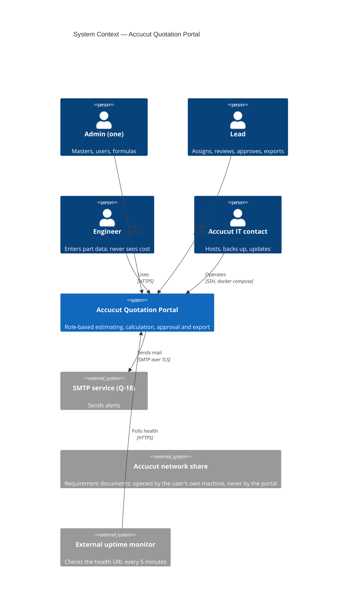
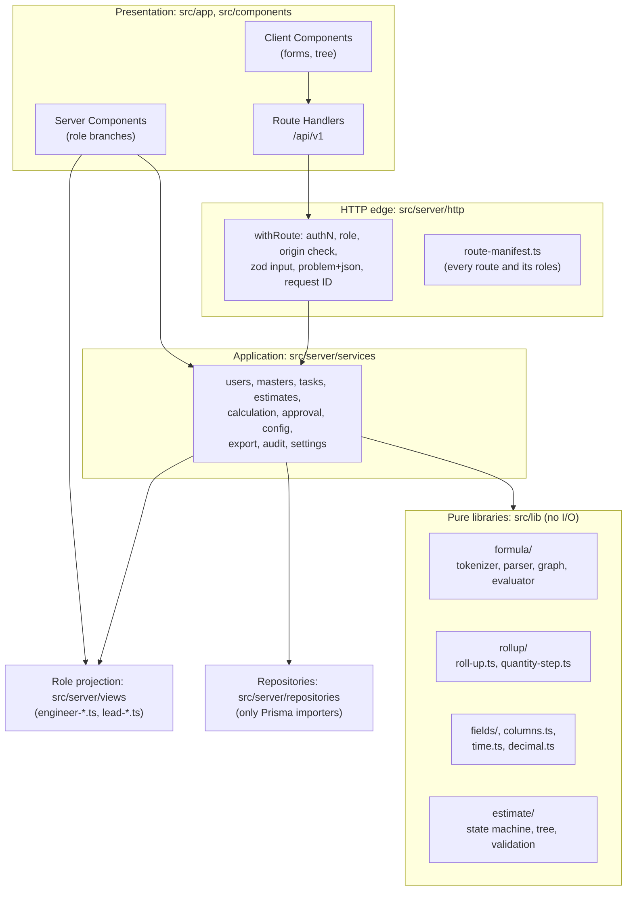
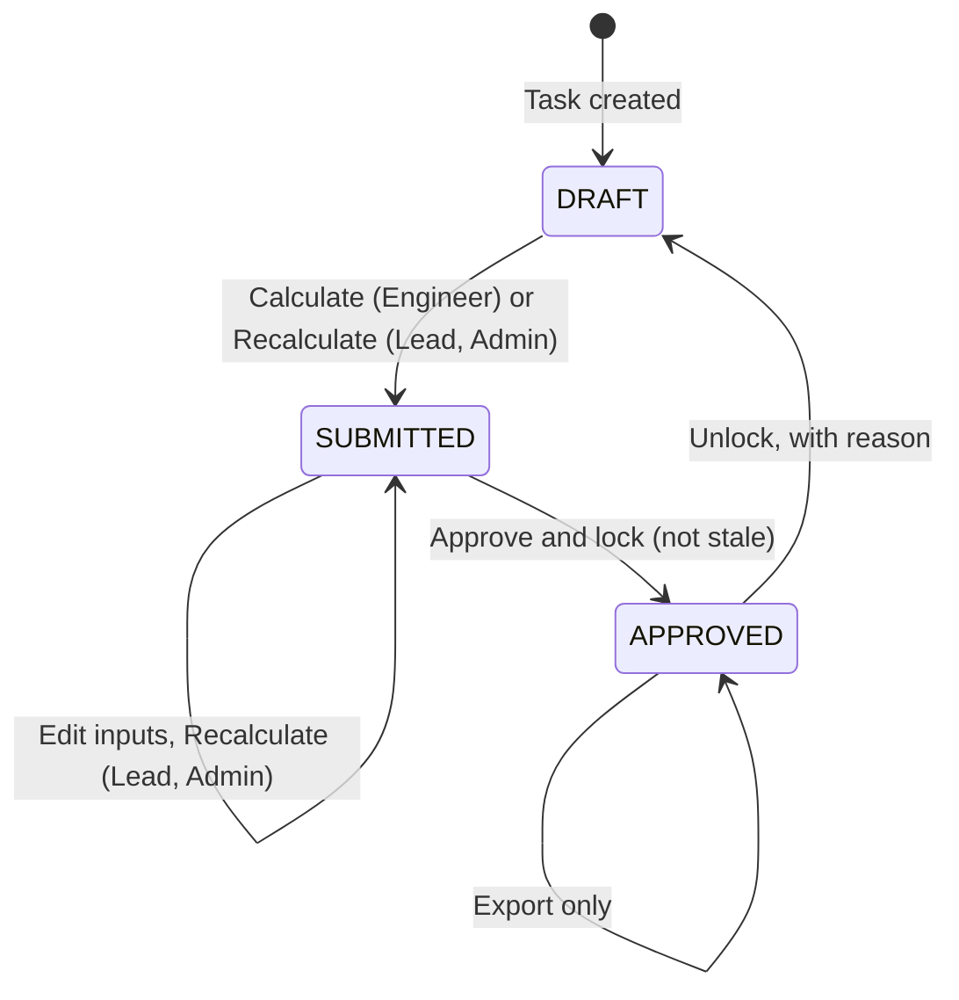
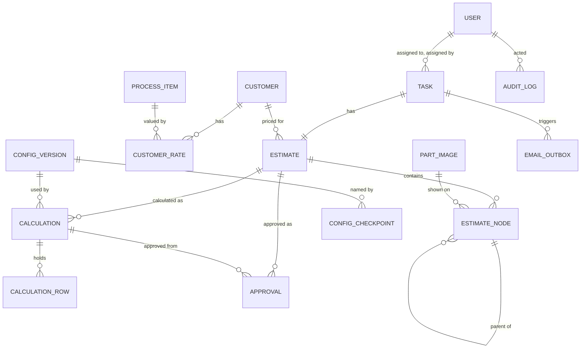

# Solution Architecture — Accucut Quotation Portal

| Field | Value |
|-------|-------|
| Version | 0.1 (G3 draft) |
| Owner | solution-architect |
| Status | In Review (G3, human approval) |
| Date | 2026-11-01 |
| Inputs | PRD v0.4; SPEC v1.3 (`ACCUCUT_QUOTATION_PORTAL_REQUIREMENTS.md`); UX spec v0.1 (reconciled in section 16); requirements catalogue v0.6; gate log G2 attempt 2; risk register; `docs/standards/` |
| Companions | `docs/04-architecture/adr/ADR-001` to `ADR-014`; `docs/04-architecture/test-strategy.md` |
| Scope | Every FR through Release 2 and every NFR (DL-004). Offline (FR-092) is not designed and not blocked (section 9.8) |

**How to read the labels.** **Evidence** = measured or read on 2026-11-01, with the source named. **A-nn** = an architecture assumption, listed in section 15 with what changes if it is wrong. **Proposed** = a value set here for an owner to confirm. Rule text comes from SPEC §7.4 and §18 D-12. Q-32 (a) is the working baseline, accepted on list wording, and still needs the delivery lead's own-words confirmation before G3 can pass (DL-006). Nothing here treats it as settled.

**G2 condition 5 at a glance.**

| Requirement of condition 5 | Where it is met |
|----------------------------|-----------------|
| One named quantity step, so a change to Q-32 (a) touches one place | `applyQuantityStep` in `src/lib/rollup/quantity-step.ts` (section 4.3, ADR-006) |
| Stored row BG kept apart from the figure displayed for a parent | `calculation_rows.outputs` against `calculation_rows.rollup`, with separate TypeScript types (section 4.3, section 5.1) |
| Constructed example from SPEC §18.5 in the test strategy | `test-strategy.md` section 5 |
| Real master data stays out of the repository; state where it is loaded from | Section 5.5, ADR-014 |

---

## 1. Architectural Drivers

**Quality attributes, ranked.** When two conflict, the higher one wins.

| Rank | Attribute | Why | Main NFRs |
|------|-----------|-----|-----------|
| 1 | Confidentiality of cost data | The product exists to keep rates and costs from Engineers. A leak cannot be recalled | NFR-001, 002, 006 |
| 2 | Correctness of prices | A wrong price is quoted to a customer. Q-32 (a) can still change | GOAL-03, NFR-026 |
| 3 | Immutability of approved work | Approved estimates must not move when anything changes (AQP-8) | NFR-026, NFR-007 |
| 4 | Changeability of the worksheet | The Admin changes fields and formulas without a developer (R2) | FR-072 to 080 |
| 5 | Operability by a small IT team | One host, one IT contact, no platform team | NFR-013, 030 |
| 6 | Performance at small scale | Under 50 users, 25 concurrent, 500 nodes | NFR-008 to 011 |

**Key functional drivers.** Server-side role projection (FR-007, 008); formula engine with no `eval` (FR-022, 023); roll-up rule D-12 (FR-029, 030); per-calculation master record (FR-031, 065); Excel export in the worksheet layout (FR-066 to 069); field insert and delete with re-lettering (FR-074, 075); immutable configuration versions (FR-077).

**Constraints.** Stack in `CLAUDE.md` §1 and SPEC §2. No `eval` (CONSTRAINT-02). Times stored in UTC and shown in IST (CONSTRAINT-03). Exactly one active Admin (CONSTRAINT-04). Images under 200 KB (CONSTRAINT-08). The repository stays public (D-13, DL-008). Secrets through environment variables only.

**Simplicity position.** One deployable codebase, three runtime containers plus an optional TLS proxy, one database. No queue broker, cache server, object store, search engine, service mesh or Kubernetes. Each moving part that remains is justified in the ADR that adds it.

---

## 2. System Context (C4 L1)



The portal never reads the network share. It stores the path as text and renders a `file:///` link plus "Copy path" (FR-033).

**Trust boundaries.**

| ID | Boundary | Crossing |
|----|----------|----------|
| TB-1 | Internet to the application | Browser and uptime monitor to the proxy and the app. Hostile by default |
| TB-2 | Engineer to cost data | Inside the app, between an authenticated Engineer and everything Restricted. This is the boundary the product exists for |
| TB-3 | Application to database | App and worker to Postgres, on a private Docker network |
| TB-4 | Application to SMTP | Worker to the mail service; message content leaves Accucut's control |
| TB-5 | Host and backups | Host filesystem, Docker volumes, off-host backup copies |
| TB-6 | Public repository and CI | Everything committed is world-readable, including CI logs (D-13) |

---

## 3. Containers (C4 L2)


| Container | Responsibility | Technology | Communicates with | Scaling approach | Owner |
|-----------|----------------|------------|-------------------|------------------|-------|
| `app` | Server-rendered pages, `/api/v1`, auth, calculation, export | Next.js 16.4 (App Router, standalone output), Node 22 | `db` (TCP 5432) | Vertical. One instance is enough (section 7, NFR-011). A second instance would need no code change: there is no in-process state that matters except the export gate | Delivery team; Accucut IT runs it |
| `worker` | Scheduled jobs and the e-mail outbox (FR-081 to 084). In R1 only a heartbeat and job log | Node 22, node-cron 4 | `db`, SMTP | Single instance. Row claims use `FOR UPDATE SKIP LOCKED`, so a second one would be safe | Delivery team; Accucut IT runs it |
| `db` | System of record, including images | PostgreSQL 17 | none | Vertical. Pool sizes: app 10, worker 3 | Accucut IT |
| `migrate` | `prisma migrate deploy`, then exit; `app` and `worker` wait for it | Prisma CLI 7.10 | `db` with the owner role | Not applicable | Delivery team |
| `proxy` | TLS, HSTS, body-size cap. **Optional Compose profile** (A-01): skipped if Accucut IT already has a TLS terminator | Caddy 2 | `app` (TCP 3000) | Not applicable | Accucut IT |

**Why each exists.** `app`, `worker` and `db` are SPEC §2 and FR-091. `migrate` keeps DDL rights out of the runtime role. `proxy` exists because NFR-003 needs Secure cookies, which need TLS, and Next.js does not terminate TLS.

**Sizing (Proposed, A-01).** One Linux VM with 2 vCPU, 4 GB RAM and 40 GB SSD. Memory limits: `app` 1.5 GB, `worker` 256 MB, `db` 1 GB. The limit on `app` covers the worst-case export (section 4.6). This has not been load tested; `test-strategy.md` section 8 confirms it on the chosen host.

---

## 4. Components (C4 L3)

### 4.1 Component map of `app`



Dependencies point inward. `src/lib` imports nothing from `src/server`, `src/app`, Prisma or Next.js. Only `src/server/repositories` imports the Prisma client. Section 10 states how this is enforced.

**Key components.**

| Component | Path | Responsibility | Key FRs |
|-----------|------|----------------|---------|
| Route wrapper | `src/server/http/with-route.ts` | The only way to declare a handler: session, role, origin check, zod parse, error mapping, request ID, `no-store` | FR-007, NFR-001, 003 |
| Route manifest | `src/server/http/route-manifest.ts` | One table of every page and API route with allowed roles. The role-matrix test iterates it, and a test fails if a route file is missing from it | FR-007 |
| Session helper | `src/server/auth/session.ts` | `requireUser()`, `requireRole()`; reads `users` on every request, so role and active flag are never taken from the token | FR-001, 004, 007 |
| Engineer views | `src/server/views/engineer-*.ts` | Allow-list projections into strict output schemas. Importing `calculation-repository` from these files fails the build | FR-008, 051, NFR-002 |
| Formula engine | `src/lib/formula/**` | Tokenizer, parser, dependency graph, evaluator, internal and display forms | FR-022, 023, 028 |
| Roll-up | `src/lib/rollup/**` | Subtree sums, item totals, the estimate total; **owns the quantity step** | FR-029, 030 |
| Calculation service | `src/server/services/calculation-service.ts` | Orchestrates one calculation in one transaction | FR-024 to 031, 055, 061 |
| Approval service | `src/server/services/approval-service.ts` | Approve, unlock, stale checks, notices | FR-062 to 065 |
| Config service | `src/server/services/config-service.ts` | New immutable version per change; checkpoints; revert | FR-072 to 080 |
| Export service | `src/server/services/export-service.ts`, `src/server/export/**` | Builds the `.xlsx` from one calculation record, in a worker thread | FR-066 to 071 |
| Masters service | `src/server/services/masters-service.ts` | Masters, customer rate sync | FR-012 to 018 |
| Audit | `src/server/services/audit-service.ts` | Appends audit rows in the caller's transaction | FR-011, NFR-007 |

### 4.2 Calculation pipeline

```mermaid
sequenceDiagram
  actor U as Engineer or Lead
  participant R as Route (withRoute)
  participant C as calculation-service
  participant DB as PostgreSQL
  participant F as lib/formula
  participant L as lib/rollup
  U->>R: POST /estimates/{id}/calculate
  R->>C: calculate(user, estimateId)
  C->>DB: BEGIN; lock estimate row
  C->>C: Check status and ownership; validate every visible input
  C->>DB: Read nodes, customer rates, used materials, exchange rates
  C->>F: Evaluate row-scope fields for each node (compiled plan)
  F-->>C: Row values (each row's own M to BK)
  C->>L: rollUp(tree, row values)
  L-->>C: Subtree figures, item totals, BL
  C->>F: Evaluate product-scope fields (BL, BN)
  C->>DB: INSERT calculations, calculation_rows; set status; COMMIT
  C-->>R: Lead or Admin: results. Engineer: status and the one message
```

The compiled plan (ordered list of parsed formulas) is cached in process by `config_versions.id`. A version is immutable, so the cache has nothing to invalidate.

### 4.3 Roll-up and the one quantity step (G2 condition 5)

**Rule in force.** SPEC §7.4 BL and §18 D-12. Baseline for (a): the item quantity multiplies once, at the top item. Own-words confirmation is pending (DL-006, RISK-002).

**Two kinds of figure, kept apart.**

| Figure | Meaning | Stored in | TypeScript type | Used by |
|--------|---------|-----------|-----------------|---------|
| Row figure | One row's own BG, BJ, BK, with its own H inside it (`BB = BA * H`) | `calculation_rows.outputs` | `RowOutputs` | Export rows; the only input to the roll-up |
| Displayed figure | Own row plus everything below it (D-12 (b3)) | `calculation_rows.rollup` | `RolledUpFigures` | Screen only (Σ figures on SCR-06, SCR-07, SCR-10) |
| Item total | Displayed figure of a top-level item, after the item quantity | `calculations.item_totals` | `ItemTotal` | The "item quantity" line on SCR-06 and the reconciliation on SCR-10 |
| BL | Sum of the item totals | `calculations.product_values` | `ProductValues` | Row 2 of the export, tiles on SCR-06 |

The two `Row`/`RolledUp` types are branded, so passing a displayed figure where a row figure is expected does not compile. The roll-up reads `outputs` and writes `rollup`; nothing reads `rollup` back into a sum. This is what stops a parent being counted twice.

**The named step.** Every use of a quantity in a roll-up passes through one function.

```ts
// src/lib/rollup/quantity-step.ts — the ONLY place Q-32 (a) lives.
export type QuantityLevel = 'top-item' | 'into-parent';

/** What a sum becomes when a quantity is applied to it. Null stays null. */
export function applyQuantityStep(
  sum: Decimal | null,
  quantity: Decimal,
  level: QuantityLevel,
): Decimal | null {
  if (sum === null) return null;
  switch (level) {
    case 'top-item':    return sum.times(quantity);   // D-12 (a): once, at the top item
    case 'into-parent': return sum;                   // D-12 (a): below the item, no multiplier
    default:            return assertNever(level);
  }
}
```

**How it is called.** `roll-up.ts` walks the tree bottom-up, without recursion, in O(n).

```text
figure(N)     = rowBG(N) + Σ over children c of carry(c)
carry(c)      = applyQuantityStep(figure(c), H(parent of c), 'into-parent')   if the parent is not a top item
carry(c)      = figure(c)                                                     if the parent is a top item
itemTotal(I)  = applyQuantityStep(figure(I), H(I), 'top-item')
BL            = Σ over top-level items of itemTotal(I)
```

Worked at the baseline, using the FR-030 example (item quantity 2 with 0 on its row; part quantity 3 with cost 1; sub-part quantity 4 with cost 1): stored BG = 0, 3, 4; `figure` = 7, 7, 4; item total = 14; BL = 14.

**If Q-32 (a) changes.** Only the `'into-parent'` branch changes, to `sum.times(quantity)`. With the same example this gives a sub-part count of 24 and BL = 30, as SPEC §18.5 predicts for the multiply-at-every-level reading. What changes and what does not:

| Item | Changes? |
|------|----------|
| `quantity-step.ts`, one branch | **Yes** |
| Expected values in `tests/unit/rollup/quantity-cases.ts` | **Yes** |
| SPEC §7.4 BL, BR-047, FR-030, GOAL-03 | Yes, by business-analyst and product-manager (G2 condition 1) |
| Database schema, migrations, API, UI structure | No |
| Row outputs (M to BK) | No: `BB = BA * H` is not touched |
| Previously approved estimates | No: they keep their stored results (FR-065). Any re-pricing is a decision for the delivery lead |

Two tests hold this to one place: only `roll-up.ts` may import `quantity-step.ts`, and `H` may reach the roll-up only as a value handed to that function (`test-strategy.md` section 5.4).

**In the formula language.** BL cannot be written as `SUM(BG)`, because SPEC §8.2 defines `SUM` as a plain sum across all nodes. A new product-scope function is added, seeded as:

```text
BL = ROLLUP(BG)
BN = BL / SUM(BM)
```

`ROLLUP(column)` calls the roll-up above with the chosen column, so BL stays visible and re-letters like any other formula (FR-075), and a change to Q-32 (a) still touches one place. `ROLLUP` is valid only in product-scope fields. Issue for product-manager: FR-022 and SPEC §8.2 should list it (section 16). SCR-06 "How the total is built" explains it in words.

**Displayed BJ and BK.** BG, BJ and BK carry a registry flag `rollupDisplay: true`. The roll-up runs once per flagged column with the same code, so no column letter is special-cased in code and re-lettering is safe. Under the baseline a parent's displayed BJ equals its displayed BG divided by the rate. Row BH and BI are not rolled up.

**Division by zero and totals (A-07).** The evaluator's value type is `Decimal | null`, where `null` means divide by zero. `null` spreads through every operator, and through `SUM` and `ROLLUP`, so a total shows "—" rather than a silently low price. The calculation never stops (FR-026). Seed formulas can only reach this through BJ, BK or BN, none of which feed BL.

### 4.4 Estimate state machine



Pure code in `src/lib/estimate/state-machine.ts`; an exhaustive `switch` with `assertNever`. Task Open or Closed is **derived** from `estimates.status`, never stored, so FR-038 holds by construction. Staleness is `estimates.inputs_revision <> calculations.inputs_revision`. Approval of a stale estimate is refused with 409 (A-04, OQ-UX-06).

### 4.5 Field registry and configuration

ADR-004. The registry is one validated JSON document per version, not rows. A change is `load latest → apply a pure edit → validate all formulas, references and cycles → insert a new version`. SPEC §8.1's `FieldDefinition` is the document's element type, with two additions: `engineerVisible` (true only for `input` fields and F; a schema rule refuses it on outputs and on I) and `rollupDisplay`. Formulas use stable references, `{{f:<fieldId>}}`, `{{rate:<rateId>}}`, `{{mat:<key>}}`, `{{fx:USD}}`. Rates use a stable ID rather than the name in SPEC's example, so a rate rename cannot break a formula.

The configuration seed comes from SPEC §7 and is committed. Header texts, widths and formats are structure read from the sample (ASSUMPTION-46). Cell values are not read and never copied.

### 4.6 Excel export

ADR-012. `export-service` loads one calculation record and streams its images in batches of 50, builds an `ExportModel`, and hands it to `src/server/export/build-workbook.ts` in a `node:worker_threads` thread, so the event loop stays free for other users. Export reads `calculation_rows.outputs`, never `rollup` (D-12 (b3)). If an estimate has no calculation yet, input columns are filled and output columns stay empty (A-05).

The decision on row-2 cells lives in one file, `src/server/export/product-cells.ts`, so Q-31 changes one file. Cell values are full-precision numbers with a two-decimal number format, so Excel's own sums reconcile with the stored values. Text goes in as strings only, so nothing an Engineer types can become a live formula.

**Measured feasibility (Evidence, 2026-11-01).** Throwaway benchmark with invented data on an Intel i7-10510U with 8 GB, Node 24, in-memory ExcelJS 4.4.0, 67 columns, one incompressible 199 KB image per row. Excludes database reads. Runs shared one process, so memory figures are upper bounds. This is not the target host and not the target Node version.

| Nodes and images | Time | File | Peak process memory |
|------------------|------|------|---------------------|
| 50 | 1.7 to 1.8 s | 9.8 MB | 178 MB |
| 200 | 7.9 s | 39 MB | 312 MB |
| 500 (validation's maximum) | 16.9 s | 97.5 MB | 528 MB |

**Outcome for RISK-010 and OQ-PM-05.** No hard limit is needed. Validation already bounds the worst case at about 100 MB, and it builds in under 20 seconds on this laptop. NFR-010's 10 s target holds comfortably at 50 nodes. The strategy is a worker thread plus a one-at-a-time gate for estimates over 100 nodes (a second such request gets 503 with `Retry-After`), and a proxy read timeout of at least 120 s. The figures also say an export of 500 nodes takes about 17 s, so the 10 s target must not be read as applying there.

### 4.7 `worker`

| Job | Schedule | Behaviour | FRs |
|-----|----------|-----------|-----|
| `heartbeat` | Every minute | Writes `job_runs`; `/api/health` reports it | NFR-024 |
| `overdue-scan` | Every minute (R2) | For open tasks past deadline, inserts an outbox row. The unique key stops repeats, so the target of 5 minutes is met with room to spare | FR-082 |
| `daily-digest` | 11:00 Asia/Kolkata, plus a catch-up at start-up if today's run is missing (R2) | Inserts one outbox row per Engineer per IST date | FR-083 |
| `outbox-send` | Every minute (R2) | Claims due rows with `SKIP LOCKED`, sends, records the result; up to 3 retries with backoff of 1, 5, 15 minutes | FR-084 |

Assignment e-mail (FR-081) is one outbox row written in the task's own transaction, so a rolled-back task sends nothing. All job logic takes `now` from a `Clock` argument so tests control time.

**Idempotency keys.** `task-assigned:<taskId>:<assignmentRevision>`, `task-overdue:<taskId>:<deadlineAtUtc>`, `digest:<engineerId>:<istDate>`. A unique index enforces them, so re-running a job sends nothing twice. A changed deadline gets a new key, so a task that becomes overdue again is reported again (A-09).

E-mails carry task details, path and deadline only. They never contain cost, rate or formula data, and the digest goes only to people who may see the task.

---

## 5. Data Architecture

### 5.1 Logical model



| Table | Key attributes | Class | Notes |
|-------|----------------|-------|-------|
| `users` | `name`, `email` (unique), `password_hash`, `role`, `is_active`, `session_version`, `must_change_password` | Confidential | Partial unique index allows one active Admin (CONSTRAINT-04) |
| `login_throttles` | `key_hash`, `failures`, `blocked_until` | Internal | Holds unknown e-mails too, so they cannot be told apart (FR-001) |
| `password_reset_tokens` | `token_hash`, `user_id`, `expires_at`, `used_at` | Confidential | R2. Hashed; single use (FR-003) |
| `process_items` | `name` (unique), `unit`, `default_value` | Restricted | |
| `customers` | `name`, `phone`, `email`, `address` | Confidential | |
| `customer_rates` | `customer_id`, `process_item_id`, `value` | Restricted | Normalised, so sync is plain SQL (FR-014) |
| `materials` | `material_in_drawing` (unique), `material_considered`, `price_per_kg`, `specific_gravity`, `scrap_rate`, `is_system` | Restricted | `is_system` marks "Not applicable" (A-03, Q-33) |
| `exchange_rates` | `currency`, `inr_value`, `updated_by`, `updated_at` | Restricted | |
| `treatments` | `name`, `is_system` | Internal | |
| `settings` | `alerts_enabled`, `sender_name`, `sender_address` | Internal | Single row. No credentials |
| `config_versions` | `number` (unique), `snapshot` JSONB, `created_by`, `reason` | Restricted | Immutable. Holds formulas |
| `config_checkpoints` | `name`, `config_version_id`, `created_by` | Restricted | |
| `task_sequences` | `year`, `last_value` | Internal | Issues `Q-<year>-<4 digits>`; year taken in IST (FR-041) |
| `tasks` | `code`, `engineer_id`, `assigned_by`, `folder_path`, `deadline_at`, `title`, `notes`, `assignment_revision` | Internal | |
| `estimates` | `task_id` (unique), `customer_id`, `status`, `inputs_revision`, `current_calculation_id` | Confidential | |
| `estimate_nodes` | `estimate_id`, `parent_id`, `sort_index`, `inputs` JSONB, `image_id`, `revision` | Confidential | Inputs only. Sl. No is derived, never stored here |
| `part_images` | `sha256`, `mime`, `bytes` bytea, `size_bytes` | Confidential | Immutable; deduplicated per estimate |
| `calculations` | `estimate_id`, `config_version_id`, `inputs_revision`, `master_snapshot` JSONB, `product_values` JSONB, `item_totals` JSONB, `created_by` | Restricted | Immutable. FR-031 |
| `calculation_rows` | `calculation_id`, `node_id`, `parent_id`, `sort_index`, `sl_no`, `inputs` JSONB, `image_id`, `outputs` JSONB, `rollup` JSONB | Restricted | Immutable. A full copy of the tree as calculated |
| `approvals` | `estimate_id`, `calculation_id`, `approved_price`, `calculated_bl`, `approved_by`, `approved_at`, `unlocked_by`, `unlocked_at`, `unlock_reason` | Restricted | BO lives here. One row per approval cycle |
| `audit_log` | `actor_id`, `event`, `object_type`, `object_id`, `before`, `after`, `request_id` | Restricted | Append-only. Admin read only |
| `email_outbox` | `idempotency_key` (unique), `event`, `to`, `cc`, `subject`, `body`, `status`, `attempts`, `next_attempt_at`, `last_error` | Internal | Is also the e-mail log (DR-013) |
| `job_runs` | `job`, `started_at`, `finished_at`, `result` | Internal | |

**Why cost data sits in its own tables.** `estimate_nodes.inputs` holds only what a person typed: I is never written there. Everything Restricted about an estimate is in `calculations`, `calculation_rows` and `approvals`, which Engineer code paths are not able to import (ADR-008). Calculated data is therefore not filtered out of an Engineer's row; it is on a different table the Engineer's code cannot reach.

**Values and precision.**
- Master values: `Decimal(18,4)` per `coding-standards.md`.
- Inputs in JSONB: decimal strings keyed by stable field ID; an absent key means blank.
- Calculated values: decimal strings at 34 significant digits, half-up rounding, in JSONB (FR-027). `Decimal(18,4)` cannot hold "full precision"; see section 16.
- JS `number` is never used for money. Export converts to a double only at the workbook boundary.

**Indexes.** `idx_estimate_nodes_estimate_id`; `idx_tasks_engineer_id_deadline_at`; `idx_tasks_assigned_by_deadline_at`; `idx_tasks_deadline_at`; `idx_estimates_status`; `idx_calculation_rows_calculation_id`; `idx_audit_log_created_at`; `idx_audit_log_actor_id`; `idx_email_outbox_status_next_attempt_at`.

**Database-level guards, added by hand-written SQL in migrations.**
- Single active Admin: `CREATE UNIQUE INDEX uq_users_single_active_admin ON users (role) WHERE role = 'ADMIN' AND is_active`.
- Triggers that raise on `UPDATE` or `DELETE` of `audit_log`, `config_versions`, `calculations` and `calculation_rows`.
- The runtime role has no DDL rights, and no `UPDATE` or `DELETE` grant on the tables above.

**Volumes (not a forecast; Q-24 gives no estimate count).** A 50-node estimate with 50 images at the size limit is about 10 MB of images, and each calculation adds roughly 1 to 2 KB per node. No archiving is designed for this size.

### 5.2 Data ownership

| Data | Owner | Writers |
|------|-------|---------|
| Users, masters, settings, configuration | Admin | `users`, `masters`, `config`, `settings` services only |
| Tasks | Lead or Admin | `task-service` |
| Inputs | Engineer, Lead, Admin | `estimate-service` |
| Calculations, approvals | System, Lead, Admin | `calculation-service`, `approval-service` |
| Audit, e-mail log | System | `audit-service`, `worker` |

### 5.3 Classification

Follows DR-001 to DR-014. **Public:** sign-in and About pages. **Internal:** task metadata, lists, job and e-mail logs. **Confidential:** personal data, customer contacts, inputs, images. **Restricted:** rates, materials, exchange rates, formulas, calculated values, approved prices, audit before and after values. Restricted data never reaches an Engineer, a log line, an e-mail, a Jira issue or the repository.

### 5.4 Retention, archival, deletion

Keep everything until a policy exists (ASSUMPTION-26, Q-26; NFR-028). Nothing is purged automatically. Calculation history is kept in full (FR-031). Application logs are kept 30 days (NFR-024). Backups are rotated per section 9.5. Two items wait for Q-26: right-to-erasure handling (a deactivated user is kept, because audit rows point to them) and a retention period. DPDP Act applicability is unverified and sits with a legal adviser (NFR-028).

### 5.5 Master data defaults: where they live (G2 condition 5, RISK-006, ADR-014)

The repository is public (D-13). The delivery lead's defaults (AQP-10) may be real, whatever the status of the sample workbook, so they are treated as Restricted and **never enter the repository**.

| Stage | Where the data is | Who controls it |
|-------|-------------------|-----------------|
| Before load | A private file outside the repository, in a place the delivery lead chooses at HOLD-01 (Proposed: Accucut-controlled storage, passed directly to the Admin or IT contact) | Santhosh |
| Loading | **Option 1 (default):** the Admin types it in on the Masters screens at first use (D-09). **Option 2:** `npm run import:masters -- --file <path>` in the `app` container, reading a file from a read-only bind mount outside the repository. The file is schema-checked and logged as an audit event with counts only | Admin or Accucut IT |
| After load | PostgreSQL in the production volume. The database is then the system of record, and the private file can be removed | Accucut IT |
| Backups | Encrypted, off-host (section 9.5) | Accucut IT |

**Never:** in `prisma/seed`, tests, fixtures, documents, Jira, GitHub, CI variables, logs or chat. Development, CI and staging use invented placeholders only, from `prisma/seed/placeholders/` (TR-002).

**Controls.** The seed script refuses to load placeholders in production and refuses to load anything else from the repository. The importer has no default path. A CI check rejects data files (`.csv`, `.xlsx`, new `.json`) outside an allow-list. Every placeholder number follows a recognisable invented pattern, and a test fails otherwise, so a pasted real value stands out. The orchestrator's HOLD-01 question must state the repository is public (G2 condition 8).

### 5.6 Migration approach

Prisma Migrate only. `prisma migrate dev` locally, `prisma migrate deploy` through the `migrate` container. Migrations are never edited after being applied. Hand-written SQL is added to generated migrations for partial indexes, triggers and grants. Changes are expand-then-contract so the previous image can still run during a rollback. DoD asks for reversible migrations; Prisma has no down migrations, so each migration with destructive effect carries a tested rollback note, and restore from backup is the fallback. No data migration from Excel (FR-096).

---

## 6. Interfaces & Integration

**Style.** JSON over HTTPS. Route Handlers under `/api/v1`. Server Components call services directly for first paint, through the same projections. **Server Actions are not used** (ADR-010), so every entry point appears in the manifest and can be tested. Roles: **A** Admin, **L** Lead, **E** Engineer; **E own** means only the Engineer's own task. Versioning: the path prefix `/api/v1`, for the portal's own client only; no external consumers in scope.

**Error model.** `application/problem+json` (RFC 9457), mapped in one place from `AppError` subclasses.

```json
{ "type": "about:blank", "title": "Inputs are missing", "status": 422,
  "code": "CALCULATE_BLOCKED", "requestId": "req-7f3a91",
  "errors": [{ "nodeId": "…", "fieldId": "…", "message": "Enter a value." }] }
```

Codes used: 400 malformed; 401 no session; 403 role refused; 404 not found, **also returned to an Engineer for another Engineer's task** so existence does not leak; 409 revision conflict, stale calculation, wrong status; 413 too large; 415 wrong image type; 422 validation; 429 throttled; 503 export gate.

**Concurrency.** `estimate_nodes.revision` on every node write; a mismatch gives 409 and the client keeps the typed values. This covers a Lead and an Engineer on one estimate and autosave races.

**Idempotency.** Nodes are created with `PUT` and a client-generated UUID, so a retry on a poor connection cannot duplicate a part. Calculate and Approve hold the estimate row lock and check status. Outbox keys are in section 4.7.

**Pagination.** `?limit=` (default 50, maximum 200) with `?cursor=` on tasks, audit and history. Master lists return all rows, as they are small.

**Rate limits.** Sign-in, password change, step-up and reset request: 5 consecutive failures block the account key for 15 minutes (NFR-003, Proposed). Per IP, 30 failures in 15 minutes. Other routes are not limited: the users are authenticated and few.

**Caching.** Every authenticated response carries `Cache-Control: private, no-store`. No Next.js data caching, `use cache` or static rendering for any role-dependent route.

| API | Method and path (`/api/v1`) | Request | Response | Errors | AuthZ | Idempotent | Rel |
|-----|-----------------------------|---------|----------|--------|-------|------------|-----|
| Sign-in, sign-out | `/api/auth/*` (next-auth) | E-mail, password | Session cookie | 401, 429 | Public | No | R1 |
| Change password | `POST /account/password` | Current, new | 204 | 401, 422, 429 | A L E | No | R1 |
| Forgot password | `POST /account/password/forgot` | E-mail | 202, always | 429 | Public | Yes | R2 |
| Reset password | `POST /account/password/reset` | Token, new | 204 | 400 | Public | Single use | R2 |
| Health | `GET /api/health` | none | `{status}` | 503 | Public; no detail | Yes | R1 |
| Current user | `GET /me` | none | Name, e-mail, role, nav, overdue count | 401 | A L E | Yes | R1 |
| Users | `GET, POST /users`; `PATCH /users/{id}` | User fields | User | 409, 422 | A | No | R1 |
| Reset user password | `POST /users/{id}/password-reset` | New temporary password | 204 | 404 | A | No | R1 |
| Hand over Admin | `POST /users/{id}/admin-handover` | Password | 204 | 403, 409 | A, step-up | No | R2 |
| Process items | `GET, POST /process-items`; `PATCH, DELETE /process-items/{id}` | Name, unit, default | Item; or 409 with formula list | 409, 422 | A | No | R1 |
| Default change | `POST /process-items/{id}/default-change` | New value | Updated count; customers that differ | 409 | A | No | R1 |
| Default choices | `POST /process-items/{id}/default-change/choices` | Apply or keep per customer | Counts | 422 | A | Yes | R1+ |
| Customers | `GET, POST /customers`; `PATCH, DELETE /customers/{id}` | Contact, rates | Customer with rates | 409, 422 | A | No | R1 |
| Reset customer | `POST /customers/{id}/reset-rates` | none | Customer | 404 | A | Yes | R1 |
| Materials | `GET, POST /materials`; `PATCH, DELETE /materials/{id}` | Material fields | Material | 409, 422 | A | No | R1 |
| Exchange rates | `GET /exchange-rates`; `PUT /exchange-rates/{currency}` | INR value | Rate, stamp | 422 | A | Yes | R1 |
| Treatments | `GET, POST /treatments`; `PATCH, DELETE /treatments/{id}` | Name | Treatment | 409 | A | No | R1 |
| Safe options | `GET /options/{customers\|materials\|treatments\|engineers}` | none | IDs and names; materials add `materialConsidered`. **No rate of any kind** | 401 | A L E (engineers: A L) | Yes | R1 |
| Tasks | `GET /tasks?tab=&assignedBy=&engineer=&customer=&from=&to=&q=` | Filters | Page of tasks | 401 | A L; E own | Yes | R1 |
| Create task | `POST /tasks` | Engineer, path, deadline, title, notes | Task and estimate | 422 | A L | No | R1 |
| Task detail | `GET /tasks/{id}` | none | Task | 404 | A L; E own | Yes | R1 |
| Change task | `PATCH /tasks/{id}` | Engineer or deadline | Task | 404, 422 | A L | No | R2 |
| Estimate form | `GET /estimates/{id}/form` | none | Sections, input fields, letters, rules | 404 | A L; E own | Yes | R1 |
| Tree | `GET /estimates/{id}/tree` | none | Nodes: ID, parent, Sl. No, label, completeness; **A L add Σ figures** | 404 | A L; E own | Yes | R1 |
| Set customer | `PUT /estimates/{id}/customer` | Customer | Estimate | 409, 422 | A L; E own, while editable | Yes | R1 |
| Node | `GET, PUT, DELETE /estimates/{id}/nodes/{nodeId}` | Parent, order | Node inputs | 404, 409 | A L; E own, while editable | Yes | R1 |
| Save inputs | `PATCH /estimates/{id}/nodes/{nodeId}/inputs` | `revision`, values by field ID | Node, revision | 409, 422 | A L; E own, while editable | Yes | R1 |
| Reorder | `POST /estimates/{id}/tree/move` | Node, new parent, index | Tree | 409, 422 | A L; E own, while editable | Yes | R1 |
| Image | `PUT, DELETE /estimates/{id}/nodes/{nodeId}/image`; `GET /images/{id}` | Multipart file | Image reference; bytes | 413, 415 | A L; E own | Yes | R1 |
| Calculate | `POST /estimates/{id}/calculate` | none | `{status, message}`, nothing else | 409, 422 | E own, DRAFT | Status guard | R1 |
| Recalculate | `POST /estimates/{id}/recalculate` | none | Costs | 409, 422 | A L | Yes | R1 |
| Costs | `GET /estimates/{id}/costs` | none | BL, BN, BO, item totals, stale flag | 404 | A L | Yes | R1 |
| Cost details | `GET /estimates/{id}/nodes/{nodeId}/costs` | none | Stages, formulas, values, the pair of figures | 404 | A L | Yes | R1 |
| Approve | `POST /estimates/{id}/approve` | `calculationId`, price | Approval | 409, 422 | A L | Status guard | R1 |
| Unlock preview | `GET /estimates/{id}/unlock-preview` | none | Config and rate changes | 409 | A L | Yes | R1 |
| Unlock | `POST /estimates/{id}/unlock` | Reason | Estimate | 409, 422 | A L | Status guard | R1 |
| Export | `GET /estimates/{id}/export` | none | `.xlsx` | 404, 503 | A L | Yes | R1 |
| Export summary | `GET /estimates/{id}/export-summary` | none | Rows, both figures, reconciliation | 404 | A L | Yes | R1 |
| Configuration | `GET /config/fields`; `GET /config/versions/{id}` | none | Fields, formulas, letters | 403 | A L | Yes | R1 read; R2 UI |
| Formula check | `POST /config/formula-check` | Text, sample node | Valid or message; preview | 422 | A | Yes | R2 |
| Save formula | `PUT /config/fields/{id}/formula` | Text, password | New version | 401, 422 | A, step-up | No | R2 |
| Insert preview | `POST /config/fields/preview` | Insert spec | Letter changes | 422 | A | Yes | R2 |
| Insert field | `POST /config/fields` | Insert spec | New version | 422 | A | No | R2 |
| Delete field | `DELETE /config/fields/{id}` | Password | New version; or 409 with formulas | 401, 409 | A, step-up | No | R2 |
| Checkpoints | `GET, POST /config/checkpoints` | Name | Checkpoint | 409 | A | No | R2 |
| Revert | `POST /config/checkpoints/{id}/revert` | Password | New version | 401 | A, step-up | No | R2 |
| Audit | `GET /audit?category=&who=&from=&to=` | Filters | Page of entries | 403 | A | Yes | R1; config R2 |
| Settings | `GET, PUT /settings` | Alerts, sender | Settings | 422 | A | Yes | R2 |
| Test e-mail | `POST /settings/test-email` | none | Result | 502 | A | No | R2 |

**Engineer-reachable routes** are only those listing E in the table. Every one has an allow-list response schema.

**Contract testing.** The zod schemas in `src/server/views/schemas` are the contract. Handlers parse their own output with `.strict()`, so an unknown key in an Engineer response is an error, and integration tests assert each route. No OpenAPI document: there is no outside consumer (add one if the offline release needs it).

**Events.** No event bus. The only asynchronous channel is `email_outbox`.

---

## 7. NFR Tactics

| NFR ID | Target | Tactic(s) | Component(s) | Verification method |
|--------|--------|-----------|--------------|---------------------|
| NFR-001 | 100 % of routes; 0 mismatches | `withRoute` is the only handler form; deny by default; page checks in the same helper; `proxy.ts` only as a coarse redirect | `server/http`, `server/auth` | Role-matrix test from the manifest; completeness test against route files |
| NFR-002 | 0 occurrences | Separate tables; Engineer views may not import cost repositories; strict output schemas; engine is `server-only`; `no-store` | `server/views`, `lib/formula` | Canary scan over every Engineer response, RSC payload, HTML and loaded chunks; build-fail import rule (`test-strategy.md` section 6) |
| NFR-003 | 100 % protected; 5 failures, 15 minutes | argon2id; encrypted HttpOnly Secure SameSite=Lax cookie; origin check on all state-changing requests; `login_throttles` | `server/auth`, `server/http` | Security tests, cookie inspection, cross-origin request test |
| NFR-004 | 3 of 3 actions | Password verified inside the service, in the same request, before the write | `config-service` | One test per action, without and with the password |
| NFR-005 | 0 wrong-type files | Own magic-byte check for four formats, size check, stored MIME, `nosniff`; React escaping; zod; no `dangerouslySetInnerHTML` | `image-service`, `lib/images` | Renamed text file, 201 KB image, polyglot; XSS payload in every text field |
| NFR-006 | 0 findings | Gitleaks in CI; data-file allow-list; placeholder pattern test; GitHub secret scanning; section 5.5 | CI | CI stages on every PR |
| NFR-007 | 100 %; 0 editable | Audit row in the same transaction; DB trigger and grants | `audit-service`, migrations | One test per event type; direct SQL `UPDATE` refused |
| NFR-008 | p95 < 2 s, 500 nodes | Compiled plan cached per version; O(n) roll-up; one read per kind; `createMany` in one transaction. **Evidence:** engine shape alone, p95 136 to 153 ms over 20 runs (500 nodes, 45 outputs, 3 operators each) on the laptop in section 4.6; leaves over 1.8 s for reads and writes | `calculation-service`, `lib/formula` | Timed test on a 500-node fixture; machine recorded |
| NFR-009 | ≤ 2 s on 5 key screens | Server Components for first paint; tree skeleton then per-node fetch; route-level code splitting; self-hosted fonts; no images from `next/image`; skeleton states | `src/app` | Lighthouse CI on the mobile preset: LCP ≤ 2 s, TBT ≤ 200 ms (definition in `test-strategy.md` section 8) |
| NFR-010 | p95 ≤ 500 ms at 25 users; export 50 nodes ≤ 10 s | Indexed queries; `select` of needed columns; bounded pool; export on a worker thread. **Feasible:** export measured at under 2 s; the 500 ms target is unmeasured, and is a reasoned estimate for small indexed queries on one host | `app`, `db` | k6 load test on staging; export timing test |
| NFR-011 | 50 users, 25 concurrent, 500 nodes; 2 × headroom | Single host is sized for 50 concurrent; pools hold; nothing scales with named users | `app`, `db` | k6 at 25 and at 50 concurrent |
| NFR-012 | 99.0 % monthly | Restart policies, health checks, restart under 1 minute, deploy with short interruption. One host is a single point of failure, and 7 h 18 min a month tolerates it | Compose, `/api/health` | External monitor every 5 minutes (section 9.4) |
| NFR-013 | RPO ≤ 24 h; RTO ≤ 4 h | Nightly `pg_dump -Fc`, encrypted, off-host; scripted restore; rehearsal | `scripts/backup`, README | Rehearsal log before go-live |
| NFR-014 | 100 % sent; 0 duplicates | Transactional outbox; unique key; 3 retries; `SKIP LOCKED`; alerts check at claim time | `worker` | Controlled-clock tests with Mailpit |
| NFR-015 | 100 % IST | One helper `lib/time.ts`; `timestamptz`; schedule in Asia/Kolkata; Indian digit grouping in a shared format helper | `lib/time.ts`, `lib/format.ts` | Unit and E2E tests, including 23:30 IST |
| NFR-016 | 0 failures | Layout per SPEC §11; containers scroll, pages do not | `src/components` | Playwright projects at all sizes |
| NFR-017 | 100 % ≥ 44 px | One button and control set with tokens | `components/ui` | Bounding-box test |
| NFR-018 | 0 AA violations | shadcn/Radix primitives; custom tree per WAI-ARIA | `src/components` | axe at three widths; manual keyboard run |
| NFR-019 | 0 blocking defects | Standard web platform only; no browser-specific APIs | `src/app` | Playwright chromium, firefox, webkit; one real phone |
| NFR-020 | 100 %; 0 hard-coded | Tailwind theme from UX tokens; ESLint rule against raw colours | `app/globals.css` | Design checklist; code search |
| NFR-021 | 100 % of states | Logo served unmodified; error tokens separate from brand red | `public/` | Hash check; contrast check |
| NFR-022 | 100 % of routes | `generateMetadata` from a static allow-list; `noindex` metadata and `X-Robots-Tag` on signed-in routes | `src/app` | Tag check test |
| NFR-023 | 1 reserved region | Grid track reserved at 1024 px and up (UX SCR-05) | `estimate-workspace` | UX review |
| NFR-024 | 100 % of injected faults | pino JSON with redaction; `withRoute` and `instrumentation.ts` `onRequestError`; `job_runs` | `lib/logger`, `worker` | Fault-injection test |
| NFR-025 | Thresholds as stated | tsconfig per standards; coverage thresholds in Vitest config; ESLint size limits | CI | CI on every PR |
| NFR-026 | 0 differing values | Immutable `calculations` and `calculation_rows`; approved screens and export read the record; triggers | `approval-service`, migrations | Approve, change everything, compare screen and bytes of export values |
| NFR-027 | 100 %; no repair prompt | ExcelJS through a tested model; widths and formats from registry | `server/export` | Read-back test plus manual open in Excel desktop |
| NFR-028 | 0 real data in tests | Data minimisation; section 5.4; Q-26 pending | repository rules | Repository scan; Q-26 answer |
| NFR-029 | English | All text in source, no i18n layer | `src/` | Inspection |
| NFR-030 | ≤ 30 minutes | One Compose file; zod-validated env with clear start-up errors; `.env.example`; no build step on the host | `docker-compose.yml`, README | Timed walk-through by someone who did not write it |

---

## 8. Security Architecture

**Authentication (ADR-009).** next-auth 4 credentials provider; JWT session strategy, encrypted, in a `__Secure-` HttpOnly, Secure, SameSite=Lax cookie; lifetime 12 hours (Proposed). The token holds only the user ID and `session_version`. **Role and active flag are read from `users` on every request**, so deactivation, role change and password change take effect at the next request. Passwords use argon2id through `@node-rs/argon2`.

**Password rule (answers OQ-UX-05, Proposed).** At least 10 characters, at most 128, no composition rule, paste allowed, refused if it equals the e-mail or is on a short common-passwords list. Argon2id parameters are set at scaffold to take about 250 ms on the host.

**First Admin.** `npm run bootstrap:admin` reads `ADMIN_EMAIL` and `ADMIN_INITIAL_PASSWORD` from the environment once, and sets `must_change_password`. The command refuses to run if an Admin exists.

**Authorisation.** Three layers, each sufficient alone:
1. Pages and handlers: `requireRole` through `withRoute`.
2. Services: ownership and status rules (`canEditEstimate(user, estimate)`).
3. Data: Engineer projections cannot reach cost repositories.

`proxy.ts` is only a redirect for signed-out users, never an authorisation control. The Next.js documentation says to verify authorisation inside each server function rather than relying on Proxy alone, which is also the lesson of the 2025 middleware bypass.

**CSRF.** On every non-GET request `withRoute` requires `Origin` to equal `APP_ORIGIN`, or `Sec-Fetch-Site: same-origin`, and a `SameSite=Lax` cookie is the second layer. Server Actions are off, so this wrapper is the single path. next-auth's own CSRF token protects sign-in.

**Secrets.** Environment variables only: `DATABASE_URL` (runtime role), `MIGRATE_DATABASE_URL` (owner role, `migrate` only), `AUTH_SECRET`, `APP_ORIGIN`, `SMTP_HOST`, `SMTP_PORT`, `SMTP_USER`, `SMTP_PASSWORD`, `ADMIN_EMAIL`, `ADMIN_INITIAL_PASSWORD`. `src/lib/env.ts` validates them at start-up with zod. `.env` on the host has mode 600 and is never committed. No `NEXT_PUBLIC_` variable holds anything sensitive. Rotation: `AUTH_SECRET` rotation signs everyone out; SMTP and DB by the IT contact.

**Encryption.** In transit: TLS 1.2 or later at the proxy, SMTP over TLS, a private Docker network to the database. At rest: full-disk encryption on the host volume (A-01), encrypted backups. Column-level encryption is not used: the key would live on the same host, so it adds little against the threats in scope.

**Input validation.** Zod at every boundary, shared by client and server. Formula text goes through the tokenizer and never reaches a dynamic execution path. Images: own signature check for PNG, JPEG, GIF and WebP, under 200 KB (A-06). The folder path is validated as a UNC or `file:` path, so a `javascript:` link is impossible. Customer text in the export file name is sanitised (answers OQ-UX-08): spaces become underscores, anything outside `A-Za-z0-9_-` is removed, at most 60 characters, fallback `Customer`.

**Security headers.** CSP with nonces (`default-src 'self'`, `frame-ancestors 'none'`, `object-src 'none'`), HSTS, `X-Content-Type-Options: nosniff`, `Referrer-Policy: same-origin`, `Permissions-Policy`. Pasted images are held as `blob:` previews, so `img-src` adds `blob:`.

**Audit logging.** Events: approval, unlock, price override, master-data edit, user changes, Admin hand-over, task reassign, configuration change, revert. Fields: who, when, object, before, after, request ID. Password hashes and tokens are never in before or after values.

**Supply chain.** `package-lock.json` committed; `npm ci` only; exact versions; Dependabot on; `npm audit --omit=dev --audit-level=high` in CI; licence allow-list in CI; base image pinned by digest; no install scripts beyond an explicit allow-list. **Never run `npm i prisma` unpinned: the `latest` tag currently points to `8.0.0-rc.29` (Evidence, npm, 2026-11-01).**

**Threat model (STRIDE).**

| Boundary | Threat | Category | Mitigation |
|----------|----------|----------|------------|
| TB-1 | Password guessing | Spoofing | Throttle, argon2id, no enumeration in messages, constant-time dummy hash |
| TB-1 | Account lock-out by a third party who knows an e-mail | Denial of service | Accepted for a 15-minute block; per-IP limit; Admin can reset; logged |
| TB-1 | Cross-site state change | Tampering | Origin check plus SameSite cookie, in the one wrapper |
| TB-1 | Stored XSS through part names or remarks | Tampering | React escaping, CSP with nonces, no raw HTML |
| TB-1 | Malicious upload | Tampering | Signature check, size cap, no SVG, `nosniff`, no server-side decode |
| TB-1 | Oversized requests, slow bodies | Denial of service | Proxy body cap, route limits, export gate |
| TB-1 | Traffic interception | Information disclosure | TLS, HSTS, Secure cookies |
| TB-2 | Engineer calls a Lead API directly | Elevation of privilege | Server role check on every route; role-matrix test |
| TB-2 | Calculated value slips into an Engineer payload (RSC props, debug field) | Information disclosure | Separate tables, import rule, strict schemas, canary scan |
| TB-2 | Engineer infers a cost from timing, status or errors | Information disclosure | One fixed message; no number in any error; Calculate is the same call whatever the result |
| TB-2 | Engineer opens another Engineer's task | Information disclosure | Ownership in the service; 404, not 403 |
| TB-2 | Engineer changes a submitted or approved estimate | Tampering | State machine in the service, under the row lock |
| TB-2 | Formula text in a client bundle | Information disclosure | `server-only` engine; formulas only in the DB; bundle scan |
| TB-2 | Lead denies an approval or override | Repudiation | Append-only audit, same transaction, trigger |
| TB-3 | SQL injection | Tampering | Prisma parameterised queries; raw SQL reviewed and limited to migrations and locks |
| TB-3 | Compromised app rewrites history | Tampering | Runtime role has no UPDATE or DELETE on immutable tables, plus triggers |
| TB-3 | Database exposed to the network | Information disclosure | No published port; private network only |
| TB-4 | Header injection, malicious recipients | Tampering | Nodemailer 10.3.1 or later; recipients from `users` only; values never in raw headers |
| TB-4 | Cost data in mail | Information disclosure | Templates accept a fixed DTO with no cost field; test asserts it |
| TB-4 | SMTP credentials stolen | Spoofing | Env only; mailbox with send rights only |
| TB-5 | Stolen backup or disk | Information disclosure | Encrypted backups, disk encryption, limited host access |
| TB-5 | Host compromise | Elevation of privilege | Non-root containers, read-only root filesystem where possible, patched host, no public Docker socket |
| TB-6 | Secret committed | Information disclosure | Gitleaks, GitHub scanning, env-only rule |
| TB-6 | Real master data committed | Information disclosure | Section 5.5, ADR-014 |
| TB-6 | Malicious pull request runs in CI | Elevation of privilege | CI has no production secrets; fork PRs get no secrets; `pull_request`, not `pull_request_target` |
| TB-6 | Compromised dependency | Tampering | Lockfile, `npm ci`, Dependabot, audit, install-script allow-list |

**Accepted residual exposure.** The formulas are public through the SPEC and the sample workbook, and the delivery lead accepted that (D-13, RISK-006). Formula secrecy against Engineers still matters in the product, but anyone who reads this repository can see the seed formulas. The rates are what must stay private.

---

## 9. Operational Architecture

### 9.1 Environments

| Environment | Purpose | Data | Runs on |
|-------------|---------|------|---------|
| Local | Development | Invented placeholders | Docker Postgres plus `next dev` |
| CI | Automated checks | Invented placeholders | GitHub-hosted runners, Postgres service |
| Staging | Load test, restore rehearsal, walk-through | Invented placeholders only | Same Compose file, separate project (A-01) |
| Production | Live | Real | Accucut's host (Q-18) |

### 9.2 CI/CD

No workflow exists yet. `.github/workflows/ci.yml` is added in the scaffold story. Stages are in `test-strategy.md` section 10. The image is built once per merge, tagged with the commit SHA and pushed to GitHub Container Registry. **It is a public package from a public repository unless set private, so it must contain no data, only code** (it does). Deploy is `docker compose pull && docker compose up -d`, run by the IT contact. No automatic production deploy: production changes need explicit authorisation.

Base branch `master`. Code PRs merge by a human after CI passes (`MERGE_POLICY`).

### 9.3 Infrastructure as code

`docker-compose.yml`, `Dockerfile`, `Caddyfile`, `.env.example`, all versioned. The host itself is documented in the README, not provisioned by code: one VM does not justify Terraform.

**`.gitignore` defect to fix in the scaffold story.** Line 6 (`.env.*`) ignores `.env.example` (verified with `git check-ignore`). FR-091 and NFR-030 need that file committed, so add `!.env.example`. The developer owns this; it is outside this agent's write area.

### 9.4 Observability

- **Logs.** pino JSON to stdout with a request ID and user ID; redaction of cookies, authorisation headers, passwords, `inputs`, `outputs` and rates. Docker `journald` driver, host retention set to 30 days (NFR-024).
- **Metrics and traces.** Not built. A metrics stack for one host and 25 users would be the largest thing in the system. `job_runs`, logs and the uptime monitor cover the alerts below. Revisit if incidents show a gap.
- **Health.** `GET /api/health` returns 200 only if the database answers and the last heartbeat is under 3 minutes old, and reveals nothing else.
- **SLO.** 99.0 % monthly availability (NFR-012, Proposed).
- **Uptime monitor (chosen at G3 as NFR-012 asks).** UptimeRobot, 5-minute HTTP check on `/api/health`, with alerts to the IT contact. Sources disagree on whether the free plan allows business use, so Accucut IT must check the current terms, or use the paid plan (A-02). Any 5-minute external HTTP monitor meets the NFR, so this choice is cheap to reverse.
- **Alerts.** Health down (monitor); outbox `failed` rows (surfaced on Settings in R2, and logged at `error`).

### 9.5 Backup, restore and DR

| Item | Design |
|------|--------|
| Backup | Host cron runs `scripts/backup.sh` nightly: `pg_dump -Fc` through the `db` container, encrypted with `age`, copied off the host (A-01) |
| Rotation | Proposed: 14 daily, 8 weekly. Subject to Q-26 |
| Restore | `scripts/restore.sh` documented step by step |
| RPO | ≤ 24 h, from the nightly dump (NFR-013) |
| RTO | ≤ 4 h: new VM, Docker, pull image, restore, DNS |
| Rehearsal | Once before go-live, on staging (NFR-013) |
| Scope | The database holds everything, including images. Only `.env` and the Caddy data volume are outside it; the IT contact keeps a sealed copy of `.env` |

Backups contain Restricted data, so they are encrypted before leaving the host. The key is held away from the backup target, by the IT contact.

### 9.6 Feature flags

Two environment flags, `FEATURE_CONFIG_EDITOR` and `FEATURE_EMAIL`, gate R2 surfaces so that the interim hand-over stays possible whichever way Q-34 goes. They are removed once R2 ships. There is no flag service. The Email alerts setting (FR-019) is product behaviour, not a feature flag.

### 9.7 Release and rollback

1. Take a backup.
2. `docker compose pull`, then `up -d`; `migrate` runs first.
3. Check health and sign-in.

Rollback: set the previous image tag and `up -d`. Expand-then-contract migrations keep that safe. If a migration cannot be reversed, restore from the backup taken in step 1. Expected interruption is under a minute (NFR-012 allows for it).

### 9.8 Offline release (FR-092): not designed, not blocked

Nothing is built for offline and no room is reserved beyond what costs nothing (RISK-004). These choices were made for other reasons and leave the door open:

- `src/lib/formula` and `src/lib/rollup` are pure TypeScript with no I/O.
- Node IDs are client-generated UUIDs and writes carry a revision, which suits a client that syncs later.
- Compose runs on any machine with Docker, so a full local copy stays possible.

What would conflict: a local copy would place rates on a machine (BRQ-002, RISK-004). `server-only` on the engine stays until that release settles what offline means.

---

## 10. Source Tree & Conventions

```text
.
├── docker-compose.yml, Dockerfile, Caddyfile, .env.example
├── prisma.config.ts
├── prisma/
│   ├── schema.prisma
│   ├── migrations/
│   └── seed/
│       ├── config/          SPEC §7 field registry. Structure only, committed
│       └── placeholders/    Invented masters for dev, CI, staging. Never real data
├── public/                  Logo, fonts
├── scripts/                 backup.sh, restore.sh, bootstrap-admin.ts, import-masters.ts
├── src/
│   ├── app/                 Next.js routes only; thin
│   │   ├── (public)/        sign-in, reset
│   │   ├── (portal)/        tasks, estimates/[id], masters/*, config/*, users, settings, audit, about, account
│   │   └── api/             api/v1/**, api/auth/[...nextauth], api/health
│   ├── components/
│   │   ├── ui/              shadcn/ui, generated source
│   │   ├── shared/          Header, nav, money, column tag, states
│   │   └── features/        estimate-workspace, estimate-review, tree, queues, masters, config
│   ├── lib/                 Pure code: no I/O, no Next.js, no Prisma
│   │   ├── formula/         tokenizer, parser, ast, graph, evaluator, internal-form
│   │   ├── rollup/          roll-up.ts, quantity-step.ts
│   │   ├── estimate/        state-machine, tree, validation, completeness
│   │   ├── fields/          registry types, config edits, visibility rules
│   │   ├── images/          signature check
│   │   ├── columns.ts       indexToColumnLetter, columnLetterToIndex
│   │   ├── time.ts          UTC and Asia/Kolkata
│   │   ├── decimal.ts       Configured Decimal
│   │   ├── format.ts        Money, numbers, "—"
│   │   └── env.ts, logger.ts, errors.ts
│   ├── server/
│   │   ├── auth/            next-auth options, session helpers
│   │   ├── http/            with-route, route-manifest, problem, origin check
│   │   ├── services/        Use cases; own transactions
│   │   ├── repositories/    Only Prisma importers
│   │   ├── views/           Role projections, schemas
│   │   ├── export/          Build workbook, product-cells, worker thread
│   │   ├── mail/            Templates, transport
│   │   └── jobs/            Job logic; used by the worker
│   └── worker/main.ts       node-cron entry point
├── tests/
│   ├── unit/                Mirrors src/lib
│   ├── integration/         Services, routes, real Postgres
│   ├── acceptance/          SPEC §14 items
│   ├── e2e/                 Playwright
│   ├── security/            Role matrix, canary scan
│   ├── perf/                k6, 500-node timing
│   └── support/             Builders, invented fixtures
└── docs/
```

Tests stay under `tests/e2e/` rather than the template's `e2e/`, so that one write area covers them.

**Layering rules.**

| Rule | Enforced by |
|------|-------------|
| `src/lib/**` imports nothing from `src/server`, `src/app`, `src/components`, Prisma or `next/*` | ESLint `no-restricted-imports` |
| Only `src/server/repositories/**` imports the Prisma client | ESLint |
| `src/server/views/engineer-*.ts` and Engineer pages may not import cost repositories, `lib/formula` or `lib/rollup` | ESLint, build failure |
| `src/lib/formula/**` and `src/lib/rollup/**` start with `import 'server-only'` | Build error if a client component imports them |
| Only `src/lib/rollup/roll-up.ts` imports `quantity-step.ts` | Architecture test |
| Every route file uses `withRoute` and is in the manifest | Architecture test |
| No business logic in `src/app` or `src/components` | Review |
| No `eval`, `new Function` or dynamic `import` of user input | ESLint, code search |
| No Server Actions (`'use server'` is forbidden) | ESLint, code search |
| No shared logic is duplicated: reusable UI lives in `components/shared` | Review |

**Naming.** Files in `kebab-case`, variables and functions in `camelCase`, types in `PascalCase`, constants in `UPPER_SNAKE_CASE`. Prisma models singular `PascalCase`, tables plural `snake_case`. These fill the placeholder in `coding-standards.md` §2.

**Next.js settings.** `output: 'standalone'`; `images.unoptimized: true`, because part images are already under 200 KB and the optimiser adds `sharp`; `serverExternalPackages: ['exceljs', '@node-rs/argon2']`; `poweredByHeader: false`.

---

## 11. Technology Stack

Versions are the current stable releases on npm on 2026-11-01. `next-auth@4` and the override below are this document's decisions; the rest follow `CLAUDE.md` §1.

| Layer | Choice | Version | Rationale | Licence | ADR |
|-------|--------|---------|-----------|---------|-----|
| Language | TypeScript, strict | 5.9.x | Project standard; Prisma recommends 5.9 | Apache-2.0 | ADR-001 |
| Runtime | Node.js LTS | 22.x (at least 22.12, for Vitest) | Project standard | MIT | ADR-001 |
| Framework | Next.js, App Router | 16.4.3 | Project standard | MIT | ADR-001 |
| UI runtime | React | 19.3.1 | With Next.js | MIT | ADR-001 |
| Styling | Tailwind CSS | 4.3.3 | Project standard | MIT | ADR-001 |
| Components | shadcn/ui, radix-ui | radix-ui 1.8.1 | Project standard. Copied source; primitives give accessibility. Sub-dependencies (`sonner`, `cmdk`, `react-day-picker`, `react-resizable-panels`) pinned at scaffold | MIT | ADR-001 |
| Icons | lucide-react | 1.66.0 | Project standard | ISC | ADR-001 |
| Forms | react-hook-form, zod | 7.91.0, 4.6.7 | Shared client and server schemas | MIT | ADR-010 |
| Database | PostgreSQL | 17 (pinned by digest at scaffold) | Project standard; JSONB, partial indexes, triggers | PostgreSQL | ADR-003 |
| ORM | Prisma, `@prisma/client`, `@prisma/adapter-pg`, `pg` | 7.10.1, 7.10.1, 8.23.1 | Project standard. Prisma 7 needs the driver adapter and `prisma.config.ts` | Apache-2.0; MIT for `pg` | ADR-003 |
| Auth | next-auth (Auth.js project) | 4.24.15 | Stable line; v5 is still beta | ISC | ADR-009 |
| Passwords | @node-rs/argon2 | 2.2.2 | Argon2id with prebuilt binaries | MIT | ADR-009 |
| Decimal | decimal.js | 10.6.0 | No floats for money | MIT | ADR-005 |
| Excel | ExcelJS | 4.4.0 | Project standard. Last stable release 2023; see risks | MIT | ADR-012 |
| E-mail | Nodemailer | 10.3.1 (at least 10.1.4) | Project standard. Earlier lines have high advisories | MIT-0 | ADR-011 |
| Scheduler | node-cron | 4.6.0 | Time-zone aware cron, no broker | ISC | ADR-011 |
| Logging | pino | 10.4.0 | JSON logs, redaction | MIT | ADR-001 |
| TLS proxy | Caddy | 2.x | Automatic certificates, one small config file | Apache-2.0 | ADR-002 |
| Tests | Vitest, Playwright, axe, Lighthouse CI | 5.0.5, 1.64.1, 4.14.0, 0.15.1 | Project standard; all dev only | MIT; Apache-2.0; MPL-2.0; Apache-2.0 | Test strategy |
| Load test | k6 binary | Pinned at scaffold | Dev tool, not linked or shipped | AGPL-3.0 (tool use only) | Test strategy |
| Mail in tests | Mailpit | Pinned at scaffold | Capturing mail server | MIT | Test strategy |
| Secret scan | Gitleaks CLI | Pinned at scaffold | Runs in CI | MIT | ADR-014 |

**Required override.** `next-auth` declares an optional peer on `nodemailer@^7`. The v5 beta has the same problem at `^7 || ^8`. Next-auth uses it only for its e-mail sign-in provider, which is never loaded here, but npm still refuses the install (ERESOLVE, verified). Downgrading to satisfy it would bring in high-severity advisories (verified). So `package.json` carries:

```json
"overrides": { "next-auth": { "nodemailer": "$nodemailer" } }
```

`--legacy-peer-deps` and `--force` are not used.

**Dependency check (Evidence, 2026-11-01).** Full set resolved with `npm i --package-lock-only`, then `npm audit --omit=dev`.

| Severity | Count | Detail |
|----------|-------|--------|
| Critical | 0 | |
| High | 0 | With Nodemailer 10.3.1 and the override. With Nodemailer 7.0.13 there are 2 high entries |
| Moderate | 9 | All through `exceljs` (`archiver`, `glob`, `minimatch`, `uuid` and their parents). The two advisories concern glob patterns and a `uuid` buffer argument. Export passes neither user-controlled glob patterns nor a buffer to `uuid`, so reachability is judged low; this is a reading, not a proof. Tracked in the issue for `TD-01` |

| Licence finding | Package | Position |
|-----------------|---------|----------|
| LGPL-3.0-or-later | `@img/sharp-libvips-*` (optional dependency of `next`, through `sharp`) | Not used at runtime with `images.unoptimized`. Unmodified prebuilt binaries if installed. CI allow-list exception; legal view not verified |
| EPL-2.0 | `elkjs` (through `@prisma/studio-core`) | Development tooling route; confirm it is not in the runtime image at scaffold |
| Dual MIT or GPL-3.0 | `jszip` (through `exceljs`) | MIT elected |
| Not stated in the lockfile | `buffers` (through `exceljs`) | Check at scaffold |

**Rejected on the way.** `file-type`: a signature check for four formats is a few lines and needs no dependency. `pg-boss`, BullMQ: see ADR-011. `@dnd-kit`, `react-arborist`: UX needs no drag (SCR-05), and the tree is custom per UX §7.5. `@tanstack/react-virtual`: added only if the 500-node test shows a need, as virtualising conflicts with `role="tree"` keyboard handling.

---

## 12. Coverage Matrix

Component shorthand: **Auth** `server/auth`; **Http** `server/http`; **Views** `server/views`; **Users, Masters, Tasks, Estimates, Calc, Approval, Config, Export, Images, Audit, Settings** the matching services; **Formula** `lib/formula`; **Rollup** `lib/rollup`; **EstLib** `lib/estimate`; **Fields** `lib/fields`; **Time** `lib/time.ts`; **Jobs** `server/jobs` and `worker`; **Mail** `server/mail`; **UI** `src/components` and `src/app`; **Ops** Compose, scripts, README.

| Requirement (FR/NFR) | Component(s) | Notes |
|----------------------|--------------|-------|
| FR-001 | Auth, UI | Section 8; no message says which part was wrong |
| FR-002 | Auth, UI | `session_version` bump signs out other sessions |
| FR-003 | Auth, Mail, Jobs | R2; hashed single-use token |
| FR-004 | Users, Auth | Deactivated user refused at next request |
| FR-005 | Users, migrations | Partial unique index |
| FR-006 | Users, Audit | R2; one transaction, demote first |
| FR-007 | Http, Auth | Route manifest |
| FR-008 | Views, Estimates | ADR-008 |
| FR-009 | UI, Http | Nav built from the manifest per role |
| FR-010 | UI | Static page |
| FR-011 | Audit | Same transaction; append-only |
| FR-012 | Masters, Config | Used-by check against the latest version |
| FR-013 | Masters | |
| FR-014 | Masters | R1+; sync in one transaction |
| FR-015 | Masters, Views | Options expose name and Material Considered only |
| FR-016 | Masters | Values feed BH and BI |
| FR-017 | Masters | `is_system` protects "Other" |
| FR-018 | Masters, seed | `is_system` rows; A-03 |
| FR-019 | Settings, Mail | R2 |
| FR-020 | Fields, seed | ADR-004 |
| FR-021 | `lib/columns.ts` | Derived, never stored |
| FR-022 | Formula | Adds `ROLLUP` (section 16) |
| FR-023 | Formula, Config | Kahn's algorithm; reports the cycle |
| FR-024 | Formula, Calc | Section 4.2 |
| FR-025 | Formula, Rollup, Calc | BL and BN are product-scope formulas |
| FR-026 | Formula, `lib/format.ts`, Export | `null` value type; A-07 |
| FR-027 | Calc, Formula | 34 digits; section 5.1 |
| FR-028 | Formula | Rate resolver divides by 100 in one place |
| FR-029 | Rollup, Views | Section 4.3 |
| FR-030 | Rollup | `applyQuantityStep`; section 4.3 |
| FR-031 | Calc | `master_snapshot` |
| FR-032 | Tasks | One transaction with the empty estimate |
| FR-033 | UI, Tasks | Path validated; copy button |
| FR-034 | Tasks, Views | Derived tabs |
| FR-035 | Tasks, UI | R1+ |
| FR-036 | UI, Time | |
| FR-037 | Tasks, UI | Count query per role |
| FR-038 | Tasks, Approval | Derived from estimate status |
| FR-039 | Tasks, UI | R1+ |
| FR-040 | Tasks, Audit | R2; `assignment_revision` |
| FR-041 | Tasks | `task_sequences` |
| FR-042 | Estimates, UI | `PUT /customer` |
| FR-043 | Estimates, EstLib, UI | Adjacency list |
| FR-044 | EstLib | Derived on read |
| FR-045 | UI, Views | Form DTO from the registry |
| FR-046 | UI | SCR-05 interaction |
| FR-047 | Images, UI | A-06 |
| FR-048 | Fields, EstLib, UI | `visibleWhen`; same rule on both sides |
| FR-049 | UI, Estimates | Flags stored as 1 or 0 |
| FR-050 | UI, Estimates | `select_other` |
| FR-051 | Views, UI | F allowed by `engineerVisible`; I never written to inputs |
| FR-052 | Fields, UI | Shared zod rule |
| FR-053 | Estimates, UI | Partial PATCH accepted |
| FR-054 | UI, Estimates | R1+; same PATCH; revision guard |
| FR-055 | Calc, EstLib, Views | Fixed response for Engineers |
| FR-056 | EstLib, Formula | 0 is a value; blank is not |
| FR-057 | EstLib, UI | R1+; completeness in the tree DTO |
| FR-058 | Views, UI | Lead view only |
| FR-059 | Views, UI | Generic `hideWhenZero` |
| FR-060 | Views, UI | No edit controls; server refuses writes |
| FR-061 | Calc, Estimates | Stale flag from `inputs_revision` |
| FR-062 | Approval, Audit | Override when price differs from BL |
| FR-063 | Approval | Unlock preview; recalculation reads current masters |
| FR-064 | EstLib, Estimates | State machine |
| FR-065 | Calc, Approval, migrations | Immutable record; ADR-007 |
| FR-066 | Export, Fields | Widths and formats from the registry |
| FR-067 | Export | Depth-first from the record; Sl. No as text; images in column C |
| FR-068 | Export | All columns; `null` is an empty cell |
| FR-069 | Export | `product-cells.ts`; Q-31 |
| FR-070 | Http, Export | L and A only |
| FR-071 | Export | Sanitised customer name |
| FR-072 | Config, UI | R2 |
| FR-073 | Config, Formula, UI | R2; server check per pause |
| FR-074 | Config, Fields, UI | R2; a pure edit |
| FR-075 | Fields, `lib/columns.ts`, Export | R2; follows from IDs |
| FR-076 | Config | R2; reference index |
| FR-077 | Config, Calc | R2; versioning exists from R1 |
| FR-078 | Config | R2; revert writes a new version |
| FR-079 | Audit, UI | R2; SCR-16 |
| FR-080 | Config, Auth | R2; password in the same request |
| FR-081 | Tasks, Jobs, Mail | R2; outbox |
| FR-082 | Jobs, Mail | R2; one-minute scan |
| FR-083 | Jobs, Mail | R2; catch-up at start |
| FR-084 | Jobs | R2; unique key; 3 retries |
| FR-085 | UI | SPEC §11; UX section 6 |
| FR-086 | UI | UX section 7 tokens |
| FR-087 | UI | Grid track, SCR-05 |
| FR-088 | UI | R1+; UX section 6.0 |
| FR-089 | UI | Metadata allow-list |
| FR-090 | UI | R3; tokens are named so a dark set can be added |
| FR-091 | Ops | Section 9 |
| FR-092 | None, by design | R-OFF; section 9.8 |
| FR-093 | None, by design | Won't; room reserved by FR-087 |
| FR-094 | None, by design | Won't |
| FR-095 | None, by design | Won't; UX OQ-UX-01 asks again. If reopened, it is client-side only: no schema change |
| FR-096 | None, by design | Won't |
| FR-097 | UI, Tasks | R3; ranking only |
| NFR-001 | Http, Auth | Section 7 |
| NFR-002 | Views, Formula | Section 7, ADR-008 |
| NFR-003 | Auth, Http | Section 8 |
| NFR-004 | Config, Auth | R2 |
| NFR-005 | Images | Section 8 |
| NFR-006 | CI, repository rules | ADR-014 |
| NFR-007 | Audit, migrations | Section 8 |
| NFR-008 | Calc, Formula, Rollup | Measured headroom, section 7 |
| NFR-009 | UI | Section 7 |
| NFR-010 | App, db, Export | Section 7 |
| NFR-011 | Ops | Section 3 sizing |
| NFR-012 | Ops | Section 9.4 |
| NFR-013 | Ops | Section 9.5 |
| NFR-014 | Jobs, Mail | R2; ADR-011 |
| NFR-015 | Time, `lib/format.ts` | |
| NFR-016 | UI | |
| NFR-017 | UI | |
| NFR-018 | UI | Gate stays WCAG 2.1 AA unless the PRD changes (UX C-4) |
| NFR-019 | UI | |
| NFR-020 | UI | |
| NFR-021 | UI | |
| NFR-022 | UI | |
| NFR-023 | UI | |
| NFR-024 | `lib/logger`, Jobs | Section 9.4 |
| NFR-025 | CI | |
| NFR-026 | Calc, Approval, migrations | ADR-007 |
| NFR-027 | Export | ADR-012 |
| NFR-028 | Repository rules | Q-26 open |
| NFR-029 | UI | |
| NFR-030 | Ops | |

---

## 13. Architecture Decisions

All are **Proposed** until G3 human approval.

| ADR | Title | Status |
|-----|-------|--------|
| [ADR-001](adr/ADR-001-modular-monolith-on-nextjs.md) | Modular monolith on Next.js with a separate worker | Proposed |
| [ADR-002](adr/ADR-002-single-host-docker-compose.md) | Single-host Docker Compose deployment | Proposed |
| [ADR-003](adr/ADR-003-postgresql-prisma-jsonb-inputs.md) | PostgreSQL and Prisma, with JSONB for configurable values | Proposed |
| [ADR-004](adr/ADR-004-registry-as-versioned-document.md) | Field registry as an immutable versioned document | Proposed |
| [ADR-005](adr/ADR-005-custom-formula-engine.md) | Custom formula engine on decimal.js | Proposed |
| [ADR-006](adr/ADR-006-rollup-and-quantity-step.md) | Cost roll-up and one named quantity step | Proposed |
| [ADR-007](adr/ADR-007-immutable-calculation-records.md) | Immutable calculation records | Proposed |
| [ADR-008](adr/ADR-008-server-side-role-projection.md) | Cost confidentiality by server-side role projection | Proposed |
| [ADR-009](adr/ADR-009-authentication-and-sessions.md) | Authentication and sessions | Proposed |
| [ADR-010](adr/ADR-010-route-handlers-no-server-actions.md) | Route Handlers, one wrapper, no Server Actions | Proposed |
| [ADR-011](adr/ADR-011-worker-and-email-outbox.md) | Worker with node-cron and a Postgres e-mail outbox | Proposed |
| [ADR-012](adr/ADR-012-excel-export.md) | Excel export with ExcelJS on a worker thread | Proposed |
| [ADR-013](adr/ADR-013-images-in-postgres.md) | Part images in PostgreSQL | Proposed |
| [ADR-014](adr/ADR-014-master-data-outside-repository.md) | Master data outside the public repository | Proposed |

---

## 14. Technical Risks & Debt

The IDs below are proposals. `master` owns the register and assigns `RISK-nnn` numbers. RISK-002, 004, 006 and 010 are existing register entries. GitHub issues: TD-01 to TD-05 are #2 to #6; ARCH-R1, R2 and R3 are #7, #8 and #9; ARCH-R4 is #10.

| Risk / debt | Impact | Mitigation | Addressed by (epic/story) |
|-------------|--------|------------|---------------------------|
| RISK-002 (existing): Q-32 (a) may differ from D-12, and no test can catch a wrong rule | Multi-level products mispriced | One quantity step; own-words confirmation before G3 passes (DL-006). Tests prove the code matches the rule, not that the rule is right | EPIC-03; delivery lead |
| RISK-006 (existing): real data reaching the public repository | Rates exposed | Section 5.5, ADR-014, CI checks | EPIC-10 (scaffold), HOLD-01 |
| RISK-010 (existing): export size. **Proposed for closure at G3** | Slow export | Bounded at about 100 MB, measured at 16.9 s, worker thread and gate. No hard limit needed | EPIC-07 |
| RISK-004 (existing): meaning of offline | Conflict with BRQ-002 | Section 9.8 | EPIC-12 |
| ARCH-R1: single host is a single point of failure | Outage up to the RTO | Accepted at 99.0 %; backups, restore rehearsal | EPIC-10 |
| ARCH-R2: a calculated value leaks through a new route or a passed prop | Breach of the main promise | Defence in layers, canary scan on every build | EPIC-01, 05 |
| ARCH-R3: hosting details (Q-18) change the proxy, backup or SMTP design | Rework of configuration, not of code | Everything is environment-driven; TLS proxy is optional | EPIC-10 |
| ARCH-R4: Next.js, React and Prisma all on recent majors; patch churn | Security patches arrive often | Dependabot, pinned versions, full suite on every update | EPIC-10 |
| TD-01: ExcelJS has had no stable release since 2023 and has 9 moderate transitive advisories | Future breakage; a patch may not come | Pin; isolated behind `build-workbook.ts`; read-back tests allow a swap; `overrides` if needed | EPIC-07 |
| TD-02: next-auth 4 is the older line, and needs a nodemailer override | Migration later if v4 support ends | Used narrowly, behind `session.ts`. Review at each release | EPIC-01 |
| TD-03: no retention rule for calculations, audit before and after values, or images | Data grows without limit; unresolved Q-26 | Monitor size; decide with Q-26 | After Q-26 |
| TD-04: no metrics or tracing | Slower diagnosis | Logs and request IDs; revisit after incidents | Later |
| TD-05: `.gitignore` ignores `.env.example` | FR-091 file silently not committed | Fix in the scaffold story (section 9.3) | EPIC-10 |

---

## 15. Open Questions and Assumptions

### 15.1 Assumptions made here

| ID | Assumption | Blocks? | If wrong |
|----|------------|---------|----------|
| A-01 | Q-18 hosting: one Linux VM with Docker, a public DNS name, Accucut IT as operator, disk encryption, an off-host backup target. The site is reachable from the internet, behind sign-in | No | Proxy, backup target and runbook change; no code change. A VPN-only site removes the proxy's public role. Managed Postgres changes the Compose file and backups only |
| A-02 | Q-18 e-mail: an SMTP service over TLS, supplied later; Mailpit until then. UptimeRobot's terms are confirmed by the IT contact | No | Settings only |
| A-03 | Q-33, ASSUMPTION-49: "Not applicable" rows are system-created, all rates 0, locked | No | A seed change and the `is_system` guard |
| A-04 | OQ-UX-06: Approve is refused when stale or never calculated | No | One guard in `approval-service` |
| A-05 | A never-calculated estimate exports inputs with empty outputs, reading FR-070 "at any status" literally. SCR-10's "Nothing to export yet" applies only to an estimate with no parts | No | One branch in `export-service` |
| A-06 | "200 KB" means 200 × 1024 bytes, strictly below (FR-047). The test files are 199 × 1024 and 201 × 1024 bytes | No | One constant |
| A-07 | `null` from a zero divisor spreads into totals, so a total shows "—" instead of a low price | No | One evaluator rule |
| A-08 | Recalculate by Lead or Admin on a DRAFT estimate sets SUBMITTED, otherwise an unlocked estimate could not be approved without the Engineer. Validation is the same as Calculate | No | State machine, one transition |
| A-09 | A task whose deadline moves and passes again gets a new overdue e-mail | No | The key format |
| A-10 | Q-31, ASSUMPTION-47: BL, BN, BO in row 2 only | No | `product-cells.ts` only (1 to 2 h, PRD estimate) |
| A-11 | Q-34: no effect on this design. Flags keep either hand-over possible | No | None |

### 15.2 Open questions

| ID | Question | Owner | Needed by |
|----|----------|-------|-----------|
| Q-32 (a) | Own-words confirmation and the meaning of QTY per Assy. The request is not yet on AQP-13 as of this draft | Santhosh; business-analyst words it | G3 approval (DL-006) |
| Q-18 | Hosting details | Santhosh, Accucut IT | G3 |
| Q-31, Q-33, Q-34 | See PRD section 12 | Santhosh | G3 |
| OQ-ARCH-01 | Confirm A-05 and A-08 with the delivery lead (behaviour neither SPEC nor PRD states) | product-manager | G4 |
| OQ-ARCH-02 | Who runs deployments, and where GitHub Container Registry images may be pulled from | Accucut IT | G4 |
| OQ-ARCH-03 | Confirm Proposed values: session lifetime 12 h, password rule, backup rotation, VM size | Santhosh | G3 |

---

## 16. Reconciliation with UX, PRD and Standards

**UX spec v0.1: feasible on what was read.** Read: sections 0, 6.0, 7.4, 7.5 and 11; SCR-05 from its states onward; SCR-06 to SCR-11; SCR-16 to SCR-20. The other screens were checked by keyword search only, and the HTML screens were not opened. Nothing read needs a change in this design, and no conflict blocks G3.

| UX item | Result |
|---------|--------|
| Condition 6 paired figures (SCR-06, 07, 10) | Supported directly: `outputs`, `rollup`, `item_totals`. The screen needs no arithmetic of its own |
| Formula with values (SCR-07) | Server renders it from the AST and the snapshot |
| Live check after a 300 ms pause (SCR-18) | Server call; `lib/formula` is server-only |
| "Building the file" (SCR-10) | Normal download with a client spinner |
| Reference such as `req-7f3a91` (SCR-06) | `requestId` in the error model |
| Tree reorder by buttons, Alt+arrows (SCR-05) | `POST /tree/move`; no drag library |
| Engineer and Lead at one address (SCR-06) | Page branches by role into separate component trees and loaders |
| Unlock notices (SCR-09) | `GET /unlock-preview` |
| OQ-UX-05, 06, 08 | Answered in section 8 and A-04 |
| OQ-UX-12 | Status without price is allowed: a status is not a cost |
| UD-5 and OQ-UX-01 | No design effect either way |

**Issues for other roles.**

| Owner | Issue |
|-------|-------|
| product-manager | FR-022 and SPEC §8.2 should list `ROLLUP(column)`: BL cannot be expressed by `SUM`. No effort or scope change. Log as text alignment |
| product-manager | NFR-010 and SCR-10: 10 s applies to 50 nodes; 500 nodes measured at about 17 s on a laptop |
| product-manager | NFR-018 against UX C-4 (2.1 or 2.2 AA): test gate stays 2.1 AA until decided |
| business-analyst | Confirm A-05 and A-08 |
| ux-expert | SCR-18: add a warning when a formula on a field that used `ROLLUP` stops using it, as replacing it with `SUM(BG)` would silently drop the item quantity (ADR-006). SCR-10: "Empty" should mean no parts, per A-05 |
| master | `coding-standards.md` §10 "Money, rates and quantities use `Decimal(18,4)`" conflicts with FR-027 "full precision" for calculated values. This design keeps `Decimal(18,4)` for masters, and 34-digit decimal strings for results. Record the deviation or amend the standard |
| master | `coding-standards.md` ends mid-sentence at "Cost, rate and formula fields must never be" (line 95). Complete it |
| master | Append-only tables have `created_at` only, a deviation from "every table has `updated_at`" |
| master | Definition of Done asks for reversible migrations; Prisma has no down migrations. Section 5.6 states what replaces them |
| master | Proposed: RISK-010 closed; new risks in section 14 |
| developer | Fix `.gitignore` (TD-05); apply the `overrides` entry; pin `prisma` exactly |
| orchestrator | HOLD-01 question: point to section 5.5, and offer the options there |

---

## 17. Change Log

| Version | Date | Change |
|---------|------|--------|
| 0.1 | 2026-11-01 | First draft for G3 |
