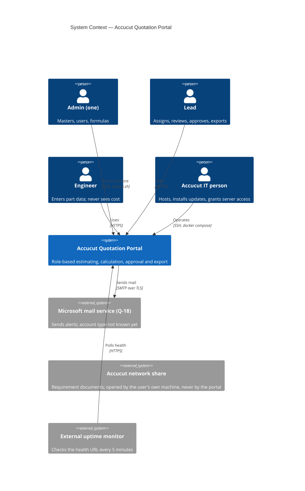
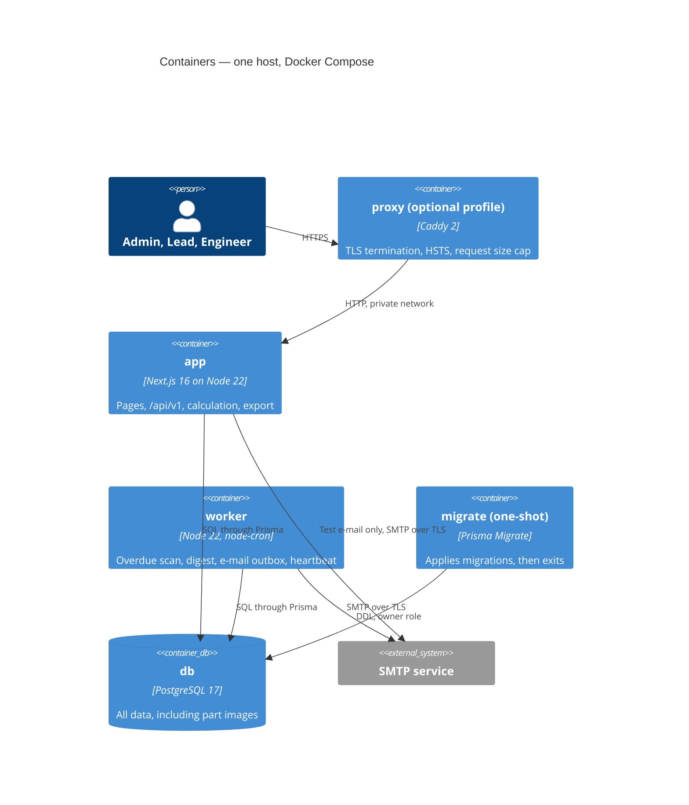
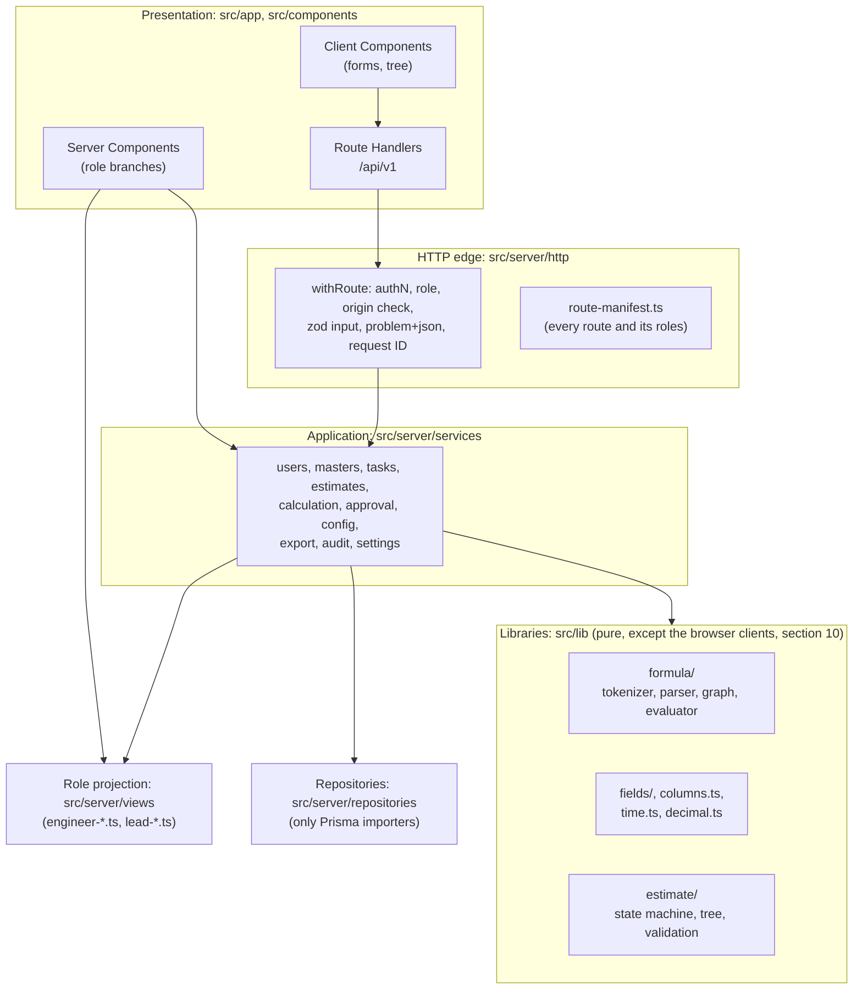
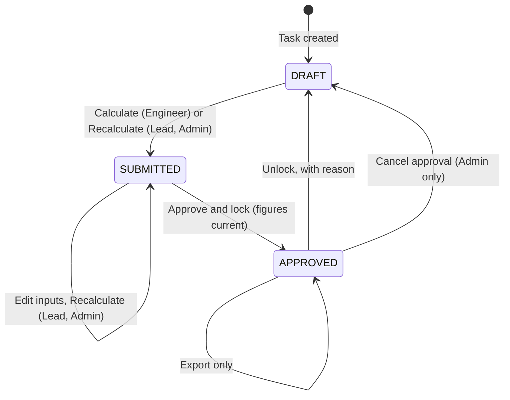
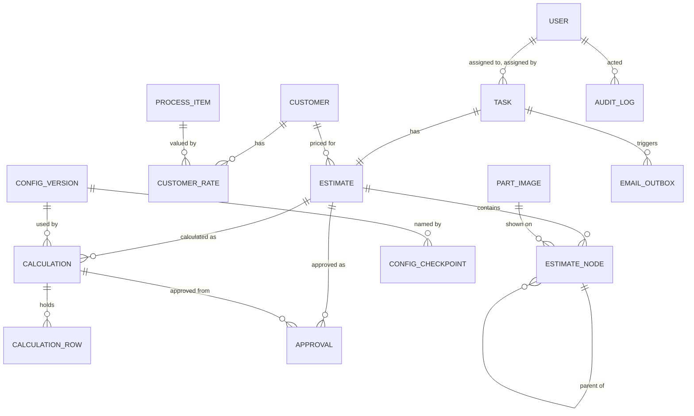

# Solution Architecture — Accucut Quotation Portal

| Field | Value |
|-------|-------|
| Version | 0.69 (2026-11-24, AQP-355: section 4.7 gains "Partial evidence for OQ-ARCH-11", the delivery lead's relayed real-mail test. The `oauth2-client-credentials` route delivered real mail on their own Microsoft 365 tenant; the vendor's cPanel `password` route is still untested, and OQ-ARCH-11 stays open. Listed in the change log). Earlier, 0.68 (2026-11-24, GitHub #627, DL-370 (5): section 5.6 gains the CR-01 release rollback runbook, the case 2 rollback note for all seven CR-01 migrations. It gives the blocks R7 to R1 in one transaction, each ending with its `_prisma_migrations` delete, then the order of work, the data each block loses, the checks, the forward path (`migrate resolve --applied` for `20261123150000`, because QUOTED stays in the type) and the proof on a throwaway copy of the demo database. No applied `migration.sql` is changed. Sections 4.11 a and 4.12 b point to it. Listed in the change log). Earlier, 0.67 (2026-11-24, section 4.11: the `PRODUCT_WORDS` follow-up, `rfq` added to the password rule's product words (STD-C-02), is recorded as done in #683 (31015cce). Listed in the change log). Earlier, 0.66 (2026-11-24, the AQP-312 full-administrator fallback: the AC-8 kit failed, and the delivery lead accepted that the Admin is a local administrator, A-35 is not met and RISK-018 stays at 10, accepted at G8. ADR-015 Amendment 3.4: the JEA wrapper is removed, not switched off, and the scripts stay; the restore names the account that ran it. Section 9.9 updated, with a new change spec for the developer (S1 to S8, with SQR-04 in scope, about 1.75 developer-days; DL-362). A-35 closed (not met), RISK-018 and TB-5 restated, new OQ-ARCH-15. Listed in the change log). Earlier, 0.65 (2026-11-23, DL-350: a second deployment target after G8. New ADR-021 "Deployment targets" (one codebase, two set-ups: `accucut-server`, the default and ADR-015 unchanged, and `web-host`, a managed web host with a separate managed PostgreSQL 17, selected by `DEPLOY_TARGET` through one target profile; provider-independence rules PI-1 to PI-10; security section SEC-1 to SEC-9 owning RISK-036). New `hosting-h1-dual-target.md` (sizing about 22.5 developer-days, range 14 to 35, which is about 11 calendar days from H1's start at 3 lanes (7 to 15) or about 15 at 2 lanes (8 to 20); H1 starts only after the customer's full sign-off of Release 1 on the Windows Server (ADR-021 entry criterion); CI for both targets; the pre-freeze assessment against H-a to H-f) and `data-move.md` (moving data between the targets). Sections 9.1 and 9.9 point to them. **Nothing in G8 changes**. Listed in the change log). Earlier, 0.64 (2026-11-23, story 7D AQP-401, the ux-expert's questions in comment 12944, and the refresh after DL-337. Section 4.12: the customer's answers of 23 Nov confirm A-CR01-1, -2, -3, -5 and -8, so "Built to change on Monday's answers" becomes a record of where each confirmed decision lives. Section 4.12 c: the Ignore remarks are counted in code points on both sides by one function, `checkIgnoreRemarks`, on the shared `validateTextInput` with `countCodePoints`; the Engineer-visible `ignored: { at, byName, remarks } \| null` with its wire shape and no user ID; 7C's `Workspace.ignored` boolean becomes that object; queue rows carry `ignoredRemarks` on the Ignored tab only; every route refuses while Ignored by its own check (DL-304). ADR-019 and ADR-020 Accepted. Listed in the change log). Earlier, 0.63 (2026-11-22, DL-317 (4) and (6). Section 5.6: check the target, then back up, before every `migrate deploy`; where the target comes from (the release scripts cannot be redirected by a stray `.env`; a hand run from a checkout can); the migration order rule, with the evidence that Prisma 7.10.1 applies a pending migration that sorts before applied ones silently, and the CR-01 case (`20261123130000_estimate_downloads` is independent of `20261123140000_estimate_node_kind` and keeps its name; 7B renames). Install guide: the target check, migrating by hand, and the "At install, before go-live" list of DL-311 (4). ARCH-R12 and GitHub #629 (CI guard, after G8). Listed in the change log). Earlier, 0.62 (2026-11-22, corrections from the combined reviews of AQP-402 and AQP-403. Section 4.12 b and d: a download records **the approval that stands** (the latest row, not cancelled, price not removed) or null, not `findLatestApproval`'s raw row. The marker is amber when the approval standing now (an ID or null) differs from the one in the last file, so a download followed by a cancel or a price removal shows "Changed since download" (QLT-08, DL-300 (3)). Section 5.6 gets a general rule: a rollback note keeps `_prisma_migrations` in step, with `prisma migrate resolve --rolled-back` for a failed migration and a row delete for an applied one reversed by hand (AQP-403 QLT-04, AQP-402 QLT-05). Listed in the change log). Earlier, 0.61 (2026-11-22, new section 4.12: CR-01 items 3, 7 and 7c before G8 (DL-299). Prepared renames SUBMITTED in place, QUOTED is a status value, and Ignored is a layer over the status (ADR-019). The node kind is stored, Sub-part is derived, and a row is reordered within its parent by our own lazy drag (ADR-020). The download log `estimate_downloads` and its marker; routes, audit and the section 9 item 2 review list; files per story; a split into 9 stories of 14.5 developer-days, with a critical path of 5.5 days. The product-manager's rulings of 2026-11-22 are applied: structure actions follow `canEditInputs`; the export is refused while Ignored; "Changed since download" means the current approval is not the approval of the last downloaded file; no kind column in Excel; no step-up. Section 4.11 e states the 36 px rule of NFR-031. Listed in the change log. ADR-017, ADR-018 and version 0.58 are on PR #581). Earlier, 0.60 (2026-11-22, section 4.11 c and e: the delivery lead answered OQ-PM-11 with "Don't limit the characters". The export file name is `<Customer Short Name>_<Subject>_<DD-MM-YYYY>.xlsx` in full, with no `EXPORT_FILE_NAME_STEM_MAX_LENGTH`, no code-point cut and no length bound in `isExportFileName`: at most 107 characters at today's limits. Sanitising, fallbacks and the header encoding are unchanged. A-CR01-A3 is dropped as resolved. RISK-CR01-3 is new: raising the limits toward their database ceilings could reach 237 characters, near Windows' 260-character path limit. Section 4.11 e cites NFR-017, not NFR-018, for the 44 px target. Listed in the change log. Version 0.58 is on PR #581, branch `docs/AQP-1-arch-576-575`). Earlier, 0.59 (CR-01 items 1, 2, 6 and 9, 2026-11-21: new section 4.11. The customer stays on `estimates.customer_id` and is set by the Lead or Admin at assignment; `customers.short_name` (unique, case-insensitive) and `tasks.subject` with a backfill, `tasks.title` required; the Engineer loses Set customer; the export file-name builder, its IST date, sanitising, cut and `filename*` header; one product-name constant; the compact layout is CSS only; limits are single constants under looser database ceilings; listed in the change log. Version 0.58 is on PR #581, branch `docs/AQP-1-arch-576-575`). Earlier, 0.57 (section 6 rows for STORY-08.03 "Insert a field" as built, AQP-358, PR #526 at 76ab5090, combined-review finding SQR-04, 2026-11-19: a new "Insert options" row for `GET /config/insert-options`, Admin only, names and structure only; the "Insert preview" row gains the optional `lettersOnly` and the answer's `baseVersion` and `formulas`; the "Insert field" row gains `baseVersion` in the body, the answer `{version, letters, message}` and 409 `CONFIG_VERSION_CHANGED`; both rows give the 422 field names, including `output.hideWhenZeroFieldId` and `cost.hideWhenInputIsZero`; listed in the change log). Earlier, 0.56 (rulings on the newly Ready stories AQP-365, AQP-370 and AQP-371, 2026-11-19: a changed default that propagates writes one `master.edited` per customer whose rate changed, as Reset to Defaults does, section 8 "Customers"; the existing `job_runs` index serves the health read and the Last backup line, and heartbeat rows are pruned after 7 days through a narrow `SECURITY DEFINER` function, sections 4.7, 5.1 and 9.4; the 1,000 ms own-password line is feasible and is measured on the production host before G8, section 7 NFR-010 row; k6 is not adopted and the Node load script is the one tool, sections 7, 10 and 11; where the heavy browser suites run is in test strategy v0.46 section 10.9; listed in the change log). Earlier, 0.55 (rulings on EPIC-09 stories AQP-348 and AQP-354, 2026-11-18: the reset link lives 60 minutes; the reset e-mail ignores the alerts switch; a reset by link has no audit entry and no system actor; `email_outbox` names recipients by user ID (`to_user_id`, `cc_user_ids`) and reads addresses at send time (NFR-028), plus `send_before` and blanking of secret-bearing bodies, and the table is Confidential; Mailpit in CI in the `verify` job only. Sections 4.7, 5.1 and 8 (TB-4 row); listed in the change log). Earlier, 0.54 (ADR-015 Amendment 3.3, 2026-11-18, STORY-10.11, AQP-312, PR #501: the restore's database role `accucut_restore`, the Admin endpoint's group and its grants, older copies migrated forward and newer ones refused; section 9.9 host layout, clear-copies and restore paragraphs; listed in the change log). Earlier, 0.53 (ruling on PR #487, AQP-332, OQ-PM-10, 2026-11-18: **the server refuses a WebP that reaches it unconverted** (415 `PICTURE_TYPE_REFUSED`, `checkPicture`), so the stored picture is never WebP (DL-237); section 8 "Input validation" and ADR-013 Amendment 1; listed in the change log). Earlier, 0.52 (ruling on PR #495, AQP-330, STORY-06.13, 2026-11-18: **BO is the estimate's latest approval row, and none once that row's price is removed**; an earlier, replaced approval never comes back. Section 5.1 `approvals` row, section 4.10 Step 1 and a new "BO after a removal" row, and the section 6 Costs row. Also AQP-329 SQR-02: the section 6 Cancel approval and Remove price rows, the section 7 NFR-004 row and A-33 now describe what was built (`step-up-service.ts`, called by `cancel-approval-service.ts` and `remove-price-service.ts`; the answers and codes as built); listed in the change log). Earlier, 0.51 (DL-230 (5)(c), 2026-11-18, after PR #455 merged as 36b2f16: section 11 records `@lhci/cli` 0.16.1 with Lighthouse 13.6.0, `PSF-2.0` as an allowed licence type, the `sentry` exact-name dev-only exception with its guard test, the `parse-cache-control` exception left unused (#484), and the NFR-009 baseline B0 re-taken on Lighthouse 13 (run 44292597690, B0 = 2594.5); the section 7 NFR-009 row points to it and to #485 (no key screen measured yet); listed in the change log). Earlier, 0.50 (notes from recent reviews, 2026-11-16: the quantity `warning` on the costs view as built, section 6 (AQP-327); the export thread's limits as built and the measured memory, section 4.6, section 6 Export row and RISK-010 in section 14 (AQP-331 QS-01); a planned evaluator change needs a versioned evaluator or a record migration, section 4.9 (AQP-320 SQR-07 (1)); the `approvals` table checked against the AQP-323 migration, section 5.1, with the open SQR-12; listed in the change log). Earlier, 0.49 (two delivery-lead decisions of 2026-11-15. The part limit of 2,000 per estimate is a decision, with its reason and where it is enforced: section 5.1, section 7 NFR-008 and NFR-011 rows (AQP-302 SQR-02). The calculation snapshot keeps only the rates the compiled plan references: the exact shape, the referenced set, both shapes readable and the developer's tests in section 4.2, pointers in sections 4.8 and 5.1 (AQP-293 SQR-05, GitHub #432, before 06.11). Section 4.10 checked against decision 4 and cross-referenced to 06.12 to 06.14; listed in the change log). Earlier, 0.48 (ADR-015 Amendment 3.2, 2026-11-15, STORY-10.05, AQP-311, PR #417: the install grants "Log on as a batch job" to the SID of `AccucutBackup` alone through the LSA API, with a domain Group Policy preflight; section 9.9 bullet and change log). Earlier, 0.47 (ADR-016, 2026-11-15, NFR-009, #418: `/estimates/[code]` is at 3 bytes of headroom at PR #416 head fb02beb. New section 10 rule "`/estimates/[code]` first load": new workspace UI loads lazily unless it is visible and usable at first paint, and each PR states the route's figure. ADR-016 ranks the changes, led by the E1 enabler at about 20.7 KB. Section 7 NFR-009 row, section 13 and section 14 (ARCH-R11) updated; listed in the change log). Earlier, 0.46 (ADR-015 Amendment 3, 2026-11-15, STORY-10.05, AQP-311: backups on Windows. In section 9.9: the backup task's account `AccucutBackup`, the database role `accucut_backup`, the ACL of `backups`, and a summary paragraph that points to the amendment; listed in the change log). Earlier, 0.45 (ADR-015 Amendment 2, 2026-11-14, STORY-10.04, AQP-310, PR #396: the install and update trust flow. Section 9.9 gains a short paragraph that points to the amendment: an inline trust block identical in both scripts; a root one level below a fixed NTFS drive root that must not exist; the root created locked in one call; the package copied, hashed and unpacked inside the root; the module loaded only after the check; programs never found through `PATH`. Listed in the change log). Earlier, 0.44 (OQ-ARCH-14 closed, the delivery lead's answer of 2026-11-13: **one disk grown to about 100 GB**, with the backups on the same disk as the data. Section 9.9's retention table is recomputed: the ceiling rises from about 1.4 GB to **about 10 GB of data**, and 2 years of weekly copies fits while the data stays under about 0.5 GB. ARCH-R10 now states the single-disk risk; a go-live note recommends that Accucut IT keep an off-server copy of the weekly backup). Earlier, 0.43 (ADR-015, ruling 2026-11-13: the target is a Windows Server with a 40 GB disk, so the portal runs as native Windows services with PowerShell scripts; new section 9.9 overrides the Docker, Compose, `cron`, `sudo`, `restore.sh` and `clear-copies.sh` parts of 9.1 to 9.7, and gives the retention arithmetic, a ceiling of about 1.4 GB of data; A-39, A-40, OQ-ARCH-14, ARCH-R9, ARCH-R10 new). Earlier, 0.42 (DL-191 (6) for AQP-81: section 8 states that `signedAt` is the time of the last proof of the password, and that the change route issues the fresh cookie (story A-3 replaced; QLT-07; ADR-009 amendment 3). The password rule is "one rule", a plain function, with the zod schemas carrying only presence and the ceiling (QLT-05). Listed in the change log). Earlier, 0.41 (STD-15 of AQP-89, DL-167: section 8 states that next-auth's `logger` option opens `POST /api/auth/_log` and that the route closes it with a 404, a security invariant (SEC-01); section 6 route row; the #255 note brought up to date; listed in the change log). Earlier, 0.40 (DL-156 (8) and DL-161 condition D, G6 of AQP-237, PR #250 at 57acbae. Section 6, "The two checks as built", is rewritten to match the code: the lexical holder at the call and at each step, the awaited, returned or arrow-body chain, selection by the receiver type `AuditService`, a non-callee use refused, the product-owner's step count, the count of 15 with "at least 15" pinned, and the known limits (QLT-04 to #259, QLT-08). Also the real meaning of the Engineer allow-list entry `transaction` (STD-08), the meaning of AC-5's 10 s line, and two layering rows in section 10. Listed in the change log). Earlier, v0.39 (G6 of AQP-89, PR #253 at c4055f7; the delivery lead's KEEP ruling, 2026-11-11, DL-157 expected. Section 8: the cookie outlives the token by 7 days, ADR-009 amendment 2; the session check named as `resolveSession` with `SESSION_HOURS`; "ended" and "refused"; the `AUTH_SECRET` rotation note. Section 4.1 Session helper row, A-23, FR-099 row and section 10 `lib` browser clients follow (STD-10, STD-11). Listed in the change log). Earlier, v0.38 (DL-154 condition B, G6 of tech-debt #218, PR #247. Section 8: a generic master event is written only for an `object_type` with a shape in `MASTER_SHAPES` and is checked against that master's own shape, never the union; an unknown or missing type is refused with `shape` at `objectType`. Listed in the change log). Earlier, v0.37 (AQP-142 Q2 ruling. Section 8: the Customers audit events are `master.created` and `master.edited` with `object_type` `customer`; Reset to defaults is `master.edited`; the customer state for #218's `MASTER_SHAPES` is `{ name, contact, rates }`, with contact fields named but their values never kept, and only the changed rates on an edit or reset. Listed in the change log). Earlier, v0.36 (G6 of tech-debt #119, PR #235, DL-150 (6) and (8). Sections 4.9 and 10: the hidden-row rule names the master repositories, the file of each table behind `MasterRepository`, not `master-repository` alone (STD-07). Section 10: where master-data storage lives, one method file per master behind `MasterRepository` with `master-constraints.ts` as the shared leaf, and the Customers placement for AQP-142, `customer-repository.ts` and `customer-service.ts`. Section 4.1: the Masters service row names the files it includes. Listed in the change log). Earlier, v0.35 (G6 of AQP-130, DL-142. Section 6: 409 `TREATMENT_LOCKED` and the 422 name codes on the codes line, and the refusal order, 404 and 409 before a name 422. Section 5.1: the system-row trigger guards "Other" too, GitHub #202; an estimate keeps a treatment's words and a delete stays unrestricted, QLT-09. Listed in the change log). Earlier, v0.34 (section 8: documented tool options only. Undocumented switches such as Playwright's `PWTEST_*` variables are refused, with the TD-06 route as the only exception; AQP-244 ruling, test strategy v0.30 10.5 item 9). Earlier, v0.33 (G6 of AQP-123 and AQP-243, DL-129 and DL-128. Section 5.1: where a table departs from the SQL naming rules, with `exchange_rates` keyed by `currency`, stamped by `updated_by` and without `created_at`. Section 6: the `columns` field of the Exchange rates answer. Section 8: the fixed audit `object_id` of the exchange-rate pair. Section 9.2: the `node-modules-v<N>` format number in the cache key, the reading rule for a run with a `miss` or `fallback`, and `setup-node`'s npm cache, to be removed in a later story. Section 10: a pointer to the departures. Listed in the change log). Earlier, v0.32 (section 6: the `record` count corrected to 11 call sites, 5 in same-file helpers and 6 directly in `.run(` callbacks, and the program built over every service file; section 9.2: the `node_modules` cache key carries the npm version and hashes `package.json` and `.npmrc` with the lockfile, AQP-243 A-2; listed in the change log). Earlier, v0.31 (section 6: the two audit-transaction static checks confirmed for STORY-10.18, with "another repository call" defined, the check following helpers inside the file and 3 points, not 2; section 8: the Dependabot major-version hold for three packages, DL-119; section 9.2: the RISK-023 trigger fired early, the two CI enablers, cache scope and the 1.30 times cost guard; listed in the change log). Earlier, v0.30 (section 9.2: three shards as built, AQP-227, with the guards, the measured path, 53 s of headroom to the 5:30 trigger and the corrected fourth-shard figures, DL-117; listed in the change log). Earlier, v0.29 (section 6: an audit entry commits with its change; a review rule with two suggested static checks, DEF-017; listed in the change log). Earlier, v0.28 (section 10: images are a plain ``, never `next/image`, with the ESLint rule changed at configuration level, AQP-74 PRF-01; listed in the change log). Earlier, v0.27 (section 5.1 and section 8: `audit_log.actor_label`, the actor's name when the entry was written, and the Who filter by `actor_id`, AQP-74; listed in the change log). Earlier, v0.26 (section 8: the audit rulings for AQP-74, event names, columns, the first Admin and row locks; section 10: `TransactionRunner` and the raw-SQL rule; listed in the change log). Earlier, v0.25 (section 9.2: follow-ups #93 and #99, warm the keys on master and bound the download; listed in the change log). Earlier, v0.24 (section 6: 409 `CANNOT_RESET_OWN_PASSWORD`, user IDs lower-cased at the schema, self-guards ignore case, AQP-65 STD-08; listed in the change log). Earlier, v0.23 (section 9.2: the shard jobs start alongside the renamed first job, AQP-208; listed in the change log). Earlier, v0.22 (section 9.2: the order after AQP-199, DEF-015 fix then the shard step as its own story; listed in the change log). Earlier, v0.21 (section 9.2: browser system packages cached and bounded, DEF-015; listed in the change log). Earlier, v0.20 (section 9.2: CI feedback time, one required job kept, four workers and one-width tests, AQP-199; listed in the change log). Earlier, v0.19 (section 6: a page's 403 through `forbidden()` and `experimental.authInterrupts`, accepted with guardrails, AQP-48; section 14: TD-06, GitHub #80; listed in the change log). Earlier, v0.18 (section 10: the CSP allows the early-tap inline script by SHA-256 hash, never `'unsafe-inline'`, AQP-188 G6 STD-01, DL-091; listed in the change log). Earlier, v0.17 (the sign-in throttle as built, section 6, master's G7 follow-up for AQP-38; the rule that overlays load on first open, section 10 and the NFR-009 row, from the AQP-188 rulings; listed under "What changed in v0.17"). Earlier, v0.16 (rulings on AQP-38, PR #58: sign-out ends every session of the person, ADR-009 amendment 1; the production check of `/design-system` moves to stage 12; RISK-020 headroom and the place of AQP-169; listed under "What changed in v0.16"). Earlier, v0.15 (the licences and audit reading of `@lhci/cli` 0.15.1's dependencies, AQP-169 AC-6, section 11; listed in the change log). Earlier, v0.14: the rulings on AQP-97 and AQP-28, PRF-01 and PRF-02 of AQP-97, OQ-ARCH-13 answered (SPEC v1.14 §7.5, D-41), and the NFR-009 test profile and JS budget (PRD NFR-009; AQP-1 comments 10712, 10713; GitHub #36); listed under "What changed in v0.14". Earlier, v0.13: SPEC v1.13, D-38 to D-40: 15 seed Process Master items with their units, and the operand Material-Scrap-Rate mapped to `materials.scrap_rate`; listed under "What changed in v0.13") |
| Owner | solution-architect |
| Status | Accepted at G3 as CONDITIONAL GO, attempt 1 (gate log; APPROVED, AQP-1 comment 10491; DL-009). Version 0.7 replaces the every-level rule and the parent figures on the delivery lead's answers, which changes what G3 accepted. Version 0.8 applies their answers in AQP-1 comments 10546 to 10554. **Backups on the same server change NFR-013 and RISK-011.** Version 0.9 applies 10559 and 10560: **the Admin's server access changes what the audit log can prove.** For `master` to record and check at G4 |
| Date | 2026-11-24 |
| Inputs | SPEC v1.13 (`ACCUCUT_QUOTATION_PORTAL_REQUIREMENTS.md`), mainly §4.1, §4.3, §7.1, §7.4, §18 D-12 to D-24, D-38 to D-40, §18.5; AQP-1 comments 10672 and 10674 (D-38 to D-40); AQP-1 comments 10490, 10491, 10493, 10523, 10528, 10529, 10538 to 10609; AQP-13 comment 10487; AQP-14 comment 10510; AQP-15 comments 10511, 10527, 10543; AQP-26 comments 10530 to 10537 (Q-39); requirements questions as of SPEC v1.9. PRD v0.11; release plan v0.11; UX spec v0.3 (section 16.9); consistency report v0.3 (CR-11, CR-33); gate log G4 attempt 1. Gate log G2 attempt 2 and G3; DL-009 to DL-026; risk register; `docs/standards/` |
| Companions | `docs/04-architecture/adr/ADR-001` to `ADR-021`; `hosting-h1-dual-target.md` and `data-move.md` (Hosting release H1, post-G8); `deploy/windows/README.md` (install, reverse proxy); `docs/04-architecture/test-strategy.md` |
| Scope | Scope A (D-14): every FR through Release 2 and every NFR. Offline (FR-092) is not designed and not blocked (section 9.8) |

**How to read the labels.** **Evidence** = measured or read on 2026-11-01, with the source named. **A-nn** = an architecture assumption, listed in section 15 with what changes if it is wrong. **Proposed** = a value set here for an owner to confirm. The quantity rule comes from the delivery lead's answers on AQP-26 (comments 10535, 10537) and AQP-14 (comment 10510), as SPEC v1.9 records them. Other rule text comes from SPEC §7.4 and §18.

**What changed in v0.17 (2026-11-04).** No FR, NFR or dependency changes.

| # | Item | Result | Where |
|---|------|--------|-------|
| 1 | Sign-in throttle as built (G7 of AQP-38, gate record follow-up 5, before G8) | The two hashed keys, counting before the password check, the account run and the address window with their blocks, what a correct password gives back, the order of refusals, and 401, 429 and 503 are now stated. These are as-built behaviour, not changes | Section 6 |
| 2 | AQP-188 rulings (STORY-10.13, #61, RISK-020) | An overlay opened by a user action loads on first open, through one shared loader, on every signed-in route. Its trigger is a plain first-load button, and nothing is rendered until the first open. There is no prefetch on hover or focus. Dialogs in later stories follow the same rule. A tap made before hydration is captured by one inline script and replayed at hydration (DEF-013, DL-083), not answered with a native fallback or a disabled state | Section 10, section 7 NFR-009 row |

**What changed in v0.16 (2026-11-04).** This version records three rulings given on PR #58 (AQP-38) and on Jira AQP-38. No FR, NFR or dependency changes. One assumption is added (A-37). One code change is required in PR #58: the compare-and-increment in item 1.

| # | Item | Result | Where |
|---|------|--------|-------|
| 1 | Sign-out and `session_version` (G4 condition 6; PR #58 Dev Record decision 1) | Sign-out clears the cookie and raises `session_version`, so it ends every session of the person, and a copied token dies. The raise applies only when the token's version is still the stored one, so an ended token cannot sign the person out again. Clearing the cookie only was rejected: a copy would stay valid for up to 12 hours. A per-session revocation table is the fallback if all-device sign-out proves disruptive. SCR-26 needs a second wording (ux-expert, AQP-89) | ADR-009 amendment 1; sections 8, 12, 15.1 (A-37) |
| 2 | `/design-system` in production (PR #58 Dev Record decision 6; G6 STD-05 of AQP-28) | Accepted. Every portal page is now rendered per request, so the build output has no 404 record to read. The proof is now `tests/e2e/production-routes.spec.ts` at stage 12. It asks the stage 9 build, served by `next start`, for the page as a signed-in Lead, and expects 404 with no design-system content. Stage 12 runs inside the required job `Stages 1 to 11`. An HTTP answer from the artefact itself is more direct evidence than a prerender record. The stage 9 script still fails a route prerendered with any other status, and a build layout it cannot read. That spec is never quarantined | `test-strategy.md` section 10 |
| 3 | RISK-020 after AQP-38 | `/` is 197,116 B and `/queue` 198,229 B of 200,000, so 2.9 KB and 1.8 KB are left. AQP-169 (the budget check) starts next after PR #58 merges, and merges before any other UI story reaches G6. Headroom recovery is GitHub #61 | Section 14 |

**What changed in v0.14 (2026-11-03).** This version writes into the document the rulings already given on Jira and the pull requests. It also records the answer to OQ-ARCH-13 and the NFR-009 test profile and JS budget set by the product-manager. No FR changes. The NFR-009 verification changes by the product-manager's decision, not this document's. Four dependencies are added and one is named (section 11).

| # | Item | Result | Where |
|---|------|--------|-------|
| 1 | AQP-97 rulings (PR #32, comment 6598858452) | The seed checkpoint and `config_checkpoints` belong to STORY-08.06 (R2), which backfills the checkpoint for an existing version 1. `config_versions.created_by` gets its foreign key from whichever of 03.01 and 01.01 merges second. Immutable tables have `created_at` only. The registry gains the property `multiline`. Stage totals are stated for all six stages | Sections 4.5, 5.1, 5.6 |
| 2 | PRF-01 and PRF-02 of AQP-97 (PR #32, comment 6598912712) | Pool sizes and timeouts are fixed in code per process kind, with no environment variable, and a timeout answers 503 `DATABASE_BUSY`. The parsed configuration document is cached by version id | Sections 3, 4.2, 6 |
| 3 | GitHub #31 | There is one formula converter, `lib/formula/internal-form.ts`. Scripts and Vitest load `server-only` under the `react-server` condition | Sections 10, 11 |
| 4 | OQ-ARCH-13 answered (SPEC v1.14 §7.5, D-41) | Column widths and number formats come from SPEC §7.5, not from defaults. Issue #30, item 1, refines the seed before the first production install | Sections 4.5, 15.2 |
| 5 | AQP-28 rulings (PR #33, comment 6599052433) | `class-variance-authority`, `clsx` and `tailwind-merge` are approved, with a configured `cn`. `@axe-core/playwright` is named. `/design-system` sits under `(portal)` and is absent from every production build, staging included | Sections 10, 11 |
| 6 | NFR-009 (PRD; AQP-1 comments 10712, 10713; GitHub #36; RISK-020) | The pass/fail profile is office Wi-Fi on a recent phone, and Slow 4G runs nightly as report only. Every route's first-load JavaScript is limited to 200 KB gzip, checked on every pull request. The reference run is defined in `test-strategy.md` section 10. `tailwind-merge` takes about 9 KB of that budget on every route | Sections 7, 11, 14 |

**What changed in v0.13 (SPEC v1.13, D-38 to D-40; AQP-1 comments 10672, 10674).** Names and units only. No formula, FR, NFR, ADR or dependency changes, and no rate value is recorded anywhere (ADR-014). Wherever an earlier part of this document, section 16 included, says 14 seed items or 14 rows, read 15.

| # | Item | Result | Where |
|---|------|--------|-------|
| 1 | D-38: 15 seed Process Master items | `Plating-rate-per-sqin` (per sq in) is the 15th, inserted by the same migration with a fixed ID in `seed-ids.ts` and 0. Every seed row carries its SPEC §4.1 unit; `Soft-Anodize-rate-per-sqin` is per sq in. Customers get 15 rates through the normal sync (FR-014); nothing counts them in code | Sections 5.1, 5.6 |
| 2 | D-40 (Q-42 closed): the plating rate is data only | No seed formula references it. Plating Cost (AU) stays typed and the Plating flag (AD) stays unused. Because nothing uses it, the Admin can rename or delete it like any unused rate. A later plating formula is an ordinary configuration edit (FR-074 to FR-078), with no schema change | Sections 4.5, 5.6 |
| 3 | D-39: Material-Scrap-Rate, per kg | The formula operand is `Material-Scrap-Rate`, stored as `{{mat:scrapRate}}`, Prisma field `scrapRate`, column `materials.scrap_rate`. **Column name kept** (ruling and reason in section 4.5). The formula for AK is unchanged | Sections 4.5, 4.9, 5.1 |

**What changed in v0.12 (G6 of AQP-27, attempt 1, gate record condition 3).** No change to any FR, NFR or dependency. Section 16.16 holds the detail.

| # | Item | Result | Where |
|---|------|--------|-------|
| 1 | QLT-01 | The Engineer rule covers all presentation code, as pages are shared by role | Section 10, ADR-008 |
| 2 | QLT-05 | Coverage gates split: pure code at stage 6, the whole package and changed code at stage 11 | `test-strategy.md` sections 10, 11 |
| 3 | STD-11 | `@types/pg` approved; every unnamed tool recorded | Section 11 |

**What changed in v0.11 (G4 attempt 1, remediations 5, 6 and 8; DL-034).**

| # | Item | Result | Hours (estimate) | Where |
|---|------|--------|------------------|-------|
| 1 | CR-33 | One rule: the role check runs first, so a refused role gets **403** with no data, on every route, whatever the ID. The uniform 404 stays for an Engineer's own routes | 0 | Section 6 |
| 2 | A-1 (stories 03.01, 02.01, 02.05) | **Confirmed.** Fixed IDs, inserted by migration at 0; the seed configuration loaded in the `migrate` one-shot; "Other" by migration. **Limit:** a rate left at 0 prices at 0 | 0 | Section 5.6 |
| 3 | Who clears old copies | **The Admin, with a second guided command,** `clear-copies.sh`, which A-35 now allows. 40 GB stands, so 2 years is not a guarantee (DL-034). **New limit:** at about 5 to 6 GB of data, clearing can no longer free enough | +0.5 to +0.75 | Section 9.5 |
**What changed in v0.9 (AQP-1 comments 10559, 10560).** This replaces "Admin only checks" and A-22 in v0.8.

| # | Answer | Result | Hours (estimate) | Where |
|---|--------|--------|------------------|-------|
| 1 | "Admin holds hte backup key"; "Admin should be given teh server access and run the restore" | OQ-ARCH-12 closed. **Anyone with server access can reach everything on the host,** and the audit log stops being a control over the Admin (ARCH-R8). A narrower account is proposed to Accucut IT | 0 | Section 9.5, section 4.10 |
| 2 | The restore is run by the Admin, not a system administrator | `restore.sh` becomes one guided, safe command, and the Admin rehearses it | +1 to +1.5 | Section 9.5 |
| 3 | "Block the portal" means the Excel download only: "Yes" | Confirms section 4.6. Nothing else is refused while figures are not current | 0 | Section 4.6 |
| | **Total** | | **+1 to +1.5, central +1.25** | Section 16.14 |
**What changed in v0.8 (AQP-1 comments 10546 to 10554).**

| # | Answer | Result | Hours (estimate) | Where |
|---|--------|--------|------------------|-------|
| 1 | Part Model picture optional | `mandatory: false` on C, on every part. OQ-ARCH-04 closed | 0 to +0.25 | Section 15.2 |
| 2 | "Tell the Lead" | A notice on SCR-06 and one line on SCR-08 when rates changed after the last calculation. Approval is not blocked. OQ-ARCH-06 closed | +1 to +1.5 | Section 4.8 |
| 3 | Last backup line, "Yes" | FR-105 stops being proposed | +0.25 to +0.5 | Section 9.5 |
| 4 | "Yes only Admin only checks", "Backup on the same server" | **A server or disk failure loses the data and every backup together.** 105 full copies do not fit the 40 GB disk: at 0.1 GB of new data a week it fills in about 6 months. A free-space check is added. **Who holds the backup key and who restores are open** | 0 to +0.25 | Section 9.5 |
| 5 | A-30: "Removable", "Admin only" | **Feasible.** Two steps, Admin only: cancel the approval, then remove the price. Each is audited, and the audit keeps the price | +2.75 to +4 | Section 4.10 |
| 6 | A-32: "Refuse it" | No Excel file until a calculation is current, for a never-calculated estimate too. A-05 ends | -0.25 to -0.5 | Section 4.6 |
| | **Total** | | **+3.75 to +6, central +4.875** (corrected in v0.10; first published as +6.5) | Section 16.13 |
**What changed in v0.7 (the quantity rule, Q-35 (b), Q-41, Q-36, Q-37).** This replaces the rule in versions 0.3 to 0.6. Where those tables and sections 16.1 to 16.11 describe `T(row)`, a multiplier, `applyQuantityStep`, `ROLLUP`, a Σ figure, an item total, or Q-39, Q-35 (b) or Warn's scope as open, this version overrides them.

| # | Change | Result | Where |
|---|--------|--------|-------|
| 1 | **The rule** | H is the count for the whole order, typed on every row (2, 6, 24). BL is `SUM(BG)` over all rows, with no multiplying down the tree. 4 and 12 typed at 150 and 20 give 840; 5 at 200 gives 1000 | Section 4.3, ADR-006 |
| 2 | **What a parent shows** | Only its own row's figures (Q-35 (b)). Every row has one box, and the screen and the file agree | Section 4.3 |
| 3 | **Removed** | `src/lib/rollup/`, `applyQuantityStep`, `T(row)`, the multiplier, `ROLLUP`, the item total, `calculation_rows.rollup`, `calculations.item_totals`, `rollupDisplay` | Sections 4.3, 5.1, 6 |
| 4 | **Cleared figures (Q-37)** | Every calculated value clears on any input change, row costs included. The approved price stays until a new approval replaces it. A move no longer changes BL, and still clears (A-29). A-18 and A-28 close | Section 4.8 |
| 4a | **Excel download (Q-37)** | Refused while figures are cleared. The out-of-date file, its markers, `allowOutOfDate` and the dialog are removed | Section 4.6 |
| 4b | **"Not applicable" (Q-36)** | Offered to Lead and Admin too, and the words show to everyone, in the field and the export. The zero values stay hidden. A-17 is now their answer, with no design change | Section 4.9 |
| 5 | **Warn** | A 0 affects only its own row, and they kept the warning (Q-41). One rule for every 0, one code, one wording: "That row will cost 0". A-27 closes | Section 4.3 |
| 6 | **New risk, ARCH-R6** | The Engineer now does the multiplying, so a mistyped count is a wrong price with nothing to flag it | Section 4.3, section 14 |
| 7 | **Effort** | **-4.25 to -7.25 h, central -5.75 h**, against release plan v0.8 (estimate), with Warn at 3.5 to 5.25 h inside it. No rework, as nothing is built | Section 16.12 |
**What changed in v0.6 (Q-38, Q-40, master's actions).**

| # | Change | Result | Where |
|---|--------|--------|-------|
| 1 | Q-38 "Yes" (AQP-15 comment 10527) | Warn covers every 0 in QTY per Assy, **a top-level item's own 0 included** (A-27). A-25 ends. Warn is now **4.25 to 6.25 h** (estimate, central 5.25 h), which is the earlier figure plus about 0.5 h | Section 4.3, section 16.11 |
| 2 | **Correction to v0.5 (DL-024)** | v0.5 said ASSUMPTION-51 was confirmed and CE-2 confirmed with it. That overclaimed. Q-35 (a) settles a top-level item with nothing below it, and only CE-12 variants A, B and D carry their number | Section 4.3, A-20, `test-strategy.md` 5.2, 5.6 |
| 2a | **Q-39 unresolved (AQP-26 comments 10530, 10531, 10533)** | Their rupee answer, 660, does not fit the rule, which gives 840. Their later count, 12 brackets for 4 frames with 3 each, does fit it, and the rupee total is still being confirmed. **The roll-up rule is frozen as written.** CE-1 and CE-2 are marked unconfirmed, with their values unchanged | Section 4.3, `test-strategy.md` 5.2, 5.6 |
| 3 | CR-11 placement | Confirmed, with what goes where in STORY-10.01 and the first stories | Sections 9.2, 16.11 |
| 4 | Q-40 "No" (AQP-1 comment 10528) | OQ-ARCH-05 closed: 2 decimals on entry stands, storage is unchanged | Section 15.2 |
| 5 | Coverage matrix | FR-104 and FR-105 added | Section 12 |

**What changed in v0.5 (the delivery lead's answers).** Item 3 below is corrected by v0.6 item 2, and item 2 is overtaken by v0.6 item 1.

| # | Change | Result | Where |
|---|--------|--------|-------|
| 1 | "Warn" for a QTY per Assy of 0 on a part with parts below it (AQP-15 comment 10511) | Calculate and Recalculate return 409 until the person acknowledges, tied to the input revision they saw. The record sits on the calculation. The Lead sees a notice on SCR-06 and SCR-10. No figure in the warning, for any role. The DL-013 block no longer applies | Section 4.3, section 6 |
| 2 | A part with nothing below it | Still unanswered, so not warned. Adding it costs about 0.5 h, with no change to the schema, routes or dialog | Section 4.3 |
| 3 | Q-35 (a) answered 1000 for 5 x 200 (AQP-14 comment 10510) | ASSUMPTION-51 is confirmed: a row's own quantity counts once. The other reading is withdrawn | Section 4.3, A-20 |
| 4 | Effort | Warn is **3.75 to 5.75 h** (estimate). It replaces the 1 h block and is not added to it | Section 16.10 |

**What changed in v0.4 (G3 condition 14).**

| # | Change | Result | Where |
|---|--------|--------|-------|
| 1 | ADRs moved to Accepted | All 14. Those resting on an assumption say which: ADR-002, 006, 007, 009, 011, 012 | Section 13 |
| 2 | Reconciled against UX spec v0.3 | Footer position agrees. Six API responses corrected, one new withheld figure, UX-38 to UX-43 raised | Section 16.9 |
| 3 | A-19 replaced by DL-013 | The delivery lead answers. With no reply by G4, Calculate and Recalculate refuse H = 0 on a part with parts below it | Section 4.3, A-19 |
| 4 | Q-35 (a) restated | Not narrow: any single-piece product is such a row (DL-012). The claim that one line would change is corrected | Section 4.3, A-20 |
| 5 | PRD v0.7 followed | Hand-over asks for the password, an Admin-set password is temporary, sign-in is `noindex`, no reason in the file; OQ-ARCH-01, 07, 08, 09 closed | Section 16.9 |

**What changed in v0.3.**

| # | Change | Result | Where |
|---|--------|--------|-------|
| 1 | Roll-up: every level's quantity applies | `T(row) = BG(row) + H(row) x sum of T(child)`. A row's own H is applied once. The nested example gives 24 lids. 500 nodes roll up in about 6 ms (Evidence) | Section 4.3, ADR-006 |
| 2 | Backups: weekly, kept 2 years, Admin looks after them | **Recovery point is up to 7 days of work**, and up to 14 if one run fails unnoticed. Their decision stands | Section 9.5, ADR-002 |
| 3 | E-mail: Microsoft Outlook, sender not decided | SMTP with a user name and password **cannot be relied on**. The design adds OAuth 2.0 client credentials. Four facts about the account are still needed | Section 4.7, ADR-011 |
| 4 | "Not applicable" entries | Scrap Weight is 0 on such a row, ordinary rows unchanged. Hidden from every list, refused by the database if edited | Section 4.9 |
| 5 | Password rule | 10 to 128 characters, a number, a symbol, not the e-mail, not common. 12-hour session from sign-in | Section 8, ADR-009 |
| 6 | Cleared totals | BL, BN, the price pre-fill, Tool Cost total, item totals and parent figures are withheld on any input change. Approval refused. Export needs a stated choice and is marked out of date | Sections 4.6, 4.8, ADR-007, ADR-012 |
| 7 | Reason on a changed price; one export total | `approvals.override_reason`; total Tool Cost in a footer row, never over a node's own BM cell | Sections 4.6, 5.1 |

No new ADR: each change applies a decision that an existing ADR already owns, so those ADRs are revised (section 13). No new dependency.

**G2 condition 5 at a glance.**

| Requirement of condition 5 | Where it is met |
|----------------------------|-----------------|
| One named quantity step, so a change to Q-32 (a) touches one place | **Overtaken in form, met in purpose.** No quantity applies to a sum any more. A quantity applies in one place, `BB = BA * H`, and a test holds it there (section 4.3, ADR-006) |
| Stored row BG kept apart from the figure displayed for a parent | **Overtaken.** A parent shows only its own row, so there is no second figure to keep apart (Q-35 (b), section 4.3) |
| Constructed example from SPEC §18.5 in the test strategy | `test-strategy.md` section 5, rewritten for the whole-order rule |
| Real master data stays out of the repository; state where it is loaded from | Section 5.5, ADR-014 |

---

## 1. Architectural Drivers

**Quality attributes, ranked.** When two conflict, the higher one wins.

| Rank | Attribute | Why | Main NFRs |
|------|-----------|-----|-----------|
| 1 | Confidentiality of cost data | The product exists to keep rates and costs from Engineers. A leak cannot be recalled | NFR-001, 002, 006 |
| 2 | Correctness of prices | A wrong price is quoted to a customer. The rule is settled, and the risk has moved to the count typed on each row (ARCH-R6) | GOAL-03, NFR-026 |
| 3 | Immutability of approved work | Approved estimates must not move when anything changes (AQP-8) | NFR-026, NFR-007 |
| 4 | Changeability of the worksheet | The Admin changes fields and formulas without a developer (R2) | FR-072 to 080 |
| 5 | Operability by a small IT team | One host, one IT contact, no platform team | NFR-013, 030 |
| 6 | Performance at small scale | Under 50 users, 25 concurrent, 500 nodes | NFR-008 to 011 |

**Key functional drivers.** Server-side role projection (FR-007, 008); formula engine with no `eval` (FR-022, 023); BL as a plain sum of BG (FR-029, 030); per-calculation master record (FR-031, 065); Excel export in the worksheet layout (FR-066 to 069); field insert and delete with re-lettering (FR-074, 075); immutable configuration versions (FR-077).

**Constraints.** Stack in `CLAUDE.md` §1 and SPEC §2. No `eval` (CONSTRAINT-02). Times stored in UTC and shown in IST (CONSTRAINT-03). Exactly one active Admin (CONSTRAINT-04). Images under 200 KB (CONSTRAINT-08). The repository stays public (D-13, DL-008). Secrets through environment variables only.

**Simplicity position.** One deployable codebase, three runtime containers plus an optional TLS proxy, one database. No queue broker, cache server, object store, search engine, service mesh or Kubernetes. Each moving part that remains is justified in the ADR that adds it.

---

## 2. System Context (C4 L1)



The portal never reads the network share. It stores the path as text and renders a `file:///` link plus "Copy path" (FR-033).

**Trust boundaries.**

| ID | Boundary | Crossing |
|----|----------|----------|
| TB-1 | Internet to the application | Browser and uptime monitor to the proxy and the app. Hostile by default |
| TB-2 | Engineer to cost data | Inside the app, between an authenticated Engineer and everything Restricted. This is the boundary the product exists for |
| TB-3 | Application to database | App and worker to Postgres, on a private Docker network |
| TB-4 | Application to mail service | Worker and `app` to Microsoft's token endpoint and mail service; message content leaves Accucut's control |
| TB-5 | Host and backups | Host filesystem, Docker volumes, the backup copies on the same server, and the backup key, held by the Admin away from it. The IT person and the Admin both cross this boundary |
| TB-6 | Public repository and CI | Everything committed is world-readable, including CI logs (D-13) |

---

## 3. Containers (C4 L2)



| Container | Responsibility | Technology | Communicates with | Scaling approach | Owner |
|-----------|----------------|------------|-------------------|------------------|-------|
| `app` | Server-rendered pages, `/api/v1`, auth, calculation, export | Next.js 16.4 (App Router, standalone output), Node 22 | `db` (TCP 5432); SMTP for the Settings test e-mail only (SCR-15 needs the result at once) | Vertical. One instance is enough (section 7, NFR-011). A second instance would need no code change: there is no in-process state that matters except the export gate | Delivery team; Accucut IT runs it |
| `worker` | Scheduled jobs and the e-mail outbox (FR-081 to 084), and the watch on the weekly backup (section 9.5). In R1 only a heartbeat, the backup watch and the job log | Node 22, node-cron 4 | `db`, SMTP | Single instance. Row claims use `FOR UPDATE SKIP LOCKED`, so a second one would be safe | Delivery team; Accucut IT runs it |
| `db` | System of record, including images | PostgreSQL 17 | none | Vertical. Pool sizes: app 10, worker 3, scripts 2. Connect timeout 5 s. `statement_timeout`: app 10 s, worker and scripts 30 s. `idle_in_transaction_session_timeout`: 30 s. Idle timeout: app 30 s, the others 10 s. Each pool sets its own `application_name`. These are fixed in code by process kind, not set by environment variables (v0.14, PRF-01 of AQP-97). `prisma migrate deploy` is not affected | Accucut IT |
| `migrate` | `prisma migrate deploy`, then `ensure-seed-version` (section 5.6), then exit; `app` and `worker` wait for it | Prisma CLI 7.10 | `db` with the owner role | Not applicable | Delivery team |
| `proxy` | TLS, HSTS, body-size cap. **Optional Compose profile** (A-01): skipped if Accucut IT already has a TLS terminator. **On Windows (section 9.9) a TLS proxy is required on every server people use** (v0.58): the service `AccucutProxy` (Caddy, supported) or IIS with ARR, configured to the contract in section 8 "Reverse proxy contract" and `deploy/windows/README.md` "Reverse proxy" | Caddy 2 | `app` (TCP 3000) | Not applicable | Accucut IT |

**Why each exists.** `app`, `worker` and `db` are SPEC §2 and FR-091. `migrate` keeps DDL rights out of the runtime role. `proxy` exists because NFR-003 needs Secure cookies, which need TLS, and Next.js does not terminate TLS.

**Sizing (Proposed, A-01).** One Linux VM with 2 vCPU, 4 GB RAM and 40 GB SSD. **Superseded by ADR-015 and section 9.9: one Windows Server with one disk of about 100 GB (OQ-ARCH-14, 2026-11-13).** **40 GB stands by their decision, and it limits how long copies can be kept (DL-034, section 9.5).** Memory limits: `app` 1.5 GB, `worker` 256 MB, `db` 1 GB. The limit on `app` covers the worst-case export (section 4.6). This has not been load tested; `test-strategy.md` section 8 confirms it on the chosen host. **Superseded for Windows by ADR-017 (v0.58):** the app service runs with `--max-old-space-size=1024`, the export threads keep 512 MB each, the app's worst case is about 2.75 GB, and 8 GB of RAM (A-39) is the minimum supported; the target-host reading (G8-C-NFR10) confirms it.

---

## 4. Components (C4 L3)

### 4.1 Component map of `app`



Dependencies point inward. `src/lib` imports nothing from `src/server`, `src/app`, Prisma or Next.js. Only `src/server/repositories` imports the Prisma client. Section 10 states how this is enforced.

**Key components.**

| Component | Path | Responsibility | Key FRs |
|-----------|------|----------------|---------|
| Route wrapper | `src/server/http/with-route.ts` | The only way to declare a handler: session, role, origin check, zod parse, error mapping, request ID, `no-store` | FR-007, NFR-001, 003 |
| Route manifest | `src/server/http/route-manifest.ts` | One table of every page and API route with allowed roles. The role-matrix test iterates it, and a test fails if a route file is missing from it | FR-007 |
| Session helper | `src/server/auth/session.ts`, `resolve-session-user.ts`, `session-token.ts` | `session.ts` is the only importer of `getServerSession` and offers `getCurrentUser()`, `requireUser()` (routes, 401 or 401 `SESSION_ENDED`), `requireUserOrRedirect()` (pages: SCR-26 through `unauthorized()`, or the sign-in redirect) and `requireRole()`. The one check of a request's session is `resolveSession` in `resolve-session-user.ts`: 12 hours from sign-in over `SESSION_HOURS` in `session-token.ts`, then `users` is read on every request, so role and active flag are never taken from the token (section 8) | FR-001, 004, 007, 099 |
| Engineer views | `src/server/views/engineer-*.ts` | Allow-list projections into strict output schemas. Importing `calculation-repository` from these files fails the build | FR-008, 051, NFR-002 |
| Formula engine | `src/lib/formula/**` | Tokenizer, parser, dependency graph, evaluator, internal and display forms | FR-022, 023, 028 |
| Figure state | `src/lib/estimate/figure-state.ts` | Pure: says `none`, `current` or `out-of-date` for an estimate. Every read of a figure goes through it (section 4.8) | FR-061, 070, 100, 101 |
| Password rule | `src/lib/auth/password-rule.ts` | The one zod rule for every place a password is set, on client and server (section 8) | FR-098, NFR-003 |
| Calculation service | `src/server/services/calculation-service.ts` | Orchestrates one calculation in one transaction | FR-024 to 031, 055, 061 |
| Approval service | `src/server/services/approval-service.ts` | Approve, unlock, refusal unless figures are `current`, notices, optional reason | FR-062 to 065, 101, 103 |
| Config service | `src/server/services/config-service.ts` | New immutable version per change; checkpoints; revert | FR-072 to 080 |
| Export service | `src/server/services/export-service.ts`, `src/server/export/**` | Builds the `.xlsx` from one calculation record, in a worker thread | FR-066 to 071 |
| Masters service | `src/server/services/masters-service.ts`, with the operation files it includes (`treatment-service.ts`, `exchange-rate-service.ts`; `customer-service.ts` from STORY-02.02) | Masters, customer rate sync. Never lists or changes a hidden entry (section 4.9). Storage is `MasterRepository`, one method file per master (section 10, "Master-data storage") | FR-012 to 018 |
| Mail transport | `src/server/mail/transport.ts` | The one place that builds the Nodemailer transport and its sign-in mode (section 4.7) | FR-019, 081 to 084 |
| Audit | `src/server/services/audit-service.ts` | Appends audit rows in the caller's transaction | FR-011, NFR-007 |

### 4.2 Calculation pipeline

```mermaid
sequenceDiagram
  actor U as Engineer or Lead
  participant R as Route (withRoute)
  participant C as calculation-service
  participant DB as PostgreSQL
  participant F as lib/formula
  U->>R: POST /estimates/{id}/calculate
  R->>C: calculate(user, estimateId)
  C->>DB: BEGIN; lock estimate row
  C->>C: Check status and ownership; validate every visible input
  C->>C: Quantity warnings from tree and typed H; compare the acknowledgement (409 if not met)
  C->>DB: Read nodes, customer rates, used materials, exchange rates
  C->>F: Evaluate row-scope fields for each node (compiled plan)
  F-->>C: Row values (each row's own M to BK)
  C->>F: Evaluate product-scope fields (BL, BN)
  C->>DB: INSERT calculations, calculation_rows; set status; COMMIT
  C-->>R: Lead or Admin: results. Engineer: status and the one message
```

The compiled plan (ordered list of parsed formulas) is cached in process by `config_versions.id`. A version is immutable, so the cache has nothing to invalidate. The parsed configuration document is cached the same way, by `config_versions.id`. The cache holds at most 16 entries and evicts the oldest first. Each document is deep-frozen, because callers share it. Each read asks only for the latest version's id and number, so every process sees a new version at once (v0.14, PRF-02 of AQP-97).

**The master snapshot keeps only the rates the plan references (delivery lead decision 2026-11-15; AQP-293 SQR-05; GitHub #432; v0.49).** This replaces AQP-293's assumption A-2 ("all customer rates"). It must merge before STORY-06.11, whose rate-change count would otherwise include Process Master items no formula reads and ask for a needless Recalculate.

| Point | Rule |
|-------|------|
| The shape | `calculations.master_snapshot` is `{ "customer": { "id", "name" }, "rates": [ { "id", "name", "value" } ], "materials": [ { "id", "materialInDrawing", "materialConsidered", "pricePerKg", "specificGravity", "scrapRate" } ], "exchangeRates": { "usd", "eur" } }`. Every value is decimal text (ADR-005); `materialConsidered`, `usd` and `eur` may be null. `rates[].id` is the Process Master item ID, `name` its name then, `value` the customer's value then, as typed (a percent rate as a percentage). The keys and types are unchanged, so `masterSnapshotSchema` (`calculation-repository.ts`) stays as it is and parses both shapes |
| What changes | Only the content of `rates`. **Shape 1** (every calculation stored before #432 merges): every rate of the customer. **Shape 2** (from #432 on): exactly the customer's rates whose ID is in the plan's referenced set, each once, **in the order of the set**. `materials` (each distinct material the tree used, in order of first use; I reads its price outside any formula) and `exchangeRates` (both, always) are unchanged |
| The referenced set | `referencedRateIds`, computed once in `compilePlan` (`lib/formula/plan.ts`) and held on `CompiledPlan`, so it is cached with the plan by `config_versions.id`. It is every `{ kind: 'rate' }` reference that `referencesOf` returns, over `rowFormulas` then `productFormulas` in plan order, each ID once at its first appearance. `referencesOf` walks every node, so a rate inside an `IF` condition or branch, `MIN`, `MAX`, `ROUND` or a negation counts. `SUM(column)` reads a field, never a rate. Field, material and exchange references are not rates |
| Where it is applied | `readMasters` takes the set and filters the customer's rates once. The evaluator and the snapshot get **the same filtered list**, so what was stored is exactly what was evaluated. A rate no formula reads was never read by the evaluator, so no figure changes |
| A referenced rate the customer has no row for | Left out of `rates`. The evaluator already gets null for it (`createRateLookup`). A reader treats an ID absent from `rates` as "no value at that time", in both shapes |
| Old records | Not rewritten: `calculations` is immutable and its trigger refuses an `UPDATE` (section 5.1). There is no data migration, and no marker key: the two shapes differ only in which rates are listed |
| Readers accept both shapes | **One rule:** a reader looks a rate up by ID and never treats `rates` as "the rates this calculation used". A reader that lists or counts rates restricts them to `referencedRateIds` of the plan of `calculations.config_version_id`, read through the plan cache. For shape 2 that is a no-op; for shape 1 it drops the unused rates. The readers: `lib/estimate/rate-diff.ts` for the review's notice (06.11) and `GET /unlock-preview` (section 4.8); `GET /nodes/{nodeId}/costs`, the cost details working (AQP-320), which takes each rate operand of the row's formulas by ID; and the export (section 4.6), which lists no rates today and follows the same rule if it ever does |

**Tests the developer writes for #432.**

1. **Unit, `lib/formula`:** `referencedRateIds` is distinct and in order of first appearance; it includes a rate that appears only in a product formula, only in an `IF` condition, only inside `MIN`/`MAX`/`ROUND`, and only under a negation; it excludes field, material and exchange references and `SUM`; a plan with no rate reference gives an empty set; compiling the same version twice gives the same set.
2. **Unit, `calculation-masters` or `calculation-service`:** a customer with five rates and a plan that references two of them stores exactly those two, in the set's order, with the name and value then; a referenced rate the customer has no row for is left out and its figure is null, as before; `materials` and `exchangeRates` are unchanged.
3. **Re-evaluation equals the record (integration, PostgreSQL):** store a calculation from the seed configuration on a multi-material tree, then re-evaluate every row and the product formulas from the stored record alone (`master_snapshot`, `calculation_rows.inputs` and the plan of `config_version_id`). Every output and `product_values` equals the stored text exactly. Read back as the runtime role, the stored `rates` holds only the referenced IDs.
4. **Figures unchanged:** the existing calculation, product-total and acceptance tests pass unchanged; none is edited to fit.
5. **Shape 1 still reads:** a fixture record whose snapshot holds every customer rate, including one no formula reads, parses through `masterSnapshotSchema` and `findCalculation`. Then, in the story that owns each reader: `rate-diff` counts zero when only the unused rate has changed since, and one when a referenced rate has (06.11; unlock preview); the cost details working for that record shows the same operands and values as for a shape-2 record of the same inputs (AQP-320); the export of that record is unchanged.

### 4.3 The quantity rule: BL as a plain sum (G2 condition 5)

**Rule in force (AQP-26 comments 10535, 10537; SPEC v1.9 §7.1 H, §7.4 BL; `master` records it).** QTY per Assy (H) is the count for the whole order, typed on every row. For 2 frames, 3 pipes on each frame and 4 lids on each pipe, the Engineer types **2, 6, 24**. A row's cost is that count times the cost of one piece, which the worksheet formula already gives (`BB = BA x H`). **BL is the sum of BG over all rows, with no multiplying down the tree.** The rule as one sentence is the team's; the typing and the numbers are theirs.

| Their answer | What it shows |
|--------------|---------------|
| "sorry my bad, yes, this has 24 lids. Engineer should typ 24" (AQP-26 comment 10537) | 2, 6, 24 are typed. The portal does not multiply them |
| "So the user will enter 4 frames and 12 brackets": 600 + 240 (AQP-26 comment 10535) | 150 x 4 + 20 x 12 = **840**. They gave the two parts, and the sum is ours |
| 1000 for quantity 5 at 200 a piece (AQP-14 comment 10510) | 200 x 5 = **1000** |
| Worksheet BL2 is `SUM(BG2:BG11)` (SPEC §18.5) | The same formula. The portal now agrees with the worksheet at any quantity, not only at 1 |
| 660 (AQP-26 comment 10530) | Read as 3 typed for the whole order, which the rule also gives. Their frame answer corrects the count to 12. That reading is the team's, and they have not said it in those words |
| "Q-35(b) - no, not required" (AQP-1 comment 10542) | A parent shows only its own row's figures, with no sum of the rows below it |

**Withdrawn:** `T(row)` in every form, `applyQuantityStep`, `quantity-step.ts`, the multiplier above each row, `ROLLUP`, the item total, `calculation_rows.rollup`, `calculations.item_totals`, the `rollupDisplay` flag and the whole of `src/lib/rollup/`. The design needs no roll-up of any kind.

| Question | Answer |
|----------|--------|
| Where does a quantity apply? | **In one place: `BB = BA * H`**, a row's own seed formula. H is an operand in no other seed formula (SPEC §7.4) |
| Is a row's own H applied twice? | No. BG carries it once, and nothing multiplies BG again |
| Where is BL worked out? | In the formula engine, as a product-scope field: `SUM(BG)` over the rows' outputs |
| Item's own row (D-12 (c)) | A row like any other, inside the sum |
| Several top-level items (D-12 (d)) | Inside the sum. No step of their own |
| Column (D-12 (e2)) | BG only. Tool Cost (BM) entries are totalled as typed. BN divides BL by that plain total |
| Does a move change BL? | **No.** A row's count is typed, and its parent has no effect on it. A move still changes Sl. No (section 4.8) |

**The frames example, by the code path.** Cost of one piece: 0, 1, 1.

| Row | H typed | One piece | BG, on screen and in the file |
|-----|---------|-----------|-------------------------------|
| I, frames | 2 | 0 | 0 |
| P, pipes | 6 | 1 | 6 |
| S, lids | 24 | 1 | 24 |

BL = 0 + 6 + 24 = **30**, and the BG column adds up to it. With cost on the lid alone BL = 24.

**What a parent shows on screen: its own row and nothing else (Q-35 (b)).** The screen and the file now hold the same figure for every row, so G2 condition 6's pair of labelled boxes has nothing left to tell apart: every row has one box, and the tree shows each row's own BG. There is no Σ tag, no item table and no per-item figure anywhere, which also matches D-16's one total in the file. SCR-07 shows a row's own stages. BJ and BK are each row's own, as in the file.

| Item | Changed by this rule? |
|------|-----------------------|
| `src/lib/rollup/`, `quantity-step.ts`, `ROLLUP`, the multiplier, the item total, `rollupDisplay` | **Removed** |
| Seed BL | **`SUM(BG)`** |
| `calculation_rows.rollup`, `calculations.item_totals` | **Removed.** No migration exists yet, so nothing moves |
| `/costs`, `/nodes/{id}/costs`, `/export-summary` | **Simpler:** a row's own figures, with no Σ, item total, multiplier or screen figure |
| Wording on SCR-06, 07, 10, 17, 18 | **Yes:** UX-53 to UX-56 |
| Row outputs (M to BK), the export layout, `figure-state` | The formulas and the layout do not change. `figure-state` has less to withhold (section 4.8) |
| Approved estimates, built code | None exist, so there is no rework |

**The Engineer now does the multiplying (new, ARCH-R6, GitHub #11).** The portal used to multiply down the tree and now takes each count as typed, so a wrong count is a wrong price and nothing can flag it. It is a real risk: on these questions the delivery lead's own first answers were 3 for 12 brackets and 12 for 24 lids, and each would have underpriced the order. 4 and 3 typed at 150 and 20 give 660, not 840. A change to the number of items in the order also means retyping every row below it. The field's name, "QTY per Assy", says the opposite of what it now means. **What the design does:** a hint on the field saying it is the count for the whole order (UX-52), and H beside every row on SCR-06, so a Lead can check it. **What it cannot do:** detect a wrong count, because the portal holds no second figure to compare with. Asking for a per-assembly count as well would bring back the rule just withdrawn, so that is not proposed. Whether to rename the field is for the product-manager and the delivery lead; the Excel column stays as it is.

**NFR-008.** No walk is left, so the roll-up's share of the budget goes. BL is one `SUM` in the compiled plan. Excel holds 15 significant digits, so a cell stops being exact to the paisa above about ₹ 10 trillion. SPEC sets no ceiling on H and none is added.

**A zero quantity (OQ-ARCH-10, OQ-PM-07, Q-38, Q-41; RISK-013).** **A 0 now affects only its own row.** `BB = BA x 0`, so that row costs 0, and the rows below it are untouched: item 2, part 0, sub-part 24 gives BL = 24 with each lid at 1, where the old rule gave 0. The minimum for H stays 0.

**Warn stays, for every 0 in QTY per Assy: "Q-41: Keep warning" (AQP-15 comment 10543).** Asked knowing a 0 now touches only its own row, they kept it. The warning names the row and says that row costs 0. A row's position in the tree no longer matters, so the design has one rule, one code and one wording. This closes A-27: a top-level item is a row with a QTY per Assy, so its own 0 warns.

| Point | Warn, as designed |
|-------|-------------------|
| Rule | `quantityWarnings(rows)` in `lib/estimate/validation`, pure. One warning per row where H is 0 after normalising (`0.00` is 0). Every such row is listed, wherever it sits in the tree. It finds H through `systemRole: 'quantity'`, so re-lettering cannot break it |
| Code | One: `QTY_ZERO`. Kept as a code so that a later warning can join the same path |
| When | Inside the transaction, under the estimate row lock, at Calculate **and at Recalculate**, because A-08 and FR-064 give them the same checks and a Lead can type the 0. A save never warns |
| Order | Status and ownership, then blank inputs (422 `CALCULATE_BLOCKED`), then this. So nobody acknowledges a warning and is then refused for a blank. **It runs before any master or cost is read** |
| First press | 409 `CALCULATE_ACK_REQUIRED` with `inputsRevision` and the `warnings` list. Nothing is written: no calculation, no status change, no audit row |
| Acknowledgement | The person presses "Calculate anyway". The client sends the same `POST` with `{ "acknowledge": { "inputsRevision": n } }`, the value from the 409 |
| Check | The server recomputes the list. If it is empty, the calculation runs and `acknowledge` is ignored. If it is not empty, `acknowledge.inputsRevision` must equal `estimates.inputs_revision`. If not, the 409 comes back with the new revision and list, and nothing is written. A warning can therefore never be passed by an acknowledgement given for an earlier state of the estimate |
| Recorded | `calculations.warnings`, JSONB, default `[]`: `{code, nodeId, slNo, label}` per row, as text at that moment. The row is immutable (ADR-007). **Who and when need no new column:** a calculation with warnings cannot exist unless they were acknowledged, so `created_by` and its time are the acknowledgement. Plus one audit event, `calculation.warning_acknowledged`, in the same transaction, naming the rows and holding no figure |
| Each press stands alone | A Lead's Recalculate asks again, even for a 0 the Engineer acknowledged (A-26). The Engineer's calculation keeps the Engineer's name, and the Lead's new one has the Lead's |
| What the Engineer sees | SCR-05: a dialog naming each row, with "Go back" and "Calculate anyway". On success the same single message as ever. Afterwards nothing: no Engineer route reads `calculations.warnings` |
| What the Lead sees | Every warning on the calculation in view. SCR-06: a notice above the tiles naming each row, who went ahead and when, and a mark on that row. SCR-10: the same notice. SCR-08: one line. Data comes from `/costs` and `/export-summary`, through `figure-state`, **only while `current`**. While `out-of-date` the list may be stale, approval is refused, and Recalculate raises it afresh |
| Approval | Warn never stops it. `POST /approve` is unchanged. The approval points at the calculation, so the warnings stay with what was approved |
| The file | No cell changes. The row shows H 0 and BG 0, as it would by hand, and no warning goes in the worksheet layout (A-24) |
| Wording | One file, `src/lib/estimate/warning-copy.ts`. Proposed, for UX-36 to settle: "QTY per Assy is 0 on `<Sl. No>` `<part>`. That row will cost 0 in this estimate." |

**The acknowledgement: options.** This follows the export's existing pattern, a 409 and then the same request with a stated choice (section 4.6), so it adds no new idea.

| Option | Result |
|--------|--------|
| **Chosen:** 409, then the same `POST` carrying `inputsRevision` | Ties the acknowledgement to the exact estimate the person saw, since every change that can alter the list already bumps the revision (section 4.8). One integer comparison, under the lock that already serialises saves. The success body stays exactly `{status, message}` |
| A plain flag, `acknowledge: true` | **Rejected.** A retry or a stale tab could pass a warning nobody saw, including one for a 0 added since |
| Echo the list of node IDs | **Rejected.** A second comparison for the same guarantee |
| Warn in the response after calculating | **Rejected.** The estimate is already SUBMITTED and read-only for the Engineer, so "Go back" would have nothing to go back to |
| A separate acknowledgement row or endpoint | **Rejected.** A new table and a state to expire, for one press |

**No cost reaches an Engineer.** This holds on the server, by structure, and not by the dialog's wording.

- The rule reads only typed H, which the Engineer already holds, and it runs before any master, rate or calculated value is read. So its result cannot depend on anything Restricted, and the 409 tells an Engineer nothing about a cost, by content or by timing.
- **"That row will cost 0" is the only cost statement, and it reveals nothing.** It follows from the 0 the person typed, at any rate and for any part, so it is the same on every estimate. It is not a calculated value, and it comes from no Restricted data.
- The 409 has one strict schema, with the same keys for every role, and no number except `inputsRevision`, Sl. No and that 0. `inputsRevision` is a count of changes. On its own it says nothing about figure state, which no Engineer route carries.
- The wording keeps to UX-24's Engineer-page rule: no "rate", "price" or "formula".
- The canary scan runs this path, and shows the same 409 body under two different sets of masters (`test-strategy.md` section 6).

**Residual risk.** A warning can be passed without being read, so a low price can reach the Lead, who sees the notice and the row and is not stopped (RISK-013). D-06 tells Engineers to enter 0 in numbers a part does not need, and an assembly row with no cost of its own may now get a 0 in H by habit, which changes nothing and still raises the dialog. A warning seen often is pressed through. A rule that skipped those rows would have to read a cost, which the warning must never do. How often this happens is not known: the first estimates in use will show it, and the audit event counts it.

**In the formula language.** `ROLLUP` is removed. BL is back to a function SPEC §8.2 already has, so the language gains nothing for it:

```text
BL = SUM(BG)
BN = BL / SUM(BM)
```

BL stays visible and re-letters like any other formula (FR-075), and it stays a system field that cannot be deleted. The warning that a formula has stopped using `ROLLUP` goes with the function. Comparisons inside `IF` stay, because seed O needs them (section 4.9).

**Division by zero and totals (A-07).** The evaluator's value type is `Decimal | null`, where `null` means divide by zero. `null` spreads through every operator and through `SUM`, so a total shows "—" rather than a silently low price. The calculation never stops (FR-026). Seed formulas can only reach this through BJ, BK or BN, none of which feed BL.

### 4.4 Estimate state machine



Pure code in `src/lib/estimate/state-machine.ts`; an exhaustive `switch` with `assertNever`. Task Open or Closed is **derived** from `estimates.status`, never stored, so FR-038 holds by construction. Approval is refused with 409 while the totals are cleared or the estimate has never been calculated (D-20, section 4.8).

**CR-01 (v0.61):** section 4.12 a replaces this diagram for CR-01. SUBMITTED becomes PREPARED, Mark as quoted takes an APPROVED estimate to QUOTED, and Ignored is a layer over the status that Restore removes (ADR-019).

### 4.5 Field registry and configuration

ADR-004. The registry is one validated JSON document per version, not rows. A change is `load latest → apply a pure edit → validate all formulas, references and cycles → insert a new version`. Formulas use stable references, `{{f:<fieldId>}}`, `{{rate:<rateId>}}`, `{{mat:<key>}}`, `{{fx:USD}}`. Rates use a stable ID rather than the name in SPEC's example, so a rate rename cannot break a formula.

**Material operands (v0.13, D-39).** The Admin cannot add a Material Master column, so the `{{mat:<key>}}` keys are a fixed set, and the evaluator reads each from the Material Master row for column E (SPEC §7.4). The formula text that a Lead or Admin sees shows the operand name; the stored formula holds the reference.

| Operand in formula text (SPEC §4.3, §7.4) | Stored reference | Prisma field | Column in `materials` | Unit |
|-------------------------------------------|------------------|--------------|-----------------------|------|
| `Material-Price-per-kg` (also the value of I) | `{{mat:pricePerKg}}` | `pricePerKg` | `price_per_kg` | per kg |
| `Material-Specific-Gravity` | `{{mat:specificGravity}}` | `specificGravity` | `specific_gravity` | none stated in SPEC |
| `Material-Scrap-Rate` | `{{mat:scrapRate}}` | `scrapRate` | `scrap_rate` | per kg (D-39) |

**Ruling: the column stays `scrap_rate`.** Each column is the operand name without the `Material-` prefix, in snake_case: the table already says "material", and Prisma maps each camelCase field with `@map`. `scrap_rate` already follows that rule for `Material-Scrap-Rate`, so D-39 changes the label and not the schema. Adding the unit to the name (`scrap_rate_per_kg`) would break the rule, as the operand name carries no unit; the unit is shown on SCR-13 and stated here. No migration exists yet, so this is consistency, not cost.

SPEC §8.1's `FieldDefinition` is the document's element type. The UX screens show it needs more than SPEC lists:

| Added property | Why | Screen |
|----------------|-----|--------|
| `engineerVisible` | True only for `input` fields and for F. A schema rule refuses it everywhere else, including I, BH and BI | SCR-05, ADR-008 |
| `systemRole` | Marks fields the code depends on: `sl-no` (A), `quantity` (H), `unit-price` (BG), `total` (BL), `approved-price` (BO), `tool-cost` (BM). These cannot be deleted, and A and BO have no editable formula. The quantity warning finds H through this role, and the export finds BM the same way for its footer | SCR-17, 20 |
| `unit`, `hint`, `formOrder` | Unit tags and hints sit beside each input. `formOrder` is separate from column position because section 08 shows AP, AU, BM, then AJ (SPEC §7.1), which is not letter order. Enter follows it | SCR-05 |
| `stageId`, `group` | Output placement in the six stages and their sub-headings. Also set on the inputs AP and AU, which stage 3 lists under "Entered directly" (SPEC §7.4). The product-scope fields (BL, BN, BO) carry stage 6, and SCR-07 lists row-scope fields only | SCR-07, 17 |
| `options`, `displayUnit` | List values for a new choice field; "kg", "$", "€" on values | SCR-07, 19 |
| `multiline` | True only on a `text` input that the form shows as a textarea, which is Remarks (AJ), SPEC §7.1 "text (multiline)". Enter moves to the next field and Shift+Enter adds a line (UX). The schema refuses the property on any other kind or data type, and an absent property means false. The export wraps the field's text (v0.14) | SCR-05 |

Sections and stages get a `shortName` (the strip on SCR-05), a display mode (`cards` or `multi-select`, as section 07), and for stages `totalFieldIds`, because the total on a stage heading is sometimes one field (stage 3 is AY) and sometimes several (stage 5 adds BC to BF). In the seed, as SCR-07 shows: stage 1 has no total (weights and areas share no unit), stage 2 is AK, stage 3 AY, stage 4 BB, stage 5 BC to BF and stage 6 BG. Section range tags such as "E, F, J–L, N" are derived per role from the fields that role sees.

A field's **references** include formulas, `hideWhenZero`, `visibleWhen` and stage totals. Field delete (SCR-20) checks all four. An input with `defaultValue` takes that value when its key is absent, so a new input with a default does not block Calculate on older drafts (A-15).

The configuration seed comes from SPEC §7 and is committed. One seed formula differs from SPEC §7.4 on purpose: Scrap Weight O (section 4.9). Header texts are the SPEC §7 labels. Column widths and number formats come from SPEC §7.5. The business-analyst read them from the first worksheet of the sample with the delivery lead's permission (D-41, OQ-ARCH-13). Nothing else was read from the workbook, and cell values are never copied. The widths and formats must be in the seed before the first production install, because version 1 is never changed afterwards (GitHub #30, item 1).

### 4.6 Excel export

ADR-012. `export-service` loads one calculation record and streams its images in batches of 50, builds an `ExportModel`, and hands it to `src/server/export/build-workbook.ts` in a `node:worker_threads` thread, so the event loop stays free for other users. Export reads `calculation_rows.outputs` (D-12 (b3)). The date in the file name is the IST date of the download.

**One total only, plus the total Tool Cost (D-16, Q-31 answered).** BL, BN and BO appear once, in row 2, and the file has no per-item totals. The export now knowingly differs from the sample on this point (SPEC §14.12). The total Tool Cost, the plain sum of BM with no quantity, cannot go in row 2, because BM2 is the first node's own Tool Cost. It goes in a **footer row at `lastNodeRow + 2`**, so one row stays empty between the last node and the footer: the value in the Tool Cost column, with the label "Total Tool Cost" in the cell to its left. With 10 parts in rows 2 to 11, the footer is row 13. UX spec v0.3 places it the same way (section 16.9). It sits directly under column BM, follows that column if letters move (`systemRole: 'tool-cost'`), and changes no node row. With no Tool Cost entered, the file shows 0 and BN2 stays empty. The value comes from `product_values.toolCostTotal`, so an approved file never changes. Adding up the exported BG column gives BL, at any quantity.

**No file exists until a calculation is current (Q-37 (b), A-32 answered).** "Yes, block the portal when the total is not calculated or recalculated" (AQP-1 comment 10545), and for a never-calculated estimate, "Refuse it" (10554). `GET /export` answers by state, with no way round it:

**Only the Excel download is refused.** "Block the portal" was read as this, and they confirmed it: "Yes" (AQP-1 comment 10560). While figures are not current, the screens, the inputs, Calculate and Recalculate all work as usual.

| State | Result |
|-------|--------|
| `none` | 409 `NOT_CALCULATED`. SCR-10 says why and links to Calculate |
| `out-of-date` | 409 `EXPORT_OUT_OF_DATE`. SCR-10 says why and links to Recalculate |
| `current` | The file: node rows from the calculation record, BL2 and BN2 filled, the footer filled, and BO2 as below |

**BO2** holds the latest approved price, if there is one and its approval has not been cancelled (section 4.10). The stated choice, the `_OUT-OF-DATE` file name, the `OUT OF DATE` sheet tab, the notice row and the confirmation dialog are gone, and so is the file with empty cost columns (A-05).

The state is read in the same repeatable-read transaction that builds the file, never taken from an earlier `export-summary`, so a change between the two cannot slip through. An approved estimate is always `current`: its inputs are locked. **Limit:** a file downloaded while current can go out of date later on someone's disk, and the portal cannot recall it; the date in its name is the only signal.

The decisions on row-2 cells and the footer live in one file, `src/server/export/product-cells.ts`. The optional override reason goes in no cell (FR-103, PRD v0.7). Cell values are full-precision numbers with a two-decimal number format, so Excel's own sums reconcile with the stored values. Text goes in as strings only, so nothing an Engineer types can become a live formula.

**Measured feasibility (Evidence, 2026-11-01).** Throwaway benchmark with invented data on an Intel i7-10510U with 8 GB, Node 24, in-memory ExcelJS 4.4.0, 67 columns, one incompressible 199 KB image per row. Excludes database reads. Runs shared one process, so memory figures are upper bounds. This is not the target host and not the target Node version.

| Nodes and images | Time | File | Peak process memory |
|------------------|------|------|---------------------|
| 50 | 1.7 to 1.8 s | 9.8 MB | 178 MB |
| 200 | 7.9 s | 39 MB | 312 MB |
| 500 (validation's maximum) | 16.9 s | 97.5 MB | 528 MB |

**Outcome for RISK-010 and OQ-PM-05.** No hard limit is needed. Validation already bounds the worst case at about 100 MB, and it builds in under 20 seconds on this laptop. NFR-010's 10 s target holds comfortably at 50 nodes. The strategy is a worker thread plus a one-at-a-time gate for estimates over 100 nodes (a second such request gets 503 with `Retry-After`), and a proxy read timeout of at least 120 s. The figures also say an export of 500 nodes takes about 17 s, so the 10 s target must not be read as applying there.

**The export thread as built (STORY-07.01, AQP-331, PR #441, review QS-01; v0.50).** The gate is simpler than planned above: one cap for every export, whatever its size. `src/server/export/thread-runner.ts` runs **at most 2 threads at once** (`maxThreads`); the next request is refused with 503 `EXPORT_BUSY`, fixed words and `Retry-After: 10`, never queued. Each thread has a **512 MB heap limit** (`resourceLimits.maxOldGenerationSizeMb`), and a **120 s timeout** terminates it. The slot is counted only once the thread has started, so a thread that fails to start does not hold it (QS-12, fixed before merge). **Measured** by the review on the laptop with the real bundle: starting one thread costs about 40 to 55 MB, whatever the file's size; 10 header-only exports at once added 405 MB; one export of 2,000 rows added 128 MB, and 4 at once added 1,037 MB; 2,000 × 67 cells build in 1.2 s. The cap of 2 keeps the worst case near two of those. **These figures have no pictures in them.** STORY-07.02 (AQP-332), which adds the pictures, re-measures the cap, the heap limit and the timeout with pictures at the 2,000-part limit, states the figures in its Dev Record, and brings any change to the three settings to the architect before it merges.

**Limits by host (ADR-017, v0.58; #575, PRF-F-04).** STORY-07.05 measured 500 nodes with 500 pictures at 14 to 67 s and about 1 GB resident on the delivery PC, with every run completing under the 512 MB thread heap (DL-271). The in-memory build stays; a cap and streaming wait for the triggers in ADR-017. (1) The build timeout becomes the `.env` setting `EXPORT_TIMEOUT_SECONDS` (integer, 120 to 300, default **240**), set from the slowest AC-2 run on the target host: 240 when it is 80 s or less, otherwise 3 times it rounded up to 30 s, and 300 plus a scope item for the product-manager when it is over 100 s. It is a setting, unlike the other export limits, because its reading may come after the freeze. (2) The reverse proxy waits at least the timeout plus 60 s (IIS 360 s; Caddy no response timeout). (3) The app service gets `--max-old-space-size=1024`; `maxThreads` 2, `maxLarge` 1 and the 512 MB thread heap stay constants. (4) The proxy refuses bodies over 1 MB, and `experimental.proxyClientMaxBodySize` is sized by #410 at no more than that.

### 4.7 `worker`

| Job | Schedule | Behaviour | FRs |
|-----|----------|-----------|-----|
| `heartbeat` | Every minute, first run at worker start (STORY-10.09) | Writes one `job_runs` row (`job = 'heartbeat'`); `/api/health` reads the newest (section 9.4). Then calls `prune_heartbeat_runs()`, which removes heartbeat rows older than 7 days and nothing else (section 5.1 `job_runs`; ruling 2026-11-19, v0.56). A prune failure logs at `error` and leaves the new row in place | NFR-012, NFR-024 |
| `overdue-scan` | Every minute (R2) | For open tasks past deadline, inserts an outbox row. The unique key stops repeats, so the target of 5 minutes is met with room to spare | FR-082 |
| `daily-digest` | 11:00 Asia/Kolkata, plus a catch-up at start-up if today's run is missing (R2) | Inserts one outbox row per Engineer per IST date | FR-083 |
| `outbox-send` | Every minute (R2) | Claims up to 25 due rows with `SKIP LOCKED`, sends, records the result; up to 3 retries with backoff of 1, 5, 15 minutes | FR-084 |
| `backup-watch` | Daily, 09:00 Asia/Kolkata (R1) | Looks for a good `backup` row in `job_runs` in the last 8 days, and for at least 20 % free disk (Proposed) in the latest one. If either fails, logs at `error` and, once e-mail is on, writes one outbox row to the Admin (section 9.5) | NFR-013 |

Assignment e-mail (FR-081) is one outbox row written in the task's own transaction, so a rolled-back task sends nothing. All job logic takes `now` from a `Clock` argument so tests control time.

**Idempotency keys.** `task-assigned:<taskId>:<assignmentRevision>`, `task-overdue:<taskId>:<deadlineAtUtc>`, `digest:<engineerId>:<istDate>`, `backup-missed:<istDate>`, `password-reset:<tokenId>` (R2, FR-003). A unique index enforces them, so re-running a job sends nothing twice. A changed deadline gets a new key, so a task that becomes overdue again is reported again (A-09).

**Alert and non-alert events (rulings on STORY-09.01 and 09.07, 2026-11-18, v0.55).**
- **The alerts switch (`settings.alerts_enabled`, FR-019) governs only the alert events of FR-081 to FR-084:** `task-assigned`, `task-overdue`, `daily-digest`, `backup-missed`. When it is off at claim time, an alert row is marked `skipped` and is final (09.01 decision D-d). The list lives once, in `src/lib/mail/events.ts`.
- **`password-reset` is a non-alert event and ignores the switch.** It is the person's own request for access, not a notice about work, and FR-019 limits the switch to FR-081 to FR-084. It still needs `FEATURE_EMAIL=on`: with the flag off, the forgot route answers as always and makes no token and no row (09.07 decision D-1).
- **Recipients are resolved at send time (NFR-028).** A row names its recipients as `to_user_id` and `cc_user_ids`. Every recipient is a user: alerts go to Engineers, Leads and the Admin, and a reset goes to the user whose token it is. `outbox-send` reads each address from `users.email` when it sends, and takes **active** users only. An inactive or missing To user marks the row `skipped` with `last_error` `NO_RECIPIENT` (and blanks a secret-bearing body); an inactive Cc user is left out. So a deactivated person is never mailed a reset link or an alert, and an address changed before the send is the one used. TB-4's "recipients from `users` only" is then held by the schema, not only by code.
- **A row can carry a deadline, `send_before` (nullable).** At claim time a row past it is marked `skipped` with `last_error` `EXPIRED` and is never sent. A reset row's `send_before` is its token's `expires_at`, so a delayed or retried row never mails a dead link. Alert rows leave it null.
- **Secret-bearing events.** An event class marks whether its body holds a secret; today only `password-reset` does. The raw link is in `body_html` and `body_text` only while the row can still be sent: they are blanked (set to empty text, the row kept as the e-mail log, DR-013) when the row is `sent`, finally `failed`, or `skipped` (`EXPIRED` or `NO_RECIPIENT`). A reset link is therefore in the database in clear for at most its 60 minutes, and in a backup only if the 02:00 run falls inside that hour, by which time it has expired by any restore.

E-mails carry task details, path and deadline only. They never contain cost, rate or formula data, and the digest goes only to people who may see the task. Each message has HTML and plain-text bodies (SCR-22). Links are full addresses built from `APP_ORIGIN`, so the worker needs that variable. The logo is attached inline by content ID, so no mail client fetches it from the portal. SCR-22 is a template reference, not a route.

The Settings test e-mail (SCR-15) is the one exception to the outbox: `app` sends it directly to the signed-in Admin's own address, because the screen must report success or failure at once, and because no recipient is accepted from the client.

**Mail transport (D-15, OQ-ARCH-11).** Their answer is "microsoft outlook, not decided yet on the sender address". SPEC §2 names Nodemailer over SMTP, with credentials in environment variables. **SMTP with a user name and password cannot be relied on for a Microsoft account.** Whether it works depends on facts not yet known, starting with which kind of account "Microsoft Outlook" means.

| If it turns out to be | Does user name and password over SMTP work? | What the portal needs |
|-----------------------|---------------------------------------------|-----------------------|
| **Microsoft 365 business mailbox** | Today only if the organisation allows it, and not for long. SMTP AUTH is off for organisations created after January 2020 and must be enabled per mailbox, and Security Defaults keeps it off. Basic authentication is reported to go off by default for existing tenants at the end of December 2026, an administrator can turn it back on, and a final removal date is to be announced in the second half of 2027 | **OAuth 2.0 client credentials over SMTP** (`smtp.office365.com`, port 587, STARTTLS, TLS 1.2 or later), which Microsoft recommends. An administrator of the tenant registers the app, grants `SMTP.SendAsApp`, registers the service principal in Exchange, and gives it access to one licensed mailbox. Limits: 10,000 recipients a day, 30 messages a minute |
| **Personal Outlook.com or Hotmail** | **No.** Microsoft states that Outlook.com requires Modern Auth / OAuth2 (`smtp-mail.outlook.com`, port 587, STARTTLS). The same page says an app password may be needed in some cases, which this design does not rely on | Delegated OAuth: a person signs in once and the portal keeps a refresh token. There is no tenant, so client credentials do not apply. **Not designed.** A personal mailbox is a poor sender for a company: it is tied to one person. Recommended answer: use a business mailbox |
| **Outlook is only the mail app**, and the mailbox is with a domain host or an on-premises Exchange server | Probably yes. That provider decides | `password` mode below |

**What is built.** Nodemailer stays, with no new dependency. `src/server/mail/transport.ts` has one setting, `SMTP_AUTH_MODE`, with three values:

| Mode | Used for | Variables |
|------|----------|-----------|
| `none` | Mailpit, in local, CI and staging | `SMTP_HOST`, `SMTP_PORT` |
| `password` | A provider that allows it | Also `SMTP_USER`, `SMTP_PASSWORD` |
| `oauth2-client-credentials` | Microsoft 365. The design default for production | Also `SMTP_USER` (the mailbox), `SMTP_OAUTH_TENANT_ID`, `SMTP_OAUTH_CLIENT_ID`, `SMTP_OAUTH_CLIENT_SECRET` |

In `oauth2-client-credentials` mode, a small function posts to `https://login.microsoftonline.com/<tenant>/oauth2/v2.0/token` with scope `https://outlook.office365.com/.default`, using the platform `fetch`. It hands the token to Nodemailer through its documented `provisionCallback`, which also renews it. Nodemailer's docs describe XOAUTH2 and the callback, but give no Microsoft client-credentials recipe, so **this is unproven until tested against a real tenant** (`test-strategy.md` section 9). A real-tenant send was reported on 2026-11-24; see "Partial evidence for OQ-ARCH-11" below (v0.69).

**Rules that hold in every mode.**
- No credential is ever in code, the database, `settings`, a log or Jira. `settings` holds the sender name and the sending mailbox (`sender_mailbox`) only. Environment variables only, on the host, mode 600.
- The mailbox is dedicated to the portal. Microsoft's steps give the app `FullAccess` to it, so it must hold nothing else.
- The sender address must be that mailbox, or one it has Send As rights on; otherwise Microsoft refuses with 5.7.60. The Settings test e-mail (SCR-15) proves this, and reports the failure without any secret.
- `outbox-send` claims at most 25 rows a run, so it stays under 30 messages a minute. A digest to 50 Engineers then takes two runs.
- An Entra client secret expires. When it does, every send fails, rows go `failed`, and Settings and the log show it. The IT person diarises the date.

**If the organisation refuses SMTP AUTH altogether.** Options named by Microsoft: Azure Communication Services Email, for internal and external recipients. High Volume Email and Direct Send reach internal recipients only, and SMTP relay needs port 25 with a static IP or a certificate, and cannot be used from a third-party hosted service. Microsoft Graph `sendMail` would be a new transport. Each is contained in `transport.ts`, about half a day, and the outbox does not change.

**Facts needed (OQ-ARCH-11), from their IT person, before e-mail can go live.** (1) Which kind of account from the table above, and which mail domain. (2) If Microsoft 365: who administers the tenant, and whether Security Defaults is on. (3) Can a dedicated licensed mailbox be created, and what is its address (the open sender address). (4) Can the host reach port 587 outward. Until then, alerts stay behind `FEATURE_EMAIL`, tested on Mailpit. None of this holds any other feature.

**Partial evidence for OQ-ARCH-11 (v0.69, 2026-11-24; AQP-355).** Reported by the delivery lead in chat and relayed by the orchestrator; the team did not observe it. On the demo copy (commit `6d85f555`), with web and worker running, the delivery lead used **their own Microsoft 365 tenant**: `SMTP_AUTH_MODE=oauth2-client-credentials`, `smtp.office365.com:587`, a shared mailbox reached through an Entra app with `SMTP.SendAsApp`. A password reset worked end to end, and the task-assignment e-mails arrived ("successfully received all the emails"). No secret was shared.
- **What it proves:** the `oauth2-client-credentials` route (token, `provisionCallback`, STARTTLS on 587) and real delivery through the outbox and worker. The "unproven until tested against a real tenant" line above no longer holds for that route.
- **What it does not prove: the vendor's set-up.** The relayed position is that Accucut's mail is on a cPanel shared web host, so the third row of the table applies and the install uses `SMTP_AUTH_MODE=password`. `transport.ts` sets implicit TLS when `SMTP_PORT` is 465 and requires STARTTLS on any other port. That route has had no real send.
- **Still open:** (1) the mail domain and the dedicated mailbox and its address, from Accucut IT; (2) 465 or 587, as the host's cPanel mail settings state; (3) whether the server can reach that port outward; (4) one real send in `password` mode from the install, through the Settings test e-mail and one alert, that lands in the inbox and not junk (a check on the domain's SPF and DKIM, which cPanel usually manages). Items (1) to (3) are the remaining parts of OQ-ARCH-11; for a cPanel mailbox, its item (2), tenant and Security Defaults, does not apply. OQ-ARCH-11 stays open until (4) passes.

**Sources (read 2026-11-01).** [Microsoft Learn: send email from an application](https://learn.microsoft.com/en-us/exchange/mail-flow-best-practices/how-to-set-up-a-multifunction-device-or-application-to-send-email-using-microsoft-365-or-office-365); [Enable or disable SMTP AUTH](https://learn.microsoft.com/en-us/exchange/clients-and-mobile-in-exchange-online/authenticated-client-smtp-submission); [OAuth for SMTP](https://learn.microsoft.com/en-us/exchange/client-developer/legacy-protocols/how-to-authenticate-an-imap-pop-smtp-application-by-using-oauth); [Outlook.com settings](https://support.microsoft.com/en-us/office/pop-imap-and-smtp-settings-for-outlook-com-d088b986-291d-42b8-9564-9c414e2aa040); [Nodemailer OAuth2](https://nodemailer.com/smtp/oauth2). **The December 2026 date is second-hand:** [Microsoft's post of 27 January 2026](https://techcommunity.microsoft.com/blog/exchange/updated-exchange-online-smtp-auth-basic-authentication-deprecation-timeline/4489835) could not be read directly with the tools here, so it rests on search summaries and [Office 365 IT Pros](https://office365itpros.com/2026/01/29/smtp-auth-basic-retirement/). The IT person should check the current position.

**Assignment e-mail expiry (DEF-055, AQP-385, PR #586 at 34575e39; DL-282; v0.58).** This paragraph governs wherever this section, or the `send_before` bullet the records PR #494 adds (v0.55), says alert rows leave `send_before` null. It now holds for the other alert events only, not for `task-assigned`.
- **Written only when it can be sent.** A `task-assigned` row is written only while the alerts switch (`settings.alerts_enabled`) is ON **and** `FEATURE_EMAIL` is on. `FEATURE_EMAIL` is checked first, so with it off the settings row is not read. With either off, no row is written, so nothing queues up to go out in a burst the day e-mail is switched on.
- **It expires after 24 hours.** It carries `send_before` = its write time + 24 h (`ASSIGNMENT_MAIL_WINDOW_MS`, the same length as the overdue e-mail's window). After that, `outbox-send` marks it `skipped` with `EXPIRED` and never sends it.
- **A reassign withdraws it.** A reassign sets `send_before = now()` on the earlier Engineer's unsent rows of that task and event (never later than they already have), in the reassign's transaction.
- **The other alert rows** (`task-overdue`, `daily-digest`, `backup-missed`) still leave `send_before` null. `password-reset` keeps its token's expiry.
- **Rows written before the fix.** A data-only migration, `20261121160000_expire_unsent_assignment_mail`, runs `UPDATE email_outbox SET send_before = now() WHERE event = 'task-assigned' AND status = 'pending' AND send_before IS NULL`. It is idempotent, changes no other event and no sent, skipped or failed row, and needs no roll-back.
- **QA** records the count of such rows before and after the upgrade on the rehearsal or target install, before the 09.08 real send. 0 is expected after.

### 4.8 Cleared figures (FR-100, FR-101, D-20, Q-37)

**Decision (their words, relayed).** "Block approval. And clear the total cost when any input is updated. So, the user will be forced to press calculate or recalculate to see the total cost." "Any input" is applied as written, so Remarks counts. Q-37 settled the rest (AQP-1 comment 10545): (a) each row's own cost clears too, "Yes"; (b) "Yes, block the portal when the total is not calculated or recalculated"; (c) the earlier approved price "should stay until it's approved again or be removed".

**"Cleared" is a rule on reading, not a change to a record.** `calculations` is immutable and the database refuses updates (ADR-007), and an approved calculation must survive. So nothing is deleted or nulled. `lib/estimate/figure-state.ts` works out one state from data already held, and every read of a figure goes through it.

| State | Condition | Who sets it |
|-------|-----------|-------------|
| `none` | No calculation yet | Task created |
| `current` | `estimates.inputs_revision = calculations.inputs_revision` | Calculate, Recalculate |
| `out-of-date` | The revisions differ | Any input change |

**One rule: no calculated value is read unless the state is `current`.** The clearing is server-side: the projections omit the values, so no browser state can show them. Because the rule has no exceptions by column or by row, the earlier special cases, parent figures, item totals and a single-piece row, have gone with their figures.

**What counts as an input change.** Every write that bumps `inputs_revision`, in the same transaction, which also serialises against Calculate through the estimate row:

- a changed value in any input field, including Remarks;
- a changed customer;
- a part image added, replaced or removed;
- a part added, deleted, moved or reordered. **Under the whole-order rule a move or a reorder no longer changes BL**, as a row's count is typed. It still clears (A-29): the calculation record holds a copy of the tree, so its Sl. No would be out of date.

**A save that changes nothing is not a change.** The 30-second autosave (SPEC §11) and a repeated PATCH must not clear a total. `estimate-service` compares normalised values in the transaction (`1.50` equals `1.5`) and bumps only on a real difference. Changing a value and changing it back still counts as two changes, and the figures stay cleared.

**What each figure does.**

| Figure | `current` | `out-of-date` |
|--------|-----------|---------------|
| BL, BN | Shown | **Cleared** |
| Approved Quote Price pre-fill | BL | **Cleared**; SCR-08 cannot open |
| Total Tool Cost | Shown | **Cleared** |
| Every row's calculated values (`outputs`, M to BK) | Shown | **Cleared** (Q-37 (a)). Weights go with the costs: the question named costs, and one rule per column set is simpler than sorting them (A-31) |
| Reconciliation on SCR-06 and SCR-10 | Shown | **Cleared** |
| Quantity warnings (`calculations.warnings`, section 4.3) | Shown | Not shown: the list may be stale, and Recalculate raises it afresh |
| The Excel file | Downloads | **Refused** (Q-37 (b); section 4.6), as it is at `none` |
| **BO, the latest approved price** | Shown | **Stays** (Q-37 (c)), labelled as approved earlier if the estimate has been unlocked. It is the one figure that clears for nothing except a new approval, or the Admin's removal (section 4.10) |
| Inputs, H included | Shown | Shown: they are what the person is changing |

**Approval.** `POST /approve` runs under the estimate row lock and refuses with 409: `NOT_CALCULATED` for `none`, `TOTALS_OUT_OF_DATE` for `out-of-date`. `calculationId` must still match, so a figure that changed under a Lead cannot be approved. The check lives on the server: SCR-08 being closed is only a convenience.

**Unlock and the earlier price.** Unlock alone changes no input, so figures stay `current` and SCR-06 keeps showing them, as UX-04 expects. The state is DRAFT, so approval still needs a Recalculate, which reads current rates (FR-063). **The approved price stays** through the unlock and any later input change, labelled as approved earlier, until a new approval replaces it. BO is the latest `approvals` row that has not been removed. An earlier row stays on record after that, for the audit trail. The Admin alone can cancel an approval and remove its price (section 4.10).

**Rates changed since the last calculation (OQ-ARCH-06, OQ-UX-16; "Tell the Lead", AQP-1 comment 10548).** A rate, material or exchange-rate change after a calculation still does not clear anything and does not count as an input change. Instead `GET /costs` carries `ratesChanged`, and SCR-06 shows a notice, with one line on SCR-08. **Approval is not blocked.**

| Point | Design |
|-------|--------|
| What it compares | The rates, material prices and exchange rates in `calculations.master_snapshot` with their current values, for the entries that calculation used: rates restricted to the plan's referenced set, so a record of either snapshot shape counts the same (section 4.2, #432). One pure function, `lib/estimate/rate-diff.ts`, shared with `GET /unlock-preview`, which already needs it |
| When | While `current`, on any status except APPROVED. An approved estimate's figures stand whatever changes later (NFR-026), so nothing shows then. While `out-of-date` the figures are cleared, and Recalculate reads current rates anyway |
| What it says | Counts only, by kind, as the unlock preview does, for example "2 rates and 1 material price changed since this was calculated. Recalculate to use them." No old or new value |
| Cost | Three short keyed reads on `GET /costs`, Lead and Admin only. Within NFR-010 |
| Limit | It is true when the page loaded. A rate that changes while SCR-08 is open is not caught, as approval uses the calculated figures regardless. A formula or configuration change is not included: they said rates (A-34) |

**Engineers.** No Engineer route carries the state or the notice. An Engineer never sees a figure, so nothing there changes, and a status is not a cost.

**Export.** See section 4.6. No file exists until a calculation is current.

### 4.9 "Not applicable" entries (FR-018, D-17, Q-36)

**The rule.** The Material row has values 0, is created by the system, cannot be edited or deleted, and is not shown in any list, Admin pages included. The Treatment / Color entry follows the same handling, and no formula uses it. A part with it skips the material cost only.

**A separate flag is needed.** `is_system` cannot carry this, because FR-017's "Other" is also a system entry and must stay on the Admin's list. So `materials` and `treatments` each get `is_hidden`, true only for these two rows.

| Concern | Design |
|---------|--------|
| Creation | One migration inserts both rows with fixed IDs, on every environment. It is not in the seed, because the seed refuses to run in production and these rows hold no real data. Rows are in place before the guard trigger is created |
| Never returned to a list | The master repositories apply `is_hidden = false` by default on `GET /materials`, `GET /treatments`, and on search and "used by" checks. Each table's filter sits in that table's file behind `MasterRepository` (`material-repository.ts`, `treatment-repository.ts`; section 10, "Master-data storage"; v0.36, STD-07 of #119). Reading a hidden row needs a separately named method in the same file, used only by the two below |
| Where it is returned | `GET /options/materials` and `/options/treatments`, for the drop-down, and the calculation's own lookup (A-17). `materialConsidered` comes back null |
| Cannot be edited or deleted | `PATCH` or `DELETE` on a hidden ID returns 404, the same as an unknown ID, so the Admin API does not confirm it exists. A database trigger refuses `UPDATE` and `DELETE` of a system row (`is_system` or `is_hidden`), so this holds even if the service is wrong. Since v0.35 the same trigger also covers "Other" (GitHub #202; section 5.1, database-level guards) |
| Cannot be imitated | `POST` or `PATCH` with that name, in any letter case, returns 422 `NAME_RESERVED`. The message does not name the entry |
| As a part's value | **Their answer (Q-36, AQP-1 comment 10544):** "a) Yes / b) Everyone can see the fields with "Not Applicable" text". So it is offered to a Lead or Admin editing a part, and the words show to everyone where a part's Material or Treatment is shown, including the export: `calculation_rows.inputs` holds the resolved text. This narrows their earlier "do not show this anywhere": the words show on parts, and the zero values and master-list entries stay hidden |
| Its zero rates | The evaluator gets 0, and the snapshot keeps them. They are never served: F and I are blank for such a row on screen and in the export. `GET /nodes/{nodeId}/costs` leaves `Material-*` and I out of the operands on that row, so SCR-07 prints no worked line for M, O and AK (UX-34) |

**Negative Scrap Weight.** With Specific Gravity 0, Blank Weight M is 0, so `O = M - N` gives `-N` whenever Part Weight N is above 0. AK is still 0 with the seed formulas, because its Material-Scrap-Rate is 0, so no price changes. It still needs handling: a negative weight would appear on SCR-07 and in the export, and a later Admin formula that reads O, such as a Rejection rule in BC, would pick it up as a real number.

| Option | Result |
|--------|--------|
| **Chosen:** seed `O = IF(Material-Specific-Gravity > 0, M - N, 0)` | O is 0 on such a row. Every row with a real material is exactly `M - N`, including N above M. Needs no new operand, and the formula text does not name the hidden entry, which a `Material-Not-Applicable` operand would show on SCR-07 and SCR-17 against D-17 |
| `MAX(M - N, 0)` | **Rejected.** Changes the price on ordinary rows where N is above M and Material-Scrap-Rate is above 0, which the worksheet does not do |
| `IF(M > 0, M - N, 0)` | **Rejected.** An ordinary material with blank dimensions has M = 0 and N above 0. Its worksheet result would change |
| Keep -N and show 0 | **Rejected.** Screen and export would differ from the stored value and from the formula printed beside it |

This changes one seed formula against SPEC §7.4, so business-analyst should record it (section 16.8). `IF` needs comparison operators (`>`, `>=`, `<`, `<=`, `=`, `<>`) inside its condition, which SPEC §8.2 does not list. They are valid only in that position. A real material with Specific Gravity 0 would also take the guard: its M is already 0, so the row is meaningless. SCR-13 requires a value above 0 (UX-37), and `POST` and `PATCH /materials` refuse anything else with 422, so the rule holds on the server too. The hidden row is exempt because it never passes through those routes.

**Changing what the evaluator means (AQP-320 SQR-07 (1); v0.50).** Cost details (`GET /nodes/{nodeId}/costs`) re-evaluate the stored record, and the record must reproduce exactly, else the answer is a fixed 500. So any later change to the evaluator's meaning (a function, a rounding mode, the Decimal precision) must come with a versioned evaluator, chosen by the record, or a migration of the stored records; otherwise every older record's cost details fail permanently, approved estimates included.

### 4.10 Cancelling an approval and removing its price (A-30 answered)

**Their answers.** "Removable. May be "only IF POSSIBLE" shall have a button to cancel the approval before removing. So that will be a safeguard." (AQP-1 comment 10552). "Admin only" (10553).

**It is possible.** Nothing in the design stands in its way. `calculations` stay immutable and are not touched; only the `approvals` row changes, and that row already takes the unlock's columns. **One limit they should know:** "removed" means gone from every screen and from the file. The audit log keeps the price, as it does every event, and only the Admin can read it. Erasing it there would break NFR-007, and the database refuses it by design, so that is not proposed.

| Point | Design |
|-------|--------|
| Who | **The Admin only**, by route manifest and in the service. A Lead or Engineer gets 403 (section 6). A Lead keeps Unlock, which does not touch the price |
| Step 1, cancel the approval | `POST /estimates/{id}/approval/cancel`: `approvalId`, reason (required), password. Allowed on the latest approval (the latest row, whatever its state) while it is not cancelled. When the latest row's price was removed there is nothing to cancel (409 `NO_APPROVAL_TO_CANCEL`): an earlier row never stands in for it (v0.52, `findLatestForCancel`). On an APPROVED estimate it does what Unlock does, to DRAFT with the task reopened and the same notices. On a DRAFT or SUBMITTED estimate (an approval kept through an unlock, section 4.8) the Admin may cancel too: the status stays unchanged and `approval.cancelled` is logged as below (delivery lead decision 4, 2026-11-15; STORY-06.12). The price stays on screen, labelled "Approval cancelled", and leaves the file |
| Step 2, remove the price | `POST /estimates/{id}/approval/remove-price`: `approvalId`, password. Allowed only on a cancelled approval, and only if it is still the latest. BO then reads "Not set yet" |
| The safeguard | Two separate requests, each its own dialog, with no single call that does both. Removal is not offered until the cancel has been done. Each asks the password (A-33). A slip at step 1 costs little: a new approval after a Recalculate restores a price |
| No undo | Neither step can be reversed. A new approval is how a price comes back |
| What is kept | The `approvals` row and its calculation stay. `cancelled_by`, `cancelled_at`, `cancel_reason`, `removed_by` and `removed_at` are added. No route serves a removed price |
| Audit | `approval.cancelled` and `approval.price_removed`, in the same transaction as the change: who, when, the estimate, the price before, and the reason. SCR-16 shows them |
| Earlier cycles | Only the latest approval can be removed. A price a later approval replaced is no longer shown, so there is nothing to remove |
| BO after a removal (ruling on PR #495, v0.52) | BO is the **latest** `approvals` row, and **none** once that row's price is removed: "Not set yet" on every screen and an empty BO2 in the file. An earlier row is never shown in its place, because a later approval replaced its price. One rule for every reader: `findLatestApproval` (screens; the export's BO2 in STORY-07.03 must read BO through it, not a query of its own), `findLatestForCancel` and `findLatestForRemoval` all start from the latest row. SCR-06 learns who removed the price and when from `findLatestRemoval`, which selects no price. A new approval is the only way back to a BO |
| Concurrency | Under the estimate row lock. `approvalId` must still be the latest, otherwise 409 `APPROVAL_CHANGED`, so an approval made meanwhile cannot be cancelled unseen |
| Database | `UPDATE` on `approvals` is granted by column to the runtime role: the unlock, cancel and remove columns only. So `approved_price` cannot be changed, even by a fault in the service |
| Engineers | Nothing new. They see the status change, as with an unlock |
| Stories | Step 1 is STORY-06.12 (FR-107), step 2 is STORY-06.13 (FR-108), and both use the password step-up of STORY-06.14 (NFR-004) |

**Limits.** With one Admin, no second person checks this, and the Admin may be the person who approved. The audit log is the only control, and only the Admin reads it. **It is a record, not a control over the Admin:** with server access the Admin can reach or roll back the database that holds it (section 9.5, ARCH-R8).

### 4.11 Change request CR-01, items 1, 2, 6 and 9 (v0.59, 2026-11-21; c and e amended in v0.60, 2026-11-22)

**Source.** UX spec 0.9 (version 0.32) rows 1, 2, 6 and 9; the delivery lead's decision of 2026-11-21 that these four go in before G8. This section governs the data model, migration and code location for them; where section 5.1 or section 6 says otherwise for `customers`, `tasks`, `estimates.customer_id`, "Set customer" or the export name, this section wins until those rows are rewritten. Code paths were read on `origin/master` at c9cc3ba5. No ADR: every choice here keeps the existing model and is cheap to reverse. Items 3, 4, 5 and 7 are not designed here.

**The limits are constants (A-CR01-4).** Each limit is one exported constant, used by the zod schema, the form check and the message text. Changing one after the customer review (23 Nov) is a code-only change inside the database ceiling below; nothing else repeats the number.

| Limit | Constant | File | Proposed | Database ceiling (CHECK) |
|-------|----------|------|----------|--------------------------|
| Customer short name | `CUSTOMER_SHORT_NAME_MAX_LENGTH` | `src/lib/masters/customers.ts` | 10 | 20 |
| Task subject | `SUBJECT_MAX_LENGTH` | `src/lib/tasks/assign.ts` (beside `TITLE_MAX_LENGTH`) | 80 | 200 |

The export file name has no limit of its own (v0.60, OQ-PM-11): its length follows from the two limits above, see c.

The ceiling departs on purpose from the precedent of `ck_tasks_title_length` (which repeats the screen's 120): a CHECK that repeated 10 or 80 would turn a code-only change into a migration. Raising a constant up to the ceiling is code only. Lowering one leaves longer stored values valid in the database; the next edit of such a row is refused until it is shortened, so the Admin checks the list first.

#### a. Data model and migration (item 6)

| Change | Design |
|--------|--------|
| `customers.short_name` | `text NOT NULL`, stored trimmed, as typed. Prisma `shortName String @map("short_name")`. Hand-written in the migration (Prisma cannot express them): `uq_customers_short_name_lower` UNIQUE on `lower(short_name)` over **all rows, soft-deleted included** (the same scope as `uq_customers_name_lower`, so a deleted customer's short name stays reserved); `ck_customers_short_name_not_blank` (`btrim(short_name) <> ''`); `ck_customers_short_name_length` (`char_length <= 20`). **Case-insensitive** because Windows file names are, and `ACME` beside `Acme` would give two customers files that cannot sit in one folder. Allowed characters: any printable text with no control character (assumption A-CR01-A2); the file-name builder (c) makes it safe for a file name, so the master does not need a narrower set. Class Internal (not contact data), so it may reach an Engineer's screen |
| `tasks.subject` | `text NOT NULL`, trimmed, single line. `ck_tasks_subject_not_blank` and `ck_tasks_subject_length` (`<= 200`). Prisma `subject String`. Lives on the task beside the title: it describes the assignment, and the queue, the workspace header and the export read it through the task |
| `tasks.title` | Becomes `NOT NULL`, with `ck_tasks_title_not_blank`. The existing `ck_tasks_title_length` (120) stays. Prisma `title String` |
| `estimates.customer_id` | **Unchanged and still nullable in the database.** See b for why it is not moved or tightened |
| Grants | None. The runtime role already has table-level `SELECT, INSERT, UPDATE` on `customers` and `tasks` |

**Migrations.** Two files, so two stories can run in parallel without a migration conflict, dated after `20261121160000`: `20261122100000_customer_short_name` and `20261122110000_task_subject_title_required`. Each runs in Prisma's one transaction, in this order: add the column nullable, backfill, `SET NOT NULL`, then the CHECKs and the index. A failure anywhere rolls the whole file back and the database is as before.

**Backfill, existing customers.** The migration generates a unique short name for every row that has none, deterministically, in a `DO` block: rows taken in `created_at, id` order; the base is the name with everything outside `A-Z a-z 0-9` removed, upper-cased and cut to 10 characters (`CUST` if nothing is left); if `lower(base)` is taken, the first free of `left(base, 10 - len(k)) || k` for k = 2, 3, ... is used. The literal 10 is right in the migration: migrations are frozen history and must not import a constant that can change. Generated short names are ordinary data the Admin can edit on SCR-12; the release note tells the Admin to check them before the first export. The backfill writes no audit entry (a migration, not a person's act).

**Backfill, existing tasks.** First `title = code` where the title is null or blank, then `subject = left(title, 80)`. A legacy title longer than 80 is cut in the subject only; the title is never shortened. These are labelled values the Lead can change; nothing is lost, because no column is dropped and no non-empty value is overwritten.

**Existing estimates.** No change to any row. An estimate whose customer an Engineer chose keeps it: that value simply becomes the task's customer, shown read-only on SCR-05 and changeable by a Lead or Admin on SCR-06. An estimate with no customer keeps `NULL`: no customer is invented for it. SCR-06 then shows "not set" with the Change customer action; Calculate stays refused with the existing 409 `CUSTOMER_NOT_CHOSEN` (the Engineer's wording for that legacy case is a UX item, see "Issues").

**Why `NOT NULL` in the same release (departure from section 5.6's expand-then-contract).** The previous image would insert customers without a short name and tasks without a subject, which these constraints refuse. This is accepted because **no production database exists before G8** (assumption A-CR01-A1: the first install follows G8, so there is no previous production image to roll back to). The populated databases are dev, the local demo copy and CI, and the migration is written to be safe on them. **Rule:** if CR-01 has not merged when the first production install happens, split each file into expand (nullable plus backfill, the app writes the column) in one release and contract (`SET NOT NULL`) in the next.

**Rollback note** (section 5.6 asks one for each migration with a destructive effect). Reverse order: drop the index and the CHECKs, `ALTER TABLE tasks ALTER COLUMN title DROP NOT NULL`, drop `tasks.subject`, drop `customers.short_name`, and run with the previous release. Lost on rollback: only the generated short names, subjects and any short names or subjects typed since; titles filled with the task code stay (harmless). Restore from the pre-update backup is the fallback, as always. The exact SQL, with the `_prisma_migrations` step, is in section 5.6, "CR-01 release rollback runbook" (v0.68, #627).

**Deployment order.** The migration and the code that writes the new columns ship in the same pull request and the same release. `update.ps1` stops the services, runs `prisma migrate deploy`, then starts the new release (single host, no rolling deploy), so the old code never runs against the new schema in production. The customer short-name story merges first; the assign story builds on it; the file-name story needs both.

#### b. Where the customer lives, and retiring the Engineer's choice (item 6)

**Decision: the customer stays on `estimates.customer_id`, the one place it is stored; the Lead or Admin sets it at assignment.** Considered: moving it to `tasks.customer_id`. Rejected, because the calculation (`calculation-service`, `CUSTOMER_NOT_CHOSEN`), the export header query, the queue's customer filter (`task-repository`), the delete guard of BR-053 (`findOpenEstimatesOfCustomer`) and `deleted-masters` all read the estimate's column today; moving it would touch all of them and need a data move, for no gain. Copying it to both tables would create two truths. The short name is **read through the join** at display and export time and never copied, so an Admin's edit of a short name is what the next file name uses (the UX "filled from the master").

**Kept nullable in the database.** A `NOT NULL` or a `CHECK ... NOT VALID` would refuse every later UPDATE of a legacy row that has no customer (Postgres checks a NOT VALID constraint on updated rows), so an old draft could no longer be saved. It also keeps the many test builders that insert estimates directly working. The rule "a new task always has a customer" is enforced by the assign service and its schema.

| Path | Design |
|------|--------|
| Assign, `POST /api/v1/tasks` | Body gains `customerId` (required), `subject` (required, trimmed, 1 to `SUBJECT_MAX_LENGTH`), and `title` becomes required. 422 under the field with the UX words. Inside the existing transaction, the customer row is read `WHERE deleted_at IS NULL ... FOR SHARE`, so a concurrent soft delete (an UPDATE) waits and then sees the open estimate (BR-053); the estimate is created with `customerId` in the same statement as today (`task-repository` `estimate.create`). Refusal order per v0.35: 401, 403, body shape, then 422 |
| Assign context, `GET /options/assign-context` | Gains `customers: [{id, name, shortName}]`, sorted by name, active only. It is already Lead and Admin only, so SCR-04 makes one call. `GET /options/customers` is unchanged (ID and name, every role; the queue filter still uses it) |
| Set customer, `PUT /api/v1/estimates/{id}/customer` | **Kept, Lead and Admin only.** The route manifest drops the Engineer, so an Engineer gets 403 **before the ID is read**, and the service refuses a non-Lead, non-Admin viewer as well (defence in depth, as in section 4.10). Everything else as built: `assertEditable` (a Lead or Admin may change DRAFT and SUBMITTED, not APPROVED), 422 under `customerId` for a missing or deleted customer, the same customer again writes nothing, a change raises `inputs_revision` in the same transaction. The customer is read `FOR SHARE` here too. Existing estimates need no change, so retiring the Engineer's right breaks nothing stored |
| Reassign, `PATCH /api/v1/tasks/{id}` (UX row 6: "Reassign can now change the customer") | If the product-manager keeps it in scope (OQ-ARCH-CR01-1), the body gains an optional `customerId`, and the change goes through the **same** service step as Set customer (one function under the estimate row lock), inside the reassign transaction; the `task.reassigned` audit state names the customer before and after (company names, not personal data). Otherwise SCR-06 is the one place to change it |
| Workspace and task detail | The answers gain `subject` and `customer: {id, name, shortName} \| null` for every role, through the strict allow-list schemas (ADR-008). SCR-05 shows them read-only to everyone; the customer picker, its notice and its states leave SCR-05. The Change customer dialog moves to SCR-06 (`estimate-review`), Lead and Admin only |
| Customer master, SCR-12 | `POST /customers` and `PATCH /customers/{id}` gain `shortName` (required). 422 under `shortName` for blank, too long, or taken ("A customer with this short name already exists."); a unique violation is matched **by the index name** `uq_customers_short_name_lower` first (the `constraintOf` trap of v0.36). The list shows the short name. Audit: `master.created` and `master.edited` state gains `shortName` beside `name` (v0.37 contract; it is not contact data, so its value may be logged) |
| Audit of a customer change on an estimate | Not audited today and not added here. A recommendation for the product-manager (OQ-ARCH-CR01-2): now that only a Lead or Admin can change it, and the change re-prices the estimate, an `estimate.customer_changed` event would fit section 8 |

#### c. The file-name builder (item 9, replaces FR-071)

| Point | Design |
|-------|--------|
| Where | `src/lib/export/file-name.ts`, rewritten in place: still the **only** place the name is made, pure, no I/O. `exportFileName({ customerShortName, subject, taskCode, now })`. `export-service.nameOf` calls it; `export-repository`'s header query adds `c.short_name` and `t.subject` |
| Shape | `<short name>_<subject>_<DD-MM-YYYY>.xlsx`. The `Quotation_` prefix and the task code leave the name |
| Date | The IST calendar date of `clock.now()` at the moment the server builds the answer (the injected clock, as built), formatted by a new `istDayMonthYearOf(instant)` in `src/lib/time.ts` beside `istIsoDateOf` |
| Sanitising, each part | (1) Unicode NFC. (2) Every whitespace character and each of `/ \ : * ? " < > \|` becomes one hyphen (no collapsing of runs: the rule is literal). (3) Every control character (`\p{Cc}`) and every format character (`\p{Cf}`, which includes the bidirectional overrides that can make `xlsx.exe` look like `exe.xlsx`) is removed. Applied to the subject as the rule says, and to the short name too, as defence: the master allows any printable text |
| Length (v0.60) | **No cut.** The delivery lead answered OQ-PM-11 on 2026-11-22: "Don't limit the characters." The name is `<Customer Short Name>_<Subject>_<DD-MM-YYYY>.xlsx` in full, after sanitising. There is no `EXPORT_FILE_NAME_STEM_MAX_LENGTH` and no code-point cut, so the v0.59 subject budget and the A-CR01-A3 reading are withdrawn. At today's constants (short name 10, subject 80) the name is at most 10 + 1 + 80 + 1 + 10 + 5 = **107 characters**. Even if every character is outside the BMP (two UTF-16 units each), it is at most 197 UTF-16 units, inside Windows' 255 per file name. **Design note (scrum-master):** at the database ceilings (short name 20, subject 200) the name could reach 20 + 1 + 200 + 1 + 10 + 5 = **237 characters**. Saved in a folder, that approaches or passes Windows' 260-character path limit (MAX_PATH). So any later change that raises `CUSTOMER_SHORT_NAME_MAX_LENGTH` or `SUBJECT_MAX_LENGTH` must re-check the file name (RISK-CR01-3) |
| Fallbacks (legacy and edge rows) | Short name empty after sanitising, or no customer: `Customer` (the existing `CUSTOMER_FALLBACK`). Subject empty after sanitising (or a legacy row the backfill could not reach): the task code. The type allows `null` for both so the builder never throws on a legacy row |
| Header | A new pure `src/server/http/content-disposition.ts`, used by `file-response.ts`: `attachment; filename="<ASCII fallback>"; filename*=UTF-8''<percent-encoded>` (RFC 6266 with RFC 8187, the successor of RFC 5987). The ASCII fallback keeps only `A-Z a-z 0-9 . _ -` from the stem (the date and separators always survive). The `filename*` value percent-encodes every byte outside RFC 8187 `attr-char`, so no quote, semicolon, CR or LF can reach the header. `file-response.ts` keeps its throw for a name holding a control character (a mistake in code) |
| Shared check | `isExportFileName(name)` in `file-name.ts` (ends `.xlsx`, a stem of at least one character with **no upper length bound** (v0.60, the delivery lead: "Don't limit the characters"), no control, format or reserved character) replaces the ASCII regex `EXPORT_FILE_NAME_PATTERN` in `server/views/schemas/export.ts` and `SAFE_FILE_NAME` in `file-response.ts` |
| Browser side | `fileNameFrom` in `src/lib/export/download-client.ts` reads `filename*` first (`decodeURIComponent` in a try), then `filename`, and accepts a value only if `isExportFileName` passes; otherwise it uses the summary's name as today. The save goes through `link.download`, so this parser, not the browser, decides the name |
| Tests | Unit: IST midnight both sides, each reserved character, whitespace kinds, a bidi override, a non-BMP character kept whole, the longest name at today's limits (107 characters) kept in full with nothing cut, both fallbacks, header encoding of a non-ASCII name and of a quote. Integration: a download's header and the summary's name agree |

#### d. Item 2, the product name

One constant in a new pure file, `src/lib/product-name.ts`: `PRODUCT_NAME = 'RFQ Portal'` and `PORTAL_FULL_NAME = 'Accucut RFQ Portal'`. `SITE_NAME` (`src/lib/page-metadata.ts`) and `PORTAL_NAME` (`src/server/mail/layout.ts`) are defined from it, and every other occurrence imports one of the three. "ACCUCUT LASERS" is unchanged. **Out of scope on purpose:** the Excel sheet name `Quotation` (`export-columns.ts`; it names the customer's worksheet layout), `package.json` `name`, and `PRODUCT_WORDS` in `src/lib/auth/common-passwords.ts` (adding `rfq` changes the password rule, an auth change, so it was kept out of item 2; done in #683 (31015cce), merged 2026-11-24, final review STD-C-02, see "Risks"). Tests that assert the old text are updated to the new literal; they keep stating the literal and do not import the constant, so an accidental change of the constant still fails a test.

#### e. Item 1, the compact layout

CSS only: Tailwind utilities on the existing SCR-05, SCR-06 and SCR-07 components, to the UX row 1 numbers (cards side by side sized by field count, fields several to a row at a 140 px minimum, 12 px card padding; fields are 36 px only at `@media (min-width: 1024px) and (pointer: fine)` and 44 px otherwise, that is with a coarse pointer at any width and below 1024 px (NFR-031, OQ-PM-12 closed, DL-289; corrected in v0.61)). No data, API, route or schema change, and no new client JavaScript, so ADR-016's first-load rule is not engaged. Use existing tokens; add a token only if none fits. Guard rails: the 44 px touch target below 1024 px stays (NFR-017; v0.60 corrects v0.59's NFR-018); no element is added that hints at a cost for an Engineer (UX principle 2, the CI cost-confidentiality scan); E2E tests that read geometry at a width are updated under the own-width rules of test strategy 10.5.

#### f. Reviews under CLAUDE.md section 9 item 2

| Item | Auth or authorisation | NFR-002 (Engineer cost visibility) | Data loss or corruption | Combined review |
|------|----------------------|-------------------------------------|-------------------------|-----------------|
| 6 | **Yes**: the Engineer loses Set customer (route manifest and service) | **Touches it**: the Engineer's workspace and task answers gain `subject` and `customer.shortName` (allow-list schemas); no rate or figure | **Yes**: two migrations with backfill and `NOT NULL` | **Yes** (already planned). Check: 403 before ID, the manifest row, the strict schemas, the backfill on a copy of the demo database, the rollback note |
| 9 | Header injection boundary (`Content-Disposition`) | No | No | **Yes, recommended**: the header builder and the browser parser are an input-to-header path. It can share item 6's review |
| 2 | No (`PRODUCT_WORDS` untouched in item 2; `rfq` added separately, done in #683 (31015cce), with its combined review `docs/06-reviews/final-cr01/pr-683-combined.md`) | No | No | No |
| 1 | No | No (CSS only; the scan still runs) | No | No |

#### Files to touch, from `origin/master` c9cc3ba5

| Item | Files |
|------|-------|
| 6, customer short name | `prisma/schema.prisma`; new `prisma/migrations/20261122100000_customer_short_name/migration.sql`; `src/lib/masters/customers.ts`, `customer-form.ts`, `customers-client.ts`; `src/server/repositories/customer-repository.ts` (columns, `constraintOf` by index name); `src/server/services/customer-service.ts` (audit state); `src/server/views/schemas/customers.ts`; `src/app/api/v1/customers/route.ts`, `[id]/route.ts`; `src/components/features/masters/customer-details-fields.tsx`, `customer-form-dialog.tsx`, `customer-edit-screen.tsx`, `customer-list.tsx`, `customer-results.tsx`, `customer-texts.ts`, `use-customer-edit.ts`; seeds and `tests/support/fake-customers.ts`, `tests/integration/masters/customers-support.ts`, `tests/support/customer-audit-side.ts` |
| 6, assign and customer flow | `prisma/schema.prisma`; new `prisma/migrations/20261122110000_task_subject_title_required/migration.sql`; `src/lib/tasks/assign.ts`, `tasks-client.ts`, `reassign.ts` (if OQ-ARCH-CR01-1 is yes); `src/server/views/schemas/tasks.ts`, `estimates.ts`; `src/server/repositories/task-repository.ts`, `estimate-repository.ts`; `src/server/services/task-service.ts`, `estimate-service.ts`, `calculation-service.ts` (message only); `src/app/api/v1/tasks/route.ts`, `tasks/[id]/route.ts`, `options/assign-context/route.ts`, `estimates/[id]/customer/route.ts`; `src/server/http/route-manifest.ts` and `tests/security/route-recipes.test.ts`, `tests/unit/http-route-manifest.test.ts`; `src/components/features/tasks/assign-fields.tsx`, `assign-form-model.ts`, `assign-screen.tsx`, `assign-texts.ts`, `use-assign-form.ts` (and `reassign-*` if in scope); `src/components/features/estimate-workspace/estimate-workspace.tsx`, `workspace-header.tsx`; remove `customer-picker.tsx` and `use-customer-choice.ts`; move `change-customer-dialog.tsx` into `src/components/features/estimate-review/` (wired from `estimate-review.tsx`, `review-actions.tsx`); `src/lib/estimates/estimates-client.ts`; `src/lib/estimate/calculate-words.ts`; tests: the 13 files that assign tasks through the route or `assignTask` (`tests/support/approval-helpers.ts`, `approved-world.ts`, ...), the 29 that choose a customer (`tests/e2e/estimate-customer.spec.ts` rewritten for SCR-06, `tests/integration/estimates/customer.test.ts` Engineer now 403, `tests/support/fake-estimates.ts`, `route-calls.ts`, `route-loaders.ts`, `spec-access.ts`, ...) |
| 9 | `src/lib/export/file-name.ts`; `src/lib/time.ts`; new `src/server/http/content-disposition.ts`; `src/server/http/file-response.ts`; `src/server/views/schemas/export.ts`; `src/server/repositories/export-repository.ts`; `src/server/services/export-service.ts`; `src/lib/export/download-client.ts`; tests: `tests/unit/export/file-name.test.ts`, `export-download-client.test.ts`, `export-route.test.ts` |
| 2 | new `src/lib/product-name.ts`; `src/lib/page-metadata.ts`; `src/server/mail/layout.ts`; `src/components/shared/brand-lockup.tsx`; `src/lib/about-text.ts`; `src/app/(portal)/page.tsx`; `src/app/(portal)/design-system/page.tsx`; `src/components/features/design-system/brand-section.tsx`; `src/server/mail/templates/backup-missed.ts`, `password-reset.ts`; `src/server/services/settings-service.ts`; tests: `tests/support/head-tags.ts`, `tests/e2e/about.spec.ts`, `design-system.spec.ts`, `scaffold-smoke.spec.ts`, `session-ended.spec.ts`, `shell.spec.ts`, `sign-in.spec.ts`, `tests/unit/about-text.test.ts`, `brand-assets.test.ts`, `page-metadata.test.ts`, `mail/backup-missed.test.ts`, `jobs/backup-watch.test.ts`, `tests/integration/settings/alerts-settings.test.ts` |
| 1 | `src/components/features/estimate-workspace/section-card.tsx`, `section-strip.tsx`, `part-form.tsx`, `part-fields.tsx`, `field-renderer.tsx`; `src/components/features/estimate-review/estimate-review.tsx`, `figure-tiles.tsx`, `build-table.tsx`; `src/components/features/cost-details/cost-details.tsx`, `stage-panel.tsx`, `phone-stages.tsx`, `working-line.tsx`; shadcn `Input` sizing only through a variant, not a fork |

**Assumptions.** A-CR01-A1: no production database exists before G8. A-CR01-A2: a short name may hold any printable text; a narrower set is a code-only change. (A-CR01-A3, the 100-character cut, is resolved and dropped in v0.60: the delivery lead answered OQ-PM-11 with no limit, see c.)

**Open questions (product-manager).** OQ-ARCH-CR01-1: does Reassign change the customer in this CR (UX row 6), or later with R2? OQ-ARCH-CR01-2: should a customer change on an estimate be audited (`estimate.customer_changed`)?

**Issues for other roles.** ux-expert: the Engineer's words for a legacy estimate with no customer (Calculate refused), now that the Engineer cannot choose one. product-manager: FR-071 and OQ-PM-11 follow the delivery lead's answer (the name in full, no 100-character limit); for item 5 (R2), `task-assigned.ts` states today that the assignment e-mail never carries a customer under NFR-002, so adding the customer and short name needs that wording changed (a customer name is not a cost).

**Risks.** RISK-CR01-1 (medium): test churn, 13 assigning and 29 customer-choosing test files, on the CI critical path; mitigation: the assign story updates the shared builders first. RISK-CR01-2 (low): generated short names are unfamiliar to the Admin; mitigation: the release note and SCR-12 edit. RISK-CR01-3 (low, v0.60): the export file name has no length bound, so raising the short-name or subject constants toward their database ceilings (20 and 200) could make the name approach Windows' 260-character path limit (237 characters at the ceilings, 107 today); mitigation: a change to either constant re-checks the file-name length (c), and the unit test of the longest name is updated with it. Follow-up `PRODUCT_WORDS` gains `rfq` (auth change, so not in item 2): done in #683 (31015cce), merged 2026-11-24 (STD-C-02).

### 4.12 Change request CR-01, items 3, 7 and 7c (v0.61, 2026-11-22)

**Source.** UX spec version 0.34, section 0.9 rows 3, 7 and 7c, and the screens SCR-03, SCR-05, SCR-06, SCR-07 and SCR-10 drawn there. The delivery lead's decision of 2026-11-22 puts these items **before G8**, after the rest of the remaining work. This section governs the data model, migrations, interfaces and code locations for them. Where section 4.4, section 5.1 or section 6 says otherwise for `estimates.status`, the queue tabs, `estimate_nodes` or the export, this section wins until those rows are rewritten. Code was read on `origin/master` at de4799ae. **Two decisions are recorded as ADRs:** [ADR-019](adr/ADR-019-estimate-status-cr01.md), which renames the status value in place, adds QUOTED, and makes Ignored a layer over the status rather than a status value; and [ADR-020](adr/ADR-020-parts-tree-kinds-and-reorder.md), which stores the node kind and reorders by dragging without a library. ADR-017 and ADR-018 are on PR #581, so the next free numbers are used.

**Confirmed by the customer on 23 Nov (DL-337, v0.64).** A-CR01-1 ("Yes, both (as built)"), A-CR01-2 ("Yes, Ignored tab"), A-CR01-3 ("No undo (as designed)") and A-CR01-5 ("Same parent only") are confirmed as written (ASSUMPTION-68 to 71), and so is A-CR01-8 ("Fully frozen", ASSUMPTION-72, read with DL-304 in c). Nothing is rebuilt. Each still lives in exactly one place, so the table now says where to change it if the customer changes their mind later:

| Decision (confirmed) | Where it lives | If it is reversed later |
|------------|----------------|------------------------|
| A-CR01-1: an Approved or Quoted estimate can be unlocked back to Draft | Two cells of the state machine: (QUOTED, UNLOCK) and (QUOTED, CANCEL) | Those cells refuse with `ESTIMATE_QUOTED_IS_FINAL`. About 0.1 d |
| A-CR01-2: an Engineer sees their own Ignored tasks, read-only, with the remarks | One predicate, `engineerSeesIgnored` in `src/lib/tasks/queue.ts`, read by the queue scope, the counts and the task read | The Engineer's Ignored tab and counts are empty, and an Ignored task opens as "not found" for an Engineer. About 0.25 d |
| A-CR01-3: Quoted has no undo apart from Unlock | No `UNMARK_QUOTED` event exists | Add the event (Lead and Admin, QUOTED to APPROVED), an audit event and a button. About 0.5 d |
| A-CR01-5: a row is reordered only among rows with the same parent | One refusal in `estimate-service.moveNode` (422 `MOVE_ACROSS_PARENTS`) and the drop targets of ADR-020 | Allow any parent whose kind permits the moving row's kind (`ALLOWED_CHILDREN`), and give drop targets across levels. About 1 to 1.5 d |

#### a. The status model (item 7, ADR-019)

| Stored `estimates.status` | Shown as | Meaning |
|---------------------------|----------|---------|
| `DRAFT` | Draft | As today |
| `PREPARED` | Prepared | **The `SUBMITTED` value renamed in place.** Same meaning and same rules (UX row 7: "Prepared replaces Submitted, with the same meaning") |
| `APPROVED` | Approved | As today |
| `QUOTED` | Quoted | New. An Approved estimate whose quote a Lead or Admin has marked as sent. A live approval still stands behind it |
| (any of the first three) with `ignored_at` set | **Ignored** | New. **A layer over the status, not a value of it.** The status underneath is kept as it was, so Restore cannot lose it |

What a screen shows comes from one pure function, `displayStatusOf({ status, ignoredAt })` in `src/lib/estimate/task-status.ts`, which answers `IGNORED` when `ignoredAt` is set. The queue, the badges, the bell and every view read it. Nothing else decides what a status looks like.

**Transitions** (`src/lib/estimate/state-machine.ts`; the input becomes `{ status, ignored }`; three new events, `MARK_QUOTED`, `IGNORE` and `RESTORE`, each for Lead and Admin only):

| From | Event (roles) | To | Refusal otherwise |
|------|---------------|----|-------------------|
| DRAFT | CALCULATE (Engineer), RECALCULATE (Lead, Admin) | PREPARED | as today |
| PREPARED | EDIT, RECALCULATE (Lead, Admin) | PREPARED | as today |
| PREPARED | APPROVE (Lead, Admin) | APPROVED | as today (`ESTIMATE_NOT_PREPARED` from DRAFT) |
| APPROVED | UNLOCK (Lead, Admin), CANCEL (Admin) | DRAFT | as today |
| APPROVED | EXPORT | APPROVED | as today |
| APPROVED | **MARK_QUOTED** (Lead, Admin) | **QUOTED** | `ESTIMATE_NOT_APPROVED` from DRAFT and PREPARED; `ESTIMATE_ALREADY_QUOTED` from QUOTED |
| QUOTED | UNLOCK (Lead, Admin), CANCEL (Admin) | DRAFT | **A-CR01-1** cells |
| QUOTED | EXPORT | QUOTED | |
| QUOTED | CALCULATE, RECALCULATE, EDIT, APPROVE | none | `ESTIMATE_APPROVED_IS_LOCKED`, with the same words as APPROVED |
| DRAFT, PREPARED, APPROVED (not ignored) | **IGNORE** (Lead, Admin) | the same status, now ignored | from QUOTED: `ESTIMATE_QUOTED_IS_FINAL`; already ignored: `ESTIMATE_ALREADY_IGNORED` |
| any status, ignored | **RESTORE** (Lead, Admin) | the same status, not ignored | not ignored: `ESTIMATE_NOT_IGNORED` |
| any status, ignored | every other event | none | `ESTIMATE_IGNORED` ("This estimate is ignored. Restore it first.") |

The order of refusals stays as it is today: the role first, then the state. The `switch` stays exhaustive (`assertNever`). One helper, `isLocked(status)`, is true for APPROVED and QUOTED and replaces every "status is APPROVED, so it is locked" test in the code: `can-edit-inputs.ts`, `unlock-service`, `cancel-approval-service`, `approval-service`, the figures shown and the export summary's approval. **A grep for `'APPROVED'` in `src/` is part of story 7B's definition of done.** Each hit is either changed to `isLocked` or kept with a comment saying why.

**Task Open, Overdue, Closed and Ignored** stay derived, never stored (FR-038 by construction):
- `isTaskClosed` = not ignored, and status APPROVED or QUOTED.
- Open = not ignored and not closed (DRAFT or PREPARED).
- Overdue = Open and past its deadline.
- Ignored = `ignored_at` is set.

The bell counts Overdue only, so an Ignored task never rings. The customer-delete guard of BR-053 (`findOpenEstimatesOfCustomer`) treats an ignored estimate whose status is Draft or Prepared as open, because Restore needs a valid customer. A closed estimate is Approved or Quoted.

#### b. Data model and migrations

| Change | Design |
|--------|--------|
| `estimate_status` value `SUBMITTED` | `ALTER TYPE estimate_status RENAME VALUE 'SUBMITTED' TO 'PREPARED'` (PostgreSQL 10 or later; the target is 17). No row is rewritten, so every Submitted row becomes Prepared at once and nothing is lost. Prisma enum `PREPARED` |
| `estimate_status` value `QUOTED` | `ALTER TYPE ... ADD VALUE 'QUOTED'`, **in a migration file of its own**. PostgreSQL lets a value added inside a transaction be used only after that transaction commits, and Prisma runs each file in one transaction, so no CHECK in the same file may name it |
| `estimates.quoted_at`, `quoted_by` | `timestamptz` and `uuid` (FK to `users`), both nullable. `ck_estimates_quoted`: `(status = 'QUOTED') = (quoted_at IS NOT NULL AND quoted_by IS NOT NULL)`. Unlock and Cancel from QUOTED clear them in the same UPDATE. The history is in the audit log |
| `estimates.ignored_at`, `ignored_by`, `ignore_remarks` | `timestamptz`, `uuid` (FK to `users`) and `text`, all null or all set (`ck_estimates_ignored_all_or_none`). `ck_estimates_ignore_remarks_not_blank`, and `ck_estimates_ignore_remarks_length` (`char_length <= 2000`, a ceiling above the code constant `IGNORE_REMARKS_MAX_LENGTH = 500`, the v0.59 rule for limits). `ck_estimates_quoted_not_ignored`: `NOT (status = 'QUOTED' AND ignored_at IS NOT NULL)`. Restore sets all three back to null, and the remarks stay in the audit entry. Class Internal: the remarks are not cost data and may reach the Engineer (A-CR01-2) |
| `estimate_downloads` (7c) | `id`, `estimate_id` (FK), `calculation_id` (FK: the calculation the file was made from), `approval_id` (FK, nullable: **the approval that stands** at that moment, or null when none does. "Stands" means the estimate's latest approval row, not cancelled, with its price not removed, which is exactly when the file carries a price in BO2 (`approvedPriceOf`). It is not `findLatestApproval`'s raw row, which can be a cancelled approval whose price is not in the file. Corrected in v0.62, AQP-402 QLT-08, DL-300 (3)), `downloaded_by` (FK to `users`), `downloaded_at` (`timestamptz` default `now()`). Append-only, like `job_runs`: the runtime role holds SELECT and INSERT, and a trigger refuses UPDATE, DELETE and TRUNCATE for every role. Index `idx_estimate_downloads_estimate_id` on (`estimate_id`, `downloaded_at DESC`). No `updated_at` (the append-only exception). Kept as long as the estimate (never deleted). Class Internal, read by Lead and Admin only |
| `estimate_nodes.node_kind` (item 3, ADR-020) | New enum `estimate_node_kind` with the values `MAIN_ASSEMBLY`, `SUB_ASSEMBLY`, `PART` and `FASTENER`. **"Sub-part" is not stored:** it is how a PART is named when its parent holds two or more PARTs (UX row 3), so the name is derived and cannot go stale on an add or a delete. Prisma `nodeKind EstimateNodeKind @map("node_kind")`. The kind never changes after the row is added (no route changes it). The allowed-children rule spans rows, so it is enforced in the service, like the other tree rules (section 5.1), not by a CHECK |

**Migrations** are dated after `20261122110000`. Each file runs in one transaction, and a failure rolls back the whole file:
1. `20261123100000_estimate_status_prepared`: the rename (story 7A).
2. `20261123110000_estimate_status_quoted`: the added value alone (story 7B).
3. `20261123120000_estimate_quoted_ignored`: the five columns and the CHECKs (story 7B).
4. `20261123130000_estimate_downloads`: the table, the trigger, the grants and the index (story 7E).
5. `20261123140000_estimate_node_kind`: the node kind (story 3A). It creates the enum, adds the column as nullable, backfills it, then sets it `NOT NULL`.

Dates are proposals: the developer takes the next free stamp. After writing each hand-made file, the developer runs `prisma migrate diff --from-migrations prisma/migrations --to-schema-datamodel prisma/schema.prisma --shadow-database-url <dev>` and expects it to print nothing, so the SQL and `schema.prisma` agree.

**Backfill of the node kind (existing trees).** One recursive CTE over each estimate's nodes sets the kind from the shape:
- depth 1 becomes `MAIN_ASSEMBLY`;
- depth 2 with at least one child becomes `SUB_ASSEMBLY`;
- every other node becomes `PART`.

Nothing else changes, and no row is added or removed. A legacy tree deeper than the five kinds allow (a PART with PART children, at depth 3 or more) stays as it is. It is readable, can be calculated and exports as today. Only **new** adds are checked against `ALLOWED_CHILDREN`, and a move within one parent never changes a tree's shape. The release note says so. The figures do not change: the calculation does not read the kind.

**Why no expand-then-contract (section 5.6):** the rename, the CHECKs and `NOT NULL` would break the previous image. As in section 4.11 a, this is accepted on **A-CR01-A1, no production database before G8**. The same split rule applies if the first production install comes first.

**Rollback notes.** In reverse order:
1. Drop `node_kind` and its enum.
2. Drop `estimate_downloads`, which takes its foreign keys with it. The download history is lost, and every marker reads "Not downloaded".
3. Drop the five columns. Ignored and Quoted state is lost from the row but kept in the audit log, so before rolling back, the Admin restores ignored estimates and the developer sets QUOTED rows back to APPROVED with an UPDATE.
4. PostgreSQL cannot drop an enum value, so `QUOTED` stays unused, which is harmless.
5. `RENAME VALUE 'PREPARED' TO 'SUBMITTED'`.

Each step also puts `_prisma_migrations` back in step, by the general rule in section 5.6 (v0.62). Restoring from the pre-update backup stays the fallback. The exact SQL, order and checks are in section 5.6, "CR-01 release rollback runbook" (v0.68, #627).

**Legacy audit entries.** `approval.cancelled` entries written before 7A hold `status: 'SUBMITTED'` in their JSON, and the audit log is immutable. The read schema of that event therefore accepts `SUBMITTED` and turns it into `PREPARED`, worded "Prepared", through `z.preprocess` in `audit-events.ts`. The write schema accepts only the new values. A unit test reads a stored legacy entry.

#### c. Interfaces, authorisation and audit (item 7)

| Route | Design |
|-------|--------|
| `POST /api/v1/estimates/{id}/quoted` (Mark as quoted) | Lead and Admin. The route manifest refuses an Engineer with 403 **before the ID is read**, and the service checks the role again. Empty body. Under the estimate row lock (`FOR UPDATE`), the state machine decides `MARK_QUOTED`. The service writes `status = 'QUOTED'`, `quoted_at` and `quoted_by`, and the audit entry `estimate.quoted`, in one transaction. 200 with the estimate status view. A second press gets 409 `ESTIMATE_ALREADY_QUOTED`, and the screen treats that as done and reloads. No step-up, for this route or for Ignore and Restore: none moves a price (the product-manager's ruling of 2026-11-22) |
| `POST /api/v1/estimates/{id}/ignore` | Lead and Admin, 403 before the ID. Body `{ remarks }`, trimmed, 1 to `IGNORE_REMARKS_MAX_LENGTH`, several lines allowed. A control character other than a line feed is refused, as for the override reason. 422 under `remarks` with the UX words. **Counting (v0.64, AQP-401):** the length is in **Unicode code points** after trimming, with a CR LF folded to one line feed, exactly as `char_length` counts the CHECK, and the same on the client and the server. One pure function decides it, `checkIgnoreRemarks` in a new `src/lib/estimate/ignore-words.ts`, built on the shared `validateTextInput(text, { multiline: true, maxLength: IGNORE_REMARKS_MAX_LENGTH, countCodePoints: true })`, as `checkUnlockReason` and `validateReason` are. The constant `IGNORE_REMARKS_MAX_LENGTH = 500` is defined once there (NFR-032), and the hint, the message and the boundary tests read it. The dialog calls the same function and the textarea has no `maxlength`, which counts UTF-16 units. The body schema bounds size only (`z.string().max(5_000).default('')`, as `unlockBodySchema`). Not UTF-16 units: an emoji or a letter outside the basic plane would count twice. Not grapheme clusters: `Intl.Segmenter` depends on the ICU version, so a browser and Node could disagree, and a text of 500 clusters with combining marks can exceed the column's 2,000-code-point CHECK, a 500 and not a 422. The hidden-character rule of DL-219 comes with the shared function, and its words are the shared rule's (GitHub #429 makes them name the character for every field) Under the row lock: decide `IGNORE`, set the three columns, write `estimate.ignored`. 409 for `ESTIMATE_QUOTED_IS_FINAL` and `ESTIMATE_ALREADY_IGNORED` |
| `POST /api/v1/estimates/{id}/restore` | Lead and Admin, 403 before the ID. Empty body. Under the row lock: decide `RESTORE`, clear the three columns, write `estimate.restored`. 409 `ESTIMATE_NOT_IGNORED` |
| While ignored | Every other estimate route refuses with 409 `ESTIMATE_IGNORED`: inputs, the tree, pictures, Calculate, Recalculate, Approve, Mark as quoted, Unlock, Cancel, Remove price, Change customer, reassign and the export (summary and file). **Each route refuses by its own check, not only through the state machine** (DL-304; FR-109): `export-service` and `remove-price-service` do not ask the machine, and an ignored Draft or Prepared estimate must say "ignored", not "not approved" (AQP-401 QLT-B2; PR #649's Mark as quoted checks `stateOf(estimate).ignored` first under the row lock, the pattern to follow). The fit test is one refusal case per route, built from the route manifest's estimate-scoped mutating routes. A deadline change is not covered (DL-304). Reading is allowed: the workspace, the review and the cost details for Lead and Admin. The Engineer reads their own task read-only with the remarks (A-CR01-2) |
| Queue `GET /api/v1/tasks?tab=` | `QUEUE_TABS` becomes `open`, `overdue`, `closed`, `ignored`, and the counts gain `ignored`. Each tab filter adds `estimate.ignoredAt` null or set. An Engineer's scope stays their own tasks, and their Ignored tab follows `engineerSeesIgnored` (A-CR01-2). The rows carry the display status. **A row carries `ignoredRemarks: string \| null` (v0.64)**: the remarks on the Ignored tab's rows, null on every other tab (no row there is ignored, by the tab filter). Who and when are not in the row: the list does not show them (ux-expert, AQP-401 comment 12944), and the task page has them |
| Workspace, task detail, review | The status field carries `PREPARED`, `QUOTED` and `IGNORED`. The `ignored: { at, byName, remarks } \| null` field is added **for every role**, through the strict allow-list schemas (ADR-008). `quoted: { at, byName } \| null` is added for Lead and Admin only. Neither holds a figure. **As ruled for 7D (v0.64):** one nested object, not three flat fields, because the columns are all set or all null (`ck_estimates_ignored_all_or_none`) and the type should not be able to hold half; the UX names `ignoredAt`, `ignoredByName`, `ignoredRemarks` are `ignored.at`, `ignored.byName`, `ignored.remarks`. One strict `ignoredMarkerSchema` in `views/schemas/estimates.ts`, beside `quotedMarkerSchema`: `at` ISO 8601 UTC text (`z.iso.datetime()`), `byName` the person's name now (joined from `users`, as `quotedByName` is), `remarks` non-empty text. **No user ID** leaves: the repository's `byId` is resolved to the name on the server. The server-side `Workspace.ignored` of 7C (PR #649), a boolean, becomes `{ at: Date; byName: string; remarks: string } \| null`, the same for every role (unlike `quoted`, which is null for an Engineer); its readers test `ignored !== null`, and `quoteOffer` keeps its boolean parameter. `taskDetailSchema` (`GET /api/v1/tasks/{id}`) gains the same `ignored` field, copied key by key in `buildTaskDetail` (`views/engineer-task.ts`). It carries no cost data: a time, a name and words a Lead or Admin typed knowing the Engineer reads them (the dialog's hint says so; A-CR01-2). The FR-008 scan stays green with remarks in the Engineer's answers, and test fixtures use remarks with no figure in them |
| Error codes | `ESTIMATE_NOT_SUBMITTED` becomes `ESTIMATE_NOT_PREPARED`, and `ESTIMATE_ALREADY_SUBMITTED` becomes `ESTIMATE_ALREADY_PREPARED`. Both are renamed in the server and the client in the same pull request, because no outside caller exists. The words say "prepared". Four new codes, listed above |

**Audit** (NFR-007). Each event is written in the change's own transaction and has its own schema. The category is `task_change`, the object is the task code, and the actor is the Lead or Admin. None of them carries a figure.

| Event | Before | After |
|-------|--------|-------|
| `estimate.ignored` | `{ status }` | `{ status, remarks }` |
| `estimate.restored` | `{ status, remarks }` | `{ status }` |
| `estimate.quoted` | `{ status: 'APPROVED' }` | `{ status: 'QUOTED' }` |

An unlock or cancel from QUOTED writes the existing `approval.unlocked` and `approval.cancelled` entries. Their stored status may now be `QUOTED`. A download is not an audit event: the download log is its record (d).

#### d. The download log and marker (item 7c)

**Recording.** `export-service.getFile` builds the file as today. Then, in a short write transaction, it inserts one `estimate_downloads` row with the calculation and **the approval that stands**, the one whose price is in the file's BO2, or null when none stands (b; v0.62). Only after that does it return the bytes. If the insert fails, the answer is 500 and no file is sent: every download is recorded, so a file is never given without its record. The record means "the server handed the file over". A browser that drops the answer still counts, because the server cannot know.

**The marker** is pure code in `src/lib/export/download-marker.ts`, `downloadMarkerOf({ count, last, latestApprovalId })`. Here `latestApprovalId` is the ID of the approval that stands now, or null:
- **"Not downloaded"** when `count` is 0;
- **"Changed since download"** (amber) when the approval that stands now (an ID or null) is not `last.approvalId` (an ID or null). Corrected in v0.62 from "when an approval exists and its ID differs", which missed one case: a download, then a cancel or a price removal, leaves no approval standing while the file still holds a price, so the marker turns amber (AQP-402 QLT-08, DL-300 (3)). Null and null is the same, so a file downloaded before any approval stays "Downloaded" until something is approved. Mark as quoted changes no approval, so it alone never turns the marker amber;
- otherwise **"Downloaded N×"**, with the last person and time.

The reading of UX row 7c, "approved again after the last download", is that the approval behind the last file is no longer the latest approval. That includes a first approval that came after a download of unapproved figures, because the file the person holds then lacks the approved price. **The product-manager ruled this on 2026-11-22:** "Changed since download" means the current approval is not the approval of the last downloaded file (FR-111). `last` and `count` come from one query. On the queue's Closed tab, a LATERAL subquery per row reads the approval that stands (the latest row, kept only when it is neither cancelled nor removed) and the latest download, using `idx_approvals_estimate_id` and the new index. At most 200 rows per page.

**Where it shows:** SCR-10 (the export summary gains `download`), the SCR-06 estimate header, the quote dialog (7C) and the Closed tab rows. **Lead and Admin only.** The field exists only in the Lead and Admin view schemas (ADR-008), never in an Engineer's, and the CI cost-confidentiality scan covers the new component.

#### e. The parts tree (item 3, ADR-020)

| Point | Design |
|-------|--------|
| Allowed children | One table in a new pure file, `src/lib/estimate/node-kinds.ts`: `ALLOWED_CHILDREN = { TOP: [MAIN_ASSEMBLY], MAIN_ASSEMBLY: [SUB_ASSEMBLY, PART, FASTENER], SUB_ASSEMBLY: [PART, FASTENER], PART: [FASTENER], FASTENER: [] }`. The server and the browser read the same table, so the "+" menu offers exactly what the server accepts |
| Naming | `nodeKindLabel(node, siblings)`, in the same file: a PART is "Part" when it is the only PART under its parent and "Sub-part" when there are two or more. The other kinds use their own names. The label is the tooltip and the spoken name of the kind icon (UX row 3). It is derived, so an add or a delete renames the siblings at once |
| Add, `POST /estimates/{id}/nodes` | The body becomes `{ parentId: uuid \| null, nodeKind }`. The new node goes **last** under that parent, and `null` is the top level (the "Add main assembly" at the foot of the tree). It replaces the `item`, `sub-part` and `beside` union, whose field `kind` would clash with the node kind. 422 under `nodeKind` with code `NODE_KIND_NOT_ALLOWED` when the parent's kind does not allow it. The part limit of 2,000, `assertEditable`, `inputs_revision` and the answer are as today |
| Move, `POST /estimates/{id}/tree/move` | The body is unchanged. **A-CR01-5:** a `parentId` other than the node's current parent gets 422 under `parentId`, code `MOVE_ACROSS_PARENTS`. A move still raises `inputs_revision`, so the figures are cleared and the file waits for a recalculation |
| Delete | Unchanged: the same route, the subtree fingerprint guard and the dialog that names every row it removes ("Delete 4 rows"). Only its trigger moves, to the row's "−" |
| Tree view | `treePartSchema` gains `nodeKind`, which holds no figure, so the Engineer's tree carries it too |
| Who may change the tree | `assertEditable`, as today: an Engineer on their own Draft; a Lead or Admin on a Draft or a Prepared estimate; nobody once it is locked or ignored. **The product-manager ruled on 2026-11-22 that the structure actions follow `canEditInputs`:** "+", "−", the move handle and dragging show exactly when the person may change the inputs. A Lead or Admin therefore keeps them on a Prepared estimate, which replaces UX row 3's "hidden once Prepared" for those roles |
| Markup | The tree becomes `nav` > nested `ul` of links. Each row holds a link (the row) and its own buttons ("+", "−" and the move handle). `role="tree"` and `treeitem` with `aria-level`, `aria-posinset` and `aria-setsize` are removed (UX row 3: a tree item may not hold a second control). The open row carries `aria-current="true"`. Tab moves from a row to its buttons. The arrow-key tree navigation of STORY-05.02 AC-9 is withdrawn with it. The level is told by the nesting and the guide lines. Kind icons are lucide shapes from the existing package, with no new dependency |
| Read-only trees | SCR-06 (`review-tree.tsx`) and SCR-07 use the same row component in read-only mode, with icons and no buttons |
| First load (ADR-016) | The rows, icons, guide lines, legend and the plain "+", "−" and handle buttons are visible at first paint, so they are in the first load. Their cost should be under 2 KB gzip, the developer's estimate to confirm. The "+" DropdownMenu and the Move up / Move down menu load through the shared first-open loader (`src/lib/ui/first-open.ts`). The drag code loads on the first pointer-down on a handle (ADR-020). Each pull request states the route's figure |
| Calculation | Unchanged. The kind is not read, every kind has the same eight sections and the same completeness rule, and section 05 Fasteners stays as it is |
| Excel | Unchanged in shape. Every node is its own row in depth-first order already (`server/export/rows.ts` over the stored rows' `sort_index`), so a reorder shows in the next file after the recalculation it requires. **No kind column is added**, because the worksheet layout is the customer's and FR-068 exports the registry's columns. The product-manager confirmed this on 2026-11-22 (OQ-ARCH-CR01-3 closed) |

#### f. Reviews under CLAUDE.md section 9 item 2

| Story | Auth or authorisation | NFR-002 | Data loss or corruption | Combined review |
|-------|----------------------|---------|-------------------------|-----------------|
| 7A Prepared replaces Submitted | No change of rule; codes renamed | No | **Yes**: an enum rename across every status read, raw SQL included | **Yes**, one review with 7B |
| 7B Status machine, Quoted and Ignored columns | **Yes**: state-machine cells, `isLocked` across approval, unlock, cancel and edit | No | **Yes**: two migrations and CHECKs | **Yes** (with 7A) |
| 7C Mark as quoted | **Yes**: Lead and Admin only, 403 before the ID; approval flow | Touches it: the Lead and Admin view gains `quoted` | Status write | **Yes** |
| 7D Ignore and Restore | **Yes**: Lead and Admin only; every route refuses while ignored | **Touches it**: the Engineer's view gains `ignored` with the remarks (allow-list) | Status layer, CHECKs | **Yes** |
| 7E Download log and marker | Lead and Admin only | **Yes**: the marker must never reach an Engineer's schema | A write in the export path; an append-only table | **Yes** |
| 3A Node kinds | `assertEditable` unchanged; new 422s | No | **Yes**: a backfill of every tree; the add and move rules | **Yes** |
| 3B Tree rows | No | No (the scan still runs) | No | No |
| 3C Row actions | No | No | Delete reuses the guarded route unchanged | No. Its E2E test proves the dialog still names the subtree count |
| 3D Reorder | No | No | Uses the existing move route | No |

#### g. Files to touch, from `origin/master` de4799ae

| Story | Files |
|-------|-------|
| 7A | `prisma/schema.prisma`; migration 1; every file that names the status or its words. At de4799ae that is 42 source files (among them `src/lib/estimate/state-machine.ts`, `task-status.ts`, `can-edit-inputs.ts`, `calculate-words.ts`, `src/lib/tasks/queue.ts`, `queue-client.ts`, `src/lib/errors.ts`, `design-tokens.ts`, `src/components/shared/status-badge.tsx`, the estimate-review, estimate-cancel and estimate-workspace texts and components, `src/server/repositories/task-repository.ts`, `estimate-repository.ts`, `estimate-use.ts`, `customer-repository.ts`, `material-repository.ts`, the approval, cancel-approval, calculation, estimate, customer and masters services, `audit-events.ts` (the legacy read), `src/server/views/schemas/estimates.ts`, `tasks.ts`, `cancel-approval.ts`, and the approve and cancel routes) and about 106 test files. Raw SQL that names `'SUBMITTED'` is found by grep and changed in the same pull request |
| 7B | `prisma/schema.prisma`; migrations 2 and 3; `state-machine.ts` (the events and the ignored input), `task-status.ts` (`displayStatusOf`, `isTaskClosed`), `can-edit-inputs.ts`, `isLocked` (in `state-machine.ts`); `estimate-repository.ts` (reads the new columns); `unlock-service.ts`, `cancel-approval-service.ts`, `approval-service.ts` (clearing the quoted columns, `isLocked`); `tests/unit/state-machine.test.ts` and the transition tables |
| 7C | new `src/app/api/v1/estimates/[id]/quoted/route.ts`; `src/server/http/route-manifest.ts`, `tests/security/route-recipes.test.ts`, `tests/unit/http-route-manifest.test.ts`; `estimate-service.ts` or a new `estimate-status-service.ts`; `audit-events.ts`; `views/schemas/estimates.ts`; `estimate-review/review-actions.tsx`, a new `mark-quoted-dialog.tsx`, `review-texts.ts`; `status-badge.tsx`; tests |
| 7D | new `ignore/route.ts` and `restore/route.ts`; the route manifest and its tests; `estimate-status-service.ts`; `audit-events.ts`; `task-repository.ts` (tab filter, counts, bell); `src/lib/tasks/queue.ts` (`ignored` tab, `engineerSeesIgnored`); `src/server/views/task-queue.ts`; `queues/queue-screen.tsx`, `queue-filters.tsx`, `queue-list.tsx`, `queue-texts.ts`; the workspace ignored notice (`estimate-workspace.tsx`, `workspace-header.tsx`); new `ignore-dialog.tsx` and `restore-dialog.tsx` in `estimate-review`; `export-service.ts` (refusal while ignored); tests, the E2E queue tabs at three widths among them |
| 7E | `prisma/schema.prisma`; migration 4; new `src/server/repositories/download-repository.ts`; `export-service.ts` (the record); new `src/lib/export/download-marker.ts`; `views/schemas/export.ts`, `estimates.ts` (Lead and Admin), `task-queue.ts` (Closed rows, Lead and Admin); a new shared `download-chip.tsx`; `estimate-export/estimate-export.tsx`, the estimate-review header, `queue-list.tsx`; tests, including an Engineer-schema test that the field is absent |
| 3A | `prisma/schema.prisma`; migration 5; new `src/lib/estimate/node-kinds.ts`; `estimate-service.ts` (`addPart`, `moveNode`); `estimate-node-repository.ts`; `views/schemas/tree.ts`; `nodes/route.ts`, `tree/move/route.ts` (docs); `src/lib/estimates/tree-client.ts`; `use-parts-tree.ts`, with an interim mapping of today's Add buttons ("Add item" adds a MAIN_ASSEMBLY, "Add sub-part" adds the first allowed kind, "beside" adds the sibling's kind); test builders that insert nodes (`tests/support`) |
| 3B | `estimate-workspace/tree-node.tsx`, `tree-panel.tsx`, `parts-tree-area.tsx`, `parts-tree-drawer.tsx`; `estimate-review/review-tree.tsx`; the SCR-07 tree; new `src/components/shared/node-kind-icon.tsx` and a tree legend; `src/lib/estimates/tree-moves.ts` (`rowsOf` loses the aria counts); the E2E and axe specs for the tree |
| 3C | `tree-node.tsx` (toolbar), a new lazy `add-node-menu.tsx` (shadcn DropdownMenu through `first-open`), `delete-part-dialog.tsx` (reused), `part-form.tsx` (the header buttons removed), `use-parts-tree.ts`; E2E |
| 3D | a new lazy `tree-reorder.ts` (ADR-020), a new lazy `move-menu.tsx` (Move up / Move down), `tree-moves.ts` (`stepOf` reused), `use-parts-tree.ts`; E2E at three widths with a mouse drag, a touch drag and the menu |

#### h. Story split, sizes, lanes and order

Sizes are in developer-days and include the developer's own tests and the E2E updates. They do not include waiting for CI. Each story is 1 to 2 days.

| Story | Title | Size (d) | Depends on | Monday answer it waits for |
|-------|-------|----------|------------|----------------------------|
| 7A | Prepared replaces Submitted (enum rename, words, codes, legacy audit read) | 1.5 | none | none |
| 7B | Status machine: QUOTED and the Ignored layer, columns, `isLocked` (no new buttons) | 1 | 7A | A-CR01-1 (two cells; build as assumed) |
| 7C | Mark as quoted (route, SCR-06 button and dialog, audit, Closed tab, badge) | 1.5 | 7B | A-CR01-3 |
| 7D | Ignore and Restore (routes, dialogs, audit, Ignored tab, counts, bell, read-only notice) | 2 | 7B | A-CR01-2 |
| 7E | Download log and marker (table, record, SCR-10, SCR-06 header, Closed tab) | 1.5 | none (the quote-dialog chip goes in whichever of 7C or 7E merges second, about 0.1 d) | none |
| 3A | Node kinds (migration and backfill, allowed children, naming, add and move rules, interim client) | 1.5 | none | none (A-CR01-5 is one refusal) |
| 3B | Tree rows (icons, arrows, guide lines, legend, `nav` > `ul`, read-only trees on SCR-06 and SCR-07, an empty toolbar slot) | 2 | 3A | none |
| 3C | Row actions ("+" menu, "−" delete, Add main assembly, header buttons removed, touch toolbar) | 1.5 | 3B | none |
| 3D | Reorder (move handle, Move up / Move down, drag within the parent) | 2 | 3B (parallel with 3C; both fill the 3B toolbar slot) | A-CR01-5 |
| | **Total** | **14.5** | | |

**Three lanes** (developer-days from the start; reviews overlap the next story):

| Lane | Sequence | Ends at |
|------|----------|---------|
| 1 (tree) | 3A 0 to 1.5, then 3B 1.5 to 3.5, then 3D 3.5 to 5.5 | **5.5, the critical path** |
| 2 (status) | 7A 0 to 1.5, then 7B 1.5 to 2.5, then 7D 2.5 to 4.5, then the combined-review fixes and E2E churn | 4.5, with about 1 d spare |
| 3 (mixed) | 7E 0 to 1.5, then helps 7A's test sweep 1.5 to 2.5, then 7C 2.5 to 4.0, then 3C 4.0 to 5.5 | 5.5 |

**Critical path: 3A, 3B, 3D = 5.5 developer-days.** With fixes from the five combined reviews, plan about **6 working days** for three lanes. **Two lanes:** tree 3A, 3B, 3C, 3D = 7.0 d; status 7A, 7B, 7C, 7D, 7E = 7.5 d; plan about **8 working days**. If A-CR01-5 is answered "allow other parents", 3D grows by 1 to 1.5 d and stays on the critical path. If A-CR01-3 is answered "undo", 7C grows by 0.5 d.

**Start order, given Monday's confirmations.** On day 1, start the three stories no answer touches: **3A, 7A and 7E**. 7B and 3B follow on day 2. The stories the answers change, 7C (A-CR01-3), 7D (A-CR01-2) and 3D (A-CR01-5), start on day 2.5 to 3.5, after the answers are in, so nothing is built twice. 7B builds the A-CR01-1 cells as assumed: a "no" changes two cells.

**Conflicts with the UX spec, as the product-manager ruled them on 2026-11-22 (for the ux-expert to align the screens).**
1. **Tree structure actions follow `canEditInputs`.** A Lead or Admin keeps add, reorder and delete on a Prepared estimate. An Engineer loses them once the estimate is Prepared, as today. This replaces UX row 3's "hidden once the estimate is Prepared" for Lead and Admin.
2. **While Ignored, the export is refused** (409 `ESTIMATE_IGNORED`), like every other change.
3. **"Changed since download"** means the current approval is not the approval of the last downloaded file (section d).
4. Not a ruling: the tree's arrow-key navigation (STORY-05.02 AC-9) is withdrawn with `role="tree"`, as UX row 3 implies. The product-owner updates that AC.

**Assumptions.** A-CR01-A1 (no production database before G8) covers the same-release migrations. The product-manager's rulings of 2026-11-22 settle the architect's earlier working assumptions on step-up and on the marker reading.

**Open questions.** None of the architect's own remain. The product-manager answered both on 2026-11-22: OQ-ARCH-CR01-3, no kind column in the Excel file; OQ-ARCH-CR01-4, no step-up for Ignore, Restore or Mark as quoted. A-CR01-1, A-CR01-2, A-CR01-3, A-CR01-5 and A-CR01-8 were confirmed by the customer on 23 Nov (DL-337), so none stays open.

**Risks.** RISK-CR01-4 (medium): 7A's rename touches about 150 files and many E2E words, so test churn is on the CI critical path. Mitigation: 7A is a pure rename with no new rule, lands first, and lane 3 helps on day 2. RISK-CR01-5 (medium): `/estimates/[code]` first load (ADR-016) with the new row parts. Mitigation: the menus and drag load lazily, and each pull request states the figure. RISK-CR01-6 (low): legacy trees deeper than the five kinds allow. Mitigation: they stay readable and calculable, only new adds are checked, and the release note says so. RISK-CR01-7 (low): hand-made pointer drag on touch screens (ADR-020). Mitigation: the Move up / Move down menu is the full alternative, and E2E runs a touch drag at the phone width.

---

## 5. Data Architecture

### 5.1 Logical model



| Table | Key attributes | Class | Notes |
|-------|----------------|-------|-------|
| `users` | `name`, `email` (unique), `password_hash`, `role`, `is_active`, `session_version`, `must_change_password` | Confidential | Partial unique index allows one active Admin (CONSTRAINT-04) |
| `login_throttles` | `key_hash`, `failures`, `blocked_until` | Internal | Holds unknown e-mails too, so they cannot be told apart (FR-001) |
| `password_reset_tokens` | `token_hash` (unique), `user_id`, `expires_at`, `used_at`, `created_at` | Confidential | R2. Hashed (SHA-256 of 32 random bytes); single use (FR-003); **lives 60 minutes** (ruling 2026-11-18, v0.55, section 8). The runtime role has no DELETE: a used or expired row stays as the record of a reset by link, which is not an audit event (section 8) |
| `process_items` | `name` (unique), `unit`, `default_value` | Restricted | The 15 seed items exist from the first migration, with fixed IDs, their SPEC §4.1 units and 0 (section 5.6, D-38) |
| `customers` | `name` (unique), `phone`, `email`, `address`, `deleted_at` | Confidential | Only the name is required (OQ-UX-04). Soft delete (A-13) |
| `customer_rates` | `customer_id`, `process_item_id`, `value` | Restricted | Normalised, so sync is plain SQL (FR-014) |
| `materials` | `material_in_drawing` (unique), `material_considered`, `price_per_kg`, `specific_gravity`, `scrap_rate`, `is_system`, `is_hidden`, `deleted_at` | Restricted | `is_hidden` marks "Not applicable" (D-17, section 4.9). Soft delete (A-13). `scrap_rate` holds Material-Scrap-Rate, per kg (D-39); each numeric column maps to one `{{mat:<key>}}` operand (section 4.5) |
| `exchange_rates` | `currency` (primary key), `inr_value`, `updated_by`, `updated_at` | Restricted | At most two rows, USD and EUR (a CHECK). Created empty (ADR-014); the first save inserts both rows, and later saves change them in place, both rows with one stamp. Departs from the SQL naming rules on purpose: see "Where a table departs from the SQL naming rules" below (AQP-123 STD-07, DL-129) |
| `treatments` | `name`, `is_system`, `is_hidden` | Internal | `is_system` marks the fixed "Other" (FR-017) and "Not applicable". `is_hidden` marks only the second, so "Other" stays on the Admin's list. No `deleted_at`: a delete is a hard `DELETE`. No table has a foreign key to it; an estimate keeps the treatment's words (below, "A treatment on an estimate") |
| `settings` | `alerts_enabled`, `sender_name`, `sender_mailbox` | Internal | Single row. No credentials of any kind, in any mail mode (section 4.7). **`sender_mailbox`, not `sender_address`** (ruling on STORY-09.01 AC-1, 2026-11-18, v0.55): it holds the portal's own dedicated sending mailbox (section 4.7), which is not personal data, and the name keeps it out of `tests/unit/privacy-schema.test.ts` without an entry on that test's personal-data list, which stays a list of personal data only. The Prisma field is `senderMailbox`; screens and FR-019 may still call it the "sender address" |
| `config_versions` | `number` (unique), `snapshot` JSONB, `created_by`, `reason` | Restricted | Immutable. Holds formulas. `created_by` is null for version 1. The table has `created_at` only, with no `updated_at`, because nothing can ever set it on an immutable table (section 16.7). The foreign key from `created_by` to `users` is added by whichever of stories 03.01 and 01.01 merges second, in a migration dated after both |
| `config_checkpoints` | `name`, `config_version_id`, `created_by` | Restricted | `created_by` is null for the seed checkpoint. The table is created by story 08.06 (R2), whose migration also adds the seed checkpoint for a version 1 that already exists |
| `task_sequences` | `year`, `last_value` | Internal | Issues `Q-<year>-<4 digits>`; year taken in IST (FR-041) |
| `tasks` | `code` (unique, the `Q-YYYY-NNNN` in page addresses), `engineer_id`, `assigned_by`, `folder_path`, `deadline_at`, `title` (120), `notes` (1,000), `assignment_revision` | Internal | Length limits Proposed by UX |
| `estimates` | `task_id` (unique), `customer_id` (null until chosen), `status`, `inputs_revision`, `current_calculation_id` | Confidential | Every input change bumps `inputs_revision`, in the same transaction (section 4.8) |
| `estimate_nodes` | `estimate_id`, `parent_id`, `sort_index`, `inputs` JSONB, `image_id`, `revision` | Confidential | Inputs only. Sl. No is derived, never stored here. Treatment / Color (G) is `{ "id", "text" }`, with the words held on the node (below) |
| `part_images` | `sha256`, `mime`, `bytes` bytea, `size_bytes`, `file_name` | Confidential | Immutable; deduplicated per estimate. `file_name` is display text on SCR-05, sanitised |
| `calculations` | `estimate_id`, `config_version_id`, `inputs_revision`, `master_snapshot` JSONB, `product_values` JSONB, `warnings` JSONB, `created_by` | Restricted | Immutable. FR-031. `master_snapshot` holds only the rates the compiled plan references, with two shapes on record (section 4.2, #432). `product_values` holds BL, BN and `toolCostTotal`. `warnings` defaults to `[]` and holds the warnings acknowledged for this calculation; its `created_by` and time are that acknowledgement (section 4.3) |
| `calculation_rows` | `calculation_id`, `node_id`, `parent_id`, `sort_index`, `sl_no`, `inputs` JSONB, `image_id`, `outputs` JSONB | Restricted | Immutable. A full copy of the tree as calculated. `inputs` holds **resolved display text** for E, F and G, so renaming a material or treatment later cannot change an approved estimate |
| `approvals` | `estimate_id`, `calculation_id`, `approved_price`, `calculated_bl`, `is_override`, `override_reason`, `approved_by`, `approved_at`, `unlocked_by`, `unlocked_at`, `unlock_reason`, `cancelled_by`, `cancelled_at`, `cancel_reason`, `removed_by`, `removed_at` | Restricted | BO lives here. One row per approval cycle. **BO is the estimate's latest row** (by `approved_at`, then `id`), whether or not it has been unlocked or cancelled (Q-37 (c)), **and there is no BO once that row's price is removed**: BO reads "Not set yet", and an earlier row never comes back in its place (ruling on PR #495, STORY-06.13 AC-3 and AC-6, v0.52; section 4.10 "BO after a removal"). Every reader of BO applies this one rule through `approval-repository.ts`; no read that serves a screen or the file selects the price of a removed row. `UPDATE` is granted by column, so `approved_price` cannot change. Override rule: A-12. `override_reason` is optional text of at most 500 characters (D-18), null unless `is_override`, and is copied to the audit row. **As built (AQP-323, migration `20261116120000_approvals`; v0.50):** `approved_price` and `calculated_bl` are DECIMAL(18,2); `calculated_bl` holds BL rounded by `toTwoPlaces` (half away from zero), the rule the price pre-fill uses, and the full-precision BL stays in the calculation the row points to. The guards are listed under "Database-level guards" below |
| `audit_log` | `actor_id`, `actor_label`, `event`, `object_type`, `object_id`, `object_label`, `before`, `after`, `request_id` | Restricted | Append-only. Admin read only. `object_label` and `actor_label` keep the names at that time (SCR-16; `actor_label` added by AQP-74 for ux-expert decision 6, 11084). The screen's Who column shows `actor_label`, never a joined current name. The Who filter selects a person by `actor_id` |
| `email_outbox` | `idempotency_key` (unique), `event`, `to_user_id` (FK `users`, no cascade), `cc_user_ids` (uuid array, default empty), `subject`, `body_html`, `body_text`, `status` (`pending`, `sending`, `sent`, `failed`, `skipped`), `attempts`, `next_attempt_at`, `locked_until`, `send_before` (nullable), `last_error` (a class code, never a message), `created_at`, `sent_at` | Confidential | Is also the e-mail log (DR-013: event, recipients, time, result, retries; the recipients are people, shown through `users`). **Recipients are user IDs, never addresses** (ruling on STORY-09.01 AC-1 and NFR-028, 2026-11-18, v0.55): the address is read from `users.email` at send time, so the outbox holds no personal-data column and `tests/unit/privacy-schema.test.ts` needs no exception. This replaces the columns `to` and `cc` (`TO` is also a reserved word in PostgreSQL). Bodies hold no e-mail address. Confidential, not Internal: bodies carry people's names and task details, and a pending reset row holds a live link until it is blanked (section 4.7). The runtime role has no DELETE |
| `job_runs` | `job`, `started_at`, `finished_at`, `result` | Internal | Also records each weekly backup (`job = 'backup'`), with its size and the disk's free space in `result`. **Index and heartbeat retention (STORY-10.09, AQP-371 OQ-2; ruling 2026-11-19, v0.56).** The existing `idx_job_runs_job_finished_at` (`job`, `finished_at DESC`), from 02.09's migration, serves every reader, so no index is added. The health read (`WHERE job = 'heartbeat' ORDER BY finished_at DESC LIMIT 1`) is one descent of the index whatever the table's size. The Last backup line's `job = 'backup'` read never touches heartbeat rows, and its `job IN ('backup', 'backup-watch')` read sorts about 420 rows a year. Each health read selects `finished_at` only. **One heartbeat row a minute stays (section 4.7), but the rows are pruned after 7 days.** Kept, they would add about 525,000 rows a year (about 50 to 90 MB with the indexes), and every weekly full copy would carry them all: roughly 1.5 to 2.5 GB of the 55 GB that holds the data and its copies by year 2 (section 9.9; estimate), for rows nobody reads once they are 3 minutes old. The prune is `prune_heartbeat_runs()`, a `SECURITY DEFINER` SQL function made in a migration and owned by the owner role. It takes no argument and deletes only `job = 'heartbeat' AND finished_at < now() - interval '7 days'`. It pins `search_path` to `pg_catalog, pg_temp`, names `public.job_runs` in full, is revoked from `PUBLIC`, and grants EXECUTE to `accucut_app` alone. The runtime role still has no DELETE on the table: a direct `DELETE` stays refused, and the function cannot reach a `backup`, `backup-clear` or `backup-watch` row. This is the "later retention rule" that 02.09's migration foresaw. 7 days at one row a minute is about 10,100 rows, enough to see when the worker stopped |

**Why cost data sits in its own tables.** `estimate_nodes.inputs` holds only what a person typed: I is never written there. Everything Restricted about an estimate is in `calculations`, `calculation_rows` and `approvals`, which Engineer code paths are not able to import (ADR-008). Calculated data is therefore not filtered out of an Engineer's row; it is on a different table the Engineer's code cannot reach.

**Values and precision.**
- Master values: `Decimal(18,4)` per `coding-standards.md`.
- Inputs in JSONB: decimal strings keyed by stable field ID; an absent key means blank.
- Calculated values: decimal strings at 34 significant digits, half-up rounding, in JSONB (FR-027). `Decimal(18,4)` cannot hold "full precision"; see section 16.
- JS `number` is never used for money. Export converts to a double only at the workbook boundary.

**Where a table departs from the SQL naming rules (ruling 2026-11-10; AQP-123 STD-07, DL-129).** `coding-standards.md` section 10 "SQL" says: primary key `id` (UUID), foreign keys `<entity>_id`, and `created_at` and `updated_at` on every table. The design departs from it only in the ways listed here. Each departure is deliberate. A table that is not listed follows the rule, and a new departure is raised with the architect and added to this list before its migration is written.

| Departure | Tables | Why |
|-----------|--------|-----|
| **The primary key is a natural code, not `id`** | `exchange_rates` (`currency`); `login_throttles` (`key_hash`) | `exchange_rates` holds exactly one row per currency, and a CHECK limits the currency to `USD` and `EUR`. The currency is the row's identity. A UUID would need a unique index on `currency` as well, and would give nothing: no other table refers to the row, and the audit entry names the pair by a fixed ID (section 8). `login_throttles` (as built by AQP-38) is read and written only by its hashed key, so a UUID would add a column and an index and nothing else |
| **A foreign key to the person who acted is named by the act, `<act>_by`, not `<entity>_id`** | `exchange_rates.updated_by`; also `config_versions.created_by`, `config_checkpoints.created_by`, `calculations.created_by`, `tasks.assigned_by`, and `approvals.approved_by`, `unlocked_by`, `cancelled_by`, `removed_by` | When one table names more than one person (`approvals` names four), `user_id` cannot say which act is meant. The column name says what the person did. The constraint is still named `fk_<table>_<column>`, it still references `users(id)`, and it has no cascade. A foreign key to a thing, not to the person who acted, stays `<entity>_id` (`estimate_id`, `config_version_id`, `engineer_id`) |
| **No `created_at`** | `exchange_rates` | The table is created empty. The first save inserts both rows and every later save changes them in place, so the rows are never created one at a time. A `created_at` would hold only the time of the first save, and the audit log already holds that save, with its `before` rates both null. The stamp the screen shows is `updated_by` and `updated_at`, set by the service from its clock on both rows by one save |
| **No `updated_at`** | `config_versions`, `calculations`, `calculation_rows`, `audit_log`, `part_images` (immutable; section 5.6, v0.14) | Nothing can ever set it on a row that triggers or grants keep from changing |
| **No `created_at` and no `updated_at`** | `approvals` (AQP-323; recorded v0.50) | `approved_at` is when the row was made, and each later act (unlock, cancel, remove) has its own `_by` and `_at`. The approve columns never change |

The model comment in `prisma/schema.prisma` names the departure where it applies. An applied migration is not edited to add a comment (section 5.6).

**Indexes.** `idx_estimate_nodes_estimate_id`; `idx_tasks_engineer_id_deadline_at`; `idx_tasks_assigned_by_deadline_at`; `idx_tasks_deadline_at`; `idx_estimates_status`; `idx_calculation_rows_calculation_id`; `idx_audit_log_created_at`; `idx_audit_log_actor_id`; `idx_email_outbox_status_next_attempt_at`.

**Database-level guards, added by hand-written SQL in migrations.**
- Single active Admin: `CREATE UNIQUE INDEX uq_users_single_active_admin ON users (role) WHERE role = 'ADMIN' AND is_active`.
- Triggers that raise on `UPDATE` or `DELETE` of `audit_log`, `config_versions`, `calculations` and `calculation_rows`.
- **System rows (D-17, FR-017; GitHub #202, ruling 2026-11-10, v0.35).** One trigger function, `refuse_system_row_change()`, on `materials` and `treatments`, `BEFORE UPDATE OR DELETE`, for each row. It raises when the old row has `is_system` or `is_hidden` true, and on `UPDATE` also when either flag would change, so an ordinary row cannot be made a system row and a system row cannot be released. It covers "Not applicable" and "Other" alike, for the runtime role and the owner role. Story 02.06 creates it, in place of a hidden-only trigger, in the migration that inserts the two "Not applicable" rows, after the rows. A later migration that must change a system row disables and re-enables the trigger inside itself, with a decision-log entry. The service still refuses first (404 for a hidden ID, 409 `TREATMENT_LOCKED` for "Other"), so the trigger firing from the app is a defect and surfaces as a logged 500. An `INSERT` with either flag is not guarded: only migrations insert system rows, and no service sets them. **Same migration (QLT-08):** `ck_treatments_name_not_blank` (`btrim`, which trims spaces only) is replaced by `CHECK (name ~ '\S')`; every stored name already passes, because the service trims all white space. **Tests (02.06, integration, as the runtime role, by SQL):** rename and delete "Other" and each "Not applicable"; set `is_system` false on "Other"; set it true on an ordinary row. Each raises, and an ordinary rename and delete still succeed. **Why a trigger and not only the repository:** the runtime role holds `UPDATE` and `DELETE` on the whole table, so any later code path could change "Other"; the hidden rows already pay for a trigger, and widening its condition costs one line. A CHECK cannot see the old row, and a column grant cannot tell rows apart.
- **`approvals` (AQP-323, as built; v0.50).** The runtime role `accucut_app` holds `SELECT` and `INSERT`, and `UPDATE` on the eight unlock, cancel and remove columns only; no `DELETE` or `TRUNCATE`. The trigger `forbid_approval_core_change()`, `BEFORE UPDATE` for each row, applies to every role, the owner included: it refuses any change to the approve columns (`estimate_id`, `calculation_id`, `approved_price`, `calculated_bl`, `is_override`, `override_reason`, `approved_by`, `approved_at`), and makes each unlock, cancel and remove column write-once (null until set, then fixed). `forbid_immutable_change` refuses `DELETE` and `TRUNCATE`. A partial unique index allows one live approval per estimate. The backup role `accucut_backup` holds `pg_read_all_data` only, so it is read-only here. **Open, SQR-12 (Minor), before STORY-06.08 writes unlocks:** write-once is per column, so a reason left null by the act can still be filled in later. The whole unlock or cancel act (`_by`, `_at`, reason) must freeze once its `_at` is set, with a test that fills a null reason afterwards and is refused.
- The runtime role has no DDL rights, and no `UPDATE` or `DELETE` grant on the tables above.

**A treatment on an estimate, and deleting one (QLT-09 of AQP-130; ruling 2026-11-10, v0.35; answers sprint plan item 3, "a deleted treatment on a draft").** Treatment / Color (G) feeds no formula (SPEC §4.5), and FR-017 puts no delete guard on the list: only Customers and Materials are refused while an open estimate uses them (BR-053, FR-013, FR-015). So no estimate refers to a treatment by key; the estimate keeps its words.

| Concern | Rule |
|---------|------|
| What a node stores | `estimate_nodes.inputs` holds G as `{ "id": <treatment ID>, "text": <words> }`. For a listed entry and for "Not applicable" the server writes `text` from the row's name at the time of the save and ignores any text the client sends. For "Other" (fixed ID `00000000-0000-4000-8000-000700000001`) it is the typed text, trimmed. The ID only tells the form which option to select and whether to show the "Other" box. Every screen, the calculation's copy in `calculation_rows.inputs` and the export read `text` |
| No foreign key | No table has a foreign key to `treatments`, so a delete never fails on a reference and never reaches the Admin as a 500. A story that wants such a key comes back to the architect first, and maps the refusal to a 409 before it merges |
| Delete | Stays a hard `DELETE`, at any time, with one `master.deleted` entry (02.05 AC-4 as built). No `deleted_at` and no "in use" check. A Draft or Submitted estimate that used the treatment keeps showing its words; an approved estimate is a copy already (FR-065) |
| Rename | Changes no estimate: the node keeps the words that were chosen. To take the new name, a person chooses the entry again. Assumption A-38 |
| Saving a node | An unchanged G is kept as stored, even when its treatment has since been deleted. A newly chosen ID that does not exist (deleted meanwhile, or never there) is refused with 422 under G, and the typed values are kept |
| The form | When the stored ID is not among `GET /options/treatments`, the drop-down shows the stored words as the current value. The words for that state are the ux-expert's (section 16.7) |
| Tests (story 05.06) | Delete a treatment a draft uses: the delete succeeds with one entry, and the draft, its calculation and the export still show the words. Rename it: the draft is unchanged. Save the node unchanged after the delete: accepted. Choose the deleted ID: 422. A listed ID sent with other text: the stored text is the row's name. A schema test: no foreign key references `treatments` |
| Options not taken | **Restrict with 409 "in use":** a business rule FR-017 does not have, so a scope change for the product-manager, and it would block the Admin over a label no figure depends on. **Soft delete (`deleted_at`):** a column, a filter on every list and a join on every display, to keep words the node can simply hold |

**Volumes (not a forecast; Q-24 gives no estimate count).** A 50-node estimate with 50 images at the size limit is about 10 MB of images, and each calculation adds roughly 1 to 2 KB per node. No archiving is designed for this size.

**Part limit: at most 2,000 parts per estimate (delivery lead decision 2026-11-15; AQP-302 SQR-02; v0.49).** This is a decision, no longer the assumption AQP-302 recorded. **Why:** NFR-008 and NFR-011 are sized at 500 nodes, and 2,000 is four times that. Every add, move and delete reads and answers the whole tree, and the Sl. No of a part grows with its depth, so without a bound one answer grows with the square of the depth (about 9 MB at 3,000 parts in a chain), and Calculate and the export would run on trees nobody sized. Depth stays unlimited (FR-043). **Where it is enforced:** `MAX_PARTS_PER_ESTIMATE = 2000` in `src/server/services/estimate-service.ts`, checked in `addPart` on the count of the estimate's nodes (a sub-part counts as a part) read under the estimate row lock, so two adds at once cannot pass it together; at the limit the add is refused with 422 `TREE_FULL` and a plain message, and nothing is written. Adding a part is the only write that raises the count. A later path that adds parts (for example an import) checks the same constant in the same transaction. The targets of NFR-008 and NFR-011 stay at 500 nodes; 2,000 is a ceiling, not a measured size.

### 5.2 Data ownership

| Data | Owner | Writers |
|------|-------|---------|
| Users, masters, settings, configuration | Admin | `users`, `masters`, `config`, `settings` services only |
| Tasks | Lead or Admin | `task-service` |
| Inputs | Engineer, Lead, Admin | `estimate-service` |
| Calculations, approvals | System, Lead, Admin | `calculation-service`, `approval-service` |
| Audit, e-mail log | System | `audit-service`, `worker` |

### 5.3 Classification

Follows DR-001 to DR-014. **Public:** sign-in and About pages. **Internal:** task metadata, lists, job and e-mail logs. **Confidential:** personal data, customer contacts, inputs, images. **Restricted:** rates, materials, exchange rates, formulas, calculated values, approved prices, audit before and after values. Restricted data never reaches an Engineer, a log line, an e-mail, a Jira issue or the repository.

### 5.4 Retention, archival, deletion

Keep everything until a policy exists (ASSUMPTION-26, Q-26; NFR-028). Nothing is purged automatically. Calculation history is kept in full (FR-031). Application logs are kept 30 days (NFR-024). Backups are kept up to 2 years, as the disk allows (D-15, DL-034, section 9.5), which sets the backup period only, not a retention period for live data. Two items wait for Q-26: right-to-erasure handling (a deactivated user is kept, because audit rows point to them) and a retention period. DPDP Act applicability is unverified and sits with a legal adviser (NFR-028).

### 5.5 Master data defaults: where they live (G2 condition 5, RISK-006, ADR-014)

The repository is public (D-13). The delivery lead's defaults (AQP-10) may be real, whatever the status of the sample workbook, so they are treated as Restricted and **never enter the repository**.

| Stage | Where the data is | Who controls it |
|-------|-------------------|-----------------|
| Before load | A private file outside the repository, in a place the delivery lead chooses at HOLD-01 (Proposed: Accucut-controlled storage, passed directly to the Admin or IT contact) | Santhosh |
| Loading | **Option 1 (default):** the Admin types it in on the Masters screens at first use (D-09). **Option 2:** `npm run import:masters -- --file <path>` in the `app` container, reading a file from a read-only bind mount outside the repository. The file is schema-checked and logged as an audit event with counts only | Admin or Accucut IT |
| After load | PostgreSQL in the production volume. The database is then the system of record, and the private file can be removed | Accucut IT |
| Backups | Encrypted, on the same server (section 9.5). **Lost with the server** | Accucut IT |

**Never:** in `prisma/seed`, tests, fixtures, documents, Jira, GitHub, CI variables, logs or chat. Development, CI and staging use invented placeholders only, from `prisma/seed/placeholders/` (TR-002).

**Controls.** The seed script refuses to load placeholders in production and refuses to load anything else from the repository. `ensure-seed-version` is a separate step: it loads the field registry, which is structure and not master data (section 5.6, ADR-014). The importer has no default path. A CI check rejects data files (`.csv`, `.xlsx`, new `.json`) outside an allow-list. Every placeholder number follows a recognisable invented pattern, and a test fails otherwise, so a pasted real value stands out. The orchestrator's HOLD-01 question must state the repository is public (G2 condition 8).

### 5.6 Migration approach

Prisma Migrate only. `prisma migrate dev` locally, `prisma migrate deploy` through the `migrate` container. Migrations are never edited after being applied. Hand-written SQL is added to generated migrations for partial indexes, triggers and grants. Changes are expand-then-contract so the previous image can still run during a rollback. DoD asks for reversible migrations; Prisma has no down migrations, so each migration with destructive effect carries a tested rollback note, and restore from backup is the fallback. No data migration from Excel (FR-096).

**Rollback notes keep `_prisma_migrations` in step (v0.62; AQP-403 QLT-04, AQP-402 QLT-05).** Prisma Migrate records each migration it runs in `_prisma_migrations`. If a rollback leaves that table out of step with the schema, the next `prisma migrate deploy` or `migrate diff` misbehaves. So every rollback note names the step for its own case. There are two cases, because Prisma treats them differently:

1. **A migration that failed** (`migrate deploy` stopped with P3009, and PostgreSQL rolled the file's one transaction back). After the cause is fixed and anything left outside that transaction is cleaned up, run `npx prisma migrate resolve --rolled-back <migration_name>`. A later `migrate deploy` then runs the file again. This is the case the command is for: Prisma documents `migrate resolve` for a migration in the failed state.
2. **A migration that was applied** and is reversed by hand with its note's SQL (a release rollback). Prisma does not let `migrate resolve --rolled-back` mark a successfully applied migration as rolled back. The note's script therefore ends, in the same transaction as the reversing SQL, with `DELETE FROM "_prisma_migrations" WHERE "migration_name" = '<migration_name>';`. `npx prisma migrate status`, run from the release whose folder still holds the file, must then list it as not yet applied. If the release goes back to one whose folder lacks the file, the table holds no stray row.

The developer proves the step on a copy of the demo database when the note is first written (CR-01 7E and 3A notes: QLT-05 and QLT-04). Each note says which case it covers, or both: a release rollback is case 2, and a deploy that stopped partway is case 1. For CR-01, the runbook below gives the case 2 steps (v0.68). It replaces the rollback notes in the migration headers and the summaries in sections 4.11 a and 4.12 b.

**CR-01 release rollback runbook (v0.68, 2026-11-24; GitHub #627, DL-370 (5)).** Six of the seven CR-01 migration headers reverse the schema but leave out the `_prisma_migrations` step above. Only `20261123130000_estimate_downloads` has it. The headers are **not** edited: Prisma stores a checksum of every applied `migration.sql`, so changing even a comment makes the file count as modified on every database that has applied it. So this runbook is the rollback note for all seven. Where a header and this runbook differ, **the runbook wins**.

*When it applies.* It is for a database that has applied some CR-01 migrations and must go back to a release that does not have them. Today that means the demo database (applied up to `20261123140000_estimate_node_kind` and `20261123130000_estimate_downloads`, read on 2026-11-24) and copies of it. No production database exists before G8, and the first production install takes all seven (A-CR01-A1), so no server is expected to need it. The SQL would be the same on a server. The server steps (stop the two services, `psql` as `accucut_owner` with the password from `migrate.env` typed at the prompt and never put on the command line, then `update.ps1` with the older zip) have **not** been rehearsed. They need a rehearsal before anyone uses them on a server. The README's "To go back to an older release on purpose" does not cover CR-01, because these migrations do not only add things.

*Which blocks.* The blocks run from the top down, in reverse name order. Run every block whose migration is **not** in the target release's `prisma/migrations` folder, and stop after the last one. Never skip a block in the middle. For example, a target that has 7A to 7E but not 7B needs R7 and R6 only. If the newer release's deploy stopped partway (P3009), a block's own SQL may not have run. In that case, leave out the reversing SQL of the file that failed, because PostgreSQL rolled it back, but keep its `DELETE` line, which also removes the failed row.

*Order of work.*
1. **Check the target and back it up** (the rule below): run `npx prisma migrate status` in the newer release's folder, then `pg_dump -Fc`. Keep the dump outside the repository until step 5 passes.
2. **Stop the application**, so nothing writes while the schema changes. On the demo, that is the demo app; the database container stays up.
3. **Run the blocks in one transaction, as the owner role.** On the demo: `docker exec -i accucut-demo-db psql -U accucut_owner -d accucut -v ON_ERROR_STOP=1 --single-transaction < cr01-rollback.sql`. On another database: `psql -h <host> -p <port> -U accucut_owner -d accucut -v ON_ERROR_STOP=1 --single-transaction -f cr01-rollback.sql`. On any error, psql stops with exit code 3 and PostgreSQL rolls the whole transaction back, so nothing has changed and the newer release can be started again.
4. **Verify** with the queries below, in the same `psql` window.
5. **Start the target release.** Run `npx prisma migrate status` from its folder (after the target check). It must say "Database schema is up to date!" with nothing pending and nothing extra. Its `migrate deploy` then applies nothing. Sign in, then open the queue, a customer and an estimate that was Prepared (it now reads Submitted).
6. **Keep the dump** until the target release has been confirmed. Restoring it stays the fallback.

```sql
-- R7: 20261123160000_estimate_quoted_ignored (with the data step of 20261123150000 first: ck_estimates_quoted is still in place)
UPDATE "estimates" SET "status" = 'APPROVED', "quoted_at" = NULL, "quoted_by" = NULL WHERE "status" = 'QUOTED';
UPDATE "estimates" SET "ignored_at" = NULL, "ignored_by" = NULL, "ignore_remarks" = NULL WHERE "ignored_at" IS NOT NULL;
ALTER TABLE "estimates" DROP CONSTRAINT "ck_estimates_quoted_not_ignored", DROP CONSTRAINT "ck_estimates_ignore_remarks_length", DROP CONSTRAINT "ck_estimates_ignore_remarks_not_blank", DROP CONSTRAINT "ck_estimates_ignored_all_or_none", DROP CONSTRAINT "ck_estimates_quoted";
ALTER TABLE "estimates" DROP CONSTRAINT "fk_estimates_ignored_by", DROP CONSTRAINT "fk_estimates_quoted_by";
ALTER TABLE "estimates" DROP COLUMN "ignore_remarks", DROP COLUMN "ignored_by", DROP COLUMN "ignored_at", DROP COLUMN "quoted_by", DROP COLUMN "quoted_at";
DELETE FROM "_prisma_migrations" WHERE "migration_name" = '20261123160000_estimate_quoted_ignored';

-- R6: 20261123150000_estimate_status_quoted (PostgreSQL cannot drop an enum value: QUOTED stays in the type, unused)
DELETE FROM "_prisma_migrations" WHERE "migration_name" = '20261123150000_estimate_status_quoted';

-- R5: 20261123140000_estimate_node_kind
ALTER TABLE "estimate_nodes" DROP COLUMN "node_kind";
DROP TYPE "estimate_node_kind";
DELETE FROM "_prisma_migrations" WHERE "migration_name" = '20261123140000_estimate_node_kind';

-- R4: 20261123130000_estimate_downloads (its index, foreign keys and triggers go with the table)
DROP TABLE "estimate_downloads";
DELETE FROM "_prisma_migrations" WHERE "migration_name" = '20261123130000_estimate_downloads';

-- R3: 20261123100000_estimate_status_prepared
ALTER TYPE "estimate_status" RENAME VALUE 'PREPARED' TO 'SUBMITTED';
DELETE FROM "_prisma_migrations" WHERE "migration_name" = '20261123100000_estimate_status_prepared';

-- R2: 20261122110000_task_subject_title_required
ALTER TABLE "tasks" DROP CONSTRAINT "ck_tasks_subject_length", DROP CONSTRAINT "ck_tasks_subject_not_blank", DROP CONSTRAINT "ck_tasks_title_not_blank";
ALTER TABLE "tasks" ALTER COLUMN "title" DROP NOT NULL;
ALTER TABLE "tasks" DROP COLUMN "subject";
DELETE FROM "_prisma_migrations" WHERE "migration_name" = '20261122110000_task_subject_title_required';

-- R1: 20261122100000_customer_short_name
DROP INDEX "uq_customers_short_name_lower";
ALTER TABLE "customers" DROP CONSTRAINT "ck_customers_short_name_length", DROP CONSTRAINT "ck_customers_short_name_not_blank";
ALTER TABLE "customers" DROP COLUMN "short_name";
DELETE FROM "_prisma_migrations" WHERE "migration_name" = '20261122100000_customer_short_name';
```

| Block | Data lost from the database | Kept |
|-------|-----------------------------|------|
| R7 (7B columns) | The Quoted marker (`quoted_at`, `quoted_by`): a QUOTED estimate goes back to APPROVED, the status it had, because an approval stands behind it. The Ignored layer (`ignored_at`, `ignored_by`, `ignore_remarks`): the status underneath is **not** touched, so an ignored Draft stays a Draft. A status is never set just to make a row pass a CHECK | The 7C and 7D audit entries. The older release cannot read those event types and shows them without detail |
| R6 (QUOTED value) | Nothing (no row is QUOTED after R7) | `QUOTED` in `estimate_status`, unused |
| R5 (node kind) | Every row's kind, including each Fastener added since. Those rows remain as plain parts | The rows, their order, inputs and figures (the calculation does not read the kind) |
| R4 (download log) | The whole download history. The older release has no marker | Everything else (no other table points at it) |
| R3 (PREPARED) | Nothing. PREPARED rows read SUBMITTED again | `approval.cancelled` entries written since hold `"PREPARED"`. The older release shows them without detail |
| R2 (task subject) | Every subject, generated or typed | Titles. Those filled with the task code by the backfill stay (harmless) |
| R1 (short name) | Every customer short name, generated or typed | Customer names and every other column |

*Verify (step 4).* Each query must give the answer shown. Here `<newest>` is the newest migration name in the target release's folder (for a full CR-01 rollback, `20261121160000_expire_unsent_assignment_mail`):
- `SELECT migration_name FROM "_prisma_migrations" WHERE migration_name > '<newest>';` gives 0 rows.
- `SELECT enum_range(NULL::estimate_status);` gives `{DRAFT,SUBMITTED,APPROVED,QUOTED}` after R3. QUOTED is expected.
- `SELECT to_regclass('public.estimate_downloads'), to_regtype('estimate_node_kind'), to_regclass('public.uq_customers_short_name_lower');` gives three nulls after R1 to R5.
- `SELECT count(*) FROM information_schema.columns WHERE table_schema = 'public' AND (table_name, column_name) IN (('customers','short_name'), ('tasks','subject'), ('estimate_nodes','node_kind'), ('estimates','quoted_at'), ('estimates','quoted_by'), ('estimates','ignored_at'), ('estimates','ignored_by'), ('estimates','ignore_remarks'));` gives 0 after a full rollback.
- The row counts of `customers`, `tasks`, `estimates` and `estimate_nodes` match the counts taken before step 3. No block adds or removes a row.

*Going forward again later.* `QUOTED` stayed in the type, so `20261123150000_estimate_status_quoted` fails when it runs again, with `ERROR: enum label "QUOTED" already exists` (Prisma P3018, then P3009). Before that release's `migrate deploy`, and after the target check, run `npx prisma migrate resolve --applied 20261123150000_estimate_status_quoted` from its folder. This is Prisma's documented command for recording a migration whose effect is already in the database. If the deploy already stopped on it, run the same command, then deploy again. Every other CR-01 migration runs again as at first. On the demo copy, `20261122100000_customer_short_name` took about 2 to 3 minutes, because the backfill loops on its 500 invented customers with similar names.

*Evidence (2026-11-24, solution-architect, on a throwaway PostgreSQL 17 container with no published port; the demo database was only read, by `pg_dump`).* The demo dump was restored with its owners. `20261123150000` and `20261123160000` were applied to the copy with their `_prisma_migrations` rows. Then one estimate was set to QUOTED, two Drafts were ignored, and one download row was added. Results:
- The script, as `accucut_owner` in one transaction, exited 0 with 7 `DELETE 1`.
- The four verify queries gave the values above. `tasks.title` was nullable again. The statuses read APPROVED 1 and DRAFT 301 (the QUOTED row went back to APPROVED, and the ignored Drafts stayed Drafts). The counts were unchanged: customers 500, tasks 302, estimates 302, nodes 1,001.
- A second run failed on its first statement with exit code 3 and changed nothing.
- Running the seven files again with `psql` in name order succeeded for all except `20261123150000`, which failed with the enum error above. That is the reason for the `resolve --applied` step. The node kinds came back the same as before (57, 46 and 898).
- **Not run in this proof:** the Prisma CLI steps, which are `migrate status` in step 5 and `migrate resolve --applied`. This worktree has no Prisma CLI, and running Prisma by hand on the delivery PC is the DL-317 hazard. Those steps are Prisma's documented behaviour. The first real use of the runbook checks them.

*Alternatives rejected.*
- (a) Correct the migration headers: this changes applied checksums, which is ruled out by DL-370.
- (b) Rebuild `estimate_status` without QUOTED, so that the forward path needs no `resolve`: more SQL on the type that every estimate row uses, for a path no production database takes.
- (c) Keep `20261123150000`'s row, because its effect stays: the older release's folder lacks the file, so `migrate status` would report a history it does not know. Case 2 above says no stray row.

**Check the target, then back up, before every `migrate deploy` (v0.63; DL-317 (4)).** Prisma migrates whatever database its datasource URL names, whatever the operator meant. On 22 Nov a rehearsal meant for a throwaway copy migrated the demo database, because the URL came from a `.env` in the working folder (no harm: there was a dump, and the data are invented). Where the URL comes from:

| How `migrate deploy` is run | Where the target comes from | Can a stray `.env` change it? |
|------------------------------|-----------------------------|-------------------------------|
| `install.ps1` and `update.ps1` on a server (the release package) | `Invoke-AccucutMigration` runs the release's own CLI with `--config migrate\prisma.config.mjs`, which `scripts/package-windows.ps1` writes. That file reads `process.env['MIGRATE_DATABASE_URL']` and loads no `.env`. The script sets that variable in the child's environment only: from `-PgHost`, `-PgPort` and the database `accucut` at install, and from `C:\Accucut\config\migrate.env` at update | **No.** Prisma 7 loads no `.env` by itself (Prisma's v7 upgrade guide), the packaged config loads none, and the script's value overrides anything inherited. The repository's `prisma.config.ts` is not in the package. Only `migrate.env` (Administrators only) decides the target |
| By hand from a repository checkout (`npx prisma migrate deploy`: the delivery PC, the demo copy, a developer) | `prisma.config.ts`: `if (existsSync('.env')) process.loadEnvFile('.env')`, relative to the **working folder**, then `MIGRATE_DATABASE_URL` | **Yes, when the shell has no `MIGRATE_DATABASE_URL`.** `process.loadEnvFile` does not override a variable already set (checked on 2026-11-22 with the delivery PC's Node 24.19.0: a shell value won over the file's, and the file's was used when the shell had none). So the target is the shell's value if set, else the working folder's `.env` |

The rule, written into the install guide (`deploy/windows/README.md`, "Before you run it" under Update, "Migrating by hand", and "At install, before go-live") and for the rehearsal steps of DL-311:
1. **Read the target without the password.** On a server: three PowerShell lines that parse `migrate.env` and print the host, port and database only (checked on Windows PowerShell 5.1 with invented values). By hand: `npx prisma migrate status` in the same window and folder. Its first line is `Datasource "db": PostgreSQL database "<name>", schema "public" at "<host>:<port>"`, with no password, and it lists the migrations not yet applied, which must be exactly the expected ones. At install: check that the program listening on `-PgPort` is `postgres` (on a machine with Docker Desktop, a container can hold the port).
2. **Back up the target.** `update.ps1` takes its release backup first; `-NoBackup` is not used for a release that holds migrations. By hand: `pg_dump -Fc`, kept outside the repository until the result is confirmed. The install needs none: it refuses an existing `accucut` database.
3. **Only then** run `migrate deploy`, in the same window and folder as the check.

**Migration order (v0.63; DL-317 (6)).** **Evidence: how Prisma 7.10.1 (pinned exactly in `package.json`) treats a pending migration whose name sorts before migrations already applied.** `migrate deploy` applies every folder whose name has no row in `_prisma_migrations` (rolled-back rows aside), in name order. It does not compare a pending name with the latest applied one. **So it applies the older migration, with no warning and no failure.** `migrate status` lists it under "Following migration have not yet been applied" and exits normally. Checked on 2026-11-22 on a throwaway PostgreSQL 17 container with the installed 7.10.1 CLI and schema engine: migrations `…100000_a` and `…140000_c` applied; `…130000_b` added; `migrate status` listed only b; `migrate deploy` printed "Applying migration `20261123130000_b`" and "All migrations have been successfully applied"; `_prisma_migrations` then held a, c, b in that order of `started_at`; `migrate status` said "Database schema is up to date!". This matches Prisma's documentation ("Prisma ORM 7 keeps migrations as timestamped SQL directories and applies them in name order"; `migrate deploy` "applies pending migrations … and does not look for drift"). The schema engine binary holds the log line "Migration history is OK, applying unapplied migrations." and no message about order.

**What that means.** A fresh database (CI, a developer's reset, the first production install, since no production database exists before G8, A-CR01-A1) always takes the migrations in name order. A database that already took a later-sorting migration takes the older one afterwards. If the two touch the same objects, those two databases can end with different schemas, and nothing reports it. The rules:

1. **A new migration's timestamp sorts after the latest migration on `master` at merge time.** The developer checks it after the last merge of `master` into the branch: `git ls-tree --name-only origin/master prisma/migrations/` lists them in name order.
2. **A PR whose migration was created earlier** (`master` gained a later-sorting migration meanwhile) **renames its folder before merge** to a timestamp after the latest on `master`, keeping the slug. It also changes every place the name is written: the rollback note's `DELETE FROM "_prisma_migrations"` line, tests and docs. A developer whose local database applied the old name runs `npx prisma migrate reset` locally. **A rename is allowed only while the migration is on no shared database** (the demo copy, staging or production). Prisma knows a migration by its folder name, so a renamed migration that a database has already applied runs again there and fails on objects that exist (P3018).
3. **A migration already on `master` that sorts before one a shared database has applied is never renamed.** The solution-architect checks that it is independent: it creates or changes no object that the later migration creates or changes, and it does not depend on one. If it is independent, applying it late gives the same schema as name order, and it stays as it is. If it is not, the fix is a new corrective migration, not a rename.
4. Before any `migrate deploy` on a shared database, the target check and the backup above apply, and `migrate status` must list exactly the expected pending names.

**The CR-01 case (2026-11-22).** The demo database has applied up to `20261123140000_estimate_node_kind`. `20261123130000_estimate_downloads` (#622, 7E) merged after it and sorts before it. **Rule 3 check: independent.** 130000 creates the table `estimate_downloads`, its index, four foreign keys to `estimates`, `calculations`, `approvals` and `users` (all made by migrations that sort before `20261123100000`), the grants to `accucut_app`, and two triggers on `forbid_immutable_change()` from the `config_versions` migration. 140000 creates the type `estimate_node_kind` and the column `estimate_nodes.node_kind` with its backfill. They share no object, and neither reads the other's. So `migrate deploy` on the demo applies 130000 alone and gives the schema a fresh install gets. **Ruling:** 130000 keeps its name. On the demo, `migrate deploy` is safe after the target check and a `pg_dump`; the throwaway-copy rehearsal (DL-317 (6)) is the evidence. 7B (#624) is rule 2: its two migrations, first named `20261123110000` and `20261123120000`, are renamed to sort after the latest on `master` when it merges (after `20261123140000_estimate_node_kind`, today).

**A cheap CI guard is proposed for after G8** (CLAUDE.md §9 item 4 freezes tooling stories): a step that fails a PR when a migration folder it adds sorts at or before the latest folder on its base branch. It is GitHub issue #629 (ARCH-R12, section 14).

**What every install starts with (assumption A-1 in stories 03.01, 02.01 and 02.05, confirmed; IMP-S1-02).** That A-1 is the stories' label, not this document's A-01. Nothing here holds a real value.

| Item | How it is created | Notes |
|------|-------------------|-------|
| **The 15 seed Process Master items** (SPEC §4.1, D-38) | The migration that creates `process_items` inserts them, on every environment, with fixed IDs, names and units from SPEC §4.1 and `default_value` 0. Story 02.01 owns it | Same pattern as the two "Not applicable" rows. The IDs live once, in `prisma/seed/config/seed-ids.ts`, which story 03.01 adds, so `{{rate:<id>}}` can be stored before the table exists. `seed-ids.ts` holds 15 IDs, including `Plating-rate-per-sqin`, which no seed formula references (D-40). Names and units are structure, not values, so they may be committed. A test compares the rows with that file. An Admin can rename an item, as formulas hold the ID. Deleting one a formula uses is refused (409 with the list) |
| **Values** | **Production:** the Admin types them in at first use (D-23). **Dev, CI, staging:** `prisma/seed/placeholders/` updates those rows by ID with invented values, and never inserts them | No real value enters the repository (ADR-014) |
| **Seed configuration, version 1** | `ensure-seed-version`, run in the `migrate` one-shot right after `prisma migrate deploy`, with the owner role, in one transaction. It inserts version 1 with `created_by` null. From story 08.06 on, it also inserts the seed checkpoint in the same statement. The 08.06 migration adds the checkpoint for any install whose version 1 already exists, which is every R1 install | **It runs only if no version exists,** so a later change to the seed module can never touch a live install. If it fails, `migrate` exits with an error and `app` and `worker` do not start. In tests it runs at set-up, from the same module |
| **"Other"** (Treatment / Color) | The migration that creates `treatments` inserts it, on every environment, with a fixed ID, `is_system` true and `is_hidden` false. Story 02.05 owns it | Same pattern as "Not applicable". Protected in the service, as AC-3 of 02.05 states (409 `TREATMENT_LOCKED`). From story 02.06 the system-row trigger covers it too (section 5.1, GitHub #202, v0.35) |

**One limit.** A rate left at 0 is a valid value, so an estimate calculated before the Admin has entered it prices that process at 0, with no message. The first-use steps in the README must say to enter all 15 before any estimate is calculated. No check is designed: a real rate may be 0, and they did not ask for one.

---

## 6. Interfaces & Integration

**Style.** JSON over HTTPS. Route Handlers under `/api/v1`. Server Components call services directly for first paint, through the same projections. **Server Actions are not used** (ADR-010), so every entry point appears in the manifest and can be tested. Roles: **A** Admin, **L** Lead, **E** Engineer; **E own** means only the Engineer's own task. Versioning: the path prefix `/api/v1`, for the portal's own client only; no external consumers in scope.

**One route, one schema (added at reconciliation).** A route an Engineer can call has exactly one response schema, with no cost field, **whoever calls it**. Lead and Admin extras come from separate routes that an Engineer cannot call. So `GET /tree` and `GET /form` return the same shape to everyone, and the row figures, totals and Material Rate (I) that SCR-06 needs come from `GET /costs` and `GET /nodes/{nodeId}/costs`. Draft v0.1 had `/tree` add figures for Lead and Admin by role. That is the kind of branch where a mistake leaks a value, so it is gone.

**Page addresses.** `/queue` (bell target `/queue?tab=overdue`, with `assignedBy=me` for a Lead so the tab matches the bell count), `/estimates/<code>` where `<code>` is `Q-YYYY-NNNN`, `/estimates/<code>/costs/<slNo>`, `/estimates/<code>/export`. One address serves SCR-05 to an Engineer and SCR-06 to Lead and Admin, as separate component trees and loaders. API paths below use the UUID that the page has loaded.

**Task codes are sequential, so they can be guessed.** For an Engineer, an estimate address that is missing and one that belongs to someone else give an identical response: the API returns 404 and the page shows SCR-26 "no access" (UX-22), so nobody can probe which task numbers exist.

**What a refused role gets (CR-33): one rule, from the route manifest.** `withRoute` checks the role first, before any lookup.

| Caller | API | Page |
|--------|-----|------|
| Signed out, any protected route | 401 | Redirect to sign-in |
| **Engineer or Lead, on a route the manifest does not list for their role** | **403**, a fixed `problem+json` body with no data | SCR-26 "no access" |
| Engineer, on a route that lists them, for a missing estimate or another Engineer's | 404, identical for both | SCR-26 "no access" |

**How a page answers 403 (AQP-48, PR #79; ruling 2026-11-05; TD-06, GitHub #80).** A page refused to a role calls `forbidden()` from `next/navigation`. That renders `(portal)/forbidden.tsx` (SCR-26 "no access") with HTTP 403, and Next.js adds `noindex`. In Next.js 16.4.3 `forbidden()` is still **experimental**: it needs `experimental.authInterrupts: true` in `next.config.ts`, and without the flag it throws. **Accepted for production**, because there is no stable way for a page to answer 403:
- `notFound()` gives 404, which goes against the rule above.
- An answer from the proxy would put an authorisation check outside the page (section 8).

Guardrails:
1. `forbidden()` is called in one place only, `authorizePage` in `src/server/http/page-access.ts`. It runs after the role check and before any lookup. The role check is the control; `forbidden()` only picks the page.
2. It fails closed. If the flag goes or the API changes, the call throws, and the error page answers 500 with no data.
3. `next` stays pinned exactly. Every Next.js update must pass the role-matrix tests and the production-build E2E test in point 4.
4. The first story that implements a page refused to some role adds an E2E test on the production build: HTTP 403, SCR-26 content and no page data. The unit tests mock `forbidden()`, so they cannot see a change in Next.js.

Fallback: `authorizePage` switches to a rewrite in `proxy.ts` to the no-access page with status 403, and the check in the page stays. No ADR is written: the choice is contained in one helper and cheap to reverse.

**Why not a uniform 404 everywhere.** The 404 exists to hide whether a record exists. A role refusal cannot show that, because it happens before any lookup: `/estimates/{any id}/costs` gives an Engineer the same 403 for a real ID and an invented one. Route names hide nothing either, as the repository is public. A 403 keeps a role fault distinct from a broken link in logs and tests. The body is the same for every route, apart from `requestId`.

**Error model.** `application/problem+json` (RFC 9457), mapped in one place from `AppError` subclasses.

```json
{ "type": "about:blank", "title": "Inputs are missing", "status": 422,
  "code": "CALCULATE_BLOCKED", "requestId": "req-7f3a91",
  "errors": [{ "nodeId": "…", "fieldId": "…", "message": "Enter a value." }] }
```

A warning that needs an acknowledgement (section 4.3) has the same frame. It is one strict schema for every role, with no cost field:

```json
{ "type": "about:blank", "title": "Please confirm", "status": 409,
  "code": "CALCULATE_ACK_REQUIRED", "requestId": "req-…", "inputsRevision": 42,
  "warnings": [{ "code": "QTY_ZERO", "nodeId": "…", "fieldId": "…",
                 "slNo": "…", "label": "…", "message": "…" }] }
```

Codes used: 400 malformed; 401 no session; 403 role refused; 404 not found, **also returned to an Engineer for another Engineer's task** so existence does not leak; 409 revision conflict, wrong status, `NOT_CALCULATED`, `TOTALS_OUT_OF_DATE`, `EXPORT_OUT_OF_DATE`, `CALCULATE_ACK_REQUIRED`, `APPROVAL_CHANGED`, `CANNOT_RESET_OWN_PASSWORD`, `PROCESS_ITEM_IN_USE` (with the formulas that use the rate), `TREATMENT_LOCKED` (a rename or delete of the treatment "Other", AQP-130); 413 too large; 415 wrong image type; 422 validation, including `PASSWORD_RULE` (naming the part of the rule that failed), `NAME_TAKEN` (a master name already used, ignoring letter case), `NAME_RESERVED` (a treatment name the system keeps, without naming it), `RATE_NAME_REFUSED`, and **a wrong step-up password (`STEP_UP_FAILED`)**, so the client shows SCR-18's message rather than treating it as a lost session; 429 throttled; 503 export gate, and 503 `DATABASE_BUSY` when a database connection or statement times out (section 3).

**Order when a request earns more than one refusal (v0.35, QLT-02 of AQP-130, DL-142).** 401, then 403 (CR-33, before any lookup), then 400 or 422 for the body's shape alone (malformed, blank, too long), then **the resource's state before the body's content**: 404 for an unknown or hidden ID, then 409 for a locked or conflicting state, and only then a 422 that depends on the name or value sent (`NAME_RESERVED`, `NAME_TAKEN`, `RATE_NAME_REFUSED`). So the answer depends on the resource, not on what was typed. The Treatments row below states it for its routes. A route found out of this order is put right when it is next touched, with a test.

**Concurrency.** `estimate_nodes.revision` on every node write; a mismatch gives 409 and the client keeps the typed values. This covers a Lead and an Engineer on one estimate and autosave races.

**An audit entry commits with its change, or not at all (DEF-017; master, AQP-74 comment 11117; review rule, 2026-11-06).**
- `AuditService.record` is always given the `Transaction` of the change it records. It is called inside the same `TransactionRunner.run` callback as the repository writes of that change, with the same `tx`.
- It never opens a transaction of its own. It is never called in a separate transaction before or after the change, and never after the callback has returned.
- **Why review, not tests:** an entry committed before its change, with the change then failing, leaves a record of something that did not happen. A test cannot tell that from the correct order unless it forces a failure at exactly that point, so **every reviewer checks each `record` call against this rule**.
- **What the code already enforces:** `tx` is a required argument of `record`, and `clientFor` refuses a handle that no runner opened.
- **Suggested static checks** (cheap, about 2 hours, an estimate; for a follow-up). *Built by STORY-10.18; the next bullet states them as built and governs where they differ (v0.40).*
  1. ESLint `no-restricted-imports` lets `createTransactionHandle` be imported only by `src/server/repositories/transaction.ts` and `tests/**`, so service code cannot make a handle.
  2. An architecture test using the TypeScript compiler API, in the style of the existing architecture tests. For every `.record(` call in `src/server/services`, it finds the enclosing function passed to `.run(`, and checks two things: that the `tx` argument of `record` is that function's parameter, and that the same function passes that parameter to at least one other repository call (the change).
- **The two checks as built (STORY-10.18, AQP-237, GitHub #104; PR #250 at 57acbae, G6 attempt 2 CONDITIONAL GO, DL-161; rewritten in v0.40).** This bullet describes the code, and where it differs from the two suggested checks above or from the v0.31 design it replaces, this bullet governs. DL-156 made the v0.31 design stricter (QLT-01, QLT-02, QLT-03), and the product-owner defined the step count (AQP-237 description, change note of 2026-11-11, comment 11521). The review rule above stays in force for the limits listed at the end of this bullet. Files: the rule and its header list of limits are in `tests/support/audit-transaction-check.ts`; the test is `tests/unit/audit-transaction-architecture.test.ts` (stages 6 and 11); the cases are in `tests/support/audit-transaction-cases.ts` (those that pass, and `OPEN_LIMITS`) and `tests/support/audit-transaction-failing-cases.ts`; the lint half is `eslint.config.mjs` with `tests/unit/lint/transaction-handle-rule.test.ts`.
  - **Check 1, the lint, as built.** `no-restricted-imports` refuses the name `createTransactionHandle` (`importNames`) from `**/transaction` and `**/transaction.*`. The entry sits in the block `accucut/transaction-handle-is-for-the-runner`, which covers every code file except `src/server/repositories/transaction.ts` and `tests/**`. It is repeated in every group of `restrict()`, because a later block replaces the setting of an earlier one, so that block must stay above the group blocks. Refused forms: a static import of the name (under another local name too, by an alias or a relative path), a namespace import, a re-export and `export *`. A literal `import()` of the file is refused whole, because `no-restricted-syntax` cannot see which names a dynamic import takes. Every other name of `transaction.ts` may be imported statically by any file: the types `Transaction` and `TransactionRunner`, and also `clientFor` and `createTransactionRunner`. The test lints each form in nine files, one in every group of the configuration. It asserts the rule's own message, not only the rule ID (QLT-05), so dropping the entry from `restrict()` fails it.
  - **What the Engineer allow-list entry `transaction` means (STD-08).** `ENGINEER_ALLOWED_REPOSITORIES` is `user-repository`, `database-errors` and `transaction`. For `transaction` it means **named imports only**: an Engineer view may import any named export of `transaction.ts` except `createTransactionHandle`, and a namespace import or an `import()` of the file is refused, as for a service. **It does not make the file "types only", and nothing here claims that.** `import { clientFor }` and `import { createTransactionRunner }` pass in a view, and the control in `tests/security/engineer-import-rule.test.ts` (`NAMED_IMPORTS_ONLY`) asserts that `import { clientFor }` gives no finding. This is not a hole in NFR-002. A view still cannot reach a database client, because that takes a `PrismaClient`, and the Engineer allow-list refuses `@prisma/client` and the generated client. A view that needs more than the types is a design change, and it comes back to the architect. A "types only" rule would be a new lint rule, and this document does not ask for one.
  - **Check 2, which calls it visits.** It visits a use of the member `record`, written `x.record` or `x['record']`, whose receiver the type checker types as `AuditService`, the interface in `src/server/services/audit-service.ts`. `audit?.record` is read through its non-nullable type. The selection is **by receiver type, not by name**, so `z.record(...)` and every other `record` are not visited (Q6). A receiver typed `any` fails, because it cannot be told apart from an audit service. A use that is not the callee of a direct call fails, because the check cannot follow it: `audit.record.call(...)`, `audit.record.bind(...)`, or an alias such as `const write = audit.record` (QLT-03). The definition in `audit-service.ts` is not a use (the test pins `checked: 0` for that file).
  - **The lexical holder, at the call and at each step (QLT-01, DL-156 (1)).** The function that lexically holds the `record` call must have the call's transaction argument as one of its own parameters, P. That function is the nearest one around the call, never one further out. If the argument resolves to a parameter of an outer function, the check fails. So `forEach(async () => { await audit.record(tx, …) })` fails inside a callback, and so does `Promise.all(items.map(async () => …))`. No real call uses either form. The same rule applies at each helper step: a call to a helper must sit lexically in the function whose parameter it passes in P's position.
  - **Awaited, returned or an arrow body (QLT-02).** The `record` call, and every helper call on the chain, must be awaited, returned, or the body of an arrow function. Parentheses are ignored. `void audit.record(...)`, a forgotten `await`, and a helper call that is not awaited all fail, because each can run after the `.run(` callback has returned.
  - **The chain up to the callback.** Call the holding function F. If F is a `.run(` callback, the chain ends there, and P must be its first parameter. A `.run(` callback is a function literal passed as the first argument of `r.run(...)`, where the checker types `r` as `TransactionRunner`, declared in `src/server/repositories/transaction.ts`. Otherwise F must be a named helper, written `function f` or `const f = (...) =>`. Every use of its name in the same file must then be a direct call that meets the two rules above and passes, in P's position, a parameter of the function that holds that call. That function must qualify in the same way, up to a `.run(` callback. A helper fails if it is never called in its file, if it is used other than by a direct call, or if any one of its calls passes anything else (P5). A function met twice on the chain is a cycle, and it fails.
  - **The step count (product-owner, AQP-237 change note of 2026-11-11; `MAX_HELPER_STEPS` = 3).** A step is one hop from a function to the function that calls it with its transaction parameter. The `.run(` callback is where the chain ends, and reaching it is not a step. A `record` call directly in the callback is 0 steps. A helper that the callback calls is 1 step. **A helper 3 calls below the callback passes (3 steps), and one 4 calls below fails (4 steps).** A cycle fails at any length. The same count bounds where (b) below looks. This is what v0.31 meant by "at most three steps from the callback", which did not say what a step counts.
  - **"Another repository call" (A-1), unchanged from v0.31.** Somewhere on the chain, from F up to and including the callback, there must be a call `x.m(...)` or `x['m'](...)` that meets three conditions. (1) The checker types `x` with a type declared under `src/server/repositories/`. (2) That file is not `transaction.ts` (the runner is not a repository) and not `audit-repository.ts` (writing the entry is not the change). (3) One of its arguments is that step's transaction parameter. Any method counts: a lock, a read or a write. It is searched anywhere in that function's body, which is the QLT-04 limit below.
  - **What it needs, and the 10 s line.** It needs one `ts.createProgram` over every file under `src/server/services/`, at any depth (12 files at 57acbae, so a new service is scanned with no change to the test). The program uses the options of `tsconfig.json`, plus `noEmit` and `incremental: false`. It is built once, in `beforeAll`, with a 120 s hook limit (DL-057). A path the program does not hold is an error, not a pass. **AC-5's "building the program takes more than 10 s in the unit stage" means the program build.** CI prints only the file time (hook plus cases), which is an upper bound of the build. The build is about 80 % of the hook (reviewer-performance, AQP-237 round 2). So the developer reports when the stage 6 file time reads over 10 s, and the report gives the host factor. The baseline is the range in `test-strategy.md` section 10, not one figure.
  - **The count (AC-4): 15 today, "at least 15" pinned.** There are **15** uses at 57acbae and on `master` 46f56d6, counted with `git grep -c "\.record(" -- src/server/services`: `masters-service.ts` 5, `user-service.ts` 6, `treatment-service.ts` 3 and `exchange-rate-service.ts` 1. AC-4's 11 is the historical count at 023e17d. The four calls since then came with AQP-123 and AQP-130, and the product-owner's change note records 15 as the explained number, with the AC text unchanged. The test pins `checked` at **at least 15** (`RECORD_CALLS_AT_BASE`), with no allow-list. So a check that stops visiting calls fails, and a later call is checked like the others. All 15 pass: each is awaited in its own holder, and each helper call is the arrow body of a callback. A new real call that fails these rules is reported to the solution-architect, and it is never suppressed (AC-4).
  - **Known limits: what a pass does not prove.** Each accepted form is pinned by an `OPEN_LIMITS` case that passes on purpose, so a change that closes one shows in the test (QLT-06):
    - **(L1)** An exported helper that holds `record` and is called from another file with any handle passes. Only the calls in the helper's own file are followed (Q4, QLT-07).
    - **(L2)** A repository call with the transaction inside a nested function that never runs satisfies (b) (Q5, **QLT-04**). **Deferred to tech-debt #259** (DL-156 (4)). The owner is the developer, on a narrow reviewer-quality route. It is due before G8, and before any story whose callback passes `tx` into a nested function. #259 also holds STD-05 for the older lint tests, STD-14's third copy, and PRF-03 as a conditional item (DL-161 (4)).
    - **(L3)** Neither a write nor an order is required. A lock or a read on the transaction satisfies (b), and the entry may come before the change inside the same callback. The late-failure runner of `tests/support` (#130) and the review rule cover that.
    - **(L4)** A `record` reached through destructuring (`const { record } = audit`) or a computed key (`audit[name]`) is not seen.
    - **(L5, QLT-08)** A `record` whose error is caught and not rethrown inside the callback passes. Error handling is outside this check. DL-161 condition A adds this line to the header and adds the X1 case to `OPEN_LIMITS`.
    - **What fails closed rather than passing silently:** a chain longer than 3 steps; a cycle; a helper never called in its file, or used other than by a direct call; a `.run(` callback the checker does not type as `TransactionRunner` (an `any`, a class that only implements the interface, a callback given by name); a `record` or helper call in a nested function; a call that is not awaited, returned or an arrow body; and a change made only through a non-repository function in another module, which leaves (b) unmet.
  - **Plants (evidence at G6 attempt 2, DL-161 (1)).** The developer's P1 to P5 (P3b and P5 added in v0.31) and reviewer-quality's Q1, Q1b, Q2, Q2b, Q3 and Q3b are red on `master`-based controls #263, #264 and #272. Q6 gives no finding, and Q4 and Q5 pass as listed. Every refusal row of the lint test fails under the `restrict()` mutation (81 of 81). QA adds its own plants at G7 (DL-161 (6)).

**Idempotency.** Nodes are created with `PUT` and a client-generated UUID, so a retry on a poor connection cannot duplicate a part. Calculate and Approve hold the estimate row lock and check status. Outbox keys are in section 4.7.

**Pagination.** `?limit=` (default 50, maximum 200) with `?cursor=` on tasks, audit and history. Tasks also return a count per tab, and audit a total, because the screens show them. Master lists return all rows, as they are small.

**Rate limits.** Sign-in, password change, step-up and reset request: 5 consecutive failures block the account key for 15 minutes (NFR-003, Proposed). Step-up has its own key, so a mistyped password in a dialog cannot lock an Admin out of signing in. An Admin password reset clears the block, as SCR-01's locked message promises. Per IP, 30 failures in 15 minutes. Other routes are not limited: the users are authenticated and few.

**How the sign-in throttle behaves, as built (AQP-38; G6 and G7 of AQP-38, DL-071, DL-075; `auth-service.ts`, `throttle-repository.ts`).** The values live in one place, `THROTTLE_POLICY`, and stay PROPOSED until the owner of NFR-003 confirms them. Password change (01.05), step-up (R1, with FR-107 and FR-108), the Admin reset that clears a block (01.04) and the reset request (R2) are designed above and not built yet. Each reuses these rules with its own key.

| Rule | Behaviour |
|------|-----------|
| Two keys | Each attempt counts on an **account key** and an **address key**. Both are HMAC-SHA256 hashes under `AUTH_SECRET`, so `login_throttles` never holds an e-mail or an address in clear. The account key is made from the e-mail as typed and normalised, so an unknown e-mail is counted like a real one and its `locked` answer tells nothing. The address is the **last** `X-Forwarded-For` entry, the one our proxy wrote, and only if it is a valid IP. Otherwise every such attempt shares one `unknown` counter (trust in the proxy header: #59) |
| Counted before the check | An attempt first **reserves its number** on the address key, then on the account key. The number comes back from the same SQL statement that adds it (an `INSERT … ON CONFLICT … RETURNING`), so parallel requests get 1, 2, 3 … in order and at most the limit ever reach a password check (QLT-32). The attempt goes ahead only if its number is within the limit. **Refusal is by count, not by the block field**: an attempt whose number is over the limit is refused |
| Account key | A run of consecutive failures with no time window. The 5th reservation sets a block of 15 minutes from that moment (QLT-38). The 6th and later attempts are refused with `locked`, a correct password included, until the block ends. The next attempt after that starts a new run at 1 |
| Address key | 30 attempts in a window of 15 minutes that starts with the window's first attempt. The window restarts when it has run out, unless a block is set. The 30th reservation sets a block of 15 minutes, and while it is set the window does not restart. So an address can be counted for up to the window plus the block (at most 30 minutes), which errs on the strict side. A refused address never touches the account's count, so a flood from one address cannot lock a person out |
| A correct password | Clears the account's run and block. Gives one reservation back to the address, because the office shares one address and successful sign-ins must not use up its budget. A give-back never goes below 0 and can lower a later run's count, which is bounded and accepted (QLT-37). If the 30th reservation was itself a success, its block field stays set but refuses nothing, because refusal is by count (STD-12) |
| Order of refusals | If the address is over its limit, the answer is `locked` and the account is not counted. If the account is over its limit, the address reservation is given back and the answer is `locked` |
| Our own fault | If the database fails during a reservation or the password check, the reservations made are given back, so a server problem never counts against a person. The answer is 503 `unavailable`, with no cause in the body or the log (QLT-34, STD-19) |
| Answers | Wrong e-mail, wrong password and deactivated account give one 401 with one message, after the same work: one hash check, a dummy hash for an unknown e-mail (FR-001). A blocked key gives 429 with the code `locked`. A failed check gives 503 `unavailable`. Only the status changes; the body stays next-auth's and is generic (`withSignInStatus`) |
| Rows | One row per key, never deleted today (clean-up: #60). `created_at` and `updated_at` are filled in. `key_hash` is the natural primary key, a recorded deviation (DL-072) |

**Caching.** Every authenticated response carries `Cache-Control: private, no-store`. No Next.js data caching, `use cache` or static rendering for any role-dependent route.

| API | Method and path (`/api/v1`) | Request | Response | Errors | AuthZ | Idempotent | Rel |
|-----|-----------------------------|---------|----------|--------|-------|------------|-----|
| Sign-in, sign-out | `/api/auth/*` (next-auth) | E-mail, password | Session cookie | 401, 429; `_log` always 404 (section 8, SEC-01) | Public | No | R1 |
| Change password | `POST /account/password` | Current, new | 204 | 401, 422, 429 | A L E | No | R1 |
| Forgot password | `POST /account/password/forgot` | E-mail | 202, always | 429 | Public | Yes | R2 |
| Reset password | `POST /account/password/reset` | Token, new | 204 | 400 | Public | Single use | R2 |
| Health | `GET /api/health` | none | `{status}` | 503 | Public; no detail | Yes | R1 |
| Current user | `GET /me` | none | Name, e-mail, role, nav, overdue count | 401 | A L E | Yes | R1 |
| Users | `GET, POST /users`; `PATCH /users/{id}` | User fields, including role and active flag. The `{id}` is a UUID, lower-cased by the zod schema before use (AQP-65, STD-08) | User | 409 (second Admin, naming the current one; own role or active flag), 422. Every self-guard compares the caller's ID with the ID on the database row, ignoring letter case, so a differently cased ID cannot get round it | A | No | R1 |
| Reset user password | `POST /users/{id}/password-reset` | New password; `{id}` lower-cased at the schema | 204; clears the sign-in block; sets `must_change_password` (FR-004) | 404, 409 `CANNOT_RESET_OWN_PASSWORD` when the caller is the target (compared with the row's ID, ignoring case; the Admin changes their own password on `POST /account/password`; AQP-65, STD-08), 422 | A | No | R1 |
| Hand over Admin | `POST /users/{id}/admin-handover` | Password (FR-006, NFR-004) | 204; caller signed out | 403, 409, 422 (`STEP_UP_FAILED`) | A, step-up | No | R2 |
| Process items | `GET, POST /process-items`; `PATCH, DELETE /process-items/{id}` | Name, unit, default | Item; or 409 with formula list | 409, 422 | A | No | R1 |
| Default change | `POST /process-items/{id}/default-change` | New value | Updated count; customers that differ | 409 | A | No | R1 |
| Default choices | `POST /process-items/{id}/default-change/choices` | Apply or keep per customer | Counts | 422 | A | Yes | R1+ |
| Customers | `GET, POST /customers`; `PATCH, DELETE /customers/{id}` | Contact, rates | Customer with rates, count that differ | 409 (with the open estimates using it), 422 | A | No | R1 |
| Reset customer | `POST /customers/{id}/reset-rates` | none | Customer | 404 | A | Yes | R1 |
| Materials | `GET, POST /materials`; `PATCH, DELETE /materials/{id}` | Material fields | Material. Hidden entries are never listed | 404 (also for a hidden ID), 409 (with the open estimates using it), 422 (`NAME_RESERVED`) | A | No | R1 |
| Exchange rates | `GET, PUT /exchange-rates` | Both INR values, `{ usd, eur }` as decimal text, always together | Rates (decimal text, null while never set), stamp (`updatedBy` name, `updatedAt` UTC instant), and `columns`: for each currency, the registry letter and label of its rate column and of the price column that divides by it (`{ usd: { rate: { letter, label }, price: { letter, label } }, eur: … }`), read from the current configuration version on each call so a re-lettering is followed (AC-5, UX-23). Strict schema: an extra key fails closed. Letters and labels only, nothing Restricted beyond the rates themselves; Admin only (AQP-123 STD-12, DL-129 (4b)) | 422 | A | Yes | R1 |
| Treatments | `GET, POST /treatments`; `PATCH, DELETE /treatments/{id}` | Name | Treatment. Hidden entries are never listed | 404 (also for a hidden ID); 409 `TREATMENT_LOCKED` for "Other"; 422 `NAME_RESERVED`, `NAME_TAKEN`. **Order (v0.35, QLT-02):** `PATCH` 401, 403, the name's shape (blank, too long), 404, 409 `TREATMENT_LOCKED`, then `NAME_RESERVED`, then `NAME_TAKEN` (the `lower(name)` index is the backstop under a race); so "Other" renamed to "Other" is 409 and an unknown ID sent "Other" is 404. `DELETE` 401, 403, 404, 409 `TREATMENT_LOCKED`; there is no "in use" refusal (section 5.1, QLT-09). `POST` 401, 403, shape, `NAME_RESERVED`, `NAME_TAKEN`. A name is stored in one form (NFKC, trimmed, inner white space as one space), and both name checks read that form (QLT-01, DL-142) | A | No | R1 |
| Safe options | `GET /options/{customers\|materials\|treatments}` | none | IDs and names; materials add `materialConsidered`. **No rate of any kind.** The only list route that returns the hidden entries, with `materialConsidered` null, for the drop-down (A-17) | 401 | A L E | Yes | R1 |
| Assign context | `GET /options/assign-context` | none | Active Engineers; `alertsEnabled` (SCR-04's notice) | 403 | A L | Yes | R1 |
| Tasks | `GET /tasks?tab=&assignedBy=&engineer=&customer=&from=&to=&q=` | Filters | Page of tasks; count per tab | 401 | A L; E own | Yes | R1 |
| Create task | `POST /tasks` | Engineer, path, deadline, title, notes | Task, with code, and estimate | 422 | A L | No | R1 |
| Task detail | `GET /tasks/{id}` | none | Task, including notes | 404 | A L; E own | Yes | R1 |
| Change task | `PATCH /tasks/{id}` | Engineer or deadline | Task | 404, 409 (approved, A-14), 422 | A L | No | R2 |
| Estimate form | `GET /estimates/{id}/form` | none | Sections, input fields, letters, units, hints, rules, last saved. **Same shape for every role** | 404 | A L; E own | Yes | R1 |
| Tree | `GET /estimates/{id}/tree` | none | Nodes: ID, parent, Sl. No, label, completeness. **Same shape for every role; no figures** | 404 | A L; E own | Yes | R1 |
| Set customer | `PUT /estimates/{id}/customer` | Customer | Estimate | 409, 422 | A L; E own, while editable | Yes | R1 |
| Node | `GET, PUT, DELETE /estimates/{id}/nodes/{nodeId}` | Parent, order | Node inputs | 404, 409 | A L; E own, while editable | Yes | R1 |
| Save inputs | `PATCH /estimates/{id}/nodes/{nodeId}/inputs` | `revision`, values by field ID. A save with no real change leaves `inputs_revision` alone (section 4.8) | Node, revision | 409, 422 | A L; E own, while editable | Yes | R1 |
| Reorder | `POST /estimates/{id}/tree/move` | Node, new parent, index | Tree | 409, 422 | A L; E own, while editable | Yes | R1 |
| Image | `PUT, DELETE /estimates/{id}/nodes/{nodeId}/image`; `GET /images/{id}` | Multipart file | Image reference; bytes | 413, 415 | A L; E own | Yes | R1 |
| Calculate | `POST /estimates/{id}/calculate` | None, or `{acknowledge: {inputsRevision}}` from the 409 (section 4.3) | `{status, message}`, nothing else, with or without an acknowledgement | 409 (including `CALCULATE_ACK_REQUIRED`, with no cost), 422 (`CALCULATE_BLOCKED`) | E own, DRAFT | Status guard | R1 |
| Recalculate | `POST /estimates/{id}/recalculate` | None, or `{acknowledge: {inputsRevision}}`, as Calculate. SCR-06's "Calculate" button for a Lead calls this route (A-08) | Costs | 409 (including `CALCULATE_ACK_REQUIRED`), 422 (`CALCULATE_BLOCKED`, the same checks as Calculate) | A L | Yes | R1 |
| Costs | `GET /estimates/{id}/costs` | none | State of figures (`none`, `current`, `out-of-date`), calculated at, configuration number. The latest approval: approver, time, price, override, reason; unlock by, time, reason. Only while `current`: by node, H, own BG, BJ and BK; BL, BN, Tool Cost total and count; and `warning` (AQP-327, STORY-06.10; v0.50): `{ madeBy, rows: [{ nodeId, slNo, label }] }`, who went ahead (the current name of the calculation's `created_by`) and each warned row as text at that moment, with no figure and no code; the time is `calculatedAt`; `null` when there is none and in every state but `current`. The review page reads the same view on the server, and Recalculate answers with it. `ratesChanged`, counts by kind, while `current` and not APPROVED (section 4.8). BO, the latest approval's price, with its cancelled state, and `null` before any approval or once that approval's price is removed; then `priceRemoved` gives who (name now) and when, never the price (section 4.10, v0.52) | 404 | A L | Yes | R1 |
| Cost details | `GET /estimates/{id}/nodes/{nodeId}/costs` | none | Stages, formulas, operands at stored precision, values, I, for that row alone, only while `current`. While `out-of-date`: the state alone, with no values. On a "Not applicable" row: no `Material-*` or I operands (section 4.9) | 404 | A L | Yes | R1 |
| Approve | `POST /estimates/{id}/approve` | `calculationId`, price, optional `reason` (at most 500 characters; kept only on an override) | Approval | 409 (`NOT_CALCULATED`, `TOTALS_OUT_OF_DATE`, changed `calculationId`, wrong status), 422 | A L | Status guard | R1 |
| Unlock preview | `GET /estimates/{id}/unlock-preview` | none | Configuration versions; counts of changed rates | 409 | A L | Yes | R1 |
| Unlock | `POST /estimates/{id}/unlock` | Reason | Estimate | 409, 422 | A L | Status guard | R1 |
| Cancel approval | `POST /estimates/{id}/approval/cancel` | `approvalId`, reason (1 to 500 characters), password | `{status, cancelledAt}` only: no price, figure, ID or password (as built, AQP-329) | In this order: 401; 403 (Lead, Engineer, before the ID is read); 422 (body or reason); 422 `STEP_UP_FAILED`, 429 `STEP_UP_LOCKED` (before any read or lock); then under the row lock: 404; 409 `CUSTOMER_DELETED`, `MATERIAL_DELETED`, `NO_APPROVAL_TO_CANCEL`, `APPROVAL_CHANGED`, `APPROVAL_ALREADY_CANCELLED`. The three 409 sentences wait on ux-expert (AQP-329 SQR-02) | A, step-up | Approval state: a repeat is 409 | R1 |
| Remove price | `POST /estimates/{id}/approval/remove-price` | `approvalId`, password | `{removedAt}` only: never the price (as built, AQP-330) | In this order: 401; 403; 422 (body); 422 `STEP_UP_FAILED`, 429 `STEP_UP_LOCKED`; then under the row lock: 404; 409 `NO_PRICE_TO_REMOVE`, `APPROVAL_CHANGED`, `PRICE_ALREADY_REMOVED`, `APPROVAL_NOT_CANCELLED`. Status unchanged; reads no customer or material | A, step-up | Approval state: a repeat is 409 | R1 |
| Export | `GET /estimates/{id}/export` | none | `.xlsx`, attachment, `no-store`, only while `current` | 404, 409 (`NOT_CALCULATED`, `EXPORT_OUT_OF_DATE`), 503 (`EXPORT_BUSY`, `Retry-After`; section 4.6) | A L | Yes | R1 |
| Export summary | `GET /estimates/{id}/export-summary` | none | File name, row and picture counts, state of figures, the approved price's difference and reason. Only while `current`: by row, H, own BG and BM as the file holds them; total Tool Cost, reconciliation, and the quantity warnings with who went ahead and when | 404 | A L | Yes | R1 |
| Configuration | `GET /config/fields`; `GET /config/current` | none | Fields, formulas, letters; version, saved by and at, estimates in use | 403 | A L | Yes | R1 read; R2 UI |
| Sample rows | `GET /config/sample-rows` | none | Rows of the latest calculated estimate, for preview (UX-11) | 403 | A | Yes | R2 |
| Formula check | `POST /config/formula-check` | Text, sample row | Valid or message, fields used, fields fed; preview | 422 | A | Yes | R2 |
| Save formula | `PUT /config/fields/{id}/formula` | Text, password | New version | 409 (system field), 422 | A, step-up | No | R2 |
| Insert options | `GET /config/insert-options` | none | `{version, columns, sections, stages, numberFormats}`: the number of the current version, which the wizard sends back as `baseVersion`; every column in order, as `{id, letter, label, kind, watchable, hideable}`, where `watchable` is an input other than a picture (for "show when") and `hideable` is a Number or flag input (for "hide the line when 0"); the sections of the Engineer's form, as `{id, number, name}`; the stages, as `{id, number, name, subHeadings}`; the number formats the worksheet already uses. Strict schema (`insertOptionsAnswerSchema`). Names and structure only, with no formula, rate name, rate value or figure (NFR-002). It answers less than `GET /config/fields`. The version and the columns come from one read, so they cannot differ. As built (AQP-358, SQR-04; v0.57) | 401, 403 (Lead, Engineer) | A | Yes | R2 |
| Insert preview | `POST /config/fields/preview` | `{spec, lettersOnly?}`, both strict. **`spec`** is one of three shapes, chosen by `kind`. `input`: `afterFieldId` and `input` `{label, dataType, defaultValue, sectionId, unit, hint, width, numFmt, watchFieldId}`, where `dataType` is `number` or `text`. `output`: `afterFieldId` and `output` `{label, formula, stageId, group, width, numFmt, hideWhenZeroFieldId}`, with the formula in display form. `pair`: `afterFieldId`, `input` as above, and `cost`, which has the output's keys plus its own `afterFieldId` and `hideWhenInputIsZero` (boolean). **`lettersOnly: true`** asks for the letters alone while step 2 is still being typed. It runs `previewLetters`, which uses only positions and the same re-lettering as the save, reads no rate and leaves the rest of the spec checked only by the schema | `{baseVersion, inserted, moved, productCells, formulas}`: the version previewed on; each new field as `{letter, label, kind, followsLetter}`, never its internal ID; each column whose letter changes as `{label, from, to}`; the product's cells (`BL2 → BM2`); each new output's formula with its final letters as `{letter, label, formula}`, which is empty with `lettersOnly`. Stores nothing and makes no version. Strict schema. As built (AQP-358, SQR-04; v0.57) | In this order: 401; 403 (Lead, Engineer, before the body is read); 400 for a body that is not JSON; 422 `VALIDATION_FAILED` for a body that fails its strict schema; then 422 `VALIDATION_FAILED` with `errors` under each field name, from the same pure insert as the save and in the same words: `afterFieldId` (the only check made with `lettersOnly`), `input.*`, `output.*` and `cost.*`. These include `output.hideWhenZeroFieldId` (the field is not a Number or flag input) and `cost.hideWhenInputIsZero` (the flag is on for an input that is not a Number) | A | Yes | R2 |
| Insert field | `POST /config/fields` | `{spec, baseVersion}`, strict: `spec` as for the preview (no `lettersOnly`), and `baseVersion`, the version number `insert-options` gave (an integer of 1 or more) | `{version, letters, message}`: the number of the new version, the new fields' letters, and the sentence to show. One new immutable version and its audit entry `config.field_inserted` in one transaction; a failure in either rolls back both. No password step (FR-080). As built (AQP-358, SQR-04; v0.57) | In this order: 401; 403 (Lead, Engineer, before the body is read); 400, 422 for the body, as for the preview; 409 `CONFIG_VERSION_CHANGED` with `currentVersion` when `baseVersion` is not the latest; 422 with `errors`, as for the preview; and inside the transaction, 409 `CONFIG_VERSION_CHANGED` again if another version was stored after the check, so two inserts from one base cannot both win. Nothing is stored on any refusal | A | Base version: a repeat is 409 | R2 |
| Delete field | `DELETE /config/fields/{id}` | Password | New version; or 409 with references | 409, 422 | A, step-up | No | R2 |
| Checkpoints | `GET, POST /config/checkpoints` | Name | Checkpoint | 409 | A | No | R2 |
| Revert | `POST /config/versions/{id}/revert` | Password | New version | 422 | A, step-up | No | R2 |
| Audit | `GET /audit?category=&event=&who=&from=&to=` | Filters | Page of entries, total | 403 | A | Yes | R1; config R2 |
| Settings | `GET, PUT /settings` | Alerts, sender | Settings; last good backup, "late" and "disk nearly full" from `job_runs` (FR-105, SCR-15) | 422 | A | Yes | R1 for FR-105; R2 for alerts and sender |
| Test e-mail | `POST /settings/test-email` | none | Result | 502, with `SENDER_NOT_ALLOWED` when Microsoft refuses the sender (5.7.60), and no secret in any body | A | No | R2 |

**Engineer-reachable routes** are only those listing E in the table. Every one has an allow-list response schema.

**Contract testing.** The zod schemas in `src/server/views/schemas` are the contract. Handlers parse their own output with `.strict()`, so an unknown key in an Engineer response is an error, and integration tests assert each route. No OpenAPI document: there is no outside consumer (add one if the offline release needs it).

**Events.** No event bus. The only asynchronous channel is `email_outbox`.

---

## 7. NFR Tactics

| NFR ID | Target | Tactic(s) | Component(s) | Verification method |
|--------|--------|-----------|--------------|---------------------|
| NFR-001 | 100 % of routes; 0 mismatches | `withRoute` is the only handler form; deny by default; page checks in the same helper; `proxy.ts` only as a coarse redirect | `server/http`, `server/auth` | Role-matrix test from the manifest; completeness test against route files |
| NFR-002 | 0 occurrences | Separate tables; Engineer views may not import cost repositories; strict output schemas; engine is `server-only`; `no-store` | `server/views`, `lib/formula` | Canary scan over every Engineer response, RSC payload, HTML and loaded chunks; build-fail import rule (`test-strategy.md` section 6) |
| NFR-003 | 100 % protected; 5 failures, 15 minutes | argon2id; one shared password rule (D-19); encrypted HttpOnly Secure SameSite=Lax cookie; origin check on all state-changing requests; `login_throttles` | `server/auth`, `server/http` | Security tests, cookie inspection, cross-origin request test |
| NFR-004 | 3 of 3 actions; 4 of 4 when FR-006 is built; 6 of 6 with cancel approval and remove price (A-33) | Password verified inside the service, in the same request, before the transaction and its row lock: one shared check, `StepUpService.verifyStepUp` (`step-up-service.ts`, STORY-06.14), with its own throttle key (422 `STEP_UP_FAILED`, 429 `STEP_UP_LOCKED`). **As built (v0.52):** called by `cancel-approval-service.ts` and `remove-price-service.ts`; the formula edit (`config-service`) and the Admin hand-over (`user-service`) call the same check when they are built | `step-up-service`, `cancel-approval-service`, `remove-price-service`; later `config-service`, `user-service` | One test per action, without and with the password |
| NFR-005 | 0 wrong-type files | Own magic-byte check for four formats, size check, stored MIME, `nosniff`; React escaping; zod; no `dangerouslySetInnerHTML` | `image-service`, `lib/images` | Renamed text file, 201 KB image, polyglot; XSS payload in every text field |
| NFR-006 | 0 findings | Gitleaks in CI; data-file allow-list; placeholder pattern test; GitHub secret scanning; section 5.5 | CI | CI stages on every PR |
| NFR-007 | 100 %; 0 editable | Audit row in the same transaction; DB trigger and grants | `audit-service`, migrations | One test per event type; direct SQL `UPDATE` refused |
| NFR-008 | p95 < 2 s, 500 nodes | Compiled plan cached per version; one read per kind; `createMany` in one transaction. **Evidence:** engine shape alone, p95 136 to 153 ms over 20 runs (500 nodes, 45 outputs, 3 operators each) on the laptop in section 4.6; BL is one `SUM` in that plan (section 4.3); leaves over 1.8 s for reads and writes. **Bounded input:** at most 2,000 parts per estimate, a decision (section 5.1, AQP-302 SQR-02), enforced by `MAX_PARTS_PER_ESTIMATE` in `estimate-service.addPart` under the row lock, 422 `TREE_FULL`; the target stays at 500 nodes | `calculation-service`, `lib/formula`, `estimate-service` | Timed test on a 500-node fixture; machine recorded |
| NFR-009 | LCP ≤ 2 s and TBT ≤ 200 ms on the 5 key screens, median of 5 runs, office Wi-Fi profile; first-load JS ≤ 200 KB gzip on every route (PRD NFR-009) | Server Components for first paint; tree skeleton then per-node fetch; route-level code splitting; heavy client parts (dialogs, editors) loaded on demand; overlays opened by an action, the account menu and the drawer included, fetched on first open through one shared loader (section 10, AQP-188); self-hosted fonts; no images from `next/image`; skeleton states; a JS budget check on every pull request. On `/estimates/[code]`, the tightest route, workspace UI that is not visible at first paint loads lazily (ADR-016, section 10; ranked headroom plan E1 to E5, #418) | `src/app`, `src/components` | JS budget check, CI step 11b, on every pull request. Lighthouse CI on the reference hardware and profile, nightly and before the G6 of each key-screen story (`test-strategy.md` sections 8, 10.1, 10.2). B0 on Lighthouse 13.6.0 = 2594.5 (run 44292597690; `/` LCP 191 ms, TBT 1 ms; section 11). **No key screen is in `KEY_SCREENS` yet, so the LCP and TBT targets are unverified on all five (#485)** |
| NFR-010 | p95 ≤ 500 ms at 25 users; export 50 nodes ≤ 10 s | Indexed queries; `select` of needed columns; bounded pool; export on a worker thread. **Feasible:** export measured at under 2 s; the 500 ms target is unmeasured, and is a reasoned estimate for small indexed queries on one host. **Own-password change, its own line of 1,000 ms (PRD v0.26; ruling on AQP-371 OQ-3, v0.56): feasible, to be measured on the production host before G8** (test strategy 8.2). Two argon2id operations at the current cost take about 515 ms on the development machine. The line holds while one operation takes at most about 450 ms on the host. If it is missed, the argon2id cost is not lowered to fit. The delivery lead, who owns the PROPOSED figure, either moves the line to the measured figure plus 100 ms, or sets the cost for the host (the hasher's own rule), never below OWASP's minimum argon2id settings | `app`, `db` | Node load script (test strategy 8.2): nightly on the CI runner, and on staging before release; the own-password line timed on the production host; export timing test |
| NFR-011 | 50 users, 25 concurrent, 500 nodes; 2 × headroom | Single host is sized for 50 concurrent; pools hold; nothing scales with named users. No one estimate can grow without bound: at most 2,000 parts, a decision (section 5.1, AQP-302 SQR-02), enforced in `estimate-service.addPart` (`MAX_PARTS_PER_ESTIMATE`, 422 `TREE_FULL`), so one signed-in user cannot make every tree request cost seconds and megabytes | `app`, `db` | Node load script at 25 and at 50 concurrent (test strategy 8.2) |
| NFR-012 | 99.0 % monthly | Restart policies, health checks, restart under 1 minute, deploy with short interruption. One host is a single point of failure, and 7 h 18 min a month tolerates it | Compose, `/api/health` | External monitor every 5 minutes (section 9.4) |
| NFR-013 | RPO ≤ 7 days and RTO ≤ 4 h **only while the server and disk survive**; each kept up to 2 years, as the disk allows. **For their loss, nothing can be recovered** (section 9.5; product-manager restates) | Weekly `pg_dump -Fc`, encrypted, on the same server, kept up to 2 years; a free-space check; `clear-copies.sh`; `backup-watch` so a missed run is seen; scripted restore; rehearsal. Up to 14 days if a failed run goes unnoticed (section 9.5) | `scripts/backup`, `worker`, README | Rehearsal log before go-live; a controlled-date test of the retention rule; a test that 8 days without a good run raises the alert |
| NFR-014 | 100 % sent; 0 duplicates | Transactional outbox; unique key; 3 retries; `SKIP LOCKED`; at most 25 per run, under Microsoft's 30 a minute; alerts check at claim time; `password` or `oauth2-client-credentials` sign-in (section 4.7) | `worker`, `server/mail` | Controlled-clock tests with Mailpit; a real send through Settings once OQ-ARCH-11 is answered |
| NFR-015 | 100 % IST | One helper `lib/time.ts`; `timestamptz`; schedule in Asia/Kolkata; Indian digit grouping in a shared format helper | `lib/time.ts`, `lib/format.ts` | Unit and E2E tests, including 23:30 IST |
| NFR-016 | 0 failures | Layout per SPEC §11; containers scroll, pages do not | `src/components` | Playwright projects at all sizes |
| NFR-017 | 100 % ≥ 44 px | One button and control set with tokens | `components/ui` | Bounding-box test |
| NFR-018 | 0 WCAG 2.2 AA violations (PROPOSED in PRD v0.6) | shadcn/Radix primitives; custom tree per WAI-ARIA | `src/components` | axe at three widths; manual keyboard run |
| NFR-019 | 0 blocking defects | Standard web platform only; no browser-specific APIs | `src/app` | Playwright chromium, firefox, webkit; one real phone |
| NFR-020 | 100 %; 0 hard-coded | Tailwind theme from UX tokens; ESLint rule against raw colours | `app/globals.css` | Design checklist; code search |
| NFR-021 | 100 % of states | Logo served unmodified; error tokens separate from brand red | `public/` | Hash check; contrast check |
| NFR-022 | 100 % of routes | `generateMetadata` from a static allow-list; `noindex` metadata and `X-Robots-Tag` on signed-in routes | `src/app` | Tag check test |
| NFR-023 | 1 reserved region | Grid track reserved at 1024 px and up (UX SCR-05) | `estimate-workspace` | UX review |
| NFR-024 | 100 % of injected faults | pino JSON with redaction; `withRoute` and `instrumentation.ts` `onRequestError`; `job_runs` | `lib/logger`, `worker` | Fault-injection test |
| NFR-025 | Thresholds as stated | tsconfig per standards; coverage thresholds in Vitest config; ESLint size limits | CI | CI on every PR |
| NFR-026 | 0 differing values | Immutable `calculations` and `calculation_rows`; approved screens and export read the record; triggers | `approval-service`, migrations | Approve, change everything, compare screen and bytes of export values |
| NFR-027 | 100 %; no repair prompt | ExcelJS through a tested model; widths and formats from registry | `server/export` | Read-back test plus manual open in Excel desktop |
| NFR-028 | 0 real data in tests | Data minimisation; section 5.4; Q-26 pending | repository rules | Repository scan; Q-26 answer |
| NFR-029 | English | All text in source, no i18n layer | `src/` | Inspection |
| NFR-030 | ≤ 30 minutes | One Compose file; zod-validated env with clear start-up errors; `.env.example`; no build step on the host | `docker-compose.yml`, README | Timed walk-through by someone who did not write it |

---

## 8. Security Architecture

**Authentication (ADR-009).** next-auth 4 credentials provider; JWT session strategy, encrypted, in a `__Secure-` HttpOnly, Secure, SameSite=Lax cookie. **A session lasts 12 hours from sign-in** (FR-099, D-19, ASSUMPTION-56), replacing v0.2's rolling 12 hours of inactivity. Activity does not extend it, so an open tab cannot keep a session alive for days. A working day ends well inside it, and autosave keeps typed work if a session ends mid-entry. SCR-26's wording changes (UX-33). The token holds only the user ID, `session_version` and `signedAt`. **`signedAt` is the time of the last proof of the password: a sign-in, or the person's own password change** (ADR-009 amendment 3, AQP-81 QLT-07). After an own change, `POST /api/v1/account/password` issues the fresh cookie itself (`src/server/auth/session-cookie.ts`). The cookie holds the same three claims, under the same `encode`, secret, name and attributes as at sign-in, and is set only on a 204. It does not come from next-auth's `update`, so story assumption A-3 is replaced. The 12 hours restart at the change, because the change proves the current password and is throttled. "12 hours from sign-in" below means 12 hours from `signedAt`. **Its lifetime is decided in one file, `src/server/auth/session-token.ts` (`SESSION_HOURS` = 12), and checked for a request in one place, `resolveSession` in `src/server/auth/resolve-session-user.ts`.** `requireUser()` and `requireUserOrRedirect()` in `session.ts` reach that check. It refuses a token 12 hours or more after its `signedAt`, whatever the cookie says. The token's own `exp` is set to the same instant by the `jwt.encode` in `options.ts`, so a rewrite by next-auth's session route cannot push it out (STORY-01.06 AC-2). **The cookie outlives the token by 7 days** (`SESSION_ENDED_NOTICE_DAYS`, `session.maxAge` = 12 hours plus 7 days; ADR-009 amendment 2, delivery-lead ruling KEEP, 2026-11-11). This adds no access: the token inside is dead and refused. It lets a person who comes back to an open tab be told the session ended. A browser deletes an expired cookie, and a request without one cannot be told apart from a stranger's. `proxy.ts` says in the `x-session-cookie` header whether the browser sent a session cookie. `session.ts` counts a token 12 hours old, or a cookie present with no readable token, as **ended**. A page then calls `unauthorized()`, which renders SCR-26 from `src/app/unauthorized.tsx` with status 401 through `experimental.authInterrupts`, as `forbidden()` does. An API route answers 401 with code `SESSION_ENDED`. A token inside its 12 hours that the account no longer vouches for (deactivated, or a `session_version` that no longer matches) is **refused**, not "ended", and goes to sign in with no explanation. ADR-009 amendment 1's second SCR-26 wording for that case is still owed by the ux-expert (GitHub #256). next-auth reports `JWT_SESSION_ERROR` for each request that carries a dead cookie. Since AQP-89, `buildNextAuthLogger` in `options.ts`, set as next-auth's `logger` option, writes that code at `debug` for an expired token and at `warn` for an unreadable one (GitHub #255). **Setting that `logger` option also switches on next-auth's unauthenticated log relay, `POST /api/auth/_log`, so the `/api/auth/[...nextauth]` route answers any request whose first segment is `_log` with a plain 404 before next-auth sees it. That closure is a security invariant, pinned by `tests/unit/auth-log-route.test.ts` and the E2E session-ended test, and it must be kept if the route handler or the auth library changes (SEC-01, STD-15).** **Role and active flag are read from `users` on every request**, so deactivation, role change and password change take effect at the next request. **Sign-out ends every session of the person** (ADR-009 amendment 1, 2026-11-04). It clears the cookie and raises `session_version`, but only while the token's version is still current, so an ended token cannot sign the person out again. Passwords use argon2id through `@node-rs/argon2`. Sign-in returns one error for a wrong e-mail, wrong password or deactivated account, and a separate `locked` code for SCR-01's locked message, which appears for unknown e-mails too. The address to return to after sign-in is accepted only as a same-origin relative path, so it cannot become an open redirect.

**Password rule (FR-098, D-19, BR-049, decided; "Need atleast one number and a symbol in the password. Rest looks good").** **One rule**, `src/lib/auth/password-rule.ts`: a plain function used on client and server, with no zod and no list, so the page carries neither (NFR-009; AQP-81 QLT-05). The zod schemas check only that a password is present and within the input ceiling of 1,024 characters (`PASSWORD_INPUT_CEILING`). The server hands in the list check as `isCommon`. The page leaves it out, and the server names "too common".

| Check | Rule |
|-------|------|
| Length | 10 to 128 characters, counted in code points. The limit is checked before hashing, so a huge input cannot be used to tie up argon2 |
| Number | At least one digit |
| Symbol | At least one character that is neither a letter nor a digit (ASSUMPTION-56) |
| E-mail | Not the user's e-mail address, ignoring letter case |
| Common | Not on a bundled list of common passwords, chosen at scaffold from a permissively licensed source. The check also runs on the password lower-cased with digits and symbols stripped from both ends, because a composition rule produces `Password1!` and `Welcome@123`, which a plain list misses. Product words such as `accucut` are added |

It applies wherever a password is set (ASSUMPTION-56): `POST /account/password`, `POST /account/password/reset`, a password the Admin sets on `POST /users` or `POST /users/{id}/password-reset`, and `npm run bootstrap:admin`, which refuses a weak `ADMIN_INITIAL_PASSWORD`. Sign-in checks only the hash, never the rule. Paste is allowed. Argon2id parameters are set at scaffold to take about 250 ms on the host. A failure returns 422 `PASSWORD_RULE` naming the part that failed (UX-32).

**Admin guards.** The Admin cannot deactivate their own account or change their own role, as SCR-14 shows, so the portal cannot end up with no Admin. The server enforces this; a disabled button is not enough. Only the hand-over changes the Admin.

**First Admin.** `npm run bootstrap:admin` reads `ADMIN_EMAIL` and `ADMIN_INITIAL_PASSWORD` from the environment once, and sets `must_change_password`. The command refuses to run if an Admin exists. While the flag is set, every page redirects to SCR-23 (UX-17). A password the Admin sets or resets on `POST /users` or `POST /users/{id}/password-reset` sets the same flag (FR-004, PRD v0.7).

**Authorisation.** Three layers, each sufficient alone:
1. Pages and handlers: `requireRole` through `withRoute`.
2. Services: ownership and status rules (`canEditEstimate(user, estimate)`).
3. Data: Engineer projections cannot reach cost repositories.

`proxy.ts` is only a redirect for signed-out users, never an authorisation control. The Next.js documentation says to verify authorisation inside each server function rather than relying on Proxy alone, which is also the lesson of the 2025 middleware bypass.

**CSRF.** On every non-GET request `withRoute` requires `Origin` to equal `APP_ORIGIN`, or `Sec-Fetch-Site: same-origin`, and a `SameSite=Lax` cookie is the second layer. Server Actions are off, so this wrapper is the single path. next-auth's own CSRF token protects sign-in.

**Secrets.** Environment variables only: `DATABASE_URL` (runtime role), `MIGRATE_DATABASE_URL` (owner role, `migrate` only), `AUTH_SECRET`, `APP_ORIGIN` (also used by the worker for e-mail links), `SMTP_HOST`, `SMTP_PORT`, `SMTP_AUTH_MODE`, `SMTP_USER`, and by mode `SMTP_PASSWORD` or `SMTP_OAUTH_TENANT_ID`, `SMTP_OAUTH_CLIENT_ID`, `SMTP_OAUTH_CLIENT_SECRET` (`app` and `worker`; section 4.7), `ADMIN_EMAIL`, `ADMIN_INITIAL_PASSWORD`. Web address and sender are not decided (Q-18), and nothing depends on them until deployment: `APP_ORIGIN` and the sender are configuration. `src/lib/env.ts` validates them at start-up with zod. `.env` on the host has mode 600 and is never committed. No `NEXT_PUBLIC_` variable holds anything sensitive. Rotation: `AUTH_SECRET` rotation signs everyone out. Because their cookies are still present but can no longer be read, every person sees SCR-26 "Session ended" with the 12-hour reason, which is untrue in this case (ADR-009 amendment 2, QLT-04 of AQP-89). The rotation runbook tells users to expect this and to sign in again. Mail credentials and DB by the IT person, who also diarises the expiry of an Entra client secret.

**Encryption.** In transit: TLS 1.2 or later at the proxy, SMTP over TLS, a private Docker network to the database. At rest: full-disk encryption on the host volume (A-01), encrypted backups. Column-level encryption is not used: the key would live on the same host, so it adds little against the threats in scope.

**Input validation.** Zod at every boundary, shared by client and server. Formula text goes through the tokenizer and never reaches a dynamic execution path. Images: own signature check for PNG, JPEG, GIF and WebP, under 200 KB (A-06). **A WebP is accepted from a person, never stored (DL-237, OQ-PM-10 ruling 2026-11-18):** the page converts it to PNG or JPEG in the browser before upload, and the server refuses a WebP that reaches it unconverted with the ordinary 415 `PICTURE_TYPE_REFUSED` (`checkPicture` in `src/lib/images/picture-rules.ts`). So the server stores only PNG, JPEG or GIF, which ExcelJS can embed (ADR-012), and still never decodes a picture (ADR-013). `detectImageType` and `IMAGE_MIMES` keep WebP, because the browser must recognise a WebP to convert it; the `part_images.mime` CHECK is not narrowed (the service is the judge, no migration). The folder path must be a UNC path (`\\server\share…`, SCR-04), and the `file:` link is generated from it on the server, so a `javascript:` link is impossible. A rate name cannot be a valid column letter, as letters move. The client strips Indian digit grouping before sending a price; the API accepts plain decimals only. Customer text in the export file name is sanitised (answers OQ-UX-08): spaces become underscores, anything outside `A-Za-z0-9_-` is removed, at most 60 characters, fallback `Customer`. SCR-10's example `Quotation_Brightwater_Controls_Q-2026-0318_2026-11-05.xlsx` follows this.

**Security headers.** CSP with nonces (`default-src 'self'`, `frame-ancestors 'none'`, `object-src 'none'`), HSTS, `X-Content-Type-Options: nosniff`, `Referrer-Policy: same-origin`, `Permissions-Policy`. Pasted images are held as `blob:` previews, so `img-src` adds `blob:`. Radix sets inline style attributes, so `style-src-attr` needs `'unsafe-inline'`. `default-src 'self'` covers the self-hosted fonts. The mock-up's inline `onsubmit` must not be copied.
- **Status (v0.58, STD-F-01, refreshed under DL-292 (B)(b)): built and merged.** DEF-054 (Jira AQP-384, GitHub #37) built these headers in PR #583, merged on 2026-11-21 as `c0cf1d21`. DEF-054 is closed (DL-292: run 44924430846, 21 of 21 header cases). How the code does it: `src/proxy.ts` makes a fresh 128-bit nonce for every page request (`createNonce` in `src/lib/security/csp.ts`). It sets the page policy (`pageContentSecurityPolicy`) on the response, and on the request too, where Next.js reads the nonce and puts it on its own scripts. It passes the nonce to the root layout in the `x-nonce` request header, and always replaces any value a browser sent. On every page, API answer and redirect the proxy sends `Content-Security-Policy`, `X-Content-Type-Options`, `X-Frame-Options`, `Referrer-Policy` and `Permissions-Policy`, all built by one function (`src/lib/security/response-headers.ts`, values in `header-values.ts`). `next.config.ts` gives the three static headers (`nosniff`, `X-Frame-Options`, `Permissions-Policy`) to `/_next/static` and the logo, which the proxy does not run for. `src/app/layout.tsx` checks the nonce against `NONCE_PATTERN` before writing it into the page as `__webpack_nonce__`, which Radix's scroll lock needs for the style element it adds when a dialog opens. The table below states what #583 ships, and its "as #583 ships it" row governs. Its three departures from the first list are accepted (review SQR-05). (1) `X-Frame-Options: DENY` is kept beside `frame-ancestors`, because it also covers static files, which carry no CSP. (2) `Permissions-Policy` names ten unused features, not three. (3) **Every page is rendered per request:** the root layout reads the request headers to get the nonce, so no page is prerendered. The NFR-009 budget still passes.
- **Who sends which header (one sender each, so no header arrives twice with two values).**

  | Header | Sent by | Note |
  |--------|---------|------|
  | `Content-Security-Policy` | **app**, every response | Per-request nonce for Next.js's inline scripts, plus the SHA-256 of `EARLY_INTENT_SCRIPT` (section 10). `frame-ancestors 'none'` is the clickjacking defence (the design; #583 also keeps `X-Frame-Options`, see below) |
  | `Content-Security-Policy` as #583 ships it | **app** (`src/lib/security/csp.ts`, set in `proxy.ts`) | **Pages:** `default-src 'self'; script-src 'self' 'nonce-<n>' 'strict-dynamic' 'sha256-<EARLY_INTENT_SCRIPT>'; style-src 'self' 'nonce-<n>'; style-src-attr 'unsafe-inline'; img-src 'self' blob:; font-src 'self'; connect-src 'self'; object-src 'none'; frame-src 'none'; base-uri 'self'; form-action 'self'; frame-ancestors 'none'`. Development only adds `'unsafe-eval'`, `'unsafe-inline'` styles and `ws:`. **API answers:** `default-src 'none'; frame-ancestors 'none'; sandbox`. **next-auth's `/api/auth/*`:** the same without `sandbox`. **The picture download:** on the wire, the proxy's API policy `default-src 'none'; frame-ancestors 'none'; sandbox`, with `Cross-Origin-Resource-Policy: same-origin` from the route. When the proxy has already set a header, Next.js drops the route's header of the same name. So `sandbox` sits in the proxy's API policy. The route keeps its own `default-src 'none'; sandbox`, so the answer is safe without the proxy. `sandbox` reaching the browser (ADR-013, STORY-05.07 AC-5) was #583's SQR-01, fixed before the merge. A unit test (`tests/unit/security-headers.test.ts`) and a built-server test (`tests/e2e/security-headers.spec.ts`) pin it |
  | `X-Content-Type-Options: nosniff` | **app**, every response | |
  | `X-Frame-Options: DENY` | **app**, every response, static files included | The legacy twin of `frame-ancestors 'none'` (accepted, SQR-05) |
  | `Referrer-Policy` | **app**, every response | `same-origin`; the two reset pages keep `no-referrer` |
  | `Permissions-Policy` | **app**, every response | As #583 ships it: `camera=(), microphone=(), geolocation=(), payment=(), usb=(), display-capture=(), accelerometer=(), gyroscope=(), magnetometer=(), midi=()`. Clipboard write is left on for the folder-path copy button. The picture control takes a file or a paste, with no `capture` |
  | `Cache-Control`, `X-Robots-Tag` | **app** | As built (`proxy.ts`, `next.config.ts`) |
  | `Strict-Transport-Security: max-age=31536000` | **proxy** only | It belongs to whatever ends TLS. The app is reached over plain http on 127.0.0.1 and cannot know the scheme. No `includeSubDomains` and no `preload`: other names under Accucut's domain are not ours to bind |
  | `Server` (removed) | **proxy** | `X-Powered-By` is already off in the app |

  The first `Content-Security-Policy` row above is the design. Where it and the "as #583 ships it" row differ, the second governs: since #583 merged, it is the code. `tests/unit/security-headers.test.ts` pins that the app never sends HSTS. The proxy must not add, change or strip the app's headers. DEF-054's built-server test (`tests/e2e/security-headers.spec.ts`) checks the app's headers and records no policy violation. It covers `/sign-in` and the two reset pages (each with a fresh nonce on every request, and none of them can be framed), a redirect, a JSON answer, a static file, the queue for a signed-in Lead (menu drawer and account menu opened), and the picture download. The install checklist (C3) asserts all of them through the public address.

**Reverse proxy contract (v0.58; #576, STD-F-02).** The app trusts its one reverse proxy for exactly these. `deploy/windows/README.md` "Reverse proxy" gives the Caddy configuration (supported) and an IIS equivalent, with checks C1 to C10.
- **P1, TLS.** TLS 1.2 or later, and http redirected to https. `APP_ORIGIN` is the https address with no port. Without TLS the `__Secure-` session cookie is never stored, and nobody can sign in except in a browser on the server.
- **P2, the client address.** The proxy writes the address of the connecting computer as the **last** entry of `X-Forwarded-For`, with no port, and never passes on a client's value as its own. The sign-in, password-change and reset limits read that entry (`client-address.ts`). Caddy does this by default, replacing the incoming header unless `trusted_proxies` is set, which is forbidden here. IIS ARR appends, and needs `includePortInXForwardedFor` False. Exactly one proxy is supported; a second device in front would make every caller one address. **Without a proxy the app listens on 0.0.0.0 and every value is the client's own**, so the limits can be dodged (#560 SQR-02, #59). That is why `-WithProxy` is required in production. For the check, `/api/health` will echo the address it worked out in `X-Client-Address-Seen` (developer, #576). That is the caller's own address, so it discloses nothing.
- **P3, headers.** As in the table above.
- **P4, access logs.** No query string in any proxy log, because the reset link carries its token there (#560 SQR-03). Caddy deletes the `token` parameter from logged addresses; IIS leaves out the `cs-uri-query` field and keeps Failed Request Tracing off for the site.
- **P5, body cap.** 1 MB at the proxy, with the app's `proxyClientMaxBodySize` at or below it (ADR-017, #410).
- **P6, keep-alive (RISK-032).** The proxy's idle time for upstream connections is shorter than the app's: Caddy `keepalive 60s`, and the app 125 s through `KEEP_ALIVE_TIMEOUT=125000` in `AccucutApp.xml` (read by Next.js's standalone `server.js`; Node's default is 5 s). ARR has no such setting, so for IIS the rehearsal's day without 502.3 errors (C9) is the proof.
- **P7, waiting.** The proxy's response timeout is at least the export timeout plus 60 s (ADR-017).
- **P8, the only way in.** The app listens on 127.0.0.1 (`-WithProxy`).

**Batched audit append (ADR-018, v0.58; #568, AQP-365 SQR-01, PRF-F-05).** Default propagation at 500 customers took 1.5 to 1.8 s under the Process Master lock, writing one audit `INSERT` per customer. That is over the 500 ms trigger of the v0.56 "Customers" ruling, so its named remedy now applies. `AuditService.recordMany(tx, entries)` checks every entry with the same function as `record` (`checkedRow`), refuses the whole batch if any entry fails, and writes nothing for an empty array. It then calls `AuditRepository.appendMany`, one multi-row `INSERT` of at most 1,000 rows per statement, in the caller's transaction. The two propagation sites use it; the rate's own entry stays a `record`, written first. The section 6 static check treats `recordMany` exactly as `record` (`AUDIT_WRITE_METHODS`). A batched insert called from outside the service is refused, because it would skip validation and leave the check's reach (the AQP-328 rule). Entries of one request may share a `created_at` millisecond and then list in `id` order; they are grouped by `request_id`. **Target:** each step at 500 customers in 500 ms or less, the median of 5 volume-test runs reported in the pull request (DL-057). Exactly one `appendMany` call per step is asserted. An NFR-010 exception was not taken.

**Indexing and sharing.**
- Signed-in pages carry `noindex, nofollow`, and so do the redirects `proxy.ts` sends a signed-out visitor, as `X-Robots-Tag`, because a crawler never reaches the page itself.
- `robots.txt` does not list private paths, as that would publish them.
- A shared link to a signed-in page shows the sign-in page's tags to the crawler. Open Graph tags on signed-in pages are therefore harmless but do nothing, and no task code or customer name may enter any `<title>` or tag (FR-089).
- The password-reset page is `noindex` and `Referrer-Policy: no-referrer`, because its address carries a single-use token (UX-12).
- **The reset link (FR-003; ruling 2026-11-18, v0.55).** The token is 32 bytes from `crypto.randomBytes`; only its SHA-256 is stored. **It lives 60 minutes** from the request and is used once, by one atomic claim. 60 minutes covers the outbox's minute cycle and its retries (1, 5 and 15 minutes, 09.06) with room for a slow mailbox; a 15-minute link would expire before the last retry. Each new request leaves earlier unused tokens valid until a reset uses one, which then marks the person's others used. The link is in the outbox body only until it is blanked (section 4.7).
- The sign-in page is `noindex`, and no page carries a sharing image until the logo is sharper and the web address is known (FR-089, PRD v0.7). This replaces the position in section 16.2.

**Audit logging.** Events: approval, unlock, price override (with the reason when one is given, D-18), a quantity warning acknowledged (naming the rows, with no figure; section 4.3), an approval cancelled and a price removed (section 4.10), master-data edit, user changes, Admin hand-over, task reassign, configuration change, revert. Fields: who, when, object, label, before, after, request ID. Password hashes and tokens are never in before or after values. Lead edits to inputs are not in this list, although OQ-UX-11 assumes they are (OQ-ARCH-07).

**Audit rulings (AQP-74, PR #97; ruling 2026-11-06).**
- **Event names.** An event is `<object>.<past participle>`, lower snake case after the dot, and the object is the thing changed. The registry is `src/server/services/audit-events.ts`.
  - Confirmed: `user.created`, `user.role_changed`, `user.deactivated`, `user.activated`, `user.password_reset`, `master.edited`, `approval.approved`, `approval.unlocked`, `approval.price_overridden`, `calculation.warning_acknowledged`, `approval.cancelled`, `approval.price_removed`.
  - Named here for the stories that raise them: `user.renamed` (before and after `{ name }`; FR-011 v0.19 lists "renamed"), `user.admin_handed_over` (R2), `task.reassigned`, `config.changed` and `config.reverted` (R2).
  - A masters story may add `master.created` and `master.deleted` under the same rule without a new ruling. `object_type` then names the master (for example `material`). A generic master event is written only for an `object_type` that has a shape in `MASTER_SHAPES` (#218), and its `before` and `after` are checked against that master's own shape, never the union of the shapes; an unknown or missing `object_type` (which would otherwise be stored as `master`) is refused with `shape` at `objectType` (DL-154 (6)).
  - **Customers (STORY-02.02, AQP-142 Q2; ruling 2026-11-11).** The events are `master.created` and `master.edited` with `object_type` `customer`, not `master.customer.*` as AC-6 was drafted (the reading of DL-129 (4a) and DL-142 (4)). `object_id` is `customers.id` and `object_label` the customer's name after the change. STORY-02.07's delete is `master.deleted` in the same way.
    - **Reset to defaults is `master.edited`, not an event of its own.** A reset changes rates, as an edit does, and the entry keeps exactly what changed: each replaced rate's old value before and its default after. A name such as `master.reset` would add a registry entry, an Event-filter choice and SCR-16 words for no fact the entry does not already hold, and on an append-only log a name can never be withdrawn once entries exist. Accepted consequence: the log does not say whether the Admin typed the defaults or pressed Reset; the change recorded is the same.
    - **The state (`MASTER_SHAPES.customer`, GitHub #218).** One strict shape for `before` and `after`: `{ name, contact, rates }`. `name` is the customer's name (always present; the same in both unless it changed). `contact` lists the contact fields whose stored value changed, from `phone`, `email` and `address`, by name only and the same list in both; **their values are never kept.** `rates` lists the rates that changed, each `{ processItemId, name, unit, value }`: the item's UUID, its name and unit at that time (items are renamed, D-39) and the value as decimal text (`decimalText`). `before` holds the old values and `after` the new ones, for the same items in the same order, the order of the SCR-12 rates table.
    - **Per action.** Create: `before` null; `after` has the name, the contact fields given, and every rate as created (the defaults copied, SPEC §4.2 rule 1), which is the only record of what the customer started from. Edit: only what changed; a save that changes nothing writes no entry (AC-2). Reset: `contact` empty and `rates` the ones that differed from the default; a reset with a count of 0 writes no entry. Delete (STORY-02.07): `before` `{ name, contact: [], rates: [] }`, `after` null; the rows stay under the soft delete (A-13).
    - **Why contact values are left out.** The same data-minimisation rule as the user events, which keep no e-mail address. A contact's phone or e-mail is personal data (Confidential), the log is append-only, and right-to-erasure waits on Q-26 (section 5.4): a value written here could never be removed. The log keeps that a contact detail changed, and who changed it. Rates are kept: they are Restricted, and the log is Admin-only, as for every other master.
    - **No entry per customer for the item sync (AC-4).** Adding or deleting a Process Master item writes only the item's own `master.created` or `master.deleted` entry (`object_type` `process_item`), not one entry per customer. The rows a customer gains or loses follow from that entry.
    - The service checks that `before` and `after` name the same rate items in the same order, and the integration tests assert it; the writer's per-type shape (#218) checks each side alone.
    - **Propagating a changed default (STORY-02.08, AQP-365 OQ-2; ruling 2026-11-19, v0.56): one `master.edited` per customer whose rate changed, as Reset to Defaults does.** It applies to both steps: the save (`PATCH /process-items/{id}`), for the customers that held the old default, and Save choices (`POST /process-items/{id}/propagation`), for the customers set to Apply.
      - **The entry.** `object_type` `customer`, `object_id` `customers.id`, `object_label` the customer's name. `before` and `after` use `MASTER_SHAPES.customer` unchanged: `{ name, contact: [], rates: [one rate] }`, the rate as `{ processItemId, name, unit, value }`, with the item's name and unit after the save (the same in both sides) and the old and new value as decimal text. So SCR-16, its Event filter and `describeCustomer` show it with no new event, shape, registry entry or words.
      - **The save still writes the item's own `master.edited`** (`object_type` `process_item`) first, as today. Then one customer entry per customer moved, in name order and then ID order, all in the same transaction (a failed write rolls everything back). Every entry of one step shares the request's `request_id`, so the entries of one save or one Save choices can be told apart from any other.
      - **Unlike the item sync above, an entry per customer is needed here.** After a new item, every customer's row follows from the item's entry (each starts at the default). After a propagation, which customers held the old default cannot be worked out later, so the log must name them.
      - **What is not in the log.** Kept and skipped customers change nothing, and an entry records a change, so they write no entry. The counts (applied, kept, skipped) go in the page notice and in one `info` log line with the request ID and the item ID, and no value or name. "Applied" is the number of customer entries with that `request_id`. The product-owner amends AC-9's "the counts" to say this.
      - **Rejected:** (a) one entry per step with lists. It would put customer data inside a `process_item` entry, widen that strict shape (or add a new event that the append-only log could never withdraw), make SCR-16 show a 500-row entry, and stop the log from answering "what happened to this customer's rate" by its object. (b) A `master.rates_propagated` event, for the reasons given for `master.reset` above.
      - **Size and time.** At most one entry per non-deleted customer: 500 at the planning volume (NFR-011), and never above AC-4's cap of 1,000 choices. Each entry is under 1 KB. Each is written through `audit.record` in a loop inside the same `.run(` callback or a same-file helper given `tx`, so the two static checks of section 6 see them; no batch method is added. Estimate: 0.3 to 0.6 s for 500 entries with the update. The story's one measurement at 500 customers reports the figure. Above 500 ms, the developer reports it to the architect, and the remedy is a validated batch append (`recordMany`: each entry checked as `record` checks it, then one multi-row INSERT), with the section 6 static checks extended to recognise it in the same pull request.
- **Columns.**
  - `created_at` is stamped by the database with `clock_timestamp()`, truncated to the millisecond. Code cannot back-date an entry, and the screen's cursor (time, id) is the same value in JavaScript and PostgreSQL.
  - `object_id` is a UUID: every audited object has a UUID primary key. A future object without one is raised with the architect.
  - **The exchange-rate pair is that case (ruling 2026-11-10; AQP-123 STD-11, DL-129 (4a)).** `exchange_rates` is keyed by `currency` (section 5.1), and one save of both rates is one change. It is audited as **one object with a fixed ID**: `object_id` `00000000-0000-4000-8000-000600000001`, `object_type` `exchange_rate`, `object_label` "Exchange rates", and the event **`master.edited`**. `before` and `after` hold both rates as decimal text, null while never set, so the first save's `before` is `{ usd: null, eur: null }`. A save that changes nothing writes no entry. The event stays `master.edited`, not `master.exchange_rate.updated` as AC-4 was drafted: the name rule above is `<object>.<past participle>`, "updated" is not in the list, and the log is append-only, so a name is never changed after entries exist (AQP-122 took the same reading for `material`; the product-owner amends AC-4).
    - **Where the ID comes from.** It follows the fixed-ID pattern of the seed, `00000000-0000-4000-8000-<4-digit namespace><8-digit ordinal>`: namespace 1 fields, 2 sections and 3 stages (`seed-sections-and-stages.ts`), 4 the 15 Process Master items (`seed-ids.ts`). Namespace **6** is the exchange-rate pair, ordinal 1. Namespace 5 is used by test fixtures (`material-master-canary.ts`) and is left to them. The ID is never a row key: no table holds it.
    - **It lives once**, as `EXCHANGE_RATES_OBJECT_ID` in `src/lib/masters/exchange-rates.ts`, and **never changes.** A new value would split the pair's history across two IDs, and the log cannot be rewritten. One unit test pins the literal value, so a change is a red test, not a silent split. The developer adds that one-line pin in `tests/unit/exchange-rates-lib.test.ts` on PR #151 before AQP-123's G7 (today the tests import the constant, so they would follow a change).
    - **A later master whose table has no UUID key** takes the next free namespace and records its ID here, in the same way.
  - `actor_id` is NOT NULL, with a foreign key to `users` and no cascade. Every event in the list is a signed-in person's action, and no worker or system job is audited.
  - `actor_label` (TEXT NOT NULL) is the actor's name when the entry was written. `AuditService.record` takes it from the request's authenticated user, whom `requireUser()` has just read from `users`. The Who column shows it, so a later rename does not rewrite history (ux-expert decision 6, Jira 11084). It is personal data of the same kind as `object_label` on user events, and the table is Restricted.
  - **The Who filter is by person, not by text.** Its choices are the current names from `users`, every user, deactivated ones included, sorted by name. A choice sends the `actor_id`, and the query is `WHERE actor_id = $1 ORDER BY created_at DESC, id DESC` on `idx_audit_log_actor_id`, so a person's entries made under an older name are found as well. The name is never matched as text.
- **A reset by e-mailed link writes no audit entry (FR-003; ruling 2026-11-18, v0.55).** FR-011 lists "user changes made by the Admin", and the PM decision on AQP-81 question 2 keeps a person's own password change out of the log; a reset by link is the same act by the same person, proved by the mailbox instead of the old password. NFR-007's "100 % of event types" means the defined types, so nothing is missed. **A system actor is rejected:** `actor_id` is NOT NULL with a foreign key to `users`, and a sentinel user row would appear in the Who filter, would have to be kept out of every user list and count, and would claim that "the system" acted when the person did. The record is: the `password_reset_tokens` row with `created_at` and `used_at` (never deleted), the `email_outbox` row (the e-mail log), the raised `session_version`, and one `info` log line with the user ID and request ID (kept 30 days, NFR-024). If the business wants resets on SCR-16, that is an FR-011 change for the product-manager, and the entry's actor would then be the person (`user.password_reset` is the Admin's event, so a new name), never a system actor.
- **The first Admin.** `npm run bootstrap:admin` writes no audit entry: no actor exists yet, and it is an operator's command on the server, not a portal change by the Admin (FR-011: "user changes made by the Admin"). The `users` row's `created_at` records it, and the log begins with the first portal change.
- **Row lock.** A change that is audited reads the row it replaces with `SELECT … FOR UPDATE` in the same transaction, so the entry's `before` is the state really replaced and a second change to the same row waits for the first. Prisma has no row-lock API, so this is raw SQL, allowed under the section 10 rule for raw SQL. If one transaction locks several rows of a table (for example the hand-over: the old and the new Admin), it locks them in ascending `id` order, so two changes cannot deadlock.

**Supply chain.** `package-lock.json` committed; `npm ci` only; exact versions; Dependabot on; `npm audit --omit=dev --audit-level=high` in CI; licence allow-list in CI; base image pinned by digest; no install scripts beyond an explicit allow-list. **Never run `npm i prisma` unpinned: the `latest` tag currently points to `8.0.0-rc.29` (Evidence, npm, 2026-11-01).**

**Documented tool options only (AQP-244; ruling 2026-11-10, v0.34).** CI, `playwright.config.ts` and other tool configuration use documented options only. An undocumented switch such as Playwright's `PWTEST_*` variables (for example `PWTEST_SHARD_WEIGHTS` in 1.64) carries no compatibility promise. Our exact pins move by Dependabot bumps, and a removed or renamed variable is ignored without an error, so its effect would vanish on a bump that every check passes. Exception only by the TD-06 route (section 6, `forbidden()`): no public alternative, a ruling, a guard that fails when the behaviour changes, and a tech-debt issue. Detail: `test-strategy.md` 10.5 item 9.

**Dependabot: major versions held for three packages (DL-119; specified 2026-11-09, v0.31).** The developer adds this to the `npm` entry of `.github/dependabot.yml` in a small PR. Nothing else in the file changes.

```yaml
    ignore:
      # DL-119: majors deferred until after release 1's G8 (TypeScript 7, ESLint 10, @types/node 26
      # were closed unmerged as PRs #26 to #28). Minor and patch updates still flow (DL-118).
      - dependency-name: "typescript"
        update-types: ["version-update:semver-major"]
      - dependency-name: "eslint"
        update-types: ["version-update:semver-major"]
      - dependency-name: "@types/node"
        update-types: ["version-update:semver-major"]
```

- **Why these three, not every major.** DL-119 is the delivery lead's decision about these three packages. A general major-version ignore would also silence majors of Next.js, React, Prisma and Auth.js, where a new major is the first sign that the current line will lose security support (ARCH-R4). That would widen the decision beyond what was decided, and it would hide information the project needs. Majors of other packages keep arriving as single PRs and are judged one by one.
- **Why it is safe to hold them.** All three are `devDependencies` (compiler, linter, Node type definitions). None of them is in the runtime image, and `npm audit --omit=dev` does not cover them. `@types/node` must also follow the Node runtime major (22, the stack in `CLAUDE.md`), so its majors stay held for as long as the runtime is 22, not only until G8. `typescript-eslint` 8.x supports TypeScript 5.x and ESLint 9.x. It moves to a new major together with the other two at the revisit, so it is not listed now.
- **Checks in the PR.** After the merge, the developer confirms that GitHub's Dependabot page shows no configuration error for the file. The developer also states, from GitHub's documentation, whether `ignore` also suppresses security-update PRs for these packages. If it does, an advisory against one of them is raised by hand to the delivery lead.
- **Revisit:** after the first release's G8 (DL-119 (4)). The architect then assesses TypeScript 7, ESLint 10 and `typescript-eslint` together, and removes the TypeScript and ESLint rules in the same PR as the upgrade.

**Threat model (STRIDE).**

| Boundary | Threat | Category | Mitigation |
|----------|----------|----------|------------|
| TB-1 | Password guessing | Spoofing | Throttle, argon2id, no enumeration in messages, constant-time dummy hash |
| TB-1 | Account lock-out by a third party who knows an e-mail | Denial of service | Accepted for a 15-minute block; per-IP limit; Admin can reset; logged |
| TB-1 | Cross-site state change | Tampering | Origin check plus SameSite cookie, in the one wrapper |
| TB-1 | Stored XSS through part names or remarks | Tampering | React escaping, CSP with nonces, no raw HTML |
| TB-1 | Malicious upload | Tampering | Signature check, size cap, no SVG, `nosniff`, no server-side decode |
| TB-1 | Oversized requests, slow bodies | Denial of service | Proxy body cap of 1 MB and a 30 s body read time (Caddy), the app's `proxyClientMaxBodySize` (#410), route limits, export gate, the app's heap limit (ADR-017) |
| TB-1 | Forged `X-Forwarded-For` to dodge the sign-in and reset limits | Spoofing | The proxy replaces or appends the address and the app reads the last entry only (section 8, P2); the app reachable on 127.0.0.1 only |
| TB-1 | Reset token recorded in a proxy log | Information disclosure | No query strings in proxy logs (section 8, P4); the token lives 60 minutes and is used once |
| TB-1 | Traffic interception | Information disclosure | TLS, HSTS, Secure cookies |
| TB-2 | Engineer calls a Lead API directly | Elevation of privilege | Server role check on every route; role-matrix test |
| TB-2 | Calculated value slips into an Engineer payload (RSC props, debug field) | Information disclosure | Separate tables, import rule, strict schemas, canary scan |
| TB-2 | Engineer infers a cost from timing, status or errors | Information disclosure | One fixed message; no number in any error; Calculate is the same call whatever the result |
| TB-2 | Engineer infers a cost from the quantity warning | Information disclosure | The rule reads only typed H, before any master or cost is read, so the 409 cannot vary with a cost, in content or timing; one strict schema; canary scan on this path |
| TB-2 | Engineer denies going ahead past a warning, or a stale acknowledgement passes a new 0 | Repudiation, Tampering | The calculation's `created_by` and `warnings`, plus an audit row, in one transaction; the acknowledgement must match `inputs_revision` under the row lock |
| TB-2 | Engineer opens another Engineer's task | Information disclosure | Ownership in the service; 404, not 403 |
| TB-2 | Engineer changes a submitted or approved estimate | Tampering | State machine in the service, under the row lock |
| TB-2 | Formula text in a client bundle | Information disclosure | `server-only` engine; formulas only in the DB; bundle scan |
| TB-2 | Lead denies an approval or override | Repudiation | Append-only audit, same transaction, trigger |
| TB-3 | SQL injection | Tampering | Prisma parameterised queries; raw SQL reviewed and limited to migrations and locks |
| TB-3 | Compromised app rewrites history | Tampering | Runtime role has no UPDATE or DELETE on immutable tables, plus triggers |
| TB-3 | Database exposed to the network | Information disclosure | No published port; private network only |
| TB-4 | Header injection, malicious recipients | Tampering | Nodemailer 10.3.1 or later; recipients from `users` only; values never in raw headers |
| TB-4 | Cost data in mail | Information disclosure | Templates accept a fixed DTO with no cost field; test asserts it |
| TB-4 | A reset link read from the outbox, a log or a backup | Spoofing, Information disclosure | Hashed at rest in `password_reset_tokens`; the raw link only in the outbox body until it is sent, failed or expired, then blanked; `send_before` so a late row is never mailed; 60 minutes, single use; never in a log, audit row or answer (section 4.7, section 8) |
| TB-4 | Mail credentials stolen | Spoofing | Env only, never in `settings` or logs; a dedicated mailbox that holds nothing else (Microsoft's steps give the app `FullAccess` to it); access granted to that one mailbox only; a secret with an expiry |
| TB-5 | Stolen disk with its backups | Information disclosure | Encrypted backups, disk encryption, limited host access; the host holds only the public key |
| TB-5 | Backup key lost, or lost with an Admin hand-over | Denial of service | Two copies kept apart; hand-over checklist in the README (section 9.5). Every backup depends on it |
| TB-5 | **The Admin's server access is used, or stolen, to read secrets, change data or audit rows, or destroy backups** | Tampering, Repudiation, Information disclosure | An account of its own, limited to `restore.sh` (A-35), key-only SSH, removed at an Admin hand-over. Host login logs. **With full access no control in the portal holds** (ARCH-R8). **Windows, v0.66:** the Admin has full access (a local administrator; A-35 not met, ADR-015 Amendment 3.4). For Repudiation: a named account, the Security log, and the account named in `restore.log` and the restore's events |
| TB-5 | A restore is run on the wrong copy, or fails half way | Tampering, Denial of service | Guided `restore.sh`: restores into a new database, swaps only on success, and takes a safety copy first (section 9.5) |
| TB-5 | **Server or disk failure, or host compromise, destroys the data and every backup together** | Denial of service | **No mitigation: their decision** (AQP-1 comment 10550; section 9.5). RISK-011 |
| TB-5 | Backups fill the disk and stop PostgreSQL | Denial of service | Free-space check before each run; alert below 20 % free; disk sized for the copies (section 9.5) |
| TB-5 | Backup silently stops | Denial of service | `backup-watch` after 8 days; the Admin checks the Last backup line |
| TB-2 | Lead or Engineer cancels an approval or removes a price | Elevation of privilege | Admin only, in the manifest and the service; role-matrix test |
| TB-2 | Admin denies, or quietly removes, a price | Repudiation | Append-only audit in the same transaction, keeping the price; `approved_price` not writable by the runtime role |
| TB-5 | Host compromise | Elevation of privilege | Non-root containers, read-only root filesystem where possible, patched host, no public Docker socket |
| TB-6 | Secret committed | Information disclosure | Gitleaks, GitHub scanning, env-only rule |
| TB-6 | Real master data committed | Information disclosure | Section 5.5, ADR-014 |
| TB-6 | Malicious pull request runs in CI | Elevation of privilege | CI has no production secrets; fork PRs get no secrets; `pull_request`, not `pull_request_target` |
| TB-6 | Compromised dependency | Tampering | Lockfile, `npm ci`, Dependabot, audit, install-script allow-list |

**Accepted residual exposure.** The formulas are public through the SPEC and the sample workbook, and the delivery lead accepted that (D-13, RISK-006). Formula secrecy against Engineers still matters in the product, but anyone who reads this repository can see the seed formulas. The rates are what must stay private.

---

## 9. Operational Architecture

### 9.1 Environments

**Deployment targets (ADR-021, v0.65).** G8 ships on the `accucut-server` target only: this section and section 9.9 describe it, unchanged. After G8, Hosting release H1 adds a `web-host` target from the same codebase, selected by `DEPLOY_TARGET` (default `accucut-server`). What differs per target, and the H1 environments, CI and sizing: [hosting-h1-dual-target.md](hosting-h1-dual-target.md). Moving data between targets: [data-move.md](data-move.md). Sections 9.1 to 9.9 are split per target in H1, not before.

**Windows (ADR-015, 2026-11-13):** where this section names Docker, Compose, `cron`, `sudo`, SSH, `restore.sh` or `clear-copies.sh`, section 9.9 overrides it: native Windows services, scheduled tasks, PowerShell scripts (`.ps1`) and a JEA endpoint for the Admin. Staging is a Windows Server VM installed from the release zip.

| Environment | Purpose | Data | Runs on |
|-------------|---------|------|---------|
| Local | Development | Invented placeholders | Docker Postgres plus `next dev` |
| CI | Automated checks | Invented placeholders | GitHub-hosted runners, Postgres service |
| Staging | Load test, restore rehearsal, walk-through | Invented placeholders only | Same Compose file, separate project (A-01) |
| Production | Live | Real | Accucut's host (Q-18) |

### 9.2 CI/CD

No workflow exists yet. `.github/workflows/ci.yml` is added in the scaffold story, STORY-10.01 (CR-11, section 16.11). Stages are in `test-strategy.md` section 10. The image is built once per merge, tagged with the commit SHA and pushed to GitHub Container Registry. **It is a public package from a public repository unless set private, so it must contain no data, only code** (it does). Deploy is `docker compose pull && docker compose up -d`, run by the IT contact. No automatic production deploy: production changes need explicit authorisation.

Base branch `master`. Code PRs merge by a human after CI passes (`MERGE_POLICY`).

**CI feedback time (AQP-199, DL-095, RISK-023; ruling 2026-11-05).** The required check stays **one job, named `Stages 1 to 11`**, so branch protection does not change. Stage 12 gets faster in two ways: four Playwright workers in CI, and tests that read no layout run at one width under the `@one-width` tag, by a per-spec ruling. Runner minutes stay at today's level or fall. A job per width and sharding are rejected for now, because each repeats the install, build and database set-up. If the nightly p95 stays over 9 minutes, stage 12 moves into shard jobs. A final fan-in job keeps the name `Stages 1 to 11`, so again no setting changes. Detail: `test-strategy.md` section 10.5.

**Browser system packages (DEF-015, DL-100; ruling 2026-11-05).** Playwright's system packages are cached as `.deb` files, keyed on the runner image version and the Playwright version, and installed with `dpkg -i` on a hit, with no network. On a miss, apt is bounded (20 s timeout, 3 retries) and the step stops after 8 minutes. The browser cache is kept, re-keyed on the Playwright version. The install is its own step, stage 12a. The Playwright container image is rejected: as a job container it would stop stage 13's Docker build, and as a `docker run` it pulls about 1 GB on every run and brings its own Node.js. Everything stays in the one job named `Stages 1 to 11`. Detail: `test-strategy.md` section 10.6. **Follow-ups #93 and #99 (ruling 2026-11-06), one fix of 3 points:** a nightly job on `master`, on the same runner label as CI, warms the stage 12a cache keys that every branch can read. On a miss the download is bounded per try with `timeout` on a download-only apt run, and the second and third tries use `archive.ubuntu.com`; apt's signature check still applies.

**After AQP-199 (ruling 2026-11-05).** Four workers saturate one 4-vCPU runner: the required job fell only 12 %, to 6:51. Most of the p95 of 15:05 comes from the apt stalls. The order is: AQP-199 merges with its targets restated by the product-manager; the DEF-015 fix comes next; then the shard step comes as its own story (3 points). It has two self-building shard jobs and a fan-in job that keeps the name `Stages 1 to 11`, so there is no settings change. Estimated effect: about 4:40 today and about 5:25 with AQP-65, at about 1.7 times today's runner minutes. **Shard jobs (AQP-208):** the renamed `Stages 1 to 11b` and the shard jobs start together, with no `needs` between them. Only the fan-in job `Stages 1 to 11` waits, and it fails unless all succeeded. `setup` runs once per shard. If the pull request's median misses 6:00, it moves to three shards, then BLOCKED. Detail: `test-strategy.md` section 10.5.

**Three shards (AQP-227, STORY-10.17; DL-116, ruling 2026-11-08; figures corrected for DL-117, 2026-11-09).** This replaces the two-shard layout above. Stage 12 runs in **three** shard jobs, set in one place (`matrix.shard: [1, 2, 3]`), alongside `Stages 1 to 11b`. The fan-in job `Stages 1 to 11` is unchanged, so branch protection does not change. Each shard still builds for itself and runs `setup` against its own database.
- **Guards.** The whole `strategy` block is pinned, so an `include`, `exclude` or `max-parallel` fails it. `fullyParallel: true` is asserted, and the shards' test counts must differ by at most one. A 10 % count check stays as a backstop for a gross imbalance only; it does not catch a per-file split on this suite.
- **Measured on PR #124.** The median path is 4:37 against a 4:45 target, and billed minutes are 1.20 times the two-shard base against a 1.60 limit. The path is steadier than at two shards (a standard deviation of about 10 s), not much shorter. It is the slowest shard plus about 7 s, so planning uses the slowest shard, not the average.
- **Headroom.** There are 53 s to the 5:30 trigger (RISK-023), about two stories; the third masters story, AQP-142, is expected to reach it.
- **What follows, in order:**
  1. Cut the set-up per shard: about 20 to 30 s of path and fewer runner minutes (estimate).
  2. A fourth shard, only if that does not bring the median under 5:00. `Stages 1 to 11b` already nearly binds (median 4:00), so it would save about 15 to 25 s for about 22 % more runner time (estimate).
  3. Nothing beyond four shards.

**The trigger fired early (7b1cf7f, PR #139; recorded 2026-11-09, v0.31).** The NFR-009 path median was **5:53** (attempts 5:53, 4:53 and 6:14, run 42733858791), against the 5:30 trigger. AQP-142 was expected to reach it. Two enablers follow, both confirmed at 3 points: **STORY-10.19 (AQP-243)**, the set-up cut with a `node_modules` cache and the per-run summary, and **STORY-10.20 (AQP-244)**, path variance. The run shows two causes. Host speed varies on the same runner image (`npm ci` takes 41 to 74 s, and the same shard's tests take 30 to 50 % longer on a slow host), which is outside the repository's control. Shard 3 also ends last in all three attempts, 29 to 45 s above the shard mean, which is inside it. **Cache scope:** a cache written by a pull-request run cannot be restored into a `master` or release build (GitHub's branch scoping; documentation-based). The key is exact, with no `restore-keys`. It holds the runner OS and architecture, `ImageOS`, the Node version and the pinned npm version (`NPM_VERSION`), and hashes `package-lock.json`, `package.json` and `.npmrc`: the install-script allow-list (`allowScripts` in `package.json`, `strict-allow-scripts` in `.npmrc`) decides what `npm ci` builds and is not in the lockfile, so a cached `node_modules` must never outlive a change to it (AQP-243 A-2; v0.32; test strategy 10.5 item 7). The cost guard is restated against the three-shard base: billed minutes at most **1.30 times** the base.

**The set-up cut as built (AQP-243, PR #152; G6 rulings 2026-11-10, DL-128; v0.33).**
- **The key's format number.** The key starts with `node-modules-v<N>`, today `v1`, before the components above. N is the format of the integrity record (`node_modules/.ci-integrity`) that `scripts/ci/node-modules-integrity.sh record` writes inside the entry. The record travels in the entry, so its format is part of what the key names. N is raised: (a) with any change to what `record` writes or to how `check` reads it, such that an entry written before the change would fail the new check; (b) to start a new key when an entry is bad and is not deleted. It is not raised for comment edits or for changes that old records still pass. Forgetting to raise it fails safe: every hit fails its check and falls back to a clean `npm ci` (time, never a stale install) until N is raised or the entry is deleted. Each raise costs one miss per ref. N is written once in `ci.yml` (DL-128 (2), STD-05) and pinned by `ci-setup-cut.test.ts`, which changes in the same PR. Hashing the script into the key was the alternative, rejected: it would miss after every edit, comments included (AQP-243 STD-07, QLT-05; accepted by master).
- **Reading a run with a miss or a fallback (RISK-023 reading rule, DL-128 (4)).** For the RISK-023 fall-back reading and for the first-attempt rule of DL-123 (d), a run whose summary or install steps show `miss` or `fallback` in any job is replaced by one more full re-run before it is read against 5:30. A miss is expected, not a fault: the first `master` run after the merge, the first run after a change to the lockfile, `package.json`, `.npmrc`, `NPM_VERSION`, `NODE_VERSION`, `ImageOS` or N, and any run after the entry was evicted. No `ci.yml` change follows: `restore-keys` stays out, and a PR's entry cannot warm `master`.
- **`setup-node`'s `cache: npm` (AQP-243 PRF-04).** On a hit nothing reads the npm cache, yet each job still restores it (about 258 MiB; 9 entries, about 2,310 MiB, 22 % of the repository's cache, which is over its 10 GB). It helps only on a miss or a fallback. **Ruling: remove it from both install jobs, in its own small story after AQP-244 merges** (GitHub #156), not in AQP-244 (whose path measure it would mix into) and not in AQP-243 (G6 scope). Detail and pass line: `test-strategy.md` 10.5 item 7.

Detail: `test-strategy.md` section 10.5.

### 9.3 Infrastructure as code

**Windows (ADR-015, 2026-11-13):** where this section names Docker, Compose, `cron`, `sudo`, SSH, `restore.sh` or `clear-copies.sh`, section 9.9 overrides it: native Windows services, scheduled tasks, PowerShell scripts (`.ps1`) and a JEA endpoint for the Admin. The versioned files become `deploy/windows/` (scripts, WinSW files, JEA files).

`docker-compose.yml`, `Dockerfile`, `Caddyfile`, `.env.example`, all versioned. The host itself is documented in the README, not provisioned by code: one VM does not justify Terraform.

**`.gitignore` defect to fix in the scaffold story.** Line 6 (`.env.*`) ignores `.env.example` (verified with `git check-ignore`). FR-091 and NFR-030 need that file committed, so add `!.env.example`. The developer owns this; it is outside this agent's write area.

### 9.4 Observability

- **Logs.** pino JSON to stdout with a request ID and user ID; redaction of cookies, authorisation headers, passwords, `inputs`, `outputs` and rates. Docker `journald` driver, host retention set to 30 days (NFR-024).
- **Metrics and traces.** Not built. A metrics stack for one host and 25 users would be the largest thing in the system. `job_runs`, logs and the uptime monitor cover the alerts below. Revisit if incidents show a gap.
- **Health.** `GET /api/health` returns 200 only if the database answers and the last heartbeat is under 3 minutes old, and reveals nothing else. The heartbeat read is one index descent on `idx_job_runs_job_finished_at`, and heartbeat rows are kept 7 days (section 5.1 `job_runs`, v0.56). A heartbeat success writes an `info` line each minute, about 43,000 lines in the 30-day log window, which is acceptable.
- **SLO.** 99.0 % monthly availability (NFR-012, Proposed).
- **Uptime monitor (chosen at G3 as NFR-012 asks).** UptimeRobot, 5-minute HTTP check on `/api/health`, with alerts to the IT contact. Sources disagree on whether the free plan allows business use, so Accucut IT must check the current terms, or use the paid plan (A-02). Any 5-minute external HTTP monitor meets the NFR, so this choice is cheap to reverse.
- **Alerts.** Health down (monitor); outbox `failed` rows (surfaced on Settings in R2, and logged at `error`); no good backup in 8 days (`backup-watch`, section 9.5).

### 9.5 Backup, restore and DR

**Windows (ADR-015, 2026-11-13):** where this section names Docker, Compose, `cron`, `sudo`, SSH, `restore.sh` or `clear-copies.sh`, section 9.9 overrides it: native Windows services, scheduled tasks, PowerShell scripts (`.ps1`) and a JEA endpoint for the Admin. **The retention table below assumes a Linux host; on Windows the ceiling is about 1.4 GB of data (section 9.9).**

**Their decisions (relayed).** "Weekly once backup is good. It should be kept for 2 years. Admin looks after them" (D-15). Then: "Backup on the same server" (AQP-1 comment 10550), "Yes" to the Last backup line (10549), "Admin holds hte backup key" (10559), "Admin should be given teh server access and run the restore" (10560), which replaces "Yes only Admin only checks" (10550), and "40 GB is good" (10576). The design follows them. **2 years and 40 GB cannot both hold, and both stand as their words, so nothing here states 2 years as a guarantee (DL-034).** They were told what weekly means (10490), what the same server means (10550) and that 2 years will not hold on 40 GB (10576).

**What this protects against, stated plainly. A failure of the server or its disk loses the live data and every backup together. Nothing can then be recovered, and the portal starts again empty.** A backup on the same server protects against a bad update or damaged data. It does not protect against losing the server.

| Failure | Work lost |
|---------|-----------|
| **Server or disk lost, for any reason** | **Everything since go-live:** every estimate, approval, master value and audit row, and all 2 years of copies |
| Someone with root on the host deletes or encrypts files | **The same.** `age` stops a thief reading the copies; it does not stop them being deleted |
| Bad update or damaged data, with the server and disk healthy | **Up to 7 days**, restored from the last copy; up to 14 if one weekly run failed unnoticed |
| Accidental change inside the portal | The record usually survives: calculations and audit rows are immutable, customers and materials are soft-deleted |

**NFR-013 no longer holds for the first two rows.** RPO ≤ 7 days and RTO ≤ 4 h apply only while the server and disk survive. For their loss there is no recovery point and no recovery time, because nothing is left to recover from. product-manager restates the NFR, and `master` owns RISK-011.

**If they change their mind.** Their decision stands, and none of this is built. Any copy kept away from this server closes the first row: the earlier design's off-host step is about 0.25 h to put back. A second disk in the same server covers a disk failure only, not the loss of the server. Nothing in the design narrows the 7 days, on purpose: a shorter one is one line in the cron file, and storage grows in proportion.

**How disk use grows over 2 years.** Every copy is a full dump of everything so far, and copies are encrypted, so they do not deduplicate, and images do not compress. So copies grow far faster than the data: **in the first 2 years, doubling the data rate doubles the disk needed, and doubling the time needed about quadruples it.** After 2 years the oldest and smallest copy is pruned each week, and the disk keeps growing by about 105 times the weekly data growth.

The table is an illustration only, as Q-24 gives no estimate count. The rates are invented. 0.1 GB a week is about 10 estimates a week, each with 50 images at the 200 KB limit (section 5.1), which is the worst case per estimate. It starts from 0.1 GB of data, and it leaves out the release copies, which add one full copy each.

| New data a week | After 6 months | After 1 year | After 2 years | Each week after that | A 40 GB disk fills after |
|-----------------|----------------|--------------|---------------|----------------------|--------------------------|
| 0.02 GB | 10 GB | 34 GB | **122 GB** | +2 GB | about 13 months |
| 0.1 GB | 41 GB | 148 GB | **567 GB** | +11 GB | **about 6 months** |
| 0.5 GB | 191 GB | 720 GB | **about 2.8 TB** | +53 GB | about 3 months |

Each figure is the live database plus all copies kept. At 0.1 GB a week, 557 of the 567 GB after 2 years are backups.

**What 40 GB means.** It stands by their decision (OQ-ARCH-03 closed for the design, DL-034). So copies are kept **up to** 2 years, for as long as they fit, and the Admin clears the oldest (below). A full disk stops PostgreSQL, so **the backups can take the portal down.** It fails in two steps: first the free-space check refuses a copy, so backups stop and the recovery point grows; then, if the disk does fill, the portal stops. They or Accucut IT can change the disk size at any time, and it needs no change to the design.

| Item | Design |
|------|--------|
| Backup | Host cron runs `scripts/backup.sh` once a week (Proposed: Sunday 02:00 IST, a quiet time): `pg_dump -Fc` through the `db` container, encrypted with `age`, written to a directory on the same server, outside the Docker volumes. `pg_dump` takes a consistent copy while the portal stays up |
| Free-space check | Before each run the script checks there is room for one more copy, at the size of the last one plus a margin. If not, it makes no copy and records a failed run, which `backup-watch` reports. It records the disk's free space in `job_runs.result`. `backup-watch` also alerts below 20 % free (Proposed) |
| Extra points | Each release takes one more backup (section 9.7). These follow the same retention |
| Retention | **Up to 2 years, as the disk allows.** The weekly script removes only copies past 2 calendar years, and never a newer copy to make room. Newer copies are cleared by the Admin (below). Retention no longer waits for Q-26, which still covers live data (section 5.4) |
| Manifest | Each copy has a small text file beside it: date, app image tag, PostgreSQL version, size, SHA-256. A 2-year-old dump needs these to restore: restore into the same or a newer PostgreSQL, then run `migrate` forward |
| Restore | `scripts/restore.sh`, one guided command, run by the Admin (below), with a README written for them |
| RTO | ≤ 4 h, for a restore on the same healthy server. It assumes the Admin is reachable, and the IT person if the script stops |
| Rehearsal | Once before go-live, on staging (NFR-013), **by the Admin, from the README alone**, timed, with the IT person on hand and not helping unless it stops. Recommended, not required: once a year with the oldest copy, because a 2-year retention is worth only what can still be read |
| Scope | The database holds everything, including images. Only `.env` and the Caddy data volume are outside it; the IT person keeps a sealed copy of `.env` |

| Who | Does what |
|-----|-----------|
| Host cron | Runs the backup unattended. It needs no person, and no secret: `age` encrypts to a public key |
| Admin | Holds the backup private key. Has server access, granted by Accucut IT. Checks the Last backup line on Settings. **Clears old copies when told the disk is nearly full.** **Runs a restore** (AQP-1 comments 10559, 10560, 10576) |
| IT person | Sets up cron, installs updates, grants and removes the Admin's server access, helps if `restore.sh` or `clear-copies.sh` stops, and grows the disk if asked |

**Who clears old copies, and how (DL-034, G4 remediation 8).** **The Admin**, with one guided command, `scripts/clear-copies.sh`, which A-35 now allows beside `restore.sh`. This keeps the Admin's account limited, rather than widening it to reach the backup directory.

| Point | Design |
|-------|--------|
| When | When Settings shows "Disk nearly full", or the e-mail arrives once alerts are on. The Admin does not need to watch the disk |
| What it does | Takes no arguments. Lists copies oldest first, with date and size, and the free space now. Suggests how many of the oldest to clear to get back above 30 % free (Proposed) |
| The safeguard | **It always keeps the newest 4 copies, about a month (A-36).** It removes only the oldest first, never a chosen one, and asks the Admin to type the date of the newest copy it will remove |
| What it removes | Each copy with its manifest, and nothing else. Copies cannot be restored once removed |
| Record | One line in the host log and one `job_runs` row (`job = 'backup-clear'`), with how many, which dates, and the free space after. No figure from any copy |
| If it cannot free enough | It says so, in plain words: "The disk is too small for the data. Call your IT person." That is the limit below |
| Not automatic | The weekly script never clears a copy under 2 years old. Automatic clearing would be simpler and would not depend on the Admin acting, at about the same cost, but it would remove copies with nobody deciding, against "kept for 2 years". It is theirs to ask for |

**The README must say this, in the Admin's words.** No README exists yet: the developer writes it in the backup story from this section. A section "When Settings says Disk nearly full": what it means, that the portal will stop if nothing is done, how to sign in to the server, the one command to run, what it will ask, what a copy cleared means, and when to call the IT person. The Admin's rehearsal (DL-035) covers it.

**The limit no clearing can pass.** Each copy is about the size of the data, so as data grows, fewer copies fit. On a 40 GB disk kept below 80 % full, before the operating system and Docker images take their share:

| Data | Copies that fit | Weekly history |
|------|-----------------|----------------|
| 1 GB | 31 | About 7 months |
| 2 GB | 15 | About 3.5 months |
| 5 GB | 5 | About 5 weeks |
| About 5 to 6 GB | **4, the minimum** | **About a month, and clearing can do no more** |

Past that point the disk has to grow, or the data will stop the portal whatever the Admin does. At an invented 0.1 GB a week that is about 14 months after go-live, or sooner, as the operating system and Docker images use the same disk. Q-24 gives no volume, so only the Last backup line will show when. A restore also needs room for its safety copy, so a full disk blocks a restore until copies are cleared.
**The Last backup line (FR-105, "Yes", AQP-1 comment 10549).** Read-only, on Settings, Admin only: the time of the last good backup, "Backup late" after 8 days without one, and "Disk nearly full" below 20 % free. `GET /settings` reads them from `job_runs`, so nothing new runs on the host. It is how the Admin checks without logging in to the server, and nothing on the server needs to be touched for a routine check.

**A silent failure is the main risk of a weekly cadence**, because it doubles the loss. So `backup.sh` records its result as a `job_runs` row (`job = 'backup'`), and a daily `backup-watch` job treats 8 days without a good run as a failure: it logs at `error`, and sends the Admin an outbox e-mail once e-mail is on.

**Key custody.** Backups contain Restricted data, so they are encrypted before they are written. **The Admin holds the private key** (AQP-1 comment 10559). It never stays on the host: on the same server as the copies, it would make the encryption pointless. For a restore it is pasted at a prompt, held in memory and never written to disk, and the decrypted dump is never written to disk either. **Losing it loses every backup.** Two copies are kept apart. If the key is rotated, old keys stay until the last copy they opened expires, up to 2 years. An Admin hand-over must pass the key and move the server access: the README checklist says so, because the portal cannot.

**What server access gives. Anyone with server access can reach everything on the host.** That is true of any account that can run Docker or use `sudo`, and the `docker` group is the same as root. It reaches:

- `.env`, so `AUTH_SECRET`, which can forge a sign-in as anyone, the owner-role database password, and the mail credentials;
- the whole database, directly: every cost, rate and approval, outside the portal's role checks;
- the audit log. The database refuses changes to the runtime role, but the owner role can remove those guards, so **audit rows can be changed, and restoring an older copy rolls them back**;
- every backup copy, to delete. It can read them too, as the same person holds the key.

So the portal's promises hold against Leads and Engineers, and not against whoever has this access. The Admin already sees all costs in the portal, so what is new is the secrets, and that the audit log becomes a record kept by the person it records. **With one Admin holding both, nothing in the design can check them** (ARCH-R8). Accucut accepts this by giving the access; it should be a deliberate choice of person, and the IT person already holds the same reach.

**Proposed to Accucut IT, who grant it (A-35).** "Server access" does not need to be full access. Give the Admin their own account, with key-only SSH, not in the `docker` group, whose `sudo` allows `scripts/restore.sh` and `scripts/clear-copies.sh` and nothing else. That keeps `.env`, the direct database and the audit tables out of reach. It does not remove the last two lines above, because a restore itself replaces the database. Host login logs show each use. If Accucut IT gives full access instead, the paragraph above applies in full.

**What the restore assumes about the person.** The Admin is not assumed to be a system administrator. The design does assume they can open an SSH session, paste one command, paste the key from where they keep it, and read a plain message. It does **not** assume they know Linux, Docker or PostgreSQL, or can diagnose a failure. So `restore.sh` must:

| Step | What it does | Why |
|------|--------------|-----|
| One command | Takes no arguments and asks its questions in plain words | Nothing to remember under pressure |
| Choose | Lists copies by date and size, newest first | No file names to type |
| Check first | Verifies the SHA-256, the manifest, the PostgreSQL version and the free space, before touching anything | A copy that cannot work stops here, with no harm done |
| Say what is lost | States the date of the copy, that everything after it is lost, **and that audit rows after it go too**, and asks the Admin to type that date | The step cannot be undone by a slip of a key |
| Safety copy | Takes a copy of the database as it stands, kept as an ordinary copy | A wrong restore can be put back |
| Restore safely | Stops `app` and `worker`, restores into a **new** database, runs `migrate`, and swaps only if that succeeds. On failure the old database comes back and the portal restarts | It never leaves a half-restored portal |
| Finish | Checks `/api/health`, prints what happened, and writes a line to a log file on the host, outside the database, so a rollback does not erase the record | The audit log is what was just rolled back |
| If it stops | Prints a plain message, what state things are in, and "Call your IT person" | They are not expected to repair it |

Backups need no such care: cron runs them unattended, and the Admin never touches them.

**Personal data.** Anything erased from the live database stays in backups for up to 2 years. Q-26 and the DPDP Act position are unchanged (section 5.4).

### 9.6 Feature flags

Scope A is decided (D-14), so the configuration editor needs no flag and `FEATURE_CONFIG_EDITOR` from v0.2 is dropped. One environment flag remains: `FEATURE_EMAIL`, because alerts cannot go live until the sender account is known (OQ-ARCH-11). It is removed once they do. There is no flag service. The Email alerts setting (FR-019) is product behaviour, not a feature flag.

### 9.7 Release and rollback

**Windows (ADR-015, 2026-11-13):** where this section names Docker, Compose, `cron`, `sudo`, SSH, `restore.sh` or `clear-copies.sh`, section 9.9 overrides it: native Windows services, scheduled tasks, PowerShell scripts (`.ps1`) and a JEA endpoint for the Admin. `update.ps1` replaces steps 1 to 3 and the rollback.

1. Take a backup.
2. `docker compose pull`, then `up -d`; `migrate` runs first.
3. Check health and sign-in.

Rollback: set the previous image tag and `up -d`. Expand-then-contract migrations keep that safe. If a migration cannot be reversed, restore from the backup taken in step 1. Expected interruption is under a minute (NFR-012 allows for it).

### 9.8 Offline release (FR-092): not designed, not blocked

Nothing is built for offline and no room is reserved beyond what costs nothing (RISK-004). These choices were made for other reasons and leave the door open:

- `src/lib/formula` is pure TypeScript with no I/O.
- Node IDs are client-generated UUIDs and writes carry a revision, which suits a client that syncs later.
- Compose runs on any machine with Docker, so a full local copy stays possible.

What would conflict: a local copy would place rates on a machine (BRQ-002, RISK-004). `server-only` on the engine stays until that release settles what offline means.

### 9.9 Windows Server runtime (ADR-015; ruling 2026-11-13, v0.43)

**v0.65:** this is the `accucut-server` target of ADR-021, and its default. ADR-015 stays in force for it. Nothing here changes for G8 or for H1: H1 adds the `web-host` target beside it.

**v0.66 (2026-11-24): the full-administrator fallback (ADR-015 Amendment 3.4).** The AQP-312 AC-8 kit failed on the delivery lead's test server ("a few commands are failing, especially because there is no Active Directory domain"; no output shared, OQ-ARCH-15). The delivery lead chose DL-243's FAIL path and accepted that **the Admin gets full Windows administrator access, A-35 is not met, and RISK-018 stays at 10 and is accepted at G8** (**DL-362**, with G8-C-ADMFB and G8-C-R018). **The JEA wrapper is removed** (the endpoint, `-AdminAccount`, the group `AccucutAdminRunAs` and its grants, the "Accucut Admin" shortcut). **The scripts stay.** The Admin runs `restore.ps1` and `clear-copies.ps1` from Windows PowerShell opened with **Run as administrator**. The text below is updated to match. The developer's change is specified at the end of this section ("The full-administrator fallback: change spec").

**This section overrides 9.1, 9.3, 9.5 and 9.7 wherever they name Docker, Compose, `cron`, `sudo`, SSH, `restore.sh` or `clear-copies.sh`.** Everything else in 9.5 stands: backups on the same server, weekly, encrypted with `age`, a manifest per copy, retention "up to 2 years, as the disk allows", the Admin holds the key and runs the restore, the newest 4 copies are always kept (A-36), the restore's step table and its failure paths, and the plain statement that a server or disk failure loses everything (RISK-011). The delivery lead's assumption (AQP-1 comment 11790): **a Windows Server with a 40 GB disk**, **grown to one disk of about 100 GB by their answer to OQ-ARCH-14 (2026-11-13, option (b)), with the backups on the same disk as the data.** A-35 stays an assumption.

**The runtime.** On one Windows Server (Server 2022 Standard recommended, A-39):

| Unit | Windows form | Replaces |
|------|--------------|----------|
| `db` | PostgreSQL 17 from the Windows installer, service `postgresql-x64-17`, listening on 127.0.0.1 only | The `db` container |
| `app` | Service `AccucutApp`: Node 22 runs the Next.js standalone `server.js`; WinSW 2.12.0 wrapper | The `app` container |
| `worker` | Service `AccucutWorker`: Node 22 runs the worker (ADR-011); WinSW | The `worker` container |
| `migrate` | A step in `install.ps1` and `update.ps1`: `prisma migrate deploy` as the owner role, then `ensure-seed-version` | The one-shot container |
| `proxy` (**required wherever people use the portal**, v0.58) | Service `AccucutProxy`: Caddy for Windows, registered with `sc.exe` under its own virtual account `NT SERVICE\AccucutProxy` (Caddy runs as a Windows service itself, so no WinSW), with a certificate from Accucut's CA or an automatic public one; or IIS with URL Rewrite and ARR where Accucut IT already runs IIS. Installed by the IT person from `deploy/windows/README.md` "Reverse proxy", to the contract in section 8 (P1 to P8), and ticked against checks C1 to C10 | The Caddy profile |
| Weekly backup | Scheduled task "Accucut weekly backup", Sunday 02:00 IST, runs `backup.ps1` as a local account of its own: `AccucutBackup`, which has its password stored by Task Scheduler, no group membership, and database role `accucut_backup` (`pg_read_all_data` plus INSERT on `job_runs`) through `config\backup.pgpass` (ADR-015 Amendment 3) | Host `cron` |

- **Services.** `AccucutApp` and `AccucutWorker` start Automatic (Delayed Start), depend on `postgresql-x64-17`, restart on failure (10 s, 30 s, 60 s), and run as a low-privilege account, never LocalSystem. Their stdout logs roll daily and are kept for 30 days (NFR-024). The worker's daily `log-prune` job deletes older files, under its own service account (ADR-015 Amendment 2.1). So a Windows Update reboot brings the portal back with no one present (NFR-012).
- **Host layout.** `C:\Accucut\releases\<tag>\` (the current and the previous release only, to save disk), `C:\Accucut\current` (a junction to the running release), `C:\Accucut\config\.env` (ACL: Administrators and the service account only), `C:\Accucut\backups\` (protected ACL of exactly three entries: Administrators, SYSTEM and `AccucutBackup` Modify; never App or Worker; ADR-015 Amendments 3 and 3.4), `C:\Accucut\logs\`. The paths are configurable, so a later second volume changes configuration, not code (OQ-ARCH-14 chose one disk).
- **The two database roles** stay as in section 5.1. `install.ps1` creates them from the same SQL as `docker/postgres-init/01-create-roles.sh`; the developer keeps one SQL source for both. The production owner role has no `CREATEDB`.
- **PowerShell rules.** The scripts target Windows PowerShell 5.1, which every Windows Server has, so nothing extra is installed. Byte streams (`pg_dump -Fc | age -r …`, `age -d -i - <copy> | pg_restore …`) never go through a PowerShell 5.1 pipeline, because it re-encodes native output as text. Instead, the script starts both processes itself, copies one's output stream into the other's input stream, and checks both exit codes (ADR-015 Amendment 3.1; this replaces `cmd.exe /c`, which reports only the last exit code). Secrets enter through standard input (the key, `age -d -i -`, checked in age's manual) or an ACL'd `PGPASSFILE`, never a command line. Prompts are wrapped in small functions so that Pester can mock them. One shared module, `AccucutOps.psm1`, holds configuration, the `job_runs` write, the manifest, the free-space reading and the byte pipe. It is loaded only after the inline trust block has checked it (ADR-015 Amendment 2), and it never checks trust, extracts a package or runs a script.
- **Windows Defender.** `install.ps1` excludes the PostgreSQL data directory from real-time scanning, as PostgreSQL advises; Accucut IT may refuse it.
- **The release package.** CI (stage 13, test strategy 10.8) builds `accucut-<tag>-win-x64.zip` on `windows-latest`, with its SHA-256. It contains the standalone server, the worker, the Prisma migrations and client, the scripts, the WinSW files, and pinned `age` and WinSW binaries with their checksums. The server never runs `npm`. Node 22 and PostgreSQL 17 are installed by the IT person from the vendors' installers, as the README says; `install.ps1` checks their versions (Node 22.12 or later, PostgreSQL 17).

**Install and update (STORY-10.04).** `install.ps1`, run once as an administrator from the unpacked zip: it checks the SHA-256 and the versions, unblocks the scripts, writes `.env` from `.env.example` (prompting for the values that have no default, or reading them from a file), creates the roles and runs the migrations, registers the services and the scheduled task (no JEA endpoint since v0.66; `-AdminAccount` is gone), opens the firewall for the proxy if `-WithProxy` is given (required in production, v0.58: then the app listens on 127.0.0.1, and the developer's #576 change refuses an `APP_ORIGIN` that is not `https://` and ends with checks C2, C3 and C5 of the install guide), starts everything, and waits for `/api/health`. `update.ps1 <zip>`: checks the SHA-256, takes a release backup (`backup.ps1 -Reason release`), unpacks, stops the two services, migrates, moves the junction, starts them and checks health. If health fails, it moves the junction back and starts the previous release (expand-then-contract migrations, section 9.7), and says "Call your IT person". A rollback to an older release is `update.ps1` given that release's zip. NFR-030 reads: a clean Windows Server reaches the sign-in page within 30 minutes by the README.

**Trust flow of install and update (v0.45; ADR-015 Amendment 2, the governing text).** No code is loaded or run before it is checked, and nothing is checked with the code under check. The rules:
- One inline **trust block** is kept byte-identical in `install.ps1` and `update.ps1`, and a test compares the two copies. `AccucutOps.psm1` holds no trust code.
- `Root` must be exactly one level below the root of a fixed NTFS drive (`C:\Accucut` by default), and **must not exist** when the install starts.
- The install creates `Root` with its locked descriptor in a single `CreateDirectory` call. It copies the zip into `Root`, hashes the copy and unpacks from it.
- The first half of the install loads no module. It runs the verified `install.ps1` from `releases\<tag>` as a child process, and only that second half imports the module, after the block has checked it.
- `update.ps1` runs from the installed release. It imports that release's module only after the check, and never reuses an existing release folder.
- Native programs (`node.exe`, `psql.exe`, WinSW, `powershell.exe`) are taken by full path, never through `PATH`, and each one and its folder are checked.
- Rule A (above `Root`), Rule B (from `Root` down, an allow-list of read and execute rights), the exact drive-root rule, the step order, the test list and the residual risks R-T1 to R-T4 are in the amendment.

**Backup, watch and free space (STORY-10.05).** `backup.ps1` behaves as section 9.5 says for `backup.sh`: a free-space check first, then `pg_dump -Fc` through `age` to `C:\Accucut\backups\`, a manifest, pruning of copies past 2 calendar years only, and one `job_runs` row (`job = 'backup'`) with the free space. `backup-watch` stays a daily worker job (ADR-011) and gains one thing: **it reads the free space itself with Node's `fs.statfs` on the volumes that hold the data directory and the backup directory**, and writes it in its own `job_runs` row. On a Linux host the worker could not see the host's disk; on Windows it can, so the "Disk nearly full" notice is at most a day old instead of a week old. `clear-copies.ps1` (run by the Admin from an elevated PowerShell since v0.66; before that it was also the JEA command `Clear-AccucutCopies`; the module function is `Invoke-AccucutClearCopies`, ADR-015 Amendment 3.3 point 3) keeps every rule of section 9.5. **As ruled in ADR-015 Amendment 3 (v0.46):**
- `job_runs` comes from 02.09; `accucut_backup` and its grants come from 10.05.
- The task runs as the local user `AccucutBackup`. The install grants it "Log on as a batch job" with `LsaAddAccountRights`, to that SID alone and with no group, after a preflight that stops when a domain Group Policy sets the right without the account (Amendment 3.2, v0.48). The install's first run of the task proves the right.
- `Root` gets a fifth ACE: AccucutBackup ReadAndExecute.
- `backups`, `backup.pgpass` and `backup-settings.json` each have a protected ACL of exactly three ACEs. The `age` recipient is held in `backup-settings.json`, not in `.env`.
- The worker reads free space with `fs.statfs` on the drive roots given in `.env` as `PG_DATA_VOLUME` and `BACKUP_VOLUME`.
- `backup.ps1` and `clear-copies.ps1` carry the trust block.

**Restore (STORY-10.11).** `restore.ps1` (run by the Admin from an elevated PowerShell since v0.66) follows the step table of section 9.5 exactly. On Windows, "stops `app` and `worker`" means `Stop-Service AccucutApp, AccucutWorker`. The record outside the database is `C:\Accucut\logs\restore.log` plus a Windows Application event (source `Accucut`). **As ruled in ADR-015 Amendment 3.3 (v0.54):**
- The restore connects as the database role `accucut_restore`: `CREATEDB`, acting as `accucut_owner` in every session, no superuser; its password only in `config\restore.pgpass`, whose readers are checked at use.
- An older copy is migrated forward after it is restored into the new database; a copy from a newer release than the one installed is refused before the swap.
- ~~The JEA virtual account is limited to the local group `AccucutAdminRunAs`~~ (v0.54 to v0.65). **Since v0.66 there is no endpoint and no group.** `restore.pgpass` is read by Administrators and SYSTEM only (two entries), and `restore.log` is the same. The three scripts keep their group checks. With no group those checks do nothing: they are the same as the strictest form, and they are removed after G8 (ADR-015 Amendment 3.4 decision 4).
- **Who ran it (v0.66).** The first line that a restore writes to `restore.log`, and each of its Application events (1100, 1101, 1110, 1111, 1112), name the Windows account that ran it. This replaces the JEA transcripts as the record of who ran a restore.

**The Admin's account (v0.66: full administrator; A-35 not met).** The Admin gets **a named Windows account of their own, in the local Administrators group**, never a shared or built-in Administrator account. They sign in by Remote Desktop, open **Windows PowerShell with Run as administrator**, and run `cd C:\Accucut\current` and then `.\restore.ps1` or `.\clear-copies.ps1`. The questions, the checks and the guards are exactly those of the JEA design: the trust checks, the typed date, the newest 4 copies always kept, the safety copy, swapping only on success, and the key read at a secure prompt and passed to `age` on standard input only. **What is lost (accepted by the delivery lead, 2026-11-24, DL-362):** the Admin's account can read `.env`, `migrate.env` and the password files, use the database directly, change the audit rows and delete the backups. Nothing on the host or in the portal limits that account (RISK-018 at 10, ADR-015 Amendment 3.4 residual R-T9, STRIDE TB-5). What remains: the Windows Security log of sign-ins, `restore.log` and the events naming the account, the off-server copy (a recommendation), and the hand-over rule (remove the old account from Administrators and disable it). ~~JEA endpoint `AccucutAdmin`, a virtual account, two visible commands and a desktop shortcut~~ (the A-35 Windows form of v0.43 to v0.65; AC-8 failed).

**Retention on one 100 GB disk under Windows: the arithmetic (v0.44; OQ-ARCH-14).** Windows uses much more of the disk than a Linux host did. Planning figures (A-40, estimates, replaced by the free space that `install.ps1` measures). The method is v0.43's for 40 GB; only the disk size and the 20 % line change:

| Item | Planning figure |
|------|-----------------|
| Windows Server 2022 Standard (Desktop Experience), after a year of cumulative updates | about 18 GB |
| Page file and crash dump (8 GB of RAM, system-managed) | about 4 GB |
| Node 22, PostgreSQL 17 binaries, WinSW, `age`, Caddy | about 1 GB |
| The current and the previous release | about 0.6 GB |
| PostgreSQL WAL (`max_wal_size` 1 GB) and 30 days of logs | about 1.4 GB |
| **Fixed use** | **about 25 GB** |
| Kept free (the 20 % "Disk nearly full" line, and room for a restore's new database and safety copy) | 20 GB (8 GB on 40 GB) |
| **Left for the live data (D) and its copies** | **about 55 GB (about 7 GB on 40 GB)** |

Each copy is about the size of the data (images do not compress, and an encrypted copy does not deduplicate), so the live data plus N copies need about (N + 1) × D. Older copies are smaller, so these counts are a floor. Pruning keeps at most 2 calendar years, about 105 copies:

| Live data D | Copies that fit (100 GB) | Weekly history (100 GB) | For comparison, 40 GB |
|-------------|--------------------------|-------------------------|-----------------------|
| 0.25 GB | 219; pruning keeps 105 | **the full 2 years** (about 26.5 GB used) | 27 copies, about 6 months |
| 0.5 GB | 109; pruning keeps 105 | **the full 2 years, just** (about 53 GB used) | 13 copies, about 3 months |
| 1.0 GB | 54 | about a year | 6 copies, about 6 weeks |
| 2.0 GB | 26 | about 6 months | does not fit (above the 1.4 GB ceiling) |
| **about 10 GB** | **4, the minimum (A-36)** | **about a month; clearing can do no more** | n/a |

- **The ceiling rises from about 1.4 GB of data (40 GB) to about 10 GB.** The copies alone would allow about 11 GB (5 × D within 55 GB); the restore's room binds first, because a restore needs a new database and a safety copy, about 2 × D, inside the 20 GB kept free. **2 years of weekly copies (106 × D with the live data) fits while D stays under about 0.5 GB**; above that the Admin clears the oldest copies when "Disk nearly full" shows.
- **When the ceiling arrives,** using the invented rates of section 9.5 (Q-24 gives no volume) and a start at 0.1 GB: at 0.02 GB a week, after about 495 weeks (about 9.5 years); at 0.1 GB a week, after about 99 weeks (about 23 months); at 0.5 GB a week, after about 20 weeks (about 4.5 months). Long before that, the copies made so far fill the 55 GB, "Disk nearly full" first shows and the Admin starts clearing the oldest copies: after about 69 weeks (16 months) at 0.02 GB a week, about 32 weeks (7 months) at 0.1 GB a week, and about 15 weeks at 0.5 GB a week (live data plus every weekly copy so far, growing linearly). Release backups add one copy each.
- After the ceiling the disk has to grow again, or the data will stop PostgreSQL whatever the Admin does (RISK-017, ARCH-R10). The Last backup line and the daily free-space reading show it coming.
- **OQ-ARCH-14 closed (2026-11-13, the delivery lead, option (b)):** grow the one disk to about 100 GB; the backups stay on the same disk as the data. Not chosen: (a) a second volume for the backups, (c) accepting the 40 GB ceiling. It changes no code, script or story: `install.ps1` measures the free space and the thresholds are percentages. Server Core is still not recommended.
- **The single-disk risk, accepted by the delivery lead, who was told it:** one disk holds the live data and every backup. **A disk failure, a lost or encrypted server (ransomware) or a bad disk-level change loses the data and all its backups together**, whatever the retention figures say (RISK-011, ARCH-R10). The figures above protect against a full disk, not a failed one.

**Go-live note for Accucut IT: keep an off-server copy (recommendation only; owner Accucut IT).** We recommend that Accucut IT copy each weekly backup off the server, for example with a Windows scheduled task of their own on Sunday at about 04:00 (after the 02:00 backup) that copies the newest `.age` file and its manifest from `C:\Accucut\backups\` to a network share, a NAS, a rotated USB disk kept elsewhere, or cloud storage they already use. The copies are already encrypted with `age`, so the other storage never holds readable data; **the backup key must not be kept with them.** The copy task's account needs read access to `C:\Accucut\backups\` (ACL in the host layout above), granted by Accucut IT. Keep the other storage's own retention (for example the newest 4 to 8 copies) and try one restore from an off-server copy once, using the README's restore steps. **This is outside the portal:** no code, no script in the release package, no story and no stage 13 test, and the Last backup line does not report it. Without it, the single-disk risk above stands in full.

**Effect on stories (for product-owner and scrum-master to restate; effort against the Linux design, estimates).**

| Story | Technical shape now | Effort change |
|-------|--------------------|---------------|
| STORY-10.04 Install and update | `install.ps1`, `update.ps1`, the WinSW service files, `.env.example`, the README for Windows, and stage 13 on `windows-latest` building the zip and installing it (test strategy 10.8). The `Dockerfile` and the production Compose file are dropped | +1.0 to +2.0 h net |
| STORY-10.05 Weekly backup, watch and free space | `backup.ps1` and its scheduled task, `clear-copies.ps1`, `AccucutOps.psm1`, and the daily `fs.statfs` reading in `backup-watch`; Pester tests in stage 13 | +0.25 to +0.5 h |
| STORY-10.11 Guided restore | `restore.ps1` and the JEA endpoint (`AccucutAdmin`), with the JEA prompt proof first; Pester tests and the failure paths in stage 13 | +0.75 to +1.25 h |
| STORY-02.09 Last backup line | Unchanged in shape: it reads `job_runs`. "Disk nearly full" reads the newest free-space figure from either a `backup` or a `backup-watch` row, so it can be a day old, not a week old | 0 to +0.25 h |

**No new story.** Stage 13 was always STORY-10.04's (section 9.2), so the Windows job is that story's, not a new CI enabler. Total **+2.0 to +4.0 h**, about **0.25 to 0.5 of a working day** in one lane. If EPIC-10 runs in its own lane, the G8 planning figure moves by 0 to 0.5 day.

**Risks.** ARCH-R9: Node 22 reaches end of life on 2027-04-30, and Node and PostgreSQL minor updates are now manual; also, Windows-only defects can escape the Linux suites (mitigated by stage 13). ARCH-R10 (reworded in v0.44): **one disk of about 100 GB holds the data and every backup, so a disk failure or the loss of the server loses both (RISK-011 restated; accepted by the delivery lead on 2026-11-13 with this stated).** The retention ceiling is about 10 GB of data (RISK-017 restated). Mitigations: the daily free-space reading and "Disk nearly full" for the ceiling; Accucut IT's off-server copy (go-live note above), a recommendation only, for the failure.

#### The full-administrator fallback: change spec (v0.66; ADR-015 Amendment 3.4)

**For the developer.** This is the scope that DL-362's G8-C-ADMFB (F1) points to. Its labels are S1 to S8, so that they are not confused with that condition's F1 to F7. It is one PR under AQP-312: `fix/AQP-312-admin-fallback`, branched from `master`. **It must merge before the freeze** (G8-C-ADMFB (F6)). Lane 2 takes it (DL-362 (6)). It is a critical story under CLAUDE.md §9 item 2 (it changes who may run the restore, and the restore can lose data), so it gets **one combined security-and-quality review before the merge**. Stage 13 must be green, and so must `Stages 1 to 11`. Where this spec and the code disagree on a line number, the function or string named here is what counts (line numbers are at `master` `1ab13781`).

**The decision in one line.** **Remove** the JEA wrapper. Do **not** keep it behind a switch. There is no new switch, so nothing has a default to set. The reason is in ADR-015 Amendment 3.4: a switched-off path that grants a group Read on the restore role's password would stay in the release, would no longer be proved on a real install, and is known to fail on a server like Accucut's. Removing it leaves only the default path, and stage 13 installs that path for real.

**S1. What is removed.**

| File | Remove |
|------|--------|
| `deploy/windows/install.ps1` | The `.PARAMETER AdminAccount` help, the `-AdminAccount` parameter in the top `param()` and in `Invoke-AccucutInstall`, the account look-up block (`Resolve-AccucutAdminAccount`, the `sc.exe` resolve that serves only the endpoint, and the administrator warning), the endpoint block after `Invoke-AccucutFirstBackup` (`Register-AccucutAdminEndpoint`, `New-AccucutAdminShortcut`, and the "shortcut 'Accucut Admin'" log line), the function `New-AccucutAdminShortcut`, `'AdminAccount'` in `Get-AccucutInstallChildArgument`'s list, and `AdminAccount = $AdminAccount` in the second-half pass-through table. Reword the proxy-check comment that says "after the first backup and the Admin's account" to "after the first backup". **Effect:** an old command line with `-AdminAccount` now stops in PowerShell's parameter binding ("A parameter cannot be found that matches parameter name 'AdminAccount'") before anything is created |
| `deploy/windows/AccucutOps.psm1` | `JeaConfig` and `JeaLogs` in `Get-AccucutPaths`. In the region "The Admin's endpoint": `$script:AdminEndpointName`, `$script:AdminAccountPattern`, `Resolve-AccucutAdminAccount`, `Get-AccucutAdminGroupMember`, `New-AccucutAdminGroup`, `Add-AccucutFileReadAccess`, `New-AccucutAdminFolder`, `Grant-AccucutServiceControl`, `Grant-AccucutAdminEndpointAccess`, `New-AccucutAdminEndpointFiles`, `Register-AccucutPSSessionConfiguration`, `Register-AccucutAdminEndpoint` and `Unregister-AccucutAdminEndpoint`, and their names in `Export-ModuleMember`. Before deleting a function, grep the repository for other callers. If a function has another caller, keep it and say so in the PR |
| `deploy/windows/jea/` | The folder: `AccucutAdmin.psrc` and `AccucutAdmin.pssc` |
| `scripts/package-windows.ps1` | The `jea\` line of the help, and `Copy-PackageFolder -Source (Join-Path $windows 'jea') …` |
| `deploy/windows/manual/AC-8-jea-prompt-check.md` | The file (and the folder if it is then empty). It proves only the JEA path. It stays in Git history |
| `deploy/windows/tests/Jea.Tests.ps1` | The file |
| `.github/workflows/windows-package.yml` | The step "Make sure PowerShell remoting is on (the install registers the Admin endpoint)" and its comment; ` -AdminAccount "$env:USERDOMAIN\$env:USERNAME"` on the install line; the "Admin endpoint transcripts (logs\jea)" lines of the failure diagnostics. Keep the `restore.log` lines. Reword the comment on the removal step: the Pester tests no longer run endpoint commands |

**S2. What is kept on purpose (do not change).** `restore.ps1`, `clear-copies.ps1` and `backup.ps1`, except the comment-only header change in S3. That includes `Get-AccucutAdminGroupMemberList`, `Assert-AccucutAdminGroupEmpty`, `-EndpointSid` and `-GroupSid`. With no group they are inert (Amendment 3.4 decision 4) and are removed after G8 (GitHub tech-debt issue). Also kept in the module: `$script:AdminGroupName`, `Get-AccucutAdminGroupSid` (the three scripts, `Test-AccucutRestoreLogFile` and `Add-AccucutRestoreLogLine` call it), `Write-AccucutRestoreConfig` (it writes `restore.pgpass`; reword its comment "the endpoint's group is added as a reader later" to "Administrators and SYSTEM only (ADR-015 Amendment 3.4)"), the role `accucut_restore` and `restore.pgpass`. Rename the region comment to "The endpoint group: inert since ADR-015 Amendment 3.4 (no install creates it); removed after G8".

**S3. What is changed or added.**
1. **The account in the restore's record** (Amendment 3.4 decision 3). Add a module function `Get-AccucutRunningAccount`. It returns `[System.Security.Principal.WindowsIdentity]::GetCurrent().Name`, or `'unknown account'` if that throws, and it never throws itself. Export it. Then make two changes. (a) `Invoke-AccucutRestore`, before the copy list is shown: `Write-AccucutRestoreRecord -Paths $Paths -Message "Restore run by $(Get-AccucutRunningAccount)."`. (b) `Write-AccucutRestoreEvent`: add ` Run by <account>.` to the message before the existing redaction and the 1000-character cap, so that every event 1100 to 1112 names the account. The clear is not changed: its record is the `backup-clear` row of `job_runs`, which holds no account name.
2. **`restore.ps1` header comment (lines 5 to 9 only, outside the trust block).** Replace "Run it from the Admin's endpoint (the shortcut "Accucut Admin" opens it; the command is Restore-AccucutBackup) or, when the endpoint is not set up, as an administrator from the installed folder:" with "Run it in Windows PowerShell opened with Run as administrator, from the installed folder (ADR-015 Amendment 3.4):". Replace "It does not depend on the endpoint: the same script runs the same way as a full administrator." with "It takes no arguments and needs no endpoint, session or virtual account."
3. **`deploy/db/create-restore-role.psql` line 12 (comment):** "…written only to config\restore.pgpass (Administrators and SYSTEM only; ADR-015 Amendment 3.4)."
4. **SQR-04 (#516), in scope by DL-362 G8-C-ADMFB (F3).** In `Invoke-AccucutNative`, when `-StdIn` is given, start the process under the existing guard: `$console = Set-AccucutConsoleInputNoPreamble; try { [void]$process.Start() } finally { Restore-AccucutConsoleInput -Encoding $console }`. Then psql never receives `EF BB BF` before `-- accucut restore`. **Test (Pester, test-first):** set `[Console]::InputEncoding` to UTF-8 with a BOM where a console exists, run `Invoke-AccucutRestoreSql` against a stand-in psql that writes its first bytes to a file, and assert `2D-2D`. Where no console exists the case is skipped, and it must not be skipped on stage 13. Close #516's SQR-04 item in the PR.

**S4. What `deploy/windows/ci/assert-install.ps1` must assert** (it runs after the install, the update and the rollback, so each assertion holds at all three).
- **Exact entries (positive):** `Root` has **five** (Administrators and SYSTEM `0x1F01FF`; `AccucutApp`, `AccucutWorker` and `AccucutBackup` `0x1200A9`). `logs` has the five inherited ones plus Modify `0x1301BF` for App and Worker. `backups` has **three** (Administrators, SYSTEM, `AccucutBackup` `0x1301BF`). `backup.pgpass` and `backup-settings.json` have **three** each (Administrators, SYSTEM, `AccucutBackup` `0x120089`). `restore.pgpass` has **two** (Administrators and SYSTEM `0x1F01FF`), protected and owned by Administrators. Update each PASS message ("exactly five entries", "exactly three", "exactly two").
- **Negative (nothing of the JEA design is created by default):**
  - no local group `AccucutAdminRunAs` (the `NTAccount` translation fails). Message: `no local group AccucutAdminRunAs exists (no JEA endpoint: ADR-015 Amendment 3.4)`;
  - no session configuration `AccucutAdmin`: the key `HKLM:\SOFTWARE\Microsoft\Windows\CurrentVersion\WSMAN\Plugin\AccucutAdmin` does not exist. This works even when WinRM is stopped. If WinRM is running, `Get-PSSessionConfiguration -Name AccucutAdmin -ErrorAction SilentlyContinue` must also return nothing;
  - no `Accucut Admin.lnk` in `[Environment]::GetFolderPath('CommonDesktopDirectory')`;
  - no `config\jea` and no `logs\jea`, and no `jea` folder in the current release;
  - on `AccucutApp` and `AccucutWorker`, the DACL part (`D:` up to `S:`, or to the end) of `sc.exe sdshow` names **no SID starting `S-1-5-21-`** (no local or domain account or group). This replaces R4's positive check.
- Remove the two R1 assertions (group exists, group has no members) and the R4 block.

**S5. Pester and the unit tests.**
- **`install.Tests.ps1`:** delete the AC-7 tests that pass `-AdminAccount`, the mocks of `Resolve-AccucutAdminAccount` and `Register-AccucutAdminEndpoint`, and the AC-7 pass-through test. Add these: (a) AST: `install.ps1`'s param block and `Invoke-AccucutInstall`'s have no parameter `AdminAccount`. (b) `Get-AccucutInstallChildArgument -Bound @{ AdminAccount = 'X'; Root = 'C:\Accucut' }` does not contain `-AdminAccount`. (c) A static check that `install.ps1` and `AccucutOps.psm1` contain none of `Register-PSSessionConfiguration`, `New-PSSessionConfigurationFile`, `RunAsVirtualAccount`, `New-LocalGroup`, `WScript.Shell`, `CreateShortcut` or `sdset`. (d) The mocked full `Invoke-AccucutInstall` run's trace has no endpoint, group or shortcut step.
- **`Restore.Tests.ps1`:** keep the R1 and R2 groups (they test the inert code that stays). Add: with `Get-AccucutRunningAccount` mocked to return an invented `TESTSRV\admin.test`, the first `restore.log` line of a run is `Restore run by TESTSRV\admin.test.`, and the message of each event written (a good run, a stop by the Admin, a check failure) ends with ` Run by TESTSRV\admin.test.`. Also: `Get-AccucutRunningAccount` returns `'unknown account'` when the identity call throws.
- **`tests/unit/windows-deploy-files.test.ts`:**
  - Replace the `-AdminAccount` install test with the negative one: no `$AdminAccount`, no `Register-AccucutAdminEndpoint`.
  - Replace the template and package tests: `deploy/windows/jea` does not exist, and `package-windows.ps1` has no `'jea'` copy.
  - Delete the AC-8 kit tests, and add one test that the kit file does not exist.
  - Remove the kit path from the loop at `:966`.
  - The AC-10 README test: drop `'Restore-AccucutBackup'`, `'Accucut Admin'`, `'JEA'` and `'AC-8-jea-prompt-check.md'` from the parts that must be present, and add `'Run as administrator'`, `'cd C:\Accucut\current'` and `'.\restore.ps1'`. Add a negative: the chapter does not contain `Double-click "Accucut Admin"` or `-AdminAccount`. Set the length floor to the new chapter's length less 10 %.
  - R1 test: keep the script assertions, and replace the `New-AccucutAdminGroup` and `assert-install` parts with the S4 negative message.
  - R2 test: the new exact-count messages.
  - Workflow test (`:1309`): `not.toContain('-AdminAccount')` and `not.toContain('Enable-PSRemoting')`.
  - README `restore.pgpass` test (`:1348`): the new wording of S7 (b).
  - Keep the AC-8 fallback tests at `:942`.
- **`tests/unit/windows-proxy-contract.test.ts:63`:** delete the `Register-AccucutAdminEndpoint -Paths` ordering line. The first-backup ordering stays.

**S6. Stage 13: one new proof of the elevated-administrator restore.** Today `restore.ps1` itself, through its trust checks, runs on the real install only inside the JEA tests that are now deleted (the real restore in `Restore.Tests.ps1` calls the module function directly). Add a section to `deploy/windows/ci/exercise-backup.ps1`. It uses the existing `Invoke-Script` helper, which runs the release's script as a child `powershell.exe` with the given lines on standard input, as an elevated administrator would. Run `restore.ps1` with `-Answer @('')`, that is Enter at the copy list, which stops the restore. Then assert:
- the exit code is the one the script uses for "stopped by the Admin" (read it from `Invoke-AccucutRestore`'s cancel branch);
- the output lists at least one copy and contains `Stopped by the Admin before a copy was chosen`, and has no `Refusing`;
- the last two lines of `restore.log` are `Restore run by <runner account>.` and then the stop line;
- exactly one Application event 1100 to 1112 newer than the step's start, with ID **1101**, whose message ends ` Run by <runner account>.`;
- both services are Running, and `/api/health` returns 200.

`clear-copies.ps1` is already driven through its prompts there (wrong date, not a date, declined, YES). The full restore through `restore.ps1` with a pasted key stays a human step: the NFR-013 rehearsal.

**S7. `deploy/windows/README.md` (the install guide). The developer edits it, with this wording.** Use the text in quotation blocks as written. Elsewhere, keep the guide's style.

(a) **Install, "Useful switches":** delete the clause `, -AdminAccount <DOMAIN\user> (the Admin's own, limited Windows account: sets up the JEA endpoint of the guided restore, see "Restore a backup")`, so that the sentence ends at `-DefenderExclusion Yes|No|Ask`.

(b) **"What the install does", the Restore row:**
> | Restore (STORY-10.11) | The database role `accucut_restore` (it can create a database and act as the owner; it is not a superuser) and its password in `config\restore.pgpass`, which only Administrators and SYSTEM can read. Nothing else: the Admin runs the restore as an administrator (see "Restore a backup"). |

(c) **"Folders":** the `config\` line ends at `install-state.json (no secret in the two .json files)`, with no `jea\` part. The `logs\` line becomes `install, update and service logs; restore.log (every restore)`.

(d) **The permissions paragraph under "Folders"** (from "`C:\Accucut` is closed to ordinary users" to "nor delete a backup."), replaced by:
> `C:\Accucut` is closed to ordinary users: only Administrators and SYSTEM can write, and only the two service accounts and `AccucutBackup` can read the program files (read and execute: five entries in all, none inherited). `.env` can be read by Administrators and the two service accounts only; `migrate.env` and `restore.pgpass` by Administrators only; `backup.pgpass` and `backup-settings.json` by Administrators and `AccucutBackup` only. `backups` is protected too: Administrators and SYSTEM full control, `AccucutBackup` Modify, and **no entry for the portal's own services**, so a taken-over portal can neither read nor delete a backup. An account that is not an administrator cannot open `C:\Accucut` at all.

(e) **"When Settings says "Disk nearly full" (for the Admin)":** the first paragraph becomes:
> It means the disk has less than 20 % free and the portal may stop if nothing is done. The Admin clears the oldest copies with one command. Sign in to the server (Remote Desktop) with your own Windows account, open **Windows PowerShell as administrator** (right-click it, choose **Run as administrator**, and say Yes when Windows asks) and run:

Keep the code block. Delete the paragraph that begins "(When the Admin's limited account is set up".

(f) **"Restore a backup", "Who this is for":**
> **Who this is for.** The Admin, who is **not** a system administrator, with the IT person on hand but not helping. Your Windows account on the server is an administrator account (your IT person sets it up), but you need no Windows Server, PostgreSQL or PowerShell knowledge: you open one window, type two lines, answer four questions in plain words, and read what it says.

"What you need before you start" gets a first item, and the other items are renumbered:
> 1. **Your own Windows account on the server, in the Administrators group.** Your IT person sets it up. Never use a shared account: the server records who ran each restore.

(g) **"How to do it", steps 1 to 3, replaced by:**
> 1. **Sign in to the server with your own Windows account** (Remote Desktop, as your IT person set up for you).
> 2. **Open Windows PowerShell as administrator.** Click Start, type `PowerShell`, right-click **Windows PowerShell** (the blue one, not PowerShell 7) and choose **Run as administrator**. Say **Yes** when Windows asks. The window's title starts with **Administrator:**. If it does not, close it and do this step again.
> 3. **Type these two lines, pressing Enter after each:**
>
>    ```powershell
>    cd C:\Accucut\current
>    .\restore.ps1
>    ```
>
>    It takes no arguments. If `cd` says that access is denied or that the path does not exist, the window was not opened as administrator: close it and go back to step 2.

Steps 4 to 9 are unchanged. Add one sentence to "A quiet time" under "What you need before you start":
> Do not start a restore while an update or another restore is running, or while your IT person is working on the portal: one at a time.

(h) **"If it stops":** replace the `The group AccucutAdminRunAs has members` row with:
> | `The group AccucutAdminRunAs has members` | A group of that name was made on this server by hand. This version of the portal does not use it. | Nothing was changed. Ask your IT person to delete the group (`Remove-LocalGroup AccucutAdminRunAs`, as administrator). |

Add this row first:
> | `Access to the path ... is denied`, or `Cannot find path 'C:\Accucut\current'` | The window was not opened with **Run as administrator**. | Nothing was changed. Close the window and open Windows PowerShell as administrator (step 2). |

(i) **"Where it is recorded":** after the sentence on events, add:
> The first line of each restore in `restore.log`, and each event, names the Windows account that ran it.

(j) **Replace the whole section "For the IT person: the Admin's limited account (A-35)"** (up to, but not including, "**Before go-live the Admin does one restore rehearsal**") with:
> ### For the IT person: the Admin's account (full administrator)
>
> The Admin runs the restore and the clearing as **a local administrator**. Give the Admin **a Windows account of their own**, add it to the local **Administrators** group, and allow it to sign in by Remote Desktop. Do not let them use a shared or the built-in Administrator account: the Windows Security log and the restore's own record (`restore.log` and the Application events) name the account, and that is the only record of who did it.
>
> **What this means (accepted by Accucut's delivery lead on 2026-11-24).** An administrator account can do anything on this server: read `.env`, `migrate.env` and the password files in `C:\Accucut\config`, use the database directly, change the audit records and delete the backups. Nothing in the portal or in these scripts can limit it. A limited account was designed (a JEA endpoint), but it failed its check on a test server that is not in a Windows domain, so it is not part of this release (architecture A-35, RISK-018). Keep the number of administrator accounts small, keep the backup key away from the server, and keep the off-server copy (see "Backups"): an administrator can delete the copies on this server.
>
> **A restore needs a database role of its own.** The install makes `accucut_restore` (CREATEDB, acts as the owner, **not** a superuser) with its password only in `config\restore.pgpass`. Before `restore.ps1` uses that file, it checks that only Administrators and SYSTEM can read it, and it stops if anyone else can.
>
> **Hand-over of the Admin's role.** The portal cannot do this for you. (1) Pass the **backup key** to the new Admin, and keep two copies apart. (2) Create the new Admin's own account and add it to Administrators. (3) Remove the old Admin's account from Administrators and disable it.

(k) **"Not covered here":**
> **Not covered here:** an off-server copy (yours to set up, see "Backups") and the timed walk-through of NFR-030.

(l) **"At install, before go-live", row 5** (this section comes from the records PR of `docs/AQP-1-records-u` if it has not yet merged when you branch; edit it wherever it is when your PR merges):
> | 5 | **The Admin's account** (ADR-015 Amendment 3.4) | Create the Admin's own Windows account and add it to the local Administrators group, as "Restore a backup", "For the IT person" says | The Admin can sign in, open Windows PowerShell as administrator and run `cd C:\Accucut\current` without an error |

(m) **"The shared module":** the first sentence reads "STORY-10.05 (backup) and STORY-10.11 (restore) import this module…". Delete the table row "The Admin endpoint (the install, `-AdminAccount`)", add `Write-AccucutRestoreConfig` and `Get-AccucutRunningAccount` to the restore row, and add `Get-AccucutAdminGroupSid` there with "(inert: ADR-015 Amendment 3.4)".

(n) **"Tests":** replace the sentence that begins "`Jea.Tests.ps1` reads the two endpoint templates" with:
> Stage 13 also runs the installed `restore.ps1` as an administrator up to the copy list (Enter stops it, nothing is changed, the event names the account), and checks that the install made no JEA endpoint, group, shortcut or `jea` folder.

Replace the "Not tested in CI" sentence with:
> Not tested in CI: a full restore through `restore.ps1` with a pasted key (the Admin's rehearsal, NFR-013), the timed walk-through of NFR-030 and a real Windows Update reboot (all by hand).

**S8. Done when:** S3 item 4 (SQR-04) is fixed with its test; the S4 assertions pass after the install, the update and the rollback in stage 13; S5's Pester and Vitest changes are green; S6 passes; `grep -rn "AdminAccount\|Accucut Admin\|AccucutAdmin\.\(psrc\|pssc\)\|Jea\.Tests\|AC-8-jea" deploy scripts tests .github` finds nothing outside the S2 kept code, its tests and the AC-8 fallback tests; the README reads as in S7; and the combined review has no open Blocker or Critical finding.

**Size: about 1.75 developer-days (range 1.25 to 2.25), one lane, including SQR-04.** S1 and S2 take about 0.3 day, S3 about 0.3 (with SQR-04), S4 about 0.15, S5 about 0.35, S6 about 0.15, S7 about 0.3, and two or three stage 13 rounds of about 15 minutes each, plus the review fixes, about 0.25. Keeping the code behind a switch would save only about half a day (SQR-04 is needed either way), because stage 13, `assert-install.ps1`, the README and the unit tests change either way.

**Effects for the product-manager and master.**

| Item | Effect |
|------|--------|
| **A-35** | **Not met** (the delivery lead's acceptance, 2026-11-24). The Windows form (a JEA endpoint) is withdrawn. The assumption row becomes "Closed: not met; the Admin is a local administrator" |
| **RISK-018** | **Stays at 10 (L 2, I 5), accepted at G8.** The "falls to 8 if A-35 is granted" line no longer applies. Mitigations now: a named account, the Security log, the account named in `restore.log` and the events, removal at a hand-over, and the off-server copy (recommended) |
| **NFR-013** | RPO and RTO unchanged. Only the way into the rehearsal changes: the Admin runs `restore.ps1` from Windows PowerShell opened with Run as administrator, from the README alone. The product-manager restates the PRD H1 table cell "the Admin restores through the limited account" to "the Admin restores as a local administrator" |
| **FR-091** | The behaviour is unchanged (guided restore, guided clear, the same guards). The product-manager restates "the architect proposes, on Windows, a limited endpoint (JEA) that lets the Admin run the restore and the clearing script and nothing else (A-35)" as "the Admin runs the restore and the clearing script as a local administrator of the server (A-35 not met; RISK-018 accepted at G8, 2026-11-24)". The acceptance criterion (the rehearsal from the README alone) stands |
| **G8 conditions** (DL-362 (4)) | G8-C-AC8 is closed by the fallback; T2 is retired. **G8-C-ADMFB**: this spec (S1 to S8) merged before the freeze, under DL-362's conditions F1 to F7. **G8-C-R018**: RISK-018 at 10 accepted in writing at sign-off; the product-manager's KG-3 and UP-3. The rehearsal is restated: install, one real restore and one clear as the Admin's administrator account, from the README as changed |
| **STRIDE TB-5** | The Windows note in section 8 now reads: full administrator, nothing limits the account. Repudiation is reduced by the account named in the restore's record |
| **GitHub #502** (the Admin hand-over re-registers the endpoint) | Moot. Replaced by S7 (j)'s hand-over steps |
| **OQ-ARCH-15** | The AC-8 kit's output, to rule out a local-account fault that would also hit the install (RISK-034). Owner: the delivery lead and Accucut IT, needed by the install rehearsal |

---

## 10. Source Tree & Conventions

```text
.
├── docker-compose.yml, Dockerfile, Caddyfile, .env.example
├── prisma.config.ts
├── prisma/
│   ├── schema.prisma
│   ├── migrations/
│   └── seed/
│       ├── config/          SPEC §7 field registry. Structure only, committed
│       └── placeholders/    Invented masters for dev, CI, staging. Never real data
├── public/                  Logo, unaltered
├── scripts/                 backup.sh (weekly, writes the manifest and the job_runs row), restore.sh, clear-copies.sh, ensure-seed-version.ts, bootstrap-admin.ts, import-masters.ts
├── src/
│   ├── app/                 Next.js routes only; thin
│   │   ├── (public)/        sign-in, reset
│   │   ├── (portal)/        queue, assign, estimates/[code], masters/*, config/*, users, settings, audit, about, account, design-system (absent from every production build)
│   │   ├── fonts/           Self-hosted fonts and their licences, loaded with next/font/local
│   │   └── api/             api/v1/**, api/auth/[...nextauth], api/health
│   ├── components/
│   │   ├── ui/              shadcn/ui, generated source
│   │   ├── shared/          Header, nav, money, column tag, states
│   │   └── features/        estimate-workspace, estimate-review, tree, queues, masters, config
│   ├── lib/                 No Next.js, no Prisma, no server import; pure code, except the browser clients (see "lib browser clients" below)
│   │   ├── formula/         tokenizer, parser, ast, graph, evaluator, internal-form (the one display/internal converter)
│   │   ├── estimate/        state-machine, tree, validation, completeness, figure-state
│   │   ├── auth/            password-rule, common-passwords list
│   │   ├── fields/          registry types, config edits, visibility rules
│   │   ├── images/          signature check
│   │   ├── columns.ts       indexToColumnLetter, columnLetterToIndex
│   │   ├── time.ts          UTC and Asia/Kolkata
│   │   ├── decimal.ts       Configured Decimal
│   │   ├── format.ts        Money, numbers, "—"
│   │   └── env.ts, logger.ts, errors.ts
│   ├── server/
│   │   ├── auth/            next-auth options, session helpers
│   │   ├── http/            with-route, route-manifest, problem, origin check
│   │   ├── services/        Use cases; own transactions
│   │   ├── repositories/    Only Prisma importers; master data is one method file per master behind MasterRepository (section 10)
│   │   ├── views/           Role projections, schemas
│   │   ├── export/          Build workbook, product-cells, worker thread
│   │   ├── mail/            Templates, transport (mail sign-in modes, Microsoft token fetch)
│   │   └── jobs/            Job logic; used by the worker
│   └── worker/main.ts       node-cron entry point
├── tests/
│   ├── unit/                Mirrors src/lib
│   ├── integration/         Services, routes, real Postgres
│   ├── acceptance/          SPEC §14 items
│   ├── e2e/                 Playwright
│   ├── security/            Role matrix, canary scan
│   ├── perf/                Node load script, 500-node timing
│   └── support/             Builders, invented fixtures
└── docs/
```

Tests stay under `tests/e2e/` rather than the template's `e2e/`, so that one write area covers them.

**Layering rules.**

| Rule | Enforced by |
|------|-------------|
| `src/lib/**` imports nothing from `src/server`, `src/app`, `src/components`, Prisma or `next/*` | ESLint `no-restricted-imports` |
| **`lib` browser clients** (STD-11 of AQP-89). `src/lib` is pure code with one stated exception: the browser clients that call the portal's own API or move the browser, which are `api-client.ts`, `auth/auth-client.ts`, `audit/audit-client.ts`, `users/users-client.ts`, `masters/*-client.ts`, and `goToSessionEndedSignIn` in `auth/session-ended.ts` (`window.location`). They may use `fetch` and `window`. They must not import anything that the rule above bans, and they must hold no business rule. A client's name ends in `-client.ts`, or its file header names it as browser code. Every other `lib` file stays pure, and `lib/formula` stays `server-only` | ESLint (imports); review (the I/O exception) |
| Only `src/server/repositories/**` imports the Prisma client | ESLint |
| `src/server/views/engineer-*.{ts,tsx}` may not import cost repositories or `lib/formula`. As built, this is an allow-list, so every other file is refused: repositories `user-repository`, `database-errors` and `transaction`; services `user-service` and `auth-service`. The `transaction` entry means named imports only, never `createTransactionHandle`, and it is **not** "types only" (section 6, STD-08 of AQP-237, v0.40) | ESLint, CI stage 4; `tests/security/engineer-import-rule.test.ts` |
| Only `src/server/repositories/transaction.ts` and `tests/**` import `createTransactionHandle`, and every use of `AuditService.record` in `src/server/services` passes the check of section 6, "The two checks as built" (STORY-10.18, v0.40) | ESLint, CI stage 4; architecture test, stages 6 and 11 |
| `src/app/**` and `src/components/**` import no repository and no `lib/formula`, on every page and route, Lead and Admin ones included. Pages are shared by role (ADR-008), so no path marks an Engineer page and the rule has to cover all presentation code; they reach data through services and views only (section 4.1) | ESLint, CI stage 4 |
| `src/lib/formula/**` starts with `import 'server-only'` | Build error if a client component imports them |
| Scripts and Vitest that import `lib/formula` resolve `server-only` with the `react-server` export condition (`node --conditions=react-server --import tsx`; Vitest `resolve.conditions`), because the package throws under plain Node | `ensure-seed-version-script.test.ts` |
| Class names are joined only through `cn` (`src/lib/cn.ts`), built on `extendTailwindMerge` with every `--text-*` and `--spacing-s-*` token of the theme registered | Unit test that reads the names from the token file |
| H is an operand in BB alone among the seed formulas, and BL is `SUM` over the `unit-price` field | Tests, `test-strategy.md` section 5.4 |
| No figure is read from `calculations` for a screen or a file without going through `figure-state` | Architecture test |
| Only the master repositories may read `is_hidden` rows: the file of the table behind `MasterRepository` (`material-repository.ts` for `materials`, `treatment-repository.ts` for `treatments`), through its separately named method. No other file under `src/` names `is_hidden` or `isHidden` (the Prisma schema and migrations are outside `src/`; true on PR #235's head b2741ca) (v0.36, STD-07 of #119; it read "only `master-repository`" before the material split) | Architecture test, written by STORY-02.06 with the first separately named method (none exists yet; until then, review) |
| **Master-data storage (DL-150 (2) and (8); v0.36).** `MasterRepository` (`src/server/repositories/master-repository.ts`) is the one interface services receive for master data. It is built from **one method file per master**: `material-repository.ts` (`MaterialMethods`, `createMaterialMethods`), `treatment-repository.ts`, `exchange-rate-repository.ts`, and the Process Master methods in `master-repository.ts` itself. A new master adds its own file in that pattern, extends the interface with its `…Methods` type, spreads `create…Methods(db)` into the factory and re-exports its record types, so `master-repository.ts` grows by a few lines only. What two masters share goes in a leaf file that imports no repository file: `master-constraints.ts` (`MasterConstraintError`, `MasterConstraint`, `enforcingConstraints`), as with `database-errors.ts`, `decimal-text.ts` and `transaction.ts`. A method file never imports another method file or `master-repository.ts`. The same pattern holds for services: `masters-service.ts` includes `create…Operations` from one file per master. **Customers (STORY-02.02, AQP-142):** `customer-repository.ts` (`CustomerMethods`, `createCustomerMethods`) holds every `customers` and `customer_rates` query, the Process-item sync statements of AC-4 included, and `customer-service.ts` (`createCustomerOperations`) holds create, edit and reset. The sync is called from the Process add and delete in `masters-service.ts`, inside the same `tx`. `MasterConstraint` gains `'customer-name'`, matched by the customers indexes' own names and tested **before** the bare column name `name`, which the Process rule also lists. Every new file is classed `blocked` in `tests/security/engineer-import-rule.test.ts` | `engineer-import-rule.test.ts` (every file classed); review |
| Every route file uses `withRoute` and is in the manifest | Architecture test |
| No business logic in `src/app` or `src/components` | Review |
| No `eval`, `new Function` or dynamic `import` of user input | ESLint, code search |
| No Server Actions (`'use server'` is forbidden) | ESLint, code search |
| No shared logic is duplicated: reusable UI lives in `components/shared` | Review |
| Writes across several repositories that must commit together, such as a change and its audit entry, share one transaction through `TransactionRunner` (`src/server/repositories/transaction.ts`; AQP-74; 5 s wait, 10 s limit, a timeout answering `DATABASE_BUSY`). A service passes the opaque `Transaction` along, and only a repository turns it into a client (`clientFor`). A method that must never run alone, the audit append, takes `tx` as required. No ADR: it applies section 4.1's "in the caller's transaction" inside the repository layer, and is cheap to change | Unit and integration tests; review |
| Raw SQL only in `src/server/repositories`, only as Prisma tagged templates (`$queryRaw`, `$executeRaw`; never the `Unsafe` forms), with the result parsed by zod. It is used only where Prisma has no API: a row lock `FOR UPDATE`, the throttle's atomic upsert, the worker's `SKIP LOCKED` claims | ESLint or code search for `Unsafe`; review |
| An overlay opened by a user action (account menu, menu drawer, Dialog, AlertDialog, Sheet, DropdownMenu, Popover) is not in a signed-in route's first load. Its trigger is a plain first-load button, and its code is fetched on the first activation through the one shared first-open loader (`src/lib/ui/first-open.ts` with its hook in `components/shared`; AQP-188). The loader is a bare `import()` driven by that state, not `React.lazy` or `next/dynamic`, so a failed load can be retried. The overlay renders nothing until then, and stays mounted once loaded. **A tap before the page is interactive is kept, not lost (DEF-013).** One small inline script in the portal frame captures a click on an element marked `data-early-intent`, shows the pending state and records the last intent. Escape clears it. The loader takes the intent at hydration as the first activation, and the script then removes itself. An inline script has no `src`, so it does not count against the JS budget. It carries the CSP nonce once the CSP is built. Form controls such as `Select` are decided per story by measurement | Review; the JS budget check, CI step 11b; the early-tap E2E test of AQP-188 |
| **`/estimates/[code]` first load (ADR-016, v0.47; #418).** This route is the tightest in the portal, and the Admin's SCR-06 carries the Engineer's client code too. From now on, **new workspace UI loads lazily unless it is visible and usable at first paint.** "Visible at first paint" means in the server-rendered HTML with its real content, not a skeleton or a sentence that waits for a client fetch. Today that is the header, the Customer field, the frame of the form area, the "Parts tree" button and the Calculate bar's place. (1) An overlay (dialog, alert dialog, drawer, sheet, menu, popover), including any warning or confirmation, follows the overlay rule above: `useFirstOpen`, and never a static import into a first-load module. (2) An in-page part that shows only after a choice, a fetch or a press loads through `useLazyComponent` (`estimate-workspace/use-lazy-component.ts`). That covers part-form sections, pickers, panels, summaries, editors and anything for one state only, such as Submitted or Approved. It is requested on mount, with a skeleton or the existing fallback until it arrives, and the existing failure notice with "Try again". A module that both kinds use is imported as a type only by the first-load file. (3) Pure display that needs no state moves to a Server Component rendered by `page.tsx`, and only what changes on the client stays a small island. (4) No new client dependency on this route without a measured size in the PR. (5) Every PR that touches `src/components/features/estimate-workspace/**`, or anything that file imports, states the stage 11b figure for `/estimates/[code]` before and after in its Dev Record. A PR that would leave less than **10,000 bytes** of headroom first moves out at least what it adds, taken from the ranked list in ADR-016 (E2 to E5). The 200,000 limit itself is unchanged (NFR-009) | The JS budget check, CI step 11b; the overlay-import unit test of ADR-016 (stage 6, from the E1 enabler); the Dev Record figure; the G8 full review |
| **The Content Security Policy allows the early-tap inline script by its SHA-256 hash, never by `'unsafe-inline'`** (AQP-188 G6, STD-01, DL-091). *Built (v0.58, STD-F-01, refreshed under DL-292 (B)(b)): DEF-054 (AQP-384, #37) merged as #583 (`c0cf1d21`, 2026-11-21). `EARLY_INTENT_SCRIPT_SOURCE` in `src/lib/security/csp.ts` hashes the exported constant with `node:crypto`, and `script-src` holds it beside the per-request nonce and `'strict-dynamic'`, with no `'unsafe-inline'`. Items (1) to (3) below are pinned by `tests/unit/security-headers.test.ts`. For item (4), the whole E2E suite, the early-tap test included, now runs under the policy, and `tests/e2e/security-headers.spec.ts` records no violation on the sign-in, reset and queue pages.* The script is `EARLY_INTENT_SCRIPT` in `src/lib/ui/early-intent-script.ts`, server-rendered, about 740 B. **A hash is preferred to a nonce here.** The text is fixed and built from constants when the module loads, so one hash fits every page and every request. The layout does not need to read a per-request nonce to render it. If the text changes, the policy refuses the old hash loudly, rather than letting the change through silently. Nonces stay for Next.js's own inline scripts (section 8). **The CSP story must carry:** (1) `script-src` holds `'sha256-<base64>'` computed in code from the exported constant with `node:crypto`, never copied by hand. (2) The rendered `<script>` text is exactly the constant, with nothing added around it, so the hash matches. (3) There is no `'unsafe-inline'` in `script-src`, and a test reads the header to prove it. (4) AQP-188 AC-10's early-tap E2E test passes with the policy on, and no `securitypolicyviolation` event is raised on `/` and `/queue`. Due before the CSP story reaches Ready | Unit test of the policy builder; E2E with the policy on |

**Naming.** Files in `kebab-case`, variables and functions in `camelCase`, types in `PascalCase`, constants in `UPPER_SNAKE_CASE`. Prisma models singular `PascalCase`, tables plural `snake_case`. These fill the placeholder in `coding-standards.md` §2. The tables that depart from the SQL rules of `coding-standards.md` section 10 (a natural primary key, `<act>_by` foreign keys, a missing `created_at` or `updated_at`) are listed in section 5.1, "Where a table departs from the SQL naming rules"; no other departure is allowed without a ruling there.

**Next.js settings.** `output: 'standalone'`; `images.unoptimized: true`, because part images are already under 200 KB and the optimiser adds `sharp`; `serverExternalPackages: ['exceljs', '@node-rs/argon2']`; `poweredByHeader: false`.

**Images: a plain ``, never `next/image` (ruling 2026-11-06; AQP-74 PRF-01, master 11096).**
- **Why.** With `images.unoptimized`, `next/image` adds client JavaScript to every route that shows the logo and gives nothing back. Removing it from `BrandLockup` cut `/sign-in` from 182,039 B to 166,285 B. Part pictures (SCR-04, SCR-05) are already limited to under 200 KB at upload and come from our own route. This applies to every image in the portal, not only the logo.
- **In `eslint.config.mjs`.** This is a configuration change, never an inline `eslint-disable`, and it applies to the whole repository, not to one file:
  - turn off `@next/next/no-img-element`, with a comment citing this section;
  - add `next/image` to `no-restricted-imports` as an error, with the message "Use a plain  with width, height and alt (architecture section 10)".

  A warning left in place would teach everyone to ignore CI annotations. A per-file override would have to grow with every future image.
- **Every ``** has `width` and `height` (so nothing shifts) and `alt` (empty only for decoration). It has `decoding="async"`, and `loading="lazy"` when it is below the fold; the logo in the top bar is not lazy. Its source is our own origin: a file under `public/` or a portal route. This fits CSP `img-src 'self' blob:` (section 8).

---

## 11. Technology Stack

Versions are the current stable releases on npm on 2026-11-01. `next-auth@4` and the override below are this document's decisions; the rest follow `CLAUDE.md` §1. Version 0.3 adds no dependency. Version 0.12 adds none either: it records the development tools STORY-10.01 installed that this table did not name, at the versions in `package.json` (STD-11). Version 0.14 adds `class-variance-authority`, `clsx`, `tailwind-merge` and `server-only`, and names `@axe-core/playwright` (evidence below). Version 0.51 records `@lhci/cli` 0.16.1 (DL-230) and the Tests row's Playwright version; the other rows' versions were not re-read in v0.51 and may trail `package.json` (for example the Dependabot bumps of DL-227).

| Layer | Choice | Version | Rationale | Licence | ADR |
|-------|--------|---------|-----------|---------|-----|
| Language | TypeScript, strict | 5.9.x | Project standard; Prisma recommends 5.9 | Apache-2.0 | ADR-001 |
| Type packages | `@types/pg`, `@types/node`, `@types/react`, `@types/react-dom` | 8.23.1, 22.20.5, 19.3.0, 19.3.0 | Compile-time only, erased from the build. **`@types/pg` is approved (STD-11):** `tests/integration/database-roles.test.ts` imports `pg` directly under strict types, and `@prisma/adapter-pg` already brings this version, so it adds no package. Keep it a dev dependency at the version the adapter resolves | MIT | ADR-001, ADR-003 |
| Runtime | Node.js LTS | 22.x (at least 22.12, for Vitest) | Project standard | MIT | ADR-001 |
| Package manager | npm | 11.17.0, pinned in CI | Enforces the `allowScripts` install-script list (section 8). Tool use only | Artistic-2.0 | ADR-001 |
| Framework | Next.js, App Router | 16.4.3 | Project standard | MIT | ADR-001 |
| UI runtime | React, `react-dom` | 19.3.1 | With Next.js | MIT | ADR-001 |
| Styling | Tailwind CSS, `@tailwindcss/postcss` | 4.3.3 | Project standard | MIT | ADR-001 |
| Components | shadcn/ui, radix-ui, `class-variance-authority`, `clsx`, `tailwind-merge` | radix-ui 1.8.1; 0.7.1, 2.1.1, 3.7.0 | Project standard. Copied source; primitives give accessibility. shadcn components are written against `class-variance-authority`, `clsx` and `tailwind-merge`, so those three are approved with it (v0.14, AQP-28; no new ADR). `cn` (`src/lib/cn.ts`) uses `extendTailwindMerge` with this theme's `text` sizes and its `s-1` to `s-7` spacing, because the default merge drops `text-body` when a colour class follows it (verified). `components.json` points `aliases.utils` at `@/lib/cn`. `tailwind-merge` costs about 9 KB gzip on every first load (NFR-009). Sub-dependencies (`sonner`, `cmdk`, `react-day-picker`, `react-resizable-panels`) pinned at scaffold | MIT; Apache-2.0 for `class-variance-authority` | ADR-001 |
| Server-only marker | `server-only` | 0.0.1 | Every `src/lib/formula/**` file imports it, so a client component that imports one fails the build (STORY-03.02 AC-8). It resolves to an empty module under the `react-server` condition and throws everywhere else (section 10) | MIT | ADR-008 |
| Icons | lucide-react | 1.66.0 | Project standard | ISC | ADR-001 |
| Forms | react-hook-form, zod | 7.91.0, 4.6.7 | Shared client and server schemas | MIT | ADR-010 |
| Database | PostgreSQL | 17 (pinned by digest at scaffold) | Project standard; JSONB, partial indexes, triggers | PostgreSQL | ADR-003 |
| ORM | Prisma, `@prisma/client`, `@prisma/adapter-pg`, `pg` | 7.10.1, 7.10.1, 8.23.1 | Project standard. Prisma 7 needs the driver adapter and `prisma.config.ts` | Apache-2.0; MIT for `pg` | ADR-003 |
| Auth | next-auth (Auth.js project) | 4.24.15 | Stable line; v5 is still beta | ISC | ADR-009 |
| Passwords | @node-rs/argon2 | 2.2.2 | Argon2id with prebuilt binaries | MIT | ADR-009 |
| Decimal | decimal.js | 10.6.0 | No floats for money | MIT | ADR-005 |
| Excel | ExcelJS | 4.4.0 | Project standard. Last stable release 2023; see risks | MIT | ADR-012 |
| E-mail | Nodemailer | 10.3.1 (at least 10.1.4) | Project standard. Earlier lines have high advisories. XOAUTH2 is built in; the token comes from a small `fetch` call | MIT-0 | ADR-011 |
| Scheduler | node-cron | 4.6.0 | Time-zone aware cron, no broker | ISC | ADR-011 |
| Logging | pino | 10.4.0 | JSON logs, redaction | MIT | ADR-001 |
| TLS proxy | Caddy | 2.x | Automatic certificates, one small config file | Apache-2.0 | ADR-002 |
| Fonts | IBM Plex Sans, IBM Plex Mono, Tinos Bold | Files from `docs/03-ux/screens/fonts/`, plus a subset with ₹ (UX-13) | UX spec §7.1. Self-hosted with `next/font/local`; preload only Plex Sans 400 and 600 and Tinos 700, and let the rest load on demand, for NFR-009. STORY-10.02 shipped nine files, about 154 KB, adding Mono and the ₹ subsets (size from its pull request, not measured here) | SIL OFL 1.1, licence files shipped beside the fonts | UX spec |
| Tests | Vitest, `@vitest/coverage-v8`, Playwright, `@axe-core/playwright` (brings `axe-core`), Lighthouse CI (`@lhci/cli`, which runs Lighthouse 13.6.0) | 5.0.5, 5.0.5, 1.65.0, 4.14.0, 0.16.1 | Project standard; all dev only. `@axe-core/playwright` is named in v0.14 (AQP-28). MPL-2.0 is a file-level licence, and the package is used unmodified and never shipped. `@lhci/cli` moved from 0.15.1 (Lighthouse 12.6.1) in PR #455 (DL-230); both exact pins are asserted in `tests/unit/lighthouserc.test.ts`. Its tree brings one `PSF-2.0` package and one named FSL exception (evidence below). Playwright 1.65.0 is read from `package.json` on `master` 36b2f16 | MIT; MIT; Apache-2.0; MPL-2.0; Apache-2.0 | Test strategy |
| Lint | ESLint, `eslint-config-next`, `typescript-eslint` | 9.39.5, 16.4.3, 8.72.1 | Enforces the layering rules (section 10). Dev only | MIT | ADR-008 |
| Script runner | `tsx` | 4.23.15 | Runs the TypeScript scripts in CI stages 2, 3, 8 and 11. Dev only | MIT | Test strategy |
| Load test | **Not adopted (v0.56).** A Node 22 script under `tests/perf/` run with `tsx`, `fetch` only; k6 is not installed | n/a | k6 was never installed or pinned. The Node script of test strategy 8.1 and 8.2 is used in CI and for the pre-release run, so there is one tool and one way of measuring p95, and no new binary on a Windows host (AQP-371 A-1) | n/a | Test strategy 8.2 |
| Mail in tests | Mailpit | Pinned at scaffold | Capturing mail server | MIT | Test strategy |
| Secret scan | Gitleaks CLI | 8.30.1, with its SHA-256 pinned in `ci.yml` | Runs in CI | MIT | ADR-014 |

**Required override.** `next-auth` declares an optional peer on `nodemailer@^7`. The v5 beta has the same problem at `^7 || ^8`. Next-auth uses it only for its e-mail sign-in provider, which is never loaded here, but npm still refuses the install (ERESOLVE, verified). Downgrading to satisfy it would bring in high-severity advisories (verified). So `package.json` carries:

```json
"overrides": { "next-auth": { "nodemailer": "$nodemailer" } }
```

`--legacy-peer-deps` and `--force` are not used.

**Dependency check (Evidence, 2026-11-01).** Full set resolved with `npm i --package-lock-only`, then `npm audit --omit=dev`.

| Severity | Count | Detail |
|----------|-------|--------|
| Critical | 0 | |
| High | 0 | With Nodemailer 10.3.1 and the override. With Nodemailer 7.0.13 there are 2 high entries |
| Moderate | 9 | All through `exceljs` (`archiver`, `glob`, `minimatch`, `uuid` and their parents). The two advisories concern glob patterns and a `uuid` buffer argument. Export passes neither user-controlled glob patterns nor a buffer to `uuid`, so reachability is judged low; this is a reading, not a proof. Tracked in the issue for `TD-01` |

**Tools recorded in v0.12 (Evidence, 2026-11-02, head 11c57e6).** `npx tsx scripts/check-licences.ts` passed. `npm audit` over the full tree gives 0 high, 0 critical and 24 moderate: the 9 above, and 15 in the ESLint tree through the same `minimatch` advisory, which ships nothing and reads only this repository's files. CI stage 7 still audits production packages only. `@types/pg`, `tsx` and `@vitest/coverage-v8` have no advisory. The npm licence is from memory, not read from its package here.

**Dependencies added in v0.14 (Evidence, 2026-11-03).** `class-variance-authority` 0.7.1, `clsx` 2.1.1, `tailwind-merge` 3.7.0 and `@axe-core/playwright` 4.14.0 were resolved in a scratch project with `npm i --package-lock-only`. `npm audit` found 0 vulnerabilities. Licences, read from the lockfile: Apache-2.0, MIT, MIT and MPL-2.0 (`axe-core` is MPL-2.0 too). `server-only` 0.0.1 (MIT, no dependencies, released in 2022) was read from the registry only. First-load cost, bundled and minified with esbuild and compressed with `gzip -9`: `tailwind-merge` with `clsx` and this theme's configuration, 9,025 bytes; `class-variance-authority` with `clsx`, 558 bytes.

**`@lhci/cli` 0.15.1 (Evidence, 2026-11-03; AQP-169 AC-6).**
- **Resolution:** resolved alone in a scratch project with `npm i --package-lock-only`. 330 packages, none with an install script, so the `allowScripts` list does not change.
- **Licences:** MIT 253, ISC 33, Apache-2.0 25, BSD-3-Clause 8, BSD-2-Clause 7, 0BSD 2, MPL-2.0 1 (`axe-core`). One package has no `license` field: `parse-cache-control` 1.0.1, through `lighthouse`. Its `LICENSE` file is the BSD 3-clause text, so it becomes a named exception (table below).
- **Audit:** `npm audit` on that tree finds 13 high, 5 moderate and 2 low, all in development tooling that CI stage 7 (`--omit=dev`) does not cover.
- **Reachability (read, not proved):**
  - the proxy chain (`proxy-agent`, `pac-proxy-agent`, `get-uri`, `basic-ftp`) needs a proxy setting that the runner does not have;
  - `extract-zip` and `@puppeteer/browsers` download a browser, but `chromePath` points at Playwright's Chromium instead;
  - `tmp`, `external-editor` and `inquirer` serve the interactive wizard, which is not run;
  - `zod`, through `chromium-bidi`, parses messages from the local browser;
  - `uuid`, `glob` and `minimatch` take no outside input.
- **Exposure:** the run uses invented data only, holds no secret, and has `contents: read`.
- **Decision:** accepted for 0.15.1, with no `overrides` and no `npm audit fix --force`.
- **Later version:** 0.16.0 (Lighthouse 13.6.0, released 2026-11-02) still audits at 8 high and 7 moderate, and is too new to adopt. A `tech-debt` issue re-checks it from 2026-11-17. *(v0.51: superseded. The re-check is GitHub #39, and 0.16.1 is adopted; see the next block.)*

**`@lhci/cli` 0.16.1 and Lighthouse 13.6.0 (Evidence, 2026-11-18; DL-230; PR #455, squash 36b2f16; GitHub #39 closed).**
- **Licences, read from `package-lock.json` on `master` 36b2f16.** Two identifiers are new to the tree, both `dev: true`, neither imported from `src/`, neither in the Windows package:
  - `argparse` 3.0.4 is `PSF-2.0`, through `@lhci/utils` > `js-yaml` 5.5.0. The root `argparse` stays 2.0.1, `Python-2.0`.
  - `sentry` 0.49.0 (the Sentry CLI) is `FSL-1.1-Apache-2.0`, through `lighthouse` > `@sentry/node` > `@sentry/bundler-plugins`.
- **Ruling (AQP-1 comment 12089; delivery lead DL-230).**
  - **`PSF-2.0` is an allowed licence type** for any package. It is the PSF part of `Python-2.0`, which was already allowed. `ALLOWED_LICENCES` in `scripts/lib/licences.ts` gains exactly this one identifier.
  - **`sentry` is one named exception, by exact name** (no `*` prefix, nothing under `@sentry/`), in `LICENCE_EXCEPTIONS`. FSL allows every use except a "Competing Use" and becomes Apache-2.0 two years after each release. Running it inside CI is internal use, so it is acceptable only while it never ships.
  - **FSL is not an allowed type.** Neither `FSL-1.1-Apache-2.0` nor any `FSL-*` identifier is on the allow-list, so any other FSL package fails the licence check.
  - **The guard:** `tests/unit/licences.test.ts` ("AQP-1 12089: the `sentry` exception is by exact name …") fails if any lockfile entry named `sentry` lacks `dev: true`, and checks that a near name (`sentry-extra`) is still refused.
- **Version pins:** `tests/unit/lighthouserc.test.ts` asserts `@lhci/cli` `0.16.1` (exact, `devDependencies` only) and `lighthouse` `13.6.0` in the lockfile. No install script was added, so the `allowScripts` list is unchanged (comment 12089).
- **Audit:**
  - **At #455:** the full tree went from 13 high, 9 moderate and 2 low to 4 high, 9 moderate and 0 low (comment 12089). The fixed advisories are `tmp`, `extract-zip`, the puppeteer chain and `zod` through `chromium-bidi`.
  - **Re-read on `master` 36b2f16 (`npm audit --package-lock-only`):** 16 high, 8 moderate. Four of the high entries are in the `@lhci/cli` tree: the proxy chain `basic-ftp`, `get-uri`, `pac-proxy-agent` and `proxy-agent`. The v0.15 reading still holds for them: they need a proxy setting the runner does not have. The other twelve come from a newer `picomatch` ReDoS advisory in the ESLint and Vitest trees (`picomatch`, `micromatch`, `fast-glob`, `tinyglobby`, `fdir`, `vite`, `vitest` and their parents). They are dev only, read only this repository's files, and are not part of #39.
  - **Production (`--omit=dev`):** 0 high and 2 moderate. CI stage 7 is unchanged.
- **Settings hold on Lighthouse 13.** All 10 reports of the B0 run were read. Each one has `lighthouseVersion` 13.6.0, `formFactor` `mobile`, `throttlingMethod` `simulate` and screen 360 × 800 at 1.75. The throttling is 40 ms, 10,240 kbps and 4× on Wi-Fi, and 150 ms, 1,638.4 kbps and 4× on Slow 4G. No report has a `runtimeError` or a run warning, and the final URL is `/`, so the sign-in script still works. `lighthouserc.cjs` was not changed (DL-230 (4)(c)).
- **`parse-cache-control`** is no longer in the lockfile, so its exception is unused. Removal is follow-up #484, its own small PR (DL-230 (5)(c)).

**NFR-009 baseline B0 on Lighthouse 13 (2026-11-18; test strategy section 10.2).**

- **Run.** Source: Nightly run 44292597690, dispatched on `master` at 36b2f16, job "Lighthouse reference run" 134761323987, success. Runner: GitHub-hosted `ubuntu-24.04`, image 20261111.370.1. Browser: Chromium 158.0.0.0 from Playwright 1.65.0. Reports: artefact `lighthouse-reports`, id 14422367403, kept until 2026-12-18. The whole run is marked failed only by its separate "CI feedback time" job, which stays frozen under DL-235.
- **Per-run figures**, read from the report files. The job summary rounds them.

| Profile | Page | Runs | LCP (ms), each run | LCP median | TBT (ms), each run | TBT median | `benchmarkIndex`, each run | Median index |
|---------|------|------|--------------------|-----------:|--------------------|-----------:|----------------------------|-------------:|
| Wi-Fi (pass/fail) | `/` | 5 | 202, 187, 191, 194, 187 | **191** | 2, 1, 47, 0, 0 | **1** | 2594.5, 2640.5, 2476, 2519.5, 2614.5 | **2594.5** |
| Slow 4G (report only) | `/` | 5 | 629, 626, 628, 629, 628 | 628 | 75, 0, 80, 0, 0 | 0 | 2600, 2674, 2588, 2533.5, 2504 | 2588 |

| NFR-009 target (Wi-Fi, median of 5) | Target | B0 run, `/` | Result |
|--------------------------------------|--------|-------------|--------|
| LCP | ≤ 2,000 ms | 191 ms | Met on `/`, about 10 % of the target |
| TBT | ≤ 200 ms | 1 ms | Met on `/` |
| The five key screens | Same targets | **Not measured.** `KEY_SCREENS` in `lighthouserc.cjs` is still empty, although all five routes exist on `master` | **Unverified: #485** |

- **B0 = 2594.5.** This is the median Wi-Fi `benchmarkIndex` of run 44292597690, which replaces 1993.5 (Lighthouse 12.6.1, run 41933808592). An agent does not set repository settings (DL-087), so the delivery lead sets the repository variable `LIGHTHOUSE_B0` to `2594.5`. Until then, the summary still compares against 1994.
- **Corroboration.** Pre-merge run 44285284224, on the PR head 9d5bc17, gave LCP 186 ms, TBT 0 ms and median index 2960 on Wi-Fi. 2960 is 14 % from the new B0, so the two runs are comparable.
- **Lighthouse 13 did not move the figures on `/`.** All twelve scheduled Lighthouse 12.6.1 nightlies on `master` from 2026-11-07 to 2026-11-18 were read (Wi-Fi):
  - LCP 185 to 249 ms and TBT 0 to 55 ms;
  - median index 2005 to 3601 on the same runner label.

  Both Lighthouse 13 runs fall inside those ranges.
- **The `benchmarkIndex` spread is the runner pool, not the tool.** Five of those twelve nightlies were "not comparable" on Wi-Fi against 1993.5, in two back-to-back groups: 2026-11-10 to 11-12, and 2026-11-16 to 11-17. Each group should already have started a new baseline under the rule. The 25 % rule of test strategy section 10.2 will keep flagging some runs whatever B0 is chosen. With B0 = 2594.5, the band is 1946 to 3243: all twelve runs except the 3579 and 3601 runs would have been comparable. This is recorded for master under RISK-020; this version does not change the rule.

| Licence finding | Package | Position |
|-----------------|---------|----------|
| LGPL-3.0-or-later | `@img/sharp-libvips-*` (optional dependency of `next`, through `sharp`) | Not used at runtime with `images.unoptimized`. Unmodified prebuilt binaries if installed. CI allow-list exception; legal view not verified |
| EPL-2.0 | `elkjs` (through `@prisma/studio-core`) | Development tooling route; confirm it is not in the runtime image at scaffold |
| Dual MIT or GPL-3.0 | `jszip` (through `exceljs`) | MIT elected |
| Not stated in the lockfile | `buffers` (through `exceljs`) | Check at scaffold |
| BSD-3-Clause, not stated in the lockfile (legacy `licenses` field, type BSD) | `parse-cache-control` 1.0.1 (through `@lhci/cli` > `lighthouse`) | Its `LICENSE` file is the BSD 3-clause text. AQP-169 adds it as a named exception in `scripts/lib/licences.ts`. Development only. **v0.51: no longer in the tree since `@lhci/cli` 0.16.1, so the exception is unused; removal is #484** |
| PSF-2.0 | `argparse` 3.0.4 (through `@lhci/utils` > `js-yaml` 5.5.0) | **Allowed type** from v0.51 (AQP-1 12089, DL-230): the PSF part of `Python-2.0`. Development only |
| FSL-1.1-Apache-2.0 | `sentry` 0.49.0, the Sentry CLI (through `lighthouse` > `@sentry/node` > `@sentry/bundler-plugins`) | **One exact-name exception**, not an allowed type (AQP-1 12089, DL-230). Internal CI use only; `tests/unit/licences.test.ts` fails if it is ever not `dev: true` |

**Rejected on the way.** `@azure/msal-node`: one client-credentials `fetch` needs no library. `file-type`: a signature check for four formats is a few lines and needs no dependency. `pg-boss`, BullMQ: see ADR-011. `@dnd-kit`, `react-arborist`: UX needs no drag (SCR-05), and the tree is custom per UX §7.5. `@tanstack/react-virtual`: added only if the 500-node test shows a need, as virtualising conflicts with `role="tree"` keyboard handling.

**Sticky bars (implementation rule).** Offsets are measured, not fixed: a small client hook watches the top bar, the section strip and the action bar with `ResizeObserver` and sets `--sticky-top` and `--sticky-bottom`, which feed `scroll-padding`. Moving focus with Enter calls `scrollIntoView({ block: 'nearest' })`, which honours that padding. See section 16.2.

---

## 12. Coverage Matrix

Component shorthand: **Auth** `server/auth`; **Http** `server/http`; **Views** `server/views`; **Users, Masters, Tasks, Estimates, Calc, Approval, Config, Export, Images, Audit, Settings** the matching services; **Formula** `lib/formula`; **EstLib** `lib/estimate`; **Fields** `lib/fields`; **Time** `lib/time.ts`; **Jobs** `server/jobs` and `worker`; **Mail** `server/mail`; **UI** `src/components` and `src/app`; **Ops** Compose, scripts, README.

| Requirement (FR/NFR) | Component(s) | Notes |
|----------------------|--------------|-------|
| FR-001 | Auth, UI | Section 8; no message says which part was wrong; sign-out raises `session_version` while the token is current, ending every session (ADR-009 amendment 1) |
| FR-002 | Auth, UI | `session_version` bump signs out other sessions |
| FR-003 | Auth, Mail, Jobs | R2; hashed single-use token |
| FR-004 | Users, Auth | Deactivated user refused at next request |
| FR-005 | Users, migrations | Partial unique index |
| FR-006 | Users, Audit | R2; one transaction, demote first |
| FR-007 | Http, Auth | Route manifest |
| FR-008 | Views, Estimates | ADR-008 |
| FR-009 | UI, Http | Nav built from the manifest per role |
| FR-010 | UI | Static page |
| FR-011 | Audit | Same transaction; append-only |
| FR-012 | Masters, Config | Used-by check against the latest version |
| FR-013 | Masters | |
| FR-014 | Masters | R1+; sync in one transaction |
| FR-015 | Masters, Views | Options expose name and Material Considered only |
| FR-016 | Masters | Values feed BH and BI |
| FR-017 | Masters | `is_system` protects "Other", which stays on the list |
| FR-018 | Masters, migrations, Views | `is_hidden` rows, section 4.9; D-17 |
| FR-019 | Settings, Mail | R2; sender open, OQ-ARCH-11 |
| FR-020 | Fields, seed | ADR-004 |
| FR-021 | `lib/columns.ts` | Derived, never stored |
| FR-022 | Formula | Comparisons inside `IF` (section 16.8). `ROLLUP` is removed: BL is `SUM(BG)` |
| FR-023 | Formula, Config | Kahn's algorithm; reports the cycle |
| FR-024 | Formula, Calc | Section 4.2 |
| FR-025 | Formula, Calc | BL and BN are product-scope formulas |
| FR-026 | Formula, `lib/format.ts`, Export | `null` value type; A-07 |
| FR-027 | Calc, Formula | 34 digits; section 5.1 |
| FR-028 | Formula | Rate resolver divides by 100 in one place |
| FR-029 | Views, UI | A parent shows only its own row, on screen and in the export; section 4.3. The FR's text is for product-manager to follow |
| FR-030 | Formula | `SUM(BG)` over all rows, with no multiplying down the tree; section 4.3. The FR's text is for product-manager to follow |
| FR-031 | Calc | `master_snapshot` |
| FR-032 | Tasks | One transaction with the empty estimate |
| FR-033 | UI, Tasks | Path validated; copy button |
| FR-034 | Tasks, Views | Derived tabs |
| FR-035 | Tasks, UI | R1+ |
| FR-036 | UI, Time | |
| FR-037 | Tasks, UI | Count query per role |
| FR-038 | Tasks, Approval | Derived from estimate status |
| FR-039 | Tasks, UI | R1+ |
| FR-040 | Tasks, Audit | R2; `assignment_revision` |
| FR-041 | Tasks | `task_sequences` |
| FR-042 | Estimates, UI | `PUT /customer` |
| FR-043 | Estimates, EstLib, UI | Adjacency list |
| FR-044 | EstLib | Derived on read |
| FR-045 | UI, Views | Form DTO from the registry |
| FR-046 | UI | SCR-05 interaction |
| FR-047 | Images, UI | A-06 |
| FR-048 | Fields, EstLib, UI | `visibleWhen`; same rule on both sides |
| FR-049 | UI, Estimates | Flags stored as 1 or 0 |
| FR-050 | UI, Estimates | `select_other` |
| FR-051 | Views, UI | F allowed by `engineerVisible`; I never written to inputs |
| FR-052 | Fields, UI | Shared zod rule |
| FR-053 | Estimates, UI | Partial PATCH accepted |
| FR-054 | UI, Estimates | R1+; same PATCH; revision guard |
| FR-055 | Calc, EstLib, Views | Fixed response for Engineers |
| FR-056 | EstLib, Formula | 0 is a value; blank is not. A 0 in H affects only its own row, and warns: FR-104 |
| FR-057 | EstLib, UI | R1+; completeness in the tree DTO |
| FR-058 | Views, UI | Lead view only |
| FR-059 | Views, UI | Generic `hideWhenZero` |
| FR-060 | Views, UI | No edit controls; server refuses writes |
| FR-061 | Calc, Estimates, EstLib | `figure-state`; any input change clears; section 4.8 |
| FR-062 | Approval, Audit | Refused unless `current`; override when price differs from rounded BL; optional reason |
| FR-063 | Approval, EstLib | Unlock preview through `rate-diff`; recalculation reads current masters. The notice before approval is FR-106 |
| FR-064 | EstLib, Estimates | State machine |
| FR-065 | Calc, Approval, migrations | Immutable record; ADR-007 |
| FR-066 | Export, Fields | Widths and formats from the registry |
| FR-067 | Export | Depth-first from the record; Sl. No as text; images in column C |
| FR-068 | Export | All columns; `null` is an empty cell |
| FR-069 | Export | `product-cells.ts`; one total, footer for total Tool Cost (D-16) |
| FR-070 | Http, Export | L and A only; refused until a calculation is `current`, including a never-calculated estimate (section 4.6). The FR's text is for product-manager to follow |
| FR-071 | Export | Sanitised customer name; suffix when out of date |
| FR-072 | Config, UI | R2 |
| FR-073 | Config, Formula, UI | R2; server check per pause |
| FR-074 | Config, Fields, UI | R2; a pure edit |
| FR-075 | Fields, `lib/columns.ts`, Export | R2; follows from IDs |
| FR-076 | Config | R2; reference index |
| FR-077 | Config, Calc | R2; versioning exists from R1 |
| FR-078 | Config | R2; revert writes a new version |
| FR-079 | Audit, UI | R2; SCR-16 |
| FR-080 | Config, Auth | R2; password in the same request |
| FR-081 | Tasks, Jobs, Mail | R2; outbox |
| FR-082 | Jobs, Mail | R2; one-minute scan |
| FR-083 | Jobs, Mail | R2; catch-up at start |
| FR-084 | Jobs | R2; unique key; 3 retries; 25 per run |
| FR-085 | UI | SPEC §11; UX section 6 |
| FR-086 | UI | UX section 7 tokens |
| FR-087 | UI | Grid track, SCR-05 |
| FR-088 | UI | R1+; UX section 6.0 |
| FR-089 | UI | Metadata allow-list |
| FR-090 | UI | R3; tokens are named so a dark set can be added |
| FR-091 | Ops | Section 9; README covers weekly backup and the Admin's duties (D-15, TR-008) |
| FR-092 | None, by design | R-OFF; section 9.8 |
| FR-093 | None, by design | Won't; room reserved by FR-087 |
| FR-094 | None, by design | Won't |
| FR-095 | None, by design | Won't; "No switch" (D-18) |
| FR-096 | None, by design | Won't |
| FR-097 | UI, Tasks | R3; ranking only |
| FR-098 | `lib/auth`, Auth, UI | One shared password rule; section 8 |
| FR-099 | Auth | 12 hours from sign-in, checked in `resolveSession`; the cookie stays 7 days longer so an ended session is named on SCR-26 (ADR-009 amendment 2); section 8 |
| FR-100 | EstLib, Estimates, Views, Export | `figure-state`; read-time clearing; section 4.8 |
| FR-101 | Approval | 409 under the row lock; section 4.8 |
| FR-102 | Views, UI | A status is not a cost; no Engineer route carries figure state |
| FR-103 | Approval, Audit, UI | `override_reason`; section 5.1 |
| FR-104 | EstLib, Calc, Views, Audit, UI | `quantityWarnings`, 409 `CALCULATE_ACK_REQUIRED`, `calculations.warnings`; section 4.3. Every 0, on every row (Q-41). The FR's text is for product-manager to follow |
| FR-105 | Settings, UI | `job_runs`; the `GET /settings` line and `backup-watch` (section 9.5). R1 core in PRD v0.10 |
| FR-106 | EstLib, Approval, Views, UI | `rate-diff`, `ratesChanged` on `GET /costs`, a notice on SCR-06 and one line on SCR-08; counts only; approval not blocked (section 4.8) |
| FR-107 | Approval, Audit, Http, UI | `POST /approval/cancel`, Admin only, step-up; `cancelled_*` columns; to DRAFT from APPROVED; `approval.cancelled` audit event (section 4.10) |
| FR-108 | Approval, Audit, Export, Views, UI | `POST /approval/remove-price`, Admin only, step-up, only after a cancel; `removed_*` columns; BO and BO2 follow; `approval.price_removed` audit event, which keeps the price (section 4.10) |
| NFR-001 | Http, Auth | Section 7 |
| NFR-002 | Views, Formula | Section 7, ADR-008 |
| NFR-003 | Auth, Http | Section 8 |
| NFR-004 | Config, Auth | R2 |
| NFR-005 | Images | Section 8 |
| NFR-006 | CI, repository rules | ADR-014 |
| NFR-007 | Audit, migrations | Section 8 |
| NFR-008 | Calc, Formula | Measured headroom, section 7 |
| NFR-009 | UI | Section 7 |
| NFR-010 | App, db, Export | Section 7 |
| NFR-011 | Ops | Section 3 sizing |
| NFR-012 | Ops | Section 9.4 |
| NFR-013 | Ops, Jobs | Section 9.5; the RPO and RTO hold only while the server and disk survive |
| NFR-014 | Jobs, Mail | R2; ADR-011 |
| NFR-015 | Time, `lib/format.ts` | |
| NFR-016 | UI | |
| NFR-017 | UI | |
| NFR-018 | UI | Gate moves to WCAG 2.2 AA with PRD v0.6 (PROPOSED there; the delivery lead may revert) |
| NFR-019 | UI | |
| NFR-020 | UI | |
| NFR-021 | UI | |
| NFR-022 | UI | |
| NFR-023 | UI | |
| NFR-024 | `lib/logger`, Jobs | Section 9.4 |
| NFR-025 | CI | |
| NFR-026 | Calc, Approval, migrations | ADR-007 |
| NFR-027 | Export | ADR-012 |
| NFR-028 | Repository rules | Q-26 open |
| NFR-029 | UI | |
| NFR-030 | Ops | |

---

## 13. Architecture Decisions

All 14 are **Accepted** under G3 condition 14, CONDITIONAL GO, 2026-11-01. "Accepted" settles the design decision. It does not settle a labelled assumption underneath it, so the table says where one remains. DL-009 limits what APPROVED (AQP-1 comment 10491) covers: the wider clearing and the out-of-date export are `master`'s acceptance of a working design, not the delivery lead's.

**Revised for v0.3:** ADR-002, 004, 006, 007, 009, 011, 012 and 013. **Revised for v0.4:** ADR-006, 009 and 012. **Revised for v0.5:** ADR-006, 007 and 008, for Warn and the Q-35 (a) answer, for `master` to check at G4. **Revised for v0.6:** ADR-006, for the correction under DL-024, Q-38 and Q-39 unresolved. **Revised for v0.7:** ADR-006, rewritten for the new rule, ADR-003, 004, 005 and 008, which named what is removed, and ADR-007 and 012, for Q-37. **Revised for v0.8:** ADR-002, for backups on the same server, and ADR-007 and 012, for A-30 and A-32. **Revised for v0.9:** ADR-002, for the Admin's server access. The cancel step and the rate notice use decisions those ADRs already own, so they need no ADR of their own. Warn is a small check on an existing path and is cheap to reverse, so it needs no ADR of its own. **No new ADR.** The roll-up, the immutable record, the export, sessions, the mail transport and the Compose host each already have an ADR, and these changes apply or amend those decisions. The backup cadence is the delivery lead's decision, and the design only follows it.

| ADR | Title | Status | Rests on |
|-----|-------|--------|----------|
| [ADR-001](adr/ADR-001-modular-monolith-on-nextjs.md) | Modular monolith on Next.js with a separate worker | Accepted | |
| [ADR-002](adr/ADR-002-single-host-docker-compose.md) | Single-host Docker Compose deployment | Accepted, revised for v0.9 | **A-01**, the open part of Q-18; A-35, how the Admin's server access is granted |
| [ADR-003](adr/ADR-003-postgresql-prisma-jsonb-inputs.md) | PostgreSQL and Prisma, with JSONB for configurable values | Accepted | |
| [ADR-004](adr/ADR-004-registry-as-versioned-document.md) | Field registry as an immutable versioned document | Accepted | |
| [ADR-005](adr/ADR-005-custom-formula-engine.md) | Custom formula engine on decimal.js | Accepted | |
| [ADR-006](adr/ADR-006-rollup-and-quantity-step.md) | BL as a plain sum of BG, with no roll-up | Accepted, rewritten for v0.7 | The rule on AQP-26 (comment 10537), for `master` to record |
| [ADR-007](adr/ADR-007-immutable-calculation-records.md) | Immutable calculation records | Accepted, revised for v0.7 | |
| [ADR-008](adr/ADR-008-server-side-role-projection.md) | Cost confidentiality by server-side role projection | Accepted | |
| [ADR-009](adr/ADR-009-authentication-and-sessions.md) | Authentication and sessions | Accepted | ASSUMPTION-56 |
| [ADR-010](adr/ADR-010-route-handlers-no-server-actions.md) | Route Handlers, one wrapper, no Server Actions | Accepted | |
| [ADR-011](adr/ADR-011-worker-and-email-outbox.md) | Worker with node-cron and a Postgres e-mail outbox | Accepted | **A-02**, OQ-ARCH-11; OAuth mode unproven until one real send (gate condition 16). v0.69: a real OAuth send on the delivery lead's own tenant was reported (relayed, section 4.7); the vendor's `password` route is still unproven |
| [ADR-012](adr/ADR-012-excel-export.md) | Excel export with ExcelJS on a worker thread | Accepted, revised for v0.8 | |
| [ADR-013](adr/ADR-013-images-in-postgres.md) | Part images in PostgreSQL | Accepted | |
| [ADR-014](adr/ADR-014-master-data-outside-repository.md) | Master data outside the public repository | Accepted | The file's location, theirs at HOLD-01 |
| [ADR-015](adr/ADR-015-native-windows-services.md) | Native Windows services on one Windows Server (supersedes ADR-002 for the runtime) | Accepted 2026-11-13, for `master` to log | **A-01 restated**, A-35 (Windows form), A-39, A-40; OQ-ARCH-14 |
| [ADR-016](adr/ADR-016-estimate-workspace-first-load.md) | First-load JavaScript on `/estimates/[code]`: what stays, what loads lazily (NFR-009 headroom plan) | Accepted 2026-11-15, for `master` to log | Sizes are esbuild estimates calibrated against CI (factor 1.07); E1's stage 11b figure confirms them |
| [ADR-017](adr/ADR-017-export-limits-from-target-host.md) | Export time and memory limits, set from the target-host reading (#575, PRF-F-04; #410, PRF-F-06) | Accepted 2026-11-21, for `master` to log | **G8-C-NFR10 (b)**, the target-host reading; A-39's 8 GB of RAM; OQ-PM-05 |
| [ADR-018](adr/ADR-018-batched-audit-append.md) | A validated batch append for the audit log, `AuditService.recordMany` (#568, AQP-365 SQR-01, PRF-F-05) | Accepted 2026-11-21, for `master` to log | The volume test's median of 5 at 500 customers |
| [ADR-019](adr/ADR-019-estimate-status-cr01.md) | Estimate status for CR-01: Prepared by renaming, Quoted as a value, Ignored as a layer | Accepted 2026-11-23, for `master` to log | A-CR01-1 to A-CR01-3 and A-CR01-8 confirmed 23 Nov (DL-337); A-CR01-A1 |
| [ADR-020](adr/ADR-020-parts-tree-kinds-and-reorder.md) | Parts tree kinds stored on the node, and reorder by dragging without a library | Accepted 2026-11-23, for `master` to log | A-CR01-5 confirmed 23 Nov (DL-337) |
| [ADR-021](adr/ADR-021-deployment-targets.md) | Deployment targets: one codebase, two set-ups (Accucut server and web host); provider-independence rules; security section for RISK-036 | Target model Accepted 2026-11-23 (the delivery lead's decision, DL-350), for `master` to log; PI and SEC rules Proposed until the H1 spike | OQ-PM-16 (a) and (b); H1 spike S-1 to S-5 |

---

## 14. Technical Risks & Debt

`master` owns the register. G3 merged ARCH-R1 into RISK-011, and registered ARCH-R3 as RISK-014 and ARCH-R5 as RISK-013; ARCH-R2 and ARCH-R4 stay here with their GitHub issues. GitHub issues: TD-01 to TD-05 are #2 to #6; ARCH-R1, R2 and R3 are #7, #8 and #9; ARCH-R4 is #10; ARCH-R6 is #11; ARCH-R8 is #12.

| Risk / debt | Impact | Mitigation | Addressed by (epic/story) |
|-------------|--------|------------|---------------------------|
| RISK-002 (restated by `master` at G4): the rule is settled in their numbers (840, 1000, 2, 6, 24) and matches the worksheet's `SUM(BG)`. What remains of this risk moves to ARCH-R6 | Lower: a parallel run against the worksheet can now test BL at any quantity | CE-1, CE-2 and CE-12 carry their numbers (`test-strategy.md` section 5). Tests prove the code matches the rule | EPIC-03 |
| RISK-006 (existing): real data reaching the public repository | Rates exposed | Section 5.5, ADR-014, CI checks | EPIC-10 (scaffold), HOLD-01 |
| RISK-010 (existing): export size. Closure was not taken at G3; close at the G7 of the export story | Slow export | Bounded at about 100 MB, measured at 16.9 s, worker thread and gate. No hard limit needed. **As built (AQP-331, QS-01; v0.50):** at most 2 threads at once (503 `EXPORT_BUSY`), 512 MB heap per thread, 120 s timeout. Measured: about 40 to 55 MB to start one thread; 10 header-only exports at once +405 MB; 4 exports of 2,000 rows at once +1,037 MB. No pictures yet: 07.02 (AQP-332) re-measures with them (section 4.6). **Restated at 4 by DL-271; v0.58:** 500 nodes with pictures measured at 14 to 67 s and about 1 GB, every run complete. ADR-017 sets the timeout (`EXPORT_TIMEOUT_SECONDS`, default 240 s) and the app's heap (1,024 MB) from the target-host reading, and names the triggers for a cap or streaming | EPIC-07; G8-C-NFR10; #575 |
| RISK-004 (existing): meaning of offline | Conflict with BRQ-002 | Section 9.8 | EPIC-12 |
| RISK-011 (ARCH-R1; restated by `master` at G4; AQP-1 comment 10550): one server holds the data and every backup, so **a server or disk failure loses everything since go-live, with no recovery**. Their decision, and they were told | Total loss of estimates, approvals, masters and audit. A bad update alone still loses up to 7 days (14 if a run fails unnoticed) | **None for the loss itself.** Accepted by the delivery lead. `backup-watch`, free-space check, restore rehearsal for the smaller failures. A copy elsewhere is about 0.25 h if they change their mind | EPIC-10; delivery lead |
| ARCH-R2: a calculated value leaks through a new route or a passed prop | Breach of the main promise | Defence in layers, canary scan on every build | EPIC-01, 05 |
| RISK-014 (ARCH-R3): open hosting details (Q-18). The mail account type matters most: SMTP with a password cannot be relied on (section 4.7) | Alerts cannot go live until the facts arrive. Configuration only for a Microsoft 365 mailbox; about half a day of code if the organisation refuses SMTP AUTH | OAuth mode built, `FEATURE_EMAIL`, Mailpit until then; TLS proxy optional | EPIC-10, EPIC-09 |
| ARCH-R4: Next.js, React and Prisma all on recent majors; patch churn | Security patches arrive often | Dependabot, pinned versions, full suite on every update | EPIC-10 |
| RISK-013 (ARCH-R5; restated by `master` at G4): H = 0 now removes only that row's own cost, and every 0 warns (Q-41). A warning can be passed unread, and one seen often is pressed through | A mistyped 0 lowers a price by that row's cost. On a single-piece product the item shows 0 | Warn (section 4.3): acknowledged at each press, shown to the Lead on SCR-06 and SCR-10, recorded and audited. Tracked on AQP-15 | EPIC-03, EPIC-05, EPIC-06 |
| RISK-016 (ARCH-R6, GitHub #11): the Engineer now does the multiplying by hand, so a mistyped count is a wrong price. The delivery lead's own first answers were 3 for 12 and 12 for 24 | An underpriced order that is valid as far as the code can tell. No check can catch it | The field keeps "QTY per Assy" for now, with a hint below it (AQP-1 comment 10551, UX-52), and H beside every row for the Lead. Detection is not possible without a second figure | EPIC-05, EPIC-06 |
| RISK-017 (ARCH-R7): about 105 full copies and 40 GB cannot both hold (DL-034). A full disk stops PostgreSQL, so the backups can take the portal down. **v0.44: on the one 100 GB Windows disk (OQ-ARCH-14), 105 copies fit while the data stays under about 0.5 GB (section 9.9)** | Backups stop first, then the portal. At about 5 to 6 GB of data no clearing can free enough (Linux, 40 GB); **about 10 GB on the 100 GB Windows disk (ARCH-R10)** | Free-space check, "Disk nearly full", `clear-copies.sh` by the Admin, or a bigger disk. Depends on a volume nobody has stated (Q-24) | EPIC-10; Accucut IT |
| RISK-018 (ARCH-R8, GitHub #12): the one Admin holds the portal's top role, the backup key and server access. Anyone with server access can reach everything on the host, including secrets and the audit log. The audit log then records the Admin but cannot hold them to it | Undetectable change to prices, approvals or audit by that person, or by anyone who steals the access | A limited account (A-35), key-only SSH, host login logs, removed at a hand-over. **Accepted by giving the access.** No design can check a sole holder of all three. **v0.66 (2026-11-24):** A-35 is not met (AQP-312 AC-8 failed). The Admin is a local administrator, so the score stays at 10 and the delivery lead accepts it at G8. What remains: a named account of their own, the Windows Security log, the account named in `restore.log` and the restore's events, removal from Administrators at a hand-over, and the off-server copy (recommended) (section 9.9, ADR-015 Amendment 3.4) | EPIC-10; Accucut IT |
| TD-01: ExcelJS has had no stable release since 2023 and has 9 moderate transitive advisories | Future breakage; a patch may not come | Pin; isolated behind `build-workbook.ts`; read-back tests allow a swap; `overrides` if needed | EPIC-07 |
| TD-02: next-auth 4 is the older line, and needs a nodemailer override | Migration later if v4 support ends | Used narrowly, behind `session.ts`. Review at each release | EPIC-01 |
| TD-03: no retention rule for calculations, audit before and after values, or images | Data grows without limit; unresolved Q-26 | Monitor size; decide with Q-26 | After Q-26 |
| TD-04: no metrics or tracing | Slower diagnosis | Logs and request IDs; revisit after incidents | Later |
| TD-05: `.gitignore` ignores `.env.example` | FR-091 file silently not committed | Fix in the scaffold story (section 9.3) | EPIC-10 |
| TD-06 (GitHub #80): a page's 403 relies on `forbidden()`, experimental in Next.js 16.4.3 behind `experimental.authInterrupts` | A Next.js update could change or drop it. A refused page would then answer 500 instead of 403, which fails closed with no data shown | One call site (`authorizePage`); `next` pinned exactly; role-matrix tests and a production-build 403 E2E test on every update; a proxy rewrite with status 403 as the fallback (section 6). Close when it is stable in a release we adopt | EPIC-01; the first story with a page refused to some role adds the E2E test |
| RISK-020 (registered by `master` at G6 of AQP-28; GitHub #36): NFR-009 is at risk. The shell adds 49.5 KB gzip to every first load. `/` is 184.6 KB of the 200 KB budget, and about 194 KB once `tailwind-merge` is in (estimate: 184.6 + 9.0 + 0.6). A shell-only page measured LCP about 2.7 s and TBT 0.4 to 0.5 s on a slow laptop, on the old Slow 4G profile | Key screens miss LCP or TBT, or have no budget left | JS budget check on every pull request. Lighthouse reference run nightly and before each key-screen G6. `next/dynamic` for heavy parts. A route's limit is raised only by a recorded product-manager decision (`test-strategy.md` section 10) | STORY-10.10 (proposed), done before 02.01 reaches G6. **At AQP-38 (2026-11-04):** `/` is 197,116 B and `/queue` 198,229 B, so 2.9 KB and 1.8 KB are left. AQP-169 is started next after PR #58 merges and merged before any other UI story reaches G6. Headroom recovery is in GitHub #61, PROPOSED target at least 10,000 B on every signed-in route, before 02.01 reaches G6 |
| RISK-032 (registered 2026-11-17, DL-231): in production Node closes an idle keep-alive connection after 5 s, while Caddy keeps upstream connections for 2 minutes by default, so the proxy can re-use a connection the app is closing | An intermittent 502 or a reset, a save included | **Decided v0.58 (section 8, P6):** the app keeps idle connections 125 s (`KEEP_ALIVE_TIMEOUT=125000` in `AccucutApp.xml`, read by the standalone `server.js`), and Caddy drops them after 60 s (`keepalive 60s`). For IIS, which has no such setting, the rehearsal's day with no 502.3 errors (install check C9) is the proof. Closure proposed when the service file carries the value and C9 passes at the rehearsal | #576 (developer: the service file and its test); qa-engineer at the rehearsal |
| ARCH-R11 (v0.47; GitHub #418; under RISK-020): `/estimates/[code]` is at 199,997 of 200,000 bytes at PR #416 head fb02beb (199,556 on master 5c89585). The shell is 163,283 of it. About 14 KB is a phone-only drawer (`Sheet` and Radix Dialog) imported statically against the overlay rule (AQP-302) | The next story on the route (AQP-320, AQP-321, AQP-313, wave 2) fails stage 11b | ADR-016: E1 enabler (drawer on first open, part fields lazy, overlay-import test), expected about 20.7 KB, so about 179.3 KB afterwards; E2 to E5 as needed; the section 10 rule for this route | EPIC-05 enabler (proposed STORY-05.13, scrum-master), before AQP-320, AQP-321 and AQP-313 |
| ARCH-R12 (v0.63; GitHub #629; DL-317): Prisma 7 `migrate deploy` applies a pending migration that sorts before applied ones, silently, so a shared database (the demo copy, later production) can take two migrations in a different order from a fresh install. Also: a hand-run `migrate deploy` from a checkout takes its target from the working folder's `.env` when the shell has none (the 22 Nov demo run) | Schema drift between a long-lived database and a fresh install if two out-of-order migrations touch the same objects; or the wrong database migrated | Section 5.6 rules 1 to 4 (sort after `master`'s latest at merge, rename before merge only while on no shared database, independence check otherwise) and the target check and backup before every `migrate deploy` (install guide). The release scripts are not exposed to a stray `.env`. A CI guard is proposed | #629, after G8 (CLAUDE.md §9 item 4); until then the developer's rule 1 check and the solution-architect's rule 3 check |
| RISK-036 (registered by `master`, DL-350; owner solution-architect): the web-host target of Hosting release H1 is internet-facing, with a provider-run database and two set-ups to keep equal | Cost data leak (NFR-002), a weaker throttle (NFR-006), or drift between targets | ADR-021 security section SEC-1 to SEC-9; DL-350 (3) H-a to H-f for any pre-freeze change; H1's own combined security review and a regression on both targets | Hosting release H1 (post-G8) |

---

## 15. Open Questions and Assumptions

### 15.1 Assumptions made here

| ID | Assumption | Blocks? | If wrong |
|----|------------|---------|----------|
| A-01 | **Restated 2026-11-13 (ADR-015): one Windows Server with a 40 GB disk, the delivery lead's stated target (AQP-1 comment 11790); the rest of this row stands with "Windows Server" for "Linux VM with Docker".** Earlier: Q-18 hosting: one Linux VM with Docker, a public DNS name, Accucut IT as operator, disk encryption, backups on the same server (AQP-1 comment 10550). The site is reachable from the internet, behind sign-in | No | Proxy, backup target and runbook change; no code change. A VPN-only site removes the proxy's public role. Managed Postgres changes the Compose file and backups only |
| A-02 | Q-18 e-mail: Microsoft Outlook (D-15). The account type is not known, so both password and OAuth client-credentials modes are built; Mailpit until OQ-ARCH-11 is answered. UptimeRobot's terms are confirmed by the IT person | No | `transport.ts` and configuration (section 4.7) |
| A-03 | Closed: Q-33 answered (D-17). Now section 4.9 | No | Not applicable |
| A-04 | Closed: answered and extended (D-20). Now section 4.8 | No | Not applicable |
| A-05 | **Closed.** A never-calculated estimate is refused ("Refuse it", AQP-1 comment 10554). SCR-10's "Nothing to export yet" now covers it | No | Not applicable |
| A-06 | "200 KB" means 200 × 1024 bytes, strictly below (FR-047). The test files are 199 × 1024 and 201 × 1024 bytes | No | One constant |
| A-07 | `null` from a zero divisor spreads into totals, so a total shows "—" instead of a low price | No | One evaluator rule |
| A-08 | Confirmed (FR-064, PRD v0.7). Recalculate by Lead or Admin on a DRAFT estimate sets SUBMITTED, otherwise an unlocked estimate could not be approved without the Engineer. Validation is the same as Calculate | No | State machine, one transition |
| A-09 | A task whose deadline moves and passes again gets a new overdue e-mail | No | The key format |
| A-10 | Closed: Q-31 answered (D-16). The footer position for total Tool Cost is this design's choice (section 4.6), for ux-expert to confirm | No | `product-cells.ts` only |
| A-11 | Closed: Q-34 answered, scope A (D-14). `FEATURE_CONFIG_EDITOR` dropped | No | Not applicable |
| A-12 | A price is an override only if it differs from BL **rounded to 2 decimals**. SCR-08 pre-fills the rounded value, and BL holds more digits, so an exact comparison would log an override every time a Lead accepts the pre-filled price | No | One comparison |
| A-13 | Customers and materials are soft-deleted, and deletion is refused while an open estimate uses them. Calculation records keep their own copies, so history is safe | No | `masters-service`; SCR-12 and SCR-13 have no delete yet (UX-16) |
| A-14 | Reassign and deadline change are refused on an approved task. SCR-03 shows the action on Closed rows (UX-20) | No | One guard |
| A-15 | An input with a default takes it when its key is absent, for older drafts after a field insert | No | One rule in `lib/estimate` |
| A-16 | "Missing data" in the tree is client state from the blocked Calculate response, and is not stored. After a reload the node shows "In progress" | No | One column, if it must survive a reload |
| A-17 | **Closed.** Q-36 answered (AQP-1 comment 10544): offered to anyone who enters inputs, shows as the part's value including in the export, and F and I are blank for it (section 4.9) | No | Not applicable |
| A-18 | **Closed.** Q-37 answered (AQP-1 comment 10545): every calculated value clears, and the file is refused, so neither the withheld rows nor the out-of-date file exist (sections 4.6, 4.8) | No | Not applicable |
| A-19 | **Closed.** The delivery lead answered "Warn" (AQP-15 comment 10511), so neither the earlier text nor the DL-013 block applies. The design is in section 4.3 | No | Not applicable |
| A-20 | **Closed.** ASSUMPTION-51, 52, 57 and 59 are retired or ended: an item's own row is a row like any other in `SUM(BG)`, and a parent shows only its own row (AQP-1 comment 10542) | No | Not applicable |
| A-21 | Seed `O = IF(Material-Specific-Gravity > 0, M - N, 0)` is acceptable as a technical handling of D-17, with no change on any row with a real material (section 4.9) | No | One seed formula |
| A-22 | **Closed.** The Admin holds the key, has server access and runs a restore (AQP-1 comments 10559, 10560) | No | Not applicable |
| A-23 | ASSUMPTION-56 applied: a session runs 12 hours from sign-in, not from last activity; any non-alphanumeric character is a symbol. The 12 hours bind the token and the server check. The cookie is kept 7 days longer only so an ended session can be named on SCR-26 (ADR-009 amendment 2) | No | One constant, `SESSION_HOURS` in `src/server/auth/session-token.ts`, and one check, `resolveSession` in `src/server/auth/resolve-session-user.ts`; one character class. The cookie's extra days are a second constant, `SESSION_ENDED_NOTICE_DAYS`, and setting it to 0 removes them |
| A-24 | The exported file carries no quantity warning. The worksheet layout stays, the row shows H 0, and SCR-10 is the last place the warning shows, as with the override reason (FR-103) | No | One notice row in `product-cells.ts`, about 0.25 h |
| A-25 | **Ended.** Q-38 answered "Yes" (AQP-15 comment 10527): Warn covers a part with nothing below it (section 4.3) | No | Not applicable |
| A-26 | Each press stands alone: a Lead's Recalculate asks again for a 0 the Engineer acknowledged, and every calculation has its own record. "Warn" did not say who is asked, beyond the Engineer | No | One comparison against the last calculation's warnings |
| A-27 | **Closed.** Warn stays for every 0 in QTY per Assy (AQP-15 comment 10543), and a top-level item has a QTY per Assy like any row, so its own 0 warns | No | Not applicable |
| A-28 | **Closed.** Row costs clear too (Q-37 (a)), so they cannot be added up to a cleared total | No | Not applicable |
| A-29 | A move or reorder still clears the figures, although it no longer changes BL, because the record's Sl. No would be out of date and D-20 says "any input" | No | One condition in `estimate-service` |
| A-30 | **Closed.** "Removable", "Admin only" (AQP-1 comments 10552, 10553). Designed in section 4.10. "Removed" means from every screen and the file; the audit log keeps the price | No | Not applicable |
| A-31 | "Every cost figure" clears all calculated columns, M to BK, weights included. The question named costs. One rule for every output is simpler, and a weight beside a cleared cost tells a Lead little | No | One list in `figure-state` |
| A-32 | **Closed.** "Refuse it" (AQP-1 comment 10554): no Excel download until a calculation is current | No | Not applicable |
| A-33 | Cancel approval and remove price each ask the Admin's password. They did not ask for it. It suits two steps that cannot be undone, and it makes NFR-004 six actions | No | One `verifyStepUp` call in each of `cancel-approval-service.ts` and `remove-price-service.ts` (as built, v0.52; the cancel was split from `approval-service` on purpose, AQP-329 Dev Record) |
| A-34 | The notice covers rates, material prices and exchange rates, as they said. A formula or configuration change is not included, though it too would change the price at Recalculate | No | One comparison in `rate-diff` |
| A-35 | The Admin's "server access" is its own limited account, key-only SSH, `sudo` for `restore.sh` and `clear-copies.sh` alone. Proposed: they said "server access", and it is Accucut IT's to grant. Both scripts are written for someone who is not a system administrator (section 9.5) **Windows form (ADR-015, section 9.9):** a standard account that may use one JEA endpoint showing only `Restore-AccucutBackup` and `Clear-AccucutCopies`. **Closed, not met (v0.66, 2026-11-24):** the AQP-312 AC-8 kit failed, and the delivery lead chose the full-administrator fallback. The Admin is a local administrator with a named account of their own, and the JEA wrapper is removed (ADR-015 Amendment 3.4) | No | Full access works too, and the scripts are unchanged; RISK-018 applies in full and is accepted at G8 |
| A-36 | `clear-copies.sh` always keeps the newest 4 copies and aims for 30 % free. Proposed: they have not said how few copies is too few | No | Two constants in the script |
| A-37 | A workstation in the office may be used by more than one person, and one person may be signed in on a workstation and a phone at once (UX spec section 2). The SPEC, PRD and UX spec do not say whether PCs are shared. ADR-009 amendment 1 rests on it | No | Nothing. Sign-out on every device is still the safer default. Only the shared-PC argument for it falls away |
| A-38 | A treatment renamed after a part chose it leaves that part's words as chosen; the part takes the new name only when someone chooses it again (section 5.1, "A treatment on an estimate", v0.35). Proposed: the SPEC and FR-017 do not say. G feeds no figure, and a calculated or approved estimate already keeps its own copy | No | If the product-manager wants drafts to follow a rename, the read takes the current name by ID while the row exists and falls back to the stored words; a small change before 05.06 is built |
| A-39 | The Windows Server is 2022 Standard with Desktop Experience, x64, 8 GB RAM (ADR-015). EDB lists PostgreSQL 17 for Server 2022; 2025 works but is outside that list; 2019 is not recommended | No | 2025: accept, or move to PostgreSQL 18 in a reviewed change. Server Core: about 6 to 8 GB more room, harder to operate |
| A-40 | Windows, page file, runtimes, two releases, WAL and logs take about 25 GB of the disk, now one disk of about 100 GB (section 9.9, planning figures) | No | `install.ps1` measures the real free space; the retention table scales with it |

### 15.2 Open questions

| ID | Question | Owner | Needed by |
|----|----------|-------|-----------|
| Q-18 | Open in part: web address; sender address; which Outlook account (OQ-ARCH-11). Where the copies are kept is answered: the same server (AQP-1 comment 10550) | Santhosh, Accucut IT | Before the first deployment |
| Q-35 | **Closed.** (a) 1000 (AQP-14 comment 10510; D-21). (b) "no, not required": a parent shows only its own row (AQP-1 comment 10542) | Closed | Closed |
| Q-39 | **Closed.** 840 and "Engineer should typ 24" (AQP-26 comments 10535, 10537), recorded in SPEC v1.9. The rule is in section 4.3 | Closed | Closed |
| Q-36 | **Closed.** Offered to Lead and Admin, and the words show to everyone; the zero values stay hidden (AQP-1 comment 10544) | Closed | Closed |
| Q-37 | **Closed.** (a) every cost figure clears; (b) no download until a calculation is current; (c) the approved price stays until a new approval or the Admin's removal (AQP-1 comments 10545, 10552 to 10554) | Closed | Closed |
| OQ-ARCH-01 | Closed: A-05 and A-08 confirmed (PRD v0.7 section 12.2, a product-manager decision for `master` to record) | Closed | Closed |
| OQ-ARCH-02 | Who runs deployments is answered: "My IT person" (D-15). Still open: where GitHub Container Registry images may be pulled from Under ADR-015 there is no image to pull: the IT person downloads the release zip and its SHA-256 from the GitHub release that stage 13 builds | Accucut IT | G4 |
| OQ-ARCH-03 | Closed for the session, password and backup rotation (D-15, D-19), and for the design on disk size: 40 GB stands (AQP-1 comment 10576, DL-034). They or Accucut IT can change it before go-live | Closed | Closed |
| OQ-ARCH-04 | **Closed.** "we shall keep that optional" (AQP-1 comment 10546). Part Model (C) has `mandatory: false` on every part, so Calculate needs no picture and no missing-picture message exists. A part with no picture has an empty cell in the export | Closed | Closed |
| OQ-ARCH-05 | **Closed.** Q-40 answered "No": no real rate, material price or exchange rate needs more than 2 digits after the decimal point (AQP-1 comment 10528; D-24). It is their statement, not checked, as no values reach the team. The 2-decimal entry limit on SCR-11 to 13 stands, and storage stays `Decimal(18,4)`, so no migration follows. OQ-UX-07 (units) is separate and stays with the Admin | Closed | Closed |
| OQ-ARCH-06 | **Closed.** "Tell the Lead" (AQP-1 comment 10548). A notice shows, and approval is not blocked (section 4.8) | Closed | Closed |
| OQ-ARCH-07 | Closed: a Lead's edit to inputs is not an audit event in Release 1, and the design does not log it (PRD v0.7 section 12.2) | Closed | Closed |
| OQ-ARCH-08 | Closed: the hand-over asks for the password (PRD v0.7 FR-006, NFR-004) | Closed | Closed |
| OQ-ARCH-10 (same as OQ-PM-07), Q-38, Q-41 | **Closed.** "Warn", "Yes" and "Q-41: Keep warning" (AQP-15 comments 10511, 10527, 10543): every 0 warns, and the wording says that row costs 0 (section 4.3) | Closed | Closed |
| OQ-ARCH-11 | Mail account facts: type of account, tenant administrator and Security Defaults, a dedicated mailbox and its address, outbound port 587 (section 4.7). **Partly answered (v0.69, 2026-11-24, relayed):** the OAuth route delivered real mail on the delivery lead's own tenant; the vendor's mail is on a cPanel host, so `password` mode. Open: mailbox and address, 465 or 587, outbound port, and one real `password`-mode send from the install (section 4.7, "Partial evidence") | Accucut IT, Santhosh | Before alerts go live |
| OQ-ARCH-12 | **Closed.** The Admin holds the key, has server access and runs a restore, copies stay on the same server, and the Last backup line is wanted (AQP-1 comments 10549, 10550, 10559, 10560). How the access is granted is Accucut IT's (A-35) | Closed | Closed |
| OQ-ARCH-09 | Closed: in Release 1 a Lead reads formulas on SCR-07; SCR-17-lead arrives with R2 (PRD v0.7 section 12.2) | Closed | Closed |
| OQ-ARCH-13 | **Closed.** The business-analyst may read only the column widths and number formats of the first worksheet of the sample. They are recorded in SPEC §7.5 (D-41, AQP-1 comment 10709), and the seed takes them from there (GitHub #30, item 1) | Closed | Closed |
| OQ-ARCH-14 | On Windows, 40 GB leaves room for about 1.4 GB of data before only 4 copies fit (section 9.9). Do you want (1) a second volume for the backups on the same server, for example 100 GB, (2) a larger system disk, about 100 GB, or (3) to accept the ceiling? **Answered 2026-11-13 by the delivery lead: (b), one disk of about 100 GB, backups on the same disk; told that one disk failure loses the data and its backups. Ceiling now about 10 GB of data (section 9.9, v0.44)** | Delivery lead, Accucut IT | Closed |
| OQ-ARCH-15 | (v0.66) Which commands of the AQP-312 AC-8 kit failed on 2026-11-24, and with what message? If they were only the JEA ones (the endpoint, the virtual account, remoting), nothing more is needed. If they were general local-account commands (`New-LocalGroup`, `Get-LocalGroupMember`, name translation), the install, which also creates the local user `AccucutBackup`, may fail the same way on Accucut's server (RISK-034). **Assumption:** the failures were in the JEA part | Delivery lead, Accucut IT (needed by the install rehearsal, DL-311) | Open |

---

## 16. Reconciliation with UX, PRD and Standards

**Reading note (v0.11).** Section 16.15 replaces every earlier part of section 16 on disk size, clearing copies and the hours. Section 16.14 replaces every earlier part of section 16 on who does what for backups. Section 16.13 replaces every earlier part of section 16 on backups, the download and the approved price. Section 16.12 replaces every earlier part of section 16 on the quantity rule, `ROLLUP`, the multiplier, parent figures, item totals, Warn, cleared figures, the out-of-date file, Q-35 to Q-37, Q-39 and what each role owes. Section 16.11 replaces section 16.10 on the rest. Sections 16.1 to 16.7 record the reconciliation of v0.2 against SPEC v1.3 and UX v0.1, and section 16.8 records v0.3 against SPEC v1.4, written while UX was still at v0.2. Both are kept as that record. Where they state the roll-up rule, the password rule, the session or a question as open, **section 16.8 replaces 16.1 to 16.7, section 16.9 replaces all of them, and section 16.10 replaces all of them on OQ-ARCH-10, UX-36 and Q-35 (a)**.

**Result.** Every screen from SCR-00 to SCR-26 is reconciled against this architecture. Nothing found needs a redesign, and no screen shows or needs a cost, rate or formula for an Engineer. The review did change the architecture in 20 places (16.5), and UX has 27 items to change (16.6), 20 of them before build. Six questions go to the delivery lead or product manager (OQ-ARCH-04 to 09). Whether any of this holds G3 is for `master` to decide.

**Correction.** Version 0.1 of this section and comment 10481 said "reconciled: feasible, no conflict blocks G3". That was stronger than the work behind it: part of the spec had been read, other screens had only a keyword search, and the HTML had not been opened. The full review below is what supports the result above.

### 16.1 Method and limits

- **Read in full:** `ux-spec.md` at commit 0178d15, and all 41 HTML pages in `docs/03-ux/screens/` (29 screen pages, 11 device frames, the index), plus `screens.js` and the sticky and responsive parts of `screens.css`.
- **How the HTML was read:** SCR-01 as raw source. The others through reading copies that drop inline SVG icons, `class` and `style` attributes, and top bars and side menus identical to one already shown. Text, state wrappers, roles, form attributes and links stayed. A script confirmed no visible word was lost. The 11 device frames are iframes of the screen pages, so they hold no content of their own.
- **Checked by script (Evidence, 2026-11-01):** head tags on 41 pages; forbidden text on 7 Engineer-reachable pages; the arithmetic in 16.3; glyphs in the 6 font files, with `fontkit`.
- **Not done:** no browser was run, and no screen was seen rendered. The phone action-bar height in 16.2 is worked out from the CSS, not measured. Mock-ups show the design only: they cannot prove server behaviour, which is proved by the tests in `test-strategy.md`.
- **Result words:** **Supported** = nothing to change. **Arch changed** = this review changed the architecture, and the screen is now supported. **UX-nn** = the screen must change (16.6).

### 16.2 UX items raised for the architect

| Item | Result | Position |
|------|--------|----------|
| **Password rule** (OQ-UX-05) | Answered, Proposed | At least 10, at most 128 characters, no composition rule, refused if equal to the e-mail or a common password. Delivery lead to confirm. Applies to SCR-02, 14 and 23. UX needs three more messages, and "Proposed rule, to be confirmed" comes off after confirmation (UX-18) |
| **Self-hosted fonts** | **Problem found** | The approach is sound: `next/font/local`, SIL OFL 1.1, licences shipped, no external request, about 120 KB in all. But **none of the 6 files contains ₹ (U+20B9), Σ (U+03A3), → (U+2192) or ← (U+2190)** (Evidence, `fontkit`). ₹ is on every money figure, and Σ is the G2 condition 6 marker, so both fall back to a system font and the look varies by device. The mock-ups cannot show this on a machine whose system font has the glyph. A subset holding ₹ is needed; Σ and the arrows can be SVG icons (UX-13) |
| **File-name handling** (OQ-UX-08) | Answered | Spaces become underscores; anything outside `A-Za-z0-9_-` is removed; at most 60 characters; `Customer` if nothing remains or no customer is chosen; date is the IST date of download. So "A&B Works" gives `AB_Works`. SCR-10's example already follows it |
| **Sign-in indexing** (OQ-UX-03) | Supported either way; product decision | Either is one constant. Nothing blocks UX's assumption of "indexable, generic text", which FR-089 allows. The architect's preference is `noindex`: users have named accounts, so search adds nothing, and an indexed sign-in page invites password guessing. It remains the product manager's call. **SCR-02 is different:** it is marked `index, follow` but its address carries a single-use reset token, so it must be `noindex` whatever is decided here (UX-12) |
| **Open Graph image** (OQ-UX-03) | Supported; recommend none for now | No page has `og:image` today (Evidence). One static image on the public pages is feasible and carries no cost risk, but it needs an absolute address from `APP_ORIGIN` (Q-18), and the logo is only 200 × 200 px (Q-16). Crawlers cannot reach signed-in pages, so a per-page image would do nothing. Revisit once Q-16 and Q-18 are answered. NFR-022 does not require an image |
| **Sticky-bar offset** | **Problem found** | `screens.css` fixes `scroll-padding-top: 136px` and `scroll-padding-bottom: 96px`. The top value fits: top bar 64 plus the section strip. The bottom value fits a one-line bar (about 69 px). It does not fit phones, where `.actionbar .btn` flexes and wraps: SCR-06 has a status line and three buttons, about 180 px by calculation from the CSS, so a focused field could sit behind the bar, against WCAG 2.4.11 and UX section 8. Measured offsets replace the fixed values (section 11, UX-14). On a phone the keyboard also reduces the visible area, so this needs the real-phone check |

Also answered: **OQ-UX-02** (reason for an override) is one optional column, no design effect. **OQ-UX-04** (customer fields): only the name is required in the schema. **OQ-UX-06** (approve when stale): no, A-04. **OQ-UX-07** (units): held in the registry. **OQ-UX-09** (test e-mail): own address only, and the API takes no recipient, which is the safer choice. **OQ-UX-12** (Engineer sees Approved): supported, as a status is not a cost. **OQ-UX-11**: see OQ-ARCH-07. **OQ-UX-01** and UD-5: no design effect either way.

### 16.3 Focus checks

**Server-side blocking of cost data for Engineers: supported.**

| Check | Result |
|-------|--------|
| What an Engineer's screens need | SCR-01, 02, 03 (Engineer), 05, 23, 24, 26 and the bell. Every value is an input, a name, a status, a date or a path. None needs a Restricted value |
| Text on those pages (Evidence) | Scan for rate names, Material Rate, exchange rates, BG, BL, BN, BO, Σ, "formula" and more: none. ₹ appears only as a unit tag on inputs the Engineer types (16 times on SCR-05), which FR-008 allows. "price" appears once, in the About sentence, as ordinary words |
| Routes an Engineer can call | Only those listing E in section 6. All have one cost-free schema. `/tree` no longer varies by role (Arch changed) |
| Pages an Engineer cannot open | SCR-04, 06 to 22, as SCR-25 sets out. Refused by `withRoute` and page checks, showing SCR-26 |
| Export | `GET /export`, `GET /export-summary` and the page `/estimates/<code>/export` are A L only. An Engineer gets SCR-26 and no data. The file goes out as an attachment with `no-store`. Tested by the role matrix and canary scan |
| Another Engineer's task | Identical response whether it exists or not, as task codes can be guessed (Arch changed, UX-22) |
| Calculate | Returns status and the one sentence. A blocked Calculate returns field labels only |
| Images | Same ownership check as the estimate |
| Side menu | Built per role on the server, so an Engineer's page does not carry the Admin items |
| Wording | SCR-05 says "You never see them" and "Rates differ by customer". No data leaks, but it breaks UX principle 2 (UX-24) |

**Parent screen figure against export row: supported, with three items for UX.**

| Check | Result |
|-------|--------|
| The two figures | SCR-06, 07 and 10 pair them with labels, as G2 condition 6 asks. `calculation_rows.rollup` feeds the screen, `outputs` feeds the file. Nothing reads `rollup` into a sum |
| Mock-up data | SCR-10's rows follow D-12: 1.1 is 896.00 + 160.16 + 107.38 = 1,163.54; 1.4 is 309.19 + 400.78 = 709.97; item 1 is 0 + 1,163.54 + 1,253.12 + 1,935.09 + 709.97 = 5,061.72 |
| Item total | `item_totals` supplies the quantity line and the SCR-06 table |
| Rounding | **SCR-10 prints "2 × ₹ 5,061.72 = ₹ 10,123.45"; the shown figures give 10,123.44.** Totals use unrounded values, so this will happen in real use, and in the very place a Lead is told to reconcile (UX-02) |
| Worked lines on SCR-07 | **The working is printed with 2-decimal operands, so it does not reproduce the result:** AK reads (2.83 × 58.00) − (0.43 × 22.00), which is 154.68, beside ₹ 154.54. Unrounded, 2.826 and 0.426 give 154.536. AV is off by 0.02. FR-058's purpose is letting a Lead check the arithmetic, so this needs fixing (UX-01) |
| BJ and BK | FR-029 says a parent shows BG, BJ and BK as sums. Only BG is paired on screen (UX-06). The data exists |
| A parent with many rows | The "sum written out" needs a limit, so the API returns own row plus children's figures (UX-25) |
| Q-32 (a) | It changed in v0.3. The wording and the SCR-10 method change too (UX-28, section 16.8) |

### 16.4 Every screen

| Screen | Pages read | Route | Roles against SCR-25 | Data and actions | States | Result |
|--------|------------|-------|----------------------|------------------|--------|--------|
| SCR-00 Design system | SCR-00 | None: reference | Not applicable | Tokens become the Tailwind theme; shadcn map confirmed | Static | Supported; fonts UX-13 |
| SCR-01 Sign in | SCR-01, -phone | `/sign-in` | Public | next-auth; return address same-origin only | 5 of 5 | Arch changed (`locked` code, throttle clear); sign-in indexing open |
| SCR-02 Forgot, reset (R2) | SCR-02 | `/reset` | Public | Forgot and reset routes; same reply always | 5 of 5 | Supported; UX-12, UX-18 |
| SCR-03 Queue, My tasks | SCR-03, -engineer, -phone, -tablet | `/queue` | Match | `GET /tasks`; `Not chosen yet` needs a null customer; bell matches tab | 7 of 7; Engineer page 6 of 6 | Arch changed (tab counts, `assignedBy` on bell); UX-20, UX-26 |
| SCR-04 Assign, reassign | SCR-04, -phone | `/assign` | Match | `POST /tasks`, `PATCH`; UNC check; server re-checks deadline | 6 of 6 | Arch changed (assign context, UNC rule, limits); UX-15, UX-21 |
| SCR-05 Workspace | SCR-05, -phone, -tablet | `/estimates/<code>` | Match | Form, tree, inputs, image, move, delete cascade, customer, Calculate | 11 of 11 | Arch changed (units, hints, form order, file name); UX-07, UX-13, UX-14, UX-15, UX-24; OQ-ARCH-04 |
| SCR-06 Review | SCR-06, -phone, -tablet | `/estimates/<code>` | Match | `/costs`, node costs, Recalculate, approve, unlock links | 7 of 7, one state missing | Arch changed (one schema; figures and I from `/costs`); UX-02, UX-03, UX-04, UX-06, UX-07, UX-25, UX-26 |
| SCR-07 Cost details | SCR-07, -phone | `/estimates/<code>/costs/<slNo>` | Match | Node costs; `hideWhenZero`; stage totals | 3 of 3 | Arch changed (stages, totals, operands); UX-01, UX-02, UX-06 |
| SCR-08 Approve | SCR-08 | Dialog on SCR-06 | Match | `POST /approve`; override event | 4 of 4 | Arch changed (A-12, grouping stripped) |
| SCR-09 Unlock | SCR-09 | Dialog on SCR-06 | Match | Preview and unlock | 4 of 4 | Supported |
| SCR-10 Export | SCR-10 | `/estimates/<code>/export` | Match; Engineer refused | Export and summary | 5 of 5, two states missing | Arch changed (`stale`, date); UX-02, UX-05 |
| SCR-11 Process master | SCR-11, -tablet | `/masters/process` | Match | Items, default change, choices, delete blocked | 8 of 8 | Supported; rate-name rule added; UX-26 |
| SCR-12 Customers | SCR-12 | `/masters/customers` | Match | Customers, rates, reset | 8 of 8 | Arch changed (unique name); UX-16 |
| SCR-13 Materials, lists | SCR-13 | `/masters/lists` | Match | Materials, exchange rates, treatments; locked rows | 4 of 4 | Arch changed (one exchange-rate save); UX-16, UX-23 |
| SCR-14 Users | SCR-14 | `/users` | Match | Users, reset, deactivate, hand over | 8 of 8 | Arch changed (Admin guards, no step-up on hand-over); UX-21; OQ-ARCH-08 |
| SCR-15 Settings (R2) | SCR-15 | `/settings` | Match | Settings; test e-mail to own address | 6 of 6 | Arch changed (`app` sends the test) |
| SCR-16 Audit log | SCR-16 | `/audit` | Match | `GET /audit`; label kept at the time | 5 of 5 | Arch changed (`object_label`, total); UX-19; OQ-ARCH-07 |
| SCR-17 Fields, formulas (R2) | SCR-17, -lead | `/config/fields` | Match; Lead view only | `GET /config/fields`; search on the client | 3 of 3 | Arch changed (`systemRole`); UX-08, UX-09, UX-26; OQ-ARCH-09 |
| SCR-18 Formula editor (R2) | SCR-18 | `/config/fields/<id>/formula` | Match | Check, save, used by, feeds | 7 of 7 | Arch changed (step-up error, sample rows); UX-09, UX-11 |
| SCR-19 Insert field (R2) | SCR-19 | `/config/fields/new` | Match | Preview, insert, one version for two fields | 5 of 5 | Arch changed; UX-10 |
| SCR-20 Delete field (R2) | SCR-20 | Dialog on SCR-17 | Match | Delete with references | 3 of 3 | Arch changed (all reference kinds); UX-08 |
| SCR-21 Checkpoints (R2) | SCR-21 | `/config/checkpoints` | Match | Save, list, revert, undo | 9 of 9 | Arch changed (revert by version: undo of a revert has no checkpoint, so v0.1 could not do it) |
| SCR-22 E-mails (R2) | SCR-22 | None: template reference | Not a page | HTML and text, CID logo, full links | 4 of 4 | Arch changed (`body_html`, `body_text`) |
| SCR-23 Account | SCR-23 | `/account` | Match | `POST /account/password` | 3 of 3 | Supported; UX-17, UX-18 |
| SCR-24 About | SCR-24 | `/about` | Match | Static text | 1 of 1 | Supported; OQ-UX-10 |
| SCR-25 Navigation | SCR-25, -phone | Shell of every page | Is the source of the matrix; agrees with SPEC §3 and section 6 | `GET /me`; R2 items follow flags | 1 of 1 | Supported |
| SCR-26 System pages | SCR-26 | Framework error pages | Match | Request ID, never technical detail | 4 of 4 | Arch changed (rolling session, uniform response); UX-22 |

"States" counts the states on the page that the design can produce. The index page was read too and lists these same pages.

### 16.5 What this review changed in the architecture

| # | Change | Why | Where |
|---|--------|-----|-------|
| 1 | An Engineer-callable route has one schema, for every caller | v0.1 varied `/tree` by role | Section 6, ADR-008 |
| 2 | Identical response for a missing and another Engineer's estimate | Codes can be guessed | Section 6, ADR-008 |
| 3 | Registry gains `systemRole`, `unit`, `hint`, `formOrder`, `stageId`, `group`, `options`, `displayUnit`, section `shortName`, stage `totalFieldIds` | SPEC §8.1 did not hold what the screens show | Section 4.5, ADR-004 |
| 4 | Deleting H, BG, BL, BO or A is refused | Code depends on them, and SCR-17 offers it | Section 4.5, ADR-004 |
| 5 | References include `hideWhenZero`, `visibleWhen`, stage totals | A delete could leave them dangling | Section 4.5, ADR-004 |
| 6 | Snapshot holds resolved names for E, F, G | A rename would have changed an approved estimate, breaking FR-065 | Section 5.1, ADR-007 |
| 7 | Override compares with rounded BL | Otherwise every accepted price logs a false override | A-12, ADR-007 |
| 8 | Revert takes a version, not a checkpoint | Undo on SCR-21 had no route | Section 6 |
| 9 | Wrong step-up password is 422, on its own throttle key | A 401 reads as a lost session; a slip must not lock out sign-in | Section 6, ADR-009 |
| 10 | Admin cannot change own role or deactivate self, on the server | No-Admin state was possible by API | Section 8 |
| 11 | Hand-over step-up removed | Follows FR-080 and SCR-14; OQ-ARCH-08 | Section 6, ADR-009 |
| 12 | Throttle cleared by Admin reset; `locked` sign-in code | SCR-01's message promises it | Sections 6, 8 |
| 13 | Session is rolling inactivity; return address same-origin | SCR-26 wording; open-redirect risk | Section 8, ADR-009 |
| 14 | `app` can send the test e-mail | SCR-15 needs the result at once | Section 3, ADR-011 |
| 15 | HTML and text bodies, CID logo, `APP_ORIGIN` in worker | SCR-22 | Sections 4.7, 5.1, ADR-011 |
| 16 | Assign context exposes `alertsEnabled` to Leads | `GET /settings` is Admin only; SCR-04 needs the flag | Section 6 |
| 17 | Schema: nullable `customer_id`, unique task code and customer name, soft delete, `file_name`, `object_label`, `is_override` | Screens need them | Section 5.1, ADR-013 |
| 18 | Task tab counts, audit total, Tool Cost total and count, one exchange-rate save, sample rows | Screens need them | Section 6 |
| 19 | Wording for the roll-up is in one file, and a change to (a) is stated to affect it | v0.1 and 10481 implied only one code branch changes | Section 4.3, ADR-006 |
| 20 | Export says when it is stale; UNC-only path; `noindex` on redirects; fonts under `src/app/fonts`; measured sticky offsets; CSP notes | Screens and UX items | Sections 4.6, 8, 10, 11 |

### 16.6 What UX must change

ux-expert owns these. `docs/03-ux/` was not edited.

**Before build.**

| ID | Screen | Change | Why |
|----|--------|--------|-----|
| UX-01 | SCR-07 | Show worked lines with operands at a precision that reproduces the result (for example 4 decimals for derived values), or say they are rounded | The printed working gives 154.68 beside ₹ 154.54 (FR-058) |
| UX-02 | SCR-06, 07, 10 | State that figures are rounded for display and totals use unrounded values | "2 × 5,061.72 = 10,123.45" and stage 5 are 0.01 out, where a Lead reconciles. Add to usability task 4 |
| UX-03 | SCR-06 | Add Calculate or Recalculate to the Draft state | The notice says "Press Calculate", and the bar has no such button |
| UX-04 | SCR-06 | Add a state for Draft after unlock | "The Engineer has not calculated" is false then, and SCR-09 says the figures stay |
| UX-05 | SCR-10 | Add states for never calculated and for inputs changed | The file holds the last calculation, so it can differ from the screen |
| UX-06 | SCR-06, 07 | Show a parent's BJ and BK sums too, or product-manager changes FR-029 | FR-029 names all three |
| UX-07 | SCR-05, 06 | Hide tree actions, New item, Replace and Remove when read-only | They stay visible on Submitted and Approved. The server refuses them regardless |
| UX-08 | SCR-17, 20 | Remove Delete from system fields, and Edit formula from A, BO, F and I | Offered today on all of them. The server refuses them regardless |
| UX-09 | SCR-17, 18 | Show BL as `ROLLUP(BG)` with its explanation; add `ROLLUP` to the function line; warn if a formula stops using it | SCR-17 shows a sentence, not the formula |
| UX-10 | SCR-19 | Add options, visibility rule, unit, hint, width and format; for outputs add stage and `hideWhenZero` | SPEC §8.3 and §10. "Choice from a list" has nowhere to enter the list |
| UX-11 | SCR-18 | Say where sample rows come from, and add no-sample and too-many-attempts states | Proposed: the latest calculated estimate |
| UX-12 | SCR-02 | Set `noindex, nofollow` | The address carries a reset token |
| UX-13 | All | Add a font subset with ₹; check it has the glyph; use icons for Σ and the arrows, or add them | None of the 6 files has them |
| UX-14 | All sticky | Replace fixed 136 and 96 px with measured offsets | Phone action bar is taller than 96 px |
| UX-15 | SCR-05, 06 | Show the task's Notes | Typed on SCR-04, and shown nowhere afterwards (FR-032) |
| UX-16 | SCR-12, 13 | Add delete and a blocked state for customers and materials, or product-manager removes it | SPEC §4 says delete at any time; the API has it (A-13) |
| UX-17 | SCR-23 | Add a "you must change your password" state | Needed for the first Admin at least; recommended after any Admin-set password |
| UX-18 | SCR-02, 14, 23 | Add messages for too long, same as e-mail, too common | Password rule |
| UX-19 | SCR-16 | Add User change and Task change to the Event filter; show a revert as "Version 9 → Version 10 (from 7)" | FR-006 and FR-040 are logged; a revert makes a new version |
| UX-20 | SCR-03 | Remove reassign from Closed rows | A-14 |

**Should change.**

| ID | Screen | Change | Why |
|----|--------|--------|-----|
| UX-21 | SCR-04, 14 | Hide the alerts notice in R1; "you can reassign open tasks" is true only from R2 | Under scope B the screens state things that are not yet so |
| UX-22 | Spec §4, SCR-26 | For an Engineer, a missing estimate also shows "no access" | Spec §4 says "not found", which would reveal which codes exist |
| UX-23 | SCR-13 and all | Correct the hint "Unit Production Price (USD), column BH" (BH is the rate; the price is BJ). Letters and cell names come from data | Hard-coded letters go stale after re-lettering (SPEC §17.4) |
| UX-24 | SCR-05 | Reword "You never see them" and "Rates differ by customer" | UX principle 2 |
| UX-25 | SCR-06, 07 | Set a limit for the "sum written out", for example own row and direct children | Long for large parents |
| UX-26 | Several | SCR-06 section 02 tag omits I while showing it. SCR-17 labels BH and BI Auto where SPEC §7.4 has outputs. SCR-11's Unit list is shorter than the units in its table. SCR-03 Engineer no-match text names filters they lack, and "1 tasks". SCR-16's phone cards in the Configuration state show the wrong rows | Accuracy |
| UX-27 | `screens.js`, SCR-20 | Lines 34, 41 and 44 split on `/s+/` where `/\s+/` is meant. SCR-20's state label "Blocked, formulas use it" holds a comma, which the review bar splits into a fourth state that does not exist | Mock-up only: `data-tab-for="closed"` splits on the letter s, so the Closed tab does not highlight |

### 16.7 Issues for other roles

| Owner | Issue |
|-------|-------|
| product-manager | FR-022 and SPEC §8.2 should list `ROLLUP(column)`: BL cannot be expressed by `SUM`. No effort or scope change. Log as text alignment |
| product-manager | NFR-010 and SCR-10: 10 s applies to 50 nodes; 500 nodes measured at about 17 s on a laptop |
| product-manager | NFR-018 against UX C-4 (2.1 or 2.2 AA): test gate stays 2.1 AA until decided |
| product-manager | OQ-UX-03: decide sign-in indexing and any Open Graph image; add SCR-02 to FR-089's `noindex` list. OQ-ARCH-04, 06, 07, 08, 09. UX-06 and UX-16 |
| business-analyst | Confirm A-05, A-08, A-13 and A-14. SPEC §8.1 lists fewer properties than section 4.5 |
| master | `coding-standards.md` §10 "Money, rates and quantities use `Decimal(18,4)`" conflicts with FR-027 "full precision" for calculated values. This design keeps `Decimal(18,4)` for masters, and 34-digit decimal strings for results. Record the deviation or amend the standard |
| master | `coding-standards.md` ends mid-sentence at "Cost, rate and formula fields must never be" (line 95). Complete it |
| master | Append-only tables have `created_at` only, a deviation from "every table has `updated_at`" |
| master | Definition of Done asks for reversible migrations; Prisma has no down migrations. Section 5.6 states what replaces them |
| master | Proposed: RISK-010 closed; new risks in section 14. Decide whether UX-01 to UX-20 hold G3 |
| developer | Fix `.gitignore` (TD-05); apply the `overrides` entry; pin `prisma` exactly |
| orchestrator | HOLD-01 question: point to section 5.5, and offer the options there |
| product-manager | (v0.35) Confirm A-38: a treatment renamed after a part chose it leaves that part's words unchanged. Not blocking; the other reading is cheap only before 05.06 is built |
| ux-expert | (v0.35) SCR-05 and SCR-07: the words for a part whose treatment is no longer on the list (the drop-down shows the stored words as the current value; section 5.1, "A treatment on an estimate"). Before 05.06 is Ready |
| scrum-master, product-owner | (v0.35) Carry the system-row trigger and the CHECK (section 5.1, #202) into 02.06's Dev Context, and "A treatment on an estimate" with its tests into 05.06's, before each is Ready |

### 16.8 Re-reconciliation against SPEC v1.4 (v0.3)

**Limit.** This covers what SPEC v1.4 changed. It was checked against the requirements text and PRD v0.6, not by re-reading every screen. ux-expert is applying the same answers in parallel, and when this was written the UX spec was still v0.2, so items below may already be in hand. `docs/03-ux/` was not edited.

| Delivery lead's answer | Design result | UX item |
|------------------------|---------------|---------|
| Every level's quantity (D-12) | Supported; section 4.3 | UX-28 |
| Totals clear on any input change; approval blocked (D-20) | Supported; section 4.8 | UX-29, UX-30 |
| One export total; total Tool Cost shown (D-16) | Supported; footer row, section 4.6 | UX-30 |
| "Reason optional" (D-18) | Supported; `override_reason` | UX-31 |
| Password rule (D-19) | Supported; section 8 | UX-32 |
| 12-hour session (D-19) | Supported, from sign-in | UX-33 |
| "Not applicable" hidden (D-17) | Supported; section 4.9 | UX-34, UX-37 |
| Weekly backup (D-15) | Supported, with the recovery point stated; section 9.5 | UX-35 |
| Outlook as the mail service (D-15) | Depends on facts; section 4.7 | UX-35 |
| Audit screen in Release 1 (PRD v0.6 FR-011, PROPOSED) | Supported: the audit API was already R1 | None |
| "No switch"; About wording; Engineers see status (D-18) | No design effect. A status is not a cost, and no Engineer route carries figure state | None. The UX note that the About sentence has no cost word is wrong (SPEC D-18) |

**UX items, for ux-expert (not edited here).**

| ID | Screen | Change | Why |
|----|--------|--------|-----|
| UX-28 | SCR-06, 07, 10; `rollup-copy.ts` | Rewrite "How the total is built", "Not multiplied again by this row's own quantity" and "How to reconcile" for every-level quantities. Remove the "item quantity" line: an item's total is T(item). On SCR-10, reconcile with BG x the multiplier above each row, since adding the BG column equals BL only when quantities above are 1. Mock-up figures must follow T(row): the frames, pipes and lids case gives 30, 15, 4 | Rule changed. The API now returns the multiplier |
| UX-29 | SCR-06, 07 | Add the cleared state. BL, BN, item totals and parent Σ figures show as cleared with "Press Recalculate". A row's own costs stay, marked out of date. On Draft, the same applies | D-20. Item totals must clear too, or they show the total |
| UX-30 | SCR-08, 10 | SCR-08 cannot open while cleared. SCR-10 gains a confirm dialog before an out-of-date download, showing the file name with `_OUT-OF-DATE`. The preview shows the Total Tool Cost footer below the last row, and shows no per-item totals | Section 4.6 |
| UX-31 | SCR-08 | Add an optional Reason, at most 500 characters, shown only when the price differs from rounded BL. SCR-16 shows it | D-18 |
| UX-32 | SCR-02, 14, 23 | Rule text and messages: needs a number, needs a symbol, plus UX-18's three. Remove "no composition rule" and "Proposed rule, to be confirmed" | D-19 |
| UX-33 | SCR-26 | Replace "after a period of no activity" with wording for a session that ends 12 hours after sign-in | A-23 |
| UX-34 | SCR-05, 07, 13 | "Not applicable" is not on SCR-13, which keeps "Other". SCR-07 for such a part: F and I blank, 0.00 for M, O, AK, and no worked line | D-17, Q-36 |
| UX-35 | SCR-15 | Add a read-only "Last backup" line, if OQ-ARCH-12 allows it. The test e-mail failure message covers "the sender is not allowed for this mailbox". Sender stays editable | Sections 4.7, 9.5 |
| UX-36 | SCR-05 | If OQ-ARCH-10 is answered yes, add the field message for QTY per Assy | Price risk |
| UX-37 | SCR-13 | Require Specific Gravity above 0 on a material | Section 4.9 |

**Issues for other roles.**

| Owner | Issue |
|-------|-------|
| product-manager | FR-022 lists `ROLLUP`; it also needs comparisons inside `IF`, since seed O uses one. FR-100 and FR-069 should add what this design also clears: item totals, parent Σ figures, Tool Cost total, BO2 (A-18). FR-091 says the Admin "runs and keeps" the backups: cron runs them, and the Admin keeps them. Please reword, or say if the Admin is meant to run them by hand |
| product-manager, Santhosh | OQ-ARCH-10 and OQ-PM-07 are one question. PRD v0.6 proposes a warning, and the architect recommends a block. Worth putting both to the delivery lead, with the reasons |
| product-manager | Effort: the release plan's +4.75 to 9.75 h does not include the items in the table below, and says EPIC-09 was "not estimated" for Outlook |
| business-analyst | BR-048 "A zero entry must not change any calculation" is no longer true for H on a parent. SPEC §7.4 O and §8.2: record the seed guard, `ROLLUP` and comparisons. Q-37's working text says only BL, BN and the pre-fill clear: this design also withholds item totals and parent figures, and adds markers (A-18) |
| master | Log the recovery point: up to 7 days, 14 if a run fails unnoticed. ARCH-R5 is proposed. Restate RISK-002 and ARCH-R3. Whether DL-006 is met. Whether Q-35 (a) stays non-blocking. A stale-export risk is proposed by product-manager: A-18's markers reduce it |
| developer | Build `oauth2-client-credentials` in the e-mail story, and prove it against a real tenant before alerts go live |
| orchestrator | OQ-ARCH-11 and 12 go to the delivery lead and their IT person, in plain words, with the HOLD-01 stop |

**Effort on top of release plan v0.6 (estimates by the architect, development with tests, no velocity behind them).** The release plan's figures stand, and product-manager decides what this does to dates.

| Item | Epic | Added hours | Why it is more than the release plan counted |
|------|------|-------------|---------------------------------------------|
| Every-level roll-up | EPIC-03 | 0 | Same size as the old walk. Agrees with the release plan |
| OAuth mail sign-in, token function, stub tests, one real send | EPIC-09 | 3 to 5 | The release plan says "not estimated" |
| `backup-watch`, manifest, retention pruning | EPIC-10 | 1.5 to 2.5 | The release plan counts the README only |
| `figure-state`, withholding parent figures, no-op save comparison | EPIC-05, 06 | 1 to 2 | Beyond clearing BL and BN |
| Export markers and `allowOutOfDate` | EPIC-07 | 1 to 1.5 | Beyond empty cells |
| `is_hidden`, triggers, reserved name, migration, projection | EPIC-02 | 0.5 to 1 | Beyond a locked row |
| Seed O guard, comparisons inside `IF` | EPIC-03 | 0.5 to 1 | New |
| **Total** | | **7.5 to 13 h** | About 1 to 1.5 working days at 8 h |

If OQ-ARCH-10 is answered with a block or a warning, add about 1 h. If SMTP AUTH is refused outright, add about 4 h for another transport.

### 16.9 Re-reconciliation against UX spec v0.3 (G3 condition 14)

**Method and limits.** `ux-spec.md` v0.3 was read in full, in the working tree, against this document. For the points in doubt, the pages SCR-06, 07, 08, 10, 17 and 18 were read by script, for their text and their list of states. PRD v0.7 arrived during this work, and its effect is below. **Not done:** the other pages were not re-read, no browser was run, and the mock-ups cannot prove server behaviour. This reconciles the two documents; it is not a re-run of section 16.4. The screen generator entered the working tree during this work and was not read.

**Result.** No redesign, and the footer position agrees. The check found six API responses that needed correcting for what UX v0.3 draws, one figure that would have shown a cleared total on screen, and six new items for UX. All the architecture items are changed in this version. No UX file was edited.

**What agrees.**

| Point | Architecture v0.4 | UX spec v0.3 | Result |
|-------|-------------------|--------------|--------|
| **Total Tool Cost, footer position** | Section 4.6: `lastNodeRow + 2`, value under the Tool Cost column, label to its left | SCR-10, §0.5 item 5, Q-31: two below the last part, one empty row between, label in the cell to its left. The page says file row 13 with 10 parts | **Agree**, and worked through to one row number. It follows its column through `systemRole`, and UX-23 fills the letters |
| Footer while `none` or `out-of-date` | Value empty, label stays | "Empty" | Agree |
| Notice row | `lastNodeRow + 3`, in column A | "Under the Total Tool Cost row" | Agree. The column is this design's choice, and needs no screen change |
| Marks on an out-of-date file | Four: a stated choice, file name, sheet tab, notice row | "Three markers and the confirmation" | Agree; the same four things counted differently |
| Roll-up | `T(row) = BG(row) + H(row) x Σ T(child)`, multiplier above | §0.5 item 1, SCR-06: same rule, "Rows above multiply by" | Agree. Frames, pipes and lids give 4, 15, 30 in both |
| What clears | Section 4.8 | §0.5 item 11, §6.0, SCR-06 Total cleared | Agree, except a childless item (UX-38) |
| Unlock, then a change | Unlock alone stays `current`; a change gives `out-of-date`; Recalculate on DRAFT sets SUBMITTED | Draft after unlock; Unlocked and changed | Agree |
| Reason on a changed price | At most 500 characters, kept only on an override, in no cell | SCR-08, 06, 10, 16 | Agree. SCR-08's "under 500 characters" reads as fewer than the 500 its hint allows (UX-43) |
| Password and session | Section 8 | §6.0, SCR-26 | Agree, including `PASSWORD_RULE` naming the part that failed |
| "Not applicable" | Section 4.9 | SCR-05, 06, 07, 13 | Agree on behaviour; see UX-41 and UX-42 |
| Backup line, sender states | Section 9.5, section 4.7 | SCR-15, 8 days, proposed | Agree; API row added below |

**What this changed in the architecture.**

| # | Gap | Why it mattered | Change |
|---|-----|-----------------|--------|
| 1 | `GET /costs` gave no row's own BG or H | SCR-06's tree shows part figures while cleared, and "How the total is built" prints the pieces counted, as 2 × 2 × 4 | H, own BG, BJ and BK by node whenever a calculation exists |
| 2 | `GET /export-summary` gave rows only while `current` | SCR-10 still shows each row's BG and BM while cleared | Rows as the file holds them, whenever a calculation exists |
| 3 | A childless top-level item's own figure stayed on screen while cleared | That figure **is** T(item), and in a one-row estimate it is the cleared BL. This is the case section 4.8 exists to stop, and a single-piece product hits it every time. UX v0.3 clears "items" and keeps "a part's own figure", and no page shows this row | Withheld on screen (section 4.8, A-18). Kept in the marked file. Put to Q-37 |
| 4 | Approval and unlock details were not in any route | SCR-06, 10 show the difference, reason, approver and unlock notice | Added to `/costs` and `/export-summary`, Lead and Admin only |
| 5 | The `ROLLUP` warning, the sender refusal and the "Last backup" line had no field | SCR-18, SCR-15 | Added to the formula check, test e-mail and settings rows |
| 6 | Specific Gravity above 0 was only on the screen | The server must hold it too | `POST` and `PATCH /materials` (section 4.9) |
| 7 | The "Calculate" button for a Lead had no stated route | SCR-06 uses that word; `POST /calculate` is Engineer only | It calls `/recalculate` (section 6) |
| 8 | The Q-35 (a) change was understated | Section 4.3 said one line | Corrected in section 4.3 and ADR-006 |

**UX items, for ux-expert (not edited here).**

| ID | Screen | Change | Why |
|----|--------|--------|-----|
| UX-36 (scope) | SCR-05 **and SCR-06** | When applied, the message must also show where a Lead or Admin presses Recalculate. SCR-06 has no state for a blocked Calculate or Recalculate at all, and §0.5 places the message on SCR-05 only. Still held for OQ-ARCH-10 or the fallback | A-08 and FR-064 give Recalculate the same checks, and a Lead can type the 0 |
| UX-38 | SCR-06, 07, 10 | Add a single-piece product to the mock-up data: a top-level item with no rows below it. Item 2 on these pages has a child, so no page shows one. Define its one box, and its tree and node figures while cleared | Section 4.8. DL-012: every single-piece product has this shape |
| UX-39 | SCR-07 | Add the Total cleared state. UX-29 asked for it on SCR-06 and 07, but SCR-07's states are default, assembly, loading and error; only the tree carries cleared text | The API returns flagged values and no Σ figure |
| UX-40 | SCR-17, §6, UX-08 | Add BM to the System fields, with the lock tag and no delete. The list is A, H, BG, BL, BO | Since v0.3 the export footer depends on `systemRole: 'tool-cost'`, and the server refuses the delete |
| UX-41 | SCR-07, 17 | Scrap Weight O shows `M - N`. Show the seeded formula, `IF(Material-Specific-Gravity > 0, M - N, 0)` | Section 4.9, A-21. FR-058 lets a Lead check the printed formula |
| UX-42 | `ux-spec.md` text | §0.6 and §11.1: remove "narrow case" and "none of them stops G4", which DL-012 and DL-013 overtake. UJ-10: "Not applicable" is no longer a locked row on a list (D-17). Q-32 row: DL-006 is met. SCR-01: sign-in is `noindex`. SCR-14: hand-over asks for the password, and an Admin-set password leads to SCR-23. OQ-UX-03, 11, 14, 15, 17, 18, 19 are decided in PRD v0.7 | Overtaken since v0.3 |
| UX-43 | SCR-08 | Reword "under 500 characters" to match the hint. Give the dialog a message for 409 `TOTALS_OUT_OF_DATE`, when an input changes while it is open | The server allows 500, and this race is tested |

Gate conditions 12 and 13 stay with ux-expert and are not repeated here: §9, the Inputs line, the SCR-18 `ROLLUP` sentence ("times the item quantity", still on the page), and the generator.

**PRD v0.7 (product-manager decisions, for `master` to record; the delivery lead can reverse any).**

| PRD item | Effect here |
|----------|-------------|
| FR-004 (OQ-UX-15) | An Admin-set password sets `must_change_password` (section 8, section 6) |
| FR-006, NFR-004 (OQ-UX-17, OQ-ARCH-08) | Hand-over takes the step-up, a fourth action (section 6, ADR-009) |
| FR-089 (OQ-UX-03) | Sign-in is `noindex`; no sharing image (section 8) |
| FR-103 (OQ-UX-19) | The reason goes in no cell (section 4.6) |
| FR-064, FR-070 (OQ-ARCH-01) | A-05 and A-08 confirmed |
| FR-013, FR-015 (OQ-UX-14) | Matches A-13: an open estimate means one not yet approved |
| OQ-UX-11, OQ-UX-18 | OQ-ARCH-07 and OQ-ARCH-09 closed, no design change |
| FR-022, FR-069, FR-091, FR-100 | Now state what this design does. FR-100 does not yet name the row in item 3 above |

**Issues for other roles.**

| Owner | Issue |
|-------|-------|
| product-manager | PRD section 12.1, which goes to the delivery lead, says "one message on one screen": it is two (UX-36). "About 1 hour" holds for a block; a warning is somewhat more (section 4.3). FR-100: add the childless top-level item if `master` keeps A-18 as extended. The 1 h for OQ-ARCH-10 is on top of the 83.75 to 125.75 h |
| business-analyst | Q-37 should cover the single-piece product: the screen, and the file, where that row's BG is the old total. The Q-35 (a) question must carry no candidate figure from `test-strategy.md`: CE-2 and CE-12 are for the test code, and condition 2 bars a reading to accept. Record a single-piece example's number in SPEC §18 once answered |
| product-owner, scrum-master | The roll-up story's acceptance criteria cite CE-2, CE-9 and CE-12 (`test-strategy.md` section 5.6) |
| qa-engineer | The test plan and the roll-up G7 report list every CE case by result |
| master | Check condition 14 at G4. Record the PRD v0.7 decisions. A-18 now has a third addition, which APPROVED did not cover (DL-009) |

### 16.10 The delivery lead's answers on AQP-14 and AQP-15 (v0.5)

**Method and limits.** AQP-14 comment 10510 and AQP-15 comment 10511 were read in Jira, and checked against sections 4.3, 4.8 and 6, ADR-006, 007 and 008, UX spec v0.3 (SCR-05, 06, 08, 10) and the test strategy. The expected values were re-run through a throwaway script on 2026-11-01. **Not done:** nothing is built, no browser was run, and the screens are not changed. The business-analyst is updating the SPEC in parallel, so SPEC wording here may lag. The hours are an estimate, with no velocity behind them.

**Effort for Warn (estimate by the architect, development with tests).** It replaces the 1 h block, and is not added to it. The release plan does not hold that 1 h in its headline, so all of this is on top of 83.75 to 125.75 h. product-manager decides what it does to dates.

| Work | Epic | Hours |
|------|------|-------|
| `quantityWarnings` and its unit tests (the block's rule, kept) | EPIC-03 | 0.5 |
| Both routes: request body, 409, revision check under the lock, writing `warnings` | EPIC-03, 05 | 0.75 to 1.25 |
| `calculations.warnings` migration; `/costs` and `/export-summary` | EPIC-06, 07 | 0.25 to 0.5 |
| Audit event | EPIC-06 | 0.25 |
| One dialog (SCR-05, 06), one notice (SCR-06, 08, 10), `warning-copy.ts` | EPIC-05, 06, 07 | 1 to 1.5 |
| Integration table, canary path, E2E at 3 widths (CE-9) | EPIC-03, 05, 06 | 1 to 1.75 |
| **Total** | | **3.75 to 5.75 h, central 4.75 h** |

Compared with the block, that is 2.75 to 4.75 h more. **A part with nothing below it** adds about 0.5 h, or about 0.75 h after the story is built, and is not in this total (section 4.3).

**UX items, for ux-expert (not edited here).**

| ID | Screen | Change | Why |
|----|--------|--------|-----|
| UX-36 (replaced) | SCR-05 | New state **Quantity warning**: an AlertDialog after Calculate naming each part with its Sl. No, each a link. Buttons "Go back", the safe choice with focus, and "Calculate anyway". No figure, and none of "rate", "price" or "formula" (UX-24). If it comes back with a new list because something changed, it shows the new list. Field rule stays "0 or more". This replaces the block and its field message | Warn; section 4.3 |
| UX-44 | SCR-06 | The same dialog when a Lead or Admin presses Calculate or Recalculate. SCR-06 has no such state today | A-08, FR-064, A-26 |
| UX-45 | SCR-06 | New state **Quantity warning on this calculation**: a notice above the tiles, naming each part, who went ahead and when. Shown only while the figures are current, on Submitted, Approved and Draft after unlock | Where the Lead sees it |
| UX-46 | SCR-06 | Mark each such row in the tree and in "How the total is built", in words as well as an icon. The parts under it show "Rows above multiply by" 0 and count 0, and the mock-up data needs one such case | So the row explains the total |
| UX-47 | SCR-10 | The same notice above "How BL2 is made", and the same row marks in the table. Say that the file holds no warning (A-24) | The last look before a file leaves |
| UX-48 | SCR-08 | One line in the dialog: this calculation has a quantity warning, naming the parts. No tick box: Warn does not stop approval | The price is set here |
| UX-49 | SCR-16 | Audit entry for `calculation.warning_acknowledged` | Section 8 |
| UX-50 | `ux-spec.md` text | §11 OQ-ARCH-10 and §11.1 item 4: answered "Warn" and "Yes", so nothing is open. §0.6 and the screens' Q-35 note: (a) is settled for a top-level item with nothing below it, so remove "narrow case". Do not write that the rule is confirmed for an item with parts below it: Q-39 is unresolved | Overtaken. Adds to UX-42 |
| UX-51 | SCR-05, 06, 08, 10 | **Applies (Q-38 "Yes").** One more wording, "That part will count as 0 pieces", in the same dialog and notice, for a row with nothing below it. It must also read correctly for a top-level item (A-27) | Section 4.3 |

**Issues for other roles.**

| Owner | Issue |
|-------|-------|
| product-manager | Warn has no FR yet: acknowledgement at Calculate and Recalculate, and what the Lead sees. FR-055 still reads as if the one message is all an Engineer can meet at Calculate, and PRD section 12.1 and the release plan still say the block is the fallback. Use 3.75 to 5.75 h. Log the scope change. Ask the open half of OQ-ARCH-10 in plain words, with its 0.5 h and the habit risk in section 4.3 |
| business-analyst | SPEC §7.1: the minimum for H stays 0, so DL-013's "records the minimum" has nothing to change. Record the Warn rule, and ASSUMPTION-51 as confirmed with 1000 in SPEC §18. Note their working read 500 x 2. BR-048 stands |
| master | DL-013's fallback is overtaken: log it. Restate RISK-013 and RISK-002 (section 14). A-24, A-25 and A-26 are this design's readings of "Warn". Confirm that the open half of OQ-ARCH-10 does not hold the roll-up story. Check ADR-006, 007 and 008 as revised |
| product-owner, scrum-master | The roll-up story cites CE-2 at 316, CE-9 as the Warn design and CE-12 at 15, 5, 17 and 1000. The Warn work crosses EPIC-03, 05, 06 and 07, so it needs its own story or clear splits |
| qa-engineer | The test plan takes CE-9 by level and the warning path in the canary scan |

### 16.11 Q-38, Q-39, Q-40 and CR-11 (v0.6)

**Method and limits.** AQP-15 comment 10527, AQP-1 comments 10523, 10528 and 10529, and AQP-26 comments 10530, 10531 and 10533 were read in Jira. SPEC v1.8's Warn rows, the decision log and the CR-11 text in the PRD, release plan, backlog and EPIC-10 were read. The CE-9 and Q-39 figures were re-run through a throwaway script or worked by hand. **Not done:** nothing is built, and no story file was checked, as none exists yet. The Warn design itself is unchanged since v0.5, apart from its scope.

**A top-level item's own 0: it warns** (business-analyst's question, AQP-1 comment 10529). CE-9 variants D and F pin it. This is this design's reading (A-27), for `master`. If they say otherwise, it is one condition, under 0.25 h.

**Effort for Warn (estimate by the architect, development with tests).** 3.75 to 5.75 h from section 16.10, plus about 0.5 h for Q-38, which arrived before the story was built: **4.25 to 6.25 h, central 5.25 h.** On the release plan's figures that makes scope A 88 to 132 h. product-manager splits the 0.5 h and decides what it does to dates.

**CR-11: placement confirmed, for order and for where the hours sit.** The placement in PRD v0.8 section 13.3 item 4 and release plan section 3.1 stands: stories 10.01 and 10.02 first, before any EPIC-01 story, with no hours moved. It agrees with this document, where the scaffold, TD-05 and RISK-006 sit under EPIC-10, and it is the right order for a public repository, because the scan must exist before anything else is committed. The hours stay where they were: scaffold and shell in EPIC-01, CI, scan and tokens in EPIC-10, so STORY-10.01 and 10.02 draw on both.

| Goes where | Item | Why |
|------------|------|-----|
| STORY-10.01 | Next.js, Prisma and tooling pinned exactly; `.env.example` fix (TD-05); Gitleaks and the data-file allow-list; `.github/workflows/ci.yml` with stages 1 to 11; the ESLint layer and import rules (section 10, ADR-008 layer 2); the placeholder pattern test | The rules must hold from the first file, or the code they guard is written without them |
| STORY-10.02 | Design tokens, the app shell, the fonts with the ₹ glyph | As in the backlog |
| First story that gives it something to run | Stage 12 (E2E) with the first page; the canary scan with the first Engineer route; stage 13 (image) with the Dockerfile, STORY-10.04 | An empty stage proves nothing, and a canary scan with no route cannot show a leak |
| EPIC-01 | `withRoute`, the route manifest and the role-matrix test | They need sign-in and roles |

**What this does not confirm.** That the hours are enough. No estimate ever itemised this work, and the architect gives no new figure. Checkpoint A is the first reading, as the release plan says.

**Q-40 "No":** OQ-ARCH-05 is closed (section 15.2). No design change.

**UX items.** UX-51 now applies, and UX-50 is reworded, both in section 16.10. No new item.

**Issues for other roles.**

| Owner | Issue |
|-------|-------|
| master | (1) If the rupee total follows their count of 12, DL-024's basis stands. If it stays 660, that basis, "an expected value and at most the T line", does not (section 4.3). Say whether STORY-03.04 may reach Ready before the total is confirmed, and restate RISK-002 and its score. (2) A-27. (3) RISK-013's path (b) closes with Q-38. (4) DL-024 says "an item or part", while Q-39 and the catalogue name an item: `test-strategy.md` section 5.6 lists the cases that hang on the answer. (5) Check ADR-006 as revised |
| product-manager | FR-104's text says a part with parts below it, and that a part with nothing below it gets no warning: extend it to every 0, with A-27. Add the 0.5 h. FR-030, section 9.1 and the 0 to about 1 h rework figure rest on the same "at most one line" view, which Q-39 may not support |
| business-analyst | Q-39 stays open in SPEC §18. ASSUMPTION-57 needs its status changed: it was asked and the answer does not fit. If `master` keeps A-27, D-22 should say "any row, a top-level item included" |
| product-owner, scrum-master | The roll-up story cites CE-1 and CE-2 as unconfirmed, CE-9 with variants A to G, and CE-12 with variant C marked as hanging on Q-39. Apply the CR-11 table to STORY-10.01 |
| ux-expert | UX-51 and UX-50 as reworded. Mock-ups and the "How the total is built" text stay on the rule as written, and a rule change would reach them (section 4.3) |
| orchestrator | The last question to the delivery lead carries no figure from this section: 840, the table in section 4.3 and CE-2's table stay out of it, as Q-39 sets out no reading to accept |

---

### 16.12 The quantity rule, Q-35 (b), Q-41, Q-36 and Q-37 (v0.7)

**Method and limits.** AQP-26 comments 10530 to 10537, AQP-1 comments 10538 to 10545 and AQP-15 comment 10543 were read in Jira, with the SPEC v1.9 version line. Every expected value was re-run through a throwaway script on 2026-11-02. **Not done:** nothing is built, `ux-spec.md` v0.4 and the screens were not re-read against this, and the PRD and release plan are still at v0.8. The hours are estimates, with no velocity behind them.

**`SUM(BG)` is confirmed.** ux-expert asked the architect to confirm BL shown as `SUM(BG)` (AQP-1 comment 10539). It is correct.

**Effort (estimate by the architect, development with tests), against release plan v0.8.** Nothing is built, so there is no rework, and the "0 to about 1 h" of rework in PRD section 9.1 goes.

| Work | Epic | Before (h) | Now (h) | Change (h) |
|------|------|------------|---------|------------|
| FR-030: quantity step, multiplied walk, `ROLLUP`, closed-form tests | EPIC-03 | 2.5 to 4 | 0.5 to 0.75: `SUM(BG)` seed and the CE cases | **-2 to -3.25** |
| `rollup`, `item_totals`, withholding parent figures | EPIC-05, 06 | Inside those epics | None | **-0.25 to -0.5** |
| SCR-06, 07, 10: Σ figures, the pair of boxes, the item table, the multiplier reconciliation | EPIC-06, 07 | Inside those epics | One box per row, a plain sum | **-0.75 to -1.25** |
| `ROLLUP` warning on the formula check and SCR-18 | EPIC-08 | Inside that epic | None | **-0.25** |
| Hint on H (UX-52), H beside each row | EPIC-05, 06 | None | Wording; the data is already there | 0 |
| **Rule and parent change, total** | | | | **-3.25 to -5.25, central -4.25** |

**Warn, re-sized for one rule on every row (Q-41).** It replaces the 3.75 to 5.75 h in the release plan and the 4.25 to 6.25 h of v0.6. The 0.5 h for Q-38 goes, as the second code and wording no longer exist, and the row check needs no tree.

| Work | Epic | Hours |
|------|------|-------|
| `quantityWarnings` and its unit tests | EPIC-03 | 0.25 to 0.5 |
| Both routes: request body, 409, revision check under the lock, writing `warnings` | EPIC-03, 05 | 0.75 to 1.25 |
| `calculations.warnings` migration; `/costs` and `/export-summary` | EPIC-06, 07 | 0.25 to 0.5 |
| Audit event | EPIC-06 | 0.25 |
| One dialog (SCR-05, 06), one notice (SCR-06, 08, 10), `warning-copy.ts` | EPIC-05, 06, 07 | 1 to 1.25 |
| Integration table, canary path, E2E at 3 widths (CE-9) | EPIC-03, 05, 06 | 1 to 1.5 |
| **Total** | | **3.5 to 5.25, central 4.375** |

**Q-37 and Q-36.**

| Work | Epic | Change (h) |
|------|------|------------|
| `allowOutOfDate`, the file name, sheet tab and notice row, the dialog (1 to 1.5 h in section 16.8), less the refusal, which stays | EPIC-07 | **-0.75 to -1.25** |
| `figure-state`: one rule, with no flagged rows and no per-column cases | EPIC-05, 06 | **-0.25 to -0.5** |
| BO as the latest approval, and its "approved earlier" label | EPIC-06 | **+0.25** |
| Q-36: already designed as A-17 | EPIC-02 | 0 |
| **Total** | | **-0.75 to -1.5, central -1.125** |

**All together, against release plan v0.8:** **-4.25 to -7.25 h, central -5.75 h**, which makes scope A **83.25 to 124.25 h, central 103.75 h**. product-manager decides what that does to dates.

**CR-11 stands.** STORY-10.01 no longer needs the rule "H is an operand in BB alone" in ESLint: it is a test, and arrives with the BL story.

**UX items, for ux-expert (not edited here).** UX-36 and UX-44 to UX-51 are released by Q-41, with the wording below. UX v0.4 applied the whole-order rule before Q-35 (b), so some of these may be only partly done there.

| ID | Screen | Change | Why |
|----|--------|--------|-----|
| UX-36 (reworded) | SCR-05 | The Quantity warning dialog names each row and says that row costs 0: "QTY per Assy is 0 on `<Sl. No>` `<part>`. That row will cost 0 in this estimate." No figure beyond that 0, and none of "rate", "price" or "formula" | Q-41 |
| UX-44 to UX-50 | SCR-06, 08, 10, 16 | Apply as listed in section 16.10, with "row" for "part". No "every part under it" anywhere, and the row mark no longer depends on the tree | Q-41 |
| UX-51 | SCR-05, 06, 08, 10 | **Withdrawn.** There is one wording | Q-41 |
| UX-52 | SCR-05, 06 | Hint on QTY per Assy (H): it is the count for the whole order, not for one assembly, with one invented example. Keep the label and letter unless the field is renamed | ARCH-R6 |
| UX-53 | SCR-06, 07 | A parent shows only its own row. Remove the Σ tag and legend, the pair of boxes, the sum written out, the item table and every per-item figure. Every row has one box. Remove "Not multiplied again", "counts it 2 times", "pieces counted" and "Rows above multiply by". Show H beside each row | Q-35 (b) |
| UX-54 | SCR-10 | Remove the "On screen: this row and below" column. "How BL2 is made": add the BG column and you get BL2, at any quantity. Keep the rounding sentence | Q-35 (b); BL is `SUM(BG)` |
| UX-55 | SCR-17, 18 | BL shows `SUM(BG)`. Remove `ROLLUP` from the function line, its explanation and the warning | The function is removed |
| UX-56 | SCR-06, 07, 10 mock-up data | Typed counts follow the rule: 2, 6, 24 gives 0, 6, 24 on screen and in the file | The rule |
| UX-57 | SCR-06, 07 | Total cleared state: every calculated value on every row clears, with no italic "out of date" figures and no legend for them. SCR-07 shows "Cleared. Press Recalculate" in place of the stages. UX-38 and UX-39 are overtaken, as a one-row estimate is no longer a special case | Q-37 (a) |
| UX-58 | SCR-10 | Remove Confirm out-of-date download, the `_OUT-OF-DATE` name, the sheet tab and the notice row. While cleared the page says the download is off until Recalculate, and shows no table | Q-37 (b) |
| UX-59 | SCR-06, 08, 10 | BO shows the latest approved price after an unlock and while cleared, labelled as approved earlier, until a new approval replaces it. Remove "Not set yet" and "Cleared by the unlock" for such an estimate. Wording waits for A-30 | Q-37 (c) |
| UX-60 | SCR-05, 06, 07, 13 | "Not applicable": remove the working-assumption labels. The words show to everyone, and F and I stay blank | Q-36 |

**Issues for other roles.**

| Owner | Issue |
|-------|-------|
| master | Record the rule and Q-35 (b). They reverse what G3 accepted (DL-011, DL-024), and G2 conditions 5 and 6 are overtaken in form (section 1). Restate RISK-002 and RISK-013, close RISK-012 (AQP-1 comment 10545), register ARCH-R6, and check A-29 to A-32 and the ADRs. DL-018's hold on stories 06.04 and 07.04 for UX-38 can end, as UX-38 is overtaken |
| product-manager | Rewrite FR-022, 029, 030, 056, 063, 069, 070, 100 and 104, and take the multiplier from GOAL-03. FR-100 clears every calculated value, and FR-070 refuses the download while cleared. Take -4.25 to -7.25 h. Decide with the delivery lead whether "QTY per Assy" keeps its name on screen |
| business-analyst | SPEC should say a parent shows only its own row, and that item totals are gone. D-22 follows Q-41. SPEC §6.5 "download at any status" follows Q-37 (b). Put A-30 and A-32 to the delivery lead with the reading of Q-37 (c) |
| product-owner, scrum-master | The roll-up story shrinks to the `SUM(BG)` seed and the CE cases. FR-029 is no longer a story of its own. Warn is released, and crosses EPIC-03, 05, 06 and 07 |
| qa-engineer | Parallel run: BL can now be compared with the worksheet at any quantity. The test plan takes section 5 of `test-strategy.md` as rewritten |

---
### 16.13 The answers in AQP-1 comments 10546 to 10554 (v0.8)

**Method and limits.** Those comments were read in Jira, with the sections they touch. The disk figures come from a throwaway model, on invented rates, because Q-24 gives no volume. **Not done:** nothing is built, and `ux-spec.md`, the PRD and the release plan were not re-read against this. The hours are estimates, with no velocity behind them. product-manager decides what they do to dates.

**Hours, against architecture v0.7.**

| # | Item | Epic | Work | Hours |
|---|------|------|------|-------|
| 1 | Picture optional | EPIC-03, 05 | `mandatory: false`, the completeness count, one test | 0 to +0.25 |
| 2 | Rate notice | EPIC-06 | `rate-diff` shared with the unlock preview 0.25; `/costs` 0.25; SCR-06 and SCR-08 0.25 to 0.5; tests 0.25 to 0.5 | +1 to +1.5 |
| 3 | Last backup line, FR-105 | EPIC-08 | The `GET /settings` fields and the SCR-15 line. The release plan held this outside its headline, at under 0.5 h | +0.25 to +0.5 |
| 4 | Backups on the same server | EPIC-10 | Off-host step gone, -0.25; free-space check and the alert, +0.25 to +0.5 | 0 to +0.25 |
| 5 | Cancel approval, remove price | EPIC-06 | Columns and grants 0.25 to 0.5; two routes, service and audit 0.75 to 1; SCR-06 buttons and two dialogs 0.75 to 1; BO rules on screen and in the file 0.25; tests 0.75 to 1.25 | +2.75 to +4 |
| 6 | No file until current | EPIC-07 | The `none` branch in the export and its SCR-10 state go; the refusal is one more condition | -0.25 to -0.5 |
| | **Total** | | | **+3.75 to +6, central +4.875** (corrected in v0.10; first published as +6.5, section 16.14) |

**All together, against release plan v0.8:** -0.5 to -1.25 h, central -0.875 h, which makes scope A **87 to 130.25 h, central 108.625 h** (corrected in v0.10). So the savings of v0.7 are nearly used up by these additions.

**UX items, for ux-expert (not edited here).**

| ID | Screen | Change | Why |
|----|--------|--------|-----|
| UX-52 (confirmed) | SCR-05, 06 | Keep the label "QTY per Assy", with the hint below it | AQP-1 comment 10551 |
| UX-61 | SCR-05 | Part Model is not counted as a required input. No missing-picture message | OQ-ARCH-04 |
| UX-62 | SCR-06, 08 | A notice when rates changed since the calculation: counts only, no values, with a link to Recalculate. One line on SCR-08. Approval stays on | OQ-ARCH-06 |
| UX-63 | SCR-15 | The Last backup line, read-only: last good backup, "Backup late", "Disk nearly full". This replaces UX-35's "if allowed" | FR-105 |
| UX-64 | SCR-06, 16 | For the Admin only: a "Cancel approval" button with reason and password; then, on a cancelled approval, "Remove price" with password. Two dialogs, not one. BO labelled "Approval cancelled", then "Not set yet". SCR-16 shows both events. A Lead sees the state and no button | Section 4.10 |
| UX-65 | SCR-10 | "Not calculated": remove the file card and say the download is off until Calculate, with a link. BO2 is not shown for a cancelled approval | A-32 |
| UX-59 (changed) | SCR-06, 08, 10 | The wording no longer waits for A-30 | Section 4.10 |

**Issues for other roles.**

| Owner | Issue |
|-------|-------|
| master | Restate RISK-011, which is now total loss on a server or disk failure, and register ARCH-R7. Note that NFR-013 no longer holds for that failure. Check A-33, A-34 and ADR-002, 007, 012. OQ-ARCH-12 needs a key holder before go-live |
| product-manager | New FRs: the rate notice, cancel approval and remove price (Admin only). Restate NFR-013 and NFR-004 (six actions). FR-070: refused until `current`. FR-047 or wherever Part Model is required. FR-105 is firm. It is R2 with Settings, and the Admin has nothing to check until it ships: say whether it should move earlier. Take +3.75 to +6 h |
| business-analyst | SPEC §6.5 and §7.3 (Part Model). OQ-ARCH-12 to the delivery lead: **who holds the backup key, and who restores?** Record that the audit log keeps a removed price |
| Accucut IT | VM disk size against section 9.5 (OQ-ARCH-03). 40 GB is too small |
| qa-engineer | Test plan: section 9 rows below, and the rehearsal needs a named person to run a restore |

---
### 16.14 The Admin's key, server access and restore (v0.9)

**Method and limits.** AQP-1 comments 10559 and 10560 were read in Jira. **Not done:** nothing is built, no restore has been tried, and `restore.sh` is a stated requirement here, not a tested script. Whether the Admin can do this is shown only by the rehearsal, and it depends on a person nobody has named. The hours are estimates, with no velocity behind them.

**Hours, against architecture v0.8.** No change to the portal's code, screens or hours for FR-105.

| Work | Epic | Hours |
|------|------|-------|
| Guided `restore.sh`: pre-checks, the typed date, safety copy, new database and swap, plain messages, the host log | EPIC-10 | +0.5 to +1 |
| README for the Admin, and the limited account steps for Accucut IT | EPIC-10 | +0.25 |
| Tests of its failure paths | EPIC-10 | +0.25 |
| **Total** | | **+1 to +1.5, central +1.25** |

**All together, against release plan v0.8:** +0.5 to +0.25 h, central +0.375 h, which makes scope A **88 to 131.75 h, central 109.875 h** (corrected in v0.10). The Admin's own time on the rehearsal is not in these hours.

**Correction (v0.10): the 0.5 h was an addition error of the architect's, not a row.** Section 16.13's rows are right and sum to +3.75 to +6: additions of 4 to 6.5, less the file saving of 0.25 to 0.5. The published +6.5 left that saving off the high end. So the "surplus" release plan v0.10 dropped was never a piece of work, and no row is missing or to be restored. The plan's central 109.875 h agrees with this. Its ends, 87.75 and 132, differ by 0.25 h each way, because it takes the file saving as 0.5 low and 0.25 high. Every other saving in the plan is taken small with low, as removing work sized 0.25 to 0.5 lowers the low estimate by 0.25 and the high by 0.5. Taken the same way, the ends are 88 and 131.75. That is for product-manager to apply.

**Issues for other roles.**

| Owner | Issue |
|-------|-------|
| master | Register ARCH-R8. RISK-011 stands as restated. Note that the audit log (NFR-007) is not a control over a person with server access. Check A-35 and ADR-002 |
| product-manager | FR-091 and NFR-013: the Admin holds the key and restores. NFR-007 should say what it does not cover. Take +1 to +1.5 h. The Admin's rehearsal is a human step before go-live, and belongs in the plan as a wait |
| business-analyst | Record the answers in 10559 and 10560 in SPEC §18, and that "block the portal" is confirmed as the Excel download only |
| Accucut IT | Grant the access, and say whether the limited account in A-35 suits them |
| qa-engineer | The rehearsal is run by the Admin from the README alone. The test plan takes the `restore.sh` row in section 9 |
| ux-expert | None. There is no screen change |

---
### 16.15 G4 attempt 1, remediations 5, 6 and 8 (v0.11)

**Method and limits.** The gate log, DL-034, DL-035, stories AQP-97 and AQP-130 and the consistency report were read. The disk figures are arithmetic on a 40 GB disk with an invented growth rate, as Q-24 gives no volume. **Not done:** nothing is built, and neither script has been tried. No README exists, so remediation 8's README half is a stated content for the developer, not an edit.

**Hours (estimate), against PRD v0.11.** CR-33 and A-1 add none: they settle what the stories already build.

| Work | Epic | Hours |
|------|------|-------|
| `clear-copies.sh`, its `sudo` rule and the `job_runs` row | EPIC-10 | +0.25 to +0.5 |
| Its tests and README section | EPIC-10 | +0.25 |
| **Total** | | **+0.5 to +0.75, central +0.625** |

That makes scope A **88.5 to 132.5 h, central 110.5 h**, from 88 to 131.75 h.

**Issues for other roles.**

| Owner | Issue |
|-------|-------|
| scrum-master | AQP-48 AC-4: remove "(or the uniform 404 where the manifest says so)", and stories 01.04, 01.07 and the masters follow section 6. A-1 in 03.01, 02.01 and 02.05 can be marked confirmed: 03.01 adds `seed-ids.ts`, 02.01 owns the 14 rows, and 03.01's `ensureSeedVersion` runs as `ensure-seed-version` in `migrate`. Story 10.05 gains `clear-copies.sh`; its "2-year pruning" stays as written. The first-use steps need "enter all 14 rates" |
| qa-engineer | Test plan section 9: 403, not 404, for an Engineer on audit and Settings. Section 14: the limited account also runs `clear-copies.sh`, and the Admin's rehearsal covers it |
| product-manager, business-analyst | Remediation 9: the real limit is in section 9.5, "up to 2 years, as the disk allows", with about a month of copies at about 5 to 6 GB of data. Take +0.5 to +0.75 h |
| master | Check A-36 and the rule in section 6. RISK-017 gains the limit no clearing can pass. Sprint plan items 3, 4 and 5 for this role (a deleted treatment on a draft, sign-out and `session_version`, the two database roles) are outside these remediations and stay open |
| ux-expert | SCR-15: the "Disk nearly full" text should point to the README section. No new state |

### 16.16 G6 of AQP-27, attempt 1 (v0.12)

**Method and limits.** The gate record, review 5746060549, `vitest.config.ts`, `ci.yml`, `eslint.config.mjs`, the layer-rule tests and the installed Vitest source were read, and the stage 6 command was run on the real configuration (`test-strategy.md` section 11). **Not done:** a throwaway project for a service file covered only by integration, and for a worker thread, was refused by the session's permission system and not retried, so neither is proved here. The developer's probe below covers the first.

**Rulings.**

| Finding | Ruling | Why |
|---------|--------|-----|
| QLT-05 | Stage 6 measures `src/lib/**` and `scripts/lib/**` on unit tests, and keeps the 80 %, 95 % and 100 % gates there. Stage 11 runs every Vitest level with coverage in one run, and decides the whole-package and changed-code gates | Unit-only lines are the right measure of pure code, and the wrong one for services |
| QLT-05, same fault, wider | `src/components/**` was also measured, and only `ui` was excluded. Vitest cannot render these files, so the first component (AQP-28, the app shell) would have failed the same way | Excluded, with E2E and axe named, because section 10 allows no logic there. `src/server/**` stays measured, as the gate record requires |
| QLT-01 | One row in section 10: presentation imports no repository and no `lib/formula`. Engineer views keep the cost-repository list | Section 4.1 has no arrow from presentation to repositories, and ADR-008 shares pages by role. The rule follows the design, so no finding had to wait for this ruling |
| STD-11 | `@types/pg` approved and recorded, with the other unnamed tools | Types only, MIT, no advisory, and already in the tree through `@prisma/adapter-pg` |

**Rejected.**

| Option | Why not |
|--------|---------|
| Move all gates after stage 11, stage 6 with no coverage | The 95 % gates would count engine lines that services run in passing, so they could pass with few direct tests. It would also change AC-4 and AC-8, and the story is at its AC limit |
| Merge stage 6 and stage 11 reports with `--merge-reports` | A reporter, an output file and a merge step to save about 13 seconds |
| Exclude `src/server/**` from stage 6 by configuration and leave it unmeasured | Removes the gate from the most sensitive code. The gate record forbids it |
| Add a component test library for `src/components/**` | New dependencies with no requirement behind them. E2E and axe already cover these files |

**Hours (estimate).** About 0.5 h of work inside AQP-27's G6 round. This is rework, not scope, so scope A's total does not move. Each later PR's CI gains about 13 seconds.

**Issues for other roles.**

| Owner | Issue |
|-------|-------|
| developer | Implement the three rulings. The hand-off, AQP-27 comment 10660, is complete on its own. README's check table changes to the two coverage commands |
| reviewer-quality | Re-review: the probe in the Dev Record, and that `src/server/**` appears in no exclusion. From the first story with service code, check that `src/server/**` shows hits in the stage 11 summary |
| qa-engineer | Test plan section on commands: `npx vitest run --coverage` needs the database, and is the combined run. Section 18.3's point on SPEC §14 items 15 to 17 in `test-strategy.md` section 12 stays open; it is outside this ruling |
| master | The widened exclusion of `src/components/**` and `src/worker/main.ts` was not in the gate record: please check it at attempt 2. ADR-008's layer 2 now names presentation code |

---
## 17. Change Log

| Version | Date | Change |
|---------|------|--------|
| 0.1 | 2026-11-01 | First draft for G3 |
| 0.2 | 2026-11-01 | Full UX reconciliation: section 16 rewritten with a table of 27 screens, 20 architecture changes and 27 UX items. Sections 3, 4.3, 4.5, 4.6, 4.7, 5.1, 6, 8, 10, 11, 15 updated. ADR-004 to 009 and 011 to 013 updated. Corrects v0.1's "feasible" claim, the Q-32 (a) note and the PRD version |
| 0.3 | 2026-11-01 | G3 answers, SPEC v1.4. Every level's quantity (section 4.3), corrects v0.2's "one branch" claim. Weekly backups, kept 2 years, RPO up to 7 days (section 9.5). Microsoft mail check and OAuth mode (section 4.7). Cleared totals (section 4.8). "Not applicable" (section 4.9). Password rule and 12-hour session from sign-in (section 8). Optional reason, one export total, Tool Cost footer. Scope A: `FEATURE_CONFIG_EDITOR` dropped. New A-17 to A-23, OQ-ARCH-10 to 12, UX-28 to UX-37. Aligned with PRD v0.6: FR-098 to FR-103 in the coverage matrix, NFR-013, NFR-018 at 2.2 AA. ADR-002, 004, 006, 007, 009, 011, 012, 013 revised |
| 0.68 | 2026-11-24 | GitHub #627 (combined review QLT-04 of AQP-403, PR #621), resolved as a docs change by DL-370 (5). (1) **Section 5.6, "CR-01 release rollback runbook" (new):** six of the seven CR-01 migration headers leave out the `_prisma_migrations` step, and they are not edited because an applied file's checksum must not change. The runbook is now their rollback note and wins over the headers. Its parts: when it applies (today the demo database and copies; the server steps are not rehearsed), which blocks to run, the six steps of work, the SQL blocks R7 to R1 with a `DELETE FROM "_prisma_migrations"` each, a table of the data each block loses and keeps, four verify queries with the expected answers, and the forward path, `npx prisma migrate resolve --applied 20261123150000_estimate_status_quoted`, because PostgreSQL keeps QUOTED in the enum. (2) **Evidence:** proved on a throwaway PostgreSQL 17 copy of the demo dump on 2026-11-24. The script exited 0 with 7 row deletes, the checks passed, a second run failed atomically, and the forward rerun failed only at `20261123150000` with the expected enum error. The Prisma CLI steps were not run (stated). (3) Sections 4.11 a and 4.12 b point to the runbook, and the 5.6 sentence that said the 4.12 b notes already followed the rule is corrected. (4) Raised, not changed here: the Windows README's "To go back to an older release on purpose" does not hold across CR-01. A pointer belongs there after #681's restore chapter merges. No FR, NFR, ADR or dependency changes |
| 0.69 | 2026-11-24 | AQP-355 (STORY-09.08). Section 4.7, new paragraph "Partial evidence for OQ-ARCH-11": the delivery lead's real-mail test on the demo copy (`6d85f555`), reported in chat and relayed, not observed by the team. `oauth2-client-credentials` through `smtp.office365.com:587` and an Entra app with `SMTP.SendAsApp` on the delivery lead's own tenant: a password reset end to end and the task-assignment e-mails arrived. It proves the OAuth route and real delivery through the outbox and worker. It does not prove the vendor's set-up: their mail is on a cPanel host, so `password` mode on 465 (implicit TLS) or 587 (STARTTLS, required by `transport.ts`), which still needs its own real send. Pointers in the OAuth paragraph of 4.7, the OQ-ARCH-11 row and the ADR-011 row. OQ-ARCH-11 stays open. No FR, NFR, ADR file or dependency changes |
| 0.67 | 2026-11-24 | Section 4.11 (CR-01 item 2): the `PRODUCT_WORDS` follow-up is done. `rfq` was added to the password rule's product words (`src/lib/auth/common-passwords.ts`, final review STD-C-02, FR-098) in PR #683, merged to `master` as 31015cce on 2026-11-24, combined review APPROVE WITH COMMENTS (`docs/06-reviews/final-cr01/pr-683-combined.md`). The "out of scope" note, the section 4.11 f row for item 2 and the RISK-CR01 follow-up line now say "done in #683 (31015cce)". No design change |
| 0.66 | 2026-11-24 | The AQP-312 full-administrator fallback (the delivery lead, 2026-11-24, relayed; DL-362). The AC-8 kit failed ("no Active Directory domain"; no output, OQ-ARCH-15). (1) **ADR-015 Amendment 3.4:** the JEA wrapper is **removed**, not kept behind a switch (endpoint `AccucutAdmin`, `-AdminAccount`, group `AccucutAdminRunAs` and its grants, the "Accucut Admin" shortcut, `deploy/windows/jea/`, `Jea.Tests.ps1`, the AC-8 kit). `restore.ps1`, `clear-copies.ps1` and `backup.ps1` stay, with their group checks inert and removed after G8. The restore names the Windows account in `restore.log` and its events. New residual R-T9. (2) **Section 9.9:** host layout, install, restore and "The Admin's account" restated; new subsection "The full-administrator fallback: change spec" (S1 removed, S2 kept, S3 changed, S4 `assert-install.ps1` positive and negative assertions, S5 Pester and Vitest, S6 a stage 13 proof of `restore.ps1` as an administrator, S7 the README wording, S8 done-when; S3 item 4 SQR-04 in scope by DL-362; about 1.75 developer-days, range 1.25 to 2.25). (3) A-35 closed, not met; RISK-018 (section 14) stays at 10, accepted at G8; TB-5 Windows note; OQ-ARCH-15 added. (4) Test strategy v0.47 follows |
| 0.65 | 2026-11-23 | DL-350 (AQP-1 comment 12971): the delivery lead keeps G8 on the Windows Server and adds a post-G8 Hosting release H1 with a second target. (1) **ADR-021** (new): one codebase, two set-ups, `DEPLOY_TARGET` (`accucut-server` default, `web-host`) read once in `env.ts` into one target profile; rejected: replacement, fork, single-provider build; PI-1 to PI-10 (standard interfaces only, no provider SDK in `src/`, plain PostgreSQL 17 with the same three roles, data API off, same region, provider change = data move plus settings); SEC-1 to SEC-9 own RISK-036. ADR-015 stays in force for `accucut-server`. (2) **`hosting-h1-dual-target.md`** (new): what differs per target; FR-091, FR-105, NFR-013, NFR-024 and NFR-030 per target; effort 14 / 22.5 / 35 developer-days, given as a duration from H1's start (about 11 calendar days at 3 lanes, 7 to 15; about 15 at 2 lanes, 8 to 20), because H1 starts only after the customer's full sign-off of Release 1 on the Windows Server (entry criterion in ADR-021; design only until then); CI: per-target unit tests in the required check, a Web host package workflow and a nightly web-host E2E, neither required at first; the four fixes as target-neutral changes; **pre-freeze (a separate G8 question for master, not H1 work): only the streamed export is eligible, and only on an idle lane by 1 Dec; the other three wait for H1.** (3) **`data-move.md`** (new): a move is a restore of the backup format into a new, empty database on the other target, with a single writer, the same release, PostgreSQL 17 and the same roles; privileges travel and ownership does not; checks by counts, ordered hashes, `task_sequences`, migration head, grants and triggers; rollback before and after people write on the target; answers OQ-PM-16 (c). (4) Sections 9.1, 9.9, 13 and 14 point to them. No FR, NFR or dependency change for G8 |
| 0.64 | 2026-11-23 | Story 7D (AQP-401): the ux-expert's two technical questions (comment 12944), and the refresh of section 4.12 after the customer's answers (DL-337). (1) **Remarks count (section 4.12 c, Ignore row).** Unicode code points after trimming, a CR LF folded to one line feed, the same on the client and the server, as `char_length` and the CR-01 limits already count (`SUBJECT_MAX_LENGTH` and `CUSTOMER_SHORT_NAME_MAX_LENGTH` through `Array.from`; the unlock and price reasons through `countCodePoints`). One pure function, `checkIgnoreRemarks` in `src/lib/estimate/ignore-words.ts`, on the shared `validateTextInput` with `countCodePoints: true`; `IGNORE_REMARKS_MAX_LENGTH = 500` defined once there (NFR-032); no `maxlength` on the textarea; the body schema bounds size only. UTF-16 units and grapheme clusters are rejected, with reasons. DL-219's hidden-character rule comes with the shared function. (2) **The Engineer-visible view (section 4.12 c, Workspace row).** One nested `ignored: { at, byName, remarks } \| null` for every role, not three flat fields; the UX names map to its keys; one strict `ignoredMarkerSchema` beside `quotedMarkerSchema`; no user ID; 7C's `Workspace.ignored` boolean becomes the object; `taskDetailSchema` gains it through `buildTaskDetail`. No cost data, so NFR-002 holds and the FR-008 scan stays green. (3) **Queue row:** `ignoredRemarks: string \| null`, set on the Ignored tab only, in place of v0.61's "`ignoredAt` and the remarks". (4) **While ignored:** each route refuses by its own check, not only through the state machine (DL-304, FR-109), with the per-route fit test. (5) **After DL-337:** the A-CR01 table is a record of confirmed decisions; the open-questions line says none stays open; ADR-019 and ADR-020 move to Accepted, for `master` to log. No FR, NFR or dependency change |
| 0.63 | 2026-11-22 | DL-317 (4) and (6), with DL-311 (4). (1) **Target check (section 5.6).** Before every `migrate deploy`, read the host, port and database without the password, then back up. `install.ps1` and `update.ps1` run the release's CLI with `migrateprisma.config.mjs`, which loads no `.env`, and set `MIGRATE_DATABASE_URL` in the child's environment from `-PgHost`/`-PgPort` or `configmigrate.env`. Prisma 7 loads no `.env` by itself, so a stray `.env` in a release folder cannot change the target. A hand run from a checkout uses `prisma.config.ts`, which loads the working folder's `.env` for variables the shell has not set (Node `process.loadEnvFile` checked: it does not override). The way to check by hand is `npx prisma migrate status`, whose first line names the database and host:port. (2) **Migration order (section 5.6).** Prisma 7.10.1 `migrate deploy` applies every folder with no row in `_prisma_migrations`, in name order, with no comparison against the latest applied. A pending migration that sorts earlier is applied with no warning and no failure. Checked on a throwaway PostgreSQL 17 with the installed CLI and engine, and matching Prisma's docs. The main session's rehearsal on a restored copy of the demo (relayed) showed the same. Rules 1 to 4: sort after `master`'s latest at merge; rename before merge only while the migration is on no shared database; otherwise an independence check, and a corrective migration if the check fails; `migrate status` before a shared deploy. CR-01: 130000 is independent of 140000 and keeps its name. On the demo, `migrate deploy` is safe after the target check and a dump. 7B renames its migrations. (3) **Install guide** (`deploy/windows/README.md`): "Before you run it" under Update (three PowerShell lines that print host, port and database only, checked on PowerShell 5.1); "Migrating by hand", with the restore-with-owners lesson (`--no-owner` leaves `_prisma_migrations` owned by `postgres`: "migration persistence is not initialized"); "At install, before go-live" with the DL-311 (4) list. The README's new sections sit away from #576's hunks, which are on `master` and not yet on records-u. (4) ARCH-R12 and GitHub #629 (CI guard, after G8). No FR, NFR, ADR or dependency change. The qa-engineer copies the target check into the R-release rehearsal steps of the test plan |
| 0.62 | 2026-11-22 | Corrections from the combined reviews of AQP-402 (PR #622) and AQP-403 (PR #621), with no change of design intent. (1) **QLT-08 (AQP-402), DL-300 (3):** in section 4.12 b, `estimate_downloads.approval_id` is the approval that **stands** at the download: the latest approval row, kept only when it is not cancelled and its price is not removed, else null. That is exactly when the file carries a price in BO2. v0.61 said "from `findLatestApproval`", which can return a cancelled approval. In section 4.12 d, the record and the marker say the same: amber when the approval standing now (an ID or null) is not the last file's (an ID or null), so download, then cancel or remove, gives "Changed since download". Null and null is not a change, and Mark as quoted alone never is. The Closed tab's LATERAL reads the standing approval. This matches the developer's deviation 2, which the review confirmed. (2) **AQP-403 QLT-04, AQP-402 QLT-05:** section 5.6 gains the rule that every rollback note keeps `_prisma_migrations` in step. For a failed migration (P3009): `npx prisma migrate resolve --rolled-back <name>` after the cause is fixed. For an applied migration reversed by hand: `DELETE FROM "_prisma_migrations"` for that name, in the same transaction as the reversing SQL, then `migrate status`. Prisma does not mark an applied migration rolled back through `migrate resolve`. The step is proved on a copy of the demo database. Section 4.12 b's rollback notes point to it, and the `estimate_downloads` step names its foreign keys and the "Not downloaded" result. No FR, NFR, ADR or dependency change. The product-owner aligns AQP-402 AC-2's "`findLatestApproval` at that moment" |
| 0.61 | 2026-11-22 | CR-01 items 3, 7 and 7c, put before G8 by the delivery lead on 2026-11-22 (DL-299). New section 4.12. (a) The status model: DRAFT, PREPARED (SUBMITTED renamed in place), APPROVED and QUOTED, plus an Ignored layer of three columns; `displayStatusOf`; the transition table with MARK_QUOTED, IGNORE and RESTORE (Lead and Admin); `isLocked`; and the derived tabs Open, Overdue, Closed and Ignored. (b) Five migrations, with QUOTED's ADD VALUE in a file of its own; the CHECKs; `estimate_downloads`, append-only; `estimate_node_kind`, with a backfill from the tree's shape; the rollback notes; and the legacy audit read of SUBMITTED. (c) The quoted, ignore and restore routes, 403 before the ID, the 409 codes, the renamed codes and three audit events. (d) The download record in `getFile` and the marker rule. (e) The tree: `ALLOWED_CHILDREN`, `nodeKindLabel`, the add body `{ parentId, nodeKind }`, the move refused across parents (A-CR01-5), `nav` > `ul`, and the first load. (f) The section 9 item 2 reviews: 7A with 7B, 7C, 7D, 7E and 3A. (g) Files. (h) Nine stories of 14.5 developer-days in three lanes; the critical path 3A, 3B, 3D of 5.5 days; the start order 3A, 7A, 7E. The product-manager's rulings of 2026-11-22 are folded in: tree structure actions follow `canEditInputs`; the export is refused while Ignored; "Changed since download" means the current approval is not the approval of the last downloaded file; no kind column in Excel (OQ-ARCH-CR01-3 closed); no step-up (OQ-ARCH-CR01-4 closed). ADR-019 and ADR-020 are new. Section 4.11 e: the 36 px rule of NFR-031 (DL-289). No FR, NFR or dependency change |
| 0.60 | 2026-11-22 | Section 4.11, on the delivery lead's answer to OQ-PM-11 ("Don't limit the characters"). (c) The export file name is `<Customer Short Name>_<Subject>_<DD-MM-YYYY>.xlsx` in full. `EXPORT_FILE_NAME_STEM_MAX_LENGTH` and the code-point cut from the end of the subject are removed, the row leaves the limits table, and `isExportFileName` has no upper length bound. At today's constants (10 and 80) the name is at most 107 characters (197 UTF-16 units if every character is outside the BMP), inside Windows' 255 per name. Sanitising, the fallbacks and the `Content-Disposition` encoding are unchanged. The unit test keeps the longest name whole. A-CR01-A3 is dropped as resolved. **RISK-CR01-3** (scrum-master's design note): at the database ceilings (20 and 200) the name could reach 237 characters, near Windows' 260-character path limit, so a change to either constant re-checks the file name. (e) The 44 px target cites NFR-017 (touch), not NFR-018, as the scrum-master flagged. No ADR, FR, NFR or dependency change. FR-071 and OQ-PM-11 are for the product-manager |
| 0.59 | 2026-11-21 | CR-01 (UX spec 0.9, version 0.32), items 1, 2, 6 and 9, decided by the delivery lead on 2026-11-21 for before G8. New section 4.11: (a) `customers.short_name` text NOT NULL with a unique index on `lower(short_name)` over all rows, `tasks.subject` NOT NULL, `tasks.title` NOT NULL; two migrations, add nullable, deterministic backfill (generated unique short names; title = code where empty; subject = left(title, 80)), then NOT NULL; database ceilings 20 and 200 under code constants 10 and 80; same-release NOT NULL accepted on A-CR01-A1 (no production before G8), with a split rule and a rollback note. (b) The customer stays on `estimates.customer_id` (nullable, no row changed), set at assignment under `FOR SHARE`; `PUT /estimates/{id}/customer` becomes Lead and Admin only (403 before the ID); the dialog moves to SCR-06. (c) `exportFileName` rewritten in `src/lib/export/file-name.ts`: IST `DD-MM-YYYY`, NFC, whitespace and reserved characters to hyphens, control and format characters removed, cut by code points from the end of the subject, fallbacks; new `src/server/http/content-disposition.ts` with `filename*` (RFC 8187). (d) `src/lib/product-name.ts`. (e) Item 1 is CSS only. (f) Items 6 and 9 go to the combined review. A-CR01-A1 to A3, OQ-ARCH-CR01-1 and 2, RISK-CR01-1 and 2. No ADR, FR, NFR or dependency change here (FR-071 is replaced by the product-manager) |
| 0.58 | 2026-11-21 | Hardening window, two items DL-276 gave the architect (both block G8). (1) **#576, STD-F-02:** section 8 gains the "Reverse proxy contract", P1 to P8: TLS and an https `APP_ORIGIN`; the last `X-Forwarded-For` entry written by the one proxy, with no port, and never a client's value; HSTS from the proxy only; no query strings in proxy logs; a 1 MB body cap; keep-alive with the proxy at 60 s and the app at 125 s; a response timeout above the export's; the app on 127.0.0.1. `deploy/windows/README.md` gets the "Reverse proxy" section, with the Caddy configuration (supported), an IIS equivalent (not run by the team) and checks C1 to C10. On Windows the proxy is required (sections 3 and 9.9). TB-1 gains two threats. (2) **STD-F-01 text drift:** section 8 "Security headers" and the section 10 AQP-188 row now give the CSP's real status (first written as "designed, not built"; refreshed to built and merged, see (8)), and a table names one sender for each header: the CSP, `nosniff`, `Referrer-Policy` and `Permissions-Policy` from the app; HSTS and the removal of `Server` from the proxy. (3) **RISK-032** is decided (section 14). (4) **#575, PRF-F-04, and #410, PRF-F-06:** ADR-017. The export timeout becomes `EXPORT_TIMEOUT_SECONDS` (120 to 300, default 240), with a rule from the target-host AC-2 reading. The app service gets `--max-old-space-size=1024`, the thread limits stay, 8 GB of RAM is the minimum, and the body cap is 1 MB at the proxy and the app's at or below it. A cap or streaming waits for ADR-017's triggers. Sections 3, 4.6, 13 and 14 (RISK-010). Developer items: the setting, the service file's two values, `X-Client-Address-Seen` on `/api/health`, and the install's https and post-install checks. **Added in the same pull request (DL-276, DL-283):** (5) **#568:** ADR-018, `AuditService.recordMany`, a validated batch append, for the two propagation sites. The static check is extended. The target is each step at 500 customers in 500 ms or less, and an NFR-010 exception was not taken (section 8). (6) **DEF-055 (DL-282):** section 4.7 gains "Assignment e-mail expiry": a 24 h `send_before`, written only with alerts ON and `FEATURE_EMAIL` on, withdrawn on reassign, and the data-only migration. (7) Section 8's header table states what #583 ships: `X-Frame-Options: DENY` kept, the wider `Permissions-Policy`, every page per request, the full page and API policies, and `sandbox` on the picture download (#583's SQR-01, fixed before its merge). (8) **Refresh before merge (DL-292 (B)(b)):** #583 merged on 2026-11-21 as `c0cf1d21`, and DEF-054 is closed. The section 8 status bullet, the header table and its note, and the section 10 AQP-188 row now describe the code: the nonce from `src/proxy.ts`, `src/lib/security/csp.ts`, `response-headers.ts`, `header-values.ts`, `next.config.ts` for static files, the nonce check in the root layout, and the unit and built-server tests that pin them. The "as #583 ships it" row governs. This row follows 0.51 to 0.57 in the records pull request #494 |
| 0.57 | 2026-11-19 | Section 6 rows brought into line with STORY-08.03 "Insert a field" as built (AQP-358, PR #526 at 76ab5090; combined-review finding SQR-04, which accepted both deviations as sound). (1) **New row "Insert options"**, `GET /config/insert-options`: Admin only (manifest and service); a strict answer `{version, columns, sections, stages, numberFormats}`, with each column's `watchable` and `hideable`; names and structure only, with no formula, rate or figure (NFR-002); 401, 403. (2) **"Insert preview"**: the body is `{spec, lettersOnly?}`, the three strict `spec` shapes (`input`, `output`, `pair`) are written out, and `lettersOnly` gives the letters alone with no rate read; the answer is `{baseVersion, inserted, moved, productCells, formulas}`, never a new field's internal ID. (3) **"Insert field"**: the body is `{spec, baseVersion}`; the answer is `{version, letters, message}`; one version and `config.field_inserted` in one transaction; 409 `CONFIG_VERSION_CHANGED` with `currentVersion`, before the insert check and again inside the transaction. (4) Both rows give the order of refusals and the 422 field names, including `output.hideWhenZeroFieldId` (a Number or flag input only) and `cost.hideWhenInputIsZero` (a Number input only), from SQR-01's fix. No FR, NFR, ADR or dependency changes |
| 0.56 | 2026-11-19 | Rulings on the architecture questions of three newly Ready stories (product-owner consistency report 9.7, CR-52 and CR-55; AQP-1). (1) **AQP-365 (STORY-02.08) OQ-2:** propagating a changed default writes one `master.edited` per customer whose rate changed, `object_type` `customer`, in both steps (the save and Save choices). `MASTER_SHAPES.customer` is unchanged (one rate, old and new value). The entries come after the item's own entry, in one transaction, and share the `request_id`. Kept and skipped customers write no entry; the counts go in the notice and an `info` line, and the product-owner amends AC-9's "counts". One entry with lists and a new event are rejected. Writes go through `audit.record` in a loop; a validated `recordMany` is the remedy only if the measurement at 500 customers is over 500 ms. Section 8 "Customers". (2) **AQP-371 (STORY-10.09) OQ-2:** no new index: `idx_job_runs_job_finished_at` serves the health read and both Last backup reads. One heartbeat row a minute stays. Rows older than 7 days are removed by `prune_heartbeat_runs()` (`SECURITY DEFINER`, no argument, a fixed predicate, a pinned `search_path`, EXECUTE to `accucut_app` only, no DELETE grant), which the heartbeat job calls. Without it, about 525,000 rows a year would go into every weekly full copy. Sections 4.7, 5.1 and 9.4. (3) **AQP-371 OQ-3:** the own-password line of 1,000 ms is feasible. The two argon2id operations take about 515 ms on the development machine, and the line holds while one operation takes at most about 450 ms on the host. It is measured on the production host before G8 (test strategy 8.2). A miss goes to the delivery lead: move the line, or set the cost for the host, never below OWASP's minimum. Section 7 NFR-010 row. (4) **AQP-371 A-1:** the Node load script is accepted, and k6 is dropped from the plan altogether, for the pre-release run too. Sections 7 (NFR-010 and NFR-011 rows), 10 (source tree) and 11 (Load test row). (5) **AQP-370 (STORY-10.08) OQ-1 (a):** the recommendation is in test strategy v0.46 section 10.9. Whether CLAUDE.md section 9 item 4 applies is for master and the orchestrator. No FR, NFR, API route or dependency change. One migration (the prune function) is added to 10.09's scope, about 0.25 to 0.5 h inside its 8 points |
| 0.55 | 2026-11-18 | Rulings on the EPIC-09 stories' architecture questions (AQP-348 STORY-09.01, AQP-354 STORY-09.07). (1) The reset link lives 60 minutes: ACCEPT (covers the outbox cycle and the 1, 5 and 15-minute retries). (2) The reset e-mail ignores the alerts switch: ACCEPT (FR-019 limits the switch to FR-081 to FR-084); it still needs `FEATURE_EMAIL=on`. (3) No audit entry for a reset by link: ACCEPT; a system actor is rejected; the record is the token row, the outbox row and the log line; resets on SCR-16 would be an FR-011 change for the product-manager. (4) and (6) Recipient columns: `to_address` and `cc_addresses` are **withdrawn** in favour of `to_user_id` and `cc_user_ids`, with the address read from `users.email` at send time, active users only (option (a) of the NFR-028 question raised by `tests/unit/privacy-schema.test.ts`); no exception in that test and no address-retention rule needed. (7) `settings.sender_address` is renamed `sender_mailbox`: it is the portal's dedicated mailbox, not personal data, and the privacy test's allow-list stays a list of personal data only. Two additions: `send_before` (a late row is `skipped` as `EXPIRED`) and blanking of a secret-bearing body when sent, failed, expired or without a recipient; `email_outbox` becomes Confidential. (5) Mailpit in CI: architecturally allowed (tech-stack row and test strategy since G3), `verify` job only, pinned, required check unchanged; the section 9 item 4 reading is master's. Sections 4.7, 5.1, 8 (reset link, audit ruling, TB-4 row); test strategy v0.45. No FR, NFR or production dependency change |
| 0.54 | 2026-11-18 | ADR-015 Amendment 3.3, rulings on PR #501 (AQP-312, STORY-10.11). (1) Role `accucut_restore` ACCEPT. (2) The JEA virtual account limited to `AccucutAdminRunAs` and its grants ACCEPT; the second writer of `backups` does not weaken the check, because `-Writer` applies to the last component only and the group must have no members. (3) `Invoke-AccucutClearCopies` ACCEPT. (4) Migrations CHANGE: migrate an older copy forward, refuse a newer one. (5) JEA approach and fallback ACCEPT; the fallback is the delivery lead's decision. Required R1 to R5: the group has no members, the readers of `restore.pgpass` are checked at use, the `newer-release` check with a stage 13 restore of an older copy, the service ACE without `DT` and read back, and no constrained cmdlet on the session path. Section 9.9: host layout, clear-copies and restore paragraphs. No FR, NFR or dependency change |
| 0.53 | 2026-11-18 | Ruling on PR #487 (AQP-332), OQ-PM-10: REFUSE. A WebP that reaches the server unconverted (a client other than the portal's page) is refused with the existing 415 `PICTURE_TYPE_REFUSED` and its existing words; the check goes in `checkPicture` (`src/lib/images/picture-rules.ts`), whose only caller is the server's `image-service.ts`. `detectImageType`, `IMAGE_MIMES`, the picker's accept list and the `part_images.mime` CHECK keep WebP (the browser must recognise one to convert it; no migration). The browser converter sends only PNG or JPEG. Section 8 "Input validation"; ADR-013 Amendment 1. The PRD's "422" for this refusal reads as 415, the code the picture-type refusal already has (section 6 Image row). No FR, NFR, schema or dependency change |
| 0.52 | 2026-11-18 | Ruling on PR #495 (AQP-330, STORY-06.13), ACCEPT. **BO is the estimate's latest approval row, and none once that row's price is removed.** The old wording, "the latest row not removed", would have brought an earlier, replaced price back on every screen after a removal, against STORY-06.13 AC-3 and AC-6 and section 4.10 "Earlier cycles"; it was this document's error. Section 5.1 `approvals` row; section 4.10 Step 1 (409 `NO_APPROVAL_TO_CANCEL` after a removal) and a new row "BO after a removal", which also binds the export's BO2 (STORY-07.03) to `findLatestApproval`; section 6 Costs row (`priceRemoved`, who and when, no price). AQP-329 SQR-02 closed for the architect: section 6 Cancel approval and Remove price rows (answers, codes and their order as built), section 7 NFR-004 row and A-33 (`step-up-service.ts`, called by `cancel-approval-service.ts` and `remove-price-service.ts`). No FR, NFR, schema or dependency change |
| 0.51 | 2026-11-18 | DL-230 (5)(c), after PR #455 (`@lhci/cli` 0.15.1 → 0.16.1, Lighthouse 12.6.1 → 13.6.0) merged as 36b2f16. Section 11: the Tests row (`@lhci/cli` 0.16.1, Lighthouse 13.6.0, Playwright 1.65.0); a new evidence block covering `PSF-2.0` as an allowed type, `sentry` (FSL-1.1-Apache-2.0) as one exact-name dev-only exception with its guard test, FSL not allowed, both pins, the audit at #455 and re-read on `master`, the settings checked in all 10 reports, and `parse-cache-control` unused (#484); two new licence-table rows. **B0 re-taken on Lighthouse 13**: run 44292597690, `/` Wi-Fi LCP 191 ms and TBT 1 ms (median of 5), Slow 4G LCP 628 ms and TBT 0 ms, **B0 = 2594.5** (was 1993.5), for the delivery lead to set as `LIGHTHOUSE_B0`. No NFR-009 target is missed on `/`. The five key screens are not measured (`KEY_SCREENS` empty), architecture issue #485. The `benchmarkIndex` spread across twelve Lighthouse 12 nightlies is noted for RISK-020. Section 7 NFR-009 row points to both. GitHub #39 closed. No FR, NFR target, threshold, assertion or production dependency changes |
| 0.50 | 2026-11-16 | Notes from recent reviews. (1) **AQP-327** (merged dc2f98e): section 6 Costs row names `warning` as built, `{ madeBy, rows }` as text only, `null` unless `current`, Lead and Admin only; it is on `GET /costs`, the review page's read and Recalculate's answer, not on `GET /nodes/{nodeId}/costs`. (2) **AQP-331** (review QS-01, QS-12): section 4.6 records the export thread as built, at most 2 at once with 503 `EXPORT_BUSY` and `Retry-After: 10`, a 512 MB heap per thread and a 120 s timeout, with the measured memory and the re-measure with pictures in 07.02; section 6 Export row names the 503; RISK-010 in section 14 carries the figures. (3) **AQP-320 SQR-07 (1):** section 4.9, a change to the evaluator's meaning needs a versioned evaluator or a record migration. (4) **AQP-323** (merged 7960846): section 5.1 checked against the migration. `calculated_bl` DECIMAL(18,2) by `toTwoPlaces` with the full BL in the calculation; the approve columns immutable by trigger; the act columns write-once; the runtime role's column `UPDATE`; the backup role read-only; `approvals` added to the departures (no `created_at` or `updated_at`); the open SQR-12 to close before 06.08 |
| 0.49 | 2026-11-15 | Two delivery-lead decisions (recorded by master in the decision log). (1) **Part limit:** `MAX_PARTS_PER_ESTIMATE` = 2,000 is a decision, no longer AQP-302's assumption; reason (NFR-008 and NFR-011 sized at 500, whole-tree answers that grow with depth) and enforcement (`estimate-service.addPart`, under the row lock, 422 `TREE_FULL`) in section 5.1 and the section 7 NFR-008 and NFR-011 rows. (2) **Calculation snapshot (AQP-293 SQR-05, GitHub #432, before 06.11):** `master_snapshot.rates` holds only the rates in the plan's `referencedRateIds`, computed in `compilePlan` and cached with the plan; the evaluator and the snapshot get the same filtered list; the JSON schema is unchanged; old records (shape 1, every customer rate) are not rewritten, and every reader looks rates up by ID and restricts any list or count to the plan's set (rate-diff for 06.11 and the unlock preview, AQP-320's cost details, the export). Five required tests. Section 4.2 new block; pointers in 4.8 and 5.1. Replaces AQP-293 A-2. (3) Section 4.10 matches decision 4 (an Admin may cancel on DRAFT or SUBMITTED, the status unchanged, `approval.cancelled` logged); the step 1 row now says so, and a Stories row names 06.12, 06.13 and 06.14. No FR, NFR target or dependency changes |
| 0.48 | 2026-11-15 | ADR-015 Amendment 3.2 (AQP-311, PR #417, stage 13 run 43679965661: the task never started, 4625 status 0xC000015B, the right held only by S-1-5-32-544, -551, -559 and -568). The install grants `SeBatchLogonRight` to AccucutBackup's SID alone with `LsaAddAccountRights`, called through an in-memory P/Invoke type (no `Add-Type`, no `secedit`). It checks that the holders afterwards are exactly the holders before plus that SID. A preflight stops when a domain GPO sets the right without the account. The right is revoked before the user is deleted. Section 9.9 backup bullet updated. No FR, NFR or dependency changes |
| 0.47 | 2026-11-15 | ADR-016 (NFR-009 headroom on `/estimates/[code]`, GitHub #418). Measured: 199,556 on master 5c89585 and 199,997 at PR #416 head fb02beb, against a shell of 163,283. The route's own client code is about 36.7 KB, and about 14 KB of it is the phone drawer's Radix Dialog stack, imported statically against the AQP-188 overlay rule. Section 10 gains the route's first-load rule. Section 7 NFR-009 row points to it. Section 13 lists ADR-016. Section 14 gains ARCH-R11. No FR, NFR, limit or dependency changes |
| 0.46 | 2026-11-15 | (Same day, ADR-015 Amendment 3.1: the backup pipe starts both processes directly and checks both exit codes, so `cmd.exe` is gone and the "PowerShell rules" bullet changes; the guarded grant migration and NOLOGIN in development are ratified; the task runs at 02:00 server time with a warning when the zone is not India Standard Time; `backup.ps1` records each run as an `Accucut` Application event, with no log file; "no good backup ever" counts as late in both `backup-watch` and Settings, through one function in `src/lib`.) ADR-015 Amendment 3 for STORY-10.05 (Jira AQP-311 comment 11943):
- `job_runs` belongs to 02.09; `accucut_backup` (`pg_read_all_data` plus INSERT on `job_runs` only) and its grants to 10.05.
- `backup-watch` is confirmed as a worker job reading `fs.statfs` on the drive roots.
- The weekly task runs as the local user `AccucutBackup` with its password stored by Task Scheduler, and the install's first run proves the batch-logon right.
- `Root` gains a fifth ACE, AccucutBackup ReadAndExecute.
- `backups`, `backup.pgpass` and `backup-settings.json` are protected with three exact ACEs each; the `age` recipient leaves `.env`.
- Forward note: the JEA account for 10.11.
- Section 9.9's host-layout line, backup-task row and backup paragraph follow. |
| 0.45 | 2026-11-14 | (Same day, ADR-015 Amendment 2.1, the combined review of PR #396, with no change to section 9.9's text: `Get-Item` added to the trust block's exceptions; the attributes are re-read after the descriptor, with the remaining race recorded as R-T5; a rollback restores the WinSW programs; the log clean-up is re-ruled the same day: the worker's daily `log-prune` job under its own service account replaces the scheduled task and `clean-logs.ps1`, and LOCAL SERVICE is withdrawn; test 3 now covers every script in the package.) ADR-015 Amendment 2, the install and update trust flow for STORY-10.04 (AQP-310, PR #396), after six rounds of automated security findings (Jira 11901, 11902, 11903, 11907). Section 9.9 gains a summary paragraph and one sentence in "PowerShell rules"; the amendment carries the step order, the inline trust block (Rule A, Rule B, the drive-root rule, generic mapping, CREATOR OWNER), the zip and root handling, where the module is loaded, 19 required tests and the residual risks R-T1 to R-T4 (R-T2 to a GitHub issue). Test strategy 10.8 points to it |
| 0.44 | 2026-11-13 | OQ-ARCH-14 closed by the delivery lead (option (b), relayed in the orchestrator's brief on AQP-1): one disk of about 100 GB, backups on the same disk. Section 9.9's retention table recomputed by v0.43's method (fixed use about 25 GB, 20 GB kept free, about 55 GB for the data and its copies): 2 years at 0.25 and 0.5 GB of data, about a year at 1 GB, about 6 months at 2 GB; ceiling about 10 GB (the restore's room binds before the copies' 11 GB), reached after about 99 weeks at 0.1 GB a week. ARCH-R10 reworded to the single-disk risk; RISK-017, A-40 and the sizing line follow. New go-live note: Accucut IT keeps an off-server copy of the weekly backup (recommendation only, no code, no story). ADR-015 amended. Test strategy unchanged (10.8 holds no disk figure) |
| 0.43 | 2026-11-13 | ADR-015 (AQP-1 comment 11790, the delivery lead's stated target, a Windows Server with a 40 GB disk). Native Node 22 and PostgreSQL 17 as Windows services with PowerShell 5.1 scripts, chosen over Docker on Windows (Docker Desktop is not supported on Windows Server; Linux images need WSL2 or a Linux VM). New section 9.9: runtime, install and update, backup and free space (daily `fs.statfs` in `backup-watch`), restore, the Admin's JEA endpoint, retention arithmetic (ceiling about 1.4 GB of data), story effects (+2.0 to +4.0 h, no new story). Pointers in 9.1, 9.3, 9.5, 9.7. A-01, A-35, OQ-ARCH-02 restated; A-39, A-40, OQ-ARCH-14 new; ADR table row |
| 0.42 | 2026-11-12 | DL-191 (6), AQP-81 open question 4 and findings QLT-05 and QLT-07 (PR #341, read at c4517e6; brief AQP-81 11706). Section 8, Authentication: `signedAt` is the time of the last proof of the password (a sign-in or an own change). The change route issues the fresh cookie through `session-cookie.ts` with the same claims, `encode`, secret, name and attributes, and only on a 204. It does not use next-auth `update`, so story A-3 is replaced. The 12 hours restart at the change (ADR-009 amendment 3). Section 8, Password rule: "one zod schema" becomes "one rule", a plain function with no zod or list, and the zod schemas carry presence and the 1,024 ceiling. **Not yet:** the "Common" row naming DL-191 F2's added candidate waits for H2's re-review, so that it describes code as built. It is due by G8. No FR, NFR, dependency or code change |
| 0.41 | 2026-11-12 | STD-15 of AQP-89 (DL-167 (2) and (5); brief AQP-1 11632). Section 8, Authentication: setting next-auth's `logger` option opens `POST /api/auth/_log`, so the route closes `_log` with a 404 before next-auth sees it. This is a security invariant, pinned by `auth-log-route.test.ts` and the session-ended E2E test, and it is kept across a change of route handler or auth library (SEC-01). The stale "to be lowered before production" note on `JWT_SESSION_ERROR` now says what AQP-89 delivered (#255: `debug` when expired, `warn` when unreadable). Section 6: the `/api/auth/*` row names the `_log` 404. Test strategy v0.36 changed at the same time (sections 8.1, 10.3, 10.5 item 12, 10.7) |
| 0.40 | 2026-11-11 | DL-156 (8) and DL-161 condition D (G6 of AQP-237, STORY-10.18, PR #250 at 57acbae; brief: AQP-237 comment 11544). **Section 6, "The two checks as built", is rewritten from the code** (`tests/support/audit-transaction-check.ts`, the test, both case files, `eslint.config.mjs` and the two lint tests, all read at 57acbae): **Check 1 as built:** the block, the forms it refuses, and the names of `transaction.ts` it leaves open. **STD-08:** the Engineer allow-list entry `transaction` means named imports only, never `createTransactionHandle`, and the file is **not** types only. `clientFor` passes, with a control. This is no hole, because no `PrismaClient` is reachable. **Check 2, which calls:** selection is by the receiver type `AuditService`. `z.record` is not visited, an `any` receiver fails, and a non-callee use (`.call`, `.bind`, an alias) fails. **Placement:** the lexical holder must own `tx` at the call and at each helper step (QLT-01), and the record call and each helper call must be awaited, returned or an arrow body (QLT-02). **The step count, as the product-owner defined it:** the callback is not a step, so 3 calls below the callback pass and 4 fail. **A-1 unchanged.** **AC-5's 10 s line** means the program build. CI's file time is its upper bound, and readings use the range and host factor in test strategy section 10. **The count:** 15 at 57acbae and 46f56d6 (5 + 6 + 3 + 1). AC-4's 11 is the count at 023e17d. "At least 15" is pinned, with no allow-list. **Limits L1 to L5:** Q4, QLT-04 (deferred to #259), no write or order required, destructuring or a computed key, and QLT-08 (from DL-161 A). The forms that fail closed are listed, and so is the plant evidence. The old "Size" and "Plants" sub-bullets are folded into this text; v0.31's row keeps the history. **Section 10:** the Engineer views row states the allow-list and the `transaction` meaning. A new row covers the handle rule and the architecture test. No FR, NFR, ADR, schema, API or dependency change. No code change: the checks already behave as described |
| 0.39 | 2026-11-11 | G6 of AQP-89 (STORY-01.06, PR #253 at `c4055f7`). The delivery lead ruled **KEEP** for `SESSION_ENDED_NOTICE_DAYS = 7` (`master` records it, DL-157 expected), which resolves STD-01 = QLT-01 by documentation. **ADR-009 amendment 2:** the token and the server check stay at 12 hours from sign-in. The cookie lives 12 hours plus 7 days, so an ended session can be named on SCR-26. There is no replay or disclosure risk, for the reasons given. Consequences: `JWT_SESSION_ERROR` at error level until #255; an unreadable cookie after an `AUTH_SECRET` rotation reads as "ended" (QLT-04); zero clock-skew tolerance if the app is ever scaled out (QLT-06); amendment 1's second wording still owed by the ux-expert through #256 (STD-08, QLT-07). **Section 8:** the authentication paragraph names `session-token.ts` (`SESSION_HOURS`), `resolveSession` in `resolve-session-user.ts`, the cookie's extra days, the `x-session-cookie` header, `unauthorized()` with `app/unauthorized.tsx`, 401 `SESSION_ENDED`, and "ended" against "refused". It replaces "`requireUser()` refuses it past 12 hours". The secrets line adds the rotation note. **Section 4.1:** the Session helper row names the three files and four helpers (STD-10). **A-23:** "one check in `session.ts`" becomes `resolveSession`, with the second constant. **Section 12:** the FR-099 row follows. **Section 10 (STD-11):** the source tree line, the layer diagram and a new layering row describe the `lib` browser clients as the one exception to "pure". The stale names `SESSION_LIFETIME_HOURS` and `system-pages/session-ended.tsx` appear only in Jira AQP-89's Dev Context, not in this document. No FR, NFR, AC, schema, API or dependency change, and no code change |
| 0.38 | 2026-11-11 | DL-154 condition B (G6 of tech-debt #218, QLT-11, PR #247; reviewer-quality's QLT-03 accepted). **Section 8, the masters line under "Event names":** one sentence added. A generic master event is written only for an `object_type` that has a shape in `MASTER_SHAPES`, and is checked against that master's own shape, never the union; an unknown or missing type is refused with `shape` at `objectType`. This corrects #218's note that such a type was "already refused by `objectTypeOf`": that function checks spelling only. Every production caller already names its master, so no caller's write changes. No FR, NFR, schema, API or dependency change |
| 0.37 | 2026-11-11 | AQP-142 (STORY-02.02) Q2, the audit event names, asked by the scrum-master (comment 11489). **Section 8, new sub-bullet "Customers":** create is `master.created` and edit `master.edited`, `object_type` `customer`, as for treatments (DL-142 (4)) and exchange rates (DL-129 (4a)); AC-6's `master.customer.*` is read that way and the product-owner amends its text. **Reset to defaults is `master.edited`** (the scrum-master's assumption confirmed): a distinct event would add a registry entry, a filter choice and SCR-16 words for no fact the entry lacks, and could never be withdrawn from the append-only log. **The customer state for `MASTER_SHAPES` (#218, QLT-11):** `{ name, contact, rates }`; `contact` names the changed contact fields but never their values (data minimisation as for the user events; the log is append-only and erasure waits on Q-26); `rates` holds the changed rates as `{ processItemId, name, unit, value }`, all of them on a create. A save or a reset that changes nothing writes no entry. The AC-4 item sync writes only the Process item's own entry. STORY-02.07's delete is `master.deleted` with `before` `{ name, contact: [], rates: [] }`. **Rejected:** a `master.reset` event; keeping contact values; the full rates table on every edit (an entry would list every rate to show one change). No FR, NFR, schema, API or dependency change |
| 0.36 | 2026-11-11 | G6 of tech-debt #119 (PR #235 at b2741ca), items routed by master (DL-150 (6) and (8); brief AQP-142 comment 11485). **Sections 4.9 and 10, STD-07:** the hidden-row rule named `master-repository`, but since the split the `is_hidden` filters sit in `material-repository.ts` and `treatment-repository.ts` (the latter already before #235). Both rows now name the master repositories, the file of each table behind `MasterRepository`, and the separately named method goes in that same file. The reviewer cited "section 6"; the row is in section 10's layering table, and section 6 names no repository for this rule (its Materials and Treatments rows say only "Hidden entries are never listed", which stays). No architecture test exists yet, so the row now says the test comes with STORY-02.06's first separately named method and is review until then. **Section 10, new row "Master-data storage":** one method file per master behind `MasterRepository`; shared pieces in leaf files such as `master-constraints.ts` (kept as a third file, DL-150 (2)); no method file imports another; the same pattern for services. **The Customers placement for AQP-142 (DL-150 (8), master's recommendation adopted):** `customer-repository.ts` for `customers` and `customer_rates`, including the AC-4 sync statements, and `customer-service.ts` for create, edit and reset; `master-repository.ts` and `masters-service.ts` change only to include them and to call the sync. **Trap recorded:** `constraintOf` in `master-constraints.ts` lists the bare column `name` under the Process rule, and a customers unique violation can name the column `name` too, so `'customer-name'` is matched by the customers index names first. **Rejected:** adding the Customers methods to `master-repository.ts`, as its header and AQP-142's Dev Context said (it re-grows the file #119 split, and `masters-service.ts` is already 313 of 400 lines); one `customer-rate-repository.ts` apart from a `customer-repository.ts` (two files for one aggregate whose writes always go together). **Section 4.1:** the Masters service row names the operation files it includes. **Source tree:** the `repositories/` line points to the new row. No FR, NFR, AC, schema or dependency change |
| 0.35 | 2026-11-10 | G6 of AQP-130 (STORY-02.05, PR #195), items routed by master (DL-142 (4)). **Section 6:** the codes line adds 409 `TREATMENT_LOCKED` and `PROCESS_ITEM_IN_USE`, and 422 `NAME_TAKEN` and `RATE_NAME_REFUSED` (STD-12); a refusal order, the resource's state before the body's content (401, 403, shape, 404, 409, then a name 422); the Treatments row states it per method, so "Other" renamed to "Other" is 409 (QLT-02), and the one stored form of a name (QLT-01). **Section 5.1, GitHub #202:** one system-row trigger on `materials` and `treatments`, created by 02.06, refuses `UPDATE` and `DELETE` of any `is_system` or `is_hidden` row and any change of either flag, so "Other" is guarded in the database too; the name CHECK becomes `name ~ '\S'` (QLT-08). **Section 5.1, QLT-09:** no estimate refers to a treatment by key; a node holds G as `{ id, text }`, a delete stays a hard `DELETE` at any time with no "in use" refusal, and a draft keeps the words; restrict and soft delete rejected; tests for 05.06. Sections 4.9 and 5.6 follow. New A-38 (a rename leaves a part's words). Section 16.7: product-manager (A-38), ux-expert (the words of a treatment no longer listed), scrum-master and product-owner (Dev Context of 02.06 and 05.06). No FR, NFR, AC, dependency or code change |
| 0.34 | 2026-11-10 | AQP-244 stop-and-decide ruling (developer's AC-1, comment 11338). Section 8, supply chain: CI and tool configuration use documented options only. `PWTEST_SHARD_WEIGHTS` (Playwright 1.64, internal) is refused, because a bump could drop it without an error. The only exception is the TD-06 route. The cut, the reading rule and the fourth-shard limit are in test strategy v0.30 10.5 item 9. No NFR, dependency or code change |
| 0.33 | 2026-11-10 | G6 rulings routed by master. **AQP-123 (DL-129):** section 5.1, a list of the tables that depart from the SQL naming rules and why, with `exchange_rates` keyed by `currency`, its `updated_by` foreign key and no `created_at` (STD-07), and the existing departures written down with it; section 6, the Exchange rates answer carries `columns`, the registry letter and label of each rate column and its price column (STD-12); section 8, the pair is audited as one object, `master.edited`, `object_type` `exchange_rate`, fixed `object_id` `00000000-0000-4000-8000-000600000001` (seed-ID namespace 6), pinned by a unit test before G7 (STD-11); section 10, a pointer to the list. **AQP-243 (DL-128):** section 9.2, the `node-modules-v<N>` format number and when N is raised (STD-07, QLT-05), the miss and fallback reading rule (DL-128 (4), PRF-05), and `setup-node`'s `cache: npm` removed in a later story (PRF-04). No FR, NFR, AC or dependency change. Detail in test strategy v0.29 section 10.5 item 7 |
| 0.32 | 2026-11-09 | Section 6 (AQP-237, product-owner 11269): the count of `record` call sites is **11**, not eight, by `git grep` on `origin/master` 023e17d: 5 in same-file helpers in `masters-service.ts` (lines 165, 185, 239, 258, 269) and 6 directly in `.run(` callbacks in `user-service.ts` (lines 127, 166, 169, 172, 174, 198); the definition in `audit-service.ts` is not a call. The program is built over every file in `src/server/services/`, not "the six service files". Section 9.2 (AQP-243 A-2): the `node_modules` cache key adds `NPM_VERSION` and hashes `package.json` and `.npmrc` with the lockfile. No FR, NFR, AC or dependency change. Detail in test strategy v0.28 section 10.5 |
| 0.31 | 2026-11-09 | Section 6 (STORY-10.18, AQP-237, GitHub #104): the two static checks are confirmed. Check 2 follows a `record` call through same-file helpers to the `.run(` callback, because five of today's eight calls sit in helpers. "Another repository call" is defined: a call on an object whose checked type is declared under `src/server/repositories/`, other than `transaction.ts` and `audit-repository.ts`, with the same transaction as an argument. Plants P3b and P5 are added. The checks need a `ts.createProgram`. A-2 is corrected to 3 points. Section 8 (DL-119): an `ignore` rule with `version-update:semver-major` for `typescript`, `eslint` and `@types/node` only, with no general major ignore; the developer adds it. Section 9.2: the RISK-023 trigger fired at 7b1cf7f (median 5:53, run 42733858791); STORY-10.19 and STORY-10.20 are confirmed at 3 points; the cache cannot cross from a PR into `master`; the cost guard is 1.30 times billed against the three-shard base. Detail in test strategy v0.27 section 10.5 |
| 0.30 | 2026-11-09 | Section 9.2: three shards (AQP-227, STORY-10.17; DL-116; G6 of AQP-227, DL-117 condition 7), replacing the two-shard description. The `strategy` block is pinned whole, `fullyParallel: true` is asserted and shard counts differ by at most one, with the 10 % check a backstop only. Measured median path 4:37, billed 1.20 times the two-shard base; planning uses the slowest shard. Headroom 53 s to the 5:30 trigger, about two stories. Next: the set-up cut, then a fourth shard worth about 15 to 25 s for about 22 % more runner time (`test-strategy.md` v0.26, 10.5). No FR, NFR or dependency change |
| 0.29 | 2026-11-06 | Section 6 (DEF-017, master 11117): `AuditService.record` always takes the change's own `Transaction`, inside the same `run` callback; it never opens one and is never called in a separate transaction. Enforced in review. Suggested static checks: `createTransactionHandle` restricted to `transaction.ts` and tests, and an architecture test on `.record(` calls. No FR, NFR or dependency change |
| 0.28 | 2026-11-06 | Section 10 (AQP-74 PRF-01, master 11096): every image is a plain `` with width, height and alt, from our own origin; `next/image` is forbidden by `no-restricted-imports`, and `@next/next/no-img-element` is off in `eslint.config.mjs` for the whole repository with a stated reason; no inline disable. No FR, NFR or dependency change |
| 0.27 | 2026-11-06 | AQP-74, ux-expert decision 6 (11084). Section 5.1: `audit_log.actor_label` (TEXT NOT NULL), shown in the Who column instead of a joined current name. Section 8: where it comes from, and the Who filter by `actor_id` with current names as choices and older entries found. No FR, NFR or dependency change |
| 0.26 | 2026-11-06 | AQP-74 (PR #97). Section 8: the event-name rule and list (12 confirmed; `user.renamed`, `user.admin_handed_over`, `task.reassigned`, `config.changed`, `config.reverted` named), the columns confirmed, no entry for `bootstrap:admin`, and row locks in ascending `id` order. Section 10: `TransactionRunner`, with no ADR, and raw SQL only as tagged templates in repositories. No FR, NFR or dependency change |
| 0.25 | 2026-11-06 | Section 9.2: follow-ups #93 and #99 as one fix (master warm job on the CI runner label; a bounded download-only apt with a mirror fallback; `test-strategy.md` 10.6). No FR, NFR or dependency change |
| 0.24 | 2026-11-06 | Section 6 (AQP-65 G6, STD-08, master 11035). The Users and Reset user password rows: `{id}` is lower-cased by the zod schema; self-guards compare with the database row's ID, ignoring case; `POST /users/{id}/password-reset` answers 409 `CANNOT_RESET_OWN_PASSWORD` when the caller is the target. The code is added to the list of codes used. No FR, NFR or dependency change |
| 0.23 | 2026-11-05 | Section 9.2: AQP-208 (CR-44 to CR-46). The renamed job `Stages 1 to 11b` and the shard jobs start together; the fan-in `Stages 1 to 11` needs all; `setup` runs per shard; three shards on the pull request if it misses 6:00 (`test-strategy.md` 10.3, 10.5). No FR, NFR or dependency change |
| 0.22 | 2026-11-05 | Section 9.2: after AQP-199. The CPU-bound result is recorded; the order is the DEF-015 fix, then the shard step as its own story (two self-building shards, a fan-in job named `Stages 1 to 11`, 3 points); estimated effects (`test-strategy.md` 10.5). No FR, NFR or dependency change |
| 0.21 | 2026-11-05 | Section 9.2: DEF-015 (DL-100). Playwright's system packages are cached by runner image and Playwright version, the download is bounded on a miss, the browser cache is kept and re-keyed, and the install is its own stage 12a. The container image is rejected. One job, name unchanged (`test-strategy.md` 10.6). No FR, NFR or dependency change |
| 0.20 | 2026-11-05 | Section 9.2: CI feedback time (AQP-199, DL-095, RISK-023). One required job named `Stages 1 to 11`, four Playwright workers in CI, and tests that read no layout at one width (`test-strategy.md` 10.5). Shard jobs behind a fan-in job of the same name if the p95 stays over 9 minutes. No FR, NFR or dependency change |
| 0.19 | 2026-11-05 | AQP-48 (PR #79). Section 6: a page refused to a role answers 403 through `forbidden()`, which needs Next.js `experimental.authInterrupts`. Accepted for production with four guardrails (one call site, fails closed, exact pin, a production-build 403 E2E test) and a proxy fallback. No ADR. Section 14: TD-06 (GitHub #80). No FR, NFR or dependency change |
| 0.18 | 2026-11-05 | Section 10: the Content Security Policy allows the early-tap inline script (`src/lib/ui/early-intent-script.ts`) by its SHA-256 hash, computed from the constant, never by `'unsafe-inline'`. A hash is preferred to a nonce because the text is fixed. What the CSP story must carry is listed (AQP-188 G6, STD-01, DL-091 condition 2). No FR, NFR or dependency change |
| 0.17 | 2026-11-04 | Section 6: the sign-in throttle as built (keys, counting before the check, account run, address window and blocks, give-back, order of refusals, 401, 429, 503, rows), master's G7 follow-up for AQP-38. Section 10: overlays opened by a user action load on first open through one shared loader (AQP-188). Section 7: the NFR-009 tactic follows. No FR, NFR or dependency change |
| 0.16 | 2026-11-04 | Rulings on AQP-38 (PR #58). Sign-out ends every session of the person: it raises `session_version`, only while the token's version is current (ADR-009 amendment 1; section 8; FR-001 in section 12; A-37 new). The `/design-system` production check moves from the build output to stage 12, `tests/e2e/production-routes.spec.ts` (`test-strategy.md` v0.15 section 10). Section 14: RISK-020 headroom after AQP-38, AQP-169 next, GitHub #61. No FR, NFR or dependency change |
| 0.15 | 2026-11-03 | AQP-169 AC-6. Section 11: the licences, install scripts and audit reading of the `@lhci/cli` 0.15.1 tree, and `parse-cache-control` added as a licence finding (BSD-3-Clause by its `LICENSE` file) |
| 0.14 | 2026-11-03 | Rulings on AQP-97 (PR #32) and AQP-28 (PR #33), PRF-01 and PRF-02 of AQP-97, OQ-ARCH-13 answered (SPEC v1.14 §7.5, D-41), and the new NFR-009 test profile and JS budget (PRD; AQP-1 comments 10712, 10713; GitHub #36). Section 3: pool sizes and timeouts. Section 4.2: cache of the configuration document. Section 4.5: `multiline`, `stageId` on AP and AU, stage totals for all six stages, widths and formats from SPEC §7.5. Sections 5.1 and 5.6: `created_at` only on immutable tables, the `created_by` foreign key, and the seed checkpoint owned by 08.06. Section 6: 503 `DATABASE_BUSY`. Section 7: NFR-009 row. Section 10: one formula converter, `server-only` under `react-server`, the `cn` rule, `design-system`. Section 11: `class-variance-authority`, `clsx`, `tailwind-merge` and `server-only` added, `@axe-core/playwright` and `@lhci/cli` named, the font size corrected, with evidence. Section 14: RISK-020. Section 15.2: OQ-ARCH-13 closed |
| 0.13 | 2026-11-03 | SPEC v1.13, D-38 to D-40 (AQP-1 comments 10672, 10674). Sections 5.1 and 5.6: 15 seed Process Master items with units, `Plating-rate-per-sqin` added and referenced by no seed formula; first-use steps say 15. Section 4.5: the fixed `{{mat:<key>}}` operands mapped to their Prisma fields and columns, and the ruling that `scrap_rate` keeps its name for Material-Scrap-Rate. Section 4.9 says Material-Scrap-Rate. No formula, FR, NFR or ADR changes; no value recorded |
| 0.12 | 2026-11-02 | G6 of AQP-27, attempt 1. Section 10: `src/app/**` and `src/components/**` import no repository and no `lib/formula` (QLT-01); Engineer views take `.tsx` too; the enforcement is named as CI stage 4. Section 11: `@types/pg` approved, and the other tools STORY-10.01 installed are recorded, with the audit and licence result (STD-11). New section 16.16, with the coverage ruling (QLT-05) that lands in `test-strategy.md` v0.11. ADR-008 layer 2 follows |
| 0.11 | 2026-11-02 | G4 attempt 1, remediations 5, 6, 8. CR-33: one rule, 403 on a refused role, checked before any lookup; the uniform 404 stays on an Engineer's own routes. A-1 confirmed in section 5.6: fixed IDs and migration rows at 0, `ensure-seed-version` in `migrate`, "Other" by migration. Section 9.5: 40 GB stands, 2 years is not a guarantee, the Admin clears old copies with `clear-copies.sh`, A-35 widened by that one script, the limit no clearing can pass. RISK-016 to 018 follow the register. A-36 new; OQ-ARCH-03 closed. New section 16.15: +0.5 to +0.75 h |
| 0.10 | 2026-11-02 | CR-22, CR-29. FR-106, 107, 108 added to the coverage matrix, and the stale FR-063 and FR-105 notes cleared. Release labels follow PRD v0.10: cancel, remove and the Last backup line are R1. **Corrected:** section 16.13's total is +3.75 to +6 h, not +6.5, an addition error; section 16.14 explains it. ADR-007 and ADR-012 cleared of stale text |
| 0.9 | 2026-11-02 | AQP-1 comments 10559, 10560. The Admin holds the key, has server access and runs a restore, replacing "Admin only checks"; A-22 and OQ-ARCH-12 closed. Section 9.5: what server access reaches, a limited account proposed (A-35), what the restore assumes about the person, and a guided `restore.sh`. ARCH-R8 new (GitHub #12). Section 4.10: the audit log is a record, not a control over the Admin. Section 4.6: only the Excel download is refused, confirmed. New section 16.14: +1 to +1.5 h. ADR-002 revised |
| 0.8 | 2026-11-02 | AQP-1 comments 10546 to 10554. Picture optional, OQ-ARCH-04 closed. Rate notice on SCR-06 and SCR-08, approval not blocked, OQ-ARCH-06 closed. FR-105 firm. Section 9.5 rewritten: the Admin only checks, copies on the same server, a server or disk failure loses everything, disk growth over 2 years, free-space check, key holder and restorer open. New section 4.10: Admin-only cancel approval and remove price, feasible, audited. No Excel file until a calculation is current; A-05, A-30, A-32 closed. A-33, A-34, ARCH-R7 new. Sections 4.4, 4.7, 4.8, 5, 6, 7, 8, 12 to 15 follow. New section 16.13: +3.75 to +6.5 h. ADR-002, 007, 012 revised |
| 0.7 | 2026-11-02 | The quantity rule (AQP-26), Q-35 (b) and Q-41. H is the count for the whole order, BL is `SUM(BG)`, and a parent shows only its own row. Section 4.3 rewritten. Removed: `src/lib/rollup/`, `T(row)`, `applyQuantityStep`, the multiplier, `ROLLUP`, the item total, `calculation_rows.rollup`, `calculations.item_totals`, `rollupDisplay`. Warn stays for every 0, with one code and the wording "That row will cost 0". Section 4.8 rewritten for Q-37: no calculated value is read unless `current`, and the approved price stays. Section 4.6: the download is refused while cleared, and the out-of-date file and its markers are removed. Section 4.9 follows Q-36. A move no longer changes BL. ARCH-R6 new (GitHub #11). A-17, A-18, A-20, A-27, A-28 closed; A-29 to A-32 new; Q-35, Q-36, Q-39, OQ-ARCH-10 closed. Sections 1, 4.1, 4.2, 4.5, 5.1, 6, 7, 8, 10, 12 to 15 follow. New section 16.12: -4.25 to -7.25 h. ADR-006 rewritten; ADR-003, 004, 005, 007, 008, 012 revised |
| 0.6 | 2026-11-02 | Q-38 "Yes": Warn covers every 0, with a second code and wording, A-25 ended, A-27 new for a top-level item's own 0, hours 4.25 to 6.25. Correction to v0.5 (DL-024): ASSUMPTION-51 was not confirmed for every item; only a top-level item with nothing below it is settled. Q-39 recorded as unresolved: 660 against 840 by the rule, while their counts of 24 lids and 12 brackets fit it, and the rupee total is still being confirmed (AQP-26 comments 10530, 10531, 10533). The roll-up rule is frozen as written and no alternative is designed. CR-11 placement confirmed, with what goes in STORY-10.01. OQ-ARCH-05 and OQ-ARCH-10 closed (Q-40, Q-38). FR-104 and FR-105 in the coverage matrix. Section 14 follows the register, with RISK-002 and RISK-013 restatements proposed. New section 16.11. ADR-006 revised |
| 0.5 | 2026-11-01 | The delivery lead's answers. "Warn" (AQP-15 comment 10511) designed in section 4.3: 409 `CALCULATE_ACK_REQUIRED`, an acknowledgement tied to `inputs_revision`, `calculations.warnings`, one audit event, Lead data on `/costs` and `/export-summary` while `current`; DL-013's block no longer applies. A part with nothing below it stays open and is costed at about 0.5 h. Q-35 (a) answered 1000 (AQP-14 comment 10510): ASSUMPTION-51 confirmed, the other reading withdrawn. A-19 closed, A-20 narrowed, A-24 to A-26 new. Sections 4.2, 4.8, 5.1, 6, 8, 12 to 15 follow. New section 16.10 with 3.75 to 5.75 h and UX-36 (replaced), UX-44 to UX-51. ADR-006, 007, 008 revised |
| 0.4 | 2026-11-01 | G3 condition 14. All 14 ADRs Accepted, with what each rests on (section 13). New section 16.9 reconciles against UX spec v0.3: footer position agrees and is stated as `lastNodeRow + 2`; notice row placed; API rows corrected for `/costs`, `/nodes/{id}/costs`, `/export-summary`, settings, test e-mail and formula check; a childless top-level item's own figures withheld while out of date (A-18); UX-38 to UX-43. A-19 replaced by DL-013, block as labelled fallback. Q-35 (a) restated per DL-012, "narrow" removed, the "one line" claim corrected. Section 14 follows the G3 register. PRD v0.7 followed: hand-over step-up, Admin-set password temporary, sign-in `noindex`, no reason in the file, OQ-ARCH-01, 07, 08, 09 closed. ADR-006, 009, 012 revised |
