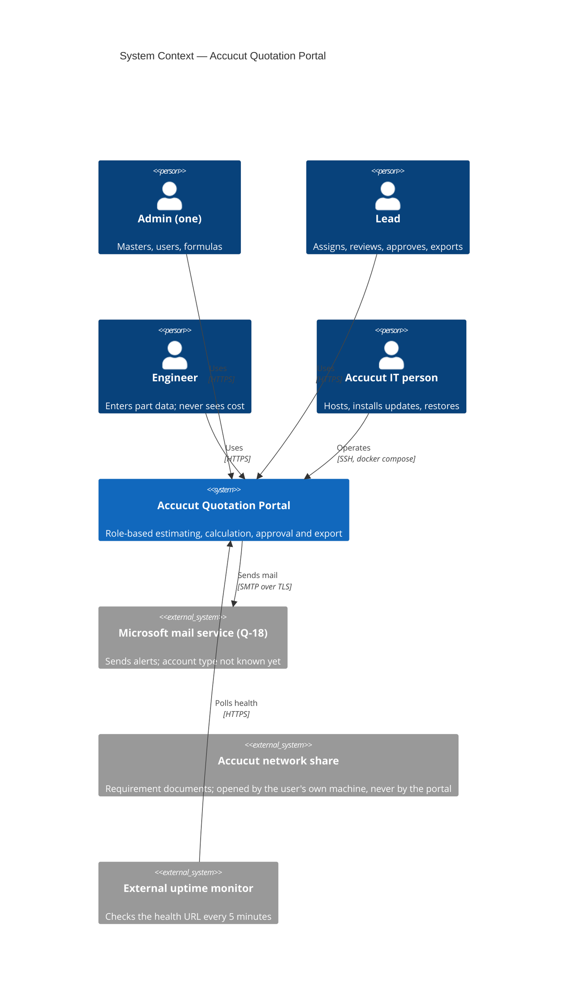
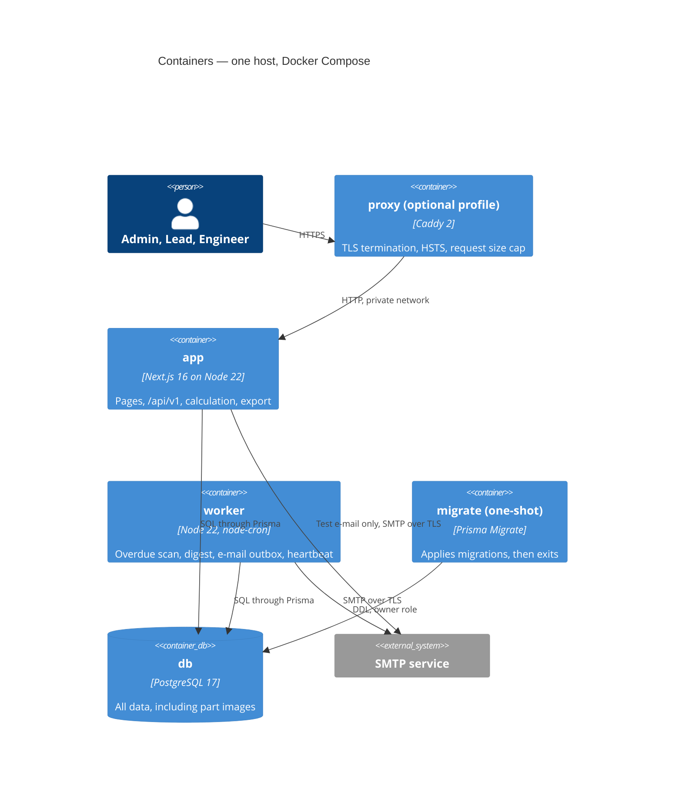
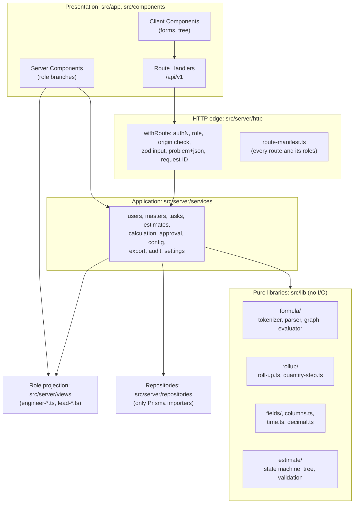
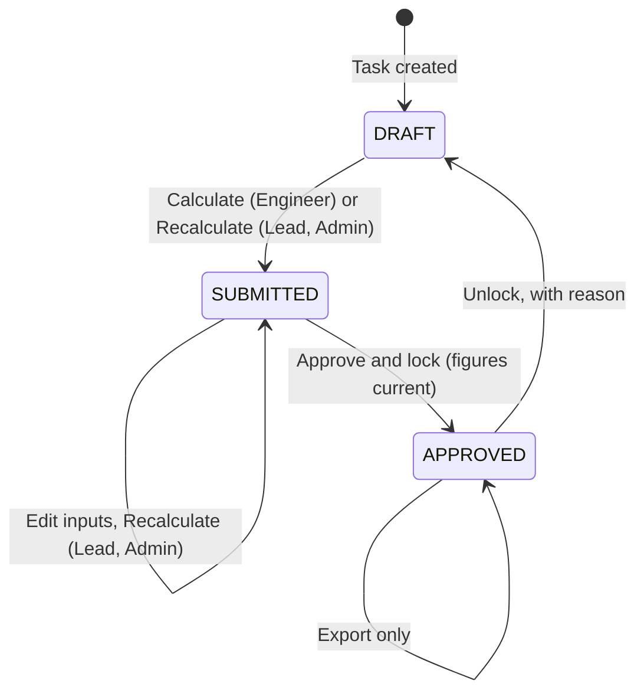
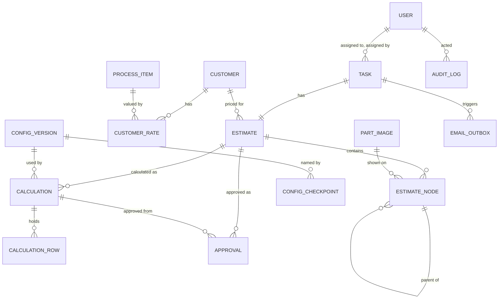

# Solution Architecture — Accucut Quotation Portal

| Field | Value |
|-------|-------|
| Version | 0.3 (G3 answers applied, SPEC v1.4; the changes are listed under "What changed in v0.3") |
| Owner | solution-architect |
| Status | In Review (G3: the delivery lead replied APPROVED, AQP-1 comment 10491; `master`'s gate decision is pending) |
| Date | 2026-11-01 |
| Inputs | SPEC v1.4 (`ACCUCUT_QUOTATION_PORTAL_REQUIREMENTS.md`), mainly §7.4, §18 D-12 to D-20, §18.5; AQP-1 comments 10490, 10491, 10493; AQP-13 comment 10487; requirements catalogue and questions v0.8. PRD v0.6 and release plan v0.6 (AQP-1 comment 10496); UX spec v0.2, before its owner finished applying the same answers (section 16.8). Gate log G2 attempt 2; risk register; `docs/standards/` |
| Companions | `docs/04-architecture/adr/ADR-001` to `ADR-014`; `docs/04-architecture/test-strategy.md` |
| Scope | Scope A (D-14): every FR through Release 2 and every NFR. Offline (FR-092) is not designed and not blocked (section 9.8) |

**How to read the labels.** **Evidence** = measured or read on 2026-11-01, with the source named. **A-nn** = an architecture assumption, listed in section 15 with what changes if it is wrong. **Proposed** = a value set here for an owner to confirm. Rule text comes from SPEC §7.4 and §18 D-12 as revised in v1.4. Q-32 (a) is now in the delivery lead's own words: their definition of QTY per Assy (AQP-13 comment 10487) and their count of 24 lids (AQP-1 comment 10490, relayed). Whether that meets DL-006 is `master`'s decision.

**What changed in v0.3.**

| # | Change | Result | Where |
|---|--------|--------|-------|
| 1 | Roll-up: every level's quantity applies | `T(row) = BG(row) + H(row) x sum of T(child)`. A row's own H is applied once. The nested example gives 24 lids. 500 nodes roll up in about 6 ms (Evidence) | Section 4.3, ADR-006 |
| 2 | Backups: weekly, kept 2 years, Admin looks after them | **Recovery point is up to 7 days of work**, and up to 14 if one run fails unnoticed. Their decision stands | Section 9.5, ADR-002 |
| 3 | E-mail: Microsoft Outlook, sender not decided | SMTP with a user name and password **cannot be relied on**. The design adds OAuth 2.0 client credentials. Four facts about the account are still needed | Section 4.7, ADR-011 |
| 4 | "Not applicable" entries | Scrap Weight is 0 on such a row, ordinary rows unchanged. Hidden from every list, refused by the database if edited | Section 4.9 |
| 5 | Password rule | 10 to 128 characters, a number, a symbol, not the e-mail, not common. 12-hour session from sign-in | Section 8, ADR-009 |
| 6 | Cleared totals | BL, BN, the price pre-fill, Tool Cost total, item totals and parent figures are withheld on any input change. Approval refused. Export needs a stated choice and is marked out of date | Sections 4.6, 4.8, ADR-007, ADR-012 |
| 7 | Reason on a changed price; one export total | `approvals.override_reason`; total Tool Cost in a footer row, never over a node's own BM cell | Sections 4.6, 5.1 |

No new ADR: each change applies a decision that an existing ADR already owns, so those ADRs are revised (section 13). No new dependency.

**G2 condition 5 at a glance.**

| Requirement of condition 5 | Where it is met |
|----------------------------|-----------------|
| One named quantity step, so a change to Q-32 (a) touches one place | `applyQuantityStep` in `src/lib/rollup/quantity-step.ts` (section 4.3, ADR-006). The rule did change. It touched the step and one line of the walk in `roll-up.ts`, not the single branch v0.2 claimed (section 4.3) |
| Stored row BG kept apart from the figure displayed for a parent | `calculation_rows.outputs` against `calculation_rows.rollup`, with separate TypeScript types (section 4.3, section 5.1) |
| Constructed example from SPEC §18.5 in the test strategy | `test-strategy.md` section 5, revised to the every-level rule |
| Real master data stays out of the repository; state where it is loaded from | Section 5.5, ADR-014 |

---

## 1. Architectural Drivers

**Quality attributes, ranked.** When two conflict, the higher one wins.

| Rank | Attribute | Why | Main NFRs |
|------|-----------|-----|-----------|
| 1 | Confidentiality of cost data | The product exists to keep rates and costs from Engineers. A leak cannot be recalled | NFR-001, 002, 006 |
| 2 | Correctness of prices | A wrong price is quoted to a customer. Q-35 (a) and OQ-ARCH-10 can still change a price in narrow cases | GOAL-03, NFR-026 |
| 3 | Immutability of approved work | Approved estimates must not move when anything changes (AQP-8) | NFR-026, NFR-007 |
| 4 | Changeability of the worksheet | The Admin changes fields and formulas without a developer (R2) | FR-072 to 080 |
| 5 | Operability by a small IT team | One host, one IT contact, no platform team | NFR-013, 030 |
| 6 | Performance at small scale | Under 50 users, 25 concurrent, 500 nodes | NFR-008 to 011 |

**Key functional drivers.** Server-side role projection (FR-007, 008); formula engine with no `eval` (FR-022, 023); roll-up rule D-12 (FR-029, 030); per-calculation master record (FR-031, 065); Excel export in the worksheet layout (FR-066 to 069); field insert and delete with re-lettering (FR-074, 075); immutable configuration versions (FR-077).

**Constraints.** Stack in `CLAUDE.md` §1 and SPEC §2. No `eval` (CONSTRAINT-02). Times stored in UTC and shown in IST (CONSTRAINT-03). Exactly one active Admin (CONSTRAINT-04). Images under 200 KB (CONSTRAINT-08). The repository stays public (D-13, DL-008). Secrets through environment variables only.

**Simplicity position.** One deployable codebase, three runtime containers plus an optional TLS proxy, one database. No queue broker, cache server, object store, search engine, service mesh or Kubernetes. Each moving part that remains is justified in the ADR that adds it.

---

## 2. System Context (C4 L1)



The portal never reads the network share. It stores the path as text and renders a `file:///` link plus "Copy path" (FR-033).

**Trust boundaries.**

| ID | Boundary | Crossing |
|----|----------|----------|
| TB-1 | Internet to the application | Browser and uptime monitor to the proxy and the app. Hostile by default |
| TB-2 | Engineer to cost data | Inside the app, between an authenticated Engineer and everything Restricted. This is the boundary the product exists for |
| TB-3 | Application to database | App and worker to Postgres, on a private Docker network |
| TB-4 | Application to mail service | Worker and `app` to Microsoft's token endpoint and mail service; message content leaves Accucut's control |
| TB-5 | Host and backups | Host filesystem, Docker volumes, off-host backup copies, the backup key held by the Admin |
| TB-6 | Public repository and CI | Everything committed is world-readable, including CI logs (D-13) |

---

## 3. Containers (C4 L2)



| Container | Responsibility | Technology | Communicates with | Scaling approach | Owner |
|-----------|----------------|------------|-------------------|------------------|-------|
| `app` | Server-rendered pages, `/api/v1`, auth, calculation, export | Next.js 16.4 (App Router, standalone output), Node 22 | `db` (TCP 5432); SMTP for the Settings test e-mail only (SCR-15 needs the result at once) | Vertical. One instance is enough (section 7, NFR-011). A second instance would need no code change: there is no in-process state that matters except the export gate | Delivery team; Accucut IT runs it |
| `worker` | Scheduled jobs and the e-mail outbox (FR-081 to 084), and the watch on the weekly backup (section 9.5). In R1 only a heartbeat, the backup watch and the job log | Node 22, node-cron 4 | `db`, SMTP | Single instance. Row claims use `FOR UPDATE SKIP LOCKED`, so a second one would be safe | Delivery team; Accucut IT runs it |
| `db` | System of record, including images | PostgreSQL 17 | none | Vertical. Pool sizes: app 10, worker 3 | Accucut IT |
| `migrate` | `prisma migrate deploy`, then exit; `app` and `worker` wait for it | Prisma CLI 7.10 | `db` with the owner role | Not applicable | Delivery team |
| `proxy` | TLS, HSTS, body-size cap. **Optional Compose profile** (A-01): skipped if Accucut IT already has a TLS terminator | Caddy 2 | `app` (TCP 3000) | Not applicable | Accucut IT |

**Why each exists.** `app`, `worker` and `db` are SPEC §2 and FR-091. `migrate` keeps DDL rights out of the runtime role. `proxy` exists because NFR-003 needs Secure cookies, which need TLS, and Next.js does not terminate TLS.

**Sizing (Proposed, A-01).** One Linux VM with 2 vCPU, 4 GB RAM and 40 GB SSD. Memory limits: `app` 1.5 GB, `worker` 256 MB, `db` 1 GB. The limit on `app` covers the worst-case export (section 4.6). This has not been load tested; `test-strategy.md` section 8 confirms it on the chosen host.

---

## 4. Components (C4 L3)

### 4.1 Component map of `app`



Dependencies point inward. `src/lib` imports nothing from `src/server`, `src/app`, Prisma or Next.js. Only `src/server/repositories` imports the Prisma client. Section 10 states how this is enforced.

**Key components.**

| Component | Path | Responsibility | Key FRs |
|-----------|------|----------------|---------|
| Route wrapper | `src/server/http/with-route.ts` | The only way to declare a handler: session, role, origin check, zod parse, error mapping, request ID, `no-store` | FR-007, NFR-001, 003 |
| Route manifest | `src/server/http/route-manifest.ts` | One table of every page and API route with allowed roles. The role-matrix test iterates it, and a test fails if a route file is missing from it | FR-007 |
| Session helper | `src/server/auth/session.ts` | `requireUser()`, `requireRole()`; reads `users` on every request, so role and active flag are never taken from the token | FR-001, 004, 007 |
| Engineer views | `src/server/views/engineer-*.ts` | Allow-list projections into strict output schemas. Importing `calculation-repository` from these files fails the build | FR-008, 051, NFR-002 |
| Formula engine | `src/lib/formula/**` | Tokenizer, parser, dependency graph, evaluator, internal and display forms | FR-022, 023, 028 |
| Roll-up | `src/lib/rollup/**` | T(row) for every row, item totals, the estimate total; **owns the quantity step** | FR-029, 030 |
| Figure state | `src/lib/estimate/figure-state.ts` | Pure: says `none`, `current` or `out-of-date` for an estimate. Every read of a figure goes through it (section 4.8) | FR-061, 070, 100, 101 |
| Password rule | `src/lib/auth/password-rule.ts` | The one zod rule for every place a password is set, on client and server (section 8) | FR-098, NFR-003 |
| Calculation service | `src/server/services/calculation-service.ts` | Orchestrates one calculation in one transaction | FR-024 to 031, 055, 061 |
| Approval service | `src/server/services/approval-service.ts` | Approve, unlock, refusal unless figures are `current`, notices, optional reason | FR-062 to 065, 101, 103 |
| Config service | `src/server/services/config-service.ts` | New immutable version per change; checkpoints; revert | FR-072 to 080 |
| Export service | `src/server/services/export-service.ts`, `src/server/export/**` | Builds the `.xlsx` from one calculation record, in a worker thread | FR-066 to 071 |
| Masters service | `src/server/services/masters-service.ts` | Masters, customer rate sync. Never lists or changes a hidden entry (section 4.9) | FR-012 to 018 |
| Mail transport | `src/server/mail/transport.ts` | The one place that builds the Nodemailer transport and its sign-in mode (section 4.7) | FR-019, 081 to 084 |
| Audit | `src/server/services/audit-service.ts` | Appends audit rows in the caller's transaction | FR-011, NFR-007 |

### 4.2 Calculation pipeline

```mermaid
sequenceDiagram
  actor U as Engineer or Lead
  participant R as Route (withRoute)
  participant C as calculation-service
  participant DB as PostgreSQL
  participant F as lib/formula
  participant L as lib/rollup
  U->>R: POST /estimates/{id}/calculate
  R->>C: calculate(user, estimateId)
  C->>DB: BEGIN; lock estimate row
  C->>C: Check status and ownership; validate every visible input
  C->>DB: Read nodes, customer rates, used materials, exchange rates
  C->>F: Evaluate row-scope fields for each node (compiled plan)
  F-->>C: Row values (each row's own M to BK)
  C->>L: rollUp(tree, row values)
  L-->>C: T(row), multiplier above each row, item totals, BL
  C->>F: Evaluate product-scope fields (BL, BN)
  C->>DB: INSERT calculations, calculation_rows; set status; COMMIT
  C-->>R: Lead or Admin: results. Engineer: status and the one message
```

The compiled plan (ordered list of parsed formulas) is cached in process by `config_versions.id`. A version is immutable, so the cache has nothing to invalidate.

### 4.3 Roll-up and the one quantity step (G2 condition 5)

**Rule in force.** SPEC §7.4 BL and §18 D-12, as revised in v1.4. QTY per Assy (H) is how many identical pieces of a part sit in one of its parent (AQP-13 comment 10487, their own words). Every level's quantity applies: 2 frames, 3 pipes per frame and 4 lids per pipe count 24 lids (AQP-1 comment 10490, relayed). The version 1.3 rule, multiply once at the top item, is withdrawn.

**Checked against SPEC §7.4 and D-12.** The rule is `T(row) = BG(row) + H(row) x sum of T(child)`, and BL is the sum of T over the top-level items.

| Question | Answer |
|----------|--------|
| Same as the closed form in SPEC §7.4 (each BG times the H of every row above it)? | Yes. Expanding the recursion, a descendant's BG meets the H of each row above it once. Evidence: the two forms agree on 300 random trees of 200 nodes (see "Large trees" below) |
| Is a row's own H applied twice? | **No.** H(row) reaches that row's own cost once, inside the row's BG (`BB = BA x H`). In the roll-up, H(row) multiplies **only the children's totals**. BG(row) is added outside that multiplication, so it never meets its own H again. It meets only the H of the rows above it |
| Does a leaf need a special case? | No. With no children the sum is 0, so T(leaf) = BG(leaf) |
| Item's own row (D-12 (c)) | A row like any other: its H counts once. This is working ASSUMPTION-51, open as Q-35 (a) |
| Several top-level items (D-12 (d)) | Added up. No further multiplier: T(item) already holds H(item) |
| Column (D-12 (e2)) | BG only. Tool Cost (BM) entries are totalled as typed, with no quantity. SPEC §7.4 BN divides BL by that plain total |

**The nested example, by the code path.** Item I has H 2, part P has H 3, sub-part S has H 4. Cost of one piece: 0, 1, 1.

| Row | H | One piece | Own BG (export) | T(row) (screen) | Pieces in the product | Adds to BL |
|-----|---|-----------|-----------------|-----------------|-----------------------|------------|
| S, lids | 4 | 1 | 4 | 4 | 2 x 3 x 4 = **24** | 24 |
| P, pipes | 3 | 1 | 3 | 3 + 3 x 4 = 15 | 2 x 3 = 6 | 6 |
| I, frames | 2 | 0 | 0 | 0 + 2 x 15 = 30 | 2 | 0 |

BL = **30**. **24 lids are counted**, confirmed by running the code path with cost on the lid alone, which gives BL = 24 (Evidence, this section).

**Figures, kept apart.**

| Figure | Meaning | Stored in | TypeScript type | Used by |
|--------|---------|-----------|-----------------|---------|
| Row figure | One row's own BG, BJ, BK, with its own H inside it (`BB = BA * H`) | `calculation_rows.outputs` | `RowOutputs` | Export rows; the only input to the roll-up |
| Displayed figure | T(row): the rule applied from that row downward (ASSUMPTION-52, Q-35 (b)) | `calculation_rows.rollup` | `RolledUpFigures` | Screen only (Σ figures on SCR-06, SCR-07, SCR-10) |
| Multiplier above | The product of H over all rows above this one | `calculation_rows.rollup` | `RolledUpFigures` | Reconciliation on SCR-10: BL = sum of BG x multiplier above. It holds quantities, not costs, and is still served only on Lead and Admin routes |
| Item total | T(item). No separate step any more: it is the displayed figure of a top-level row | `calculations.item_totals` | `ItemTotal` | The item table on SCR-06 |
| BL | Sum of the item totals | `calculations.product_values` | `ProductValues` | Row 2 of the export, tiles on SCR-06 |

The `Row` and `RolledUp` types are branded, so passing a displayed figure where a row figure is expected does not compile. The roll-up reads `outputs` and writes `rollup`; nothing reads `rollup` back into a sum. This is what stops a parent being counted twice.

**The named step.** Every use of a quantity in a roll-up passes through one function.

```ts
// src/lib/rollup/quantity-step.ts — the ONLY place a quantity is applied to a sum.
/** What a row's children add to that row: their totals times the row's OWN quantity.
 *  The row's own BG is never passed here, so its H cannot be applied twice. */
export function applyQuantityStep(
  childTotals: RolledUp | null,
  ownQuantity: Decimal,
): RolledUp | null {
  return childTotals === null ? null : childTotals.times(ownQuantity);
}
```

**How it is called.** `roll-up.ts` holds the rows in depth-first order, so a child always follows its parent. It walks them once in reverse, without recursion, in O(n).

```text
T(row)              = BG(row) + applyQuantityStep(Σ over children c of T(c), H(row))
BL                  = Σ over top-level items of T(item)
multiplierAbove(c)  = multiplierAbove(parent) x H(parent);  1 at a top-level item
```

Only `roll-up.ts` imports `quantity-step.ts`. H may reach the roll-up only as a value handed to that function, and a test holds both rules (`test-strategy.md` section 5.4).

**Correction to v0.2.** Version 0.2 and ADR-006 said the change would be one branch: `'into-parent'` returning `sum.times(quantity)`. That was true only when the item's own row holds 0. Changing that branch alone leaves `itemTotal = H(item) x (BG(item) + ...)`, which counts the item's own row twice: the version 1.3 reading (c), which SPEC v1.4 withdraws. So the real change was the step, the `top-item` level going away, and the T line in the walk. It stayed inside `src/lib/rollup/`, with no schema or API change.

| Item | Changed by the rule? |
|------|----------------------|
| `quantity-step.ts`, and the T line in `roll-up.ts` | **Yes** |
| Expected values in `tests/unit/rollup/quantity-cases.ts` | **Yes** |
| SPEC §7.4 BL, BR-046, BR-047 | Done (business-analyst, v1.4) |
| FR-024, 025, 029, 030, 056, GOAL-03 | Done (product-manager, PRD v0.6) |
| Wording on SCR-06, 07, 10 ("How the total is built", "Not multiplied again by this row's own quantity", "How to reconcile") | **Yes.** It states the old rule. It lives in `src/components/features/estimate-review/rollup-copy.ts`, and ux-expert rewrites it (UX-28). The SCR-06 "item quantity" line goes away, and the SCR-10 method changes |
| Database schema, migrations, API shape, screen structure | No. `multiplierAbove` is one more key in the `rollup` JSONB |
| Row outputs (M to BK) | No: `BB = BA * H` is not touched |
| Previously approved estimates | None exist yet |

**If Q-35 changes it.** Both open points are small and stay in `src/lib/rollup/`.

| Answer | Change | Effect |
|--------|--------|--------|
| (a) The item's own row also takes the item quantity | For top-level rows only, `T(item) = H(item) x (BG(item) + Σ T(c))` | In case CE-2 the total goes from 316 to 326. Only where the item's own row has values and H is above 1. Nothing else moves |
| (b) A part below the top shows something else | The figure stored in `rollup`, and `rollup-copy.ts` | Display only. BL does not change |

**Large trees (Evidence, 2026-11-01).** Throwaway script, invented data, Node 24.19, decimal.js 10.6.0 at 34 significant digits. This is not the target host or Node version. p95 over 40 runs (20 for the closed form), 500 nodes. The designed form was timed with BG, BJ and BK rolled up (three passes).

| Tree shape | T form, three columns | Closed form, one column only |
|------------|-----------------------|------------------------------|
| One parent, 499 children | 2.8 ms | 0.9 ms |
| Random, depth bias | 4.0 ms | 4.7 ms |
| One chain, depth 500 | **6.0 ms** | **186 ms** |

- **NFR-008 (under 2 s for 500 nodes):** the roll-up costs about 6 ms at worst, against the 136 to 153 ms measured for the row engine in section 7. It is not a material part of the budget.
- **The closed form is not used in the product.** It is O(n x depth): on a deep chain, one column took about 30 times as long as all three columns by the T form. It appears only as a test oracle.
- **Depth:** the walk has no recursion, so unlimited depth (SPEC §6.1) cannot overflow the stack. Validation's 500-node limit bounds the work.
- **Precision:** decimal.js rounds at 34 digits, so the two forms can differ in the last digits (worst relative difference 8.7e-33 over 300 trees). Tests compare at 2 decimals, not exactly. With every H = 1 the result equals a plain `SUM(BG)` in 300 of 300 trees, so the sample's total is unchanged.
- **Size of numbers:** a multiplier grows with depth (8 levels at H 99.99 gives about 1.2e19). Nothing overflows: 40 levels at H 9999.99 evaluates normally, at about 1.2e163. Stored values keep 34 significant digits. The export is the weaker link: Excel holds 15 significant digits, so a cell stops being exact to the paisa above about ₹ 10 trillion. SPEC sets no ceiling on H and none is added. NFR-010 is not affected: the export reads `outputs`, not the roll-up.

**A zero quantity on a parent (OQ-ARCH-10, the same point as OQ-PM-07; price risk).** The rule multiplies a subtree by H, so **H = 0 on a parent silently removes everything under it**: item quantity 2, part quantity 0, sub-part quantity 4 gives BL = 0 with the sub-parts unpriced. Under version 1.3 this could not happen below the top item. It conflicts with BR-048 ("A zero entry must not change any calculation") and with D-06, which tells Engineers to enter 0 in numbers a parent does not need. PRD v0.6 FR-056 now excepts QTY per Assy, but SPEC §7.3 still allows it. D-12 (b2) covers a non-zero value, so it does not settle this. This design calculates what the rule says and does not refuse the 0 (A-19), because that is a product decision. PRD v0.6 proposes a warning at Calculate. **The architect recommends a block**, with the field message "QTY per Assy must be above 0 on a part that has parts under it": a warning can be passed, and the result is a price that is low with nothing on the Lead's screen to show why, while no real assembly has 0 pieces. Either is one rule in `lib/estimate/validation`, about 1 h of work, and the message holds no cost.

**In the formula language.** BL cannot be written as `SUM(BG)`, because SPEC §8.2 defines `SUM` as a plain sum across all nodes. A new product-scope function is added, seeded as:

```text
BL = ROLLUP(BG)
BN = BL / SUM(BM)
```

`ROLLUP(column)` calls the roll-up above with the chosen column, so BL stays visible and re-letters like any other formula (FR-075). `ROLLUP` is valid only in product-scope fields. PRD v0.6 FR-022 lists it, and SPEC §8.2 is to follow (section 16.8). SCR-06 "How the total is built" explains it in words.

**Displayed BJ and BK.** BG, BJ and BK carry a registry flag `rollupDisplay: true`. The roll-up runs once per flagged column with the same code, so no column letter is special-cased in code and re-lettering is safe. A parent's displayed BJ equals its displayed BG divided by the rate. Row BH and BI are not rolled up.

**Division by zero and totals (A-07).** The evaluator's value type is `Decimal | null`, where `null` means divide by zero. `null` spreads through every operator, and through `SUM` and `ROLLUP`, so a total shows "—" rather than a silently low price. The calculation never stops (FR-026). Seed formulas can only reach this through BJ, BK or BN, none of which feed BL.

### 4.4 Estimate state machine



Pure code in `src/lib/estimate/state-machine.ts`; an exhaustive `switch` with `assertNever`. Task Open or Closed is **derived** from `estimates.status`, never stored, so FR-038 holds by construction. Approval is refused with 409 while the totals are cleared or the estimate has never been calculated (D-20, section 4.8).

### 4.5 Field registry and configuration

ADR-004. The registry is one validated JSON document per version, not rows. A change is `load latest → apply a pure edit → validate all formulas, references and cycles → insert a new version`. Formulas use stable references, `{{f:<fieldId>}}`, `{{rate:<rateId>}}`, `{{mat:<key>}}`, `{{fx:USD}}`. Rates use a stable ID rather than the name in SPEC's example, so a rate rename cannot break a formula.

SPEC §8.1's `FieldDefinition` is the document's element type. The UX screens show it needs more than SPEC lists:

| Added property | Why | Screen |
|----------------|-----|--------|
| `engineerVisible` | True only for `input` fields and for F. A schema rule refuses it everywhere else, including I, BH and BI | SCR-05, ADR-008 |
| `rollupDisplay` | BG, BJ, BK show a Σ figure on a parent | SCR-06, 07, 10 |
| `systemRole` | Marks fields the code depends on: `sl-no` (A), `quantity` (H), `unit-price` (BG), `total` (BL), `approved-price` (BO), `tool-cost` (BM). These cannot be deleted, and A and BO have no editable formula. `ROLLUP` finds H through this role, so deleting H cannot break the roll-up, and the export finds BM the same way for its footer | SCR-17, 20 |
| `unit`, `hint`, `formOrder` | Unit tags and hints sit beside each input. `formOrder` is separate from column position because section 08 shows AP, AU, BM, then AJ (SPEC §7.1), which is not letter order. Enter follows it | SCR-05 |
| `stageId`, `group` | Output placement in the six stages and their sub-headings | SCR-07, 17 |
| `options`, `displayUnit` | List values for a new choice field; "kg", "$", "€" on values | SCR-07, 19 |

Sections and stages get a `shortName` (the strip on SCR-05), a display mode (`cards` or `multi-select`, as section 07), and for stages `totalFieldIds`, because the total on a stage heading is sometimes one field (stage 3 is AY) and sometimes several (stage 5 adds BC to BF). Section range tags such as "E, F, J–L, N" are derived per role from the fields that role sees.

A field's **references** include formulas, `hideWhenZero`, `visibleWhen` and stage totals. Field delete (SCR-20) checks all four. An input with `defaultValue` takes that value when its key is absent, so a new input with a default does not block Calculate on older drafts (A-15).

The configuration seed comes from SPEC §7 and is committed. One seed formula differs from SPEC §7.4 on purpose: Scrap Weight O (section 4.9). Header texts, widths and formats are structure read from the sample (ASSUMPTION-46). Cell values are not read and never copied.

### 4.6 Excel export

ADR-012. `export-service` loads one calculation record and streams its images in batches of 50, builds an `ExportModel`, and hands it to `src/server/export/build-workbook.ts` in a `node:worker_threads` thread, so the event loop stays free for other users. Export reads `calculation_rows.outputs`, never `rollup` (D-12 (b3)). If an estimate has no calculation yet, input columns are filled and output columns stay empty (A-05). The date in the file name is the IST date of the download.

**One total only, plus the total Tool Cost (D-16, Q-31 answered).** BL, BN and BO appear once, in row 2, and the file has no per-item totals. The export now knowingly differs from the sample on this point (SPEC §14.12). The total Tool Cost, the plain sum of BM with no quantity, cannot go in row 2, because BM2 is the first node's own Tool Cost. It goes in a **footer row**, one blank row below the last node: the value in the Tool Cost column, with the label "Total Tool Cost" in the cell to its left. It sits directly under column BM, follows that column if letters move (`systemRole: 'tool-cost'`), and changes no node row. The value comes from `product_values.toolCostTotal`, so an approved file never changes. Adding up the exported BG column gives BL only when every quantity above a row is 1 (SPEC §10), so SCR-10 gives the method (UX-28).

**What the file holds, by state (section 4.8).**

| Cell | `none` | `current` | `out-of-date` |
|------|--------|-----------|---------------|
| Node rows | Inputs; outputs empty (A-05) | The calculation record | The last record, inputs and costs together, so each row agrees with itself (ASSUMPTION-55) |
| BL2, BN2 | Empty | Filled | **Empty** |
| BO2 | Empty | Filled while an approval is active | **Empty** |
| Footer, total Tool Cost | Empty | Filled | **Empty** |

**An out-of-date figure cannot leave unnoticed (architect's addition to ASSUMPTION-55).** Row costs are still in the file, so four things mark it. All four apply only in the `out-of-date` state, and Q-37 can remove them.

1. **A stated choice first.** `GET /export` returns 409 `EXPORT_OUT_OF_DATE` unless the request carries `allowOutOfDate=true`, which SCR-10 sends only after a Lead confirms a dialog (UX-30). An old link cannot fetch such a file by accident.
2. **File name:** `Quotation_<Customer>_<TaskId>_<YYYY-MM-DD>_OUT-OF-DATE.xlsx`.
3. **Sheet tab** named `OUT OF DATE`.
4. **A notice row** under the footer: "OUT OF DATE. Inputs changed after this calculation on <IST time>. Press Recalculate and download again."

The state is read in the same repeatable-read transaction that builds the file, never taken from an earlier `export-summary`, so a change between the two cannot slip through. An approved estimate cannot reach this state: its inputs are locked. **Limit:** a file downloaded while current can go out of date later on someone's disk, and the portal cannot recall it. The date in its name is the only signal.

The decisions on row-2 cells, the footer and the markers live in one file, `src/server/export/product-cells.ts`. Cell values are full-precision numbers with a two-decimal number format, so Excel's own sums reconcile with the stored values. Text goes in as strings only, so nothing an Engineer types can become a live formula.

**Measured feasibility (Evidence, 2026-11-01).** Throwaway benchmark with invented data on an Intel i7-10510U with 8 GB, Node 24, in-memory ExcelJS 4.4.0, 67 columns, one incompressible 199 KB image per row. Excludes database reads. Runs shared one process, so memory figures are upper bounds. This is not the target host and not the target Node version.

| Nodes and images | Time | File | Peak process memory |
|------------------|------|------|---------------------|
| 50 | 1.7 to 1.8 s | 9.8 MB | 178 MB |
| 200 | 7.9 s | 39 MB | 312 MB |
| 500 (validation's maximum) | 16.9 s | 97.5 MB | 528 MB |

**Outcome for RISK-010 and OQ-PM-05.** No hard limit is needed. Validation already bounds the worst case at about 100 MB, and it builds in under 20 seconds on this laptop. NFR-010's 10 s target holds comfortably at 50 nodes. The strategy is a worker thread plus a one-at-a-time gate for estimates over 100 nodes (a second such request gets 503 with `Retry-After`), and a proxy read timeout of at least 120 s. The figures also say an export of 500 nodes takes about 17 s, so the 10 s target must not be read as applying there.

### 4.7 `worker`

| Job | Schedule | Behaviour | FRs |
|-----|----------|-----------|-----|
| `heartbeat` | Every minute | Writes `job_runs`; `/api/health` reports it | NFR-024 |
| `overdue-scan` | Every minute (R2) | For open tasks past deadline, inserts an outbox row. The unique key stops repeats, so the target of 5 minutes is met with room to spare | FR-082 |
| `daily-digest` | 11:00 Asia/Kolkata, plus a catch-up at start-up if today's run is missing (R2) | Inserts one outbox row per Engineer per IST date | FR-083 |
| `outbox-send` | Every minute (R2) | Claims up to 25 due rows with `SKIP LOCKED`, sends, records the result; up to 3 retries with backoff of 1, 5, 15 minutes | FR-084 |
| `backup-watch` | Daily, 09:00 Asia/Kolkata (R1) | Looks for a good `backup` row in `job_runs` in the last 8 days. If there is none, logs at `error` and, once e-mail is on, writes one outbox row to the Admin (section 9.5) | NFR-013 |

Assignment e-mail (FR-081) is one outbox row written in the task's own transaction, so a rolled-back task sends nothing. All job logic takes `now` from a `Clock` argument so tests control time.

**Idempotency keys.** `task-assigned:<taskId>:<assignmentRevision>`, `task-overdue:<taskId>:<deadlineAtUtc>`, `digest:<engineerId>:<istDate>`, `backup-missed:<istDate>`. A unique index enforces them, so re-running a job sends nothing twice. A changed deadline gets a new key, so a task that becomes overdue again is reported again (A-09).

E-mails carry task details, path and deadline only. They never contain cost, rate or formula data, and the digest goes only to people who may see the task. Each message has HTML and plain-text bodies (SCR-22). Links are full addresses built from `APP_ORIGIN`, so the worker needs that variable. The logo is attached inline by content ID, so no mail client fetches it from the portal. SCR-22 is a template reference, not a route.

The Settings test e-mail (SCR-15) is the one exception to the outbox: `app` sends it directly to the signed-in Admin's own address, because the screen must report success or failure at once, and because no recipient is accepted from the client.

**Mail transport (D-15, OQ-ARCH-11).** Their answer is "microsoft outlook, not decided yet on the sender address". SPEC §2 names Nodemailer over SMTP, with credentials in environment variables. **SMTP with a user name and password cannot be relied on for a Microsoft account.** Whether it works depends on facts not yet known, starting with which kind of account "Microsoft Outlook" means.

| If it turns out to be | Does user name and password over SMTP work? | What the portal needs |
|-----------------------|---------------------------------------------|-----------------------|
| **Microsoft 365 business mailbox** | Today only if the organisation allows it, and not for long. SMTP AUTH is off for organisations created after January 2020 and must be enabled per mailbox, and Security Defaults keeps it off. Basic authentication is reported to go off by default for existing tenants at the end of December 2026, an administrator can turn it back on, and a final removal date is to be announced in the second half of 2027 | **OAuth 2.0 client credentials over SMTP** (`smtp.office365.com`, port 587, STARTTLS, TLS 1.2 or later), which Microsoft recommends. An administrator of the tenant registers the app, grants `SMTP.SendAsApp`, registers the service principal in Exchange, and gives it access to one licensed mailbox. Limits: 10,000 recipients a day, 30 messages a minute |
| **Personal Outlook.com or Hotmail** | **No.** Microsoft states that Outlook.com requires Modern Auth / OAuth2 (`smtp-mail.outlook.com`, port 587, STARTTLS). The same page says an app password may be needed in some cases, which this design does not rely on | Delegated OAuth: a person signs in once and the portal keeps a refresh token. There is no tenant, so client credentials do not apply. **Not designed.** A personal mailbox is a poor sender for a company: it is tied to one person. Recommended answer: use a business mailbox |
| **Outlook is only the mail app**, and the mailbox is with a domain host or an on-premises Exchange server | Probably yes. That provider decides | `password` mode below |

**What is built.** Nodemailer stays, with no new dependency. `src/server/mail/transport.ts` has one setting, `SMTP_AUTH_MODE`, with three values:

| Mode | Used for | Variables |
|------|----------|-----------|
| `none` | Mailpit, in local, CI and staging | `SMTP_HOST`, `SMTP_PORT` |
| `password` | A provider that allows it | Also `SMTP_USER`, `SMTP_PASSWORD` |
| `oauth2-client-credentials` | Microsoft 365. The design default for production | Also `SMTP_USER` (the mailbox), `SMTP_OAUTH_TENANT_ID`, `SMTP_OAUTH_CLIENT_ID`, `SMTP_OAUTH_CLIENT_SECRET` |

In `oauth2-client-credentials` mode, a small function posts to `https://login.microsoftonline.com/<tenant>/oauth2/v2.0/token` with scope `https://outlook.office365.com/.default`, using the platform `fetch`. It hands the token to Nodemailer through its documented `provisionCallback`, which also renews it. Nodemailer's docs describe XOAUTH2 and the callback, but give no Microsoft client-credentials recipe, so **this is unproven until tested against a real tenant** (`test-strategy.md` section 9).

**Rules that hold in every mode.**
- No credential is ever in code, the database, `settings`, a log or Jira. `settings` holds the sender name and address only. Environment variables only, on the host, mode 600.
- The mailbox is dedicated to the portal. Microsoft's steps give the app `FullAccess` to it, so it must hold nothing else.
- The sender address must be that mailbox, or one it has Send As rights on; otherwise Microsoft refuses with 5.7.60. The Settings test e-mail (SCR-15) proves this, and reports the failure without any secret.
- `outbox-send` claims at most 25 rows a run, so it stays under 30 messages a minute. A digest to 50 Engineers then takes two runs.
- An Entra client secret expires. When it does, every send fails, rows go `failed`, and Settings and the log show it. The IT person diarises the date.

**If the organisation refuses SMTP AUTH altogether.** Options named by Microsoft: Azure Communication Services Email, for internal and external recipients. High Volume Email and Direct Send reach internal recipients only, and SMTP relay needs port 25 with a static IP or a certificate, and cannot be used from a third-party hosted service. Microsoft Graph `sendMail` would be a new transport. Each is contained in `transport.ts`, about half a day, and the outbox does not change.

**Facts needed (OQ-ARCH-11), from their IT person, before e-mail can go live.** (1) Which kind of account from the table above, and which mail domain. (2) If Microsoft 365: who administers the tenant, and whether Security Defaults is on. (3) Can a dedicated licensed mailbox be created, and what is its address (the open sender address). (4) Can the host reach port 587 outward. Until then, alerts stay behind `FEATURE_EMAIL`, tested on Mailpit. None of this holds any other feature.

**Sources (read 2026-11-01).** [Microsoft Learn: send email from an application](https://learn.microsoft.com/en-us/exchange/mail-flow-best-practices/how-to-set-up-a-multifunction-device-or-application-to-send-email-using-microsoft-365-or-office-365); [Enable or disable SMTP AUTH](https://learn.microsoft.com/en-us/exchange/clients-and-mobile-in-exchange-online/authenticated-client-smtp-submission); [OAuth for SMTP](https://learn.microsoft.com/en-us/exchange/client-developer/legacy-protocols/how-to-authenticate-an-imap-pop-smtp-application-by-using-oauth); [Outlook.com settings](https://support.microsoft.com/en-us/office/pop-imap-and-smtp-settings-for-outlook-com-d088b986-291d-42b8-9564-9c414e2aa040); [Nodemailer OAuth2](https://nodemailer.com/smtp/oauth2). **The December 2026 date is second-hand:** [Microsoft's post of 27 January 2026](https://techcommunity.microsoft.com/blog/exchange/updated-exchange-online-smtp-auth-basic-authentication-deprecation-timeline/4489835) could not be read directly with the tools here, so it rests on search summaries and [Office 365 IT Pros](https://office365itpros.com/2026/01/29/smtp-auth-basic-retirement/). The IT person should check the current position.

### 4.8 Cleared totals (FR-100, FR-101, D-20, Q-37)

**Decision (their words, relayed).** "Block approval. And clear the total cost when any input is updated. So, the user will be forced to press calculate or recalculate to see the total cost." "Any input" is applied as written, so Remarks counts.

**Working assumption (ASSUMPTION-55, Q-37 open).** Only the total (BL) is cleared, with what comes from it. Each part's own cost stays as last calculated and is marked out of date. The export leaves BL2 and BN2 empty and carries row costs as last calculated. A price approved before an unlock stays in the history and is not shown as the current price. This section applies that, plus two additions by the architect, both marked below, so the working assumption does not leak a total or let an old figure leave unnoticed.

**"Cleared" is a rule on reading, not a change to a record.** `calculations` is immutable and the database refuses updates (ADR-007), and an approved calculation must survive. So nothing is deleted or nulled. `lib/estimate/figure-state.ts` works out one state from data already held, and every read of a figure goes through it.

| State | Condition | Who sets it |
|-------|-----------|-------------|
| `none` | No calculation yet | Task created |
| `current` | `estimates.inputs_revision = calculations.inputs_revision` | Calculate, Recalculate |
| `out-of-date` | The revisions differ | Any input change |

The clearing is server-side: the `/costs` projection omits the values, so no browser state can show them.

**What counts as an input change.** Every write that bumps `inputs_revision`, in the same transaction, which also serialises against Calculate through the estimate row:

- a changed value in any input field, including Remarks;
- a changed customer;
- a part image added, replaced or removed;
- a part added, deleted, moved or reordered. **A move to another parent changes the price under the every-level rule**, so this one is not cosmetic.

**A save that changes nothing is not a change.** The 30-second autosave (SPEC §11) and a repeated PATCH must not clear a total. `estimate-service` compares normalised values in the transaction (`1.50` equals `1.5`) and bumps only on a real difference. Changing a value and changing it back still counts as two changes, and the total stays cleared.

**What each figure does.**

| Figure | `current` | `out-of-date` |
|--------|-----------|---------------|
| BL, BN | Shown | **Withheld** (ASSUMPTION-55) |
| Approved Quote Price pre-fill | BL | **Withheld**; SCR-08 cannot open |
| Total Tool Cost | Shown | **Withheld** with BN, which it feeds (D-20 reading) |
| Item totals and every parent's Σ figure (`rollup`) | Shown | **Withheld (architect's addition).** T(item) is a share of BL, and with one item it **is** BL. Leaving these on screen would show the cleared total under another name |
| A row's own costs (`outputs`) | Shown | Shown, marked out of date (ASSUMPTION-55) |
| Reconciliation on SCR-10 | Shown | Withheld |
| BO, current price | Shown if an approval is active (`unlocked_at` is null) | Not shown, as no approval is active. History keeps it |

**Approval.** `POST /approve` runs under the estimate row lock and refuses with 409: `NOT_CALCULATED` for `none`, `TOTALS_OUT_OF_DATE` for `out-of-date`. `calculationId` must still match, so a figure that changed under a Lead cannot be approved. The check lives on the server: SCR-08 being closed is only a convenience.

**Unlock.** Unlock alone changes no input, so figures stay `current` and SCR-06 keeps showing them, as UX-04 expects. The state is DRAFT, so approval still needs a Recalculate, which reads current rates (FR-063). The approved price is not shown as current from the moment of unlock.

**Engineers.** No Engineer route carries the state. An Engineer never sees a figure, so nothing there changes, and a status is not a cost. Rate and configuration changes after a calculation do not count as input changes: that stays OQ-ARCH-06 and OQ-UX-16.

**Export.** See section 4.6. The file cannot carry an out-of-date figure unnoticed.

### 4.9 "Not applicable" entries (FR-018, D-17, Q-36)

**The rule.** The Material row has values 0, is created by the system, cannot be edited or deleted, and is not shown in any list, Admin pages included. The Treatment / Color entry follows the same handling, and no formula uses it. A part with it skips the material cost only.

**A separate flag is needed.** `is_system` cannot carry this, because FR-017's "Other" is also a system entry and must stay on the Admin's list. So `materials` and `treatments` each get `is_hidden`, true only for these two rows.

| Concern | Design |
|---------|--------|
| Creation | One migration inserts both rows with fixed IDs, on every environment. It is not in the seed, because the seed refuses to run in production and these rows hold no real data. Rows are in place before the guard trigger is created |
| Never returned to a list | `master-repository` applies `is_hidden = false` by default on `GET /materials`, `GET /treatments`, and on search and "used by" checks. Reading a hidden row needs a separately named method, used only by the two below |
| Where it is returned | `GET /options/materials` and `/options/treatments`, for the drop-down, and the calculation's own lookup (A-17). `materialConsidered` comes back null |
| Cannot be edited or deleted | `PATCH` or `DELETE` on a hidden ID returns 404, the same as an unknown ID, so the Admin API does not confirm it exists. A database trigger refuses `UPDATE` and `DELETE` where `is_hidden`, so this holds even if the service is wrong |
| Cannot be imitated | `POST` or `PATCH` with that name, in any letter case, returns 422 `NAME_RESERVED`. The message does not name the entry |
| As a part's value | Per ASSUMPTION-54 the words show where a part's Material or Treatment is shown, including the export: `calculation_rows.inputs` holds the resolved text |
| Its zero rates | The evaluator gets 0, and the snapshot keeps them. They are never served: F and I are blank for such a row on screen and in the export. `GET /nodes/{nodeId}/costs` leaves `Material-*` and I out of the operands on that row, so SCR-07 prints no worked line for M, O and AK (UX-34) |

**Negative Scrap Weight.** With Specific Gravity 0, Blank Weight M is 0, so `O = M - N` gives `-N` whenever Part Weight N is above 0. AK is still 0 with the seed formulas, because the scrap rate is 0, so no price changes. It still needs handling: a negative weight would appear on SCR-07 and in the export, and a later Admin formula that reads O, such as a Rejection rule in BC, would pick it up as a real number.

| Option | Result |
|--------|--------|
| **Chosen:** seed `O = IF(Material-Specific-Gravity > 0, M - N, 0)` | O is 0 on such a row. Every row with a real material is exactly `M - N`, including N above M. Needs no new operand, and the formula text does not name the hidden entry, which a `Material-Not-Applicable` operand would show on SCR-07 and SCR-17 against D-17 |
| `MAX(M - N, 0)` | **Rejected.** Changes the price on ordinary rows where N is above M and the scrap rate is above 0, which the worksheet does not do |
| `IF(M > 0, M - N, 0)` | **Rejected.** An ordinary material with blank dimensions has M = 0 and N above 0. Its worksheet result would change |
| Keep -N and show 0 | **Rejected.** Screen and export would differ from the stored value and from the formula printed beside it |

This changes one seed formula against SPEC §7.4, so business-analyst should record it (section 16.8). `IF` needs comparison operators (`>`, `>=`, `<`, `<=`, `=`, `<>`) inside its condition, which SPEC §8.2 does not list. They are valid only in that position. A real material with Specific Gravity 0 would also take the guard: its M is already 0, so the row is meaningless, and SCR-13 should require a value above 0 (UX-37).

---

## 5. Data Architecture

### 5.1 Logical model



| Table | Key attributes | Class | Notes |
|-------|----------------|-------|-------|
| `users` | `name`, `email` (unique), `password_hash`, `role`, `is_active`, `session_version`, `must_change_password` | Confidential | Partial unique index allows one active Admin (CONSTRAINT-04) |
| `login_throttles` | `key_hash`, `failures`, `blocked_until` | Internal | Holds unknown e-mails too, so they cannot be told apart (FR-001) |
| `password_reset_tokens` | `token_hash`, `user_id`, `expires_at`, `used_at` | Confidential | R2. Hashed; single use (FR-003) |
| `process_items` | `name` (unique), `unit`, `default_value` | Restricted | |
| `customers` | `name` (unique), `phone`, `email`, `address`, `deleted_at` | Confidential | Only the name is required (OQ-UX-04). Soft delete (A-13) |
| `customer_rates` | `customer_id`, `process_item_id`, `value` | Restricted | Normalised, so sync is plain SQL (FR-014) |
| `materials` | `material_in_drawing` (unique), `material_considered`, `price_per_kg`, `specific_gravity`, `scrap_rate`, `is_system`, `is_hidden`, `deleted_at` | Restricted | `is_hidden` marks "Not applicable" (D-17, section 4.9). Soft delete (A-13) |
| `exchange_rates` | `currency`, `inr_value`, `updated_by`, `updated_at` | Restricted | |
| `treatments` | `name`, `is_system`, `is_hidden` | Internal | `is_system` marks the fixed "Other" (FR-017) and "Not applicable". `is_hidden` marks only the second, so "Other" stays on the Admin's list |
| `settings` | `alerts_enabled`, `sender_name`, `sender_address` | Internal | Single row. No credentials of any kind, in any mail mode (section 4.7) |
| `config_versions` | `number` (unique), `snapshot` JSONB, `created_by`, `reason` | Restricted | Immutable. Holds formulas |
| `config_checkpoints` | `name`, `config_version_id`, `created_by` | Restricted | `created_by` is null for the seed checkpoint |
| `task_sequences` | `year`, `last_value` | Internal | Issues `Q-<year>-<4 digits>`; year taken in IST (FR-041) |
| `tasks` | `code` (unique, the `Q-YYYY-NNNN` in page addresses), `engineer_id`, `assigned_by`, `folder_path`, `deadline_at`, `title` (120), `notes` (1,000), `assignment_revision` | Internal | Length limits Proposed by UX |
| `estimates` | `task_id` (unique), `customer_id` (null until chosen), `status`, `inputs_revision`, `current_calculation_id` | Confidential | Every input change bumps `inputs_revision`, in the same transaction (section 4.8) |
| `estimate_nodes` | `estimate_id`, `parent_id`, `sort_index`, `inputs` JSONB, `image_id`, `revision` | Confidential | Inputs only. Sl. No is derived, never stored here |
| `part_images` | `sha256`, `mime`, `bytes` bytea, `size_bytes`, `file_name` | Confidential | Immutable; deduplicated per estimate. `file_name` is display text on SCR-05, sanitised |
| `calculations` | `estimate_id`, `config_version_id`, `inputs_revision`, `master_snapshot` JSONB, `product_values` JSONB, `item_totals` JSONB, `created_by` | Restricted | Immutable. FR-031. `product_values` holds BL, BN and `toolCostTotal` |
| `calculation_rows` | `calculation_id`, `node_id`, `parent_id`, `sort_index`, `sl_no`, `inputs` JSONB, `image_id`, `outputs` JSONB, `rollup` JSONB | Restricted | Immutable. A full copy of the tree as calculated. `rollup` holds T(row) and `multiplierAbove`. `inputs` holds **resolved display text** for E, F and G, so renaming a material or treatment later cannot change an approved estimate |
| `approvals` | `estimate_id`, `calculation_id`, `approved_price`, `calculated_bl`, `is_override`, `override_reason`, `approved_by`, `approved_at`, `unlocked_by`, `unlocked_at`, `unlock_reason` | Restricted | BO lives here. One row per approval cycle; the active one has `unlocked_at` null. Override rule: A-12. `override_reason` is optional text of at most 500 characters (D-18), null unless `is_override`, and is copied to the audit row |
| `audit_log` | `actor_id`, `event`, `object_type`, `object_id`, `object_label`, `before`, `after`, `request_id` | Restricted | Append-only. Admin read only. `object_label` keeps the name at that time (SCR-16) |
| `email_outbox` | `idempotency_key` (unique), `event`, `to`, `cc`, `subject`, `body_html`, `body_text`, `status`, `attempts`, `next_attempt_at`, `last_error` | Internal | Is also the e-mail log (DR-013) |
| `job_runs` | `job`, `started_at`, `finished_at`, `result` | Internal | Also records each weekly backup (`job = 'backup'`) |

**Why cost data sits in its own tables.** `estimate_nodes.inputs` holds only what a person typed: I is never written there. Everything Restricted about an estimate is in `calculations`, `calculation_rows` and `approvals`, which Engineer code paths are not able to import (ADR-008). Calculated data is therefore not filtered out of an Engineer's row; it is on a different table the Engineer's code cannot reach.

**Values and precision.**
- Master values: `Decimal(18,4)` per `coding-standards.md`.
- Inputs in JSONB: decimal strings keyed by stable field ID; an absent key means blank.
- Calculated values: decimal strings at 34 significant digits, half-up rounding, in JSONB (FR-027). `Decimal(18,4)` cannot hold "full precision"; see section 16.
- JS `number` is never used for money. Export converts to a double only at the workbook boundary.

**Indexes.** `idx_estimate_nodes_estimate_id`; `idx_tasks_engineer_id_deadline_at`; `idx_tasks_assigned_by_deadline_at`; `idx_tasks_deadline_at`; `idx_estimates_status`; `idx_calculation_rows_calculation_id`; `idx_audit_log_created_at`; `idx_audit_log_actor_id`; `idx_email_outbox_status_next_attempt_at`.

**Database-level guards, added by hand-written SQL in migrations.**
- Single active Admin: `CREATE UNIQUE INDEX uq_users_single_active_admin ON users (role) WHERE role = 'ADMIN' AND is_active`.
- Triggers that raise on `UPDATE` or `DELETE` of `audit_log`, `config_versions`, `calculations` and `calculation_rows`.
- Triggers on `materials` and `treatments` that raise on `UPDATE` or `DELETE` of a row with `is_hidden` true (D-17).
- The runtime role has no DDL rights, and no `UPDATE` or `DELETE` grant on the tables above.

**Volumes (not a forecast; Q-24 gives no estimate count).** A 50-node estimate with 50 images at the size limit is about 10 MB of images, and each calculation adds roughly 1 to 2 KB per node. No archiving is designed for this size.

### 5.2 Data ownership

| Data | Owner | Writers |
|------|-------|---------|
| Users, masters, settings, configuration | Admin | `users`, `masters`, `config`, `settings` services only |
| Tasks | Lead or Admin | `task-service` |
| Inputs | Engineer, Lead, Admin | `estimate-service` |
| Calculations, approvals | System, Lead, Admin | `calculation-service`, `approval-service` |
| Audit, e-mail log | System | `audit-service`, `worker` |

### 5.3 Classification

Follows DR-001 to DR-014. **Public:** sign-in and About pages. **Internal:** task metadata, lists, job and e-mail logs. **Confidential:** personal data, customer contacts, inputs, images. **Restricted:** rates, materials, exchange rates, formulas, calculated values, approved prices, audit before and after values. Restricted data never reaches an Engineer, a log line, an e-mail, a Jira issue or the repository.

### 5.4 Retention, archival, deletion

Keep everything until a policy exists (ASSUMPTION-26, Q-26; NFR-028). Nothing is purged automatically. Calculation history is kept in full (FR-031). Application logs are kept 30 days (NFR-024). Backups are kept 2 years (D-15, section 9.5), which sets the backup period only, not a retention period for live data. Two items wait for Q-26: right-to-erasure handling (a deactivated user is kept, because audit rows point to them) and a retention period. DPDP Act applicability is unverified and sits with a legal adviser (NFR-028).

### 5.5 Master data defaults: where they live (G2 condition 5, RISK-006, ADR-014)

The repository is public (D-13). The delivery lead's defaults (AQP-10) may be real, whatever the status of the sample workbook, so they are treated as Restricted and **never enter the repository**.

| Stage | Where the data is | Who controls it |
|-------|-------------------|-----------------|
| Before load | A private file outside the repository, in a place the delivery lead chooses at HOLD-01 (Proposed: Accucut-controlled storage, passed directly to the Admin or IT contact) | Santhosh |
| Loading | **Option 1 (default):** the Admin types it in on the Masters screens at first use (D-09). **Option 2:** `npm run import:masters -- --file <path>` in the `app` container, reading a file from a read-only bind mount outside the repository. The file is schema-checked and logged as an audit event with counts only | Admin or Accucut IT |
| After load | PostgreSQL in the production volume. The database is then the system of record, and the private file can be removed | Accucut IT |
| Backups | Encrypted, off-host (section 9.5) | Accucut IT |

**Never:** in `prisma/seed`, tests, fixtures, documents, Jira, GitHub, CI variables, logs or chat. Development, CI and staging use invented placeholders only, from `prisma/seed/placeholders/` (TR-002).

**Controls.** The seed script refuses to load placeholders in production and refuses to load anything else from the repository. The importer has no default path. A CI check rejects data files (`.csv`, `.xlsx`, new `.json`) outside an allow-list. Every placeholder number follows a recognisable invented pattern, and a test fails otherwise, so a pasted real value stands out. The orchestrator's HOLD-01 question must state the repository is public (G2 condition 8).

### 5.6 Migration approach

Prisma Migrate only. `prisma migrate dev` locally, `prisma migrate deploy` through the `migrate` container. Migrations are never edited after being applied. Hand-written SQL is added to generated migrations for partial indexes, triggers and grants. Changes are expand-then-contract so the previous image can still run during a rollback. DoD asks for reversible migrations; Prisma has no down migrations, so each migration with destructive effect carries a tested rollback note, and restore from backup is the fallback. No data migration from Excel (FR-096).

---

## 6. Interfaces & Integration

**Style.** JSON over HTTPS. Route Handlers under `/api/v1`. Server Components call services directly for first paint, through the same projections. **Server Actions are not used** (ADR-010), so every entry point appears in the manifest and can be tested. Roles: **A** Admin, **L** Lead, **E** Engineer; **E own** means only the Engineer's own task. Versioning: the path prefix `/api/v1`, for the portal's own client only; no external consumers in scope.

**One route, one schema (added at reconciliation).** A route an Engineer can call has exactly one response schema, with no cost field, **whoever calls it**. Lead and Admin extras come from separate routes that an Engineer cannot call. So `GET /tree` and `GET /form` return the same shape to everyone, and the Σ figures, item totals and Material Rate (I) that SCR-06 needs come from `GET /costs` and `GET /nodes/{nodeId}/costs`. Draft v0.1 had `/tree` add figures for Lead and Admin by role. That is the kind of branch where a mistake leaks a value, so it is gone.

**Page addresses.** `/queue` (bell target `/queue?tab=overdue`, with `assignedBy=me` for a Lead so the tab matches the bell count), `/estimates/<code>` where `<code>` is `Q-YYYY-NNNN`, `/estimates/<code>/costs/<slNo>`, `/estimates/<code>/export`. One address serves SCR-05 to an Engineer and SCR-06 to Lead and Admin, as separate component trees and loaders. API paths below use the UUID that the page has loaded.

**Task codes are sequential, so they can be guessed.** For an Engineer, an estimate address that is missing and one that belongs to someone else give an identical response: the API returns 404 and the page shows SCR-26 "no access" (UX-22), so nobody can probe which task numbers exist.

**Error model.** `application/problem+json` (RFC 9457), mapped in one place from `AppError` subclasses.

```json
{ "type": "about:blank", "title": "Inputs are missing", "status": 422,
  "code": "CALCULATE_BLOCKED", "requestId": "req-7f3a91",
  "errors": [{ "nodeId": "…", "fieldId": "…", "message": "Enter a value." }] }
```

Codes used: 400 malformed; 401 no session; 403 role refused; 404 not found, **also returned to an Engineer for another Engineer's task** so existence does not leak; 409 revision conflict, wrong status, `NOT_CALCULATED`, `TOTALS_OUT_OF_DATE`, `EXPORT_OUT_OF_DATE`; 413 too large; 415 wrong image type; 422 validation, including `PASSWORD_RULE` (naming the part of the rule that failed) and `NAME_RESERVED`, and **a wrong step-up password (`STEP_UP_FAILED`)**, so the client shows SCR-18's message rather than treating it as a lost session; 429 throttled; 503 export gate.

**Concurrency.** `estimate_nodes.revision` on every node write; a mismatch gives 409 and the client keeps the typed values. This covers a Lead and an Engineer on one estimate and autosave races.

**Idempotency.** Nodes are created with `PUT` and a client-generated UUID, so a retry on a poor connection cannot duplicate a part. Calculate and Approve hold the estimate row lock and check status. Outbox keys are in section 4.7.

**Pagination.** `?limit=` (default 50, maximum 200) with `?cursor=` on tasks, audit and history. Tasks also return a count per tab, and audit a total, because the screens show them. Master lists return all rows, as they are small.

**Rate limits.** Sign-in, password change, step-up and reset request: 5 consecutive failures block the account key for 15 minutes (NFR-003, Proposed). Step-up has its own key, so a mistyped password in a dialog cannot lock an Admin out of signing in. An Admin password reset clears the block, as SCR-01's locked message promises. Per IP, 30 failures in 15 minutes. Other routes are not limited: the users are authenticated and few.

**Caching.** Every authenticated response carries `Cache-Control: private, no-store`. No Next.js data caching, `use cache` or static rendering for any role-dependent route.

| API | Method and path (`/api/v1`) | Request | Response | Errors | AuthZ | Idempotent | Rel |
|-----|-----------------------------|---------|----------|--------|-------|------------|-----|
| Sign-in, sign-out | `/api/auth/*` (next-auth) | E-mail, password | Session cookie | 401, 429 | Public | No | R1 |
| Change password | `POST /account/password` | Current, new | 204 | 401, 422, 429 | A L E | No | R1 |
| Forgot password | `POST /account/password/forgot` | E-mail | 202, always | 429 | Public | Yes | R2 |
| Reset password | `POST /account/password/reset` | Token, new | 204 | 400 | Public | Single use | R2 |
| Health | `GET /api/health` | none | `{status}` | 503 | Public; no detail | Yes | R1 |
| Current user | `GET /me` | none | Name, e-mail, role, nav, overdue count | 401 | A L E | Yes | R1 |
| Users | `GET, POST /users`; `PATCH /users/{id}` | User fields, including role and active flag | User | 409 (second Admin, naming the current one; own role or active flag), 422 | A | No | R1 |
| Reset user password | `POST /users/{id}/password-reset` | New password | 204; clears the sign-in block | 404, 422 | A | No | R1 |
| Hand over Admin | `POST /users/{id}/admin-handover` | none (see OQ-ARCH-08) | 204; caller signed out | 403, 409 | A | No | R2 |
| Process items | `GET, POST /process-items`; `PATCH, DELETE /process-items/{id}` | Name, unit, default | Item; or 409 with formula list | 409, 422 | A | No | R1 |
| Default change | `POST /process-items/{id}/default-change` | New value | Updated count; customers that differ | 409 | A | No | R1 |
| Default choices | `POST /process-items/{id}/default-change/choices` | Apply or keep per customer | Counts | 422 | A | Yes | R1+ |
| Customers | `GET, POST /customers`; `PATCH, DELETE /customers/{id}` | Contact, rates | Customer with rates, count that differ | 409 (with the open estimates using it), 422 | A | No | R1 |
| Reset customer | `POST /customers/{id}/reset-rates` | none | Customer | 404 | A | Yes | R1 |
| Materials | `GET, POST /materials`; `PATCH, DELETE /materials/{id}` | Material fields | Material. Hidden entries are never listed | 404 (also for a hidden ID), 409 (with the open estimates using it), 422 (`NAME_RESERVED`) | A | No | R1 |
| Exchange rates | `GET, PUT /exchange-rates` | Both INR values | Rates, stamp | 422 | A | Yes | R1 |
| Treatments | `GET, POST /treatments`; `PATCH, DELETE /treatments/{id}` | Name | Treatment. Hidden entries are never listed | 404 (also for a hidden ID), 409, 422 (`NAME_RESERVED`) | A | No | R1 |
| Safe options | `GET /options/{customers\|materials\|treatments}` | none | IDs and names; materials add `materialConsidered`. **No rate of any kind.** The only list route that returns the hidden entries, with `materialConsidered` null, for the drop-down (A-17) | 401 | A L E | Yes | R1 |
| Assign context | `GET /options/assign-context` | none | Active Engineers; `alertsEnabled` (SCR-04's notice) | 403 | A L | Yes | R1 |
| Tasks | `GET /tasks?tab=&assignedBy=&engineer=&customer=&from=&to=&q=` | Filters | Page of tasks; count per tab | 401 | A L; E own | Yes | R1 |
| Create task | `POST /tasks` | Engineer, path, deadline, title, notes | Task, with code, and estimate | 422 | A L | No | R1 |
| Task detail | `GET /tasks/{id}` | none | Task, including notes | 404 | A L; E own | Yes | R1 |
| Change task | `PATCH /tasks/{id}` | Engineer or deadline | Task | 404, 409 (approved, A-14), 422 | A L | No | R2 |
| Estimate form | `GET /estimates/{id}/form` | none | Sections, input fields, letters, units, hints, rules, last saved. **Same shape for every role** | 404 | A L; E own | Yes | R1 |
| Tree | `GET /estimates/{id}/tree` | none | Nodes: ID, parent, Sl. No, label, completeness. **Same shape for every role; no figures** | 404 | A L; E own | Yes | R1 |
| Set customer | `PUT /estimates/{id}/customer` | Customer | Estimate | 409, 422 | A L; E own, while editable | Yes | R1 |
| Node | `GET, PUT, DELETE /estimates/{id}/nodes/{nodeId}` | Parent, order | Node inputs | 404, 409 | A L; E own, while editable | Yes | R1 |
| Save inputs | `PATCH /estimates/{id}/nodes/{nodeId}/inputs` | `revision`, values by field ID. A save with no real change leaves `inputs_revision` alone (section 4.8) | Node, revision | 409, 422 | A L; E own, while editable | Yes | R1 |
| Reorder | `POST /estimates/{id}/tree/move` | Node, new parent, index | Tree | 409, 422 | A L; E own, while editable | Yes | R1 |
| Image | `PUT, DELETE /estimates/{id}/nodes/{nodeId}/image`; `GET /images/{id}` | Multipart file | Image reference; bytes | 413, 415 | A L; E own | Yes | R1 |
| Calculate | `POST /estimates/{id}/calculate` | none | `{status, message}`, nothing else | 409, 422 | E own, DRAFT | Status guard | R1 |
| Recalculate | `POST /estimates/{id}/recalculate` | none | Costs | 409, 422 | A L | Yes | R1 |
| Costs | `GET /estimates/{id}/costs` | none | State of figures (`none`, `current`, `out-of-date`), calculated at, configuration number. Only while `current`: BL, BN, item totals, Tool Cost total and count, Σ figures and multiplier by node. BO only while an approval is active | 404 | A L | Yes | R1 |
| Cost details | `GET /estimates/{id}/nodes/{nodeId}/costs` | none | Stages, formulas, operands at stored precision, values, the pair of figures, own row plus children's figures, I. While `out-of-date`: row values only, flagged, with no Σ figure. On a "Not applicable" row: no `Material-*` or I operands (section 4.9) | 404 | A L | Yes | R1 |
| Approve | `POST /estimates/{id}/approve` | `calculationId`, price, optional `reason` (at most 500 characters; kept only on an override) | Approval | 409 (`NOT_CALCULATED`, `TOTALS_OUT_OF_DATE`, changed `calculationId`, wrong status), 422 | A L | Status guard | R1 |
| Unlock preview | `GET /estimates/{id}/unlock-preview` | none | Configuration versions; counts of changed rates | 409 | A L | Yes | R1 |
| Unlock | `POST /estimates/{id}/unlock` | Reason | Estimate | 409, 422 | A L | Status guard | R1 |
| Export | `GET /estimates/{id}/export` | `allowOutOfDate=true`, required while `out-of-date` | `.xlsx`, attachment, `no-store` | 404, 409 (`EXPORT_OUT_OF_DATE`), 503 | A L | Yes | R1 |
| Export summary | `GET /estimates/{id}/export-summary` | none | File name, row and picture counts, state of figures. Only while `current`: total Tool Cost, rows with both figures and the multiplier above, reconciliation | 404 | A L | Yes | R1 |
| Configuration | `GET /config/fields`; `GET /config/current` | none | Fields, formulas, letters; version, saved by and at, estimates in use | 403 | A L | Yes | R1 read; R2 UI |
| Sample rows | `GET /config/sample-rows` | none | Rows of the latest calculated estimate, for preview (UX-11) | 403 | A | Yes | R2 |
| Formula check | `POST /config/formula-check` | Text, sample row | Valid or message, fields used, fields fed; preview | 422 | A | Yes | R2 |
| Save formula | `PUT /config/fields/{id}/formula` | Text, password | New version | 409 (system field), 422 | A, step-up | No | R2 |
| Insert preview | `POST /config/fields/preview` | Insert spec, one or two fields | Letter changes, moved cells | 422 | A | Yes | R2 |
| Insert field | `POST /config/fields` | Insert spec, one or two fields | One new version | 422 | A | No | R2 |
| Delete field | `DELETE /config/fields/{id}` | Password | New version; or 409 with references | 409, 422 | A, step-up | No | R2 |
| Checkpoints | `GET, POST /config/checkpoints` | Name | Checkpoint | 409 | A | No | R2 |
| Revert | `POST /config/versions/{id}/revert` | Password | New version | 422 | A, step-up | No | R2 |
| Audit | `GET /audit?category=&event=&who=&from=&to=` | Filters | Page of entries, total | 403 | A | Yes | R1; config R2 |
| Settings | `GET, PUT /settings` | Alerts, sender | Settings | 422 | A | Yes | R2 |
| Test e-mail | `POST /settings/test-email` | none | Result | 502 | A | No | R2 |

**Engineer-reachable routes** are only those listing E in the table. Every one has an allow-list response schema.

**Contract testing.** The zod schemas in `src/server/views/schemas` are the contract. Handlers parse their own output with `.strict()`, so an unknown key in an Engineer response is an error, and integration tests assert each route. No OpenAPI document: there is no outside consumer (add one if the offline release needs it).

**Events.** No event bus. The only asynchronous channel is `email_outbox`.

---

## 7. NFR Tactics

| NFR ID | Target | Tactic(s) | Component(s) | Verification method |
|--------|--------|-----------|--------------|---------------------|
| NFR-001 | 100 % of routes; 0 mismatches | `withRoute` is the only handler form; deny by default; page checks in the same helper; `proxy.ts` only as a coarse redirect | `server/http`, `server/auth` | Role-matrix test from the manifest; completeness test against route files |
| NFR-002 | 0 occurrences | Separate tables; Engineer views may not import cost repositories; strict output schemas; engine is `server-only`; `no-store` | `server/views`, `lib/formula` | Canary scan over every Engineer response, RSC payload, HTML and loaded chunks; build-fail import rule (`test-strategy.md` section 6) |
| NFR-003 | 100 % protected; 5 failures, 15 minutes | argon2id; one shared password rule (D-19); encrypted HttpOnly Secure SameSite=Lax cookie; origin check on all state-changing requests; `login_throttles` | `server/auth`, `server/http` | Security tests, cookie inspection, cross-origin request test |
| NFR-004 | 3 of 3 actions | Password verified inside the service, in the same request, before the write | `config-service` | One test per action, without and with the password |
| NFR-005 | 0 wrong-type files | Own magic-byte check for four formats, size check, stored MIME, `nosniff`; React escaping; zod; no `dangerouslySetInnerHTML` | `image-service`, `lib/images` | Renamed text file, 201 KB image, polyglot; XSS payload in every text field |
| NFR-006 | 0 findings | Gitleaks in CI; data-file allow-list; placeholder pattern test; GitHub secret scanning; section 5.5 | CI | CI stages on every PR |
| NFR-007 | 100 %; 0 editable | Audit row in the same transaction; DB trigger and grants | `audit-service`, migrations | One test per event type; direct SQL `UPDATE` refused |
| NFR-008 | p95 < 2 s, 500 nodes | Compiled plan cached per version; O(n) roll-up; one read per kind; `createMany` in one transaction. **Evidence:** engine shape alone, p95 136 to 153 ms over 20 runs (500 nodes, 45 outputs, 3 operators each) on the laptop in section 4.6; the every-level roll-up adds about 6 ms at worst, on a 500-deep chain (section 4.3); leaves over 1.8 s for reads and writes | `calculation-service`, `lib/formula` | Timed test on a 500-node fixture; machine recorded |
| NFR-009 | ≤ 2 s on 5 key screens | Server Components for first paint; tree skeleton then per-node fetch; route-level code splitting; self-hosted fonts; no images from `next/image`; skeleton states | `src/app` | Lighthouse CI on the mobile preset: LCP ≤ 2 s, TBT ≤ 200 ms (definition in `test-strategy.md` section 8) |
| NFR-010 | p95 ≤ 500 ms at 25 users; export 50 nodes ≤ 10 s | Indexed queries; `select` of needed columns; bounded pool; export on a worker thread. **Feasible:** export measured at under 2 s; the 500 ms target is unmeasured, and is a reasoned estimate for small indexed queries on one host | `app`, `db` | k6 load test on staging; export timing test |
| NFR-011 | 50 users, 25 concurrent, 500 nodes; 2 × headroom | Single host is sized for 50 concurrent; pools hold; nothing scales with named users | `app`, `db` | k6 at 25 and at 50 concurrent |
| NFR-012 | 99.0 % monthly | Restart policies, health checks, restart under 1 minute, deploy with short interruption. One host is a single point of failure, and 7 h 18 min a month tolerates it | Compose, `/api/health` | External monitor every 5 minutes (section 9.4) |
| NFR-013 | RPO ≤ 7 days, the consequence of weekly (D-15, PRD v0.6); each kept 2 years; RTO ≤ 4 h | Weekly `pg_dump -Fc`, encrypted, off-host, kept 2 years; `backup-watch` so a missed run is seen; scripted restore; rehearsal. Up to 14 days if a failed run goes unnoticed (section 9.5) | `scripts/backup`, `worker`, README | Rehearsal log before go-live; a controlled-date test of the retention rule; a test that 8 days without a good run raises the alert |
| NFR-014 | 100 % sent; 0 duplicates | Transactional outbox; unique key; 3 retries; `SKIP LOCKED`; at most 25 per run, under Microsoft's 30 a minute; alerts check at claim time; `password` or `oauth2-client-credentials` sign-in (section 4.7) | `worker`, `server/mail` | Controlled-clock tests with Mailpit; a real send through Settings once OQ-ARCH-11 is answered |
| NFR-015 | 100 % IST | One helper `lib/time.ts`; `timestamptz`; schedule in Asia/Kolkata; Indian digit grouping in a shared format helper | `lib/time.ts`, `lib/format.ts` | Unit and E2E tests, including 23:30 IST |
| NFR-016 | 0 failures | Layout per SPEC §11; containers scroll, pages do not | `src/components` | Playwright projects at all sizes |
| NFR-017 | 100 % ≥ 44 px | One button and control set with tokens | `components/ui` | Bounding-box test |
| NFR-018 | 0 WCAG 2.2 AA violations (PROPOSED in PRD v0.6) | shadcn/Radix primitives; custom tree per WAI-ARIA | `src/components` | axe at three widths; manual keyboard run |
| NFR-019 | 0 blocking defects | Standard web platform only; no browser-specific APIs | `src/app` | Playwright chromium, firefox, webkit; one real phone |
| NFR-020 | 100 %; 0 hard-coded | Tailwind theme from UX tokens; ESLint rule against raw colours | `app/globals.css` | Design checklist; code search |
| NFR-021 | 100 % of states | Logo served unmodified; error tokens separate from brand red | `public/` | Hash check; contrast check |
| NFR-022 | 100 % of routes | `generateMetadata` from a static allow-list; `noindex` metadata and `X-Robots-Tag` on signed-in routes | `src/app` | Tag check test |
| NFR-023 | 1 reserved region | Grid track reserved at 1024 px and up (UX SCR-05) | `estimate-workspace` | UX review |
| NFR-024 | 100 % of injected faults | pino JSON with redaction; `withRoute` and `instrumentation.ts` `onRequestError`; `job_runs` | `lib/logger`, `worker` | Fault-injection test |
| NFR-025 | Thresholds as stated | tsconfig per standards; coverage thresholds in Vitest config; ESLint size limits | CI | CI on every PR |
| NFR-026 | 0 differing values | Immutable `calculations` and `calculation_rows`; approved screens and export read the record; triggers | `approval-service`, migrations | Approve, change everything, compare screen and bytes of export values |
| NFR-027 | 100 %; no repair prompt | ExcelJS through a tested model; widths and formats from registry | `server/export` | Read-back test plus manual open in Excel desktop |
| NFR-028 | 0 real data in tests | Data minimisation; section 5.4; Q-26 pending | repository rules | Repository scan; Q-26 answer |
| NFR-029 | English | All text in source, no i18n layer | `src/` | Inspection |
| NFR-030 | ≤ 30 minutes | One Compose file; zod-validated env with clear start-up errors; `.env.example`; no build step on the host | `docker-compose.yml`, README | Timed walk-through by someone who did not write it |

---

## 8. Security Architecture

**Authentication (ADR-009).** next-auth 4 credentials provider; JWT session strategy, encrypted, in a `__Secure-` HttpOnly, Secure, SameSite=Lax cookie. **A session lasts 12 hours from sign-in** (FR-099, D-19, ASSUMPTION-56), replacing v0.2's rolling 12 hours of inactivity. Activity does not extend it, so an open tab cannot keep a session alive for days. A working day ends well inside it, and autosave keeps typed work if a session ends mid-entry. SCR-26's wording changes (UX-33). The token holds only the user ID, `session_version` and the sign-in time, and `requireUser()` refuses it past 12 hours. **Role and active flag are read from `users` on every request**, so deactivation, role change and password change take effect at the next request. Passwords use argon2id through `@node-rs/argon2`. Sign-in returns one error for a wrong e-mail, wrong password or deactivated account, and a separate `locked` code for SCR-01's locked message, which appears for unknown e-mails too. The address to return to after sign-in is accepted only as a same-origin relative path, so it cannot become an open redirect.

**Password rule (FR-098, D-19, BR-049, decided; "Need atleast one number and a symbol in the password. Rest looks good").** One zod schema, `src/lib/auth/password-rule.ts`, used on client and server.

| Check | Rule |
|-------|------|
| Length | 10 to 128 characters, counted in code points. The limit is checked before hashing, so a huge input cannot be used to tie up argon2 |
| Number | At least one digit |
| Symbol | At least one character that is neither a letter nor a digit (ASSUMPTION-56) |
| E-mail | Not the user's e-mail address, ignoring letter case |
| Common | Not on a bundled list of common passwords, chosen at scaffold from a permissively licensed source. The check also runs on the password lower-cased with digits and symbols stripped from both ends, because a composition rule produces `Password1!` and `Welcome@123`, which a plain list misses. Product words such as `accucut` are added |

It applies wherever a password is set (ASSUMPTION-56): `POST /account/password`, `POST /account/password/reset`, a password the Admin sets on `POST /users` or `POST /users/{id}/password-reset`, and `npm run bootstrap:admin`, which refuses a weak `ADMIN_INITIAL_PASSWORD`. Sign-in checks only the hash, never the rule. Paste is allowed. Argon2id parameters are set at scaffold to take about 250 ms on the host. A failure returns 422 `PASSWORD_RULE` naming the part that failed (UX-32).

**Admin guards.** The Admin cannot deactivate their own account or change their own role, as SCR-14 shows, so the portal cannot end up with no Admin. The server enforces this; a disabled button is not enough. Only the hand-over changes the Admin.

**First Admin.** `npm run bootstrap:admin` reads `ADMIN_EMAIL` and `ADMIN_INITIAL_PASSWORD` from the environment once, and sets `must_change_password`. The command refuses to run if an Admin exists. While the flag is set, every page redirects to SCR-23 (UX-17).

**Authorisation.** Three layers, each sufficient alone:
1. Pages and handlers: `requireRole` through `withRoute`.
2. Services: ownership and status rules (`canEditEstimate(user, estimate)`).
3. Data: Engineer projections cannot reach cost repositories.

`proxy.ts` is only a redirect for signed-out users, never an authorisation control. The Next.js documentation says to verify authorisation inside each server function rather than relying on Proxy alone, which is also the lesson of the 2025 middleware bypass.

**CSRF.** On every non-GET request `withRoute` requires `Origin` to equal `APP_ORIGIN`, or `Sec-Fetch-Site: same-origin`, and a `SameSite=Lax` cookie is the second layer. Server Actions are off, so this wrapper is the single path. next-auth's own CSRF token protects sign-in.

**Secrets.** Environment variables only: `DATABASE_URL` (runtime role), `MIGRATE_DATABASE_URL` (owner role, `migrate` only), `AUTH_SECRET`, `APP_ORIGIN` (also used by the worker for e-mail links), `SMTP_HOST`, `SMTP_PORT`, `SMTP_AUTH_MODE`, `SMTP_USER`, and by mode `SMTP_PASSWORD` or `SMTP_OAUTH_TENANT_ID`, `SMTP_OAUTH_CLIENT_ID`, `SMTP_OAUTH_CLIENT_SECRET` (`app` and `worker`; section 4.7), `ADMIN_EMAIL`, `ADMIN_INITIAL_PASSWORD`. Web address and sender are not decided (Q-18), and nothing depends on them until deployment: `APP_ORIGIN` and the sender are configuration. `src/lib/env.ts` validates them at start-up with zod. `.env` on the host has mode 600 and is never committed. No `NEXT_PUBLIC_` variable holds anything sensitive. Rotation: `AUTH_SECRET` rotation signs everyone out; mail credentials and DB by the IT person, who also diarises the expiry of an Entra client secret.

**Encryption.** In transit: TLS 1.2 or later at the proxy, SMTP over TLS, a private Docker network to the database. At rest: full-disk encryption on the host volume (A-01), encrypted backups. Column-level encryption is not used: the key would live on the same host, so it adds little against the threats in scope.

**Input validation.** Zod at every boundary, shared by client and server. Formula text goes through the tokenizer and never reaches a dynamic execution path. Images: own signature check for PNG, JPEG, GIF and WebP, under 200 KB (A-06). The folder path must be a UNC path (`\\server\share…`, SCR-04), and the `file:` link is generated from it on the server, so a `javascript:` link is impossible. A rate name cannot be a valid column letter, as letters move. The client strips Indian digit grouping before sending a price; the API accepts plain decimals only. Customer text in the export file name is sanitised (answers OQ-UX-08): spaces become underscores, anything outside `A-Za-z0-9_-` is removed, at most 60 characters, fallback `Customer`. SCR-10's example `Quotation_Brightwater_Controls_Q-2026-0318_2026-11-05.xlsx` follows this.

**Security headers.** CSP with nonces (`default-src 'self'`, `frame-ancestors 'none'`, `object-src 'none'`), HSTS, `X-Content-Type-Options: nosniff`, `Referrer-Policy: same-origin`, `Permissions-Policy`. Pasted images are held as `blob:` previews, so `img-src` adds `blob:`. Radix sets inline style attributes, so `style-src-attr` needs `'unsafe-inline'`. `default-src 'self'` covers the self-hosted fonts. The mock-up's inline `onsubmit` must not be copied.

**Indexing and sharing.**
- Signed-in pages carry `noindex, nofollow`, and so do the redirects `proxy.ts` sends a signed-out visitor, as `X-Robots-Tag`, because a crawler never reaches the page itself.
- `robots.txt` does not list private paths, as that would publish them.
- A shared link to a signed-in page shows the sign-in page's tags to the crawler. Open Graph tags on signed-in pages are therefore harmless but do nothing, and no task code or customer name may enter any `<title>` or tag (FR-089).
- The password-reset page is `noindex` and `Referrer-Policy: no-referrer`, because its address carries a single-use token (UX-12).
- Sign-in indexing and any Open Graph image are decided in section 16.2.

**Audit logging.** Events: approval, unlock, price override (with the reason when one is given, D-18), master-data edit, user changes, Admin hand-over, task reassign, configuration change, revert. Fields: who, when, object, label, before, after, request ID. Password hashes and tokens are never in before or after values. Lead edits to inputs are not in this list, although OQ-UX-11 assumes they are (OQ-ARCH-07).

**Supply chain.** `package-lock.json` committed; `npm ci` only; exact versions; Dependabot on; `npm audit --omit=dev --audit-level=high` in CI; licence allow-list in CI; base image pinned by digest; no install scripts beyond an explicit allow-list. **Never run `npm i prisma` unpinned: the `latest` tag currently points to `8.0.0-rc.29` (Evidence, npm, 2026-11-01).**

**Threat model (STRIDE).**

| Boundary | Threat | Category | Mitigation |
|----------|----------|----------|------------|
| TB-1 | Password guessing | Spoofing | Throttle, argon2id, no enumeration in messages, constant-time dummy hash |
| TB-1 | Account lock-out by a third party who knows an e-mail | Denial of service | Accepted for a 15-minute block; per-IP limit; Admin can reset; logged |
| TB-1 | Cross-site state change | Tampering | Origin check plus SameSite cookie, in the one wrapper |
| TB-1 | Stored XSS through part names or remarks | Tampering | React escaping, CSP with nonces, no raw HTML |
| TB-1 | Malicious upload | Tampering | Signature check, size cap, no SVG, `nosniff`, no server-side decode |
| TB-1 | Oversized requests, slow bodies | Denial of service | Proxy body cap, route limits, export gate |
| TB-1 | Traffic interception | Information disclosure | TLS, HSTS, Secure cookies |
| TB-2 | Engineer calls a Lead API directly | Elevation of privilege | Server role check on every route; role-matrix test |
| TB-2 | Calculated value slips into an Engineer payload (RSC props, debug field) | Information disclosure | Separate tables, import rule, strict schemas, canary scan |
| TB-2 | Engineer infers a cost from timing, status or errors | Information disclosure | One fixed message; no number in any error; Calculate is the same call whatever the result |
| TB-2 | Engineer opens another Engineer's task | Information disclosure | Ownership in the service; 404, not 403 |
| TB-2 | Engineer changes a submitted or approved estimate | Tampering | State machine in the service, under the row lock |
| TB-2 | Formula text in a client bundle | Information disclosure | `server-only` engine; formulas only in the DB; bundle scan |
| TB-2 | Lead denies an approval or override | Repudiation | Append-only audit, same transaction, trigger |
| TB-3 | SQL injection | Tampering | Prisma parameterised queries; raw SQL reviewed and limited to migrations and locks |
| TB-3 | Compromised app rewrites history | Tampering | Runtime role has no UPDATE or DELETE on immutable tables, plus triggers |
| TB-3 | Database exposed to the network | Information disclosure | No published port; private network only |
| TB-4 | Header injection, malicious recipients | Tampering | Nodemailer 10.3.1 or later; recipients from `users` only; values never in raw headers |
| TB-4 | Cost data in mail | Information disclosure | Templates accept a fixed DTO with no cost field; test asserts it |
| TB-4 | Mail credentials stolen | Spoofing | Env only, never in `settings` or logs; a dedicated mailbox that holds nothing else (Microsoft's steps give the app `FullAccess` to it); access granted to that one mailbox only; a secret with an expiry |
| TB-5 | Stolen backup or disk | Information disclosure | Encrypted backups, disk encryption, limited host access; the host holds only the public key |
| TB-5 | Backup key lost, or lost with an Admin hand-over | Denial of service | Two copies kept apart; hand-over checklist in the README (section 9.5). Every backup depends on it |
| TB-5 | Backup silently stops | Denial of service | `backup-watch` after 8 days; weekly check by the Admin |
| TB-5 | Host compromise | Elevation of privilege | Non-root containers, read-only root filesystem where possible, patched host, no public Docker socket |
| TB-6 | Secret committed | Information disclosure | Gitleaks, GitHub scanning, env-only rule |
| TB-6 | Real master data committed | Information disclosure | Section 5.5, ADR-014 |
| TB-6 | Malicious pull request runs in CI | Elevation of privilege | CI has no production secrets; fork PRs get no secrets; `pull_request`, not `pull_request_target` |
| TB-6 | Compromised dependency | Tampering | Lockfile, `npm ci`, Dependabot, audit, install-script allow-list |

**Accepted residual exposure.** The formulas are public through the SPEC and the sample workbook, and the delivery lead accepted that (D-13, RISK-006). Formula secrecy against Engineers still matters in the product, but anyone who reads this repository can see the seed formulas. The rates are what must stay private.

---

## 9. Operational Architecture

### 9.1 Environments

| Environment | Purpose | Data | Runs on |
|-------------|---------|------|---------|
| Local | Development | Invented placeholders | Docker Postgres plus `next dev` |
| CI | Automated checks | Invented placeholders | GitHub-hosted runners, Postgres service |
| Staging | Load test, restore rehearsal, walk-through | Invented placeholders only | Same Compose file, separate project (A-01) |
| Production | Live | Real | Accucut's host (Q-18) |

### 9.2 CI/CD

No workflow exists yet. `.github/workflows/ci.yml` is added in the scaffold story. Stages are in `test-strategy.md` section 10. The image is built once per merge, tagged with the commit SHA and pushed to GitHub Container Registry. **It is a public package from a public repository unless set private, so it must contain no data, only code** (it does). Deploy is `docker compose pull && docker compose up -d`, run by the IT contact. No automatic production deploy: production changes need explicit authorisation.

Base branch `master`. Code PRs merge by a human after CI passes (`MERGE_POLICY`).

### 9.3 Infrastructure as code

`docker-compose.yml`, `Dockerfile`, `Caddyfile`, `.env.example`, all versioned. The host itself is documented in the README, not provisioned by code: one VM does not justify Terraform.

**`.gitignore` defect to fix in the scaffold story.** Line 6 (`.env.*`) ignores `.env.example` (verified with `git check-ignore`). FR-091 and NFR-030 need that file committed, so add `!.env.example`. The developer owns this; it is outside this agent's write area.

### 9.4 Observability

- **Logs.** pino JSON to stdout with a request ID and user ID; redaction of cookies, authorisation headers, passwords, `inputs`, `outputs` and rates. Docker `journald` driver, host retention set to 30 days (NFR-024).
- **Metrics and traces.** Not built. A metrics stack for one host and 25 users would be the largest thing in the system. `job_runs`, logs and the uptime monitor cover the alerts below. Revisit if incidents show a gap.
- **Health.** `GET /api/health` returns 200 only if the database answers and the last heartbeat is under 3 minutes old, and reveals nothing else.
- **SLO.** 99.0 % monthly availability (NFR-012, Proposed).
- **Uptime monitor (chosen at G3 as NFR-012 asks).** UptimeRobot, 5-minute HTTP check on `/api/health`, with alerts to the IT contact. Sources disagree on whether the free plan allows business use, so Accucut IT must check the current terms, or use the paid plan (A-02). Any 5-minute external HTTP monitor meets the NFR, so this choice is cheap to reverse.
- **Alerts.** Health down (monitor); outbox `failed` rows (surfaced on Settings in R2, and logged at `error`); no good backup in 8 days (`backup-watch`, section 9.5).

### 9.5 Backup, restore and DR

**Their decision (D-15, relayed).** "Weekly once backup is good. It should be kept for 2 years. Admin looks after them". The design follows it. The orchestrator told them what weekly means (AQP-1 comment 10490), and weekly stands.

**The recovery point, stated plainly.**

| Failure | Work lost |
|---------|-----------|
| Disk or host lost just before the next weekly run | **Up to 7 days**: every estimate, approval, master change and audit row since the last backup |
| The same, after one weekly run failed unnoticed | **Up to 14 days** |
| Accidental change inside the portal | The record usually survives: calculations and audit rows are immutable, customers and materials are soft-deleted |

NFR-013 in PRD v0.6 states **RPO ≤ 7 days**, as the consequence of weekly. The 14-day case is what a missed run adds, and `backup-watch` exists to prevent it. Nothing in the design narrows the 7 days, on purpose. If they ever want a shorter one, it is one line in the cron file, and storage grows in proportion.

| Item | Design |
|------|--------|
| Backup | Host cron runs `scripts/backup.sh` once a week (Proposed: Sunday 02:00 IST, a quiet time): `pg_dump -Fc` through the `db` container, encrypted with `age`, copied off the host (A-01). `pg_dump` takes a consistent copy while the portal stays up |
| Extra points | Each release takes one more backup (section 9.7). These follow the same retention |
| Retention | Each backup is kept 2 years: about 105 copies. The script removes only copies past 2 calendar years. Retention no longer waits for Q-26, which still covers live data (section 5.4) |
| Manifest | Each copy has a small text file beside it: date, app image tag, PostgreSQL version, size, SHA-256. A 2-year-old dump needs these to restore: restore into the same or a newer PostgreSQL, then run `migrate` forward |
| Restore | `scripts/restore.sh`, step by step in the README. The IT person runs it; the Admin provides the copy and the key |
| RTO | ≤ 4 h technical: new VM, Docker, pull image, restore, DNS. **It assumes the Admin and the IT person are both reachable**, as one holds the key and the other the host |
| Rehearsal | Once before go-live, on staging (NFR-013). Recommended, not required: once a year with the oldest copy, because a 2-year retention is worth only what can still be read |
| Scope | The database holds everything, including images. Only `.env` and the Caddy data volume are outside it; the IT person keeps a sealed copy of `.env` |
| Storage | Copies are encrypted, so they do not deduplicate, and images do not compress. Off-host space is about 105 x the size of one dump, growing with volume. Illustration only, as Q-24 gives no forecast: a 1 GB dump needs about 105 GB. The 40 GB host disk keeps one local copy at most. Where the copies are kept is open (Q-18 (iv)) |

**What "Admin looks after them" means here (ASSUMPTION-53, Q-18 (iii) open).** A responsibility of the person in the Admin role, outside the portal, with README steps. There is no backup or restore screen in the portal.

| Who | Does what |
|-----|-----------|
| Host cron | Runs the backup unattended. It needs no person, and no secret: `age` encrypts to a public key. PRD FR-091 says the Admin "runs and keeps" them: the run is automated so that an Admin needs no access to the host, and the keeping stays theirs (section 16.8) |
| Admin | Holds the private key. Keeps the off-host copies. Confirms each week that a new copy arrived. Asks the IT person for a restore |
| IT person | Sets up cron and the off-host target, installs updates, runs a restore |

**A silent failure is the main risk of a weekly cadence**, because it doubles the loss. So `backup.sh` records its result as a `job_runs` row (`job = 'backup'`), and a daily `backup-watch` job treats 8 days without a good run as a failure: it logs at `error`, and sends the Admin an outbox e-mail once e-mail is on. Proposed: a read-only "Last backup" line on Settings (UX-35). This is not a backup feature, and if it is declined, the log and the e-mail remain.

**Key custody.** Backups contain Restricted data, so they are encrypted before leaving the host. The private key never sits on the host or with the backups. **Losing it loses every backup.** The Admin keeps two copies apart. If the key is rotated, old keys stay until the last copy they opened expires, up to 2 years. An Admin hand-over (FR-006) must pass the key and the off-host access too: the README checklist says so, because the portal cannot.

**Personal data.** Anything erased from the live database stays in backups for up to 2 years. Q-26 and the DPDP Act position are unchanged (section 5.4).

### 9.6 Feature flags

Scope A is decided (D-14), so the configuration editor needs no flag and `FEATURE_CONFIG_EDITOR` from v0.2 is dropped. One environment flag remains: `FEATURE_EMAIL`, because alerts cannot go live until the sender account is known (OQ-ARCH-11). It is removed once they do. There is no flag service. The Email alerts setting (FR-019) is product behaviour, not a feature flag.

### 9.7 Release and rollback

1. Take a backup.
2. `docker compose pull`, then `up -d`; `migrate` runs first.
3. Check health and sign-in.

Rollback: set the previous image tag and `up -d`. Expand-then-contract migrations keep that safe. If a migration cannot be reversed, restore from the backup taken in step 1. Expected interruption is under a minute (NFR-012 allows for it).

### 9.8 Offline release (FR-092): not designed, not blocked

Nothing is built for offline and no room is reserved beyond what costs nothing (RISK-004). These choices were made for other reasons and leave the door open:

- `src/lib/formula` and `src/lib/rollup` are pure TypeScript with no I/O.
- Node IDs are client-generated UUIDs and writes carry a revision, which suits a client that syncs later.
- Compose runs on any machine with Docker, so a full local copy stays possible.

What would conflict: a local copy would place rates on a machine (BRQ-002, RISK-004). `server-only` on the engine stays until that release settles what offline means.

---

## 10. Source Tree & Conventions

```text
.
├── docker-compose.yml, Dockerfile, Caddyfile, .env.example
├── prisma.config.ts
├── prisma/
│   ├── schema.prisma
│   ├── migrations/
│   └── seed/
│       ├── config/          SPEC §7 field registry. Structure only, committed
│       └── placeholders/    Invented masters for dev, CI, staging. Never real data
├── public/                  Logo, unaltered
├── scripts/                 backup.sh (weekly, writes the manifest and the job_runs row), restore.sh, bootstrap-admin.ts, import-masters.ts
├── src/
│   ├── app/                 Next.js routes only; thin
│   │   ├── (public)/        sign-in, reset
│   │   ├── (portal)/        queue, assign, estimates/[code], masters/*, config/*, users, settings, audit, about, account
│   │   ├── fonts/           Self-hosted fonts and their licences, loaded with next/font/local
│   │   └── api/             api/v1/**, api/auth/[...nextauth], api/health
│   ├── components/
│   │   ├── ui/              shadcn/ui, generated source
│   │   ├── shared/          Header, nav, money, column tag, states
│   │   └── features/        estimate-workspace, estimate-review, tree, queues, masters, config
│   ├── lib/                 Pure code: no I/O, no Next.js, no Prisma
│   │   ├── formula/         tokenizer, parser, ast, graph, evaluator, internal-form
│   │   ├── rollup/          roll-up.ts, quantity-step.ts
│   │   ├── estimate/        state-machine, tree, validation, completeness, figure-state
│   │   ├── auth/            password-rule, common-passwords list
│   │   ├── fields/          registry types, config edits, visibility rules
│   │   ├── images/          signature check
│   │   ├── columns.ts       indexToColumnLetter, columnLetterToIndex
│   │   ├── time.ts          UTC and Asia/Kolkata
│   │   ├── decimal.ts       Configured Decimal
│   │   ├── format.ts        Money, numbers, "—"
│   │   └── env.ts, logger.ts, errors.ts
│   ├── server/
│   │   ├── auth/            next-auth options, session helpers
│   │   ├── http/            with-route, route-manifest, problem, origin check
│   │   ├── services/        Use cases; own transactions
│   │   ├── repositories/    Only Prisma importers
│   │   ├── views/           Role projections, schemas
│   │   ├── export/          Build workbook, product-cells, worker thread
│   │   ├── mail/            Templates, transport (mail sign-in modes, Microsoft token fetch)
│   │   └── jobs/            Job logic; used by the worker
│   └── worker/main.ts       node-cron entry point
├── tests/
│   ├── unit/                Mirrors src/lib
│   ├── integration/         Services, routes, real Postgres
│   ├── acceptance/          SPEC §14 items
│   ├── e2e/                 Playwright
│   ├── security/            Role matrix, canary scan
│   ├── perf/                k6, 500-node timing
│   └── support/             Builders, invented fixtures
└── docs/
```

Tests stay under `tests/e2e/` rather than the template's `e2e/`, so that one write area covers them.

**Layering rules.**

| Rule | Enforced by |
|------|-------------|
| `src/lib/**` imports nothing from `src/server`, `src/app`, `src/components`, Prisma or `next/*` | ESLint `no-restricted-imports` |
| Only `src/server/repositories/**` imports the Prisma client | ESLint |
| `src/server/views/engineer-*.ts` and Engineer pages may not import cost repositories, `lib/formula` or `lib/rollup` | ESLint, build failure |
| `src/lib/formula/**` and `src/lib/rollup/**` start with `import 'server-only'` | Build error if a client component imports them |
| Only `src/lib/rollup/roll-up.ts` imports `quantity-step.ts` | Architecture test |
| No figure is read from `calculations` for a screen or a file without going through `figure-state` | Architecture test |
| Only `master-repository` may read `is_hidden` rows, through its separately named method | Architecture test |
| Every route file uses `withRoute` and is in the manifest | Architecture test |
| No business logic in `src/app` or `src/components` | Review |
| No `eval`, `new Function` or dynamic `import` of user input | ESLint, code search |
| No Server Actions (`'use server'` is forbidden) | ESLint, code search |
| No shared logic is duplicated: reusable UI lives in `components/shared` | Review |

**Naming.** Files in `kebab-case`, variables and functions in `camelCase`, types in `PascalCase`, constants in `UPPER_SNAKE_CASE`. Prisma models singular `PascalCase`, tables plural `snake_case`. These fill the placeholder in `coding-standards.md` §2.

**Next.js settings.** `output: 'standalone'`; `images.unoptimized: true`, because part images are already under 200 KB and the optimiser adds `sharp`; `serverExternalPackages: ['exceljs', '@node-rs/argon2']`; `poweredByHeader: false`.

---

## 11. Technology Stack

Versions are the current stable releases on npm on 2026-11-01. `next-auth@4` and the override below are this document's decisions; the rest follow `CLAUDE.md` §1. Version 0.3 adds no dependency.

| Layer | Choice | Version | Rationale | Licence | ADR |
|-------|--------|---------|-----------|---------|-----|
| Language | TypeScript, strict | 5.9.x | Project standard; Prisma recommends 5.9 | Apache-2.0 | ADR-001 |
| Runtime | Node.js LTS | 22.x (at least 22.12, for Vitest) | Project standard | MIT | ADR-001 |
| Framework | Next.js, App Router | 16.4.3 | Project standard | MIT | ADR-001 |
| UI runtime | React | 19.3.1 | With Next.js | MIT | ADR-001 |
| Styling | Tailwind CSS | 4.3.3 | Project standard | MIT | ADR-001 |
| Components | shadcn/ui, radix-ui | radix-ui 1.8.1 | Project standard. Copied source; primitives give accessibility. Sub-dependencies (`sonner`, `cmdk`, `react-day-picker`, `react-resizable-panels`) pinned at scaffold | MIT | ADR-001 |
| Icons | lucide-react | 1.66.0 | Project standard | ISC | ADR-001 |
| Forms | react-hook-form, zod | 7.91.0, 4.6.7 | Shared client and server schemas | MIT | ADR-010 |
| Database | PostgreSQL | 17 (pinned by digest at scaffold) | Project standard; JSONB, partial indexes, triggers | PostgreSQL | ADR-003 |
| ORM | Prisma, `@prisma/client`, `@prisma/adapter-pg`, `pg` | 7.10.1, 7.10.1, 8.23.1 | Project standard. Prisma 7 needs the driver adapter and `prisma.config.ts` | Apache-2.0; MIT for `pg` | ADR-003 |
| Auth | next-auth (Auth.js project) | 4.24.15 | Stable line; v5 is still beta | ISC | ADR-009 |
| Passwords | @node-rs/argon2 | 2.2.2 | Argon2id with prebuilt binaries | MIT | ADR-009 |
| Decimal | decimal.js | 10.6.0 | No floats for money | MIT | ADR-005 |
| Excel | ExcelJS | 4.4.0 | Project standard. Last stable release 2023; see risks | MIT | ADR-012 |
| E-mail | Nodemailer | 10.3.1 (at least 10.1.4) | Project standard. Earlier lines have high advisories. XOAUTH2 is built in; the token comes from a small `fetch` call | MIT-0 | ADR-011 |
| Scheduler | node-cron | 4.6.0 | Time-zone aware cron, no broker | ISC | ADR-011 |
| Logging | pino | 10.4.0 | JSON logs, redaction | MIT | ADR-001 |
| TLS proxy | Caddy | 2.x | Automatic certificates, one small config file | Apache-2.0 | ADR-002 |
| Fonts | IBM Plex Sans, IBM Plex Mono, Tinos Bold | Files from `docs/03-ux/screens/fonts/`, plus a subset with ₹ (UX-13) | UX spec §7.1. Self-hosted with `next/font/local`; preload only Plex Sans 400 and 600 and Tinos 700, and let the rest load on demand, for NFR-009. The six files total about 120 KB | SIL OFL 1.1, licence files shipped beside the fonts | UX spec |
| Tests | Vitest, Playwright, axe, Lighthouse CI | 5.0.5, 1.64.1, 4.14.0, 0.15.1 | Project standard; all dev only | MIT; Apache-2.0; MPL-2.0; Apache-2.0 | Test strategy |
| Load test | k6 binary | Pinned at scaffold | Dev tool, not linked or shipped | AGPL-3.0 (tool use only) | Test strategy |
| Mail in tests | Mailpit | Pinned at scaffold | Capturing mail server | MIT | Test strategy |
| Secret scan | Gitleaks CLI | Pinned at scaffold | Runs in CI | MIT | ADR-014 |

**Required override.** `next-auth` declares an optional peer on `nodemailer@^7`. The v5 beta has the same problem at `^7 || ^8`. Next-auth uses it only for its e-mail sign-in provider, which is never loaded here, but npm still refuses the install (ERESOLVE, verified). Downgrading to satisfy it would bring in high-severity advisories (verified). So `package.json` carries:

```json
"overrides": { "next-auth": { "nodemailer": "$nodemailer" } }
```

`--legacy-peer-deps` and `--force` are not used.

**Dependency check (Evidence, 2026-11-01).** Full set resolved with `npm i --package-lock-only`, then `npm audit --omit=dev`.

| Severity | Count | Detail |
|----------|-------|--------|
| Critical | 0 | |
| High | 0 | With Nodemailer 10.3.1 and the override. With Nodemailer 7.0.13 there are 2 high entries |
| Moderate | 9 | All through `exceljs` (`archiver`, `glob`, `minimatch`, `uuid` and their parents). The two advisories concern glob patterns and a `uuid` buffer argument. Export passes neither user-controlled glob patterns nor a buffer to `uuid`, so reachability is judged low; this is a reading, not a proof. Tracked in the issue for `TD-01` |

| Licence finding | Package | Position |
|-----------------|---------|----------|
| LGPL-3.0-or-later | `@img/sharp-libvips-*` (optional dependency of `next`, through `sharp`) | Not used at runtime with `images.unoptimized`. Unmodified prebuilt binaries if installed. CI allow-list exception; legal view not verified |
| EPL-2.0 | `elkjs` (through `@prisma/studio-core`) | Development tooling route; confirm it is not in the runtime image at scaffold |
| Dual MIT or GPL-3.0 | `jszip` (through `exceljs`) | MIT elected |
| Not stated in the lockfile | `buffers` (through `exceljs`) | Check at scaffold |

**Rejected on the way.** `@azure/msal-node`: one client-credentials `fetch` needs no library. `file-type`: a signature check for four formats is a few lines and needs no dependency. `pg-boss`, BullMQ: see ADR-011. `@dnd-kit`, `react-arborist`: UX needs no drag (SCR-05), and the tree is custom per UX §7.5. `@tanstack/react-virtual`: added only if the 500-node test shows a need, as virtualising conflicts with `role="tree"` keyboard handling.

**Sticky bars (implementation rule).** Offsets are measured, not fixed: a small client hook watches the top bar, the section strip and the action bar with `ResizeObserver` and sets `--sticky-top` and `--sticky-bottom`, which feed `scroll-padding`. Moving focus with Enter calls `scrollIntoView({ block: 'nearest' })`, which honours that padding. See section 16.2.

---

## 12. Coverage Matrix

Component shorthand: **Auth** `server/auth`; **Http** `server/http`; **Views** `server/views`; **Users, Masters, Tasks, Estimates, Calc, Approval, Config, Export, Images, Audit, Settings** the matching services; **Formula** `lib/formula`; **Rollup** `lib/rollup`; **EstLib** `lib/estimate`; **Fields** `lib/fields`; **Time** `lib/time.ts`; **Jobs** `server/jobs` and `worker`; **Mail** `server/mail`; **UI** `src/components` and `src/app`; **Ops** Compose, scripts, README.

| Requirement (FR/NFR) | Component(s) | Notes |
|----------------------|--------------|-------|
| FR-001 | Auth, UI | Section 8; no message says which part was wrong |
| FR-002 | Auth, UI | `session_version` bump signs out other sessions |
| FR-003 | Auth, Mail, Jobs | R2; hashed single-use token |
| FR-004 | Users, Auth | Deactivated user refused at next request |
| FR-005 | Users, migrations | Partial unique index |
| FR-006 | Users, Audit | R2; one transaction, demote first |
| FR-007 | Http, Auth | Route manifest |
| FR-008 | Views, Estimates | ADR-008 |
| FR-009 | UI, Http | Nav built from the manifest per role |
| FR-010 | UI | Static page |
| FR-011 | Audit | Same transaction; append-only |
| FR-012 | Masters, Config | Used-by check against the latest version |
| FR-013 | Masters | |
| FR-014 | Masters | R1+; sync in one transaction |
| FR-015 | Masters, Views | Options expose name and Material Considered only |
| FR-016 | Masters | Values feed BH and BI |
| FR-017 | Masters | `is_system` protects "Other", which stays on the list |
| FR-018 | Masters, migrations, Views | `is_hidden` rows, section 4.9; D-17 |
| FR-019 | Settings, Mail | R2; sender open, OQ-ARCH-11 |
| FR-020 | Fields, seed | ADR-004 |
| FR-021 | `lib/columns.ts` | Derived, never stored |
| FR-022 | Formula | Adds `ROLLUP`, and comparisons inside `IF` (section 16.8) |
| FR-023 | Formula, Config | Kahn's algorithm; reports the cycle |
| FR-024 | Formula, Calc | Section 4.2 |
| FR-025 | Formula, Rollup, Calc | BL and BN are product-scope formulas |
| FR-026 | Formula, `lib/format.ts`, Export | `null` value type; A-07 |
| FR-027 | Calc, Formula | 34 digits; section 5.1 |
| FR-028 | Formula | Rate resolver divides by 100 in one place |
| FR-029 | Rollup, Views | T(row) on screen, own row in the export; section 4.3 |
| FR-030 | Rollup | Every level's quantity, `applyQuantityStep`; section 4.3 |
| FR-031 | Calc | `master_snapshot` |
| FR-032 | Tasks | One transaction with the empty estimate |
| FR-033 | UI, Tasks | Path validated; copy button |
| FR-034 | Tasks, Views | Derived tabs |
| FR-035 | Tasks, UI | R1+ |
| FR-036 | UI, Time | |
| FR-037 | Tasks, UI | Count query per role |
| FR-038 | Tasks, Approval | Derived from estimate status |
| FR-039 | Tasks, UI | R1+ |
| FR-040 | Tasks, Audit | R2; `assignment_revision` |
| FR-041 | Tasks | `task_sequences` |
| FR-042 | Estimates, UI | `PUT /customer` |
| FR-043 | Estimates, EstLib, UI | Adjacency list |
| FR-044 | EstLib | Derived on read |
| FR-045 | UI, Views | Form DTO from the registry |
| FR-046 | UI | SCR-05 interaction |
| FR-047 | Images, UI | A-06 |
| FR-048 | Fields, EstLib, UI | `visibleWhen`; same rule on both sides |
| FR-049 | UI, Estimates | Flags stored as 1 or 0 |
| FR-050 | UI, Estimates | `select_other` |
| FR-051 | Views, UI | F allowed by `engineerVisible`; I never written to inputs |
| FR-052 | Fields, UI | Shared zod rule |
| FR-053 | Estimates, UI | Partial PATCH accepted |
| FR-054 | UI, Estimates | R1+; same PATCH; revision guard |
| FR-055 | Calc, EstLib, Views | Fixed response for Engineers |
| FR-056 | EstLib, Formula | 0 is a value; blank is not. H = 0 on a parent: OQ-ARCH-10 |
| FR-057 | EstLib, UI | R1+; completeness in the tree DTO |
| FR-058 | Views, UI | Lead view only |
| FR-059 | Views, UI | Generic `hideWhenZero` |
| FR-060 | Views, UI | No edit controls; server refuses writes |
| FR-061 | Calc, Estimates, EstLib | `figure-state`; any input change clears; section 4.8 |
| FR-062 | Approval, Audit | Refused unless `current`; override when price differs from rounded BL; optional reason |
| FR-063 | Approval | Unlock preview; recalculation reads current masters |
| FR-064 | EstLib, Estimates | State machine |
| FR-065 | Calc, Approval, migrations | Immutable record; ADR-007 |
| FR-066 | Export, Fields | Widths and formats from the registry |
| FR-067 | Export | Depth-first from the record; Sl. No as text; images in column C |
| FR-068 | Export | All columns; `null` is an empty cell |
| FR-069 | Export | `product-cells.ts`; one total, footer for total Tool Cost (D-16) |
| FR-070 | Http, Export | L and A only; at any status; `out-of-date` needs a stated choice and is marked (section 4.6) |
| FR-071 | Export | Sanitised customer name; suffix when out of date |
| FR-072 | Config, UI | R2 |
| FR-073 | Config, Formula, UI | R2; server check per pause |
| FR-074 | Config, Fields, UI | R2; a pure edit |
| FR-075 | Fields, `lib/columns.ts`, Export | R2; follows from IDs |
| FR-076 | Config | R2; reference index |
| FR-077 | Config, Calc | R2; versioning exists from R1 |
| FR-078 | Config | R2; revert writes a new version |
| FR-079 | Audit, UI | R2; SCR-16 |
| FR-080 | Config, Auth | R2; password in the same request |
| FR-081 | Tasks, Jobs, Mail | R2; outbox |
| FR-082 | Jobs, Mail | R2; one-minute scan |
| FR-083 | Jobs, Mail | R2; catch-up at start |
| FR-084 | Jobs | R2; unique key; 3 retries; 25 per run |
| FR-085 | UI | SPEC §11; UX section 6 |
| FR-086 | UI | UX section 7 tokens |
| FR-087 | UI | Grid track, SCR-05 |
| FR-088 | UI | R1+; UX section 6.0 |
| FR-089 | UI | Metadata allow-list |
| FR-090 | UI | R3; tokens are named so a dark set can be added |
| FR-091 | Ops | Section 9; README covers weekly backup and the Admin's duties (D-15, TR-008) |
| FR-092 | None, by design | R-OFF; section 9.8 |
| FR-093 | None, by design | Won't; room reserved by FR-087 |
| FR-094 | None, by design | Won't |
| FR-095 | None, by design | Won't; "No switch" (D-18) |
| FR-096 | None, by design | Won't |
| FR-097 | UI, Tasks | R3; ranking only |
| FR-098 | `lib/auth`, Auth, UI | One shared password rule; section 8 |
| FR-099 | Auth | 12 hours from sign-in; section 8 |
| FR-100 | EstLib, Estimates, Views, Export | `figure-state`; read-time clearing; section 4.8 |
| FR-101 | Approval | 409 under the row lock; section 4.8 |
| FR-102 | Views, UI | A status is not a cost; no Engineer route carries figure state |
| FR-103 | Approval, Audit, UI | `override_reason`; section 5.1 |
| NFR-001 | Http, Auth | Section 7 |
| NFR-002 | Views, Formula | Section 7, ADR-008 |
| NFR-003 | Auth, Http | Section 8 |
| NFR-004 | Config, Auth | R2 |
| NFR-005 | Images | Section 8 |
| NFR-006 | CI, repository rules | ADR-014 |
| NFR-007 | Audit, migrations | Section 8 |
| NFR-008 | Calc, Formula, Rollup | Measured headroom, section 7 |
| NFR-009 | UI | Section 7 |
| NFR-010 | App, db, Export | Section 7 |
| NFR-011 | Ops | Section 3 sizing |
| NFR-012 | Ops | Section 9.4 |
| NFR-013 | Ops, Jobs | Section 9.5; RPO ≤ 7 days under D-15 |
| NFR-014 | Jobs, Mail | R2; ADR-011 |
| NFR-015 | Time, `lib/format.ts` | |
| NFR-016 | UI | |
| NFR-017 | UI | |
| NFR-018 | UI | Gate moves to WCAG 2.2 AA with PRD v0.6 (PROPOSED there; the delivery lead may revert) |
| NFR-019 | UI | |
| NFR-020 | UI | |
| NFR-021 | UI | |
| NFR-022 | UI | |
| NFR-023 | UI | |
| NFR-024 | `lib/logger`, Jobs | Section 9.4 |
| NFR-025 | CI | |
| NFR-026 | Calc, Approval, migrations | ADR-007 |
| NFR-027 | Export | ADR-012 |
| NFR-028 | Repository rules | Q-26 open |
| NFR-029 | UI | |
| NFR-030 | Ops | |

---

## 13. Architecture Decisions

All stay **Proposed** until `master` records G3. The delivery lead's APPROVED is AQP-1 comment 10491.

**Revised for v0.3:** ADR-002, 004, 006, 007, 009, 011, 012 and 013. **No new ADR.** The roll-up, the immutable record, the export, sessions, the mail transport and the Compose host each already have an ADR, and these changes apply or amend those decisions. The backup cadence is the delivery lead's decision, and the design only follows it.

| ADR | Title | Status |
|-----|-------|--------|
| [ADR-001](adr/ADR-001-modular-monolith-on-nextjs.md) | Modular monolith on Next.js with a separate worker | Proposed |
| [ADR-002](adr/ADR-002-single-host-docker-compose.md) | Single-host Docker Compose deployment | Proposed |
| [ADR-003](adr/ADR-003-postgresql-prisma-jsonb-inputs.md) | PostgreSQL and Prisma, with JSONB for configurable values | Proposed |
| [ADR-004](adr/ADR-004-registry-as-versioned-document.md) | Field registry as an immutable versioned document | Proposed |
| [ADR-005](adr/ADR-005-custom-formula-engine.md) | Custom formula engine on decimal.js | Proposed |
| [ADR-006](adr/ADR-006-rollup-and-quantity-step.md) | Cost roll-up and one named quantity step | Proposed |
| [ADR-007](adr/ADR-007-immutable-calculation-records.md) | Immutable calculation records | Proposed |
| [ADR-008](adr/ADR-008-server-side-role-projection.md) | Cost confidentiality by server-side role projection | Proposed |
| [ADR-009](adr/ADR-009-authentication-and-sessions.md) | Authentication and sessions | Proposed |
| [ADR-010](adr/ADR-010-route-handlers-no-server-actions.md) | Route Handlers, one wrapper, no Server Actions | Proposed |
| [ADR-011](adr/ADR-011-worker-and-email-outbox.md) | Worker with node-cron and a Postgres e-mail outbox | Proposed |
| [ADR-012](adr/ADR-012-excel-export.md) | Excel export with ExcelJS on a worker thread | Proposed |
| [ADR-013](adr/ADR-013-images-in-postgres.md) | Part images in PostgreSQL | Proposed |
| [ADR-014](adr/ADR-014-master-data-outside-repository.md) | Master data outside the public repository | Proposed |

---

## 14. Technical Risks & Debt

The IDs below are proposals. `master` owns the register and assigns `RISK-nnn` numbers. RISK-002, 004, 006 and 010 are existing register entries. GitHub issues: TD-01 to TD-05 are #2 to #6; ARCH-R1, R2 and R3 are #7, #8 and #9; ARCH-R4 is #10.

| Risk / debt | Impact | Mitigation | Addressed by (epic/story) |
|-------------|--------|------------|---------------------------|
| RISK-002 (existing, for `master` to restate; PRD v0.6 proposes wording): the rule is now in their own words at (a), but ASSUMPTION-51 and 52 stand on Q-35, and no test can catch a wrong rule | Multi-level products mispriced in the narrow Q-35 (a) case | One quantity step inside `src/lib/rollup/`. Tests prove the code matches the rule, not that the rule is right | EPIC-03; delivery lead |
| RISK-006 (existing): real data reaching the public repository | Rates exposed | Section 5.5, ADR-014, CI checks | EPIC-10 (scaffold), HOLD-01 |
| RISK-010 (existing): export size. **Proposed for closure at G3** | Slow export | Bounded at about 100 MB, measured at 16.9 s, worker thread and gate. No hard limit needed | EPIC-07 |
| RISK-004 (existing): meaning of offline | Conflict with BRQ-002 | Section 9.8 | EPIC-12 |
| ARCH-R1: single host is a single point of failure, and backups are now weekly | Outage up to the RTO, and **up to 7 days of work lost** (14 if a run fails unnoticed) | Accepted at 99.0 %; D-15 stands; `backup-watch`, restore rehearsal | EPIC-10 |
| ARCH-R2: a calculated value leaks through a new route or a passed prop | Breach of the main promise | Defence in layers, canary scan on every build | EPIC-01, 05 |
| ARCH-R3: open hosting details (Q-18). The mail account type matters most: SMTP with a password cannot be relied on (section 4.7) | Alerts cannot go live until the facts arrive. Configuration only for a Microsoft 365 mailbox; about half a day of code if the organisation refuses SMTP AUTH | OAuth mode built, `FEATURE_EMAIL`, Mailpit until then; TLS proxy optional | EPIC-10, EPIC-09 |
| ARCH-R4: Next.js, React and Prisma all on recent majors; patch churn | Security patches arrive often | Dependabot, pinned versions, full suite on every update | EPIC-10 |
| ARCH-R5 (proposed for `master`; part of RISK-002 in PRD v0.6): H = 0 on a parent silently removes the subtree from BL, and conflicts with BR-048 | A low price with no warning | OQ-ARCH-10 and OQ-PM-07; recommended: block at Calculate. Held as a question, so no GitHub issue yet | EPIC-03; delivery lead |
| TD-01: ExcelJS has had no stable release since 2023 and has 9 moderate transitive advisories | Future breakage; a patch may not come | Pin; isolated behind `build-workbook.ts`; read-back tests allow a swap; `overrides` if needed | EPIC-07 |
| TD-02: next-auth 4 is the older line, and needs a nodemailer override | Migration later if v4 support ends | Used narrowly, behind `session.ts`. Review at each release | EPIC-01 |
| TD-03: no retention rule for calculations, audit before and after values, or images | Data grows without limit; unresolved Q-26 | Monitor size; decide with Q-26 | After Q-26 |
| TD-04: no metrics or tracing | Slower diagnosis | Logs and request IDs; revisit after incidents | Later |
| TD-05: `.gitignore` ignores `.env.example` | FR-091 file silently not committed | Fix in the scaffold story (section 9.3) | EPIC-10 |

---

## 15. Open Questions and Assumptions

### 15.1 Assumptions made here

| ID | Assumption | Blocks? | If wrong |
|----|------------|---------|----------|
| A-01 | Q-18 hosting: one Linux VM with Docker, a public DNS name, Accucut IT as operator, disk encryption, an off-host backup target. The site is reachable from the internet, behind sign-in | No | Proxy, backup target and runbook change; no code change. A VPN-only site removes the proxy's public role. Managed Postgres changes the Compose file and backups only |
| A-02 | Q-18 e-mail: Microsoft Outlook (D-15). The account type is not known, so both password and OAuth client-credentials modes are built; Mailpit until OQ-ARCH-11 is answered. UptimeRobot's terms are confirmed by the IT person | No | `transport.ts` and configuration (section 4.7) |
| A-03 | Closed: Q-33 answered (D-17). Now section 4.9 | No | Not applicable |
| A-04 | Closed: answered and extended (D-20). Now section 4.8 | No | Not applicable |
| A-05 | A never-calculated estimate exports inputs with empty outputs, reading FR-070 "at any status" literally. SCR-10's "Nothing to export yet" applies only to an estimate with no parts | No | One branch in `export-service` |
| A-06 | "200 KB" means 200 × 1024 bytes, strictly below (FR-047). The test files are 199 × 1024 and 201 × 1024 bytes | No | One constant |
| A-07 | `null` from a zero divisor spreads into totals, so a total shows "—" instead of a low price | No | One evaluator rule |
| A-08 | Recalculate by Lead or Admin on a DRAFT estimate sets SUBMITTED, otherwise an unlocked estimate could not be approved without the Engineer. Validation is the same as Calculate | No | State machine, one transition |
| A-09 | A task whose deadline moves and passes again gets a new overdue e-mail | No | The key format |
| A-10 | Closed: Q-31 answered (D-16). The footer position for total Tool Cost is this design's choice (section 4.6), for ux-expert to confirm | No | `product-cells.ts` only |
| A-11 | Closed: Q-34 answered, scope A (D-14). `FEATURE_CONFIG_EDITOR` dropped | No | Not applicable |
| A-12 | A price is an override only if it differs from BL **rounded to 2 decimals**. SCR-08 pre-fills the rounded value, and BL holds more digits, so an exact comparison would log an override every time a Lead accepts the pre-filled price | No | One comparison |
| A-13 | Customers and materials are soft-deleted, and deletion is refused while an open estimate uses them. Calculation records keep their own copies, so history is safe | No | `masters-service`; SCR-12 and SCR-13 have no delete yet (UX-16) |
| A-14 | Reassign and deadline change are refused on an approved task. SCR-03 shows the action on Closed rows (UX-20) | No | One guard |
| A-15 | An input with a default takes it when its key is absent, for older drafts after a field insert | No | One rule in `lib/estimate` |
| A-16 | "Missing data" in the tree is client state from the blocked Calculate response, and is not stored. After a reload the node shows "In progress" | No | One column, if it must survive a reload |
| A-17 | ASSUMPTION-54 applied: "Not applicable" is offered to anyone who enters inputs, shows as the part's value including in the export, and F and I are blank for it. The reading "drop-down for Engineers only" was put to them and not stated (Q-36) | No | One filter on `GET /options`, and the projection |
| A-18 | ASSUMPTION-55 applied, plus two additions: rolled-up figures are withheld with BL, and an out-of-date file needs a stated choice and carries four markers (Q-37) | No | `figure-state.ts` and `product-cells.ts` |
| A-19 | H = 0 on a parent is calculated as the rule says, and not refused (OQ-ARCH-10) | **Price**, narrow | One rule in `lib/estimate/validation`, about 1 h |
| A-20 | ASSUMPTION-51 and 52 applied: the item's own row counts its H once; a part shows T(row) (Q-35) | **Price**, narrow, for (a) | `roll-up.ts` and `rollup-copy.ts` (section 4.3) |
| A-21 | Seed `O = IF(Material-Specific-Gravity > 0, M - N, 0)` is acceptable as a technical handling of D-17, with no change on any row with a real material (section 4.9) | No | One seed formula |
| A-22 | ASSUMPTION-53 applied: the person in the Admin role holds the backup key and the off-host copies, and the IT person restores (Q-18) | No | Runbook only |
| A-23 | ASSUMPTION-56 applied: a session runs 12 hours from sign-in, not from last activity; any non-alphanumeric character is a symbol | No | One check in `session.ts`; one character class |

### 15.2 Open questions

| ID | Question | Owner | Needed by |
|----|----------|-------|-----------|
| Q-18 | Open in part: web address; sender address; which Outlook account (OQ-ARCH-11); what "Admin looks after them" means; where the 2-year copies are kept | Santhosh, Accucut IT | Before the first deployment |
| Q-35 | The item's own row, and what a part below the top shows (A-20) | Santhosh | G4 |
| Q-36 | Where "Not applicable" is shown to Lead and Admin (A-17) | Santhosh | G4 |
| Q-37 | What a cleared total means for per-part costs, BN, the export and a price approved before an unlock (A-18) | Santhosh | G4 |
| OQ-ARCH-01 | Confirm A-05 and A-08 with the delivery lead (behaviour neither SPEC nor PRD states) | product-manager | G4 |
| OQ-ARCH-02 | Who runs deployments is answered: "My IT person" (D-15). Still open: where GitHub Container Registry images may be pulled from | Accucut IT | G4 |
| OQ-ARCH-03 | Closed for the session, password and backup rotation (D-15, D-19). Still open: VM size | Accucut IT | G4 |
| OQ-ARCH-04 | Part Model (C) is mandatory on Calculate, because SPEC §7.3 makes every visible input mandatory and SCR-05 counts it. An assembly with no picture has no equivalent of entering 0, so Calculate cannot pass, and UX defines no message for it. Is a picture required on every node? The registry's `mandatory` flag changes this in one place | Santhosh, through product-manager | G4 |
| OQ-ARCH-05 | SCR-11 to 13 limit master rates to 2 decimals; storage allows 4. Do any real rates or exchange rates need more? Check when the defaults arrive at HOLD-01 | Santhosh | HOLD-01 |
| OQ-ARCH-06 | Should a Lead be told when rates changed after the last calculation but before approval? Today SCR-06 says nothing, and approval uses the calculated figures. The data for a notice exists (same diff as unlock) | Santhosh, through product-manager | G4 |
| OQ-ARCH-07 | OQ-UX-11 assumes Lead edits to inputs on a Submitted estimate are in the audit log. FR-011 does not list them and this design does not log them. Add the event, or correct the assumption | product-manager | G4 |
| OQ-ARCH-08 | Should Admin hand-over ask for the password? FR-080 and NFR-004 name three actions, and SCR-14 has no password step, so the API follows them and draft v0.1's step-up is removed. It is the highest-privilege action in the portal, so the architect recommends adding it | product-manager | G4 |
| OQ-ARCH-10 (same as OQ-PM-07) | **Price.** QTY per Assy of 0 on a part that has parts under it removes the whole subtree from the total, against BR-048. Refuse it at Calculate, warn, or leave it? PRD v0.6 proposes a warning; the architect recommends a block (section 4.3) | Santhosh, through product-manager | G4, before the roll-up story |
| OQ-ARCH-11 | Mail account facts: type of account, tenant administrator and Security Defaults, a dedicated mailbox and its address, outbound port 587 (section 4.7) | Accucut IT, Santhosh | Before alerts go live |
| OQ-ARCH-12 | Backup duties: where the 2-year copies are kept, who confirms each week, and whether Settings may show "Last backup" (UX-35) | Santhosh | Before the first deployment |
| OQ-ARCH-09 | FR-060 (Lead views formulas read-only) is R1, and SCR-17-lead is marked R2. In R1 a Lead reads formulas on SCR-07 only. Is that enough for FR-060 under scope B? SCR-17-lead can ship in R1, as its API is already R1 | product-manager | G4 |

---

## 16. Reconciliation with UX, PRD and Standards

**Reading note (v0.3).** Sections 16.1 to 16.7 record the reconciliation of v0.2 against SPEC v1.3 and UX v0.1, and are kept as that record. Where they state the roll-up rule, the password rule, the session or a question as open, **section 16.8 replaces them**.

**Result.** Every screen from SCR-00 to SCR-26 is reconciled against this architecture. Nothing found needs a redesign, and no screen shows or needs a cost, rate or formula for an Engineer. The review did change the architecture in 20 places (16.5), and UX has 27 items to change (16.6), 20 of them before build. Six questions go to the delivery lead or product manager (OQ-ARCH-04 to 09). Whether any of this holds G3 is for `master` to decide.

**Correction.** Version 0.1 of this section and comment 10481 said "reconciled: feasible, no conflict blocks G3". That was stronger than the work behind it: part of the spec had been read, other screens had only a keyword search, and the HTML had not been opened. The full review below is what supports the result above.

### 16.1 Method and limits

- **Read in full:** `ux-spec.md` at commit 0178d15, and all 41 HTML pages in `docs/03-ux/screens/` (29 screen pages, 11 device frames, the index), plus `screens.js` and the sticky and responsive parts of `screens.css`.
- **How the HTML was read:** SCR-01 as raw source. The others through reading copies that drop inline SVG icons, `class` and `style` attributes, and top bars and side menus identical to one already shown. Text, state wrappers, roles, form attributes and links stayed. A script confirmed no visible word was lost. The 11 device frames are iframes of the screen pages, so they hold no content of their own.
- **Checked by script (Evidence, 2026-11-01):** head tags on 41 pages; forbidden text on 7 Engineer-reachable pages; the arithmetic in 16.3; glyphs in the 6 font files, with `fontkit`.
- **Not done:** no browser was run, and no screen was seen rendered. The phone action-bar height in 16.2 is worked out from the CSS, not measured. Mock-ups show the design only: they cannot prove server behaviour, which is proved by the tests in `test-strategy.md`.
- **Result words:** **Supported** = nothing to change. **Arch changed** = this review changed the architecture, and the screen is now supported. **UX-nn** = the screen must change (16.6).

### 16.2 UX items raised for the architect

| Item | Result | Position |
|------|--------|----------|
| **Password rule** (OQ-UX-05) | Answered, Proposed | At least 10, at most 128 characters, no composition rule, refused if equal to the e-mail or a common password. Delivery lead to confirm. Applies to SCR-02, 14 and 23. UX needs three more messages, and "Proposed rule, to be confirmed" comes off after confirmation (UX-18) |
| **Self-hosted fonts** | **Problem found** | The approach is sound: `next/font/local`, SIL OFL 1.1, licences shipped, no external request, about 120 KB in all. But **none of the 6 files contains ₹ (U+20B9), Σ (U+03A3), → (U+2192) or ← (U+2190)** (Evidence, `fontkit`). ₹ is on every money figure, and Σ is the G2 condition 6 marker, so both fall back to a system font and the look varies by device. The mock-ups cannot show this on a machine whose system font has the glyph. A subset holding ₹ is needed; Σ and the arrows can be SVG icons (UX-13) |
| **File-name handling** (OQ-UX-08) | Answered | Spaces become underscores; anything outside `A-Za-z0-9_-` is removed; at most 60 characters; `Customer` if nothing remains or no customer is chosen; date is the IST date of download. So "A&B Works" gives `AB_Works`. SCR-10's example already follows it |
| **Sign-in indexing** (OQ-UX-03) | Supported either way; product decision | Either is one constant. Nothing blocks UX's assumption of "indexable, generic text", which FR-089 allows. The architect's preference is `noindex`: users have named accounts, so search adds nothing, and an indexed sign-in page invites password guessing. It remains the product manager's call. **SCR-02 is different:** it is marked `index, follow` but its address carries a single-use reset token, so it must be `noindex` whatever is decided here (UX-12) |
| **Open Graph image** (OQ-UX-03) | Supported; recommend none for now | No page has `og:image` today (Evidence). One static image on the public pages is feasible and carries no cost risk, but it needs an absolute address from `APP_ORIGIN` (Q-18), and the logo is only 200 × 200 px (Q-16). Crawlers cannot reach signed-in pages, so a per-page image would do nothing. Revisit once Q-16 and Q-18 are answered. NFR-022 does not require an image |
| **Sticky-bar offset** | **Problem found** | `screens.css` fixes `scroll-padding-top: 136px` and `scroll-padding-bottom: 96px`. The top value fits: top bar 64 plus the section strip. The bottom value fits a one-line bar (about 69 px). It does not fit phones, where `.actionbar .btn` flexes and wraps: SCR-06 has a status line and three buttons, about 180 px by calculation from the CSS, so a focused field could sit behind the bar, against WCAG 2.4.11 and UX section 8. Measured offsets replace the fixed values (section 11, UX-14). On a phone the keyboard also reduces the visible area, so this needs the real-phone check |

Also answered: **OQ-UX-02** (reason for an override) is one optional column, no design effect. **OQ-UX-04** (customer fields): only the name is required in the schema. **OQ-UX-06** (approve when stale): no, A-04. **OQ-UX-07** (units): held in the registry. **OQ-UX-09** (test e-mail): own address only, and the API takes no recipient, which is the safer choice. **OQ-UX-12** (Engineer sees Approved): supported, as a status is not a cost. **OQ-UX-11**: see OQ-ARCH-07. **OQ-UX-01** and UD-5: no design effect either way.

### 16.3 Focus checks

**Server-side blocking of cost data for Engineers: supported.**

| Check | Result |
|-------|--------|
| What an Engineer's screens need | SCR-01, 02, 03 (Engineer), 05, 23, 24, 26 and the bell. Every value is an input, a name, a status, a date or a path. None needs a Restricted value |
| Text on those pages (Evidence) | Scan for rate names, Material Rate, exchange rates, BG, BL, BN, BO, Σ, "formula" and more: none. ₹ appears only as a unit tag on inputs the Engineer types (16 times on SCR-05), which FR-008 allows. "price" appears once, in the About sentence, as ordinary words |
| Routes an Engineer can call | Only those listing E in section 6. All have one cost-free schema. `/tree` no longer varies by role (Arch changed) |
| Pages an Engineer cannot open | SCR-04, 06 to 22, as SCR-25 sets out. Refused by `withRoute` and page checks, showing SCR-26 |
| Export | `GET /export`, `GET /export-summary` and the page `/estimates/<code>/export` are A L only. An Engineer gets SCR-26 and no data. The file goes out as an attachment with `no-store`. Tested by the role matrix and canary scan |
| Another Engineer's task | Identical response whether it exists or not, as task codes can be guessed (Arch changed, UX-22) |
| Calculate | Returns status and the one sentence. A blocked Calculate returns field labels only |
| Images | Same ownership check as the estimate |
| Side menu | Built per role on the server, so an Engineer's page does not carry the Admin items |
| Wording | SCR-05 says "You never see them" and "Rates differ by customer". No data leaks, but it breaks UX principle 2 (UX-24) |

**Parent screen figure against export row: supported, with three items for UX.**

| Check | Result |
|-------|--------|
| The two figures | SCR-06, 07 and 10 pair them with labels, as G2 condition 6 asks. `calculation_rows.rollup` feeds the screen, `outputs` feeds the file. Nothing reads `rollup` into a sum |
| Mock-up data | SCR-10's rows follow D-12: 1.1 is 896.00 + 160.16 + 107.38 = 1,163.54; 1.4 is 309.19 + 400.78 = 709.97; item 1 is 0 + 1,163.54 + 1,253.12 + 1,935.09 + 709.97 = 5,061.72 |
| Item total | `item_totals` supplies the quantity line and the SCR-06 table |
| Rounding | **SCR-10 prints "2 × ₹ 5,061.72 = ₹ 10,123.45"; the shown figures give 10,123.44.** Totals use unrounded values, so this will happen in real use, and in the very place a Lead is told to reconcile (UX-02) |
| Worked lines on SCR-07 | **The working is printed with 2-decimal operands, so it does not reproduce the result:** AK reads (2.83 × 58.00) − (0.43 × 22.00), which is 154.68, beside ₹ 154.54. Unrounded, 2.826 and 0.426 give 154.536. AV is off by 0.02. FR-058's purpose is letting a Lead check the arithmetic, so this needs fixing (UX-01) |
| BJ and BK | FR-029 says a parent shows BG, BJ and BK as sums. Only BG is paired on screen (UX-06). The data exists |
| A parent with many rows | The "sum written out" needs a limit, so the API returns own row plus children's figures (UX-25) |
| Q-32 (a) | It changed in v0.3. The wording and the SCR-10 method change too (UX-28, section 16.8) |

### 16.4 Every screen

| Screen | Pages read | Route | Roles against SCR-25 | Data and actions | States | Result |
|--------|------------|-------|----------------------|------------------|--------|--------|
| SCR-00 Design system | SCR-00 | None: reference | Not applicable | Tokens become the Tailwind theme; shadcn map confirmed | Static | Supported; fonts UX-13 |
| SCR-01 Sign in | SCR-01, -phone | `/sign-in` | Public | next-auth; return address same-origin only | 5 of 5 | Arch changed (`locked` code, throttle clear); sign-in indexing open |
| SCR-02 Forgot, reset (R2) | SCR-02 | `/reset` | Public | Forgot and reset routes; same reply always | 5 of 5 | Supported; UX-12, UX-18 |
| SCR-03 Queue, My tasks | SCR-03, -engineer, -phone, -tablet | `/queue` | Match | `GET /tasks`; `Not chosen yet` needs a null customer; bell matches tab | 7 of 7; Engineer page 6 of 6 | Arch changed (tab counts, `assignedBy` on bell); UX-20, UX-26 |
| SCR-04 Assign, reassign | SCR-04, -phone | `/assign` | Match | `POST /tasks`, `PATCH`; UNC check; server re-checks deadline | 6 of 6 | Arch changed (assign context, UNC rule, limits); UX-15, UX-21 |
| SCR-05 Workspace | SCR-05, -phone, -tablet | `/estimates/<code>` | Match | Form, tree, inputs, image, move, delete cascade, customer, Calculate | 11 of 11 | Arch changed (units, hints, form order, file name); UX-07, UX-13, UX-14, UX-15, UX-24; OQ-ARCH-04 |
| SCR-06 Review | SCR-06, -phone, -tablet | `/estimates/<code>` | Match | `/costs`, node costs, Recalculate, approve, unlock links | 7 of 7, one state missing | Arch changed (one schema; figures and I from `/costs`); UX-02, UX-03, UX-04, UX-06, UX-07, UX-25, UX-26 |
| SCR-07 Cost details | SCR-07, -phone | `/estimates/<code>/costs/<slNo>` | Match | Node costs; `hideWhenZero`; stage totals | 3 of 3 | Arch changed (stages, totals, operands); UX-01, UX-02, UX-06 |
| SCR-08 Approve | SCR-08 | Dialog on SCR-06 | Match | `POST /approve`; override event | 4 of 4 | Arch changed (A-12, grouping stripped) |
| SCR-09 Unlock | SCR-09 | Dialog on SCR-06 | Match | Preview and unlock | 4 of 4 | Supported |
| SCR-10 Export | SCR-10 | `/estimates/<code>/export` | Match; Engineer refused | Export and summary | 5 of 5, two states missing | Arch changed (`stale`, date); UX-02, UX-05 |
| SCR-11 Process master | SCR-11, -tablet | `/masters/process` | Match | Items, default change, choices, delete blocked | 8 of 8 | Supported; rate-name rule added; UX-26 |
| SCR-12 Customers | SCR-12 | `/masters/customers` | Match | Customers, rates, reset | 8 of 8 | Arch changed (unique name); UX-16 |
| SCR-13 Materials, lists | SCR-13 | `/masters/lists` | Match | Materials, exchange rates, treatments; locked rows | 4 of 4 | Arch changed (one exchange-rate save); UX-16, UX-23 |
| SCR-14 Users | SCR-14 | `/users` | Match | Users, reset, deactivate, hand over | 8 of 8 | Arch changed (Admin guards, no step-up on hand-over); UX-21; OQ-ARCH-08 |
| SCR-15 Settings (R2) | SCR-15 | `/settings` | Match | Settings; test e-mail to own address | 6 of 6 | Arch changed (`app` sends the test) |
| SCR-16 Audit log | SCR-16 | `/audit` | Match | `GET /audit`; label kept at the time | 5 of 5 | Arch changed (`object_label`, total); UX-19; OQ-ARCH-07 |
| SCR-17 Fields, formulas (R2) | SCR-17, -lead | `/config/fields` | Match; Lead view only | `GET /config/fields`; search on the client | 3 of 3 | Arch changed (`systemRole`); UX-08, UX-09, UX-26; OQ-ARCH-09 |
| SCR-18 Formula editor (R2) | SCR-18 | `/config/fields/<id>/formula` | Match | Check, save, used by, feeds | 7 of 7 | Arch changed (step-up error, sample rows); UX-09, UX-11 |
| SCR-19 Insert field (R2) | SCR-19 | `/config/fields/new` | Match | Preview, insert, one version for two fields | 5 of 5 | Arch changed; UX-10 |
| SCR-20 Delete field (R2) | SCR-20 | Dialog on SCR-17 | Match | Delete with references | 3 of 3 | Arch changed (all reference kinds); UX-08 |
| SCR-21 Checkpoints (R2) | SCR-21 | `/config/checkpoints` | Match | Save, list, revert, undo | 9 of 9 | Arch changed (revert by version: undo of a revert has no checkpoint, so v0.1 could not do it) |
| SCR-22 E-mails (R2) | SCR-22 | None: template reference | Not a page | HTML and text, CID logo, full links | 4 of 4 | Arch changed (`body_html`, `body_text`) |
| SCR-23 Account | SCR-23 | `/account` | Match | `POST /account/password` | 3 of 3 | Supported; UX-17, UX-18 |
| SCR-24 About | SCR-24 | `/about` | Match | Static text | 1 of 1 | Supported; OQ-UX-10 |
| SCR-25 Navigation | SCR-25, -phone | Shell of every page | Is the source of the matrix; agrees with SPEC §3 and section 6 | `GET /me`; R2 items follow flags | 1 of 1 | Supported |
| SCR-26 System pages | SCR-26 | Framework error pages | Match | Request ID, never technical detail | 4 of 4 | Arch changed (rolling session, uniform response); UX-22 |

"States" counts the states on the page that the design can produce. The index page was read too and lists these same pages.

### 16.5 What this review changed in the architecture

| # | Change | Why | Where |
|---|--------|-----|-------|
| 1 | An Engineer-callable route has one schema, for every caller | v0.1 varied `/tree` by role | Section 6, ADR-008 |
| 2 | Identical response for a missing and another Engineer's estimate | Codes can be guessed | Section 6, ADR-008 |
| 3 | Registry gains `systemRole`, `unit`, `hint`, `formOrder`, `stageId`, `group`, `options`, `displayUnit`, section `shortName`, stage `totalFieldIds` | SPEC §8.1 did not hold what the screens show | Section 4.5, ADR-004 |
| 4 | Deleting H, BG, BL, BO or A is refused | Code depends on them, and SCR-17 offers it | Section 4.5, ADR-004 |
| 5 | References include `hideWhenZero`, `visibleWhen`, stage totals | A delete could leave them dangling | Section 4.5, ADR-004 |
| 6 | Snapshot holds resolved names for E, F, G | A rename would have changed an approved estimate, breaking FR-065 | Section 5.1, ADR-007 |
| 7 | Override compares with rounded BL | Otherwise every accepted price logs a false override | A-12, ADR-007 |
| 8 | Revert takes a version, not a checkpoint | Undo on SCR-21 had no route | Section 6 |
| 9 | Wrong step-up password is 422, on its own throttle key | A 401 reads as a lost session; a slip must not lock out sign-in | Section 6, ADR-009 |
| 10 | Admin cannot change own role or deactivate self, on the server | No-Admin state was possible by API | Section 8 |
| 11 | Hand-over step-up removed | Follows FR-080 and SCR-14; OQ-ARCH-08 | Section 6, ADR-009 |
| 12 | Throttle cleared by Admin reset; `locked` sign-in code | SCR-01's message promises it | Sections 6, 8 |
| 13 | Session is rolling inactivity; return address same-origin | SCR-26 wording; open-redirect risk | Section 8, ADR-009 |
| 14 | `app` can send the test e-mail | SCR-15 needs the result at once | Section 3, ADR-011 |
| 15 | HTML and text bodies, CID logo, `APP_ORIGIN` in worker | SCR-22 | Sections 4.7, 5.1, ADR-011 |
| 16 | Assign context exposes `alertsEnabled` to Leads | `GET /settings` is Admin only; SCR-04 needs the flag | Section 6 |
| 17 | Schema: nullable `customer_id`, unique task code and customer name, soft delete, `file_name`, `object_label`, `is_override` | Screens need them | Section 5.1, ADR-013 |
| 18 | Task tab counts, audit total, Tool Cost total and count, one exchange-rate save, sample rows | Screens need them | Section 6 |
| 19 | Wording for the roll-up is in one file, and a change to (a) is stated to affect it | v0.1 and 10481 implied only one code branch changes | Section 4.3, ADR-006 |
| 20 | Export says when it is stale; UNC-only path; `noindex` on redirects; fonts under `src/app/fonts`; measured sticky offsets; CSP notes | Screens and UX items | Sections 4.6, 8, 10, 11 |

### 16.6 What UX must change

ux-expert owns these. `docs/03-ux/` was not edited.

**Before build.**

| ID | Screen | Change | Why |
|----|--------|--------|-----|
| UX-01 | SCR-07 | Show worked lines with operands at a precision that reproduces the result (for example 4 decimals for derived values), or say they are rounded | The printed working gives 154.68 beside ₹ 154.54 (FR-058) |
| UX-02 | SCR-06, 07, 10 | State that figures are rounded for display and totals use unrounded values | "2 × 5,061.72 = 10,123.45" and stage 5 are 0.01 out, where a Lead reconciles. Add to usability task 4 |
| UX-03 | SCR-06 | Add Calculate or Recalculate to the Draft state | The notice says "Press Calculate", and the bar has no such button |
| UX-04 | SCR-06 | Add a state for Draft after unlock | "The Engineer has not calculated" is false then, and SCR-09 says the figures stay |
| UX-05 | SCR-10 | Add states for never calculated and for inputs changed | The file holds the last calculation, so it can differ from the screen |
| UX-06 | SCR-06, 07 | Show a parent's BJ and BK sums too, or product-manager changes FR-029 | FR-029 names all three |
| UX-07 | SCR-05, 06 | Hide tree actions, New item, Replace and Remove when read-only | They stay visible on Submitted and Approved. The server refuses them regardless |
| UX-08 | SCR-17, 20 | Remove Delete from system fields, and Edit formula from A, BO, F and I | Offered today on all of them. The server refuses them regardless |
| UX-09 | SCR-17, 18 | Show BL as `ROLLUP(BG)` with its explanation; add `ROLLUP` to the function line; warn if a formula stops using it | SCR-17 shows a sentence, not the formula |
| UX-10 | SCR-19 | Add options, visibility rule, unit, hint, width and format; for outputs add stage and `hideWhenZero` | SPEC §8.3 and §10. "Choice from a list" has nowhere to enter the list |
| UX-11 | SCR-18 | Say where sample rows come from, and add no-sample and too-many-attempts states | Proposed: the latest calculated estimate |
| UX-12 | SCR-02 | Set `noindex, nofollow` | The address carries a reset token |
| UX-13 | All | Add a font subset with ₹; check it has the glyph; use icons for Σ and the arrows, or add them | None of the 6 files has them |
| UX-14 | All sticky | Replace fixed 136 and 96 px with measured offsets | Phone action bar is taller than 96 px |
| UX-15 | SCR-05, 06 | Show the task's Notes | Typed on SCR-04, and shown nowhere afterwards (FR-032) |
| UX-16 | SCR-12, 13 | Add delete and a blocked state for customers and materials, or product-manager removes it | SPEC §4 says delete at any time; the API has it (A-13) |
| UX-17 | SCR-23 | Add a "you must change your password" state | Needed for the first Admin at least; recommended after any Admin-set password |
| UX-18 | SCR-02, 14, 23 | Add messages for too long, same as e-mail, too common | Password rule |
| UX-19 | SCR-16 | Add User change and Task change to the Event filter; show a revert as "Version 9 → Version 10 (from 7)" | FR-006 and FR-040 are logged; a revert makes a new version |
| UX-20 | SCR-03 | Remove reassign from Closed rows | A-14 |

**Should change.**

| ID | Screen | Change | Why |
|----|--------|--------|-----|
| UX-21 | SCR-04, 14 | Hide the alerts notice in R1; "you can reassign open tasks" is true only from R2 | Under scope B the screens state things that are not yet so |
| UX-22 | Spec §4, SCR-26 | For an Engineer, a missing estimate also shows "no access" | Spec §4 says "not found", which would reveal which codes exist |
| UX-23 | SCR-13 and all | Correct the hint "Unit Production Price (USD), column BH" (BH is the rate; the price is BJ). Letters and cell names come from data | Hard-coded letters go stale after re-lettering (SPEC §17.4) |
| UX-24 | SCR-05 | Reword "You never see them" and "Rates differ by customer" | UX principle 2 |
| UX-25 | SCR-06, 07 | Set a limit for the "sum written out", for example own row and direct children | Long for large parents |
| UX-26 | Several | SCR-06 section 02 tag omits I while showing it. SCR-17 labels BH and BI Auto where SPEC §7.4 has outputs. SCR-11's Unit list is shorter than the units in its table. SCR-03 Engineer no-match text names filters they lack, and "1 tasks". SCR-16's phone cards in the Configuration state show the wrong rows | Accuracy |
| UX-27 | `screens.js`, SCR-20 | Lines 34, 41 and 44 split on `/s+/` where `/\s+/` is meant. SCR-20's state label "Blocked, formulas use it" holds a comma, which the review bar splits into a fourth state that does not exist | Mock-up only: `data-tab-for="closed"` splits on the letter s, so the Closed tab does not highlight |

### 16.7 Issues for other roles

| Owner | Issue |
|-------|-------|
| product-manager | FR-022 and SPEC §8.2 should list `ROLLUP(column)`: BL cannot be expressed by `SUM`. No effort or scope change. Log as text alignment |
| product-manager | NFR-010 and SCR-10: 10 s applies to 50 nodes; 500 nodes measured at about 17 s on a laptop |
| product-manager | NFR-018 against UX C-4 (2.1 or 2.2 AA): test gate stays 2.1 AA until decided |
| product-manager | OQ-UX-03: decide sign-in indexing and any Open Graph image; add SCR-02 to FR-089's `noindex` list. OQ-ARCH-04, 06, 07, 08, 09. UX-06 and UX-16 |
| business-analyst | Confirm A-05, A-08, A-13 and A-14. SPEC §8.1 lists fewer properties than section 4.5 |
| master | `coding-standards.md` §10 "Money, rates and quantities use `Decimal(18,4)`" conflicts with FR-027 "full precision" for calculated values. This design keeps `Decimal(18,4)` for masters, and 34-digit decimal strings for results. Record the deviation or amend the standard |
| master | `coding-standards.md` ends mid-sentence at "Cost, rate and formula fields must never be" (line 95). Complete it |
| master | Append-only tables have `created_at` only, a deviation from "every table has `updated_at`" |
| master | Definition of Done asks for reversible migrations; Prisma has no down migrations. Section 5.6 states what replaces them |
| master | Proposed: RISK-010 closed; new risks in section 14. Decide whether UX-01 to UX-20 hold G3 |
| developer | Fix `.gitignore` (TD-05); apply the `overrides` entry; pin `prisma` exactly |
| orchestrator | HOLD-01 question: point to section 5.5, and offer the options there |

### 16.8 Re-reconciliation against SPEC v1.4 (v0.3)

**Limit.** This covers what SPEC v1.4 changed. It was checked against the requirements text and PRD v0.6, not by re-reading every screen. ux-expert is applying the same answers in parallel, and when this was written the UX spec was still v0.2, so items below may already be in hand. `docs/03-ux/` was not edited.

| Delivery lead's answer | Design result | UX item |
|------------------------|---------------|---------|
| Every level's quantity (D-12) | Supported; section 4.3 | UX-28 |
| Totals clear on any input change; approval blocked (D-20) | Supported; section 4.8 | UX-29, UX-30 |
| One export total; total Tool Cost shown (D-16) | Supported; footer row, section 4.6 | UX-30 |
| "Reason optional" (D-18) | Supported; `override_reason` | UX-31 |
| Password rule (D-19) | Supported; section 8 | UX-32 |
| 12-hour session (D-19) | Supported, from sign-in | UX-33 |
| "Not applicable" hidden (D-17) | Supported; section 4.9 | UX-34, UX-37 |
| Weekly backup (D-15) | Supported, with the recovery point stated; section 9.5 | UX-35 |
| Outlook as the mail service (D-15) | Depends on facts; section 4.7 | UX-35 |
| Audit screen in Release 1 (PRD v0.6 FR-011, PROPOSED) | Supported: the audit API was already R1 | None |
| "No switch"; About wording; Engineers see status (D-18) | No design effect. A status is not a cost, and no Engineer route carries figure state | None. The UX note that the About sentence has no cost word is wrong (SPEC D-18) |

**UX items, for ux-expert (not edited here).**

| ID | Screen | Change | Why |
|----|--------|--------|-----|
| UX-28 | SCR-06, 07, 10; `rollup-copy.ts` | Rewrite "How the total is built", "Not multiplied again by this row's own quantity" and "How to reconcile" for every-level quantities. Remove the "item quantity" line: an item's total is T(item). On SCR-10, reconcile with BG x the multiplier above each row, since adding the BG column equals BL only when quantities above are 1. Mock-up figures must follow T(row): the frames, pipes and lids case gives 30, 15, 4 | Rule changed. The API now returns the multiplier |
| UX-29 | SCR-06, 07 | Add the cleared state. BL, BN, item totals and parent Σ figures show as cleared with "Press Recalculate". A row's own costs stay, marked out of date. On Draft, the same applies | D-20. Item totals must clear too, or they show the total |
| UX-30 | SCR-08, 10 | SCR-08 cannot open while cleared. SCR-10 gains a confirm dialog before an out-of-date download, showing the file name with `_OUT-OF-DATE`. The preview shows the Total Tool Cost footer below the last row, and shows no per-item totals | Section 4.6 |
| UX-31 | SCR-08 | Add an optional Reason, at most 500 characters, shown only when the price differs from rounded BL. SCR-16 shows it | D-18 |
| UX-32 | SCR-02, 14, 23 | Rule text and messages: needs a number, needs a symbol, plus UX-18's three. Remove "no composition rule" and "Proposed rule, to be confirmed" | D-19 |
| UX-33 | SCR-26 | Replace "after a period of no activity" with wording for a session that ends 12 hours after sign-in | A-23 |
| UX-34 | SCR-05, 07, 13 | "Not applicable" is not on SCR-13, which keeps "Other". SCR-07 for such a part: F and I blank, 0.00 for M, O, AK, and no worked line | D-17, Q-36 |
| UX-35 | SCR-15 | Add a read-only "Last backup" line, if OQ-ARCH-12 allows it. The test e-mail failure message covers "the sender is not allowed for this mailbox". Sender stays editable | Sections 4.7, 9.5 |
| UX-36 | SCR-05 | If OQ-ARCH-10 is answered yes, add the field message for QTY per Assy | Price risk |
| UX-37 | SCR-13 | Require Specific Gravity above 0 on a material | Section 4.9 |

**Issues for other roles.**

| Owner | Issue |
|-------|-------|
| product-manager | FR-022 lists `ROLLUP`; it also needs comparisons inside `IF`, since seed O uses one. FR-100 and FR-069 should add what this design also clears: item totals, parent Σ figures, Tool Cost total, BO2 (A-18). FR-091 says the Admin "runs and keeps" the backups: cron runs them, and the Admin keeps them. Please reword, or say if the Admin is meant to run them by hand |
| product-manager, Santhosh | OQ-ARCH-10 and OQ-PM-07 are one question. PRD v0.6 proposes a warning, and the architect recommends a block. Worth putting both to the delivery lead, with the reasons |
| product-manager | Effort: the release plan's +4.75 to 9.75 h does not include the items in the table below, and says EPIC-09 was "not estimated" for Outlook |
| business-analyst | BR-048 "A zero entry must not change any calculation" is no longer true for H on a parent. SPEC §7.4 O and §8.2: record the seed guard, `ROLLUP` and comparisons. Q-37's working text says only BL, BN and the pre-fill clear: this design also withholds item totals and parent figures, and adds markers (A-18) |
| master | Log the recovery point: up to 7 days, 14 if a run fails unnoticed. ARCH-R5 is proposed. Restate RISK-002 and ARCH-R3. Whether DL-006 is met. Whether Q-35 (a) stays non-blocking. A stale-export risk is proposed by product-manager: A-18's markers reduce it |
| developer | Build `oauth2-client-credentials` in the e-mail story, and prove it against a real tenant before alerts go live |
| orchestrator | OQ-ARCH-11 and 12 go to the delivery lead and their IT person, in plain words, with the HOLD-01 stop |

**Effort on top of release plan v0.6 (estimates by the architect, development with tests, no velocity behind them).** The release plan's figures stand, and product-manager decides what this does to dates.

| Item | Epic | Added hours | Why it is more than the release plan counted |
|------|------|-------------|---------------------------------------------|
| Every-level roll-up | EPIC-03 | 0 | Same size as the old walk. Agrees with the release plan |
| OAuth mail sign-in, token function, stub tests, one real send | EPIC-09 | 3 to 5 | The release plan says "not estimated" |
| `backup-watch`, manifest, retention pruning | EPIC-10 | 1.5 to 2.5 | The release plan counts the README only |
| `figure-state`, withholding parent figures, no-op save comparison | EPIC-05, 06 | 1 to 2 | Beyond clearing BL and BN |
| Export markers and `allowOutOfDate` | EPIC-07 | 1 to 1.5 | Beyond empty cells |
| `is_hidden`, triggers, reserved name, migration, projection | EPIC-02 | 0.5 to 1 | Beyond a locked row |
| Seed O guard, comparisons inside `IF` | EPIC-03 | 0.5 to 1 | New |
| **Total** | | **7.5 to 13 h** | About 1 to 1.5 working days at 8 h |

If OQ-ARCH-10 is answered with a block or a warning, add about 1 h. If SMTP AUTH is refused outright, add about 4 h for another transport.

---

## 17. Change Log

| Version | Date | Change |
|---------|------|--------|
| 0.1 | 2026-11-01 | First draft for G3 |
| 0.2 | 2026-11-01 | Full UX reconciliation: section 16 rewritten with a table of 27 screens, 20 architecture changes and 27 UX items. Sections 3, 4.3, 4.5, 4.6, 4.7, 5.1, 6, 8, 10, 11, 15 updated. ADR-004 to 009 and 011 to 013 updated. Corrects v0.1's "feasible" claim, the Q-32 (a) note and the PRD version |
| 0.3 | 2026-11-01 | G3 answers, SPEC v1.4. Every level's quantity (section 4.3), corrects v0.2's "one branch" claim. Weekly backups, kept 2 years, RPO up to 7 days (section 9.5). Microsoft mail check and OAuth mode (section 4.7). Cleared totals (section 4.8). "Not applicable" (section 4.9). Password rule and 12-hour session from sign-in (section 8). Optional reason, one export total, Tool Cost footer. Scope A: `FEATURE_CONFIG_EDITOR` dropped. New A-17 to A-23, OQ-ARCH-10 to 12, UX-28 to UX-37. Aligned with PRD v0.6: FR-098 to FR-103 in the coverage matrix, NFR-013, NFR-018 at 2.2 AA. ADR-002, 004, 006, 007, 009, 011, 012, 013 revised |
