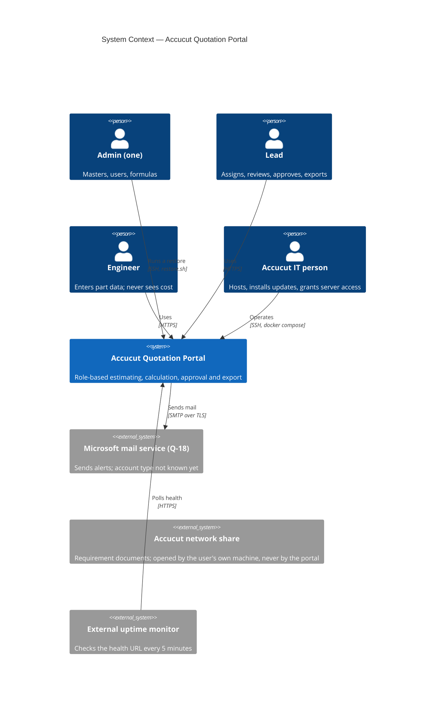
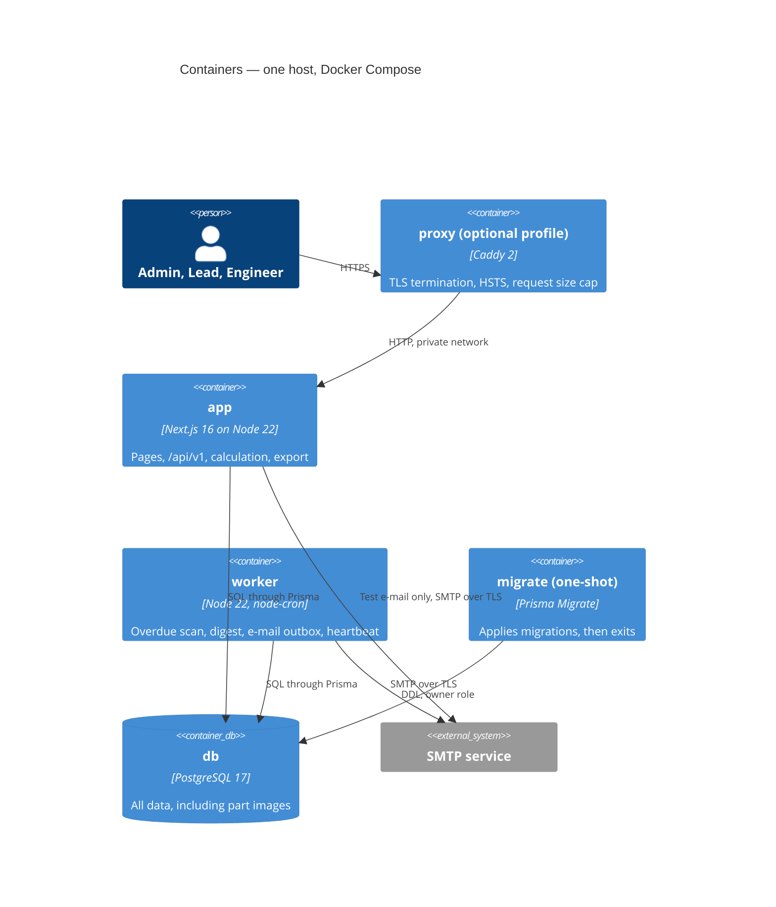
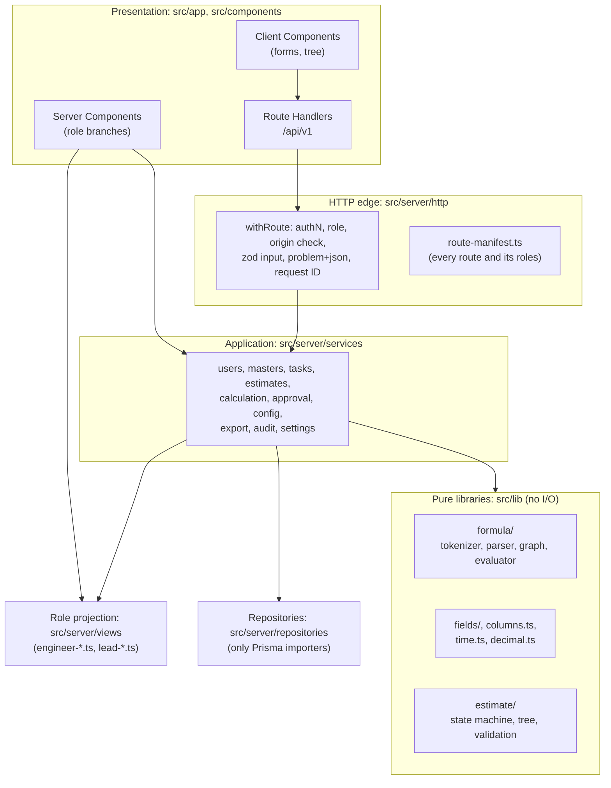
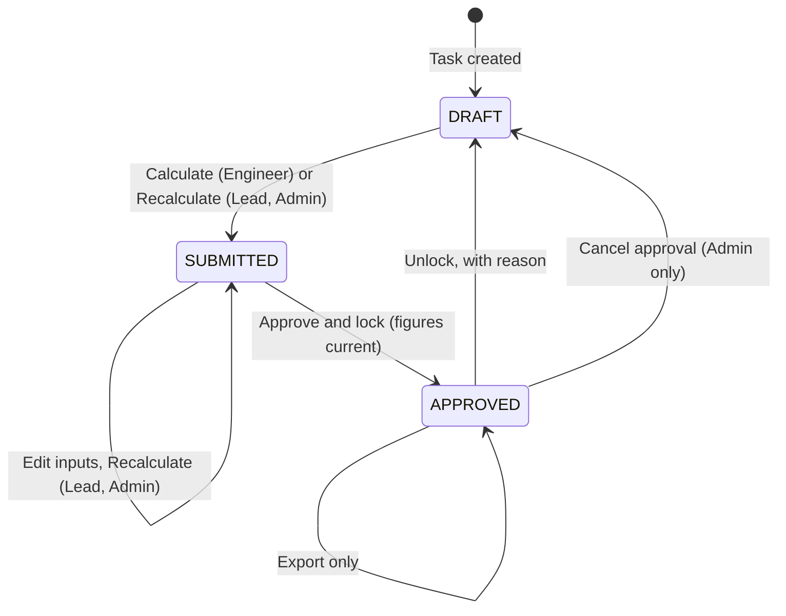
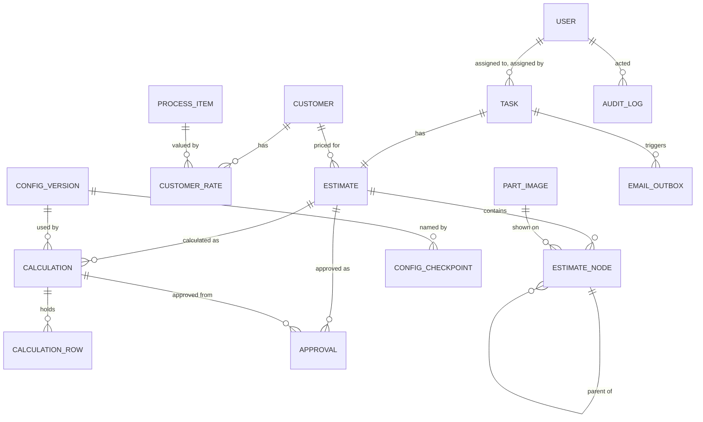

# Solution Architecture — Accucut Quotation Portal

| Field | Value |
|-------|-------|
| Version | 0.11 (G4 remediations 5, 6 and 8: CR-33, the seed and "Other", who clears old backup copies; the changes are listed under "What changed in v0.11") |
| Owner | solution-architect |
| Status | Accepted at G3 as CONDITIONAL GO, attempt 1 (gate log; APPROVED, AQP-1 comment 10491; DL-009). Version 0.7 replaces the every-level rule and the parent figures on the delivery lead's answers, which changes what G3 accepted. Version 0.8 applies their answers in AQP-1 comments 10546 to 10554. **Backups on the same server change NFR-013 and RISK-011.** Version 0.9 applies 10559 and 10560: **the Admin's server access changes what the audit log can prove.** For `master` to record and check at G4 |
| Date | 2026-11-02 |
| Inputs | SPEC v1.12 (`ACCUCUT_QUOTATION_PORTAL_REQUIREMENTS.md`), mainly §7.1, §7.4, §18 D-12 to D-24, §18.5; AQP-1 comments 10490, 10491, 10493, 10523, 10528, 10529, 10538 to 10609; AQP-13 comment 10487; AQP-14 comment 10510; AQP-15 comments 10511, 10527, 10543; AQP-26 comments 10530 to 10537 (Q-39); requirements questions as of SPEC v1.9. PRD v0.11; release plan v0.11; UX spec v0.3 (section 16.9); consistency report v0.3 (CR-11, CR-33); gate log G4 attempt 1. Gate log G2 attempt 2 and G3; DL-009 to DL-026; risk register; `docs/standards/` |
| Companions | `docs/04-architecture/adr/ADR-001` to `ADR-014`; `docs/04-architecture/test-strategy.md` |
| Scope | Scope A (D-14): every FR through Release 2 and every NFR. Offline (FR-092) is not designed and not blocked (section 9.8) |

**How to read the labels.** **Evidence** = measured or read on 2026-11-01, with the source named. **A-nn** = an architecture assumption, listed in section 15 with what changes if it is wrong. **Proposed** = a value set here for an owner to confirm. The quantity rule comes from the delivery lead's answers on AQP-26 (comments 10535, 10537) and AQP-14 (comment 10510), as SPEC v1.9 records them. Other rule text comes from SPEC §7.4 and §18.

**What changed in v0.11 (G4 attempt 1, remediations 5, 6 and 8; DL-034).**

| # | Item | Result | Hours (estimate) | Where |
|---|------|--------|------------------|-------|
| 1 | CR-33 | One rule: the role check runs first, so a refused role gets **403** with no data, on every route, whatever the ID. The uniform 404 stays for an Engineer's own routes | 0 | Section 6 |
| 2 | A-1 (stories 03.01, 02.01, 02.05) | **Confirmed.** Fixed IDs, inserted by migration at 0; the seed configuration loaded in the `migrate` one-shot; "Other" by migration. **Limit:** a rate left at 0 prices at 0 | 0 | Section 5.6 |
| 3 | Who clears old copies | **The Admin, with a second guided command,** `clear-copies.sh`, which A-35 now allows. 40 GB stands, so 2 years is not a guarantee (DL-034). **New limit:** at about 5 to 6 GB of data, clearing can no longer free enough | +0.5 to +0.75 | Section 9.5 |
**What changed in v0.9 (AQP-1 comments 10559, 10560).** This replaces "Admin only checks" and A-22 in v0.8.

| # | Answer | Result | Hours (estimate) | Where |
|---|--------|--------|------------------|-------|
| 1 | "Admin holds hte backup key"; "Admin should be given teh server access and run the restore" | OQ-ARCH-12 closed. **Anyone with server access can reach everything on the host,** and the audit log stops being a control over the Admin (ARCH-R8). A narrower account is proposed to Accucut IT | 0 | Section 9.5, section 4.10 |
| 2 | The restore is run by the Admin, not a system administrator | `restore.sh` becomes one guided, safe command, and the Admin rehearses it | +1 to +1.5 | Section 9.5 |
| 3 | "Block the portal" means the Excel download only: "Yes" | Confirms section 4.6. Nothing else is refused while figures are not current | 0 | Section 4.6 |
| | **Total** | | **+1 to +1.5, central +1.25** | Section 16.14 |
**What changed in v0.8 (AQP-1 comments 10546 to 10554).**

| # | Answer | Result | Hours (estimate) | Where |
|---|--------|--------|------------------|-------|
| 1 | Part Model picture optional | `mandatory: false` on C, on every part. OQ-ARCH-04 closed | 0 to +0.25 | Section 15.2 |
| 2 | "Tell the Lead" | A notice on SCR-06 and one line on SCR-08 when rates changed after the last calculation. Approval is not blocked. OQ-ARCH-06 closed | +1 to +1.5 | Section 4.8 |
| 3 | Last backup line, "Yes" | FR-105 stops being proposed | +0.25 to +0.5 | Section 9.5 |
| 4 | "Yes only Admin only checks", "Backup on the same server" | **A server or disk failure loses the data and every backup together.** 105 full copies do not fit the 40 GB disk: at 0.1 GB of new data a week it fills in about 6 months. A free-space check is added. **Who holds the backup key and who restores are open** | 0 to +0.25 | Section 9.5 |
| 5 | A-30: "Removable", "Admin only" | **Feasible.** Two steps, Admin only: cancel the approval, then remove the price. Each is audited, and the audit keeps the price | +2.75 to +4 | Section 4.10 |
| 6 | A-32: "Refuse it" | No Excel file until a calculation is current, for a never-calculated estimate too. A-05 ends | -0.25 to -0.5 | Section 4.6 |
| | **Total** | | **+3.75 to +6, central +4.875** (corrected in v0.10; first published as +6.5) | Section 16.13 |
**What changed in v0.7 (the quantity rule, Q-35 (b), Q-41, Q-36, Q-37).** This replaces the rule in versions 0.3 to 0.6. Where those tables and sections 16.1 to 16.11 describe `T(row)`, a multiplier, `applyQuantityStep`, `ROLLUP`, a Σ figure, an item total, or Q-39, Q-35 (b) or Warn's scope as open, this version overrides them.

| # | Change | Result | Where |
|---|--------|--------|-------|
| 1 | **The rule** | H is the count for the whole order, typed on every row (2, 6, 24). BL is `SUM(BG)` over all rows, with no multiplying down the tree. 4 and 12 typed at 150 and 20 give 840; 5 at 200 gives 1000 | Section 4.3, ADR-006 |
| 2 | **What a parent shows** | Only its own row's figures (Q-35 (b)). Every row has one box, and the screen and the file agree | Section 4.3 |
| 3 | **Removed** | `src/lib/rollup/`, `applyQuantityStep`, `T(row)`, the multiplier, `ROLLUP`, the item total, `calculation_rows.rollup`, `calculations.item_totals`, `rollupDisplay` | Sections 4.3, 5.1, 6 |
| 4 | **Cleared figures (Q-37)** | Every calculated value clears on any input change, row costs included. The approved price stays until a new approval replaces it. A move no longer changes BL, and still clears (A-29). A-18 and A-28 close | Section 4.8 |
| 4a | **Excel download (Q-37)** | Refused while figures are cleared. The out-of-date file, its markers, `allowOutOfDate` and the dialog are removed | Section 4.6 |
| 4b | **"Not applicable" (Q-36)** | Offered to Lead and Admin too, and the words show to everyone, in the field and the export. The zero values stay hidden. A-17 is now their answer, with no design change | Section 4.9 |
| 5 | **Warn** | A 0 affects only its own row, and they kept the warning (Q-41). One rule for every 0, one code, one wording: "That row will cost 0". A-27 closes | Section 4.3 |
| 6 | **New risk, ARCH-R6** | The Engineer now does the multiplying, so a mistyped count is a wrong price with nothing to flag it | Section 4.3, section 14 |
| 7 | **Effort** | **-4.25 to -7.25 h, central -5.75 h**, against release plan v0.8 (estimate), with Warn at 3.5 to 5.25 h inside it. No rework, as nothing is built | Section 16.12 |
**What changed in v0.6 (Q-38, Q-40, master's actions).**

| # | Change | Result | Where |
|---|--------|--------|-------|
| 1 | Q-38 "Yes" (AQP-15 comment 10527) | Warn covers every 0 in QTY per Assy, **a top-level item's own 0 included** (A-27). A-25 ends. Warn is now **4.25 to 6.25 h** (estimate, central 5.25 h), which is the earlier figure plus about 0.5 h | Section 4.3, section 16.11 |
| 2 | **Correction to v0.5 (DL-024)** | v0.5 said ASSUMPTION-51 was confirmed and CE-2 confirmed with it. That overclaimed. Q-35 (a) settles a top-level item with nothing below it, and only CE-12 variants A, B and D carry their number | Section 4.3, A-20, `test-strategy.md` 5.2, 5.6 |
| 2a | **Q-39 unresolved (AQP-26 comments 10530, 10531, 10533)** | Their rupee answer, 660, does not fit the rule, which gives 840. Their later count, 12 brackets for 4 frames with 3 each, does fit it, and the rupee total is still being confirmed. **The roll-up rule is frozen as written.** CE-1 and CE-2 are marked unconfirmed, with their values unchanged | Section 4.3, `test-strategy.md` 5.2, 5.6 |
| 3 | CR-11 placement | Confirmed, with what goes where in STORY-10.01 and the first stories | Sections 9.2, 16.11 |
| 4 | Q-40 "No" (AQP-1 comment 10528) | OQ-ARCH-05 closed: 2 decimals on entry stands, storage is unchanged | Section 15.2 |
| 5 | Coverage matrix | FR-104 and FR-105 added | Section 12 |

**What changed in v0.5 (the delivery lead's answers).** Item 3 below is corrected by v0.6 item 2, and item 2 is overtaken by v0.6 item 1.

| # | Change | Result | Where |
|---|--------|--------|-------|
| 1 | "Warn" for a QTY per Assy of 0 on a part with parts below it (AQP-15 comment 10511) | Calculate and Recalculate return 409 until the person acknowledges, tied to the input revision they saw. The record sits on the calculation. The Lead sees a notice on SCR-06 and SCR-10. No figure in the warning, for any role. The DL-013 block no longer applies | Section 4.3, section 6 |
| 2 | A part with nothing below it | Still unanswered, so not warned. Adding it costs about 0.5 h, with no change to the schema, routes or dialog | Section 4.3 |
| 3 | Q-35 (a) answered 1000 for 5 x 200 (AQP-14 comment 10510) | ASSUMPTION-51 is confirmed: a row's own quantity counts once. The other reading is withdrawn | Section 4.3, A-20 |
| 4 | Effort | Warn is **3.75 to 5.75 h** (estimate). It replaces the 1 h block and is not added to it | Section 16.10 |

**What changed in v0.4 (G3 condition 14).**

| # | Change | Result | Where |
|---|--------|--------|-------|
| 1 | ADRs moved to Accepted | All 14. Those resting on an assumption say which: ADR-002, 006, 007, 009, 011, 012 | Section 13 |
| 2 | Reconciled against UX spec v0.3 | Footer position agrees. Six API responses corrected, one new withheld figure, UX-38 to UX-43 raised | Section 16.9 |
| 3 | A-19 replaced by DL-013 | The delivery lead answers. With no reply by G4, Calculate and Recalculate refuse H = 0 on a part with parts below it | Section 4.3, A-19 |
| 4 | Q-35 (a) restated | Not narrow: any single-piece product is such a row (DL-012). The claim that one line would change is corrected | Section 4.3, A-20 |
| 5 | PRD v0.7 followed | Hand-over asks for the password, an Admin-set password is temporary, sign-in is `noindex`, no reason in the file; OQ-ARCH-01, 07, 08, 09 closed | Section 16.9 |

**What changed in v0.3.**

| # | Change | Result | Where |
|---|--------|--------|-------|
| 1 | Roll-up: every level's quantity applies | `T(row) = BG(row) + H(row) x sum of T(child)`. A row's own H is applied once. The nested example gives 24 lids. 500 nodes roll up in about 6 ms (Evidence) | Section 4.3, ADR-006 |
| 2 | Backups: weekly, kept 2 years, Admin looks after them | **Recovery point is up to 7 days of work**, and up to 14 if one run fails unnoticed. Their decision stands | Section 9.5, ADR-002 |
| 3 | E-mail: Microsoft Outlook, sender not decided | SMTP with a user name and password **cannot be relied on**. The design adds OAuth 2.0 client credentials. Four facts about the account are still needed | Section 4.7, ADR-011 |
| 4 | "Not applicable" entries | Scrap Weight is 0 on such a row, ordinary rows unchanged. Hidden from every list, refused by the database if edited | Section 4.9 |
| 5 | Password rule | 10 to 128 characters, a number, a symbol, not the e-mail, not common. 12-hour session from sign-in | Section 8, ADR-009 |
| 6 | Cleared totals | BL, BN, the price pre-fill, Tool Cost total, item totals and parent figures are withheld on any input change. Approval refused. Export needs a stated choice and is marked out of date | Sections 4.6, 4.8, ADR-007, ADR-012 |
| 7 | Reason on a changed price; one export total | `approvals.override_reason`; total Tool Cost in a footer row, never over a node's own BM cell | Sections 4.6, 5.1 |

No new ADR: each change applies a decision that an existing ADR already owns, so those ADRs are revised (section 13). No new dependency.

**G2 condition 5 at a glance.**

| Requirement of condition 5 | Where it is met |
|----------------------------|-----------------|
| One named quantity step, so a change to Q-32 (a) touches one place | **Overtaken in form, met in purpose.** No quantity applies to a sum any more. A quantity applies in one place, `BB = BA * H`, and a test holds it there (section 4.3, ADR-006) |
| Stored row BG kept apart from the figure displayed for a parent | **Overtaken.** A parent shows only its own row, so there is no second figure to keep apart (Q-35 (b), section 4.3) |
| Constructed example from SPEC §18.5 in the test strategy | `test-strategy.md` section 5, rewritten for the whole-order rule |
| Real master data stays out of the repository; state where it is loaded from | Section 5.5, ADR-014 |

---

## 1. Architectural Drivers

**Quality attributes, ranked.** When two conflict, the higher one wins.

| Rank | Attribute | Why | Main NFRs |
|------|-----------|-----|-----------|
| 1 | Confidentiality of cost data | The product exists to keep rates and costs from Engineers. A leak cannot be recalled | NFR-001, 002, 006 |
| 2 | Correctness of prices | A wrong price is quoted to a customer. The rule is settled, and the risk has moved to the count typed on each row (ARCH-R6) | GOAL-03, NFR-026 |
| 3 | Immutability of approved work | Approved estimates must not move when anything changes (AQP-8) | NFR-026, NFR-007 |
| 4 | Changeability of the worksheet | The Admin changes fields and formulas without a developer (R2) | FR-072 to 080 |
| 5 | Operability by a small IT team | One host, one IT contact, no platform team | NFR-013, 030 |
| 6 | Performance at small scale | Under 50 users, 25 concurrent, 500 nodes | NFR-008 to 011 |

**Key functional drivers.** Server-side role projection (FR-007, 008); formula engine with no `eval` (FR-022, 023); BL as a plain sum of BG (FR-029, 030); per-calculation master record (FR-031, 065); Excel export in the worksheet layout (FR-066 to 069); field insert and delete with re-lettering (FR-074, 075); immutable configuration versions (FR-077).

**Constraints.** Stack in `CLAUDE.md` §1 and SPEC §2. No `eval` (CONSTRAINT-02). Times stored in UTC and shown in IST (CONSTRAINT-03). Exactly one active Admin (CONSTRAINT-04). Images under 200 KB (CONSTRAINT-08). The repository stays public (D-13, DL-008). Secrets through environment variables only.

**Simplicity position.** One deployable codebase, three runtime containers plus an optional TLS proxy, one database. No queue broker, cache server, object store, search engine, service mesh or Kubernetes. Each moving part that remains is justified in the ADR that adds it.

---

## 2. System Context (C4 L1)



The portal never reads the network share. It stores the path as text and renders a `file:///` link plus "Copy path" (FR-033).

**Trust boundaries.**

| ID | Boundary | Crossing |
|----|----------|----------|
| TB-1 | Internet to the application | Browser and uptime monitor to the proxy and the app. Hostile by default |
| TB-2 | Engineer to cost data | Inside the app, between an authenticated Engineer and everything Restricted. This is the boundary the product exists for |
| TB-3 | Application to database | App and worker to Postgres, on a private Docker network |
| TB-4 | Application to mail service | Worker and `app` to Microsoft's token endpoint and mail service; message content leaves Accucut's control |
| TB-5 | Host and backups | Host filesystem, Docker volumes, the backup copies on the same server, and the backup key, held by the Admin away from it. The IT person and the Admin both cross this boundary |
| TB-6 | Public repository and CI | Everything committed is world-readable, including CI logs (D-13) |

---

## 3. Containers (C4 L2)



| Container | Responsibility | Technology | Communicates with | Scaling approach | Owner |
|-----------|----------------|------------|-------------------|------------------|-------|
| `app` | Server-rendered pages, `/api/v1`, auth, calculation, export | Next.js 16.4 (App Router, standalone output), Node 22 | `db` (TCP 5432); SMTP for the Settings test e-mail only (SCR-15 needs the result at once) | Vertical. One instance is enough (section 7, NFR-011). A second instance would need no code change: there is no in-process state that matters except the export gate | Delivery team; Accucut IT runs it |
| `worker` | Scheduled jobs and the e-mail outbox (FR-081 to 084), and the watch on the weekly backup (section 9.5). In R1 only a heartbeat, the backup watch and the job log | Node 22, node-cron 4 | `db`, SMTP | Single instance. Row claims use `FOR UPDATE SKIP LOCKED`, so a second one would be safe | Delivery team; Accucut IT runs it |
| `db` | System of record, including images | PostgreSQL 17 | none | Vertical. Pool sizes: app 10, worker 3 | Accucut IT |
| `migrate` | `prisma migrate deploy`, then `ensure-seed-version` (section 5.6), then exit; `app` and `worker` wait for it | Prisma CLI 7.10 | `db` with the owner role | Not applicable | Delivery team |
| `proxy` | TLS, HSTS, body-size cap. **Optional Compose profile** (A-01): skipped if Accucut IT already has a TLS terminator | Caddy 2 | `app` (TCP 3000) | Not applicable | Accucut IT |

**Why each exists.** `app`, `worker` and `db` are SPEC §2 and FR-091. `migrate` keeps DDL rights out of the runtime role. `proxy` exists because NFR-003 needs Secure cookies, which need TLS, and Next.js does not terminate TLS.

**Sizing (Proposed, A-01).** One Linux VM with 2 vCPU, 4 GB RAM and 40 GB SSD. **40 GB stands by their decision, and it limits how long copies can be kept (DL-034, section 9.5).** Memory limits: `app` 1.5 GB, `worker` 256 MB, `db` 1 GB. The limit on `app` covers the worst-case export (section 4.6). This has not been load tested; `test-strategy.md` section 8 confirms it on the chosen host.

---

## 4. Components (C4 L3)

### 4.1 Component map of `app`



Dependencies point inward. `src/lib` imports nothing from `src/server`, `src/app`, Prisma or Next.js. Only `src/server/repositories` imports the Prisma client. Section 10 states how this is enforced.

**Key components.**

| Component | Path | Responsibility | Key FRs |
|-----------|------|----------------|---------|
| Route wrapper | `src/server/http/with-route.ts` | The only way to declare a handler: session, role, origin check, zod parse, error mapping, request ID, `no-store` | FR-007, NFR-001, 003 |
| Route manifest | `src/server/http/route-manifest.ts` | One table of every page and API route with allowed roles. The role-matrix test iterates it, and a test fails if a route file is missing from it | FR-007 |
| Session helper | `src/server/auth/session.ts` | `requireUser()`, `requireRole()`; reads `users` on every request, so role and active flag are never taken from the token | FR-001, 004, 007 |
| Engineer views | `src/server/views/engineer-*.ts` | Allow-list projections into strict output schemas. Importing `calculation-repository` from these files fails the build | FR-008, 051, NFR-002 |
| Formula engine | `src/lib/formula/**` | Tokenizer, parser, dependency graph, evaluator, internal and display forms | FR-022, 023, 028 |
| Figure state | `src/lib/estimate/figure-state.ts` | Pure: says `none`, `current` or `out-of-date` for an estimate. Every read of a figure goes through it (section 4.8) | FR-061, 070, 100, 101 |
| Password rule | `src/lib/auth/password-rule.ts` | The one zod rule for every place a password is set, on client and server (section 8) | FR-098, NFR-003 |
| Calculation service | `src/server/services/calculation-service.ts` | Orchestrates one calculation in one transaction | FR-024 to 031, 055, 061 |
| Approval service | `src/server/services/approval-service.ts` | Approve, unlock, refusal unless figures are `current`, notices, optional reason | FR-062 to 065, 101, 103 |
| Config service | `src/server/services/config-service.ts` | New immutable version per change; checkpoints; revert | FR-072 to 080 |
| Export service | `src/server/services/export-service.ts`, `src/server/export/**` | Builds the `.xlsx` from one calculation record, in a worker thread | FR-066 to 071 |
| Masters service | `src/server/services/masters-service.ts` | Masters, customer rate sync. Never lists or changes a hidden entry (section 4.9) | FR-012 to 018 |
| Mail transport | `src/server/mail/transport.ts` | The one place that builds the Nodemailer transport and its sign-in mode (section 4.7) | FR-019, 081 to 084 |
| Audit | `src/server/services/audit-service.ts` | Appends audit rows in the caller's transaction | FR-011, NFR-007 |

### 4.2 Calculation pipeline

```mermaid
sequenceDiagram
  actor U as Engineer or Lead
  participant R as Route (withRoute)
  participant C as calculation-service
  participant DB as PostgreSQL
  participant F as lib/formula
  U->>R: POST /estimates/{id}/calculate
  R->>C: calculate(user, estimateId)
  C->>DB: BEGIN; lock estimate row
  C->>C: Check status and ownership; validate every visible input
  C->>C: Quantity warnings from tree and typed H; compare the acknowledgement (409 if not met)
  C->>DB: Read nodes, customer rates, used materials, exchange rates
  C->>F: Evaluate row-scope fields for each node (compiled plan)
  F-->>C: Row values (each row's own M to BK)
  C->>F: Evaluate product-scope fields (BL, BN)
  C->>DB: INSERT calculations, calculation_rows; set status; COMMIT
  C-->>R: Lead or Admin: results. Engineer: status and the one message
```

The compiled plan (ordered list of parsed formulas) is cached in process by `config_versions.id`. A version is immutable, so the cache has nothing to invalidate.

### 4.3 The quantity rule: BL as a plain sum (G2 condition 5)

**Rule in force (AQP-26 comments 10535, 10537; SPEC v1.9 §7.1 H, §7.4 BL; `master` records it).** QTY per Assy (H) is the count for the whole order, typed on every row. For 2 frames, 3 pipes on each frame and 4 lids on each pipe, the Engineer types **2, 6, 24**. A row's cost is that count times the cost of one piece, which the worksheet formula already gives (`BB = BA x H`). **BL is the sum of BG over all rows, with no multiplying down the tree.** The rule as one sentence is the team's; the typing and the numbers are theirs.

| Their answer | What it shows |
|--------------|---------------|
| "sorry my bad, yes, this has 24 lids. Engineer should typ 24" (AQP-26 comment 10537) | 2, 6, 24 are typed. The portal does not multiply them |
| "So the user will enter 4 frames and 12 brackets": 600 + 240 (AQP-26 comment 10535) | 150 x 4 + 20 x 12 = **840**. They gave the two parts, and the sum is ours |
| 1000 for quantity 5 at 200 a piece (AQP-14 comment 10510) | 200 x 5 = **1000** |
| Worksheet BL2 is `SUM(BG2:BG11)` (SPEC §18.5) | The same formula. The portal now agrees with the worksheet at any quantity, not only at 1 |
| 660 (AQP-26 comment 10530) | Read as 3 typed for the whole order, which the rule also gives. Their frame answer corrects the count to 12. That reading is the team's, and they have not said it in those words |
| "Q-35(b) - no, not required" (AQP-1 comment 10542) | A parent shows only its own row's figures, with no sum of the rows below it |

**Withdrawn:** `T(row)` in every form, `applyQuantityStep`, `quantity-step.ts`, the multiplier above each row, `ROLLUP`, the item total, `calculation_rows.rollup`, `calculations.item_totals`, the `rollupDisplay` flag and the whole of `src/lib/rollup/`. The design needs no roll-up of any kind.

| Question | Answer |
|----------|--------|
| Where does a quantity apply? | **In one place: `BB = BA * H`**, a row's own seed formula. H is an operand in no other seed formula (SPEC §7.4) |
| Is a row's own H applied twice? | No. BG carries it once, and nothing multiplies BG again |
| Where is BL worked out? | In the formula engine, as a product-scope field: `SUM(BG)` over the rows' outputs |
| Item's own row (D-12 (c)) | A row like any other, inside the sum |
| Several top-level items (D-12 (d)) | Inside the sum. No step of their own |
| Column (D-12 (e2)) | BG only. Tool Cost (BM) entries are totalled as typed. BN divides BL by that plain total |
| Does a move change BL? | **No.** A row's count is typed, and its parent has no effect on it. A move still changes Sl. No (section 4.8) |

**The frames example, by the code path.** Cost of one piece: 0, 1, 1.

| Row | H typed | One piece | BG, on screen and in the file |
|-----|---------|-----------|-------------------------------|
| I, frames | 2 | 0 | 0 |
| P, pipes | 6 | 1 | 6 |
| S, lids | 24 | 1 | 24 |

BL = 0 + 6 + 24 = **30**, and the BG column adds up to it. With cost on the lid alone BL = 24.

**What a parent shows on screen: its own row and nothing else (Q-35 (b)).** The screen and the file now hold the same figure for every row, so G2 condition 6's pair of labelled boxes has nothing left to tell apart: every row has one box, and the tree shows each row's own BG. There is no Σ tag, no item table and no per-item figure anywhere, which also matches D-16's one total in the file. SCR-07 shows a row's own stages. BJ and BK are each row's own, as in the file.

| Item | Changed by this rule? |
|------|-----------------------|
| `src/lib/rollup/`, `quantity-step.ts`, `ROLLUP`, the multiplier, the item total, `rollupDisplay` | **Removed** |
| Seed BL | **`SUM(BG)`** |
| `calculation_rows.rollup`, `calculations.item_totals` | **Removed.** No migration exists yet, so nothing moves |
| `/costs`, `/nodes/{id}/costs`, `/export-summary` | **Simpler:** a row's own figures, with no Σ, item total, multiplier or screen figure |
| Wording on SCR-06, 07, 10, 17, 18 | **Yes:** UX-53 to UX-56 |
| Row outputs (M to BK), the export layout, `figure-state` | The formulas and the layout do not change. `figure-state` has less to withhold (section 4.8) |
| Approved estimates, built code | None exist, so there is no rework |

**The Engineer now does the multiplying (new, ARCH-R6, GitHub #11).** The portal used to multiply down the tree and now takes each count as typed, so a wrong count is a wrong price and nothing can flag it. It is a real risk: on these questions the delivery lead's own first answers were 3 for 12 brackets and 12 for 24 lids, and each would have underpriced the order. 4 and 3 typed at 150 and 20 give 660, not 840. A change to the number of items in the order also means retyping every row below it. The field's name, "QTY per Assy", says the opposite of what it now means. **What the design does:** a hint on the field saying it is the count for the whole order (UX-52), and H beside every row on SCR-06, so a Lead can check it. **What it cannot do:** detect a wrong count, because the portal holds no second figure to compare with. Asking for a per-assembly count as well would bring back the rule just withdrawn, so that is not proposed. Whether to rename the field is for the product-manager and the delivery lead; the Excel column stays as it is.

**NFR-008.** No walk is left, so the roll-up's share of the budget goes. BL is one `SUM` in the compiled plan. Excel holds 15 significant digits, so a cell stops being exact to the paisa above about ₹ 10 trillion. SPEC sets no ceiling on H and none is added.

**A zero quantity (OQ-ARCH-10, OQ-PM-07, Q-38, Q-41; RISK-013).** **A 0 now affects only its own row.** `BB = BA x 0`, so that row costs 0, and the rows below it are untouched: item 2, part 0, sub-part 24 gives BL = 24 with each lid at 1, where the old rule gave 0. The minimum for H stays 0.

**Warn stays, for every 0 in QTY per Assy: "Q-41: Keep warning" (AQP-15 comment 10543).** Asked knowing a 0 now touches only its own row, they kept it. The warning names the row and says that row costs 0. A row's position in the tree no longer matters, so the design has one rule, one code and one wording. This closes A-27: a top-level item is a row with a QTY per Assy, so its own 0 warns.

| Point | Warn, as designed |
|-------|-------------------|
| Rule | `quantityWarnings(rows)` in `lib/estimate/validation`, pure. One warning per row where H is 0 after normalising (`0.00` is 0). Every such row is listed, wherever it sits in the tree. It finds H through `systemRole: 'quantity'`, so re-lettering cannot break it |
| Code | One: `QTY_ZERO`. Kept as a code so that a later warning can join the same path |
| When | Inside the transaction, under the estimate row lock, at Calculate **and at Recalculate**, because A-08 and FR-064 give them the same checks and a Lead can type the 0. A save never warns |
| Order | Status and ownership, then blank inputs (422 `CALCULATE_BLOCKED`), then this. So nobody acknowledges a warning and is then refused for a blank. **It runs before any master or cost is read** |
| First press | 409 `CALCULATE_ACK_REQUIRED` with `inputsRevision` and the `warnings` list. Nothing is written: no calculation, no status change, no audit row |
| Acknowledgement | The person presses "Calculate anyway". The client sends the same `POST` with `{ "acknowledge": { "inputsRevision": n } }`, the value from the 409 |
| Check | The server recomputes the list. If it is empty, the calculation runs and `acknowledge` is ignored. If it is not empty, `acknowledge.inputsRevision` must equal `estimates.inputs_revision`. If not, the 409 comes back with the new revision and list, and nothing is written. A warning can therefore never be passed by an acknowledgement given for an earlier state of the estimate |
| Recorded | `calculations.warnings`, JSONB, default `[]`: `{code, nodeId, slNo, label}` per row, as text at that moment. The row is immutable (ADR-007). **Who and when need no new column:** a calculation with warnings cannot exist unless they were acknowledged, so `created_by` and its time are the acknowledgement. Plus one audit event, `calculation.warning_acknowledged`, in the same transaction, naming the rows and holding no figure |
| Each press stands alone | A Lead's Recalculate asks again, even for a 0 the Engineer acknowledged (A-26). The Engineer's calculation keeps the Engineer's name, and the Lead's new one has the Lead's |
| What the Engineer sees | SCR-05: a dialog naming each row, with "Go back" and "Calculate anyway". On success the same single message as ever. Afterwards nothing: no Engineer route reads `calculations.warnings` |
| What the Lead sees | Every warning on the calculation in view. SCR-06: a notice above the tiles naming each row, who went ahead and when, and a mark on that row. SCR-10: the same notice. SCR-08: one line. Data comes from `/costs` and `/export-summary`, through `figure-state`, **only while `current`**. While `out-of-date` the list may be stale, approval is refused, and Recalculate raises it afresh |
| Approval | Warn never stops it. `POST /approve` is unchanged. The approval points at the calculation, so the warnings stay with what was approved |
| The file | No cell changes. The row shows H 0 and BG 0, as it would by hand, and no warning goes in the worksheet layout (A-24) |
| Wording | One file, `src/lib/estimate/warning-copy.ts`. Proposed, for UX-36 to settle: "QTY per Assy is 0 on `<Sl. No>` `<part>`. That row will cost 0 in this estimate." |

**The acknowledgement: options.** This follows the export's existing pattern, a 409 and then the same request with a stated choice (section 4.6), so it adds no new idea.

| Option | Result |
|--------|--------|
| **Chosen:** 409, then the same `POST` carrying `inputsRevision` | Ties the acknowledgement to the exact estimate the person saw, since every change that can alter the list already bumps the revision (section 4.8). One integer comparison, under the lock that already serialises saves. The success body stays exactly `{status, message}` |
| A plain flag, `acknowledge: true` | **Rejected.** A retry or a stale tab could pass a warning nobody saw, including one for a 0 added since |
| Echo the list of node IDs | **Rejected.** A second comparison for the same guarantee |
| Warn in the response after calculating | **Rejected.** The estimate is already SUBMITTED and read-only for the Engineer, so "Go back" would have nothing to go back to |
| A separate acknowledgement row or endpoint | **Rejected.** A new table and a state to expire, for one press |

**No cost reaches an Engineer.** This holds on the server, by structure, and not by the dialog's wording.

- The rule reads only typed H, which the Engineer already holds, and it runs before any master, rate or calculated value is read. So its result cannot depend on anything Restricted, and the 409 tells an Engineer nothing about a cost, by content or by timing.
- **"That row will cost 0" is the only cost statement, and it reveals nothing.** It follows from the 0 the person typed, at any rate and for any part, so it is the same on every estimate. It is not a calculated value, and it comes from no Restricted data.
- The 409 has one strict schema, with the same keys for every role, and no number except `inputsRevision`, Sl. No and that 0. `inputsRevision` is a count of changes. On its own it says nothing about figure state, which no Engineer route carries.
- The wording keeps to UX-24's Engineer-page rule: no "rate", "price" or "formula".
- The canary scan runs this path, and shows the same 409 body under two different sets of masters (`test-strategy.md` section 6).

**Residual risk.** A warning can be passed without being read, so a low price can reach the Lead, who sees the notice and the row and is not stopped (RISK-013). D-06 tells Engineers to enter 0 in numbers a part does not need, and an assembly row with no cost of its own may now get a 0 in H by habit, which changes nothing and still raises the dialog. A warning seen often is pressed through. A rule that skipped those rows would have to read a cost, which the warning must never do. How often this happens is not known: the first estimates in use will show it, and the audit event counts it.

**In the formula language.** `ROLLUP` is removed. BL is back to a function SPEC §8.2 already has, so the language gains nothing for it:

```text
BL = SUM(BG)
BN = BL / SUM(BM)
```

BL stays visible and re-letters like any other formula (FR-075), and it stays a system field that cannot be deleted. The warning that a formula has stopped using `ROLLUP` goes with the function. Comparisons inside `IF` stay, because seed O needs them (section 4.9).

**Division by zero and totals (A-07).** The evaluator's value type is `Decimal | null`, where `null` means divide by zero. `null` spreads through every operator and through `SUM`, so a total shows "—" rather than a silently low price. The calculation never stops (FR-026). Seed formulas can only reach this through BJ, BK or BN, none of which feed BL.

### 4.4 Estimate state machine



Pure code in `src/lib/estimate/state-machine.ts`; an exhaustive `switch` with `assertNever`. Task Open or Closed is **derived** from `estimates.status`, never stored, so FR-038 holds by construction. Approval is refused with 409 while the totals are cleared or the estimate has never been calculated (D-20, section 4.8).

### 4.5 Field registry and configuration

ADR-004. The registry is one validated JSON document per version, not rows. A change is `load latest → apply a pure edit → validate all formulas, references and cycles → insert a new version`. Formulas use stable references, `{{f:<fieldId>}}`, `{{rate:<rateId>}}`, `{{mat:<key>}}`, `{{fx:USD}}`. Rates use a stable ID rather than the name in SPEC's example, so a rate rename cannot break a formula.

SPEC §8.1's `FieldDefinition` is the document's element type. The UX screens show it needs more than SPEC lists:

| Added property | Why | Screen |
|----------------|-----|--------|
| `engineerVisible` | True only for `input` fields and for F. A schema rule refuses it everywhere else, including I, BH and BI | SCR-05, ADR-008 |
| `systemRole` | Marks fields the code depends on: `sl-no` (A), `quantity` (H), `unit-price` (BG), `total` (BL), `approved-price` (BO), `tool-cost` (BM). These cannot be deleted, and A and BO have no editable formula. The quantity warning finds H through this role, and the export finds BM the same way for its footer | SCR-17, 20 |
| `unit`, `hint`, `formOrder` | Unit tags and hints sit beside each input. `formOrder` is separate from column position because section 08 shows AP, AU, BM, then AJ (SPEC §7.1), which is not letter order. Enter follows it | SCR-05 |
| `stageId`, `group` | Output placement in the six stages and their sub-headings | SCR-07, 17 |
| `options`, `displayUnit` | List values for a new choice field; "kg", "$", "€" on values | SCR-07, 19 |

Sections and stages get a `shortName` (the strip on SCR-05), a display mode (`cards` or `multi-select`, as section 07), and for stages `totalFieldIds`, because the total on a stage heading is sometimes one field (stage 3 is AY) and sometimes several (stage 5 adds BC to BF). Section range tags such as "E, F, J–L, N" are derived per role from the fields that role sees.

A field's **references** include formulas, `hideWhenZero`, `visibleWhen` and stage totals. Field delete (SCR-20) checks all four. An input with `defaultValue` takes that value when its key is absent, so a new input with a default does not block Calculate on older drafts (A-15).

The configuration seed comes from SPEC §7 and is committed. One seed formula differs from SPEC §7.4 on purpose: Scrap Weight O (section 4.9). Header texts, widths and formats are structure read from the sample (ASSUMPTION-46). Cell values are not read and never copied.

### 4.6 Excel export

ADR-012. `export-service` loads one calculation record and streams its images in batches of 50, builds an `ExportModel`, and hands it to `src/server/export/build-workbook.ts` in a `node:worker_threads` thread, so the event loop stays free for other users. Export reads `calculation_rows.outputs` (D-12 (b3)). The date in the file name is the IST date of the download.

**One total only, plus the total Tool Cost (D-16, Q-31 answered).** BL, BN and BO appear once, in row 2, and the file has no per-item totals. The export now knowingly differs from the sample on this point (SPEC §14.12). The total Tool Cost, the plain sum of BM with no quantity, cannot go in row 2, because BM2 is the first node's own Tool Cost. It goes in a **footer row at `lastNodeRow + 2`**, so one row stays empty between the last node and the footer: the value in the Tool Cost column, with the label "Total Tool Cost" in the cell to its left. With 10 parts in rows 2 to 11, the footer is row 13. UX spec v0.3 places it the same way (section 16.9). It sits directly under column BM, follows that column if letters move (`systemRole: 'tool-cost'`), and changes no node row. With no Tool Cost entered, the file shows 0 and BN2 stays empty. The value comes from `product_values.toolCostTotal`, so an approved file never changes. Adding up the exported BG column gives BL, at any quantity.

**No file exists until a calculation is current (Q-37 (b), A-32 answered).** "Yes, block the portal when the total is not calculated or recalculated" (AQP-1 comment 10545), and for a never-calculated estimate, "Refuse it" (10554). `GET /export` answers by state, with no way round it:

**Only the Excel download is refused.** "Block the portal" was read as this, and they confirmed it: "Yes" (AQP-1 comment 10560). While figures are not current, the screens, the inputs, Calculate and Recalculate all work as usual.

| State | Result |
|-------|--------|
| `none` | 409 `NOT_CALCULATED`. SCR-10 says why and links to Calculate |
| `out-of-date` | 409 `EXPORT_OUT_OF_DATE`. SCR-10 says why and links to Recalculate |
| `current` | The file: node rows from the calculation record, BL2 and BN2 filled, the footer filled, and BO2 as below |

**BO2** holds the latest approved price, if there is one and its approval has not been cancelled (section 4.10). The stated choice, the `_OUT-OF-DATE` file name, the `OUT OF DATE` sheet tab, the notice row and the confirmation dialog are gone, and so is the file with empty cost columns (A-05).

The state is read in the same repeatable-read transaction that builds the file, never taken from an earlier `export-summary`, so a change between the two cannot slip through. An approved estimate is always `current`: its inputs are locked. **Limit:** a file downloaded while current can go out of date later on someone's disk, and the portal cannot recall it; the date in its name is the only signal.

The decisions on row-2 cells and the footer live in one file, `src/server/export/product-cells.ts`. The optional override reason goes in no cell (FR-103, PRD v0.7). Cell values are full-precision numbers with a two-decimal number format, so Excel's own sums reconcile with the stored values. Text goes in as strings only, so nothing an Engineer types can become a live formula.

**Measured feasibility (Evidence, 2026-11-01).** Throwaway benchmark with invented data on an Intel i7-10510U with 8 GB, Node 24, in-memory ExcelJS 4.4.0, 67 columns, one incompressible 199 KB image per row. Excludes database reads. Runs shared one process, so memory figures are upper bounds. This is not the target host and not the target Node version.

| Nodes and images | Time | File | Peak process memory |
|------------------|------|------|---------------------|
| 50 | 1.7 to 1.8 s | 9.8 MB | 178 MB |
| 200 | 7.9 s | 39 MB | 312 MB |
| 500 (validation's maximum) | 16.9 s | 97.5 MB | 528 MB |

**Outcome for RISK-010 and OQ-PM-05.** No hard limit is needed. Validation already bounds the worst case at about 100 MB, and it builds in under 20 seconds on this laptop. NFR-010's 10 s target holds comfortably at 50 nodes. The strategy is a worker thread plus a one-at-a-time gate for estimates over 100 nodes (a second such request gets 503 with `Retry-After`), and a proxy read timeout of at least 120 s. The figures also say an export of 500 nodes takes about 17 s, so the 10 s target must not be read as applying there.

### 4.7 `worker`

| Job | Schedule | Behaviour | FRs |
|-----|----------|-----------|-----|
| `heartbeat` | Every minute | Writes `job_runs`; `/api/health` reports it | NFR-024 |
| `overdue-scan` | Every minute (R2) | For open tasks past deadline, inserts an outbox row. The unique key stops repeats, so the target of 5 minutes is met with room to spare | FR-082 |
| `daily-digest` | 11:00 Asia/Kolkata, plus a catch-up at start-up if today's run is missing (R2) | Inserts one outbox row per Engineer per IST date | FR-083 |
| `outbox-send` | Every minute (R2) | Claims up to 25 due rows with `SKIP LOCKED`, sends, records the result; up to 3 retries with backoff of 1, 5, 15 minutes | FR-084 |
| `backup-watch` | Daily, 09:00 Asia/Kolkata (R1) | Looks for a good `backup` row in `job_runs` in the last 8 days, and for at least 20 % free disk (Proposed) in the latest one. If either fails, logs at `error` and, once e-mail is on, writes one outbox row to the Admin (section 9.5) | NFR-013 |

Assignment e-mail (FR-081) is one outbox row written in the task's own transaction, so a rolled-back task sends nothing. All job logic takes `now` from a `Clock` argument so tests control time.

**Idempotency keys.** `task-assigned:<taskId>:<assignmentRevision>`, `task-overdue:<taskId>:<deadlineAtUtc>`, `digest:<engineerId>:<istDate>`, `backup-missed:<istDate>`. A unique index enforces them, so re-running a job sends nothing twice. A changed deadline gets a new key, so a task that becomes overdue again is reported again (A-09).

E-mails carry task details, path and deadline only. They never contain cost, rate or formula data, and the digest goes only to people who may see the task. Each message has HTML and plain-text bodies (SCR-22). Links are full addresses built from `APP_ORIGIN`, so the worker needs that variable. The logo is attached inline by content ID, so no mail client fetches it from the portal. SCR-22 is a template reference, not a route.

The Settings test e-mail (SCR-15) is the one exception to the outbox: `app` sends it directly to the signed-in Admin's own address, because the screen must report success or failure at once, and because no recipient is accepted from the client.

**Mail transport (D-15, OQ-ARCH-11).** Their answer is "microsoft outlook, not decided yet on the sender address". SPEC §2 names Nodemailer over SMTP, with credentials in environment variables. **SMTP with a user name and password cannot be relied on for a Microsoft account.** Whether it works depends on facts not yet known, starting with which kind of account "Microsoft Outlook" means.

| If it turns out to be | Does user name and password over SMTP work? | What the portal needs |
|-----------------------|---------------------------------------------|-----------------------|
| **Microsoft 365 business mailbox** | Today only if the organisation allows it, and not for long. SMTP AUTH is off for organisations created after January 2020 and must be enabled per mailbox, and Security Defaults keeps it off. Basic authentication is reported to go off by default for existing tenants at the end of December 2026, an administrator can turn it back on, and a final removal date is to be announced in the second half of 2027 | **OAuth 2.0 client credentials over SMTP** (`smtp.office365.com`, port 587, STARTTLS, TLS 1.2 or later), which Microsoft recommends. An administrator of the tenant registers the app, grants `SMTP.SendAsApp`, registers the service principal in Exchange, and gives it access to one licensed mailbox. Limits: 10,000 recipients a day, 30 messages a minute |
| **Personal Outlook.com or Hotmail** | **No.** Microsoft states that Outlook.com requires Modern Auth / OAuth2 (`smtp-mail.outlook.com`, port 587, STARTTLS). The same page says an app password may be needed in some cases, which this design does not rely on | Delegated OAuth: a person signs in once and the portal keeps a refresh token. There is no tenant, so client credentials do not apply. **Not designed.** A personal mailbox is a poor sender for a company: it is tied to one person. Recommended answer: use a business mailbox |
| **Outlook is only the mail app**, and the mailbox is with a domain host or an on-premises Exchange server | Probably yes. That provider decides | `password` mode below |

**What is built.** Nodemailer stays, with no new dependency. `src/server/mail/transport.ts` has one setting, `SMTP_AUTH_MODE`, with three values:

| Mode | Used for | Variables |
|------|----------|-----------|
| `none` | Mailpit, in local, CI and staging | `SMTP_HOST`, `SMTP_PORT` |
| `password` | A provider that allows it | Also `SMTP_USER`, `SMTP_PASSWORD` |
| `oauth2-client-credentials` | Microsoft 365. The design default for production | Also `SMTP_USER` (the mailbox), `SMTP_OAUTH_TENANT_ID`, `SMTP_OAUTH_CLIENT_ID`, `SMTP_OAUTH_CLIENT_SECRET` |

In `oauth2-client-credentials` mode, a small function posts to `https://login.microsoftonline.com/<tenant>/oauth2/v2.0/token` with scope `https://outlook.office365.com/.default`, using the platform `fetch`. It hands the token to Nodemailer through its documented `provisionCallback`, which also renews it. Nodemailer's docs describe XOAUTH2 and the callback, but give no Microsoft client-credentials recipe, so **this is unproven until tested against a real tenant** (`test-strategy.md` section 9).

**Rules that hold in every mode.**
- No credential is ever in code, the database, `settings`, a log or Jira. `settings` holds the sender name and address only. Environment variables only, on the host, mode 600.
- The mailbox is dedicated to the portal. Microsoft's steps give the app `FullAccess` to it, so it must hold nothing else.
- The sender address must be that mailbox, or one it has Send As rights on; otherwise Microsoft refuses with 5.7.60. The Settings test e-mail (SCR-15) proves this, and reports the failure without any secret.
- `outbox-send` claims at most 25 rows a run, so it stays under 30 messages a minute. A digest to 50 Engineers then takes two runs.
- An Entra client secret expires. When it does, every send fails, rows go `failed`, and Settings and the log show it. The IT person diarises the date.

**If the organisation refuses SMTP AUTH altogether.** Options named by Microsoft: Azure Communication Services Email, for internal and external recipients. High Volume Email and Direct Send reach internal recipients only, and SMTP relay needs port 25 with a static IP or a certificate, and cannot be used from a third-party hosted service. Microsoft Graph `sendMail` would be a new transport. Each is contained in `transport.ts`, about half a day, and the outbox does not change.

**Facts needed (OQ-ARCH-11), from their IT person, before e-mail can go live.** (1) Which kind of account from the table above, and which mail domain. (2) If Microsoft 365: who administers the tenant, and whether Security Defaults is on. (3) Can a dedicated licensed mailbox be created, and what is its address (the open sender address). (4) Can the host reach port 587 outward. Until then, alerts stay behind `FEATURE_EMAIL`, tested on Mailpit. None of this holds any other feature.

**Sources (read 2026-11-01).** [Microsoft Learn: send email from an application](https://learn.microsoft.com/en-us/exchange/mail-flow-best-practices/how-to-set-up-a-multifunction-device-or-application-to-send-email-using-microsoft-365-or-office-365); [Enable or disable SMTP AUTH](https://learn.microsoft.com/en-us/exchange/clients-and-mobile-in-exchange-online/authenticated-client-smtp-submission); [OAuth for SMTP](https://learn.microsoft.com/en-us/exchange/client-developer/legacy-protocols/how-to-authenticate-an-imap-pop-smtp-application-by-using-oauth); [Outlook.com settings](https://support.microsoft.com/en-us/office/pop-imap-and-smtp-settings-for-outlook-com-d088b986-291d-42b8-9564-9c414e2aa040); [Nodemailer OAuth2](https://nodemailer.com/smtp/oauth2). **The December 2026 date is second-hand:** [Microsoft's post of 27 January 2026](https://techcommunity.microsoft.com/blog/exchange/updated-exchange-online-smtp-auth-basic-authentication-deprecation-timeline/4489835) could not be read directly with the tools here, so it rests on search summaries and [Office 365 IT Pros](https://office365itpros.com/2026/01/29/smtp-auth-basic-retirement/). The IT person should check the current position.

### 4.8 Cleared figures (FR-100, FR-101, D-20, Q-37)

**Decision (their words, relayed).** "Block approval. And clear the total cost when any input is updated. So, the user will be forced to press calculate or recalculate to see the total cost." "Any input" is applied as written, so Remarks counts. Q-37 settled the rest (AQP-1 comment 10545): (a) each row's own cost clears too, "Yes"; (b) "Yes, block the portal when the total is not calculated or recalculated"; (c) the earlier approved price "should stay until it's approved again or be removed".

**"Cleared" is a rule on reading, not a change to a record.** `calculations` is immutable and the database refuses updates (ADR-007), and an approved calculation must survive. So nothing is deleted or nulled. `lib/estimate/figure-state.ts` works out one state from data already held, and every read of a figure goes through it.

| State | Condition | Who sets it |
|-------|-----------|-------------|
| `none` | No calculation yet | Task created |
| `current` | `estimates.inputs_revision = calculations.inputs_revision` | Calculate, Recalculate |
| `out-of-date` | The revisions differ | Any input change |

**One rule: no calculated value is read unless the state is `current`.** The clearing is server-side: the projections omit the values, so no browser state can show them. Because the rule has no exceptions by column or by row, the earlier special cases, parent figures, item totals and a single-piece row, have gone with their figures.

**What counts as an input change.** Every write that bumps `inputs_revision`, in the same transaction, which also serialises against Calculate through the estimate row:

- a changed value in any input field, including Remarks;
- a changed customer;
- a part image added, replaced or removed;
- a part added, deleted, moved or reordered. **Under the whole-order rule a move or a reorder no longer changes BL**, as a row's count is typed. It still clears (A-29): the calculation record holds a copy of the tree, so its Sl. No would be out of date.

**A save that changes nothing is not a change.** The 30-second autosave (SPEC §11) and a repeated PATCH must not clear a total. `estimate-service` compares normalised values in the transaction (`1.50` equals `1.5`) and bumps only on a real difference. Changing a value and changing it back still counts as two changes, and the figures stay cleared.

**What each figure does.**

| Figure | `current` | `out-of-date` |
|--------|-----------|---------------|
| BL, BN | Shown | **Cleared** |
| Approved Quote Price pre-fill | BL | **Cleared**; SCR-08 cannot open |
| Total Tool Cost | Shown | **Cleared** |
| Every row's calculated values (`outputs`, M to BK) | Shown | **Cleared** (Q-37 (a)). Weights go with the costs: the question named costs, and one rule per column set is simpler than sorting them (A-31) |
| Reconciliation on SCR-06 and SCR-10 | Shown | **Cleared** |
| Quantity warnings (`calculations.warnings`, section 4.3) | Shown | Not shown: the list may be stale, and Recalculate raises it afresh |
| The Excel file | Downloads | **Refused** (Q-37 (b); section 4.6), as it is at `none` |
| **BO, the latest approved price** | Shown | **Stays** (Q-37 (c)), labelled as approved earlier if the estimate has been unlocked. It is the one figure that clears for nothing except a new approval, or the Admin's removal (section 4.10) |
| Inputs, H included | Shown | Shown: they are what the person is changing |

**Approval.** `POST /approve` runs under the estimate row lock and refuses with 409: `NOT_CALCULATED` for `none`, `TOTALS_OUT_OF_DATE` for `out-of-date`. `calculationId` must still match, so a figure that changed under a Lead cannot be approved. The check lives on the server: SCR-08 being closed is only a convenience.

**Unlock and the earlier price.** Unlock alone changes no input, so figures stay `current` and SCR-06 keeps showing them, as UX-04 expects. The state is DRAFT, so approval still needs a Recalculate, which reads current rates (FR-063). **The approved price stays** through the unlock and any later input change, labelled as approved earlier, until a new approval replaces it. BO is the latest `approvals` row that has not been removed. An earlier row stays on record after that, for the audit trail. The Admin alone can cancel an approval and remove its price (section 4.10).

**Rates changed since the last calculation (OQ-ARCH-06, OQ-UX-16; "Tell the Lead", AQP-1 comment 10548).** A rate, material or exchange-rate change after a calculation still does not clear anything and does not count as an input change. Instead `GET /costs` carries `ratesChanged`, and SCR-06 shows a notice, with one line on SCR-08. **Approval is not blocked.**

| Point | Design |
|-------|--------|
| What it compares | The rates, material prices and exchange rates in `calculations.master_snapshot` with their current values, for the entries that calculation used. One pure function, `lib/estimate/rate-diff.ts`, shared with `GET /unlock-preview`, which already needs it |
| When | While `current`, on any status except APPROVED. An approved estimate's figures stand whatever changes later (NFR-026), so nothing shows then. While `out-of-date` the figures are cleared, and Recalculate reads current rates anyway |
| What it says | Counts only, by kind, as the unlock preview does, for example "2 rates and 1 material price changed since this was calculated. Recalculate to use them." No old or new value |
| Cost | Three short keyed reads on `GET /costs`, Lead and Admin only. Within NFR-010 |
| Limit | It is true when the page loaded. A rate that changes while SCR-08 is open is not caught, as approval uses the calculated figures regardless. A formula or configuration change is not included: they said rates (A-34) |

**Engineers.** No Engineer route carries the state or the notice. An Engineer never sees a figure, so nothing there changes, and a status is not a cost.

**Export.** See section 4.6. No file exists until a calculation is current.

### 4.9 "Not applicable" entries (FR-018, D-17, Q-36)

**The rule.** The Material row has values 0, is created by the system, cannot be edited or deleted, and is not shown in any list, Admin pages included. The Treatment / Color entry follows the same handling, and no formula uses it. A part with it skips the material cost only.

**A separate flag is needed.** `is_system` cannot carry this, because FR-017's "Other" is also a system entry and must stay on the Admin's list. So `materials` and `treatments` each get `is_hidden`, true only for these two rows.

| Concern | Design |
|---------|--------|
| Creation | One migration inserts both rows with fixed IDs, on every environment. It is not in the seed, because the seed refuses to run in production and these rows hold no real data. Rows are in place before the guard trigger is created |
| Never returned to a list | `master-repository` applies `is_hidden = false` by default on `GET /materials`, `GET /treatments`, and on search and "used by" checks. Reading a hidden row needs a separately named method, used only by the two below |
| Where it is returned | `GET /options/materials` and `/options/treatments`, for the drop-down, and the calculation's own lookup (A-17). `materialConsidered` comes back null |
| Cannot be edited or deleted | `PATCH` or `DELETE` on a hidden ID returns 404, the same as an unknown ID, so the Admin API does not confirm it exists. A database trigger refuses `UPDATE` and `DELETE` where `is_hidden`, so this holds even if the service is wrong |
| Cannot be imitated | `POST` or `PATCH` with that name, in any letter case, returns 422 `NAME_RESERVED`. The message does not name the entry |
| As a part's value | **Their answer (Q-36, AQP-1 comment 10544):** "a) Yes / b) Everyone can see the fields with "Not Applicable" text". So it is offered to a Lead or Admin editing a part, and the words show to everyone where a part's Material or Treatment is shown, including the export: `calculation_rows.inputs` holds the resolved text. This narrows their earlier "do not show this anywhere": the words show on parts, and the zero values and master-list entries stay hidden |
| Its zero rates | The evaluator gets 0, and the snapshot keeps them. They are never served: F and I are blank for such a row on screen and in the export. `GET /nodes/{nodeId}/costs` leaves `Material-*` and I out of the operands on that row, so SCR-07 prints no worked line for M, O and AK (UX-34) |

**Negative Scrap Weight.** With Specific Gravity 0, Blank Weight M is 0, so `O = M - N` gives `-N` whenever Part Weight N is above 0. AK is still 0 with the seed formulas, because the scrap rate is 0, so no price changes. It still needs handling: a negative weight would appear on SCR-07 and in the export, and a later Admin formula that reads O, such as a Rejection rule in BC, would pick it up as a real number.

| Option | Result |
|--------|--------|
| **Chosen:** seed `O = IF(Material-Specific-Gravity > 0, M - N, 0)` | O is 0 on such a row. Every row with a real material is exactly `M - N`, including N above M. Needs no new operand, and the formula text does not name the hidden entry, which a `Material-Not-Applicable` operand would show on SCR-07 and SCR-17 against D-17 |
| `MAX(M - N, 0)` | **Rejected.** Changes the price on ordinary rows where N is above M and the scrap rate is above 0, which the worksheet does not do |
| `IF(M > 0, M - N, 0)` | **Rejected.** An ordinary material with blank dimensions has M = 0 and N above 0. Its worksheet result would change |
| Keep -N and show 0 | **Rejected.** Screen and export would differ from the stored value and from the formula printed beside it |

This changes one seed formula against SPEC §7.4, so business-analyst should record it (section 16.8). `IF` needs comparison operators (`>`, `>=`, `<`, `<=`, `=`, `<>`) inside its condition, which SPEC §8.2 does not list. They are valid only in that position. A real material with Specific Gravity 0 would also take the guard: its M is already 0, so the row is meaningless. SCR-13 requires a value above 0 (UX-37), and `POST` and `PATCH /materials` refuse anything else with 422, so the rule holds on the server too. The hidden row is exempt because it never passes through those routes.

### 4.10 Cancelling an approval and removing its price (A-30 answered)

**Their answers.** "Removable. May be "only IF POSSIBLE" shall have a button to cancel the approval before removing. So that will be a safeguard." (AQP-1 comment 10552). "Admin only" (10553).

**It is possible.** Nothing in the design stands in its way. `calculations` stay immutable and are not touched; only the `approvals` row changes, and that row already takes the unlock's columns. **One limit they should know:** "removed" means gone from every screen and from the file. The audit log keeps the price, as it does every event, and only the Admin can read it. Erasing it there would break NFR-007, and the database refuses it by design, so that is not proposed.

| Point | Design |
|-------|--------|
| Who | **The Admin only**, by route manifest and in the service. A Lead or Engineer gets 403 (section 6). A Lead keeps Unlock, which does not touch the price |
| Step 1, cancel the approval | `POST /estimates/{id}/approval/cancel`: `approvalId`, reason (required), password. Allowed on the latest approval that is not cancelled. On an APPROVED estimate it does what Unlock does, to DRAFT with the task reopened and the same notices. On a DRAFT or SUBMITTED estimate the status stays. The price stays on screen, labelled "Approval cancelled", and leaves the file |
| Step 2, remove the price | `POST /estimates/{id}/approval/remove-price`: `approvalId`, password. Allowed only on a cancelled approval, and only if it is still the latest. BO then reads "Not set yet" |
| The safeguard | Two separate requests, each its own dialog, with no single call that does both. Removal is not offered until the cancel has been done. Each asks the password (A-33). A slip at step 1 costs little: a new approval after a Recalculate restores a price |
| No undo | Neither step can be reversed. A new approval is how a price comes back |
| What is kept | The `approvals` row and its calculation stay. `cancelled_by`, `cancelled_at`, `cancel_reason`, `removed_by` and `removed_at` are added. No route serves a removed price |
| Audit | `approval.cancelled` and `approval.price_removed`, in the same transaction as the change: who, when, the estimate, the price before, and the reason. SCR-16 shows them |
| Earlier cycles | Only the latest approval can be removed. A price a later approval replaced is no longer shown, so there is nothing to remove |
| Concurrency | Under the estimate row lock. `approvalId` must still be the latest, otherwise 409 `APPROVAL_CHANGED`, so an approval made meanwhile cannot be cancelled unseen |
| Database | `UPDATE` on `approvals` is granted by column to the runtime role: the unlock, cancel and remove columns only. So `approved_price` cannot be changed, even by a fault in the service |
| Engineers | Nothing new. They see the status change, as with an unlock |

**Limits.** With one Admin, no second person checks this, and the Admin may be the person who approved. The audit log is the only control, and only the Admin reads it. **It is a record, not a control over the Admin:** with server access the Admin can reach or roll back the database that holds it (section 9.5, ARCH-R8).

---

## 5. Data Architecture

### 5.1 Logical model



| Table | Key attributes | Class | Notes |
|-------|----------------|-------|-------|
| `users` | `name`, `email` (unique), `password_hash`, `role`, `is_active`, `session_version`, `must_change_password` | Confidential | Partial unique index allows one active Admin (CONSTRAINT-04) |
| `login_throttles` | `key_hash`, `failures`, `blocked_until` | Internal | Holds unknown e-mails too, so they cannot be told apart (FR-001) |
| `password_reset_tokens` | `token_hash`, `user_id`, `expires_at`, `used_at` | Confidential | R2. Hashed; single use (FR-003) |
| `process_items` | `name` (unique), `unit`, `default_value` | Restricted | The 14 seed items exist from the first migration, with fixed IDs and 0 (section 5.6) |
| `customers` | `name` (unique), `phone`, `email`, `address`, `deleted_at` | Confidential | Only the name is required (OQ-UX-04). Soft delete (A-13) |
| `customer_rates` | `customer_id`, `process_item_id`, `value` | Restricted | Normalised, so sync is plain SQL (FR-014) |
| `materials` | `material_in_drawing` (unique), `material_considered`, `price_per_kg`, `specific_gravity`, `scrap_rate`, `is_system`, `is_hidden`, `deleted_at` | Restricted | `is_hidden` marks "Not applicable" (D-17, section 4.9). Soft delete (A-13) |
| `exchange_rates` | `currency`, `inr_value`, `updated_by`, `updated_at` | Restricted | |
| `treatments` | `name`, `is_system`, `is_hidden` | Internal | `is_system` marks the fixed "Other" (FR-017) and "Not applicable". `is_hidden` marks only the second, so "Other" stays on the Admin's list |
| `settings` | `alerts_enabled`, `sender_name`, `sender_address` | Internal | Single row. No credentials of any kind, in any mail mode (section 4.7) |
| `config_versions` | `number` (unique), `snapshot` JSONB, `created_by`, `reason` | Restricted | Immutable. Holds formulas. `created_by` is null for version 1 |
| `config_checkpoints` | `name`, `config_version_id`, `created_by` | Restricted | `created_by` is null for the seed checkpoint |
| `task_sequences` | `year`, `last_value` | Internal | Issues `Q-<year>-<4 digits>`; year taken in IST (FR-041) |
| `tasks` | `code` (unique, the `Q-YYYY-NNNN` in page addresses), `engineer_id`, `assigned_by`, `folder_path`, `deadline_at`, `title` (120), `notes` (1,000), `assignment_revision` | Internal | Length limits Proposed by UX |
| `estimates` | `task_id` (unique), `customer_id` (null until chosen), `status`, `inputs_revision`, `current_calculation_id` | Confidential | Every input change bumps `inputs_revision`, in the same transaction (section 4.8) |
| `estimate_nodes` | `estimate_id`, `parent_id`, `sort_index`, `inputs` JSONB, `image_id`, `revision` | Confidential | Inputs only. Sl. No is derived, never stored here |
| `part_images` | `sha256`, `mime`, `bytes` bytea, `size_bytes`, `file_name` | Confidential | Immutable; deduplicated per estimate. `file_name` is display text on SCR-05, sanitised |
| `calculations` | `estimate_id`, `config_version_id`, `inputs_revision`, `master_snapshot` JSONB, `product_values` JSONB, `warnings` JSONB, `created_by` | Restricted | Immutable. FR-031. `product_values` holds BL, BN and `toolCostTotal`. `warnings` defaults to `[]` and holds the warnings acknowledged for this calculation; its `created_by` and time are that acknowledgement (section 4.3) |
| `calculation_rows` | `calculation_id`, `node_id`, `parent_id`, `sort_index`, `sl_no`, `inputs` JSONB, `image_id`, `outputs` JSONB | Restricted | Immutable. A full copy of the tree as calculated. `inputs` holds **resolved display text** for E, F and G, so renaming a material or treatment later cannot change an approved estimate |
| `approvals` | `estimate_id`, `calculation_id`, `approved_price`, `calculated_bl`, `is_override`, `override_reason`, `approved_by`, `approved_at`, `unlocked_by`, `unlocked_at`, `unlock_reason`, `cancelled_by`, `cancelled_at`, `cancel_reason`, `removed_by`, `removed_at` | Restricted | BO lives here. One row per approval cycle, and BO is the latest row not removed, whether or not it has been unlocked (Q-37 (c); section 4.10). `UPDATE` is granted by column, so `approved_price` cannot change. Override rule: A-12. `override_reason` is optional text of at most 500 characters (D-18), null unless `is_override`, and is copied to the audit row |
| `audit_log` | `actor_id`, `event`, `object_type`, `object_id`, `object_label`, `before`, `after`, `request_id` | Restricted | Append-only. Admin read only. `object_label` keeps the name at that time (SCR-16) |
| `email_outbox` | `idempotency_key` (unique), `event`, `to`, `cc`, `subject`, `body_html`, `body_text`, `status`, `attempts`, `next_attempt_at`, `last_error` | Internal | Is also the e-mail log (DR-013) |
| `job_runs` | `job`, `started_at`, `finished_at`, `result` | Internal | Also records each weekly backup (`job = 'backup'`), with its size and the disk's free space in `result` |

**Why cost data sits in its own tables.** `estimate_nodes.inputs` holds only what a person typed: I is never written there. Everything Restricted about an estimate is in `calculations`, `calculation_rows` and `approvals`, which Engineer code paths are not able to import (ADR-008). Calculated data is therefore not filtered out of an Engineer's row; it is on a different table the Engineer's code cannot reach.

**Values and precision.**
- Master values: `Decimal(18,4)` per `coding-standards.md`.
- Inputs in JSONB: decimal strings keyed by stable field ID; an absent key means blank.
- Calculated values: decimal strings at 34 significant digits, half-up rounding, in JSONB (FR-027). `Decimal(18,4)` cannot hold "full precision"; see section 16.
- JS `number` is never used for money. Export converts to a double only at the workbook boundary.

**Indexes.** `idx_estimate_nodes_estimate_id`; `idx_tasks_engineer_id_deadline_at`; `idx_tasks_assigned_by_deadline_at`; `idx_tasks_deadline_at`; `idx_estimates_status`; `idx_calculation_rows_calculation_id`; `idx_audit_log_created_at`; `idx_audit_log_actor_id`; `idx_email_outbox_status_next_attempt_at`.

**Database-level guards, added by hand-written SQL in migrations.**
- Single active Admin: `CREATE UNIQUE INDEX uq_users_single_active_admin ON users (role) WHERE role = 'ADMIN' AND is_active`.
- Triggers that raise on `UPDATE` or `DELETE` of `audit_log`, `config_versions`, `calculations` and `calculation_rows`.
- Triggers on `materials` and `treatments` that raise on `UPDATE` or `DELETE` of a row with `is_hidden` true (D-17).
- The runtime role has no DDL rights, and no `UPDATE` or `DELETE` grant on the tables above.

**Volumes (not a forecast; Q-24 gives no estimate count).** A 50-node estimate with 50 images at the size limit is about 10 MB of images, and each calculation adds roughly 1 to 2 KB per node. No archiving is designed for this size.

### 5.2 Data ownership

| Data | Owner | Writers |
|------|-------|---------|
| Users, masters, settings, configuration | Admin | `users`, `masters`, `config`, `settings` services only |
| Tasks | Lead or Admin | `task-service` |
| Inputs | Engineer, Lead, Admin | `estimate-service` |
| Calculations, approvals | System, Lead, Admin | `calculation-service`, `approval-service` |
| Audit, e-mail log | System | `audit-service`, `worker` |

### 5.3 Classification

Follows DR-001 to DR-014. **Public:** sign-in and About pages. **Internal:** task metadata, lists, job and e-mail logs. **Confidential:** personal data, customer contacts, inputs, images. **Restricted:** rates, materials, exchange rates, formulas, calculated values, approved prices, audit before and after values. Restricted data never reaches an Engineer, a log line, an e-mail, a Jira issue or the repository.

### 5.4 Retention, archival, deletion

Keep everything until a policy exists (ASSUMPTION-26, Q-26; NFR-028). Nothing is purged automatically. Calculation history is kept in full (FR-031). Application logs are kept 30 days (NFR-024). Backups are kept up to 2 years, as the disk allows (D-15, DL-034, section 9.5), which sets the backup period only, not a retention period for live data. Two items wait for Q-26: right-to-erasure handling (a deactivated user is kept, because audit rows point to them) and a retention period. DPDP Act applicability is unverified and sits with a legal adviser (NFR-028).

### 5.5 Master data defaults: where they live (G2 condition 5, RISK-006, ADR-014)

The repository is public (D-13). The delivery lead's defaults (AQP-10) may be real, whatever the status of the sample workbook, so they are treated as Restricted and **never enter the repository**.

| Stage | Where the data is | Who controls it |
|-------|-------------------|-----------------|
| Before load | A private file outside the repository, in a place the delivery lead chooses at HOLD-01 (Proposed: Accucut-controlled storage, passed directly to the Admin or IT contact) | Santhosh |
| Loading | **Option 1 (default):** the Admin types it in on the Masters screens at first use (D-09). **Option 2:** `npm run import:masters -- --file <path>` in the `app` container, reading a file from a read-only bind mount outside the repository. The file is schema-checked and logged as an audit event with counts only | Admin or Accucut IT |
| After load | PostgreSQL in the production volume. The database is then the system of record, and the private file can be removed | Accucut IT |
| Backups | Encrypted, on the same server (section 9.5). **Lost with the server** | Accucut IT |

**Never:** in `prisma/seed`, tests, fixtures, documents, Jira, GitHub, CI variables, logs or chat. Development, CI and staging use invented placeholders only, from `prisma/seed/placeholders/` (TR-002).

**Controls.** The seed script refuses to load placeholders in production and refuses to load anything else from the repository. `ensure-seed-version` is a separate step: it loads the field registry, which is structure and not master data (section 5.6, ADR-014). The importer has no default path. A CI check rejects data files (`.csv`, `.xlsx`, new `.json`) outside an allow-list. Every placeholder number follows a recognisable invented pattern, and a test fails otherwise, so a pasted real value stands out. The orchestrator's HOLD-01 question must state the repository is public (G2 condition 8).

### 5.6 Migration approach

Prisma Migrate only. `prisma migrate dev` locally, `prisma migrate deploy` through the `migrate` container. Migrations are never edited after being applied. Hand-written SQL is added to generated migrations for partial indexes, triggers and grants. Changes are expand-then-contract so the previous image can still run during a rollback. DoD asks for reversible migrations; Prisma has no down migrations, so each migration with destructive effect carries a tested rollback note, and restore from backup is the fallback. No data migration from Excel (FR-096).

**What every install starts with (assumption A-1 in stories 03.01, 02.01 and 02.05, confirmed; IMP-S1-02).** That A-1 is the stories' label, not this document's A-01. Nothing here holds a real value.

| Item | How it is created | Notes |
|------|-------------------|-------|
| **The 14 seed Process Master items** (SPEC §4.1) | The migration that creates `process_items` inserts them, on every environment, with fixed IDs, names from SPEC §4.1 and `default_value` 0. Story 02.01 owns it | Same pattern as the two "Not applicable" rows. The IDs live once, in `prisma/seed/config/seed-ids.ts`, which story 03.01 adds, so `{{rate:<id>}}` can be stored before the table exists. A test compares the rows with that file. An Admin can rename an item, as formulas hold the ID. Deleting one a formula uses is refused (409 with the list) |
| **Values** | **Production:** the Admin types them in at first use (D-23). **Dev, CI, staging:** `prisma/seed/placeholders/` updates those rows by ID with invented values, and never inserts them | No real value enters the repository (ADR-014) |
| **Seed configuration, version 1** | `ensure-seed-version`, run in the `migrate` one-shot right after `prisma migrate deploy`, with the owner role, in one transaction. It inserts version 1, `created_by` null, and its seed checkpoint | **It runs only if no version exists,** so a later change to the seed module can never touch a live install. If it fails, `migrate` exits with an error and `app` and `worker` do not start. In tests it runs at set-up, from the same module |
| **"Other"** (Treatment / Color) | The migration that creates `treatments` inserts it, on every environment, with a fixed ID, `is_system` true and `is_hidden` false. Story 02.05 owns it | Same pattern as "Not applicable". Protected in the service, as AC-3 of 02.05 states. The hidden-row trigger does not cover it, because "Other" is not hidden |

**One limit.** A rate left at 0 is a valid value, so an estimate calculated before the Admin has entered it prices that process at 0, with no message. The first-use steps in the README must say to enter all 14 before any estimate is calculated. No check is designed: a real rate may be 0, and they did not ask for one.

---

## 6. Interfaces & Integration

**Style.** JSON over HTTPS. Route Handlers under `/api/v1`. Server Components call services directly for first paint, through the same projections. **Server Actions are not used** (ADR-010), so every entry point appears in the manifest and can be tested. Roles: **A** Admin, **L** Lead, **E** Engineer; **E own** means only the Engineer's own task. Versioning: the path prefix `/api/v1`, for the portal's own client only; no external consumers in scope.

**One route, one schema (added at reconciliation).** A route an Engineer can call has exactly one response schema, with no cost field, **whoever calls it**. Lead and Admin extras come from separate routes that an Engineer cannot call. So `GET /tree` and `GET /form` return the same shape to everyone, and the row figures, totals and Material Rate (I) that SCR-06 needs come from `GET /costs` and `GET /nodes/{nodeId}/costs`. Draft v0.1 had `/tree` add figures for Lead and Admin by role. That is the kind of branch where a mistake leaks a value, so it is gone.

**Page addresses.** `/queue` (bell target `/queue?tab=overdue`, with `assignedBy=me` for a Lead so the tab matches the bell count), `/estimates/<code>` where `<code>` is `Q-YYYY-NNNN`, `/estimates/<code>/costs/<slNo>`, `/estimates/<code>/export`. One address serves SCR-05 to an Engineer and SCR-06 to Lead and Admin, as separate component trees and loaders. API paths below use the UUID that the page has loaded.

**Task codes are sequential, so they can be guessed.** For an Engineer, an estimate address that is missing and one that belongs to someone else give an identical response: the API returns 404 and the page shows SCR-26 "no access" (UX-22), so nobody can probe which task numbers exist.

**What a refused role gets (CR-33): one rule, from the route manifest.** `withRoute` checks the role first, before any lookup.

| Caller | API | Page |
|--------|-----|------|
| Signed out, any protected route | 401 | Redirect to sign-in |
| **Engineer or Lead, on a route the manifest does not list for their role** | **403**, a fixed `problem+json` body with no data | SCR-26 "no access" |
| Engineer, on a route that lists them, for a missing estimate or another Engineer's | 404, identical for both | SCR-26 "no access" |

**Why not a uniform 404 everywhere.** The 404 exists to hide whether a record exists. A role refusal cannot show that, because it happens before any lookup: `/estimates/{any id}/costs` gives an Engineer the same 403 for a real ID and an invented one. Route names hide nothing either, as the repository is public. A 403 keeps a role fault distinct from a broken link in logs and tests. The body is the same for every route, apart from `requestId`.

**Error model.** `application/problem+json` (RFC 9457), mapped in one place from `AppError` subclasses.

```json
{ "type": "about:blank", "title": "Inputs are missing", "status": 422,
  "code": "CALCULATE_BLOCKED", "requestId": "req-7f3a91",
  "errors": [{ "nodeId": "…", "fieldId": "…", "message": "Enter a value." }] }
```

A warning that needs an acknowledgement (section 4.3) has the same frame. It is one strict schema for every role, with no cost field:

```json
{ "type": "about:blank", "title": "Please confirm", "status": 409,
  "code": "CALCULATE_ACK_REQUIRED", "requestId": "req-…", "inputsRevision": 42,
  "warnings": [{ "code": "QTY_ZERO", "nodeId": "…", "fieldId": "…",
                 "slNo": "…", "label": "…", "message": "…" }] }
```

Codes used: 400 malformed; 401 no session; 403 role refused; 404 not found, **also returned to an Engineer for another Engineer's task** so existence does not leak; 409 revision conflict, wrong status, `NOT_CALCULATED`, `TOTALS_OUT_OF_DATE`, `EXPORT_OUT_OF_DATE`, `CALCULATE_ACK_REQUIRED`, `APPROVAL_CHANGED`; 413 too large; 415 wrong image type; 422 validation, including `PASSWORD_RULE` (naming the part of the rule that failed) and `NAME_RESERVED`, and **a wrong step-up password (`STEP_UP_FAILED`)**, so the client shows SCR-18's message rather than treating it as a lost session; 429 throttled; 503 export gate.

**Concurrency.** `estimate_nodes.revision` on every node write; a mismatch gives 409 and the client keeps the typed values. This covers a Lead and an Engineer on one estimate and autosave races.

**Idempotency.** Nodes are created with `PUT` and a client-generated UUID, so a retry on a poor connection cannot duplicate a part. Calculate and Approve hold the estimate row lock and check status. Outbox keys are in section 4.7.

**Pagination.** `?limit=` (default 50, maximum 200) with `?cursor=` on tasks, audit and history. Tasks also return a count per tab, and audit a total, because the screens show them. Master lists return all rows, as they are small.

**Rate limits.** Sign-in, password change, step-up and reset request: 5 consecutive failures block the account key for 15 minutes (NFR-003, Proposed). Step-up has its own key, so a mistyped password in a dialog cannot lock an Admin out of signing in. An Admin password reset clears the block, as SCR-01's locked message promises. Per IP, 30 failures in 15 minutes. Other routes are not limited: the users are authenticated and few.

**Caching.** Every authenticated response carries `Cache-Control: private, no-store`. No Next.js data caching, `use cache` or static rendering for any role-dependent route.

| API | Method and path (`/api/v1`) | Request | Response | Errors | AuthZ | Idempotent | Rel |
|-----|-----------------------------|---------|----------|--------|-------|------------|-----|
| Sign-in, sign-out | `/api/auth/*` (next-auth) | E-mail, password | Session cookie | 401, 429 | Public | No | R1 |
| Change password | `POST /account/password` | Current, new | 204 | 401, 422, 429 | A L E | No | R1 |
| Forgot password | `POST /account/password/forgot` | E-mail | 202, always | 429 | Public | Yes | R2 |
| Reset password | `POST /account/password/reset` | Token, new | 204 | 400 | Public | Single use | R2 |
| Health | `GET /api/health` | none | `{status}` | 503 | Public; no detail | Yes | R1 |
| Current user | `GET /me` | none | Name, e-mail, role, nav, overdue count | 401 | A L E | Yes | R1 |
| Users | `GET, POST /users`; `PATCH /users/{id}` | User fields, including role and active flag | User | 409 (second Admin, naming the current one; own role or active flag), 422 | A | No | R1 |
| Reset user password | `POST /users/{id}/password-reset` | New password | 204; clears the sign-in block; sets `must_change_password` (FR-004) | 404, 422 | A | No | R1 |
| Hand over Admin | `POST /users/{id}/admin-handover` | Password (FR-006, NFR-004) | 204; caller signed out | 403, 409, 422 (`STEP_UP_FAILED`) | A, step-up | No | R2 |
| Process items | `GET, POST /process-items`; `PATCH, DELETE /process-items/{id}` | Name, unit, default | Item; or 409 with formula list | 409, 422 | A | No | R1 |
| Default change | `POST /process-items/{id}/default-change` | New value | Updated count; customers that differ | 409 | A | No | R1 |
| Default choices | `POST /process-items/{id}/default-change/choices` | Apply or keep per customer | Counts | 422 | A | Yes | R1+ |
| Customers | `GET, POST /customers`; `PATCH, DELETE /customers/{id}` | Contact, rates | Customer with rates, count that differ | 409 (with the open estimates using it), 422 | A | No | R1 |
| Reset customer | `POST /customers/{id}/reset-rates` | none | Customer | 404 | A | Yes | R1 |
| Materials | `GET, POST /materials`; `PATCH, DELETE /materials/{id}` | Material fields | Material. Hidden entries are never listed | 404 (also for a hidden ID), 409 (with the open estimates using it), 422 (`NAME_RESERVED`) | A | No | R1 |
| Exchange rates | `GET, PUT /exchange-rates` | Both INR values | Rates, stamp | 422 | A | Yes | R1 |
| Treatments | `GET, POST /treatments`; `PATCH, DELETE /treatments/{id}` | Name | Treatment. Hidden entries are never listed | 404 (also for a hidden ID), 409, 422 (`NAME_RESERVED`) | A | No | R1 |
| Safe options | `GET /options/{customers\|materials\|treatments}` | none | IDs and names; materials add `materialConsidered`. **No rate of any kind.** The only list route that returns the hidden entries, with `materialConsidered` null, for the drop-down (A-17) | 401 | A L E | Yes | R1 |
| Assign context | `GET /options/assign-context` | none | Active Engineers; `alertsEnabled` (SCR-04's notice) | 403 | A L | Yes | R1 |
| Tasks | `GET /tasks?tab=&assignedBy=&engineer=&customer=&from=&to=&q=` | Filters | Page of tasks; count per tab | 401 | A L; E own | Yes | R1 |
| Create task | `POST /tasks` | Engineer, path, deadline, title, notes | Task, with code, and estimate | 422 | A L | No | R1 |
| Task detail | `GET /tasks/{id}` | none | Task, including notes | 404 | A L; E own | Yes | R1 |
| Change task | `PATCH /tasks/{id}` | Engineer or deadline | Task | 404, 409 (approved, A-14), 422 | A L | No | R2 |
| Estimate form | `GET /estimates/{id}/form` | none | Sections, input fields, letters, units, hints, rules, last saved. **Same shape for every role** | 404 | A L; E own | Yes | R1 |
| Tree | `GET /estimates/{id}/tree` | none | Nodes: ID, parent, Sl. No, label, completeness. **Same shape for every role; no figures** | 404 | A L; E own | Yes | R1 |
| Set customer | `PUT /estimates/{id}/customer` | Customer | Estimate | 409, 422 | A L; E own, while editable | Yes | R1 |
| Node | `GET, PUT, DELETE /estimates/{id}/nodes/{nodeId}` | Parent, order | Node inputs | 404, 409 | A L; E own, while editable | Yes | R1 |
| Save inputs | `PATCH /estimates/{id}/nodes/{nodeId}/inputs` | `revision`, values by field ID. A save with no real change leaves `inputs_revision` alone (section 4.8) | Node, revision | 409, 422 | A L; E own, while editable | Yes | R1 |
| Reorder | `POST /estimates/{id}/tree/move` | Node, new parent, index | Tree | 409, 422 | A L; E own, while editable | Yes | R1 |
| Image | `PUT, DELETE /estimates/{id}/nodes/{nodeId}/image`; `GET /images/{id}` | Multipart file | Image reference; bytes | 413, 415 | A L; E own | Yes | R1 |
| Calculate | `POST /estimates/{id}/calculate` | None, or `{acknowledge: {inputsRevision}}` from the 409 (section 4.3) | `{status, message}`, nothing else, with or without an acknowledgement | 409 (including `CALCULATE_ACK_REQUIRED`, with no cost), 422 (`CALCULATE_BLOCKED`) | E own, DRAFT | Status guard | R1 |
| Recalculate | `POST /estimates/{id}/recalculate` | None, or `{acknowledge: {inputsRevision}}`, as Calculate. SCR-06's "Calculate" button for a Lead calls this route (A-08) | Costs | 409 (including `CALCULATE_ACK_REQUIRED`), 422 (`CALCULATE_BLOCKED`, the same checks as Calculate) | A L | Yes | R1 |
| Costs | `GET /estimates/{id}/costs` | none | State of figures (`none`, `current`, `out-of-date`), calculated at, configuration number. The latest approval: approver, time, price, override, reason; unlock by, time, reason. Only while `current`: by node, H, own BG, BJ and BK; BL, BN, Tool Cost total and count; and the quantity warnings with who went ahead and when. `ratesChanged`, counts by kind, while `current` and not APPROVED (section 4.8). BO, the latest approved price not removed, whenever there is one, with its cancelled state (section 4.10) | 404 | A L | Yes | R1 |
| Cost details | `GET /estimates/{id}/nodes/{nodeId}/costs` | none | Stages, formulas, operands at stored precision, values, I, for that row alone, only while `current`. While `out-of-date`: the state alone, with no values. On a "Not applicable" row: no `Material-*` or I operands (section 4.9) | 404 | A L | Yes | R1 |
| Approve | `POST /estimates/{id}/approve` | `calculationId`, price, optional `reason` (at most 500 characters; kept only on an override) | Approval | 409 (`NOT_CALCULATED`, `TOTALS_OUT_OF_DATE`, changed `calculationId`, wrong status), 422 | A L | Status guard | R1 |
| Unlock preview | `GET /estimates/{id}/unlock-preview` | none | Configuration versions; counts of changed rates | 409 | A L | Yes | R1 |
| Unlock | `POST /estimates/{id}/unlock` | Reason | Estimate | 409, 422 | A L | Status guard | R1 |
| Cancel approval | `POST /estimates/{id}/approval/cancel` | `approvalId`, reason, password | Estimate | 403, 409 (`APPROVAL_CHANGED`, already cancelled), 422 (`STEP_UP_FAILED`) | A, step-up | Status guard | R1 |
| Remove price | `POST /estimates/{id}/approval/remove-price` | `approvalId`, password | Estimate | 403, 409 (`APPROVAL_CHANGED`, not cancelled), 422 (`STEP_UP_FAILED`) | A, step-up | Status guard | R1 |
| Export | `GET /estimates/{id}/export` | none | `.xlsx`, attachment, `no-store`, only while `current` | 404, 409 (`NOT_CALCULATED`, `EXPORT_OUT_OF_DATE`), 503 | A L | Yes | R1 |
| Export summary | `GET /estimates/{id}/export-summary` | none | File name, row and picture counts, state of figures, the approved price's difference and reason. Only while `current`: by row, H, own BG and BM as the file holds them; total Tool Cost, reconciliation, and the quantity warnings with who went ahead and when | 404 | A L | Yes | R1 |
| Configuration | `GET /config/fields`; `GET /config/current` | none | Fields, formulas, letters; version, saved by and at, estimates in use | 403 | A L | Yes | R1 read; R2 UI |
| Sample rows | `GET /config/sample-rows` | none | Rows of the latest calculated estimate, for preview (UX-11) | 403 | A | Yes | R2 |
| Formula check | `POST /config/formula-check` | Text, sample row | Valid or message, fields used, fields fed; preview | 422 | A | Yes | R2 |
| Save formula | `PUT /config/fields/{id}/formula` | Text, password | New version | 409 (system field), 422 | A, step-up | No | R2 |
| Insert preview | `POST /config/fields/preview` | Insert spec, one or two fields | Letter changes, moved cells | 422 | A | Yes | R2 |
| Insert field | `POST /config/fields` | Insert spec, one or two fields | One new version | 422 | A | No | R2 |
| Delete field | `DELETE /config/fields/{id}` | Password | New version; or 409 with references | 409, 422 | A, step-up | No | R2 |
| Checkpoints | `GET, POST /config/checkpoints` | Name | Checkpoint | 409 | A | No | R2 |
| Revert | `POST /config/versions/{id}/revert` | Password | New version | 422 | A, step-up | No | R2 |
| Audit | `GET /audit?category=&event=&who=&from=&to=` | Filters | Page of entries, total | 403 | A | Yes | R1; config R2 |
| Settings | `GET, PUT /settings` | Alerts, sender | Settings; last good backup, "late" and "disk nearly full" from `job_runs` (FR-105, SCR-15) | 422 | A | Yes | R1 for FR-105; R2 for alerts and sender |
| Test e-mail | `POST /settings/test-email` | none | Result | 502, with `SENDER_NOT_ALLOWED` when Microsoft refuses the sender (5.7.60), and no secret in any body | A | No | R2 |

**Engineer-reachable routes** are only those listing E in the table. Every one has an allow-list response schema.

**Contract testing.** The zod schemas in `src/server/views/schemas` are the contract. Handlers parse their own output with `.strict()`, so an unknown key in an Engineer response is an error, and integration tests assert each route. No OpenAPI document: there is no outside consumer (add one if the offline release needs it).

**Events.** No event bus. The only asynchronous channel is `email_outbox`.

---

## 7. NFR Tactics

| NFR ID | Target | Tactic(s) | Component(s) | Verification method |
|--------|--------|-----------|--------------|---------------------|
| NFR-001 | 100 % of routes; 0 mismatches | `withRoute` is the only handler form; deny by default; page checks in the same helper; `proxy.ts` only as a coarse redirect | `server/http`, `server/auth` | Role-matrix test from the manifest; completeness test against route files |
| NFR-002 | 0 occurrences | Separate tables; Engineer views may not import cost repositories; strict output schemas; engine is `server-only`; `no-store` | `server/views`, `lib/formula` | Canary scan over every Engineer response, RSC payload, HTML and loaded chunks; build-fail import rule (`test-strategy.md` section 6) |
| NFR-003 | 100 % protected; 5 failures, 15 minutes | argon2id; one shared password rule (D-19); encrypted HttpOnly Secure SameSite=Lax cookie; origin check on all state-changing requests; `login_throttles` | `server/auth`, `server/http` | Security tests, cookie inspection, cross-origin request test |
| NFR-004 | 3 of 3 actions; 4 of 4 when FR-006 is built; 6 of 6 with cancel approval and remove price (A-33) | Password verified inside the service, in the same request, before the write | `config-service`, `users` service, `approval-service` | One test per action, without and with the password |
| NFR-005 | 0 wrong-type files | Own magic-byte check for four formats, size check, stored MIME, `nosniff`; React escaping; zod; no `dangerouslySetInnerHTML` | `image-service`, `lib/images` | Renamed text file, 201 KB image, polyglot; XSS payload in every text field |
| NFR-006 | 0 findings | Gitleaks in CI; data-file allow-list; placeholder pattern test; GitHub secret scanning; section 5.5 | CI | CI stages on every PR |
| NFR-007 | 100 %; 0 editable | Audit row in the same transaction; DB trigger and grants | `audit-service`, migrations | One test per event type; direct SQL `UPDATE` refused |
| NFR-008 | p95 < 2 s, 500 nodes | Compiled plan cached per version; one read per kind; `createMany` in one transaction. **Evidence:** engine shape alone, p95 136 to 153 ms over 20 runs (500 nodes, 45 outputs, 3 operators each) on the laptop in section 4.6; BL is one `SUM` in that plan (section 4.3); leaves over 1.8 s for reads and writes | `calculation-service`, `lib/formula` | Timed test on a 500-node fixture; machine recorded |
| NFR-009 | ≤ 2 s on 5 key screens | Server Components for first paint; tree skeleton then per-node fetch; route-level code splitting; self-hosted fonts; no images from `next/image`; skeleton states | `src/app` | Lighthouse CI on the mobile preset: LCP ≤ 2 s, TBT ≤ 200 ms (definition in `test-strategy.md` section 8) |
| NFR-010 | p95 ≤ 500 ms at 25 users; export 50 nodes ≤ 10 s | Indexed queries; `select` of needed columns; bounded pool; export on a worker thread. **Feasible:** export measured at under 2 s; the 500 ms target is unmeasured, and is a reasoned estimate for small indexed queries on one host | `app`, `db` | k6 load test on staging; export timing test |
| NFR-011 | 50 users, 25 concurrent, 500 nodes; 2 × headroom | Single host is sized for 50 concurrent; pools hold; nothing scales with named users | `app`, `db` | k6 at 25 and at 50 concurrent |
| NFR-012 | 99.0 % monthly | Restart policies, health checks, restart under 1 minute, deploy with short interruption. One host is a single point of failure, and 7 h 18 min a month tolerates it | Compose, `/api/health` | External monitor every 5 minutes (section 9.4) |
| NFR-013 | RPO ≤ 7 days and RTO ≤ 4 h **only while the server and disk survive**; each kept up to 2 years, as the disk allows. **For their loss, nothing can be recovered** (section 9.5; product-manager restates) | Weekly `pg_dump -Fc`, encrypted, on the same server, kept up to 2 years; a free-space check; `clear-copies.sh`; `backup-watch` so a missed run is seen; scripted restore; rehearsal. Up to 14 days if a failed run goes unnoticed (section 9.5) | `scripts/backup`, `worker`, README | Rehearsal log before go-live; a controlled-date test of the retention rule; a test that 8 days without a good run raises the alert |
| NFR-014 | 100 % sent; 0 duplicates | Transactional outbox; unique key; 3 retries; `SKIP LOCKED`; at most 25 per run, under Microsoft's 30 a minute; alerts check at claim time; `password` or `oauth2-client-credentials` sign-in (section 4.7) | `worker`, `server/mail` | Controlled-clock tests with Mailpit; a real send through Settings once OQ-ARCH-11 is answered |
| NFR-015 | 100 % IST | One helper `lib/time.ts`; `timestamptz`; schedule in Asia/Kolkata; Indian digit grouping in a shared format helper | `lib/time.ts`, `lib/format.ts` | Unit and E2E tests, including 23:30 IST |
| NFR-016 | 0 failures | Layout per SPEC §11; containers scroll, pages do not | `src/components` | Playwright projects at all sizes |
| NFR-017 | 100 % ≥ 44 px | One button and control set with tokens | `components/ui` | Bounding-box test |
| NFR-018 | 0 WCAG 2.2 AA violations (PROPOSED in PRD v0.6) | shadcn/Radix primitives; custom tree per WAI-ARIA | `src/components` | axe at three widths; manual keyboard run |
| NFR-019 | 0 blocking defects | Standard web platform only; no browser-specific APIs | `src/app` | Playwright chromium, firefox, webkit; one real phone |
| NFR-020 | 100 %; 0 hard-coded | Tailwind theme from UX tokens; ESLint rule against raw colours | `app/globals.css` | Design checklist; code search |
| NFR-021 | 100 % of states | Logo served unmodified; error tokens separate from brand red | `public/` | Hash check; contrast check |
| NFR-022 | 100 % of routes | `generateMetadata` from a static allow-list; `noindex` metadata and `X-Robots-Tag` on signed-in routes | `src/app` | Tag check test |
| NFR-023 | 1 reserved region | Grid track reserved at 1024 px and up (UX SCR-05) | `estimate-workspace` | UX review |
| NFR-024 | 100 % of injected faults | pino JSON with redaction; `withRoute` and `instrumentation.ts` `onRequestError`; `job_runs` | `lib/logger`, `worker` | Fault-injection test |
| NFR-025 | Thresholds as stated | tsconfig per standards; coverage thresholds in Vitest config; ESLint size limits | CI | CI on every PR |
| NFR-026 | 0 differing values | Immutable `calculations` and `calculation_rows`; approved screens and export read the record; triggers | `approval-service`, migrations | Approve, change everything, compare screen and bytes of export values |
| NFR-027 | 100 %; no repair prompt | ExcelJS through a tested model; widths and formats from registry | `server/export` | Read-back test plus manual open in Excel desktop |
| NFR-028 | 0 real data in tests | Data minimisation; section 5.4; Q-26 pending | repository rules | Repository scan; Q-26 answer |
| NFR-029 | English | All text in source, no i18n layer | `src/` | Inspection |
| NFR-030 | ≤ 30 minutes | One Compose file; zod-validated env with clear start-up errors; `.env.example`; no build step on the host | `docker-compose.yml`, README | Timed walk-through by someone who did not write it |

---

## 8. Security Architecture

**Authentication (ADR-009).** next-auth 4 credentials provider; JWT session strategy, encrypted, in a `__Secure-` HttpOnly, Secure, SameSite=Lax cookie. **A session lasts 12 hours from sign-in** (FR-099, D-19, ASSUMPTION-56), replacing v0.2's rolling 12 hours of inactivity. Activity does not extend it, so an open tab cannot keep a session alive for days. A working day ends well inside it, and autosave keeps typed work if a session ends mid-entry. SCR-26's wording changes (UX-33). The token holds only the user ID, `session_version` and the sign-in time, and `requireUser()` refuses it past 12 hours. **Role and active flag are read from `users` on every request**, so deactivation, role change and password change take effect at the next request. Passwords use argon2id through `@node-rs/argon2`. Sign-in returns one error for a wrong e-mail, wrong password or deactivated account, and a separate `locked` code for SCR-01's locked message, which appears for unknown e-mails too. The address to return to after sign-in is accepted only as a same-origin relative path, so it cannot become an open redirect.

**Password rule (FR-098, D-19, BR-049, decided; "Need atleast one number and a symbol in the password. Rest looks good").** One zod schema, `src/lib/auth/password-rule.ts`, used on client and server.

| Check | Rule |
|-------|------|
| Length | 10 to 128 characters, counted in code points. The limit is checked before hashing, so a huge input cannot be used to tie up argon2 |
| Number | At least one digit |
| Symbol | At least one character that is neither a letter nor a digit (ASSUMPTION-56) |
| E-mail | Not the user's e-mail address, ignoring letter case |
| Common | Not on a bundled list of common passwords, chosen at scaffold from a permissively licensed source. The check also runs on the password lower-cased with digits and symbols stripped from both ends, because a composition rule produces `Password1!` and `Welcome@123`, which a plain list misses. Product words such as `accucut` are added |

It applies wherever a password is set (ASSUMPTION-56): `POST /account/password`, `POST /account/password/reset`, a password the Admin sets on `POST /users` or `POST /users/{id}/password-reset`, and `npm run bootstrap:admin`, which refuses a weak `ADMIN_INITIAL_PASSWORD`. Sign-in checks only the hash, never the rule. Paste is allowed. Argon2id parameters are set at scaffold to take about 250 ms on the host. A failure returns 422 `PASSWORD_RULE` naming the part that failed (UX-32).

**Admin guards.** The Admin cannot deactivate their own account or change their own role, as SCR-14 shows, so the portal cannot end up with no Admin. The server enforces this; a disabled button is not enough. Only the hand-over changes the Admin.

**First Admin.** `npm run bootstrap:admin` reads `ADMIN_EMAIL` and `ADMIN_INITIAL_PASSWORD` from the environment once, and sets `must_change_password`. The command refuses to run if an Admin exists. While the flag is set, every page redirects to SCR-23 (UX-17). A password the Admin sets or resets on `POST /users` or `POST /users/{id}/password-reset` sets the same flag (FR-004, PRD v0.7).

**Authorisation.** Three layers, each sufficient alone:
1. Pages and handlers: `requireRole` through `withRoute`.
2. Services: ownership and status rules (`canEditEstimate(user, estimate)`).
3. Data: Engineer projections cannot reach cost repositories.

`proxy.ts` is only a redirect for signed-out users, never an authorisation control. The Next.js documentation says to verify authorisation inside each server function rather than relying on Proxy alone, which is also the lesson of the 2025 middleware bypass.

**CSRF.** On every non-GET request `withRoute` requires `Origin` to equal `APP_ORIGIN`, or `Sec-Fetch-Site: same-origin`, and a `SameSite=Lax` cookie is the second layer. Server Actions are off, so this wrapper is the single path. next-auth's own CSRF token protects sign-in.

**Secrets.** Environment variables only: `DATABASE_URL` (runtime role), `MIGRATE_DATABASE_URL` (owner role, `migrate` only), `AUTH_SECRET`, `APP_ORIGIN` (also used by the worker for e-mail links), `SMTP_HOST`, `SMTP_PORT`, `SMTP_AUTH_MODE`, `SMTP_USER`, and by mode `SMTP_PASSWORD` or `SMTP_OAUTH_TENANT_ID`, `SMTP_OAUTH_CLIENT_ID`, `SMTP_OAUTH_CLIENT_SECRET` (`app` and `worker`; section 4.7), `ADMIN_EMAIL`, `ADMIN_INITIAL_PASSWORD`. Web address and sender are not decided (Q-18), and nothing depends on them until deployment: `APP_ORIGIN` and the sender are configuration. `src/lib/env.ts` validates them at start-up with zod. `.env` on the host has mode 600 and is never committed. No `NEXT_PUBLIC_` variable holds anything sensitive. Rotation: `AUTH_SECRET` rotation signs everyone out; mail credentials and DB by the IT person, who also diarises the expiry of an Entra client secret.

**Encryption.** In transit: TLS 1.2 or later at the proxy, SMTP over TLS, a private Docker network to the database. At rest: full-disk encryption on the host volume (A-01), encrypted backups. Column-level encryption is not used: the key would live on the same host, so it adds little against the threats in scope.

**Input validation.** Zod at every boundary, shared by client and server. Formula text goes through the tokenizer and never reaches a dynamic execution path. Images: own signature check for PNG, JPEG, GIF and WebP, under 200 KB (A-06). The folder path must be a UNC path (`\\server\share…`, SCR-04), and the `file:` link is generated from it on the server, so a `javascript:` link is impossible. A rate name cannot be a valid column letter, as letters move. The client strips Indian digit grouping before sending a price; the API accepts plain decimals only. Customer text in the export file name is sanitised (answers OQ-UX-08): spaces become underscores, anything outside `A-Za-z0-9_-` is removed, at most 60 characters, fallback `Customer`. SCR-10's example `Quotation_Brightwater_Controls_Q-2026-0318_2026-11-05.xlsx` follows this.

**Security headers.** CSP with nonces (`default-src 'self'`, `frame-ancestors 'none'`, `object-src 'none'`), HSTS, `X-Content-Type-Options: nosniff`, `Referrer-Policy: same-origin`, `Permissions-Policy`. Pasted images are held as `blob:` previews, so `img-src` adds `blob:`. Radix sets inline style attributes, so `style-src-attr` needs `'unsafe-inline'`. `default-src 'self'` covers the self-hosted fonts. The mock-up's inline `onsubmit` must not be copied.

**Indexing and sharing.**
- Signed-in pages carry `noindex, nofollow`, and so do the redirects `proxy.ts` sends a signed-out visitor, as `X-Robots-Tag`, because a crawler never reaches the page itself.
- `robots.txt` does not list private paths, as that would publish them.
- A shared link to a signed-in page shows the sign-in page's tags to the crawler. Open Graph tags on signed-in pages are therefore harmless but do nothing, and no task code or customer name may enter any `<title>` or tag (FR-089).
- The password-reset page is `noindex` and `Referrer-Policy: no-referrer`, because its address carries a single-use token (UX-12).
- The sign-in page is `noindex`, and no page carries a sharing image until the logo is sharper and the web address is known (FR-089, PRD v0.7). This replaces the position in section 16.2.

**Audit logging.** Events: approval, unlock, price override (with the reason when one is given, D-18), a quantity warning acknowledged (naming the rows, with no figure; section 4.3), an approval cancelled and a price removed (section 4.10), master-data edit, user changes, Admin hand-over, task reassign, configuration change, revert. Fields: who, when, object, label, before, after, request ID. Password hashes and tokens are never in before or after values. Lead edits to inputs are not in this list, although OQ-UX-11 assumes they are (OQ-ARCH-07).

**Supply chain.** `package-lock.json` committed; `npm ci` only; exact versions; Dependabot on; `npm audit --omit=dev --audit-level=high` in CI; licence allow-list in CI; base image pinned by digest; no install scripts beyond an explicit allow-list. **Never run `npm i prisma` unpinned: the `latest` tag currently points to `8.0.0-rc.29` (Evidence, npm, 2026-11-01).**

**Threat model (STRIDE).**

| Boundary | Threat | Category | Mitigation |
|----------|----------|----------|------------|
| TB-1 | Password guessing | Spoofing | Throttle, argon2id, no enumeration in messages, constant-time dummy hash |
| TB-1 | Account lock-out by a third party who knows an e-mail | Denial of service | Accepted for a 15-minute block; per-IP limit; Admin can reset; logged |
| TB-1 | Cross-site state change | Tampering | Origin check plus SameSite cookie, in the one wrapper |
| TB-1 | Stored XSS through part names or remarks | Tampering | React escaping, CSP with nonces, no raw HTML |
| TB-1 | Malicious upload | Tampering | Signature check, size cap, no SVG, `nosniff`, no server-side decode |
| TB-1 | Oversized requests, slow bodies | Denial of service | Proxy body cap, route limits, export gate |
| TB-1 | Traffic interception | Information disclosure | TLS, HSTS, Secure cookies |
| TB-2 | Engineer calls a Lead API directly | Elevation of privilege | Server role check on every route; role-matrix test |
| TB-2 | Calculated value slips into an Engineer payload (RSC props, debug field) | Information disclosure | Separate tables, import rule, strict schemas, canary scan |
| TB-2 | Engineer infers a cost from timing, status or errors | Information disclosure | One fixed message; no number in any error; Calculate is the same call whatever the result |
| TB-2 | Engineer infers a cost from the quantity warning | Information disclosure | The rule reads only typed H, before any master or cost is read, so the 409 cannot vary with a cost, in content or timing; one strict schema; canary scan on this path |
| TB-2 | Engineer denies going ahead past a warning, or a stale acknowledgement passes a new 0 | Repudiation, Tampering | The calculation's `created_by` and `warnings`, plus an audit row, in one transaction; the acknowledgement must match `inputs_revision` under the row lock |
| TB-2 | Engineer opens another Engineer's task | Information disclosure | Ownership in the service; 404, not 403 |
| TB-2 | Engineer changes a submitted or approved estimate | Tampering | State machine in the service, under the row lock |
| TB-2 | Formula text in a client bundle | Information disclosure | `server-only` engine; formulas only in the DB; bundle scan |
| TB-2 | Lead denies an approval or override | Repudiation | Append-only audit, same transaction, trigger |
| TB-3 | SQL injection | Tampering | Prisma parameterised queries; raw SQL reviewed and limited to migrations and locks |
| TB-3 | Compromised app rewrites history | Tampering | Runtime role has no UPDATE or DELETE on immutable tables, plus triggers |
| TB-3 | Database exposed to the network | Information disclosure | No published port; private network only |
| TB-4 | Header injection, malicious recipients | Tampering | Nodemailer 10.3.1 or later; recipients from `users` only; values never in raw headers |
| TB-4 | Cost data in mail | Information disclosure | Templates accept a fixed DTO with no cost field; test asserts it |
| TB-4 | Mail credentials stolen | Spoofing | Env only, never in `settings` or logs; a dedicated mailbox that holds nothing else (Microsoft's steps give the app `FullAccess` to it); access granted to that one mailbox only; a secret with an expiry |
| TB-5 | Stolen disk with its backups | Information disclosure | Encrypted backups, disk encryption, limited host access; the host holds only the public key |
| TB-5 | Backup key lost, or lost with an Admin hand-over | Denial of service | Two copies kept apart; hand-over checklist in the README (section 9.5). Every backup depends on it |
| TB-5 | **The Admin's server access is used, or stolen, to read secrets, change data or audit rows, or destroy backups** | Tampering, Repudiation, Information disclosure | An account of its own, limited to `restore.sh` (A-35), key-only SSH, removed at an Admin hand-over. Host login logs. **With full access no control in the portal holds** (ARCH-R8) |
| TB-5 | A restore is run on the wrong copy, or fails half way | Tampering, Denial of service | Guided `restore.sh`: restores into a new database, swaps only on success, and takes a safety copy first (section 9.5) |
| TB-5 | **Server or disk failure, or host compromise, destroys the data and every backup together** | Denial of service | **No mitigation: their decision** (AQP-1 comment 10550; section 9.5). RISK-011 |
| TB-5 | Backups fill the disk and stop PostgreSQL | Denial of service | Free-space check before each run; alert below 20 % free; disk sized for the copies (section 9.5) |
| TB-5 | Backup silently stops | Denial of service | `backup-watch` after 8 days; the Admin checks the Last backup line |
| TB-2 | Lead or Engineer cancels an approval or removes a price | Elevation of privilege | Admin only, in the manifest and the service; role-matrix test |
| TB-2 | Admin denies, or quietly removes, a price | Repudiation | Append-only audit in the same transaction, keeping the price; `approved_price` not writable by the runtime role |
| TB-5 | Host compromise | Elevation of privilege | Non-root containers, read-only root filesystem where possible, patched host, no public Docker socket |
| TB-6 | Secret committed | Information disclosure | Gitleaks, GitHub scanning, env-only rule |
| TB-6 | Real master data committed | Information disclosure | Section 5.5, ADR-014 |
| TB-6 | Malicious pull request runs in CI | Elevation of privilege | CI has no production secrets; fork PRs get no secrets; `pull_request`, not `pull_request_target` |
| TB-6 | Compromised dependency | Tampering | Lockfile, `npm ci`, Dependabot, audit, install-script allow-list |

**Accepted residual exposure.** The formulas are public through the SPEC and the sample workbook, and the delivery lead accepted that (D-13, RISK-006). Formula secrecy against Engineers still matters in the product, but anyone who reads this repository can see the seed formulas. The rates are what must stay private.

---

## 9. Operational Architecture

### 9.1 Environments

| Environment | Purpose | Data | Runs on |
|-------------|---------|------|---------|
| Local | Development | Invented placeholders | Docker Postgres plus `next dev` |
| CI | Automated checks | Invented placeholders | GitHub-hosted runners, Postgres service |
| Staging | Load test, restore rehearsal, walk-through | Invented placeholders only | Same Compose file, separate project (A-01) |
| Production | Live | Real | Accucut's host (Q-18) |

### 9.2 CI/CD

No workflow exists yet. `.github/workflows/ci.yml` is added in the scaffold story, STORY-10.01 (CR-11, section 16.11). Stages are in `test-strategy.md` section 10. The image is built once per merge, tagged with the commit SHA and pushed to GitHub Container Registry. **It is a public package from a public repository unless set private, so it must contain no data, only code** (it does). Deploy is `docker compose pull && docker compose up -d`, run by the IT contact. No automatic production deploy: production changes need explicit authorisation.

Base branch `master`. Code PRs merge by a human after CI passes (`MERGE_POLICY`).

### 9.3 Infrastructure as code

`docker-compose.yml`, `Dockerfile`, `Caddyfile`, `.env.example`, all versioned. The host itself is documented in the README, not provisioned by code: one VM does not justify Terraform.

**`.gitignore` defect to fix in the scaffold story.** Line 6 (`.env.*`) ignores `.env.example` (verified with `git check-ignore`). FR-091 and NFR-030 need that file committed, so add `!.env.example`. The developer owns this; it is outside this agent's write area.

### 9.4 Observability

- **Logs.** pino JSON to stdout with a request ID and user ID; redaction of cookies, authorisation headers, passwords, `inputs`, `outputs` and rates. Docker `journald` driver, host retention set to 30 days (NFR-024).
- **Metrics and traces.** Not built. A metrics stack for one host and 25 users would be the largest thing in the system. `job_runs`, logs and the uptime monitor cover the alerts below. Revisit if incidents show a gap.
- **Health.** `GET /api/health` returns 200 only if the database answers and the last heartbeat is under 3 minutes old, and reveals nothing else.
- **SLO.** 99.0 % monthly availability (NFR-012, Proposed).
- **Uptime monitor (chosen at G3 as NFR-012 asks).** UptimeRobot, 5-minute HTTP check on `/api/health`, with alerts to the IT contact. Sources disagree on whether the free plan allows business use, so Accucut IT must check the current terms, or use the paid plan (A-02). Any 5-minute external HTTP monitor meets the NFR, so this choice is cheap to reverse.
- **Alerts.** Health down (monitor); outbox `failed` rows (surfaced on Settings in R2, and logged at `error`); no good backup in 8 days (`backup-watch`, section 9.5).

### 9.5 Backup, restore and DR

**Their decisions (relayed).** "Weekly once backup is good. It should be kept for 2 years. Admin looks after them" (D-15). Then: "Backup on the same server" (AQP-1 comment 10550), "Yes" to the Last backup line (10549), "Admin holds hte backup key" (10559), "Admin should be given teh server access and run the restore" (10560), which replaces "Yes only Admin only checks" (10550), and "40 GB is good" (10576). The design follows them. **2 years and 40 GB cannot both hold, and both stand as their words, so nothing here states 2 years as a guarantee (DL-034).** They were told what weekly means (10490), what the same server means (10550) and that 2 years will not hold on 40 GB (10576).

**What this protects against, stated plainly. A failure of the server or its disk loses the live data and every backup together. Nothing can then be recovered, and the portal starts again empty.** A backup on the same server protects against a bad update or damaged data. It does not protect against losing the server.

| Failure | Work lost |
|---------|-----------|
| **Server or disk lost, for any reason** | **Everything since go-live:** every estimate, approval, master value and audit row, and all 2 years of copies |
| Someone with root on the host deletes or encrypts files | **The same.** `age` stops a thief reading the copies; it does not stop them being deleted |
| Bad update or damaged data, with the server and disk healthy | **Up to 7 days**, restored from the last copy; up to 14 if one weekly run failed unnoticed |
| Accidental change inside the portal | The record usually survives: calculations and audit rows are immutable, customers and materials are soft-deleted |

**NFR-013 no longer holds for the first two rows.** RPO ≤ 7 days and RTO ≤ 4 h apply only while the server and disk survive. For their loss there is no recovery point and no recovery time, because nothing is left to recover from. product-manager restates the NFR, and `master` owns RISK-011.

**If they change their mind.** Their decision stands, and none of this is built. Any copy kept away from this server closes the first row: the earlier design's off-host step is about 0.25 h to put back. A second disk in the same server covers a disk failure only, not the loss of the server. Nothing in the design narrows the 7 days, on purpose: a shorter one is one line in the cron file, and storage grows in proportion.

**How disk use grows over 2 years.** Every copy is a full dump of everything so far, and copies are encrypted, so they do not deduplicate, and images do not compress. So copies grow far faster than the data: **in the first 2 years, doubling the data rate doubles the disk needed, and doubling the time needed about quadruples it.** After 2 years the oldest and smallest copy is pruned each week, and the disk keeps growing by about 105 times the weekly data growth.

The table is an illustration only, as Q-24 gives no estimate count. The rates are invented. 0.1 GB a week is about 10 estimates a week, each with 50 images at the 200 KB limit (section 5.1), which is the worst case per estimate. It starts from 0.1 GB of data, and it leaves out the release copies, which add one full copy each.

| New data a week | After 6 months | After 1 year | After 2 years | Each week after that | A 40 GB disk fills after |
|-----------------|----------------|--------------|---------------|----------------------|--------------------------|
| 0.02 GB | 10 GB | 34 GB | **122 GB** | +2 GB | about 13 months |
| 0.1 GB | 41 GB | 148 GB | **567 GB** | +11 GB | **about 6 months** |
| 0.5 GB | 191 GB | 720 GB | **about 2.8 TB** | +53 GB | about 3 months |

Each figure is the live database plus all copies kept. At 0.1 GB a week, 557 of the 567 GB after 2 years are backups.

**What 40 GB means.** It stands by their decision (OQ-ARCH-03 closed for the design, DL-034). So copies are kept **up to** 2 years, for as long as they fit, and the Admin clears the oldest (below). A full disk stops PostgreSQL, so **the backups can take the portal down.** It fails in two steps: first the free-space check refuses a copy, so backups stop and the recovery point grows; then, if the disk does fill, the portal stops. They or Accucut IT can change the disk size at any time, and it needs no change to the design.

| Item | Design |
|------|--------|
| Backup | Host cron runs `scripts/backup.sh` once a week (Proposed: Sunday 02:00 IST, a quiet time): `pg_dump -Fc` through the `db` container, encrypted with `age`, written to a directory on the same server, outside the Docker volumes. `pg_dump` takes a consistent copy while the portal stays up |
| Free-space check | Before each run the script checks there is room for one more copy, at the size of the last one plus a margin. If not, it makes no copy and records a failed run, which `backup-watch` reports. It records the disk's free space in `job_runs.result`. `backup-watch` also alerts below 20 % free (Proposed) |
| Extra points | Each release takes one more backup (section 9.7). These follow the same retention |
| Retention | **Up to 2 years, as the disk allows.** The weekly script removes only copies past 2 calendar years, and never a newer copy to make room. Newer copies are cleared by the Admin (below). Retention no longer waits for Q-26, which still covers live data (section 5.4) |
| Manifest | Each copy has a small text file beside it: date, app image tag, PostgreSQL version, size, SHA-256. A 2-year-old dump needs these to restore: restore into the same or a newer PostgreSQL, then run `migrate` forward |
| Restore | `scripts/restore.sh`, one guided command, run by the Admin (below), with a README written for them |
| RTO | ≤ 4 h, for a restore on the same healthy server. It assumes the Admin is reachable, and the IT person if the script stops |
| Rehearsal | Once before go-live, on staging (NFR-013), **by the Admin, from the README alone**, timed, with the IT person on hand and not helping unless it stops. Recommended, not required: once a year with the oldest copy, because a 2-year retention is worth only what can still be read |
| Scope | The database holds everything, including images. Only `.env` and the Caddy data volume are outside it; the IT person keeps a sealed copy of `.env` |

| Who | Does what |
|-----|-----------|
| Host cron | Runs the backup unattended. It needs no person, and no secret: `age` encrypts to a public key |
| Admin | Holds the backup private key. Has server access, granted by Accucut IT. Checks the Last backup line on Settings. **Clears old copies when told the disk is nearly full.** **Runs a restore** (AQP-1 comments 10559, 10560, 10576) |
| IT person | Sets up cron, installs updates, grants and removes the Admin's server access, helps if `restore.sh` or `clear-copies.sh` stops, and grows the disk if asked |

**Who clears old copies, and how (DL-034, G4 remediation 8).** **The Admin**, with one guided command, `scripts/clear-copies.sh`, which A-35 now allows beside `restore.sh`. This keeps the Admin's account limited, rather than widening it to reach the backup directory.

| Point | Design |
|-------|--------|
| When | When Settings shows "Disk nearly full", or the e-mail arrives once alerts are on. The Admin does not need to watch the disk |
| What it does | Takes no arguments. Lists copies oldest first, with date and size, and the free space now. Suggests how many of the oldest to clear to get back above 30 % free (Proposed) |
| The safeguard | **It always keeps the newest 4 copies, about a month (A-36).** It removes only the oldest first, never a chosen one, and asks the Admin to type the date of the newest copy it will remove |
| What it removes | Each copy with its manifest, and nothing else. Copies cannot be restored once removed |
| Record | One line in the host log and one `job_runs` row (`job = 'backup-clear'`), with how many, which dates, and the free space after. No figure from any copy |
| If it cannot free enough | It says so, in plain words: "The disk is too small for the data. Call your IT person." That is the limit below |
| Not automatic | The weekly script never clears a copy under 2 years old. Automatic clearing would be simpler and would not depend on the Admin acting, at about the same cost, but it would remove copies with nobody deciding, against "kept for 2 years". It is theirs to ask for |

**The README must say this, in the Admin's words.** No README exists yet: the developer writes it in the backup story from this section. A section "When Settings says Disk nearly full": what it means, that the portal will stop if nothing is done, how to sign in to the server, the one command to run, what it will ask, what a copy cleared means, and when to call the IT person. The Admin's rehearsal (DL-035) covers it.

**The limit no clearing can pass.** Each copy is about the size of the data, so as data grows, fewer copies fit. On a 40 GB disk kept below 80 % full, before the operating system and Docker images take their share:

| Data | Copies that fit | Weekly history |
|------|-----------------|----------------|
| 1 GB | 31 | About 7 months |
| 2 GB | 15 | About 3.5 months |
| 5 GB | 5 | About 5 weeks |
| About 5 to 6 GB | **4, the minimum** | **About a month, and clearing can do no more** |

Past that point the disk has to grow, or the data will stop the portal whatever the Admin does. At an invented 0.1 GB a week that is about 14 months after go-live, or sooner, as the operating system and Docker images use the same disk. Q-24 gives no volume, so only the Last backup line will show when. A restore also needs room for its safety copy, so a full disk blocks a restore until copies are cleared.
**The Last backup line (FR-105, "Yes", AQP-1 comment 10549).** Read-only, on Settings, Admin only: the time of the last good backup, "Backup late" after 8 days without one, and "Disk nearly full" below 20 % free. `GET /settings` reads them from `job_runs`, so nothing new runs on the host. It is how the Admin checks without logging in to the server, and nothing on the server needs to be touched for a routine check.

**A silent failure is the main risk of a weekly cadence**, because it doubles the loss. So `backup.sh` records its result as a `job_runs` row (`job = 'backup'`), and a daily `backup-watch` job treats 8 days without a good run as a failure: it logs at `error`, and sends the Admin an outbox e-mail once e-mail is on.

**Key custody.** Backups contain Restricted data, so they are encrypted before they are written. **The Admin holds the private key** (AQP-1 comment 10559). It never stays on the host: on the same server as the copies, it would make the encryption pointless. For a restore it is pasted at a prompt, held in memory and never written to disk, and the decrypted dump is never written to disk either. **Losing it loses every backup.** Two copies are kept apart. If the key is rotated, old keys stay until the last copy they opened expires, up to 2 years. An Admin hand-over must pass the key and move the server access: the README checklist says so, because the portal cannot.

**What server access gives. Anyone with server access can reach everything on the host.** That is true of any account that can run Docker or use `sudo`, and the `docker` group is the same as root. It reaches:

- `.env`, so `AUTH_SECRET`, which can forge a sign-in as anyone, the owner-role database password, and the mail credentials;
- the whole database, directly: every cost, rate and approval, outside the portal's role checks;
- the audit log. The database refuses changes to the runtime role, but the owner role can remove those guards, so **audit rows can be changed, and restoring an older copy rolls them back**;
- every backup copy, to delete. It can read them too, as the same person holds the key.

So the portal's promises hold against Leads and Engineers, and not against whoever has this access. The Admin already sees all costs in the portal, so what is new is the secrets, and that the audit log becomes a record kept by the person it records. **With one Admin holding both, nothing in the design can check them** (ARCH-R8). Accucut accepts this by giving the access; it should be a deliberate choice of person, and the IT person already holds the same reach.

**Proposed to Accucut IT, who grant it (A-35).** "Server access" does not need to be full access. Give the Admin their own account, with key-only SSH, not in the `docker` group, whose `sudo` allows `scripts/restore.sh` and `scripts/clear-copies.sh` and nothing else. That keeps `.env`, the direct database and the audit tables out of reach. It does not remove the last two lines above, because a restore itself replaces the database. Host login logs show each use. If Accucut IT gives full access instead, the paragraph above applies in full.

**What the restore assumes about the person.** The Admin is not assumed to be a system administrator. The design does assume they can open an SSH session, paste one command, paste the key from where they keep it, and read a plain message. It does **not** assume they know Linux, Docker or PostgreSQL, or can diagnose a failure. So `restore.sh` must:

| Step | What it does | Why |
|------|--------------|-----|
| One command | Takes no arguments and asks its questions in plain words | Nothing to remember under pressure |
| Choose | Lists copies by date and size, newest first | No file names to type |
| Check first | Verifies the SHA-256, the manifest, the PostgreSQL version and the free space, before touching anything | A copy that cannot work stops here, with no harm done |
| Say what is lost | States the date of the copy, that everything after it is lost, **and that audit rows after it go too**, and asks the Admin to type that date | The step cannot be undone by a slip of a key |
| Safety copy | Takes a copy of the database as it stands, kept as an ordinary copy | A wrong restore can be put back |
| Restore safely | Stops `app` and `worker`, restores into a **new** database, runs `migrate`, and swaps only if that succeeds. On failure the old database comes back and the portal restarts | It never leaves a half-restored portal |
| Finish | Checks `/api/health`, prints what happened, and writes a line to a log file on the host, outside the database, so a rollback does not erase the record | The audit log is what was just rolled back |
| If it stops | Prints a plain message, what state things are in, and "Call your IT person" | They are not expected to repair it |

Backups need no such care: cron runs them unattended, and the Admin never touches them.

**Personal data.** Anything erased from the live database stays in backups for up to 2 years. Q-26 and the DPDP Act position are unchanged (section 5.4).

### 9.6 Feature flags

Scope A is decided (D-14), so the configuration editor needs no flag and `FEATURE_CONFIG_EDITOR` from v0.2 is dropped. One environment flag remains: `FEATURE_EMAIL`, because alerts cannot go live until the sender account is known (OQ-ARCH-11). It is removed once they do. There is no flag service. The Email alerts setting (FR-019) is product behaviour, not a feature flag.

### 9.7 Release and rollback

1. Take a backup.
2. `docker compose pull`, then `up -d`; `migrate` runs first.
3. Check health and sign-in.

Rollback: set the previous image tag and `up -d`. Expand-then-contract migrations keep that safe. If a migration cannot be reversed, restore from the backup taken in step 1. Expected interruption is under a minute (NFR-012 allows for it).

### 9.8 Offline release (FR-092): not designed, not blocked

Nothing is built for offline and no room is reserved beyond what costs nothing (RISK-004). These choices were made for other reasons and leave the door open:

- `src/lib/formula` is pure TypeScript with no I/O.
- Node IDs are client-generated UUIDs and writes carry a revision, which suits a client that syncs later.
- Compose runs on any machine with Docker, so a full local copy stays possible.

What would conflict: a local copy would place rates on a machine (BRQ-002, RISK-004). `server-only` on the engine stays until that release settles what offline means.

---

## 10. Source Tree & Conventions

```text
.
├── docker-compose.yml, Dockerfile, Caddyfile, .env.example
├── prisma.config.ts
├── prisma/
│   ├── schema.prisma
│   ├── migrations/
│   └── seed/
│       ├── config/          SPEC §7 field registry. Structure only, committed
│       └── placeholders/    Invented masters for dev, CI, staging. Never real data
├── public/                  Logo, unaltered
├── scripts/                 backup.sh (weekly, writes the manifest and the job_runs row), restore.sh, clear-copies.sh, ensure-seed-version.ts, bootstrap-admin.ts, import-masters.ts
├── src/
│   ├── app/                 Next.js routes only; thin
│   │   ├── (public)/        sign-in, reset
│   │   ├── (portal)/        queue, assign, estimates/[code], masters/*, config/*, users, settings, audit, about, account
│   │   ├── fonts/           Self-hosted fonts and their licences, loaded with next/font/local
│   │   └── api/             api/v1/**, api/auth/[...nextauth], api/health
│   ├── components/
│   │   ├── ui/              shadcn/ui, generated source
│   │   ├── shared/          Header, nav, money, column tag, states
│   │   └── features/        estimate-workspace, estimate-review, tree, queues, masters, config
│   ├── lib/                 Pure code: no I/O, no Next.js, no Prisma
│   │   ├── formula/         tokenizer, parser, ast, graph, evaluator, internal-form
│   │   ├── estimate/        state-machine, tree, validation, completeness, figure-state
│   │   ├── auth/            password-rule, common-passwords list
│   │   ├── fields/          registry types, config edits, visibility rules
│   │   ├── images/          signature check
│   │   ├── columns.ts       indexToColumnLetter, columnLetterToIndex
│   │   ├── time.ts          UTC and Asia/Kolkata
│   │   ├── decimal.ts       Configured Decimal
│   │   ├── format.ts        Money, numbers, "—"
│   │   └── env.ts, logger.ts, errors.ts
│   ├── server/
│   │   ├── auth/            next-auth options, session helpers
│   │   ├── http/            with-route, route-manifest, problem, origin check
│   │   ├── services/        Use cases; own transactions
│   │   ├── repositories/    Only Prisma importers
│   │   ├── views/           Role projections, schemas
│   │   ├── export/          Build workbook, product-cells, worker thread
│   │   ├── mail/            Templates, transport (mail sign-in modes, Microsoft token fetch)
│   │   └── jobs/            Job logic; used by the worker
│   └── worker/main.ts       node-cron entry point
├── tests/
│   ├── unit/                Mirrors src/lib
│   ├── integration/         Services, routes, real Postgres
│   ├── acceptance/          SPEC §14 items
│   ├── e2e/                 Playwright
│   ├── security/            Role matrix, canary scan
│   ├── perf/                k6, 500-node timing
│   └── support/             Builders, invented fixtures
└── docs/
```

Tests stay under `tests/e2e/` rather than the template's `e2e/`, so that one write area covers them.

**Layering rules.**

| Rule | Enforced by |
|------|-------------|
| `src/lib/**` imports nothing from `src/server`, `src/app`, `src/components`, Prisma or `next/*` | ESLint `no-restricted-imports` |
| Only `src/server/repositories/**` imports the Prisma client | ESLint |
| `src/server/views/engineer-*.ts` and Engineer pages may not import cost repositories or `lib/formula` | ESLint, build failure |
| `src/lib/formula/**` starts with `import 'server-only'` | Build error if a client component imports them |
| H is an operand in BB alone among the seed formulas, and BL is `SUM` over the `unit-price` field | Tests, `test-strategy.md` section 5.4 |
| No figure is read from `calculations` for a screen or a file without going through `figure-state` | Architecture test |
| Only `master-repository` may read `is_hidden` rows, through its separately named method | Architecture test |
| Every route file uses `withRoute` and is in the manifest | Architecture test |
| No business logic in `src/app` or `src/components` | Review |
| No `eval`, `new Function` or dynamic `import` of user input | ESLint, code search |
| No Server Actions (`'use server'` is forbidden) | ESLint, code search |
| No shared logic is duplicated: reusable UI lives in `components/shared` | Review |

**Naming.** Files in `kebab-case`, variables and functions in `camelCase`, types in `PascalCase`, constants in `UPPER_SNAKE_CASE`. Prisma models singular `PascalCase`, tables plural `snake_case`. These fill the placeholder in `coding-standards.md` §2.

**Next.js settings.** `output: 'standalone'`; `images.unoptimized: true`, because part images are already under 200 KB and the optimiser adds `sharp`; `serverExternalPackages: ['exceljs', '@node-rs/argon2']`; `poweredByHeader: false`.

---

## 11. Technology Stack

Versions are the current stable releases on npm on 2026-11-01. `next-auth@4` and the override below are this document's decisions; the rest follow `CLAUDE.md` §1. Version 0.3 adds no dependency.

| Layer | Choice | Version | Rationale | Licence | ADR |
|-------|--------|---------|-----------|---------|-----|
| Language | TypeScript, strict | 5.9.x | Project standard; Prisma recommends 5.9 | Apache-2.0 | ADR-001 |
| Runtime | Node.js LTS | 22.x (at least 22.12, for Vitest) | Project standard | MIT | ADR-001 |
| Framework | Next.js, App Router | 16.4.3 | Project standard | MIT | ADR-001 |
| UI runtime | React | 19.3.1 | With Next.js | MIT | ADR-001 |
| Styling | Tailwind CSS | 4.3.3 | Project standard | MIT | ADR-001 |
| Components | shadcn/ui, radix-ui | radix-ui 1.8.1 | Project standard. Copied source; primitives give accessibility. Sub-dependencies (`sonner`, `cmdk`, `react-day-picker`, `react-resizable-panels`) pinned at scaffold | MIT | ADR-001 |
| Icons | lucide-react | 1.66.0 | Project standard | ISC | ADR-001 |
| Forms | react-hook-form, zod | 7.91.0, 4.6.7 | Shared client and server schemas | MIT | ADR-010 |
| Database | PostgreSQL | 17 (pinned by digest at scaffold) | Project standard; JSONB, partial indexes, triggers | PostgreSQL | ADR-003 |
| ORM | Prisma, `@prisma/client`, `@prisma/adapter-pg`, `pg` | 7.10.1, 7.10.1, 8.23.1 | Project standard. Prisma 7 needs the driver adapter and `prisma.config.ts` | Apache-2.0; MIT for `pg` | ADR-003 |
| Auth | next-auth (Auth.js project) | 4.24.15 | Stable line; v5 is still beta | ISC | ADR-009 |
| Passwords | @node-rs/argon2 | 2.2.2 | Argon2id with prebuilt binaries | MIT | ADR-009 |
| Decimal | decimal.js | 10.6.0 | No floats for money | MIT | ADR-005 |
| Excel | ExcelJS | 4.4.0 | Project standard. Last stable release 2023; see risks | MIT | ADR-012 |
| E-mail | Nodemailer | 10.3.1 (at least 10.1.4) | Project standard. Earlier lines have high advisories. XOAUTH2 is built in; the token comes from a small `fetch` call | MIT-0 | ADR-011 |
| Scheduler | node-cron | 4.6.0 | Time-zone aware cron, no broker | ISC | ADR-011 |
| Logging | pino | 10.4.0 | JSON logs, redaction | MIT | ADR-001 |
| TLS proxy | Caddy | 2.x | Automatic certificates, one small config file | Apache-2.0 | ADR-002 |
| Fonts | IBM Plex Sans, IBM Plex Mono, Tinos Bold | Files from `docs/03-ux/screens/fonts/`, plus a subset with ₹ (UX-13) | UX spec §7.1. Self-hosted with `next/font/local`; preload only Plex Sans 400 and 600 and Tinos 700, and let the rest load on demand, for NFR-009. The six files total about 120 KB | SIL OFL 1.1, licence files shipped beside the fonts | UX spec |
| Tests | Vitest, Playwright, axe, Lighthouse CI | 5.0.5, 1.64.1, 4.14.0, 0.15.1 | Project standard; all dev only | MIT; Apache-2.0; MPL-2.0; Apache-2.0 | Test strategy |
| Load test | k6 binary | Pinned at scaffold | Dev tool, not linked or shipped | AGPL-3.0 (tool use only) | Test strategy |
| Mail in tests | Mailpit | Pinned at scaffold | Capturing mail server | MIT | Test strategy |
| Secret scan | Gitleaks CLI | Pinned at scaffold | Runs in CI | MIT | ADR-014 |

**Required override.** `next-auth` declares an optional peer on `nodemailer@^7`. The v5 beta has the same problem at `^7 || ^8`. Next-auth uses it only for its e-mail sign-in provider, which is never loaded here, but npm still refuses the install (ERESOLVE, verified). Downgrading to satisfy it would bring in high-severity advisories (verified). So `package.json` carries:

```json
"overrides": { "next-auth": { "nodemailer": "$nodemailer" } }
```

`--legacy-peer-deps` and `--force` are not used.

**Dependency check (Evidence, 2026-11-01).** Full set resolved with `npm i --package-lock-only`, then `npm audit --omit=dev`.

| Severity | Count | Detail |
|----------|-------|--------|
| Critical | 0 | |
| High | 0 | With Nodemailer 10.3.1 and the override. With Nodemailer 7.0.13 there are 2 high entries |
| Moderate | 9 | All through `exceljs` (`archiver`, `glob`, `minimatch`, `uuid` and their parents). The two advisories concern glob patterns and a `uuid` buffer argument. Export passes neither user-controlled glob patterns nor a buffer to `uuid`, so reachability is judged low; this is a reading, not a proof. Tracked in the issue for `TD-01` |

| Licence finding | Package | Position |
|-----------------|---------|----------|
| LGPL-3.0-or-later | `@img/sharp-libvips-*` (optional dependency of `next`, through `sharp`) | Not used at runtime with `images.unoptimized`. Unmodified prebuilt binaries if installed. CI allow-list exception; legal view not verified |
| EPL-2.0 | `elkjs` (through `@prisma/studio-core`) | Development tooling route; confirm it is not in the runtime image at scaffold |
| Dual MIT or GPL-3.0 | `jszip` (through `exceljs`) | MIT elected |
| Not stated in the lockfile | `buffers` (through `exceljs`) | Check at scaffold |

**Rejected on the way.** `@azure/msal-node`: one client-credentials `fetch` needs no library. `file-type`: a signature check for four formats is a few lines and needs no dependency. `pg-boss`, BullMQ: see ADR-011. `@dnd-kit`, `react-arborist`: UX needs no drag (SCR-05), and the tree is custom per UX §7.5. `@tanstack/react-virtual`: added only if the 500-node test shows a need, as virtualising conflicts with `role="tree"` keyboard handling.

**Sticky bars (implementation rule).** Offsets are measured, not fixed: a small client hook watches the top bar, the section strip and the action bar with `ResizeObserver` and sets `--sticky-top` and `--sticky-bottom`, which feed `scroll-padding`. Moving focus with Enter calls `scrollIntoView({ block: 'nearest' })`, which honours that padding. See section 16.2.

---

## 12. Coverage Matrix

Component shorthand: **Auth** `server/auth`; **Http** `server/http`; **Views** `server/views`; **Users, Masters, Tasks, Estimates, Calc, Approval, Config, Export, Images, Audit, Settings** the matching services; **Formula** `lib/formula`; **EstLib** `lib/estimate`; **Fields** `lib/fields`; **Time** `lib/time.ts`; **Jobs** `server/jobs` and `worker`; **Mail** `server/mail`; **UI** `src/components` and `src/app`; **Ops** Compose, scripts, README.

| Requirement (FR/NFR) | Component(s) | Notes |
|----------------------|--------------|-------|
| FR-001 | Auth, UI | Section 8; no message says which part was wrong |
| FR-002 | Auth, UI | `session_version` bump signs out other sessions |
| FR-003 | Auth, Mail, Jobs | R2; hashed single-use token |
| FR-004 | Users, Auth | Deactivated user refused at next request |
| FR-005 | Users, migrations | Partial unique index |
| FR-006 | Users, Audit | R2; one transaction, demote first |
| FR-007 | Http, Auth | Route manifest |
| FR-008 | Views, Estimates | ADR-008 |
| FR-009 | UI, Http | Nav built from the manifest per role |
| FR-010 | UI | Static page |
| FR-011 | Audit | Same transaction; append-only |
| FR-012 | Masters, Config | Used-by check against the latest version |
| FR-013 | Masters | |
| FR-014 | Masters | R1+; sync in one transaction |
| FR-015 | Masters, Views | Options expose name and Material Considered only |
| FR-016 | Masters | Values feed BH and BI |
| FR-017 | Masters | `is_system` protects "Other", which stays on the list |
| FR-018 | Masters, migrations, Views | `is_hidden` rows, section 4.9; D-17 |
| FR-019 | Settings, Mail | R2; sender open, OQ-ARCH-11 |
| FR-020 | Fields, seed | ADR-004 |
| FR-021 | `lib/columns.ts` | Derived, never stored |
| FR-022 | Formula | Comparisons inside `IF` (section 16.8). `ROLLUP` is removed: BL is `SUM(BG)` |
| FR-023 | Formula, Config | Kahn's algorithm; reports the cycle |
| FR-024 | Formula, Calc | Section 4.2 |
| FR-025 | Formula, Calc | BL and BN are product-scope formulas |
| FR-026 | Formula, `lib/format.ts`, Export | `null` value type; A-07 |
| FR-027 | Calc, Formula | 34 digits; section 5.1 |
| FR-028 | Formula | Rate resolver divides by 100 in one place |
| FR-029 | Views, UI | A parent shows only its own row, on screen and in the export; section 4.3. The FR's text is for product-manager to follow |
| FR-030 | Formula | `SUM(BG)` over all rows, with no multiplying down the tree; section 4.3. The FR's text is for product-manager to follow |
| FR-031 | Calc | `master_snapshot` |
| FR-032 | Tasks | One transaction with the empty estimate |
| FR-033 | UI, Tasks | Path validated; copy button |
| FR-034 | Tasks, Views | Derived tabs |
| FR-035 | Tasks, UI | R1+ |
| FR-036 | UI, Time | |
| FR-037 | Tasks, UI | Count query per role |
| FR-038 | Tasks, Approval | Derived from estimate status |
| FR-039 | Tasks, UI | R1+ |
| FR-040 | Tasks, Audit | R2; `assignment_revision` |
| FR-041 | Tasks | `task_sequences` |
| FR-042 | Estimates, UI | `PUT /customer` |
| FR-043 | Estimates, EstLib, UI | Adjacency list |
| FR-044 | EstLib | Derived on read |
| FR-045 | UI, Views | Form DTO from the registry |
| FR-046 | UI | SCR-05 interaction |
| FR-047 | Images, UI | A-06 |
| FR-048 | Fields, EstLib, UI | `visibleWhen`; same rule on both sides |
| FR-049 | UI, Estimates | Flags stored as 1 or 0 |
| FR-050 | UI, Estimates | `select_other` |
| FR-051 | Views, UI | F allowed by `engineerVisible`; I never written to inputs |
| FR-052 | Fields, UI | Shared zod rule |
| FR-053 | Estimates, UI | Partial PATCH accepted |
| FR-054 | UI, Estimates | R1+; same PATCH; revision guard |
| FR-055 | Calc, EstLib, Views | Fixed response for Engineers |
| FR-056 | EstLib, Formula | 0 is a value; blank is not. A 0 in H affects only its own row, and warns: FR-104 |
| FR-057 | EstLib, UI | R1+; completeness in the tree DTO |
| FR-058 | Views, UI | Lead view only |
| FR-059 | Views, UI | Generic `hideWhenZero` |
| FR-060 | Views, UI | No edit controls; server refuses writes |
| FR-061 | Calc, Estimates, EstLib | `figure-state`; any input change clears; section 4.8 |
| FR-062 | Approval, Audit | Refused unless `current`; override when price differs from rounded BL; optional reason |
| FR-063 | Approval, EstLib | Unlock preview through `rate-diff`; recalculation reads current masters. The notice before approval is FR-106 |
| FR-064 | EstLib, Estimates | State machine |
| FR-065 | Calc, Approval, migrations | Immutable record; ADR-007 |
| FR-066 | Export, Fields | Widths and formats from the registry |
| FR-067 | Export | Depth-first from the record; Sl. No as text; images in column C |
| FR-068 | Export | All columns; `null` is an empty cell |
| FR-069 | Export | `product-cells.ts`; one total, footer for total Tool Cost (D-16) |
| FR-070 | Http, Export | L and A only; refused until a calculation is `current`, including a never-calculated estimate (section 4.6). The FR's text is for product-manager to follow |
| FR-071 | Export | Sanitised customer name; suffix when out of date |
| FR-072 | Config, UI | R2 |
| FR-073 | Config, Formula, UI | R2; server check per pause |
| FR-074 | Config, Fields, UI | R2; a pure edit |
| FR-075 | Fields, `lib/columns.ts`, Export | R2; follows from IDs |
| FR-076 | Config | R2; reference index |
| FR-077 | Config, Calc | R2; versioning exists from R1 |
| FR-078 | Config | R2; revert writes a new version |
| FR-079 | Audit, UI | R2; SCR-16 |
| FR-080 | Config, Auth | R2; password in the same request |
| FR-081 | Tasks, Jobs, Mail | R2; outbox |
| FR-082 | Jobs, Mail | R2; one-minute scan |
| FR-083 | Jobs, Mail | R2; catch-up at start |
| FR-084 | Jobs | R2; unique key; 3 retries; 25 per run |
| FR-085 | UI | SPEC §11; UX section 6 |
| FR-086 | UI | UX section 7 tokens |
| FR-087 | UI | Grid track, SCR-05 |
| FR-088 | UI | R1+; UX section 6.0 |
| FR-089 | UI | Metadata allow-list |
| FR-090 | UI | R3; tokens are named so a dark set can be added |
| FR-091 | Ops | Section 9; README covers weekly backup and the Admin's duties (D-15, TR-008) |
| FR-092 | None, by design | R-OFF; section 9.8 |
| FR-093 | None, by design | Won't; room reserved by FR-087 |
| FR-094 | None, by design | Won't |
| FR-095 | None, by design | Won't; "No switch" (D-18) |
| FR-096 | None, by design | Won't |
| FR-097 | UI, Tasks | R3; ranking only |
| FR-098 | `lib/auth`, Auth, UI | One shared password rule; section 8 |
| FR-099 | Auth | 12 hours from sign-in; section 8 |
| FR-100 | EstLib, Estimates, Views, Export | `figure-state`; read-time clearing; section 4.8 |
| FR-101 | Approval | 409 under the row lock; section 4.8 |
| FR-102 | Views, UI | A status is not a cost; no Engineer route carries figure state |
| FR-103 | Approval, Audit, UI | `override_reason`; section 5.1 |
| FR-104 | EstLib, Calc, Views, Audit, UI | `quantityWarnings`, 409 `CALCULATE_ACK_REQUIRED`, `calculations.warnings`; section 4.3. Every 0, on every row (Q-41). The FR's text is for product-manager to follow |
| FR-105 | Settings, UI | `job_runs`; the `GET /settings` line and `backup-watch` (section 9.5). R1 core in PRD v0.10 |
| FR-106 | EstLib, Approval, Views, UI | `rate-diff`, `ratesChanged` on `GET /costs`, a notice on SCR-06 and one line on SCR-08; counts only; approval not blocked (section 4.8) |
| FR-107 | Approval, Audit, Http, UI | `POST /approval/cancel`, Admin only, step-up; `cancelled_*` columns; to DRAFT from APPROVED; `approval.cancelled` audit event (section 4.10) |
| FR-108 | Approval, Audit, Export, Views, UI | `POST /approval/remove-price`, Admin only, step-up, only after a cancel; `removed_*` columns; BO and BO2 follow; `approval.price_removed` audit event, which keeps the price (section 4.10) |
| NFR-001 | Http, Auth | Section 7 |
| NFR-002 | Views, Formula | Section 7, ADR-008 |
| NFR-003 | Auth, Http | Section 8 |
| NFR-004 | Config, Auth | R2 |
| NFR-005 | Images | Section 8 |
| NFR-006 | CI, repository rules | ADR-014 |
| NFR-007 | Audit, migrations | Section 8 |
| NFR-008 | Calc, Formula | Measured headroom, section 7 |
| NFR-009 | UI | Section 7 |
| NFR-010 | App, db, Export | Section 7 |
| NFR-011 | Ops | Section 3 sizing |
| NFR-012 | Ops | Section 9.4 |
| NFR-013 | Ops, Jobs | Section 9.5; the RPO and RTO hold only while the server and disk survive |
| NFR-014 | Jobs, Mail | R2; ADR-011 |
| NFR-015 | Time, `lib/format.ts` | |
| NFR-016 | UI | |
| NFR-017 | UI | |
| NFR-018 | UI | Gate moves to WCAG 2.2 AA with PRD v0.6 (PROPOSED there; the delivery lead may revert) |
| NFR-019 | UI | |
| NFR-020 | UI | |
| NFR-021 | UI | |
| NFR-022 | UI | |
| NFR-023 | UI | |
| NFR-024 | `lib/logger`, Jobs | Section 9.4 |
| NFR-025 | CI | |
| NFR-026 | Calc, Approval, migrations | ADR-007 |
| NFR-027 | Export | ADR-012 |
| NFR-028 | Repository rules | Q-26 open |
| NFR-029 | UI | |
| NFR-030 | Ops | |

---

## 13. Architecture Decisions

All 14 are **Accepted** under G3 condition 14, CONDITIONAL GO, 2026-11-01. "Accepted" settles the design decision. It does not settle a labelled assumption underneath it, so the table says where one remains. DL-009 limits what APPROVED (AQP-1 comment 10491) covers: the wider clearing and the out-of-date export are `master`'s acceptance of a working design, not the delivery lead's.

**Revised for v0.3:** ADR-002, 004, 006, 007, 009, 011, 012 and 013. **Revised for v0.4:** ADR-006, 009 and 012. **Revised for v0.5:** ADR-006, 007 and 008, for Warn and the Q-35 (a) answer, for `master` to check at G4. **Revised for v0.6:** ADR-006, for the correction under DL-024, Q-38 and Q-39 unresolved. **Revised for v0.7:** ADR-006, rewritten for the new rule, ADR-003, 004, 005 and 008, which named what is removed, and ADR-007 and 012, for Q-37. **Revised for v0.8:** ADR-002, for backups on the same server, and ADR-007 and 012, for A-30 and A-32. **Revised for v0.9:** ADR-002, for the Admin's server access. The cancel step and the rate notice use decisions those ADRs already own, so they need no ADR of their own. Warn is a small check on an existing path and is cheap to reverse, so it needs no ADR of its own. **No new ADR.** The roll-up, the immutable record, the export, sessions, the mail transport and the Compose host each already have an ADR, and these changes apply or amend those decisions. The backup cadence is the delivery lead's decision, and the design only follows it.

| ADR | Title | Status | Rests on |
|-----|-------|--------|----------|
| [ADR-001](adr/ADR-001-modular-monolith-on-nextjs.md) | Modular monolith on Next.js with a separate worker | Accepted | |
| [ADR-002](adr/ADR-002-single-host-docker-compose.md) | Single-host Docker Compose deployment | Accepted, revised for v0.9 | **A-01**, the open part of Q-18; A-35, how the Admin's server access is granted |
| [ADR-003](adr/ADR-003-postgresql-prisma-jsonb-inputs.md) | PostgreSQL and Prisma, with JSONB for configurable values | Accepted | |
| [ADR-004](adr/ADR-004-registry-as-versioned-document.md) | Field registry as an immutable versioned document | Accepted | |
| [ADR-005](adr/ADR-005-custom-formula-engine.md) | Custom formula engine on decimal.js | Accepted | |
| [ADR-006](adr/ADR-006-rollup-and-quantity-step.md) | BL as a plain sum of BG, with no roll-up | Accepted, rewritten for v0.7 | The rule on AQP-26 (comment 10537), for `master` to record |
| [ADR-007](adr/ADR-007-immutable-calculation-records.md) | Immutable calculation records | Accepted, revised for v0.7 | |
| [ADR-008](adr/ADR-008-server-side-role-projection.md) | Cost confidentiality by server-side role projection | Accepted | |
| [ADR-009](adr/ADR-009-authentication-and-sessions.md) | Authentication and sessions | Accepted | ASSUMPTION-56 |
| [ADR-010](adr/ADR-010-route-handlers-no-server-actions.md) | Route Handlers, one wrapper, no Server Actions | Accepted | |
| [ADR-011](adr/ADR-011-worker-and-email-outbox.md) | Worker with node-cron and a Postgres e-mail outbox | Accepted | **A-02**, OQ-ARCH-11; OAuth mode unproven until one real send (gate condition 16) |
| [ADR-012](adr/ADR-012-excel-export.md) | Excel export with ExcelJS on a worker thread | Accepted, revised for v0.8 | |
| [ADR-013](adr/ADR-013-images-in-postgres.md) | Part images in PostgreSQL | Accepted | |
| [ADR-014](adr/ADR-014-master-data-outside-repository.md) | Master data outside the public repository | Accepted | The file's location, theirs at HOLD-01 |

---

## 14. Technical Risks & Debt

`master` owns the register. G3 merged ARCH-R1 into RISK-011, and registered ARCH-R3 as RISK-014 and ARCH-R5 as RISK-013; ARCH-R2 and ARCH-R4 stay here with their GitHub issues. GitHub issues: TD-01 to TD-05 are #2 to #6; ARCH-R1, R2 and R3 are #7, #8 and #9; ARCH-R4 is #10; ARCH-R6 is #11; ARCH-R8 is #12.

| Risk / debt | Impact | Mitigation | Addressed by (epic/story) |
|-------------|--------|------------|---------------------------|
| RISK-002 (restated by `master` at G4): the rule is settled in their numbers (840, 1000, 2, 6, 24) and matches the worksheet's `SUM(BG)`. What remains of this risk moves to ARCH-R6 | Lower: a parallel run against the worksheet can now test BL at any quantity | CE-1, CE-2 and CE-12 carry their numbers (`test-strategy.md` section 5). Tests prove the code matches the rule | EPIC-03 |
| RISK-006 (existing): real data reaching the public repository | Rates exposed | Section 5.5, ADR-014, CI checks | EPIC-10 (scaffold), HOLD-01 |
| RISK-010 (existing): export size. Closure was not taken at G3; close at the G7 of the export story | Slow export | Bounded at about 100 MB, measured at 16.9 s, worker thread and gate. No hard limit needed | EPIC-07 |
| RISK-004 (existing): meaning of offline | Conflict with BRQ-002 | Section 9.8 | EPIC-12 |
| RISK-011 (ARCH-R1; restated by `master` at G4; AQP-1 comment 10550): one server holds the data and every backup, so **a server or disk failure loses everything since go-live, with no recovery**. Their decision, and they were told | Total loss of estimates, approvals, masters and audit. A bad update alone still loses up to 7 days (14 if a run fails unnoticed) | **None for the loss itself.** Accepted by the delivery lead. `backup-watch`, free-space check, restore rehearsal for the smaller failures. A copy elsewhere is about 0.25 h if they change their mind | EPIC-10; delivery lead |
| ARCH-R2: a calculated value leaks through a new route or a passed prop | Breach of the main promise | Defence in layers, canary scan on every build | EPIC-01, 05 |
| RISK-014 (ARCH-R3): open hosting details (Q-18). The mail account type matters most: SMTP with a password cannot be relied on (section 4.7) | Alerts cannot go live until the facts arrive. Configuration only for a Microsoft 365 mailbox; about half a day of code if the organisation refuses SMTP AUTH | OAuth mode built, `FEATURE_EMAIL`, Mailpit until then; TLS proxy optional | EPIC-10, EPIC-09 |
| ARCH-R4: Next.js, React and Prisma all on recent majors; patch churn | Security patches arrive often | Dependabot, pinned versions, full suite on every update | EPIC-10 |
| RISK-013 (ARCH-R5; restated by `master` at G4): H = 0 now removes only that row's own cost, and every 0 warns (Q-41). A warning can be passed unread, and one seen often is pressed through | A mistyped 0 lowers a price by that row's cost. On a single-piece product the item shows 0 | Warn (section 4.3): acknowledged at each press, shown to the Lead on SCR-06 and SCR-10, recorded and audited. Tracked on AQP-15 | EPIC-03, EPIC-05, EPIC-06 |
| RISK-016 (ARCH-R6, GitHub #11): the Engineer now does the multiplying by hand, so a mistyped count is a wrong price. The delivery lead's own first answers were 3 for 12 and 12 for 24 | An underpriced order that is valid as far as the code can tell. No check can catch it | The field keeps "QTY per Assy" for now, with a hint below it (AQP-1 comment 10551, UX-52), and H beside every row for the Lead. Detection is not possible without a second figure | EPIC-05, EPIC-06 |
| RISK-017 (ARCH-R7): about 105 full copies and 40 GB cannot both hold (DL-034). A full disk stops PostgreSQL, so the backups can take the portal down | Backups stop first, then the portal. At about 5 to 6 GB of data no clearing can free enough | Free-space check, "Disk nearly full", `clear-copies.sh` by the Admin, or a bigger disk. Depends on a volume nobody has stated (Q-24) | EPIC-10; Accucut IT |
| RISK-018 (ARCH-R8, GitHub #12): the one Admin holds the portal's top role, the backup key and server access. Anyone with server access can reach everything on the host, including secrets and the audit log. The audit log then records the Admin but cannot hold them to it | Undetectable change to prices, approvals or audit by that person, or by anyone who steals the access | A limited account (A-35), key-only SSH, host login logs, removed at a hand-over. **Accepted by giving the access.** No design can check a sole holder of all three | EPIC-10; Accucut IT |
| TD-01: ExcelJS has had no stable release since 2023 and has 9 moderate transitive advisories | Future breakage; a patch may not come | Pin; isolated behind `build-workbook.ts`; read-back tests allow a swap; `overrides` if needed | EPIC-07 |
| TD-02: next-auth 4 is the older line, and needs a nodemailer override | Migration later if v4 support ends | Used narrowly, behind `session.ts`. Review at each release | EPIC-01 |
| TD-03: no retention rule for calculations, audit before and after values, or images | Data grows without limit; unresolved Q-26 | Monitor size; decide with Q-26 | After Q-26 |
| TD-04: no metrics or tracing | Slower diagnosis | Logs and request IDs; revisit after incidents | Later |
| TD-05: `.gitignore` ignores `.env.example` | FR-091 file silently not committed | Fix in the scaffold story (section 9.3) | EPIC-10 |

---

## 15. Open Questions and Assumptions

### 15.1 Assumptions made here

| ID | Assumption | Blocks? | If wrong |
|----|------------|---------|----------|
| A-01 | Q-18 hosting: one Linux VM with Docker, a public DNS name, Accucut IT as operator, disk encryption, backups on the same server (AQP-1 comment 10550). The site is reachable from the internet, behind sign-in | No | Proxy, backup target and runbook change; no code change. A VPN-only site removes the proxy's public role. Managed Postgres changes the Compose file and backups only |
| A-02 | Q-18 e-mail: Microsoft Outlook (D-15). The account type is not known, so both password and OAuth client-credentials modes are built; Mailpit until OQ-ARCH-11 is answered. UptimeRobot's terms are confirmed by the IT person | No | `transport.ts` and configuration (section 4.7) |
| A-03 | Closed: Q-33 answered (D-17). Now section 4.9 | No | Not applicable |
| A-04 | Closed: answered and extended (D-20). Now section 4.8 | No | Not applicable |
| A-05 | **Closed.** A never-calculated estimate is refused ("Refuse it", AQP-1 comment 10554). SCR-10's "Nothing to export yet" now covers it | No | Not applicable |
| A-06 | "200 KB" means 200 × 1024 bytes, strictly below (FR-047). The test files are 199 × 1024 and 201 × 1024 bytes | No | One constant |
| A-07 | `null` from a zero divisor spreads into totals, so a total shows "—" instead of a low price | No | One evaluator rule |
| A-08 | Confirmed (FR-064, PRD v0.7). Recalculate by Lead or Admin on a DRAFT estimate sets SUBMITTED, otherwise an unlocked estimate could not be approved without the Engineer. Validation is the same as Calculate | No | State machine, one transition |
| A-09 | A task whose deadline moves and passes again gets a new overdue e-mail | No | The key format |
| A-10 | Closed: Q-31 answered (D-16). The footer position for total Tool Cost is this design's choice (section 4.6), for ux-expert to confirm | No | `product-cells.ts` only |
| A-11 | Closed: Q-34 answered, scope A (D-14). `FEATURE_CONFIG_EDITOR` dropped | No | Not applicable |
| A-12 | A price is an override only if it differs from BL **rounded to 2 decimals**. SCR-08 pre-fills the rounded value, and BL holds more digits, so an exact comparison would log an override every time a Lead accepts the pre-filled price | No | One comparison |
| A-13 | Customers and materials are soft-deleted, and deletion is refused while an open estimate uses them. Calculation records keep their own copies, so history is safe | No | `masters-service`; SCR-12 and SCR-13 have no delete yet (UX-16) |
| A-14 | Reassign and deadline change are refused on an approved task. SCR-03 shows the action on Closed rows (UX-20) | No | One guard |
| A-15 | An input with a default takes it when its key is absent, for older drafts after a field insert | No | One rule in `lib/estimate` |
| A-16 | "Missing data" in the tree is client state from the blocked Calculate response, and is not stored. After a reload the node shows "In progress" | No | One column, if it must survive a reload |
| A-17 | **Closed.** Q-36 answered (AQP-1 comment 10544): offered to anyone who enters inputs, shows as the part's value including in the export, and F and I are blank for it (section 4.9) | No | Not applicable |
| A-18 | **Closed.** Q-37 answered (AQP-1 comment 10545): every calculated value clears, and the file is refused, so neither the withheld rows nor the out-of-date file exist (sections 4.6, 4.8) | No | Not applicable |
| A-19 | **Closed.** The delivery lead answered "Warn" (AQP-15 comment 10511), so neither the earlier text nor the DL-013 block applies. The design is in section 4.3 | No | Not applicable |
| A-20 | **Closed.** ASSUMPTION-51, 52, 57 and 59 are retired or ended: an item's own row is a row like any other in `SUM(BG)`, and a parent shows only its own row (AQP-1 comment 10542) | No | Not applicable |
| A-21 | Seed `O = IF(Material-Specific-Gravity > 0, M - N, 0)` is acceptable as a technical handling of D-17, with no change on any row with a real material (section 4.9) | No | One seed formula |
| A-22 | **Closed.** The Admin holds the key, has server access and runs a restore (AQP-1 comments 10559, 10560) | No | Not applicable |
| A-23 | ASSUMPTION-56 applied: a session runs 12 hours from sign-in, not from last activity; any non-alphanumeric character is a symbol | No | One check in `session.ts`; one character class |
| A-24 | The exported file carries no quantity warning. The worksheet layout stays, the row shows H 0, and SCR-10 is the last place the warning shows, as with the override reason (FR-103) | No | One notice row in `product-cells.ts`, about 0.25 h |
| A-25 | **Ended.** Q-38 answered "Yes" (AQP-15 comment 10527): Warn covers a part with nothing below it (section 4.3) | No | Not applicable |
| A-26 | Each press stands alone: a Lead's Recalculate asks again for a 0 the Engineer acknowledged, and every calculation has its own record. "Warn" did not say who is asked, beyond the Engineer | No | One comparison against the last calculation's warnings |
| A-27 | **Closed.** Warn stays for every 0 in QTY per Assy (AQP-15 comment 10543), and a top-level item has a QTY per Assy like any row, so its own 0 warns | No | Not applicable |
| A-28 | **Closed.** Row costs clear too (Q-37 (a)), so they cannot be added up to a cleared total | No | Not applicable |
| A-29 | A move or reorder still clears the figures, although it no longer changes BL, because the record's Sl. No would be out of date and D-20 says "any input" | No | One condition in `estimate-service` |
| A-30 | **Closed.** "Removable", "Admin only" (AQP-1 comments 10552, 10553). Designed in section 4.10. "Removed" means from every screen and the file; the audit log keeps the price | No | Not applicable |
| A-31 | "Every cost figure" clears all calculated columns, M to BK, weights included. The question named costs. One rule for every output is simpler, and a weight beside a cleared cost tells a Lead little | No | One list in `figure-state` |
| A-32 | **Closed.** "Refuse it" (AQP-1 comment 10554): no Excel download until a calculation is current | No | Not applicable |
| A-33 | Cancel approval and remove price each ask the Admin's password. They did not ask for it. It suits two steps that cannot be undone, and it makes NFR-004 six actions | No | One check in `approval-service` |
| A-34 | The notice covers rates, material prices and exchange rates, as they said. A formula or configuration change is not included, though it too would change the price at Recalculate | No | One comparison in `rate-diff` |
| A-35 | The Admin's "server access" is its own limited account, key-only SSH, `sudo` for `restore.sh` and `clear-copies.sh` alone. Proposed: they said "server access", and it is Accucut IT's to grant. Both scripts are written for someone who is not a system administrator (section 9.5) | No | Full access works too, and the scripts are unchanged; RISK-018 then applies in full |
| A-36 | `clear-copies.sh` always keeps the newest 4 copies and aims for 30 % free. Proposed: they have not said how few copies is too few | No | Two constants in the script |

### 15.2 Open questions

| ID | Question | Owner | Needed by |
|----|----------|-------|-----------|
| Q-18 | Open in part: web address; sender address; which Outlook account (OQ-ARCH-11). Where the copies are kept is answered: the same server (AQP-1 comment 10550) | Santhosh, Accucut IT | Before the first deployment |
| Q-35 | **Closed.** (a) 1000 (AQP-14 comment 10510; D-21). (b) "no, not required": a parent shows only its own row (AQP-1 comment 10542) | Closed | Closed |
| Q-39 | **Closed.** 840 and "Engineer should typ 24" (AQP-26 comments 10535, 10537), recorded in SPEC v1.9. The rule is in section 4.3 | Closed | Closed |
| Q-36 | **Closed.** Offered to Lead and Admin, and the words show to everyone; the zero values stay hidden (AQP-1 comment 10544) | Closed | Closed |
| Q-37 | **Closed.** (a) every cost figure clears; (b) no download until a calculation is current; (c) the approved price stays until a new approval or the Admin's removal (AQP-1 comments 10545, 10552 to 10554) | Closed | Closed |
| OQ-ARCH-01 | Closed: A-05 and A-08 confirmed (PRD v0.7 section 12.2, a product-manager decision for `master` to record) | Closed | Closed |
| OQ-ARCH-02 | Who runs deployments is answered: "My IT person" (D-15). Still open: where GitHub Container Registry images may be pulled from | Accucut IT | G4 |
| OQ-ARCH-03 | Closed for the session, password and backup rotation (D-15, D-19), and for the design on disk size: 40 GB stands (AQP-1 comment 10576, DL-034). They or Accucut IT can change it before go-live | Closed | Closed |
| OQ-ARCH-04 | **Closed.** "we shall keep that optional" (AQP-1 comment 10546). Part Model (C) has `mandatory: false` on every part, so Calculate needs no picture and no missing-picture message exists. A part with no picture has an empty cell in the export | Closed | Closed |
| OQ-ARCH-05 | **Closed.** Q-40 answered "No": no real rate, material price or exchange rate needs more than 2 digits after the decimal point (AQP-1 comment 10528; D-24). It is their statement, not checked, as no values reach the team. The 2-decimal entry limit on SCR-11 to 13 stands, and storage stays `Decimal(18,4)`, so no migration follows. OQ-UX-07 (units) is separate and stays with the Admin | Closed | Closed |
| OQ-ARCH-06 | **Closed.** "Tell the Lead" (AQP-1 comment 10548). A notice shows, and approval is not blocked (section 4.8) | Closed | Closed |
| OQ-ARCH-07 | Closed: a Lead's edit to inputs is not an audit event in Release 1, and the design does not log it (PRD v0.7 section 12.2) | Closed | Closed |
| OQ-ARCH-08 | Closed: the hand-over asks for the password (PRD v0.7 FR-006, NFR-004) | Closed | Closed |
| OQ-ARCH-10 (same as OQ-PM-07), Q-38, Q-41 | **Closed.** "Warn", "Yes" and "Q-41: Keep warning" (AQP-15 comments 10511, 10527, 10543): every 0 warns, and the wording says that row costs 0 (section 4.3) | Closed | Closed |
| OQ-ARCH-11 | Mail account facts: type of account, tenant administrator and Security Defaults, a dedicated mailbox and its address, outbound port 587 (section 4.7) | Accucut IT, Santhosh | Before alerts go live |
| OQ-ARCH-12 | **Closed.** The Admin holds the key, has server access and runs a restore, copies stay on the same server, and the Last backup line is wanted (AQP-1 comments 10549, 10550, 10559, 10560). How the access is granted is Accucut IT's (A-35) | Closed | Closed |
| OQ-ARCH-09 | Closed: in Release 1 a Lead reads formulas on SCR-07; SCR-17-lead arrives with R2 (PRD v0.7 section 12.2) | Closed | Closed |

---

## 16. Reconciliation with UX, PRD and Standards

**Reading note (v0.11).** Section 16.15 replaces every earlier part of section 16 on disk size, clearing copies and the hours. Section 16.14 replaces every earlier part of section 16 on who does what for backups. Section 16.13 replaces every earlier part of section 16 on backups, the download and the approved price. Section 16.12 replaces every earlier part of section 16 on the quantity rule, `ROLLUP`, the multiplier, parent figures, item totals, Warn, cleared figures, the out-of-date file, Q-35 to Q-37, Q-39 and what each role owes. Section 16.11 replaces section 16.10 on the rest. Sections 16.1 to 16.7 record the reconciliation of v0.2 against SPEC v1.3 and UX v0.1, and section 16.8 records v0.3 against SPEC v1.4, written while UX was still at v0.2. Both are kept as that record. Where they state the roll-up rule, the password rule, the session or a question as open, **section 16.8 replaces 16.1 to 16.7, section 16.9 replaces all of them, and section 16.10 replaces all of them on OQ-ARCH-10, UX-36 and Q-35 (a)**.

**Result.** Every screen from SCR-00 to SCR-26 is reconciled against this architecture. Nothing found needs a redesign, and no screen shows or needs a cost, rate or formula for an Engineer. The review did change the architecture in 20 places (16.5), and UX has 27 items to change (16.6), 20 of them before build. Six questions go to the delivery lead or product manager (OQ-ARCH-04 to 09). Whether any of this holds G3 is for `master` to decide.

**Correction.** Version 0.1 of this section and comment 10481 said "reconciled: feasible, no conflict blocks G3". That was stronger than the work behind it: part of the spec had been read, other screens had only a keyword search, and the HTML had not been opened. The full review below is what supports the result above.

### 16.1 Method and limits

- **Read in full:** `ux-spec.md` at commit 0178d15, and all 41 HTML pages in `docs/03-ux/screens/` (29 screen pages, 11 device frames, the index), plus `screens.js` and the sticky and responsive parts of `screens.css`.
- **How the HTML was read:** SCR-01 as raw source. The others through reading copies that drop inline SVG icons, `class` and `style` attributes, and top bars and side menus identical to one already shown. Text, state wrappers, roles, form attributes and links stayed. A script confirmed no visible word was lost. The 11 device frames are iframes of the screen pages, so they hold no content of their own.
- **Checked by script (Evidence, 2026-11-01):** head tags on 41 pages; forbidden text on 7 Engineer-reachable pages; the arithmetic in 16.3; glyphs in the 6 font files, with `fontkit`.
- **Not done:** no browser was run, and no screen was seen rendered. The phone action-bar height in 16.2 is worked out from the CSS, not measured. Mock-ups show the design only: they cannot prove server behaviour, which is proved by the tests in `test-strategy.md`.
- **Result words:** **Supported** = nothing to change. **Arch changed** = this review changed the architecture, and the screen is now supported. **UX-nn** = the screen must change (16.6).

### 16.2 UX items raised for the architect

| Item | Result | Position |
|------|--------|----------|
| **Password rule** (OQ-UX-05) | Answered, Proposed | At least 10, at most 128 characters, no composition rule, refused if equal to the e-mail or a common password. Delivery lead to confirm. Applies to SCR-02, 14 and 23. UX needs three more messages, and "Proposed rule, to be confirmed" comes off after confirmation (UX-18) |
| **Self-hosted fonts** | **Problem found** | The approach is sound: `next/font/local`, SIL OFL 1.1, licences shipped, no external request, about 120 KB in all. But **none of the 6 files contains ₹ (U+20B9), Σ (U+03A3), → (U+2192) or ← (U+2190)** (Evidence, `fontkit`). ₹ is on every money figure, and Σ is the G2 condition 6 marker, so both fall back to a system font and the look varies by device. The mock-ups cannot show this on a machine whose system font has the glyph. A subset holding ₹ is needed; Σ and the arrows can be SVG icons (UX-13) |
| **File-name handling** (OQ-UX-08) | Answered | Spaces become underscores; anything outside `A-Za-z0-9_-` is removed; at most 60 characters; `Customer` if nothing remains or no customer is chosen; date is the IST date of download. So "A&B Works" gives `AB_Works`. SCR-10's example already follows it |
| **Sign-in indexing** (OQ-UX-03) | Supported either way; product decision | Either is one constant. Nothing blocks UX's assumption of "indexable, generic text", which FR-089 allows. The architect's preference is `noindex`: users have named accounts, so search adds nothing, and an indexed sign-in page invites password guessing. It remains the product manager's call. **SCR-02 is different:** it is marked `index, follow` but its address carries a single-use reset token, so it must be `noindex` whatever is decided here (UX-12) |
| **Open Graph image** (OQ-UX-03) | Supported; recommend none for now | No page has `og:image` today (Evidence). One static image on the public pages is feasible and carries no cost risk, but it needs an absolute address from `APP_ORIGIN` (Q-18), and the logo is only 200 × 200 px (Q-16). Crawlers cannot reach signed-in pages, so a per-page image would do nothing. Revisit once Q-16 and Q-18 are answered. NFR-022 does not require an image |
| **Sticky-bar offset** | **Problem found** | `screens.css` fixes `scroll-padding-top: 136px` and `scroll-padding-bottom: 96px`. The top value fits: top bar 64 plus the section strip. The bottom value fits a one-line bar (about 69 px). It does not fit phones, where `.actionbar .btn` flexes and wraps: SCR-06 has a status line and three buttons, about 180 px by calculation from the CSS, so a focused field could sit behind the bar, against WCAG 2.4.11 and UX section 8. Measured offsets replace the fixed values (section 11, UX-14). On a phone the keyboard also reduces the visible area, so this needs the real-phone check |

Also answered: **OQ-UX-02** (reason for an override) is one optional column, no design effect. **OQ-UX-04** (customer fields): only the name is required in the schema. **OQ-UX-06** (approve when stale): no, A-04. **OQ-UX-07** (units): held in the registry. **OQ-UX-09** (test e-mail): own address only, and the API takes no recipient, which is the safer choice. **OQ-UX-12** (Engineer sees Approved): supported, as a status is not a cost. **OQ-UX-11**: see OQ-ARCH-07. **OQ-UX-01** and UD-5: no design effect either way.

### 16.3 Focus checks

**Server-side blocking of cost data for Engineers: supported.**

| Check | Result |
|-------|--------|
| What an Engineer's screens need | SCR-01, 02, 03 (Engineer), 05, 23, 24, 26 and the bell. Every value is an input, a name, a status, a date or a path. None needs a Restricted value |
| Text on those pages (Evidence) | Scan for rate names, Material Rate, exchange rates, BG, BL, BN, BO, Σ, "formula" and more: none. ₹ appears only as a unit tag on inputs the Engineer types (16 times on SCR-05), which FR-008 allows. "price" appears once, in the About sentence, as ordinary words |
| Routes an Engineer can call | Only those listing E in section 6. All have one cost-free schema. `/tree` no longer varies by role (Arch changed) |
| Pages an Engineer cannot open | SCR-04, 06 to 22, as SCR-25 sets out. Refused by `withRoute` and page checks, showing SCR-26 |
| Export | `GET /export`, `GET /export-summary` and the page `/estimates/<code>/export` are A L only. An Engineer gets SCR-26 and no data. The file goes out as an attachment with `no-store`. Tested by the role matrix and canary scan |
| Another Engineer's task | Identical response whether it exists or not, as task codes can be guessed (Arch changed, UX-22) |
| Calculate | Returns status and the one sentence. A blocked Calculate returns field labels only |
| Images | Same ownership check as the estimate |
| Side menu | Built per role on the server, so an Engineer's page does not carry the Admin items |
| Wording | SCR-05 says "You never see them" and "Rates differ by customer". No data leaks, but it breaks UX principle 2 (UX-24) |

**Parent screen figure against export row: supported, with three items for UX.**

| Check | Result |
|-------|--------|
| The two figures | SCR-06, 07 and 10 pair them with labels, as G2 condition 6 asks. `calculation_rows.rollup` feeds the screen, `outputs` feeds the file. Nothing reads `rollup` into a sum |
| Mock-up data | SCR-10's rows follow D-12: 1.1 is 896.00 + 160.16 + 107.38 = 1,163.54; 1.4 is 309.19 + 400.78 = 709.97; item 1 is 0 + 1,163.54 + 1,253.12 + 1,935.09 + 709.97 = 5,061.72 |
| Item total | `item_totals` supplies the quantity line and the SCR-06 table |
| Rounding | **SCR-10 prints "2 × ₹ 5,061.72 = ₹ 10,123.45"; the shown figures give 10,123.44.** Totals use unrounded values, so this will happen in real use, and in the very place a Lead is told to reconcile (UX-02) |
| Worked lines on SCR-07 | **The working is printed with 2-decimal operands, so it does not reproduce the result:** AK reads (2.83 × 58.00) − (0.43 × 22.00), which is 154.68, beside ₹ 154.54. Unrounded, 2.826 and 0.426 give 154.536. AV is off by 0.02. FR-058's purpose is letting a Lead check the arithmetic, so this needs fixing (UX-01) |
| BJ and BK | FR-029 says a parent shows BG, BJ and BK as sums. Only BG is paired on screen (UX-06). The data exists |
| A parent with many rows | The "sum written out" needs a limit, so the API returns own row plus children's figures (UX-25) |
| Q-32 (a) | It changed in v0.3. The wording and the SCR-10 method change too (UX-28, section 16.8) |

### 16.4 Every screen

| Screen | Pages read | Route | Roles against SCR-25 | Data and actions | States | Result |
|--------|------------|-------|----------------------|------------------|--------|--------|
| SCR-00 Design system | SCR-00 | None: reference | Not applicable | Tokens become the Tailwind theme; shadcn map confirmed | Static | Supported; fonts UX-13 |
| SCR-01 Sign in | SCR-01, -phone | `/sign-in` | Public | next-auth; return address same-origin only | 5 of 5 | Arch changed (`locked` code, throttle clear); sign-in indexing open |
| SCR-02 Forgot, reset (R2) | SCR-02 | `/reset` | Public | Forgot and reset routes; same reply always | 5 of 5 | Supported; UX-12, UX-18 |
| SCR-03 Queue, My tasks | SCR-03, -engineer, -phone, -tablet | `/queue` | Match | `GET /tasks`; `Not chosen yet` needs a null customer; bell matches tab | 7 of 7; Engineer page 6 of 6 | Arch changed (tab counts, `assignedBy` on bell); UX-20, UX-26 |
| SCR-04 Assign, reassign | SCR-04, -phone | `/assign` | Match | `POST /tasks`, `PATCH`; UNC check; server re-checks deadline | 6 of 6 | Arch changed (assign context, UNC rule, limits); UX-15, UX-21 |
| SCR-05 Workspace | SCR-05, -phone, -tablet | `/estimates/<code>` | Match | Form, tree, inputs, image, move, delete cascade, customer, Calculate | 11 of 11 | Arch changed (units, hints, form order, file name); UX-07, UX-13, UX-14, UX-15, UX-24; OQ-ARCH-04 |
| SCR-06 Review | SCR-06, -phone, -tablet | `/estimates/<code>` | Match | `/costs`, node costs, Recalculate, approve, unlock links | 7 of 7, one state missing | Arch changed (one schema; figures and I from `/costs`); UX-02, UX-03, UX-04, UX-06, UX-07, UX-25, UX-26 |
| SCR-07 Cost details | SCR-07, -phone | `/estimates/<code>/costs/<slNo>` | Match | Node costs; `hideWhenZero`; stage totals | 3 of 3 | Arch changed (stages, totals, operands); UX-01, UX-02, UX-06 |
| SCR-08 Approve | SCR-08 | Dialog on SCR-06 | Match | `POST /approve`; override event | 4 of 4 | Arch changed (A-12, grouping stripped) |
| SCR-09 Unlock | SCR-09 | Dialog on SCR-06 | Match | Preview and unlock | 4 of 4 | Supported |
| SCR-10 Export | SCR-10 | `/estimates/<code>/export` | Match; Engineer refused | Export and summary | 5 of 5, two states missing | Arch changed (`stale`, date); UX-02, UX-05 |
| SCR-11 Process master | SCR-11, -tablet | `/masters/process` | Match | Items, default change, choices, delete blocked | 8 of 8 | Supported; rate-name rule added; UX-26 |
| SCR-12 Customers | SCR-12 | `/masters/customers` | Match | Customers, rates, reset | 8 of 8 | Arch changed (unique name); UX-16 |
| SCR-13 Materials, lists | SCR-13 | `/masters/lists` | Match | Materials, exchange rates, treatments; locked rows | 4 of 4 | Arch changed (one exchange-rate save); UX-16, UX-23 |
| SCR-14 Users | SCR-14 | `/users` | Match | Users, reset, deactivate, hand over | 8 of 8 | Arch changed (Admin guards, no step-up on hand-over); UX-21; OQ-ARCH-08 |
| SCR-15 Settings (R2) | SCR-15 | `/settings` | Match | Settings; test e-mail to own address | 6 of 6 | Arch changed (`app` sends the test) |
| SCR-16 Audit log | SCR-16 | `/audit` | Match | `GET /audit`; label kept at the time | 5 of 5 | Arch changed (`object_label`, total); UX-19; OQ-ARCH-07 |
| SCR-17 Fields, formulas (R2) | SCR-17, -lead | `/config/fields` | Match; Lead view only | `GET /config/fields`; search on the client | 3 of 3 | Arch changed (`systemRole`); UX-08, UX-09, UX-26; OQ-ARCH-09 |
| SCR-18 Formula editor (R2) | SCR-18 | `/config/fields/<id>/formula` | Match | Check, save, used by, feeds | 7 of 7 | Arch changed (step-up error, sample rows); UX-09, UX-11 |
| SCR-19 Insert field (R2) | SCR-19 | `/config/fields/new` | Match | Preview, insert, one version for two fields | 5 of 5 | Arch changed; UX-10 |
| SCR-20 Delete field (R2) | SCR-20 | Dialog on SCR-17 | Match | Delete with references | 3 of 3 | Arch changed (all reference kinds); UX-08 |
| SCR-21 Checkpoints (R2) | SCR-21 | `/config/checkpoints` | Match | Save, list, revert, undo | 9 of 9 | Arch changed (revert by version: undo of a revert has no checkpoint, so v0.1 could not do it) |
| SCR-22 E-mails (R2) | SCR-22 | None: template reference | Not a page | HTML and text, CID logo, full links | 4 of 4 | Arch changed (`body_html`, `body_text`) |
| SCR-23 Account | SCR-23 | `/account` | Match | `POST /account/password` | 3 of 3 | Supported; UX-17, UX-18 |
| SCR-24 About | SCR-24 | `/about` | Match | Static text | 1 of 1 | Supported; OQ-UX-10 |
| SCR-25 Navigation | SCR-25, -phone | Shell of every page | Is the source of the matrix; agrees with SPEC §3 and section 6 | `GET /me`; R2 items follow flags | 1 of 1 | Supported |
| SCR-26 System pages | SCR-26 | Framework error pages | Match | Request ID, never technical detail | 4 of 4 | Arch changed (rolling session, uniform response); UX-22 |

"States" counts the states on the page that the design can produce. The index page was read too and lists these same pages.

### 16.5 What this review changed in the architecture

| # | Change | Why | Where |
|---|--------|-----|-------|
| 1 | An Engineer-callable route has one schema, for every caller | v0.1 varied `/tree` by role | Section 6, ADR-008 |
| 2 | Identical response for a missing and another Engineer's estimate | Codes can be guessed | Section 6, ADR-008 |
| 3 | Registry gains `systemRole`, `unit`, `hint`, `formOrder`, `stageId`, `group`, `options`, `displayUnit`, section `shortName`, stage `totalFieldIds` | SPEC §8.1 did not hold what the screens show | Section 4.5, ADR-004 |
| 4 | Deleting H, BG, BL, BO or A is refused | Code depends on them, and SCR-17 offers it | Section 4.5, ADR-004 |
| 5 | References include `hideWhenZero`, `visibleWhen`, stage totals | A delete could leave them dangling | Section 4.5, ADR-004 |
| 6 | Snapshot holds resolved names for E, F, G | A rename would have changed an approved estimate, breaking FR-065 | Section 5.1, ADR-007 |
| 7 | Override compares with rounded BL | Otherwise every accepted price logs a false override | A-12, ADR-007 |
| 8 | Revert takes a version, not a checkpoint | Undo on SCR-21 had no route | Section 6 |
| 9 | Wrong step-up password is 422, on its own throttle key | A 401 reads as a lost session; a slip must not lock out sign-in | Section 6, ADR-009 |
| 10 | Admin cannot change own role or deactivate self, on the server | No-Admin state was possible by API | Section 8 |
| 11 | Hand-over step-up removed | Follows FR-080 and SCR-14; OQ-ARCH-08 | Section 6, ADR-009 |
| 12 | Throttle cleared by Admin reset; `locked` sign-in code | SCR-01's message promises it | Sections 6, 8 |
| 13 | Session is rolling inactivity; return address same-origin | SCR-26 wording; open-redirect risk | Section 8, ADR-009 |
| 14 | `app` can send the test e-mail | SCR-15 needs the result at once | Section 3, ADR-011 |
| 15 | HTML and text bodies, CID logo, `APP_ORIGIN` in worker | SCR-22 | Sections 4.7, 5.1, ADR-011 |
| 16 | Assign context exposes `alertsEnabled` to Leads | `GET /settings` is Admin only; SCR-04 needs the flag | Section 6 |
| 17 | Schema: nullable `customer_id`, unique task code and customer name, soft delete, `file_name`, `object_label`, `is_override` | Screens need them | Section 5.1, ADR-013 |
| 18 | Task tab counts, audit total, Tool Cost total and count, one exchange-rate save, sample rows | Screens need them | Section 6 |
| 19 | Wording for the roll-up is in one file, and a change to (a) is stated to affect it | v0.1 and 10481 implied only one code branch changes | Section 4.3, ADR-006 |
| 20 | Export says when it is stale; UNC-only path; `noindex` on redirects; fonts under `src/app/fonts`; measured sticky offsets; CSP notes | Screens and UX items | Sections 4.6, 8, 10, 11 |

### 16.6 What UX must change

ux-expert owns these. `docs/03-ux/` was not edited.

**Before build.**

| ID | Screen | Change | Why |
|----|--------|--------|-----|
| UX-01 | SCR-07 | Show worked lines with operands at a precision that reproduces the result (for example 4 decimals for derived values), or say they are rounded | The printed working gives 154.68 beside ₹ 154.54 (FR-058) |
| UX-02 | SCR-06, 07, 10 | State that figures are rounded for display and totals use unrounded values | "2 × 5,061.72 = 10,123.45" and stage 5 are 0.01 out, where a Lead reconciles. Add to usability task 4 |
| UX-03 | SCR-06 | Add Calculate or Recalculate to the Draft state | The notice says "Press Calculate", and the bar has no such button |
| UX-04 | SCR-06 | Add a state for Draft after unlock | "The Engineer has not calculated" is false then, and SCR-09 says the figures stay |
| UX-05 | SCR-10 | Add states for never calculated and for inputs changed | The file holds the last calculation, so it can differ from the screen |
| UX-06 | SCR-06, 07 | Show a parent's BJ and BK sums too, or product-manager changes FR-029 | FR-029 names all three |
| UX-07 | SCR-05, 06 | Hide tree actions, New item, Replace and Remove when read-only | They stay visible on Submitted and Approved. The server refuses them regardless |
| UX-08 | SCR-17, 20 | Remove Delete from system fields, and Edit formula from A, BO, F and I | Offered today on all of them. The server refuses them regardless |
| UX-09 | SCR-17, 18 | Show BL as `ROLLUP(BG)` with its explanation; add `ROLLUP` to the function line; warn if a formula stops using it | SCR-17 shows a sentence, not the formula |
| UX-10 | SCR-19 | Add options, visibility rule, unit, hint, width and format; for outputs add stage and `hideWhenZero` | SPEC §8.3 and §10. "Choice from a list" has nowhere to enter the list |
| UX-11 | SCR-18 | Say where sample rows come from, and add no-sample and too-many-attempts states | Proposed: the latest calculated estimate |
| UX-12 | SCR-02 | Set `noindex, nofollow` | The address carries a reset token |
| UX-13 | All | Add a font subset with ₹; check it has the glyph; use icons for Σ and the arrows, or add them | None of the 6 files has them |
| UX-14 | All sticky | Replace fixed 136 and 96 px with measured offsets | Phone action bar is taller than 96 px |
| UX-15 | SCR-05, 06 | Show the task's Notes | Typed on SCR-04, and shown nowhere afterwards (FR-032) |
| UX-16 | SCR-12, 13 | Add delete and a blocked state for customers and materials, or product-manager removes it | SPEC §4 says delete at any time; the API has it (A-13) |
| UX-17 | SCR-23 | Add a "you must change your password" state | Needed for the first Admin at least; recommended after any Admin-set password |
| UX-18 | SCR-02, 14, 23 | Add messages for too long, same as e-mail, too common | Password rule |
| UX-19 | SCR-16 | Add User change and Task change to the Event filter; show a revert as "Version 9 → Version 10 (from 7)" | FR-006 and FR-040 are logged; a revert makes a new version |
| UX-20 | SCR-03 | Remove reassign from Closed rows | A-14 |

**Should change.**

| ID | Screen | Change | Why |
|----|--------|--------|-----|
| UX-21 | SCR-04, 14 | Hide the alerts notice in R1; "you can reassign open tasks" is true only from R2 | Under scope B the screens state things that are not yet so |
| UX-22 | Spec §4, SCR-26 | For an Engineer, a missing estimate also shows "no access" | Spec §4 says "not found", which would reveal which codes exist |
| UX-23 | SCR-13 and all | Correct the hint "Unit Production Price (USD), column BH" (BH is the rate; the price is BJ). Letters and cell names come from data | Hard-coded letters go stale after re-lettering (SPEC §17.4) |
| UX-24 | SCR-05 | Reword "You never see them" and "Rates differ by customer" | UX principle 2 |
| UX-25 | SCR-06, 07 | Set a limit for the "sum written out", for example own row and direct children | Long for large parents |
| UX-26 | Several | SCR-06 section 02 tag omits I while showing it. SCR-17 labels BH and BI Auto where SPEC §7.4 has outputs. SCR-11's Unit list is shorter than the units in its table. SCR-03 Engineer no-match text names filters they lack, and "1 tasks". SCR-16's phone cards in the Configuration state show the wrong rows | Accuracy |
| UX-27 | `screens.js`, SCR-20 | Lines 34, 41 and 44 split on `/s+/` where `/\s+/` is meant. SCR-20's state label "Blocked, formulas use it" holds a comma, which the review bar splits into a fourth state that does not exist | Mock-up only: `data-tab-for="closed"` splits on the letter s, so the Closed tab does not highlight |

### 16.7 Issues for other roles

| Owner | Issue |
|-------|-------|
| product-manager | FR-022 and SPEC §8.2 should list `ROLLUP(column)`: BL cannot be expressed by `SUM`. No effort or scope change. Log as text alignment |
| product-manager | NFR-010 and SCR-10: 10 s applies to 50 nodes; 500 nodes measured at about 17 s on a laptop |
| product-manager | NFR-018 against UX C-4 (2.1 or 2.2 AA): test gate stays 2.1 AA until decided |
| product-manager | OQ-UX-03: decide sign-in indexing and any Open Graph image; add SCR-02 to FR-089's `noindex` list. OQ-ARCH-04, 06, 07, 08, 09. UX-06 and UX-16 |
| business-analyst | Confirm A-05, A-08, A-13 and A-14. SPEC §8.1 lists fewer properties than section 4.5 |
| master | `coding-standards.md` §10 "Money, rates and quantities use `Decimal(18,4)`" conflicts with FR-027 "full precision" for calculated values. This design keeps `Decimal(18,4)` for masters, and 34-digit decimal strings for results. Record the deviation or amend the standard |
| master | `coding-standards.md` ends mid-sentence at "Cost, rate and formula fields must never be" (line 95). Complete it |
| master | Append-only tables have `created_at` only, a deviation from "every table has `updated_at`" |
| master | Definition of Done asks for reversible migrations; Prisma has no down migrations. Section 5.6 states what replaces them |
| master | Proposed: RISK-010 closed; new risks in section 14. Decide whether UX-01 to UX-20 hold G3 |
| developer | Fix `.gitignore` (TD-05); apply the `overrides` entry; pin `prisma` exactly |
| orchestrator | HOLD-01 question: point to section 5.5, and offer the options there |

### 16.8 Re-reconciliation against SPEC v1.4 (v0.3)

**Limit.** This covers what SPEC v1.4 changed. It was checked against the requirements text and PRD v0.6, not by re-reading every screen. ux-expert is applying the same answers in parallel, and when this was written the UX spec was still v0.2, so items below may already be in hand. `docs/03-ux/` was not edited.

| Delivery lead's answer | Design result | UX item |
|------------------------|---------------|---------|
| Every level's quantity (D-12) | Supported; section 4.3 | UX-28 |
| Totals clear on any input change; approval blocked (D-20) | Supported; section 4.8 | UX-29, UX-30 |
| One export total; total Tool Cost shown (D-16) | Supported; footer row, section 4.6 | UX-30 |
| "Reason optional" (D-18) | Supported; `override_reason` | UX-31 |
| Password rule (D-19) | Supported; section 8 | UX-32 |
| 12-hour session (D-19) | Supported, from sign-in | UX-33 |
| "Not applicable" hidden (D-17) | Supported; section 4.9 | UX-34, UX-37 |
| Weekly backup (D-15) | Supported, with the recovery point stated; section 9.5 | UX-35 |
| Outlook as the mail service (D-15) | Depends on facts; section 4.7 | UX-35 |
| Audit screen in Release 1 (PRD v0.6 FR-011, PROPOSED) | Supported: the audit API was already R1 | None |
| "No switch"; About wording; Engineers see status (D-18) | No design effect. A status is not a cost, and no Engineer route carries figure state | None. The UX note that the About sentence has no cost word is wrong (SPEC D-18) |

**UX items, for ux-expert (not edited here).**

| ID | Screen | Change | Why |
|----|--------|--------|-----|
| UX-28 | SCR-06, 07, 10; `rollup-copy.ts` | Rewrite "How the total is built", "Not multiplied again by this row's own quantity" and "How to reconcile" for every-level quantities. Remove the "item quantity" line: an item's total is T(item). On SCR-10, reconcile with BG x the multiplier above each row, since adding the BG column equals BL only when quantities above are 1. Mock-up figures must follow T(row): the frames, pipes and lids case gives 30, 15, 4 | Rule changed. The API now returns the multiplier |
| UX-29 | SCR-06, 07 | Add the cleared state. BL, BN, item totals and parent Σ figures show as cleared with "Press Recalculate". A row's own costs stay, marked out of date. On Draft, the same applies | D-20. Item totals must clear too, or they show the total |
| UX-30 | SCR-08, 10 | SCR-08 cannot open while cleared. SCR-10 gains a confirm dialog before an out-of-date download, showing the file name with `_OUT-OF-DATE`. The preview shows the Total Tool Cost footer below the last row, and shows no per-item totals | Section 4.6 |
| UX-31 | SCR-08 | Add an optional Reason, at most 500 characters, shown only when the price differs from rounded BL. SCR-16 shows it | D-18 |
| UX-32 | SCR-02, 14, 23 | Rule text and messages: needs a number, needs a symbol, plus UX-18's three. Remove "no composition rule" and "Proposed rule, to be confirmed" | D-19 |
| UX-33 | SCR-26 | Replace "after a period of no activity" with wording for a session that ends 12 hours after sign-in | A-23 |
| UX-34 | SCR-05, 07, 13 | "Not applicable" is not on SCR-13, which keeps "Other". SCR-07 for such a part: F and I blank, 0.00 for M, O, AK, and no worked line | D-17, Q-36 |
| UX-35 | SCR-15 | Add a read-only "Last backup" line, if OQ-ARCH-12 allows it. The test e-mail failure message covers "the sender is not allowed for this mailbox". Sender stays editable | Sections 4.7, 9.5 |
| UX-36 | SCR-05 | If OQ-ARCH-10 is answered yes, add the field message for QTY per Assy | Price risk |
| UX-37 | SCR-13 | Require Specific Gravity above 0 on a material | Section 4.9 |

**Issues for other roles.**

| Owner | Issue |
|-------|-------|
| product-manager | FR-022 lists `ROLLUP`; it also needs comparisons inside `IF`, since seed O uses one. FR-100 and FR-069 should add what this design also clears: item totals, parent Σ figures, Tool Cost total, BO2 (A-18). FR-091 says the Admin "runs and keeps" the backups: cron runs them, and the Admin keeps them. Please reword, or say if the Admin is meant to run them by hand |
| product-manager, Santhosh | OQ-ARCH-10 and OQ-PM-07 are one question. PRD v0.6 proposes a warning, and the architect recommends a block. Worth putting both to the delivery lead, with the reasons |
| product-manager | Effort: the release plan's +4.75 to 9.75 h does not include the items in the table below, and says EPIC-09 was "not estimated" for Outlook |
| business-analyst | BR-048 "A zero entry must not change any calculation" is no longer true for H on a parent. SPEC §7.4 O and §8.2: record the seed guard, `ROLLUP` and comparisons. Q-37's working text says only BL, BN and the pre-fill clear: this design also withholds item totals and parent figures, and adds markers (A-18) |
| master | Log the recovery point: up to 7 days, 14 if a run fails unnoticed. ARCH-R5 is proposed. Restate RISK-002 and ARCH-R3. Whether DL-006 is met. Whether Q-35 (a) stays non-blocking. A stale-export risk is proposed by product-manager: A-18's markers reduce it |
| developer | Build `oauth2-client-credentials` in the e-mail story, and prove it against a real tenant before alerts go live |
| orchestrator | OQ-ARCH-11 and 12 go to the delivery lead and their IT person, in plain words, with the HOLD-01 stop |

**Effort on top of release plan v0.6 (estimates by the architect, development with tests, no velocity behind them).** The release plan's figures stand, and product-manager decides what this does to dates.

| Item | Epic | Added hours | Why it is more than the release plan counted |
|------|------|-------------|---------------------------------------------|
| Every-level roll-up | EPIC-03 | 0 | Same size as the old walk. Agrees with the release plan |
| OAuth mail sign-in, token function, stub tests, one real send | EPIC-09 | 3 to 5 | The release plan says "not estimated" |
| `backup-watch`, manifest, retention pruning | EPIC-10 | 1.5 to 2.5 | The release plan counts the README only |
| `figure-state`, withholding parent figures, no-op save comparison | EPIC-05, 06 | 1 to 2 | Beyond clearing BL and BN |
| Export markers and `allowOutOfDate` | EPIC-07 | 1 to 1.5 | Beyond empty cells |
| `is_hidden`, triggers, reserved name, migration, projection | EPIC-02 | 0.5 to 1 | Beyond a locked row |
| Seed O guard, comparisons inside `IF` | EPIC-03 | 0.5 to 1 | New |
| **Total** | | **7.5 to 13 h** | About 1 to 1.5 working days at 8 h |

If OQ-ARCH-10 is answered with a block or a warning, add about 1 h. If SMTP AUTH is refused outright, add about 4 h for another transport.

### 16.9 Re-reconciliation against UX spec v0.3 (G3 condition 14)

**Method and limits.** `ux-spec.md` v0.3 was read in full, in the working tree, against this document. For the points in doubt, the pages SCR-06, 07, 08, 10, 17 and 18 were read by script, for their text and their list of states. PRD v0.7 arrived during this work, and its effect is below. **Not done:** the other pages were not re-read, no browser was run, and the mock-ups cannot prove server behaviour. This reconciles the two documents; it is not a re-run of section 16.4. The screen generator entered the working tree during this work and was not read.

**Result.** No redesign, and the footer position agrees. The check found six API responses that needed correcting for what UX v0.3 draws, one figure that would have shown a cleared total on screen, and six new items for UX. All the architecture items are changed in this version. No UX file was edited.

**What agrees.**

| Point | Architecture v0.4 | UX spec v0.3 | Result |
|-------|-------------------|--------------|--------|
| **Total Tool Cost, footer position** | Section 4.6: `lastNodeRow + 2`, value under the Tool Cost column, label to its left | SCR-10, §0.5 item 5, Q-31: two below the last part, one empty row between, label in the cell to its left. The page says file row 13 with 10 parts | **Agree**, and worked through to one row number. It follows its column through `systemRole`, and UX-23 fills the letters |
| Footer while `none` or `out-of-date` | Value empty, label stays | "Empty" | Agree |
| Notice row | `lastNodeRow + 3`, in column A | "Under the Total Tool Cost row" | Agree. The column is this design's choice, and needs no screen change |
| Marks on an out-of-date file | Four: a stated choice, file name, sheet tab, notice row | "Three markers and the confirmation" | Agree; the same four things counted differently |
| Roll-up | `T(row) = BG(row) + H(row) x Σ T(child)`, multiplier above | §0.5 item 1, SCR-06: same rule, "Rows above multiply by" | Agree. Frames, pipes and lids give 4, 15, 30 in both |
| What clears | Section 4.8 | §0.5 item 11, §6.0, SCR-06 Total cleared | Agree, except a childless item (UX-38) |
| Unlock, then a change | Unlock alone stays `current`; a change gives `out-of-date`; Recalculate on DRAFT sets SUBMITTED | Draft after unlock; Unlocked and changed | Agree |
| Reason on a changed price | At most 500 characters, kept only on an override, in no cell | SCR-08, 06, 10, 16 | Agree. SCR-08's "under 500 characters" reads as fewer than the 500 its hint allows (UX-43) |
| Password and session | Section 8 | §6.0, SCR-26 | Agree, including `PASSWORD_RULE` naming the part that failed |
| "Not applicable" | Section 4.9 | SCR-05, 06, 07, 13 | Agree on behaviour; see UX-41 and UX-42 |
| Backup line, sender states | Section 9.5, section 4.7 | SCR-15, 8 days, proposed | Agree; API row added below |

**What this changed in the architecture.**

| # | Gap | Why it mattered | Change |
|---|-----|-----------------|--------|
| 1 | `GET /costs` gave no row's own BG or H | SCR-06's tree shows part figures while cleared, and "How the total is built" prints the pieces counted, as 2 × 2 × 4 | H, own BG, BJ and BK by node whenever a calculation exists |
| 2 | `GET /export-summary` gave rows only while `current` | SCR-10 still shows each row's BG and BM while cleared | Rows as the file holds them, whenever a calculation exists |
| 3 | A childless top-level item's own figure stayed on screen while cleared | That figure **is** T(item), and in a one-row estimate it is the cleared BL. This is the case section 4.8 exists to stop, and a single-piece product hits it every time. UX v0.3 clears "items" and keeps "a part's own figure", and no page shows this row | Withheld on screen (section 4.8, A-18). Kept in the marked file. Put to Q-37 |
| 4 | Approval and unlock details were not in any route | SCR-06, 10 show the difference, reason, approver and unlock notice | Added to `/costs` and `/export-summary`, Lead and Admin only |
| 5 | The `ROLLUP` warning, the sender refusal and the "Last backup" line had no field | SCR-18, SCR-15 | Added to the formula check, test e-mail and settings rows |
| 6 | Specific Gravity above 0 was only on the screen | The server must hold it too | `POST` and `PATCH /materials` (section 4.9) |
| 7 | The "Calculate" button for a Lead had no stated route | SCR-06 uses that word; `POST /calculate` is Engineer only | It calls `/recalculate` (section 6) |
| 8 | The Q-35 (a) change was understated | Section 4.3 said one line | Corrected in section 4.3 and ADR-006 |

**UX items, for ux-expert (not edited here).**

| ID | Screen | Change | Why |
|----|--------|--------|-----|
| UX-36 (scope) | SCR-05 **and SCR-06** | When applied, the message must also show where a Lead or Admin presses Recalculate. SCR-06 has no state for a blocked Calculate or Recalculate at all, and §0.5 places the message on SCR-05 only. Still held for OQ-ARCH-10 or the fallback | A-08 and FR-064 give Recalculate the same checks, and a Lead can type the 0 |
| UX-38 | SCR-06, 07, 10 | Add a single-piece product to the mock-up data: a top-level item with no rows below it. Item 2 on these pages has a child, so no page shows one. Define its one box, and its tree and node figures while cleared | Section 4.8. DL-012: every single-piece product has this shape |
| UX-39 | SCR-07 | Add the Total cleared state. UX-29 asked for it on SCR-06 and 07, but SCR-07's states are default, assembly, loading and error; only the tree carries cleared text | The API returns flagged values and no Σ figure |
| UX-40 | SCR-17, §6, UX-08 | Add BM to the System fields, with the lock tag and no delete. The list is A, H, BG, BL, BO | Since v0.3 the export footer depends on `systemRole: 'tool-cost'`, and the server refuses the delete |
| UX-41 | SCR-07, 17 | Scrap Weight O shows `M - N`. Show the seeded formula, `IF(Material-Specific-Gravity > 0, M - N, 0)` | Section 4.9, A-21. FR-058 lets a Lead check the printed formula |
| UX-42 | `ux-spec.md` text | §0.6 and §11.1: remove "narrow case" and "none of them stops G4", which DL-012 and DL-013 overtake. UJ-10: "Not applicable" is no longer a locked row on a list (D-17). Q-32 row: DL-006 is met. SCR-01: sign-in is `noindex`. SCR-14: hand-over asks for the password, and an Admin-set password leads to SCR-23. OQ-UX-03, 11, 14, 15, 17, 18, 19 are decided in PRD v0.7 | Overtaken since v0.3 |
| UX-43 | SCR-08 | Reword "under 500 characters" to match the hint. Give the dialog a message for 409 `TOTALS_OUT_OF_DATE`, when an input changes while it is open | The server allows 500, and this race is tested |

Gate conditions 12 and 13 stay with ux-expert and are not repeated here: §9, the Inputs line, the SCR-18 `ROLLUP` sentence ("times the item quantity", still on the page), and the generator.

**PRD v0.7 (product-manager decisions, for `master` to record; the delivery lead can reverse any).**

| PRD item | Effect here |
|----------|-------------|
| FR-004 (OQ-UX-15) | An Admin-set password sets `must_change_password` (section 8, section 6) |
| FR-006, NFR-004 (OQ-UX-17, OQ-ARCH-08) | Hand-over takes the step-up, a fourth action (section 6, ADR-009) |
| FR-089 (OQ-UX-03) | Sign-in is `noindex`; no sharing image (section 8) |
| FR-103 (OQ-UX-19) | The reason goes in no cell (section 4.6) |
| FR-064, FR-070 (OQ-ARCH-01) | A-05 and A-08 confirmed |
| FR-013, FR-015 (OQ-UX-14) | Matches A-13: an open estimate means one not yet approved |
| OQ-UX-11, OQ-UX-18 | OQ-ARCH-07 and OQ-ARCH-09 closed, no design change |
| FR-022, FR-069, FR-091, FR-100 | Now state what this design does. FR-100 does not yet name the row in item 3 above |

**Issues for other roles.**

| Owner | Issue |
|-------|-------|
| product-manager | PRD section 12.1, which goes to the delivery lead, says "one message on one screen": it is two (UX-36). "About 1 hour" holds for a block; a warning is somewhat more (section 4.3). FR-100: add the childless top-level item if `master` keeps A-18 as extended. The 1 h for OQ-ARCH-10 is on top of the 83.75 to 125.75 h |
| business-analyst | Q-37 should cover the single-piece product: the screen, and the file, where that row's BG is the old total. The Q-35 (a) question must carry no candidate figure from `test-strategy.md`: CE-2 and CE-12 are for the test code, and condition 2 bars a reading to accept. Record a single-piece example's number in SPEC §18 once answered |
| product-owner, scrum-master | The roll-up story's acceptance criteria cite CE-2, CE-9 and CE-12 (`test-strategy.md` section 5.6) |
| qa-engineer | The test plan and the roll-up G7 report list every CE case by result |
| master | Check condition 14 at G4. Record the PRD v0.7 decisions. A-18 now has a third addition, which APPROVED did not cover (DL-009) |

### 16.10 The delivery lead's answers on AQP-14 and AQP-15 (v0.5)

**Method and limits.** AQP-14 comment 10510 and AQP-15 comment 10511 were read in Jira, and checked against sections 4.3, 4.8 and 6, ADR-006, 007 and 008, UX spec v0.3 (SCR-05, 06, 08, 10) and the test strategy. The expected values were re-run through a throwaway script on 2026-11-01. **Not done:** nothing is built, no browser was run, and the screens are not changed. The business-analyst is updating the SPEC in parallel, so SPEC wording here may lag. The hours are an estimate, with no velocity behind them.

**Effort for Warn (estimate by the architect, development with tests).** It replaces the 1 h block, and is not added to it. The release plan does not hold that 1 h in its headline, so all of this is on top of 83.75 to 125.75 h. product-manager decides what it does to dates.

| Work | Epic | Hours |
|------|------|-------|
| `quantityWarnings` and its unit tests (the block's rule, kept) | EPIC-03 | 0.5 |
| Both routes: request body, 409, revision check under the lock, writing `warnings` | EPIC-03, 05 | 0.75 to 1.25 |
| `calculations.warnings` migration; `/costs` and `/export-summary` | EPIC-06, 07 | 0.25 to 0.5 |
| Audit event | EPIC-06 | 0.25 |
| One dialog (SCR-05, 06), one notice (SCR-06, 08, 10), `warning-copy.ts` | EPIC-05, 06, 07 | 1 to 1.5 |
| Integration table, canary path, E2E at 3 widths (CE-9) | EPIC-03, 05, 06 | 1 to 1.75 |
| **Total** | | **3.75 to 5.75 h, central 4.75 h** |

Compared with the block, that is 2.75 to 4.75 h more. **A part with nothing below it** adds about 0.5 h, or about 0.75 h after the story is built, and is not in this total (section 4.3).

**UX items, for ux-expert (not edited here).**

| ID | Screen | Change | Why |
|----|--------|--------|-----|
| UX-36 (replaced) | SCR-05 | New state **Quantity warning**: an AlertDialog after Calculate naming each part with its Sl. No, each a link. Buttons "Go back", the safe choice with focus, and "Calculate anyway". No figure, and none of "rate", "price" or "formula" (UX-24). If it comes back with a new list because something changed, it shows the new list. Field rule stays "0 or more". This replaces the block and its field message | Warn; section 4.3 |
| UX-44 | SCR-06 | The same dialog when a Lead or Admin presses Calculate or Recalculate. SCR-06 has no such state today | A-08, FR-064, A-26 |
| UX-45 | SCR-06 | New state **Quantity warning on this calculation**: a notice above the tiles, naming each part, who went ahead and when. Shown only while the figures are current, on Submitted, Approved and Draft after unlock | Where the Lead sees it |
| UX-46 | SCR-06 | Mark each such row in the tree and in "How the total is built", in words as well as an icon. The parts under it show "Rows above multiply by" 0 and count 0, and the mock-up data needs one such case | So the row explains the total |
| UX-47 | SCR-10 | The same notice above "How BL2 is made", and the same row marks in the table. Say that the file holds no warning (A-24) | The last look before a file leaves |
| UX-48 | SCR-08 | One line in the dialog: this calculation has a quantity warning, naming the parts. No tick box: Warn does not stop approval | The price is set here |
| UX-49 | SCR-16 | Audit entry for `calculation.warning_acknowledged` | Section 8 |
| UX-50 | `ux-spec.md` text | §11 OQ-ARCH-10 and §11.1 item 4: answered "Warn" and "Yes", so nothing is open. §0.6 and the screens' Q-35 note: (a) is settled for a top-level item with nothing below it, so remove "narrow case". Do not write that the rule is confirmed for an item with parts below it: Q-39 is unresolved | Overtaken. Adds to UX-42 |
| UX-51 | SCR-05, 06, 08, 10 | **Applies (Q-38 "Yes").** One more wording, "That part will count as 0 pieces", in the same dialog and notice, for a row with nothing below it. It must also read correctly for a top-level item (A-27) | Section 4.3 |

**Issues for other roles.**

| Owner | Issue |
|-------|-------|
| product-manager | Warn has no FR yet: acknowledgement at Calculate and Recalculate, and what the Lead sees. FR-055 still reads as if the one message is all an Engineer can meet at Calculate, and PRD section 12.1 and the release plan still say the block is the fallback. Use 3.75 to 5.75 h. Log the scope change. Ask the open half of OQ-ARCH-10 in plain words, with its 0.5 h and the habit risk in section 4.3 |
| business-analyst | SPEC §7.1: the minimum for H stays 0, so DL-013's "records the minimum" has nothing to change. Record the Warn rule, and ASSUMPTION-51 as confirmed with 1000 in SPEC §18. Note their working read 500 x 2. BR-048 stands |
| master | DL-013's fallback is overtaken: log it. Restate RISK-013 and RISK-002 (section 14). A-24, A-25 and A-26 are this design's readings of "Warn". Confirm that the open half of OQ-ARCH-10 does not hold the roll-up story. Check ADR-006, 007 and 008 as revised |
| product-owner, scrum-master | The roll-up story cites CE-2 at 316, CE-9 as the Warn design and CE-12 at 15, 5, 17 and 1000. The Warn work crosses EPIC-03, 05, 06 and 07, so it needs its own story or clear splits |
| qa-engineer | The test plan takes CE-9 by level and the warning path in the canary scan |

### 16.11 Q-38, Q-39, Q-40 and CR-11 (v0.6)

**Method and limits.** AQP-15 comment 10527, AQP-1 comments 10523, 10528 and 10529, and AQP-26 comments 10530, 10531 and 10533 were read in Jira. SPEC v1.8's Warn rows, the decision log and the CR-11 text in the PRD, release plan, backlog and EPIC-10 were read. The CE-9 and Q-39 figures were re-run through a throwaway script or worked by hand. **Not done:** nothing is built, and no story file was checked, as none exists yet. The Warn design itself is unchanged since v0.5, apart from its scope.

**A top-level item's own 0: it warns** (business-analyst's question, AQP-1 comment 10529). CE-9 variants D and F pin it. This is this design's reading (A-27), for `master`. If they say otherwise, it is one condition, under 0.25 h.

**Effort for Warn (estimate by the architect, development with tests).** 3.75 to 5.75 h from section 16.10, plus about 0.5 h for Q-38, which arrived before the story was built: **4.25 to 6.25 h, central 5.25 h.** On the release plan's figures that makes scope A 88 to 132 h. product-manager splits the 0.5 h and decides what it does to dates.

**CR-11: placement confirmed, for order and for where the hours sit.** The placement in PRD v0.8 section 13.3 item 4 and release plan section 3.1 stands: stories 10.01 and 10.02 first, before any EPIC-01 story, with no hours moved. It agrees with this document, where the scaffold, TD-05 and RISK-006 sit under EPIC-10, and it is the right order for a public repository, because the scan must exist before anything else is committed. The hours stay where they were: scaffold and shell in EPIC-01, CI, scan and tokens in EPIC-10, so STORY-10.01 and 10.02 draw on both.

| Goes where | Item | Why |
|------------|------|-----|
| STORY-10.01 | Next.js, Prisma and tooling pinned exactly; `.env.example` fix (TD-05); Gitleaks and the data-file allow-list; `.github/workflows/ci.yml` with stages 1 to 11; the ESLint layer and import rules (section 10, ADR-008 layer 2); the placeholder pattern test | The rules must hold from the first file, or the code they guard is written without them |
| STORY-10.02 | Design tokens, the app shell, the fonts with the ₹ glyph | As in the backlog |
| First story that gives it something to run | Stage 12 (E2E) with the first page; the canary scan with the first Engineer route; stage 13 (image) with the Dockerfile, STORY-10.04 | An empty stage proves nothing, and a canary scan with no route cannot show a leak |
| EPIC-01 | `withRoute`, the route manifest and the role-matrix test | They need sign-in and roles |

**What this does not confirm.** That the hours are enough. No estimate ever itemised this work, and the architect gives no new figure. Checkpoint A is the first reading, as the release plan says.

**Q-40 "No":** OQ-ARCH-05 is closed (section 15.2). No design change.

**UX items.** UX-51 now applies, and UX-50 is reworded, both in section 16.10. No new item.

**Issues for other roles.**

| Owner | Issue |
|-------|-------|
| master | (1) If the rupee total follows their count of 12, DL-024's basis stands. If it stays 660, that basis, "an expected value and at most the T line", does not (section 4.3). Say whether STORY-03.04 may reach Ready before the total is confirmed, and restate RISK-002 and its score. (2) A-27. (3) RISK-013's path (b) closes with Q-38. (4) DL-024 says "an item or part", while Q-39 and the catalogue name an item: `test-strategy.md` section 5.6 lists the cases that hang on the answer. (5) Check ADR-006 as revised |
| product-manager | FR-104's text says a part with parts below it, and that a part with nothing below it gets no warning: extend it to every 0, with A-27. Add the 0.5 h. FR-030, section 9.1 and the 0 to about 1 h rework figure rest on the same "at most one line" view, which Q-39 may not support |
| business-analyst | Q-39 stays open in SPEC §18. ASSUMPTION-57 needs its status changed: it was asked and the answer does not fit. If `master` keeps A-27, D-22 should say "any row, a top-level item included" |
| product-owner, scrum-master | The roll-up story cites CE-1 and CE-2 as unconfirmed, CE-9 with variants A to G, and CE-12 with variant C marked as hanging on Q-39. Apply the CR-11 table to STORY-10.01 |
| ux-expert | UX-51 and UX-50 as reworded. Mock-ups and the "How the total is built" text stay on the rule as written, and a rule change would reach them (section 4.3) |
| orchestrator | The last question to the delivery lead carries no figure from this section: 840, the table in section 4.3 and CE-2's table stay out of it, as Q-39 sets out no reading to accept |

---

### 16.12 The quantity rule, Q-35 (b), Q-41, Q-36 and Q-37 (v0.7)

**Method and limits.** AQP-26 comments 10530 to 10537, AQP-1 comments 10538 to 10545 and AQP-15 comment 10543 were read in Jira, with the SPEC v1.9 version line. Every expected value was re-run through a throwaway script on 2026-11-02. **Not done:** nothing is built, `ux-spec.md` v0.4 and the screens were not re-read against this, and the PRD and release plan are still at v0.8. The hours are estimates, with no velocity behind them.

**`SUM(BG)` is confirmed.** ux-expert asked the architect to confirm BL shown as `SUM(BG)` (AQP-1 comment 10539). It is correct.

**Effort (estimate by the architect, development with tests), against release plan v0.8.** Nothing is built, so there is no rework, and the "0 to about 1 h" of rework in PRD section 9.1 goes.

| Work | Epic | Before (h) | Now (h) | Change (h) |
|------|------|------------|---------|------------|
| FR-030: quantity step, multiplied walk, `ROLLUP`, closed-form tests | EPIC-03 | 2.5 to 4 | 0.5 to 0.75: `SUM(BG)` seed and the CE cases | **-2 to -3.25** |
| `rollup`, `item_totals`, withholding parent figures | EPIC-05, 06 | Inside those epics | None | **-0.25 to -0.5** |
| SCR-06, 07, 10: Σ figures, the pair of boxes, the item table, the multiplier reconciliation | EPIC-06, 07 | Inside those epics | One box per row, a plain sum | **-0.75 to -1.25** |
| `ROLLUP` warning on the formula check and SCR-18 | EPIC-08 | Inside that epic | None | **-0.25** |
| Hint on H (UX-52), H beside each row | EPIC-05, 06 | None | Wording; the data is already there | 0 |
| **Rule and parent change, total** | | | | **-3.25 to -5.25, central -4.25** |

**Warn, re-sized for one rule on every row (Q-41).** It replaces the 3.75 to 5.75 h in the release plan and the 4.25 to 6.25 h of v0.6. The 0.5 h for Q-38 goes, as the second code and wording no longer exist, and the row check needs no tree.

| Work | Epic | Hours |
|------|------|-------|
| `quantityWarnings` and its unit tests | EPIC-03 | 0.25 to 0.5 |
| Both routes: request body, 409, revision check under the lock, writing `warnings` | EPIC-03, 05 | 0.75 to 1.25 |
| `calculations.warnings` migration; `/costs` and `/export-summary` | EPIC-06, 07 | 0.25 to 0.5 |
| Audit event | EPIC-06 | 0.25 |
| One dialog (SCR-05, 06), one notice (SCR-06, 08, 10), `warning-copy.ts` | EPIC-05, 06, 07 | 1 to 1.25 |
| Integration table, canary path, E2E at 3 widths (CE-9) | EPIC-03, 05, 06 | 1 to 1.5 |
| **Total** | | **3.5 to 5.25, central 4.375** |

**Q-37 and Q-36.**

| Work | Epic | Change (h) |
|------|------|------------|
| `allowOutOfDate`, the file name, sheet tab and notice row, the dialog (1 to 1.5 h in section 16.8), less the refusal, which stays | EPIC-07 | **-0.75 to -1.25** |
| `figure-state`: one rule, with no flagged rows and no per-column cases | EPIC-05, 06 | **-0.25 to -0.5** |
| BO as the latest approval, and its "approved earlier" label | EPIC-06 | **+0.25** |
| Q-36: already designed as A-17 | EPIC-02 | 0 |
| **Total** | | **-0.75 to -1.5, central -1.125** |

**All together, against release plan v0.8:** **-4.25 to -7.25 h, central -5.75 h**, which makes scope A **83.25 to 124.25 h, central 103.75 h**. product-manager decides what that does to dates.

**CR-11 stands.** STORY-10.01 no longer needs the rule "H is an operand in BB alone" in ESLint: it is a test, and arrives with the BL story.

**UX items, for ux-expert (not edited here).** UX-36 and UX-44 to UX-51 are released by Q-41, with the wording below. UX v0.4 applied the whole-order rule before Q-35 (b), so some of these may be only partly done there.

| ID | Screen | Change | Why |
|----|--------|--------|-----|
| UX-36 (reworded) | SCR-05 | The Quantity warning dialog names each row and says that row costs 0: "QTY per Assy is 0 on `<Sl. No>` `<part>`. That row will cost 0 in this estimate." No figure beyond that 0, and none of "rate", "price" or "formula" | Q-41 |
| UX-44 to UX-50 | SCR-06, 08, 10, 16 | Apply as listed in section 16.10, with "row" for "part". No "every part under it" anywhere, and the row mark no longer depends on the tree | Q-41 |
| UX-51 | SCR-05, 06, 08, 10 | **Withdrawn.** There is one wording | Q-41 |
| UX-52 | SCR-05, 06 | Hint on QTY per Assy (H): it is the count for the whole order, not for one assembly, with one invented example. Keep the label and letter unless the field is renamed | ARCH-R6 |
| UX-53 | SCR-06, 07 | A parent shows only its own row. Remove the Σ tag and legend, the pair of boxes, the sum written out, the item table and every per-item figure. Every row has one box. Remove "Not multiplied again", "counts it 2 times", "pieces counted" and "Rows above multiply by". Show H beside each row | Q-35 (b) |
| UX-54 | SCR-10 | Remove the "On screen: this row and below" column. "How BL2 is made": add the BG column and you get BL2, at any quantity. Keep the rounding sentence | Q-35 (b); BL is `SUM(BG)` |
| UX-55 | SCR-17, 18 | BL shows `SUM(BG)`. Remove `ROLLUP` from the function line, its explanation and the warning | The function is removed |
| UX-56 | SCR-06, 07, 10 mock-up data | Typed counts follow the rule: 2, 6, 24 gives 0, 6, 24 on screen and in the file | The rule |
| UX-57 | SCR-06, 07 | Total cleared state: every calculated value on every row clears, with no italic "out of date" figures and no legend for them. SCR-07 shows "Cleared. Press Recalculate" in place of the stages. UX-38 and UX-39 are overtaken, as a one-row estimate is no longer a special case | Q-37 (a) |
| UX-58 | SCR-10 | Remove Confirm out-of-date download, the `_OUT-OF-DATE` name, the sheet tab and the notice row. While cleared the page says the download is off until Recalculate, and shows no table | Q-37 (b) |
| UX-59 | SCR-06, 08, 10 | BO shows the latest approved price after an unlock and while cleared, labelled as approved earlier, until a new approval replaces it. Remove "Not set yet" and "Cleared by the unlock" for such an estimate. Wording waits for A-30 | Q-37 (c) |
| UX-60 | SCR-05, 06, 07, 13 | "Not applicable": remove the working-assumption labels. The words show to everyone, and F and I stay blank | Q-36 |

**Issues for other roles.**

| Owner | Issue |
|-------|-------|
| master | Record the rule and Q-35 (b). They reverse what G3 accepted (DL-011, DL-024), and G2 conditions 5 and 6 are overtaken in form (section 1). Restate RISK-002 and RISK-013, close RISK-012 (AQP-1 comment 10545), register ARCH-R6, and check A-29 to A-32 and the ADRs. DL-018's hold on stories 06.04 and 07.04 for UX-38 can end, as UX-38 is overtaken |
| product-manager | Rewrite FR-022, 029, 030, 056, 063, 069, 070, 100 and 104, and take the multiplier from GOAL-03. FR-100 clears every calculated value, and FR-070 refuses the download while cleared. Take -4.25 to -7.25 h. Decide with the delivery lead whether "QTY per Assy" keeps its name on screen |
| business-analyst | SPEC should say a parent shows only its own row, and that item totals are gone. D-22 follows Q-41. SPEC §6.5 "download at any status" follows Q-37 (b). Put A-30 and A-32 to the delivery lead with the reading of Q-37 (c) |
| product-owner, scrum-master | The roll-up story shrinks to the `SUM(BG)` seed and the CE cases. FR-029 is no longer a story of its own. Warn is released, and crosses EPIC-03, 05, 06 and 07 |
| qa-engineer | Parallel run: BL can now be compared with the worksheet at any quantity. The test plan takes section 5 of `test-strategy.md` as rewritten |

---
### 16.13 The answers in AQP-1 comments 10546 to 10554 (v0.8)

**Method and limits.** Those comments were read in Jira, with the sections they touch. The disk figures come from a throwaway model, on invented rates, because Q-24 gives no volume. **Not done:** nothing is built, and `ux-spec.md`, the PRD and the release plan were not re-read against this. The hours are estimates, with no velocity behind them. product-manager decides what they do to dates.

**Hours, against architecture v0.7.**

| # | Item | Epic | Work | Hours |
|---|------|------|------|-------|
| 1 | Picture optional | EPIC-03, 05 | `mandatory: false`, the completeness count, one test | 0 to +0.25 |
| 2 | Rate notice | EPIC-06 | `rate-diff` shared with the unlock preview 0.25; `/costs` 0.25; SCR-06 and SCR-08 0.25 to 0.5; tests 0.25 to 0.5 | +1 to +1.5 |
| 3 | Last backup line, FR-105 | EPIC-08 | The `GET /settings` fields and the SCR-15 line. The release plan held this outside its headline, at under 0.5 h | +0.25 to +0.5 |
| 4 | Backups on the same server | EPIC-10 | Off-host step gone, -0.25; free-space check and the alert, +0.25 to +0.5 | 0 to +0.25 |
| 5 | Cancel approval, remove price | EPIC-06 | Columns and grants 0.25 to 0.5; two routes, service and audit 0.75 to 1; SCR-06 buttons and two dialogs 0.75 to 1; BO rules on screen and in the file 0.25; tests 0.75 to 1.25 | +2.75 to +4 |
| 6 | No file until current | EPIC-07 | The `none` branch in the export and its SCR-10 state go; the refusal is one more condition | -0.25 to -0.5 |
| | **Total** | | | **+3.75 to +6, central +4.875** (corrected in v0.10; first published as +6.5, section 16.14) |

**All together, against release plan v0.8:** -0.5 to -1.25 h, central -0.875 h, which makes scope A **87 to 130.25 h, central 108.625 h** (corrected in v0.10). So the savings of v0.7 are nearly used up by these additions.

**UX items, for ux-expert (not edited here).**

| ID | Screen | Change | Why |
|----|--------|--------|-----|
| UX-52 (confirmed) | SCR-05, 06 | Keep the label "QTY per Assy", with the hint below it | AQP-1 comment 10551 |
| UX-61 | SCR-05 | Part Model is not counted as a required input. No missing-picture message | OQ-ARCH-04 |
| UX-62 | SCR-06, 08 | A notice when rates changed since the calculation: counts only, no values, with a link to Recalculate. One line on SCR-08. Approval stays on | OQ-ARCH-06 |
| UX-63 | SCR-15 | The Last backup line, read-only: last good backup, "Backup late", "Disk nearly full". This replaces UX-35's "if allowed" | FR-105 |
| UX-64 | SCR-06, 16 | For the Admin only: a "Cancel approval" button with reason and password; then, on a cancelled approval, "Remove price" with password. Two dialogs, not one. BO labelled "Approval cancelled", then "Not set yet". SCR-16 shows both events. A Lead sees the state and no button | Section 4.10 |
| UX-65 | SCR-10 | "Not calculated": remove the file card and say the download is off until Calculate, with a link. BO2 is not shown for a cancelled approval | A-32 |
| UX-59 (changed) | SCR-06, 08, 10 | The wording no longer waits for A-30 | Section 4.10 |

**Issues for other roles.**

| Owner | Issue |
|-------|-------|
| master | Restate RISK-011, which is now total loss on a server or disk failure, and register ARCH-R7. Note that NFR-013 no longer holds for that failure. Check A-33, A-34 and ADR-002, 007, 012. OQ-ARCH-12 needs a key holder before go-live |
| product-manager | New FRs: the rate notice, cancel approval and remove price (Admin only). Restate NFR-013 and NFR-004 (six actions). FR-070: refused until `current`. FR-047 or wherever Part Model is required. FR-105 is firm. It is R2 with Settings, and the Admin has nothing to check until it ships: say whether it should move earlier. Take +3.75 to +6 h |
| business-analyst | SPEC §6.5 and §7.3 (Part Model). OQ-ARCH-12 to the delivery lead: **who holds the backup key, and who restores?** Record that the audit log keeps a removed price |
| Accucut IT | VM disk size against section 9.5 (OQ-ARCH-03). 40 GB is too small |
| qa-engineer | Test plan: section 9 rows below, and the rehearsal needs a named person to run a restore |

---
### 16.14 The Admin's key, server access and restore (v0.9)

**Method and limits.** AQP-1 comments 10559 and 10560 were read in Jira. **Not done:** nothing is built, no restore has been tried, and `restore.sh` is a stated requirement here, not a tested script. Whether the Admin can do this is shown only by the rehearsal, and it depends on a person nobody has named. The hours are estimates, with no velocity behind them.

**Hours, against architecture v0.8.** No change to the portal's code, screens or hours for FR-105.

| Work | Epic | Hours |
|------|------|-------|
| Guided `restore.sh`: pre-checks, the typed date, safety copy, new database and swap, plain messages, the host log | EPIC-10 | +0.5 to +1 |
| README for the Admin, and the limited account steps for Accucut IT | EPIC-10 | +0.25 |
| Tests of its failure paths | EPIC-10 | +0.25 |
| **Total** | | **+1 to +1.5, central +1.25** |

**All together, against release plan v0.8:** +0.5 to +0.25 h, central +0.375 h, which makes scope A **88 to 131.75 h, central 109.875 h** (corrected in v0.10). The Admin's own time on the rehearsal is not in these hours.

**Correction (v0.10): the 0.5 h was an addition error of the architect's, not a row.** Section 16.13's rows are right and sum to +3.75 to +6: additions of 4 to 6.5, less the file saving of 0.25 to 0.5. The published +6.5 left that saving off the high end. So the "surplus" release plan v0.10 dropped was never a piece of work, and no row is missing or to be restored. The plan's central 109.875 h agrees with this. Its ends, 87.75 and 132, differ by 0.25 h each way, because it takes the file saving as 0.5 low and 0.25 high. Every other saving in the plan is taken small with low, as removing work sized 0.25 to 0.5 lowers the low estimate by 0.25 and the high by 0.5. Taken the same way, the ends are 88 and 131.75. That is for product-manager to apply.

**Issues for other roles.**

| Owner | Issue |
|-------|-------|
| master | Register ARCH-R8. RISK-011 stands as restated. Note that the audit log (NFR-007) is not a control over a person with server access. Check A-35 and ADR-002 |
| product-manager | FR-091 and NFR-013: the Admin holds the key and restores. NFR-007 should say what it does not cover. Take +1 to +1.5 h. The Admin's rehearsal is a human step before go-live, and belongs in the plan as a wait |
| business-analyst | Record the answers in 10559 and 10560 in SPEC §18, and that "block the portal" is confirmed as the Excel download only |
| Accucut IT | Grant the access, and say whether the limited account in A-35 suits them |
| qa-engineer | The rehearsal is run by the Admin from the README alone. The test plan takes the `restore.sh` row in section 9 |
| ux-expert | None. There is no screen change |

---
### 16.15 G4 attempt 1, remediations 5, 6 and 8 (v0.11)

**Method and limits.** The gate log, DL-034, DL-035, stories AQP-97 and AQP-130 and the consistency report were read. The disk figures are arithmetic on a 40 GB disk with an invented growth rate, as Q-24 gives no volume. **Not done:** nothing is built, and neither script has been tried. No README exists, so remediation 8's README half is a stated content for the developer, not an edit.

**Hours (estimate), against PRD v0.11.** CR-33 and A-1 add none: they settle what the stories already build.

| Work | Epic | Hours |
|------|------|-------|
| `clear-copies.sh`, its `sudo` rule and the `job_runs` row | EPIC-10 | +0.25 to +0.5 |
| Its tests and README section | EPIC-10 | +0.25 |
| **Total** | | **+0.5 to +0.75, central +0.625** |

That makes scope A **88.5 to 132.5 h, central 110.5 h**, from 88 to 131.75 h.

**Issues for other roles.**

| Owner | Issue |
|-------|-------|
| scrum-master | AQP-48 AC-4: remove "(or the uniform 404 where the manifest says so)", and stories 01.04, 01.07 and the masters follow section 6. A-1 in 03.01, 02.01 and 02.05 can be marked confirmed: 03.01 adds `seed-ids.ts`, 02.01 owns the 14 rows, and 03.01's `ensureSeedVersion` runs as `ensure-seed-version` in `migrate`. Story 10.05 gains `clear-copies.sh`; its "2-year pruning" stays as written. The first-use steps need "enter all 14 rates" |
| qa-engineer | Test plan section 9: 403, not 404, for an Engineer on audit and Settings. Section 14: the limited account also runs `clear-copies.sh`, and the Admin's rehearsal covers it |
| product-manager, business-analyst | Remediation 9: the real limit is in section 9.5, "up to 2 years, as the disk allows", with about a month of copies at about 5 to 6 GB of data. Take +0.5 to +0.75 h |
| master | Check A-36 and the rule in section 6. RISK-017 gains the limit no clearing can pass. Sprint plan items 3, 4 and 5 for this role (a deleted treatment on a draft, sign-out and `session_version`, the two database roles) are outside these remediations and stay open |
| ux-expert | SCR-15: the "Disk nearly full" text should point to the README section. No new state |

---
## 17. Change Log

| Version | Date | Change |
|---------|------|--------|
| 0.1 | 2026-11-01 | First draft for G3 |
| 0.2 | 2026-11-01 | Full UX reconciliation: section 16 rewritten with a table of 27 screens, 20 architecture changes and 27 UX items. Sections 3, 4.3, 4.5, 4.6, 4.7, 5.1, 6, 8, 10, 11, 15 updated. ADR-004 to 009 and 011 to 013 updated. Corrects v0.1's "feasible" claim, the Q-32 (a) note and the PRD version |
| 0.3 | 2026-11-01 | G3 answers, SPEC v1.4. Every level's quantity (section 4.3), corrects v0.2's "one branch" claim. Weekly backups, kept 2 years, RPO up to 7 days (section 9.5). Microsoft mail check and OAuth mode (section 4.7). Cleared totals (section 4.8). "Not applicable" (section 4.9). Password rule and 12-hour session from sign-in (section 8). Optional reason, one export total, Tool Cost footer. Scope A: `FEATURE_CONFIG_EDITOR` dropped. New A-17 to A-23, OQ-ARCH-10 to 12, UX-28 to UX-37. Aligned with PRD v0.6: FR-098 to FR-103 in the coverage matrix, NFR-013, NFR-018 at 2.2 AA. ADR-002, 004, 006, 007, 009, 011, 012, 013 revised |
| 0.11 | 2026-11-02 | G4 attempt 1, remediations 5, 6, 8. CR-33: one rule, 403 on a refused role, checked before any lookup; the uniform 404 stays on an Engineer's own routes. A-1 confirmed in section 5.6: fixed IDs and migration rows at 0, `ensure-seed-version` in `migrate`, "Other" by migration. Section 9.5: 40 GB stands, 2 years is not a guarantee, the Admin clears old copies with `clear-copies.sh`, A-35 widened by that one script, the limit no clearing can pass. RISK-016 to 018 follow the register. A-36 new; OQ-ARCH-03 closed. New section 16.15: +0.5 to +0.75 h |
| 0.10 | 2026-11-02 | CR-22, CR-29. FR-106, 107, 108 added to the coverage matrix, and the stale FR-063 and FR-105 notes cleared. Release labels follow PRD v0.10: cancel, remove and the Last backup line are R1. **Corrected:** section 16.13's total is +3.75 to +6 h, not +6.5, an addition error; section 16.14 explains it. ADR-007 and ADR-012 cleared of stale text |
| 0.9 | 2026-11-02 | AQP-1 comments 10559, 10560. The Admin holds the key, has server access and runs a restore, replacing "Admin only checks"; A-22 and OQ-ARCH-12 closed. Section 9.5: what server access reaches, a limited account proposed (A-35), what the restore assumes about the person, and a guided `restore.sh`. ARCH-R8 new (GitHub #12). Section 4.10: the audit log is a record, not a control over the Admin. Section 4.6: only the Excel download is refused, confirmed. New section 16.14: +1 to +1.5 h. ADR-002 revised |
| 0.8 | 2026-11-02 | AQP-1 comments 10546 to 10554. Picture optional, OQ-ARCH-04 closed. Rate notice on SCR-06 and SCR-08, approval not blocked, OQ-ARCH-06 closed. FR-105 firm. Section 9.5 rewritten: the Admin only checks, copies on the same server, a server or disk failure loses everything, disk growth over 2 years, free-space check, key holder and restorer open. New section 4.10: Admin-only cancel approval and remove price, feasible, audited. No Excel file until a calculation is current; A-05, A-30, A-32 closed. A-33, A-34, ARCH-R7 new. Sections 4.4, 4.7, 4.8, 5, 6, 7, 8, 12 to 15 follow. New section 16.13: +3.75 to +6.5 h. ADR-002, 007, 012 revised |
| 0.7 | 2026-11-02 | The quantity rule (AQP-26), Q-35 (b) and Q-41. H is the count for the whole order, BL is `SUM(BG)`, and a parent shows only its own row. Section 4.3 rewritten. Removed: `src/lib/rollup/`, `T(row)`, `applyQuantityStep`, the multiplier, `ROLLUP`, the item total, `calculation_rows.rollup`, `calculations.item_totals`, `rollupDisplay`. Warn stays for every 0, with one code and the wording "That row will cost 0". Section 4.8 rewritten for Q-37: no calculated value is read unless `current`, and the approved price stays. Section 4.6: the download is refused while cleared, and the out-of-date file and its markers are removed. Section 4.9 follows Q-36. A move no longer changes BL. ARCH-R6 new (GitHub #11). A-17, A-18, A-20, A-27, A-28 closed; A-29 to A-32 new; Q-35, Q-36, Q-39, OQ-ARCH-10 closed. Sections 1, 4.1, 4.2, 4.5, 5.1, 6, 7, 8, 10, 12 to 15 follow. New section 16.12: -4.25 to -7.25 h. ADR-006 rewritten; ADR-003, 004, 005, 007, 008, 012 revised |
| 0.6 | 2026-11-02 | Q-38 "Yes": Warn covers every 0, with a second code and wording, A-25 ended, A-27 new for a top-level item's own 0, hours 4.25 to 6.25. Correction to v0.5 (DL-024): ASSUMPTION-51 was not confirmed for every item; only a top-level item with nothing below it is settled. Q-39 recorded as unresolved: 660 against 840 by the rule, while their counts of 24 lids and 12 brackets fit it, and the rupee total is still being confirmed (AQP-26 comments 10530, 10531, 10533). The roll-up rule is frozen as written and no alternative is designed. CR-11 placement confirmed, with what goes in STORY-10.01. OQ-ARCH-05 and OQ-ARCH-10 closed (Q-40, Q-38). FR-104 and FR-105 in the coverage matrix. Section 14 follows the register, with RISK-002 and RISK-013 restatements proposed. New section 16.11. ADR-006 revised |
| 0.5 | 2026-11-01 | The delivery lead's answers. "Warn" (AQP-15 comment 10511) designed in section 4.3: 409 `CALCULATE_ACK_REQUIRED`, an acknowledgement tied to `inputs_revision`, `calculations.warnings`, one audit event, Lead data on `/costs` and `/export-summary` while `current`; DL-013's block no longer applies. A part with nothing below it stays open and is costed at about 0.5 h. Q-35 (a) answered 1000 (AQP-14 comment 10510): ASSUMPTION-51 confirmed, the other reading withdrawn. A-19 closed, A-20 narrowed, A-24 to A-26 new. Sections 4.2, 4.8, 5.1, 6, 8, 12 to 15 follow. New section 16.10 with 3.75 to 5.75 h and UX-36 (replaced), UX-44 to UX-51. ADR-006, 007, 008 revised |
| 0.4 | 2026-11-01 | G3 condition 14. All 14 ADRs Accepted, with what each rests on (section 13). New section 16.9 reconciles against UX spec v0.3: footer position agrees and is stated as `lastNodeRow + 2`; notice row placed; API rows corrected for `/costs`, `/nodes/{id}/costs`, `/export-summary`, settings, test e-mail and formula check; a childless top-level item's own figures withheld while out of date (A-18); UX-38 to UX-43. A-19 replaced by DL-013, block as labelled fallback. Q-35 (a) restated per DL-012, "narrow" removed, the "one line" claim corrected. Section 14 follows the G3 register. PRD v0.7 followed: hand-over step-up, Admin-set password temporary, sign-in `noindex`, no reason in the file, OQ-ARCH-01, 07, 08, 09 closed. ADR-006, 009, 012 revised |
